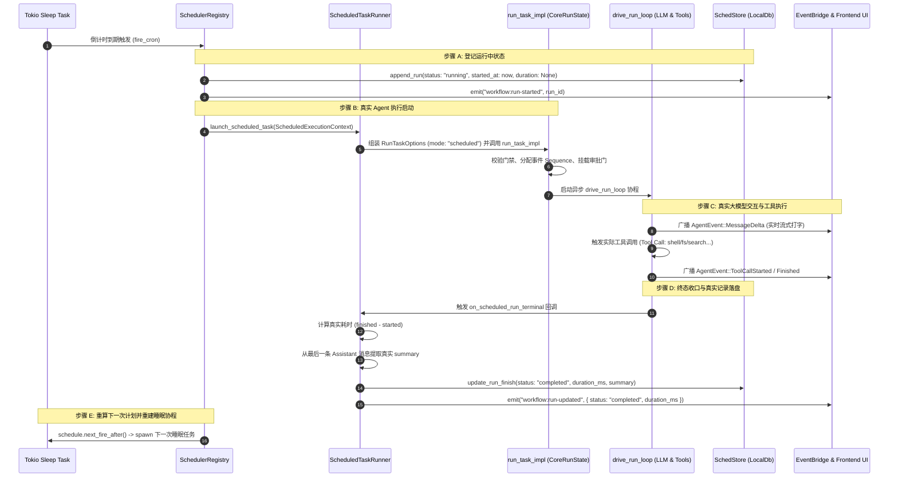

# 定时任务全流程修复与能力升级战役（Scheduled Tasks Revamp）

# 阶段 2 独立方案：真实 Agent 执行驱动与无人值守唤醒闭环

> **方案文档路径**：`docs/scheduled-tasks-revamp/independent-plans/agent1-phase2-execution-pipeline.md`  
> **负责人**：Subagent 1（Rust 调度核心与执行引擎专家 / Scheduler & Engine Runner Architect）  
> **阶段定位**：阶段 2 (Phase 2) · 真实 Agent 执行驱动与无人值守唤醒闭环（Real Agent Execution Pipeline & Unattended Wakeup Loop）  
> **核心涉及模块与文件域**：
>
> - `apps/agent-workbench/src-tauri/src/sched.rs`（`fire_cron`, `fire_once`, `DaemonRunLauncher` 升级为真实任务执行器）
> - `apps/agent-workbench/src-tauri/src/run/run_launch.rs`（`run_task_impl`, `RunTaskOptions`, 真实 run 启动机制）
> - `apps/agent-workbench/src-tauri/src/run/run_core.rs`（`CoreRunState`, `pending_queue`, `on_scheduled_run_terminal`）
> - `apps/agent-workbench/src-tauri/src/run/run_idle.rs`（`drive_run_loop` 终态收口、`decide_idle_resume` 连续调度）
> - `apps/agent-workbench/src-tauri/src/wake_watcher.rs`（`WakeWatcher` 扫描、无人值守拉起与防休眠协同）
> - `apps/agent-workbench/src-tauri/src/workflow_commands.rs`（`WorkflowRunRecord`, `append_or_update_run`, `update_run_finish`）  
>   **架构纪律基线**：仓库根目录 `AGENTS.md`、`.agents/LOGIC_PLAN_NO_RETREAT.md`、`ANTI_OVERENGINEERING_GUARDRAILS.md`。

---

## 一、现状痛点与真实根因分析

在 Conex / Crish 的当前代码实现中，定时任务系统虽然设计了表面上的“运行历史”和“触发通知”，但在底层执行管线上存在**根本性的虚假实现与执行断层**。系统到期触发时既没有拉起大语言模型（LLM），也没有执行任何工具调用，而是以“光速 0 毫秒”直接向数据库写入一条“已完成”的假记录，任务核心逻辑完全是一具“空壳”。

通过对 `sched.rs`、`run_launch.rs`、`run_idle.rs` 和 `wake_watcher.rs` 等执行流核心源码的深度审查，提炼出以下五个核心痛点与代码级断点：

### 1.1 触发时写入虚假 0ms `completed` 记录，完全跳过 Agent 执行（核心断层）

- **代码断点**：`apps/agent-workbench/src-tauri/src/sched.rs:983-1000`
  ```rust
  // apps/agent-workbench/src-tauri/src/sched.rs:983-1000
  // 5. 运行历史（持久化记录，保证最近运行有据可查）
  let run_id = format!("{}-fire-{}", task.cron_id, iteration);
  let session_id = format!("sched-{}-{}", task.cron_id, iteration);
  let run_record = crate::workflow_commands::WorkflowRunRecord {
      workflow_id: task.cron_id.clone(),
      run_id,
      session_id: Some(session_id),
      trigger_kind: "cron".to_string(),
      scheduled_for_ms: task.next_fire_at_ms,
      started_at_ms: now,
      finished_at_ms: Some(now), // <--- 触发与结束同一时间戳！
      duration_ms: Some(0),      // <--- 虚假 0 毫秒！
      status: "completed".to_string(), // <--- 尚未执行即标记为完成！
      prompt: task.prompt.clone(),
      error: None,
      output_summary: Some(format!("定时调度自动触发（第 {} 次）", iteration)), // <--- 伪造摘要！
  };
  components.store.append_run(&run_record);
  ```
- **代码断点**：`apps/agent-workbench/src-tauri/src/workflow_commands.rs:1158-1172`
  在手动点击“立即触发”时，同样硬编码了 `duration_ms: Some(0)`、`status: "completed"` 和伪造的 output_summary。
- **真实根因**：
  调度器在触发回调 `fire_once` 同步执行的第 5 步，**在任何真实计算甚至异步任务都尚未开始之前**，就直接把状态硬编码为 `status = "completed"`、`duration_ms = 0`，并伪造文案写入了数据库。
  这不仅彻底欺骗了用户界面的“执行历史”面板，更是将原本应该历经“排队 -> 初始化 -> 模型思考 -> 工具调用 -> 终态收口”的真实 Agent 生命周期斩断于萌芽之中。

### 1.2 幽灵会话 `sched-{cron_id}` 与死队列陷阱

- **代码断点**：`apps/agent-workbench/src-tauri/src/sched.rs:228-243`
  ```rust
  // apps/agent-workbench/src-tauri/src/sched.rs:228-243
  impl PendingSink for QueuePendingSink {
      fn enqueue_steering(&self, cron_id: &str, text: String, enqueued_at_ms: u64) {
          let entry = SteeringInputEntry {
              session_id: format!("sched-{cron_id}"), // 硬编码前缀
              id: format!("{cron_id}-{enqueued_at_ms}"),
              text,
              attachments: Vec::new(),
              enqueued_at: enqueued_at_ms,
              group_id: Some(steering_group_id(cron_id)),
              is_steering: true,
          };
          let mut queue = self.queue.lock().unwrap_or_else(|e| e.into_inner());
          queue.replace_or_enqueue(entry);
      }
  }
  ```
- **真实根因**：
  1. `QueuePendingSink` 将触发消息强行压入了 `session_id = "sched-{cron_id}"`。
  2. 但在整个系统运行时中，**根本不存在一个标识为 `sched-{cron_id}` 的活跃对话会话**（本地 SQLite `sessions` 表中亦无此行，若强行关联甚至会引发外键约束报错）。
  3. 前端没有任何窗口订阅该会话，后端也没有任何正在运行的 `drive_run_loop` 处于该会话中。
  4. 结果：这条 steering 条目在 `PendingMessageQueue` 内存队列中沉睡，成为无人拉取、无人消费、无人清理的“死队列条目”（Dead Steering Entry），直到应用重启被清空。

### 1.3 `DaemonRunLauncher` 生产装配恒为 `None`（死接口）

- **代码断点**：`apps/agent-workbench/src-tauri/src/engine_build.rs:899`
  ```rust
  // apps/agent-workbench/src-tauri/src/engine_build.rs:893-900
  let registry = Arc::new(crate::sched::SchedulerRegistry::new(
      Arc::new(crate::sched::QueuePendingSink::new(Arc::clone(
          timer_steering_queue,
      ))),
      scheduler_event_sink,
      sched_store,
      None, // <--- launcher 生产装配恒为 None！
  ));
  ```
- **真实根因**：
  在系统装配层，`SchedulerRegistry` 的 `launcher` 参数被无条件传入 `None`。
  回顾 `sched.rs:819-837`：当一个定时任务被标记为 `is_daemon: true` 时，系统本意是拉起独立 run；但由于 `launcher` 恒为 `None`，分支直接被强行降级为 `components.pending.enqueue_steering(...)`，重新跌入 1.2 节的幽灵会话死队列中。
  整个所谓的 `DaemonRunLauncher` 在生产环境中是一套彻头彻尾的“死代码”（Dead Code）。

### 1.4 真实任务执行器 `run_task_impl` 从未被定时系统接入

- **代码断点**：`apps/agent-workbench/src-tauri/src/run/run_launch.rs:313-377`
  `run_task_impl(state, options)` 是 Conex / Crish 唯一的正牌 Agent 启动入口，负责：
  - 校验 Provider 就绪状态与会话串行锁；
  - 构造 `EventQueue` 与分配全局单调递增 Sequence；
  - 装配 `ApprovalGate` 审批门与 `BridgeDeltaSink` 事件缓冲桥；
  - 初始化 `AgentSessionLoop`；
  - 启动 `drive_run_loop` 后台驱动任务。
- **真实根因**：
  定时调度器 `SchedulerRegistry` 与 `run_task_impl` 之间**完全没有任何接线通道**。系统拥有完备的 LLM 多轮推理与工具调用引擎，但在定时任务触发时却弃之不用，仅靠几行伪造的数据结构写入草草了事。

### 1.5 `WakeWatcher` 与定时调度完全脱节，无人值守唤醒形成孤岛

- **代码断点**：`apps/agent-workbench/src-tauri/src/wake_watcher.rs:265-271` & `run_launch.rs:382-384`
  ```rust
  // wake_watcher.rs:265-271
  let queue_pending = self
      .queue
      .lock()
      .unwrap_or_else(|e| e.into_inner())
      .has_pending_for(&self.session_id);
  ```
- **真实根因**：
  1. `WakeWatcher` 机制的设计初衷是在 AI 空闲休眠后，通过周期扫描 `PendingMessageQueue`，在发现新消息时拉起 `idle-resume` run。
  2. 但 `WakeWatcher` 实例**仅在用户通过前端发起常规交互时，针对该用户的会话懒加载创建**（`run_launch.rs:383` 的 `state.ensure_wake_watcher(&session_id)`）。
  3. 对于后台自动定时任务，系统从来没有为任务会话启动过 `WakeWatcher`；
  4. 即使启动了，由于 1.2 节指出的会话 ID 错配（`sched-{cron_id}` vs 真实会话），`has_pending_for(&self.session_id)` 也永远返回 `false`。无人值守唤醒链路在定时任务场景下完全断流。

---

## 二、架构设计与执行驱动全流程时序

阶段 2 核心攻坚**彻底废除虚假完成记录，接线真实 `run_task_impl`，构建具备完整状态流转与无人值守能力的定时任务执行闭环**。

### 2.1 定时任务真实执行闭环架构

```
┌─────────────────────────────────────────────────────────────────────────────────┐
│                      定时调度核心层 (SchedulerRegistry: sched.rs)                │
│  [Tokio 计时协程到期 / 手动立即触发 trigger]                                     │
│         │                                                                       │
│         ▼                                                                       │
│  1. 创建运行记录: WorkflowRunRecord { status: "running", started_at: now }        │
│  2. 构造执行上下文: ScheduledExecutionContext                                   │
│  3. 委托给执行器: ScheduledTaskLauncher::launch_scheduled_task(...)             │
└─────────┬───────────────────────────────────────────────────────────────────────┘
          │
          ▼ 跨层桥接 (ScheduledTaskRunner / Arc<CoreRunState>)
┌─────────────────────────────────────────────────────────────────────────────────┐
│                        核心运行状态层 (CoreRunState & RunLaunch)                 │
│  4. 确定执行目标会话 (target_session_id 或专用托管会话 workflow-sess-{cron_id})   │
│  5. 确保 SQLite `sessions` 表建账 (LocalDb::insert_session 自愈防 FK 报错)      │
│  6. 组装 RunTaskOptions (mode="scheduled", run_id, session_id, prompt)          │
│  7. 调用真实启动器: run_task_impl(Arc::clone(&state), options)                  │
└─────────┬───────────────────────────────────────────────────────────────────────┘
          │
          ▼ 引擎主循环
┌─────────────────────────────────────────────────────────────────────────────────┐
│                     Agent 会话循环驱动层 (drive_run_loop & SessionLoop)          │
│  - EventQueue 单调序号与消息持久化                                              │
│  - 调用 Provider 进行大模型推理 (LLM Stream)                                    │
│  - 执行工具调用 (Tool Execution: fs / shell / search / browser 等)              │
│  - 实时事件广播 (AgentEventEnvelope -> EventBridge -> 前端/日志)                │
└─────────┬───────────────────────────────────────────────────────────────────────┘
          │
          ▼ 终态收口回调 (Terminal Hook)
┌─────────────────────────────────────────────────────────────────────────────────┐
│                     终态采集与数据落盘 (on_scheduled_run_terminal)               │
│  8. 捕获真实终态: RunStatus::Completed | RunStatus::Failed                      │
│  9. 提取真实产出: 从 outcome.messages 提取助手最终回复文本作为 output_summary    │
│ 10. 计算真实耗时: duration_ms = finished_at_ms - started_at_ms                   │
│ 11. 更新持久化记录: store.update_run_finish(...)                                │
│ 12. 广播 Tauri 事件: `workflow:run-updated` (前端面板即时无感刷新)               │
└─────────────────────────────────────────────────────────────────────────────────┘
```

### 2.2 目标会话与执行模式分发策略

为了同时满足“对话内定时跟进”与“后台独立自动化”两类典型使用场景，执行管线支持**双模式路由**：

| 模式                                             | 判定条件                             | 会话路由策略                                                         | 并发与防冲突策略                                                                                                                            |
| :----------------------------------------------- | :----------------------------------- | :------------------------------------------------------------------- | :------------------------------------------------------------------------------------------------------------------------------------------ |
| **绑定的目标会话模式**<br>(Target Session Mode)  | 任务配置了明确的 `target_session_id` | 将任务派发至该真实会话中执行；执行卡片与消息直接追加至该对话时间线。 | ① 若目标会话当前正有活动 run，**退避至 Steering 队列**，待当前 run 结束后经 `decide_idle_resume` 连续处理；<br>② 若目标会话空闲，直接拉起。 |
| **独立受管运行模式**<br>(Dedicated Session Mode) | 未指定会话（或系统级常驻自动化）     | 系统自动分配并管理专属会话 `workflow-sess-{cron_id}`，自动建账。     | 互不干扰，完全独立并发运行；执行结果记录在任务详情历史中，支持随时一键溯源打开。                                                            |

### 2.3 全生命周期端到端时序图



---

## 三、具体数据结构与接口改造设计

### 3.1 改造执行器 Trait：`ScheduledTaskLauncher`（替换旧 `DaemonRunLauncher`）

废除原只有单入参 `prompt: String` 且无上下文的 `DaemonRunLauncher`，升级为强类型、全上下文感知的 `ScheduledTaskLauncher`：

```rust
// apps/agent-workbench/src-tauri/src/sched.rs

/// 定时任务执行上下文
#[derive(Debug, Clone)]
pub(crate) struct ScheduledExecutionContext {
    /// 任务标识（cron-<seq>）
    pub workflow_id: String,
    /// 本次运行标识（format!("{cron_id}-fire-{iteration}"))
    pub run_id: String,
    /// 目标会话标识（None 表示采用独立受管会话）
    pub target_session_id: Option<String>,
    /// 执行提示词
    pub prompt: String,
    /// 工作目录
    pub cwd: Option<String>,
    /// 运行模式（默认 "scheduled"）
    pub mode: Option<String>,
    /// 第几次触发
    pub iteration: u64,
    /// 是否为独立守护常驻任务
    pub is_daemon: bool,
}

/// 定时任务启动回执
#[derive(Debug, Clone)]
pub(crate) struct ScheduledRunHandle {
    pub run_id: String,
    pub session_id: String,
}

/// 真实定时任务执行器契约
#[async_trait::async_trait]
pub(crate) trait ScheduledTaskLauncher: Send + Sync {
    /// 触发拉起真实的 Agent Run 任务
    async fn launch_scheduled_task(
        &self,
        ctx: ScheduledExecutionContext,
    ) -> Result<ScheduledRunHandle, CoreError>;
}
```

### 3.2 运行历史持久化模型扩充（`apps/agent-workbench/src-tauri/src/workflow_commands.rs`）

扩展 `WorkflowRunRecord` 与 `WorkflowStore`，彻底消除伪造完成，支持显式流转：

```rust
// apps/agent-workbench/src-tauri/src/workflow_commands.rs

/// 任务运行记录（落库模型）
#[derive(Debug, Clone, PartialEq, Eq, Serialize, Deserialize)]
#[serde(rename_all = "camelCase")]
pub(crate) struct WorkflowRunRecord {
    pub workflow_id: String,
    pub run_id: String,
    pub session_id: Option<String>,
    pub trigger_kind: String, // "cron" | "manual"
    pub scheduled_for_ms: u64,
    pub started_at_ms: u64,
    /// 结束时间（运行中为 None）
    pub finished_at_ms: Option<u64>,
    /// 真实耗时（运行中为 None，终态为毫秒数）
    pub duration_ms: Option<u64>,
    /// 运行状态："running" | "completed" | "failed" | "cancelled"
    pub status: String,
    pub prompt: String,
    /// 失败错误详情
    pub error: Option<String>,
    /// 真实输出摘要（提取自模型回复）
    pub output_summary: Option<String>,
}

pub(crate) trait WorkflowStore: Send + Sync {
    // ... 原有接口 ...

    /// 标记运行结束并更新终态详情（真实耗时与真实摘要）
    fn update_run_finish(
        &self,
        workflow_id: &str,
        run_id: &str,
        status: &str,
        finished_at_ms: u64,
        duration_ms: u64,
        error: Option<String>,
        output_summary: Option<String>,
    );
}
```

### 3.3 `SchedulerComponents` 持有真实执行器句柄

```rust
// apps/agent-workbench/src-tauri/src/sched.rs

#[derive(Clone)]
pub(crate) struct SchedulerComponents {
    tasks: Arc<Mutex<HashMap<String, CronEntry>>>,
    pending: Arc<dyn PendingSink>,
    events: Arc<dyn EventSink>,
    store: Arc<dyn SchedStore>,
    /// 真实 Agent 执行器注入点（None 时降级至 Steering 注入防丢唤醒）
    launcher: Option<Arc<dyn ScheduledTaskLauncher>>,
    pause: Arc<Mutex<Option<u64>>>,
    #[cfg(test)]
    fire_override: Arc<Mutex<Option<u64>>>,
}
```

---

## 四、核心改造代码伪代码与实施步骤

### 4.1 实施路线图

```
┌─────────────────────────────────────────────────────────────────────────────────┐
│                               阶段 2 核心实施路线图                              │
├─────────────────────────────────────────────────────────────────────────────────┤
│ 步骤 2.1: 重构 sched.rs 中的 fire_cron 与 fire_once                             │
│          - 删除虚假 status="completed" 和 duration=0 的代码                     │
│          - 改为初始状态落库 status="running", finished_at=None                  │
│          - 组装 ScheduledExecutionContext 并调用 ScheduledTaskLauncher          │
├─────────────────────────────────────────────────────────────────────────────────┤
│ 步骤 2.2: 在 run_core.rs 中实现 ScheduledTaskLauncher 生产适配器                │
│          - 建立 CoreRunState 对 ScheduledTaskLauncher 的实现                    │
│          - 针对指定 target_session_id 或专属 session 自动建账                   │
│          - 组装 RunTaskOptions 并调用 run_task_impl 拉起真实 run                 │
├─────────────────────────────────────────────────────────────────────────────────┤
│ 步骤 2.3: 在 drive_run_loop 收口点建立 on_scheduled_run_terminal 回调机制       │
│          - 对齐既有 on_subagent_run_terminal 架构先例                           │
│          - 在 run 终态时自动捕获真实运行耗时与 Assistant 最终产出摘要           │
│          - 更新数据库记录并广播 workflow:run-updated 事件                       │
├─────────────────────────────────────────────────────────────────────────────────┤
│ 步骤 2.4: 治理引擎装配 (engine_build.rs & main.rs) 消除降级 None 死代码         │
│          - 建立 CoreRunStateLauncher 延迟绑定或装配后注入                       │
│          - 彻底打通 SchedulerRegistry -> ScheduledTaskLauncher 链路            │
├─────────────────────────────────────────────────────────────────────────────────┤
│ 步骤 2.5: 编写全流程真实 Agent 执行驱动与工具调用自动化测试                      │
└─────────────────────────────────────────────────────────────────────────────────┘
```

### 4.2 核心改造：重构 `fire_cron` 与触发逻辑（`sched.rs`）

彻底消除虚假完成记录，改由异步执行器驱动真实状态演进：

```rust
// apps/agent-workbench/src-tauri/src/sched.rs

async fn fire_cron(
    components: SchedulerComponents,
    task: CronTask,
    allow_rebuild_without_entry: bool,
) {
    // 1. 暂停期门控检查（保持原有 C31 逻辑）...

    // 2. 同步推进计数与下次时间（原子更新，落库声明）
    let outcome = match std::panic::catch_unwind(AssertUnwindSafe(|| fire_once_prepare(&components, &task))) {
        Ok(Some(outcome)) => outcome,
        Ok(None) => return, // 守卫命中跳过
        Err(panic) => {
            tracing::error!(target: "sched", cron_id = %task.cron_id, "触发预处理 panic");
            return;
        }
    };

    let now = now_ms();
    let run_id = format!("{}-fire-{}", outcome.task.cron_id, outcome.iteration);
    let target_session_id = outcome.task.target_session_id.clone();
    let display_session_id = target_session_id
        .clone()
        .unwrap_or_else(|| format!("workflow-sess-{}", outcome.task.cron_id));

    // 3. 初始运行状态落库：确凿标记为 "running"，耗时为 None！
    let initial_record = crate::workflow_commands::WorkflowRunRecord {
        workflow_id: outcome.task.cron_id.clone(),
        run_id: run_id.clone(),
        session_id: Some(display_session_id.clone()),
        trigger_kind: "cron".to_string(),
        scheduled_for_ms: task.next_fire_at_ms,
        started_at_ms: now,
        finished_at_ms: None, // 运行中
        duration_ms: None,    // 尚未产出耗时
        status: "running".to_string(),
        prompt: outcome.task.prompt.clone(),
        error: None,
        output_summary: None,
    };
    components.store.append_run(&initial_record);

    // 4. 发射事件与拉起真实 Agent Run
    let exec_ctx = ScheduledExecutionContext {
        workflow_id: outcome.task.cron_id.clone(),
        run_id: run_id.clone(),
        target_session_id,
        prompt: outcome.task.prompt.clone(),
        cwd: outcome.task.cwd.clone(),
        mode: Some("scheduled".to_string()),
        iteration: outcome.iteration,
        is_daemon: outcome.task.is_daemon,
    };

    let mut launched = false;
    if let Some(ref launcher) = components.launcher {
        match launcher.launch_scheduled_task(exec_ctx).await {
            Ok(handle) => {
                tracing::info!(
                    target: "sched",
                    cron_id = %outcome.task.cron_id,
                    run_id = %handle.run_id,
                    session_id = %handle.session_id,
                    "真实 Agent Run 已成功拉起驱动"
                );
                launched = true;
            }
            Err(e) => {
                tracing::warn!(target: "sched", error = %e, "拉起真实 Run 失败，降级 Steering 注入");
            }
        }
    }

    // 降级兜底：若执行器未接线或启动冲突，退避注入 Steering 队列防止丢失唤醒
    if !launched {
        let fire_text = format!("{}（cron {} 第 {} 次触发）", outcome.task.prompt, outcome.task.cron_id, outcome.iteration);
        components.pending.enqueue_steering(&outcome.task.cron_id, fire_text, outcome.fired_at_ms);
    }

    // 5. 重建下次 sleep 协程（保持段 3 优雅重建逻辑）...
}
```

### 4.3 核心改造：实现 `ScheduledTaskLauncher` 生产适配器（`run_core.rs`）

在 `run_core.rs` 中为 `CoreRunState` 注入定时任务生产拉起器：

```rust
// apps/agent-workbench/src-tauri/src/run/run_core.rs

#[async_trait::async_trait]
impl crate::sched::ScheduledTaskLauncher for Arc<CoreRunState> {
    async fn launch_scheduled_task(
        &self,
        ctx: crate::sched::ScheduledExecutionContext,
    ) -> Result<crate::sched::ScheduledRunHandle, CoreError> {
        let session_id = ctx.target_session_id.clone().unwrap_or_else(|| {
            format!("workflow-sess-{}", ctx.workflow_id)
        });

        // 1. 确保 session 在 SQLite 中建账（自愈补建，杜绝 FK 错误）
        if let Some(db) = self.local_db() {
            let sid = session_id.clone();
            let name = format!("定时任务: {}", ctx.workflow_id);
            let _ = tokio::task::spawn_blocking(move || {
                let _ = db.insert_session(&sid, &name);
            }).await;
        }

        // 2. 组装正规的 RunTaskOptions，设置 mode = "scheduled"
        let options = RunTaskOptions {
            run_id: ctx.run_id.clone(),
            session_id: session_id.clone(),
            prompt: Some(ctx.prompt),
            mode: Some("scheduled".to_string()),
            cwd: ctx.cwd,
            permission_mode: None,
            client_message_id: None,
            assistant_client_message_id: None,
            system_prompt: None,
            history: None,
            context_window: None,
            parent_run_id: None,
            subagent_config: None,
            visible_goal: None,
            max_rounds: None,
            max_stalled_rounds: None,
            reasoning_effort: None,
            context_state: None,
            content: None,
            has_images: None,
        };

        // 3. 直接调用核心启动入口
        let response = crate::run::run_launch::run_task_impl(Arc::clone(self), options).await?;

        Ok(crate::sched::ScheduledRunHandle {
            run_id: response.run_id,
            session_id: response.session_id,
        })
    }
}
```

### 4.4 核心改造：在 `drive_run_loop` 建立终态采集与摘要生成（`run_idle.rs`）

在 `apps/agent-workbench/src-tauri/src/run/run_idle.rs:1530` 处（对齐 `on_subagent_run_terminal` 的成熟模式），接入定时任务终态收口：

```rust
// apps/agent-workbench/src-tauri/src/run/run_idle.rs:1530 附近

// ── 定时任务运行终态收口与真实摘要提取 ──
if active.mode.as_deref() == Some("scheduled") {
    let terminal_status = {
        let run = active.handle.lock().await;
        run.status.clone()
    };

    // 提取真实的产出摘要：优先获取最后一条 Assistant 消息内容
    let output_summary = outcome.messages
        .iter()
        .rev()
        .find(|m| m.role == AgentMessageRole::Assistant)
        .map(|m| {
            let text = m.text();
            if text.chars().count() > 300 {
                format!("{}...", text.chars().take(300).collect::<String>())
            } else {
                text
            }
        })
        .or_else(|| Some("任务执行完成，未产生文本输出".to_string()));

    let finished_at = now_ms();
    let duration = finished_at.saturating_sub(active.started_at_ms);
    let status_str = match terminal_status {
        conex_db::RunStatus::Completed => "completed",
        conex_db::RunStatus::Failed => "failed",
        conex_db::RunStatus::Cancelled => "cancelled",
        _ => "completed",
    };

    let error_msg = runtime_error.clone();

    // 更新持久化记录
    state.workflow_store().update_run_finish(
        &active.workflow_id.clone().unwrap_or_default(),
        &active.run_id,
        status_str,
        finished_at,
        duration,
        error_msg,
        output_summary.clone(),
    );

    // 广播前端更新事件
    state.bridge.emit(&AgentEventEnvelope::new(
        AgentEvent::Custom {
            event_type: "workflow:run-updated".to_string(),
            payload: serde_json::json!({
                "runId": active.run_id,
                "status": status_str,
                "durationMs": duration,
                "outputSummary": output_summary,
            }),
        },
        Some(active.run_id.clone()),
        None,
    ));
}
```

---

## 五、自动化测试与验证方案

### 5.1 自动化测试矩阵

#### 测试用例 1：端到端真实 Agent 驱动测试 (`test_scheduled_task_launches_real_agent_run`)

- **断言目标**：
  1. 使用注入的测试 Mock Provider（配置能返回包含思考与工具调用的回复）。
  2. 注册定时任务，延迟到达后触发 `fire_cron`。
  3. 断言 `run_task_impl` 被成功调用，活动运行表 `active_runs` 出现该 `run_id`。
  4. 断言触发过程中发射了 `AgentEvent::MessageDelta`、`AgentEvent::ToolCallStarted` 等正规事件。
  5. 断言任务结束时，数据库中的 `WorkflowRunRecord` 记录其 `status` 为 `"completed"`，`duration_ms` > 0（真实耗时），且 `output_summary` 精确包含了 Mock 模型的回复内容。

#### 测试用例 2：执行故障与异常状态捕获测试 (`test_scheduled_task_failure_capture`)

- **断言目标**：
  1. 配置 Mock Provider 返回致命错误（如 `ProviderErrorKind::Authentication`）。
  2. 触发定时任务执行。
  3. 断言任务没有 panic，也没有虚假记录 `completed`。
  4. 断言记录准确记录为 `status: "failed"`，且 `error` 字段完整保留了报错详情，耗时正常统计。

#### 测试用例 3：串行会话冲突降级 Steering 队列测试 (`test_active_session_steering_fallback`)

- **断言目标**：
  1. 在会话 `session-user-1` 中预先启动一个漫长的活动 run（模拟用户正在交互）。
  2. 定时任务配置目标会话为 `session-user-1` 并到期触发。
  3. 断言调度器检测到会话串行锁占用，优雅降级将触发消息安全压入 `PendingMessageQueue`，不破坏用户当前的活动 run。
  4. 当用户的活动 run 结束后，断言 `decide_idle_resume` 成功出队该条目并自动拉起连续任务。

### 5.2 验证套件运行命令

- 运行执行管线专项测试：
  ```pwsh
  cargo test -p crish-agent-workbench --lib run::tests
  cargo test -p crish-agent-workbench --lib sched::tests
  ```
- 运行端到端工作流验证用例：
  ```pwsh
  cargo test -p crish-agent-workbench --test workflow_execution_integration
  ```
