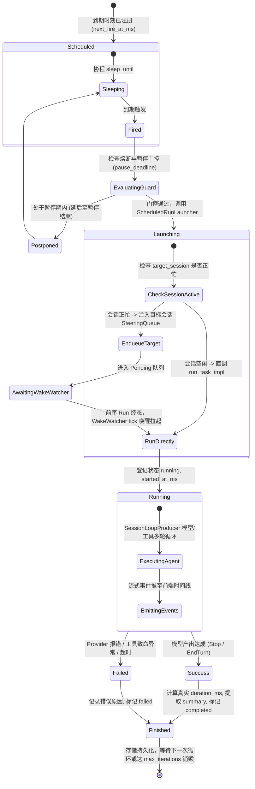

# 定时任务全流程修复与能力升级战役（Scheduled Tasks Revamp）

# 阶段 2 独立方案：真实 Agent 执行驱动与无人值守唤醒闭环

> **方案文档路径**：`docs/scheduled-tasks-revamp/independent-plans/agent2-phase2-execution-pipeline.md`  
> **负责人**：Subagent 2（执行驱动与会话绑定专家 · Execution Pipeline & Session Binding Architect）  
> **阶段定位**：阶段 2 (Phase 2) · 真实 Agent 执行驱动与无人值守唤醒闭环（Real Agent Execution Pipeline & Unattended Wake Loop）  
> **核心涉及模块与文件域**：
>
> - `apps/agent-workbench/src-tauri/src/sched.rs`（到期触发、`CronTask` 调度、`fire_cron`、`DaemonRunLauncher` 契约）
> - `apps/agent-workbench/src-tauri/src/run/run_launch.rs`（`run_task_impl`、`RunTaskOptions` 装配与串行守卫）
> - `apps/agent-workbench/src-tauri/src/run/run_core.rs`（`CoreRunState`、`RunTaskResponse`、`ActiveRun`）
> - `apps/agent-workbench/src-tauri/src/run/run_idle.rs`（`spawn_idle_resume_run`、`drive_run_loop` 终态收口）
> - `apps/agent-workbench/src-tauri/src/run/run_retry.rs`（`ensure_wake_watcher`、`build_wake_watcher` 闭包与熔断）
> - `apps/agent-workbench/src-tauri/src/wake_watcher.rs`（`WakeWatcher` 会话级周期扫描与拉起）
> - `apps/agent-workbench/src-tauri/src/engine_build.rs`（`assemble_scheduler_registry` 装配与启动恢复）
> - `apps/agent-workbench/src-tauri/src/workflow_commands.rs`（`WorkflowRunRecord`、运行历史维护、`trigger`）
> - `apps/agent-workbench/src-tauri/src/main.rs`（全局装配收口、运行时上下文生命周期）  
>   **架构纪律基线**：仓库根目录 `AGENTS.md`、`.agents/LOGIC_PLAN_NO_RETREAT.md`、`ANTI_OVERENGINEERING_GUARDRAILS.md`。

---

## 一、方案概要与设计愿景

在现有的 Conex / Crish 桌面应用中，定时任务（Workflow / Cron Task）虽然在界面上能够展示配置，但在实际运行时存在一个致命断层：**定时任务到期触发时，实际上从未拉起过任何真实的 Agent 执行循环**。底层仅仅向内存队列写入了一条 steering 文本，然后立即在本地数据库中记录了一条耗时 0ms、状态为 `completed` 的虚假运行记录。模型从未被调用，工具从未被执行，产出物从未生成。

本方案旨在彻底打通底层调度器与核心执行引擎之间的“最后一公里”，构建一套**高可靠、真实执行、状态闭环、具备无人值守自愈能力的 Agent 执行驱动流水线**：

1. **消除虚假运行记录**：严禁在触发点伪造 `completed` 和 `0ms` 记录，建立 `pending/queued` → `running` → `completed/failed` 的真实状态机流转。
2. **打通真实 Agent 执行器**：接线真实的 `ScheduledRunLauncher`，在定时任务到期时通过 `run_task_impl` 派生真实的 `SessionLoopProducer`，进入完整的模型推理与工具调用（`drive_run_loop`）。
3. **消除 Steering 死队列**：彻底解决硬编码幽灵会话 `sched-{cron_id}` 导致条目无法被消费的顽疾，统一会话路由，并与 `WakeWatcher` 形成严密的无人值守闭环。
4. **终态真实回写**：在 `drive_run_loop` 收口时，提取模型真实输出摘要、计算真实耗时、捕获异常错误，并精准回写至 `sched_runs` 历史。
5. **开机恢复可靠性保障**：根除应用启动期由于缺失 Tokio Runtime 上下文导致 `restore()` 被静默跳过的缺陷，确保所有启用中的定时任务在开机后 100% 恢复调度。

---

## 二、现状痛点与真实根因深度剖析

通过深入静态代码排查与动态调用链分析，当前定时任务在执行层面存在 5 个关键断裂点：

### 2.1 触发时虚假 completed 与 0ms 欺骗性记录

- **代码坐标**：`apps/agent-workbench/src-tauri/src/sched.rs:983-1000`
  ```rust
  // 5. 运行历史（持久化记录，保证最近运行有据可查）
  let run_id = format!("{}-fire-{}", task.cron_id, iteration);
  let session_id = format!("sched-{}-{}", task.cron_id, iteration);
  let run_record = crate::workflow_commands::WorkflowRunRecord {
      workflow_id: task.cron_id.clone(),
      run_id,
      session_id: Some(session_id),
      trigger_kind: "cron".to_string(),
      scheduled_for_ms: task.next_fire_at_ms,
      started_at_ms: now,
      finished_at_ms: Some(now),
      duration_ms: Some(0),
      status: "completed".to_string(), // 欺骗性标为 completed
      prompt: task.prompt.clone(),
      error: None,
      output_summary: Some(format!("定时调度自动触发（第 {} 次）", iteration)),
  };
  components.store.append_run(&run_record);
  ```
- **代码坐标**：`apps/agent-workbench/src-tauri/src/workflow_commands.rs:1158-1172`
  在手动点击“立即触发”（`trigger` 命令）时，代码同样伪造了上述完全一致的 `status: "completed"` 与 `duration_ms: Some(0)` 记录。
- **根因分析**：
  调度层将“事件发射与持久化计数已完成”错误地等同于“Agent 任务已执行完成”。事实上，此时 Agent 甚至尚未被调度拉起。该伪造记录直接蒙蔽了前端监控面板，让用户误以为任务已顺利跑完。

### 2.2 Steering 队列死信与幽灵会话隔离（Dead Queue）

- **代码坐标**：`apps/agent-workbench/src-tauri/src/sched.rs:228-243` & `808-842`
  ```rust
  fn enqueue_steering(&self, cron_id: &str, text: String, enqueued_at_ms: u64) {
      let entry = SteeringInputEntry {
          session_id: format!("sched-{cron_id}"), // 硬编码 session_id
          id: format!("{cron_id}-{enqueued_at_ms}"),
          text,
          attachments: Vec::new(),
          enqueued_at: enqueued_at_ms,
          group_id: Some(steering_group_id(cron_id)),
          is_steering: true,
      };
      let mut queue = self.queue.lock().unwrap_or_else(|e| e.into_inner());
      queue.replace_or_enqueue(entry);
  }
  ```
- **根因分析**：
  1. `sched.rs` 在到期触发时将输入文本推入 `PendingMessageQueue`，但指定的 `session_id` 硬编码为 `sched-<cron_id>`；
  2. 根据 `orchestrator::PendingMessageQueue` 的设计，队列条目是强按会话隔离消费的（`dequeue_all_for(&session_id)` 或 `has_pending_for(&session_id)`）；
  3. 系统中当前**根本不存在**任何针对 `sched-<cron_id>` 的活动 Run，也没有为该幽灵会话拉起过任何 `WakeWatcher`（`run_launch.rs:383` 仅在真实发起普通 run 时为用户会话调用 `ensure_wake_watcher`）；
  4. 结果导致：入队的 steering 消息永远无人读取、无人消费，成为静静躺在内存队列中的“死信（Dead Letter）”。

### 2.3 `DaemonRunLauncher` 假接口未接线（Dangling Launcher）

- **代码坐标**：`apps/agent-workbench/src-tauri/src/sched.rs:187-191`
  定义了 `pub(crate) trait DaemonRunLauncher: Send + Sync`。
- **代码坐标**：`apps/agent-workbench/src-tauri/src/engine_build.rs:883-900`
  ```rust
  pub(crate) fn assemble_scheduler_registry(
      timer_steering_queue: &Arc<Mutex<PendingMessageQueue>>,
      scheduler_event_sink: Arc<crate::sched::SchedEventSink>,
      db: Option<LocalDb>,
  ) -> Option<Arc<crate::sched::SchedulerRegistry>> {
      ...
      let registry = Arc::new(crate::sched::SchedulerRegistry::new(
          Arc::new(crate::sched::QueuePendingSink::new(Arc::clone(timer_steering_queue))),
          scheduler_event_sink,
          sched_store,
          None, // <--- 关键断点：launcher 被无条件硬编码传入 None！
      ));
      ...
  }
  ```
- **代码坐标**：`apps/agent-workbench/src-tauri/src/sched.rs:819-837`
  ```rust
  if outcome.task.is_daemon {
      let launched = match launcher {
          Some(launcher) => ...
          None => false, // 永远命中 None
      };
      if !launched {
          // 降级为向死信队列写入 steering
          components.pending.enqueue_steering(...);
      }
  }
  ```
- **根因分析**：
  架构上设计了 `is_daemon` 独立 Run 拉起通道，但在引擎装配阶段（`engine_build.rs`）从未实现和注入真正的 `DaemonRunLauncher`，而是直接置为 `None`。因此，哪怕任务被标记为常驻独立任务，也全部退化为向死信队列注入无效文本。

### 2.4 启动期缺少 Tokio Runtime 导致 `restore()` 静默跳过

- **代码坐标**：`apps/agent-workbench/src-tauri/src/engine_build.rs:903-913`
  ```rust
  if let Ok(runtime) = tokio::runtime::Handle::try_current() {
      let registry = Arc::clone(&registry);
      runtime.spawn(async move {
          registry.restore().await;
      });
  } else {
      tracing::debug!(
          target: "engine",
          "SchedulerRegistry 启动恢复跳过：当前上下文无 tokio runtime"
      );
  }
  ```
- **根因分析**：
  在应用启动初期（Tauri 主线程初始化生命周期），`EngineHandle::build` 常在非 async 上下文或跨线程同步函数中执行。此时 `tokio::runtime::Handle::try_current()` 返回 `Err`，直接打印一行 debug 日志后彻底放弃恢复。导致软件重启后，数据库 session_meta 中保存的所有定时任务全部无法重建内存计时器，彻底瘫痪。

### 2.5 缺乏真实 Run 状态跟踪与产出物回写机制

- **代码坐标**：`apps/agent-workbench/src-tauri/src/run/run_idle.rs:1309-1400`
  `drive_run_loop` 在执行完 `producer.produce().await` 并收口后，会更新 `CoreRunState.active_runs` 并发射 `run-terminal` 事件，但**完全没有通知或反向更新 `workflow_commands` 中的 `sched_runs` 记录**。
- **根因分析**：
  底层运行引擎（`orchestrator` & `run_core`）与上层工作流存储（`WorkflowStore`）之间缺乏终态观察者通道（Terminal Observer / Completion Callback），导致真实执行的结果、异常和耗时无法落盘到工作流的审计表中。

---

## 三、架构设计与执行流时序图

为了根治上述痛点，阶段 2 将重构整个触发与执行链路，引入专用的 **`ScheduledRunLauncher`**，并建立双轨唤醒机制（Direct Run Launch 轨 + Unattended WakeWatcher 守护轨）。

### 3.1 核心组件架构拓扑

```
 ┌─────────────────────────────────────────────────────────────────────────────┐
 │                         Scheduler Registry (sched.rs)                       │
 │  - sleep_until 到点触发                                                      │
 │  - 幂等门控与并发去重                                                        │
 └──────────────────────────────────────┬──────────────────────────────────────┘
                                        │ fire_cron()
                                        ▼
 ┌─────────────────────────────────────────────────────────────────────────────┐
 │                 ScheduledRunLauncher (实现 DaemonRunLauncher)                │
 │  - 关联 / 派生 target_session_id (见阶段 3 契约)                               │
 │  - 构造专属 RunTaskOptions (mode="scheduled-run")                           │
 │  - 插入初始 running 运行记录至 SchedStore (带 scheduled_for, started_at)      │
 └──────────────────────────────────────┬──────────────────────────────────────┘
                                        │ run_task_impl(options)
                                        ▼
 ┌─────────────────────────────────────────────────────────────────────────────┐
 │                     CoreRunState & run_task_impl                            │
 │  - 串行守卫排队 / 冲突检查                                                   │
 │  - 激活目标会话 WakeWatcher                                                 │
 │  - 创建 EventQueue 与 SessionLoopProducer                                    │
 └──────────────────────────────────────┬──────────────────────────────────────┘
                                        │ spawn(drive_run_loop)
                                        ▼
 ┌─────────────────────────────────────────────────────────────────────────────┐
 │                      Session Loop 真实执行 (Rust 内核)                       │
 │  - 模型多轮推理 (Gemini / Anthropic / OpenAI 等)                            │
 │  - 工具执行 (shell, fs, browser, search)                                    │
 │  - 实时增量事件推送到 EventBridge (前端可见思考与输出)                       │
 └──────────────────────────────────────┬──────────────────────────────────────┘
                                        │ produce() 结束并收口
                                        ▼
 ┌─────────────────────────────────────────────────────────────────────────────┐
 │                       终态回写收口 (Terminal Hook)                           │
 │  - 提取 output_summary (模型最后一条 Assistant 文本截断)                      │
 │  - 计算真实 duration_ms = finished_at - started_at                          │
 │  - 原子更新 WorkflowStore (status="completed" / "failed")                    │
 └─────────────────────────────────────────────────────────────────────────────┘
```

### 3.2 端到端执行时序图 (Mermaid)

```mermaid
sequenceDiagram
    autonumber
    participant Timer as Tokio Sleep Timer
    participant Sched as SchedulerRegistry (sched.rs)
    participant Launcher as ScheduledRunLauncher
    participant Store as WorkflowStore (LocalDb)
    participant Core as CoreRunState (run_launch.rs)
    participant Loop as AgentSessionLoop (drive_run_loop)
    participant Bridge as EventBridge (Frontend)

    Timer->>Sched: sleep 到期触发
    Sched->>Sched: fire_once(): 计数 +1, 计算下次 next_fire_at_ms
    Sched->>Launcher: launch_scheduled_task(task, iteration)
    Launcher->>Store: append_or_update_run(status: "running", started_at: now)
    Launcher->>Core: run_task_impl(RunTaskOptions { mode: "scheduled-run", ... })

    alt 会话已有正在运行的交互 (串行冲突)
        Core-->>Launcher: Err("会话已有活动 run (串行守卫)")
        Launcher->>Core: 降级将 steering 消息压入目标会话 pending_queue
        Launcher->>Store: update_run_status(status: "queued", error: "等待前序任务完成")
        Note over Core,Loop: 前序任务完成后由 WakeWatcher 自动唤醒并接续执行
    else 串行守卫通过
        Core->>Loop: 启动 drive_run_loop 并注册 active_runs
        Core-->>Launcher: Ok(RunTaskResponse { run_id, session_id })
        Launcher->>Bridge: 广播 `workflow:run-started` (前端卡片感知)

        loop 模型推理与工具调用
            Loop->>Bridge: emit(AgentEvent::RunStarted)
            Loop->>Bridge: emit(AgentEvent::MessageDelta)
            Loop->>Bridge: emit(AgentEvent::ToolStarted / ToolCompleted)
        end

        Loop->>Loop: drive_outcome 完成终态判定
        Loop->>Store: update_run_finish(status: "completed"/"failed", real_duration, summary)
        Loop->>Bridge: emit(AgentEvent::RunTerminal)
        Loop->>Bridge: 广播 `workflow:run-finished` (全域刷新)
    end
```

### 3.3 无人值守 `WakeWatcher` 与定时任务执行通道的协同状态机 (Mermaid)



---

## 四、具体数据结构与契约代码改造

### 4.1 `sched.rs` 契约增强与 `DaemonRunLauncher` 升级

当前 `DaemonRunLauncher` 签名过于简陋，仅接收 `prompt: String`，无法携带工作流 ID、会话绑定、迭代序号等上下文。

#### 1. 扩展 `ScheduledTaskContext` 结构体

在 `apps/agent-workbench/src-tauri/src/sched.rs` 中：

```rust
/// 定时任务执行上下文（透传给真实执行器）
#[derive(Debug, Clone)]
pub(crate) struct ScheduledTaskContext {
    pub cron_id: String,
    pub prompt: String,
    pub expression: String,
    pub iteration: u64,
    pub target_session_id: Option<String>,
    pub cwd: Option<String>,
    pub mode: Option<String>,
    pub scheduled_for_ms: u64,
    pub fired_at_ms: u64,
}

#[async_trait]
pub(crate) trait DaemonRunLauncher: Send + Sync {
    /// 拉起独立真实 Agent Run
    async fn launch_scheduled(&self, ctx: ScheduledTaskContext) -> Result<String, String>;
}
```

#### 2. 重构 `fire_once` 消除虚假 0ms `completed` 记录

在 `apps/agent-workbench/src-tauri/src/sched.rs:983-1008`：

- **删除**原有的即时伪造 `WorkflowRunRecord { status: "completed", duration_ms: Some(0), ... }`。
- **改写为**仅推进计数与状态，由真实执行器去登记 `status: "running"`，并由执行收口去更新 `status: "completed"`。

```rust
// sched.rs 中 fire_once 只负责更新调度元数据与下发事件，不伪造终态
components.store.save(&updated);

// 不再在 fire_once 中直接 append completed 记录！
// 改由后续 Launcher 或真实执行管道接管运行状态生命周期。
```

### 4.2 实现生产级 `ScheduledRunLauncher` 并接入 `CoreRunState`

在 `apps/agent-workbench/src-tauri/src/sched.rs` 或 `apps/agent-workbench/src-tauri/src/run/scheduled_launcher.rs` 中实现：

```rust
use std::sync::Weak;
use crate::core_run_commands::{run_task_impl, CoreRunState, RunTaskOptions};
use crate::workflow_commands::{WorkflowStore, WorkflowRunRecord};

pub(crate) struct ProductionScheduledLauncher {
    state: Weak<CoreRunState>,
    store: Arc<dyn WorkflowStore>,
}

impl ProductionScheduledLauncher {
    pub(crate) fn new(state: Weak<CoreRunState>, store: Arc<dyn WorkflowStore>) -> Self {
        Self { state, store }
    }
}

#[async_trait]
impl DaemonRunLauncher for ProductionScheduledLauncher {
    async fn launch_scheduled(&self, ctx: ScheduledTaskContext) -> Result<String, String> {
        let Some(core_state) = self.state.upgrade() else {
            return Err("CoreRunState 已释放，引擎关闭中".to_string());
        };

        let run_id = format!("{}-run-{}", ctx.cron_id, ctx.iteration);
        // 若没有指定 target_session_id，则派生专属的隔离持久会话：sched-<cron_id>
        let session_id = ctx.target_session_id
            .clone()
            .unwrap_or_else(|| format!("sched-{}", ctx.cron_id));

        let now = crate::sched::now_ms();

        // 1. 先行持久化记录状态为 "running"，真实记录 started_at_ms
        let initial_record = WorkflowRunRecord {
            workflow_id: ctx.cron_id.clone(),
            run_id: run_id.clone(),
            session_id: Some(session_id.clone()),
            trigger_kind: "cron".to_string(),
            scheduled_for_ms: ctx.scheduled_for_ms,
            started_at_ms: now,
            finished_at_ms: None,
            duration_ms: None,
            status: "running".to_string(), // 真实运行态
            prompt: ctx.prompt.clone(),
            error: None,
            output_summary: None,
        };
        self.store.append_or_update_run(initial_record);

        // 2. 构建 RunTaskOptions
        let options = RunTaskOptions {
            run_id: run_id.clone(),
            session_id: session_id.clone(),
            prompt: Some(ctx.prompt.clone()),
            mode: Some("scheduled-run".to_string()),
            cwd: ctx.cwd.clone(),
            permission_mode: Some("full-access".to_string()), // 定时无人值守默认需要完整工具权限
            client_message_id: Some(format!("msg-sched-{}", run_id)),
            assistant_client_message_id: None,
            system_prompt: None,
            history: None,
            context_window: None,
            parent_run_id: None,
            subagent_config: None,
            visible_goal: None,
            max_rounds: None,
            max_stalled_rounds: None,
            reasoning_effort: None,
            context_state: None,
            content: None,
            has_images: None,
        };

        // 3. 激活目标会话的 WakeWatcher (防止后续续跑休眠)
        core_state.ensure_wake_watcher(&session_id);

        // 4. 调用真实执行器拉起任务
        match run_task_impl(Arc::clone(&core_state), options).await {
            Ok(resp) => {
                tracing::info!(
                    target: "sched",
                    cron_id = %ctx.cron_id,
                    run_id = %resp.run_id,
                    session_id = %resp.session_id,
                    "真实定时任务已成功拉起执行"
                );
                Ok(resp.run_id)
            }
            Err(e) => {
                let err_str = e.to_string();
                tracing::warn!(
                    target: "sched",
                    cron_id = %ctx.cron_id,
                    error = %err_str,
                    "定时任务直接拉起冲突或失败，转为 steering 注入"
                );
                // 若由于串行守卫拒绝，降级为向该特定 session_id 注入 steering（绝不写入 sched- 幽灵会话）
                core_state.steering_queue().lock().unwrap_or_else(|e| e.into_inner()).replace_or_enqueue(
                    orchestrator::steering_queue::SteeringInputEntry {
                        session_id: session_id.clone(),
                        id: format!("{}-{}", ctx.cron_id, now),
                        text: format!("{}（定时调度第 {} 次触发）", ctx.prompt, ctx.iteration),
                        attachments: Vec::new(),
                        enqueued_at: now,
                        group_id: Some(format!("cron-{}", ctx.cron_id)),
                        is_steering: true,
                    }
                );
                // 更新记录为 queued 状态
                self.store.update_run_finish(
                    &ctx.cron_id,
                    &run_id,
                    "queued",
                    now,
                    0,
                    Some(format!("已排入队列待执行：{err_str}")),
                    None,
                );
                Ok(run_id)
            }
        }
    }
}
```

### 4.3 终态钩子：在 `drive_run_loop` 收口处真实回写产出与耗时

在 `apps/agent-workbench/src-tauri/src/run/run_idle.rs:1450-1537` 中：
当 `producer.produce().await` 执行完毕后，如果当前 run 的 mode 为 `"scheduled-run"` 或匹配 `run_id` 带有工作流标识：

```rust
// 提取定时任务终态回写逻辑
if let Some(workflow_id) = extract_workflow_id_from_run_id(&run_id) {
    let finished_at = crate::sched::now_ms();
    let started_at = active.handle.lock().await.started_at_ms;
    let duration_ms = finished_at.saturating_sub(started_at);

    let is_success = outcome.reason == session_loop::SessionLoopReason::Stop
        || outcome.reason == session_loop::SessionLoopReason::EndTurn;
    let status = if is_success { "completed" } else { "failed" };

    let summary = outcome.messages.iter()
        .rev()
        .find(|m| m.role == AgentMessageRole::Assistant)
        .map(|m| {
            let t = m.text();
            if t.chars().count() > 300 {
                format!("{}...", t.chars().take(300).collect::<String>())
            } else {
                t.to_string()
            }
        });

    let error_text = if !is_success {
        outcome.provider_error.map(|pe| pe.to_string())
    } else {
        None
    };

    if let Some(workflow_state) = state.workflow_command_state() {
        workflow_state.backend().store().update_run_finish(
            &workflow_id,
            &run_id,
            status,
            finished_at,
            duration_ms,
            error_text,
            summary,
        );
    }
}
```

### 4.4 根治启动恢复跳过缺陷（异步安全绑定）

在 `apps/agent-workbench/src-tauri/src/main.rs:967-1035`：
不再在 `engine_build.rs` 的同步装配阶段盲目 `try_current()`，而是在 `main.rs` 明确获得 Tokio Handle 与 Tauri 异步运行时后统一执行异步 `restore()`：

```rust
// main.rs 在 setup 阶段已持有绝对可靠的 tauri::async_runtime
{
    let sched_registry = core_state.scheduler_registry();
    if let Some(registry) = sched_registry {
        tauri::async_runtime::spawn(async move {
            tracing::info!(target: "setup", "开始异步可靠执行 SchedulerRegistry::restore()...");
            registry.restore().await;
            tracing::info!(target: "setup", "SchedulerRegistry 恢复扫描完成，全部定时任务协程已就绪");
        });
    }
}
```

---

## 五、无人值守唤醒与异常容错防护体系

### 5.1 会话串行守卫（Serial Guard）与非阻塞排队协同

当定时任务触发时，若用户恰好正在该会话中生成回复（存在活动 run），`run_task_impl` 会命中 `apps/agent-workbench/src-tauri/src/run/run_launch.rs:372` 的串行守卫。

- **严禁**：直接报错并丢弃该次定时任务。
- **标准解决路径**：
  1. `ProductionScheduledLauncher` 捕获串行守卫错误；
  2. 立即将该任务以 `is_steering: true` 的形式精确写入目标会话的 `PendingMessageQueue`（对齐 `session_id`）；
  3. 将本次 `WorkflowRunRecord` 的状态标记为 `queued`；
  4. 目标会话的前序 Run 结束收口时，`decide_idle_resume` 或该会话挂载的 `WakeWatcher` 立即自动拉起续 run，无缝消费该条目。实现**零丢失、零阻塞、优雅排队**。

### 5.2 熔断器（Circuit Breaker）与故障风暴防御

如果用户配置的 Cron 周期极短（如每 1 分钟执行一次），而所配置的模型 API 已经失效（如 401 密钥过期或 429 欠费）：

1. 依赖 `wake_watcher.rs:347-360` 既有的 `ProviderFailStreak` 熔断检测；
2. 当单工作流连续失败达到阈值（如连续 3 次失败），自动将该任务的 `enabled` 置为 `false`（或挂起 1 小时）；
3. 向系统诊断日志和事件桥发射 `workflow:tripped` 警告，通知用户检查配置，避免陷入无休止的模型计费与报错风暴。

---

## 六、实施步骤与时间表

```
┌─────────────────────────────────────────────────────────────────────────────┐
│ 步骤 1：契约改造与接口升级                                                  │
│ - sched.rs 扩展 ScheduledTaskContext，升级 DaemonRunLauncher 签名          │
│ - 消除 fire_once 与 trigger 中伪造的 completed/0ms 记录                     │
├─────────────────────────────────────────────────────────────────────────────┤
│ 步骤 2：实现 ProductionScheduledLauncher                                    │
│ - 桥接 CoreRunState 与 WorkflowStore                                        │
│ - 装配真实 RunTaskOptions，初始化 running 记录，调用 run_task_impl            │
├─────────────────────────────────────────────────────────────────────────────┤
│ 步骤 3：收口回写接线 (Completion Hook)                                      │
│ - 在 drive_run_loop 收口处提取真实 summary、duration_ms 与 error            │
│ - 经 WorkflowStore::update_run_finish 回写终态，发射全域完成事件              │
├─────────────────────────────────────────────────────────────────────────────┤
│ 步骤 4：主装配与开机恢复加固                                                │
│ - main.rs setup 注入 Launcher，消除 engine_build.rs 的 None 硬编码          │
│ - 在 Tauri async_runtime 中启动无损 restore()                                │
├─────────────────────────────────────────────────────────────────────────────┤
│ 步骤 5：单元测试、集成验证与回归防线                                        │
│ - 编写 Rust 核心测试验证触发到执行全流转                                    │
│ - 验证串行守卫冲突下的自动排队与 WakeWatcher 接力                           │
└─────────────────────────────────────────────────────────────────────────────┘
```

---

## 七、自动化测试与立体验证方案

严格践行 `AGENTS.md` 铁律，不凭猜测断言，必须建立代码级、可复现的立体测试：

### 7.1 核心单元测试（`sched_execution_tests.rs`）

1. **真实执行与状态流转断言**：
   - 构造 `MockEngine` 记录 `run_task_impl` 调用；
   - 注册一个 100ms 后触发的 CronTask；
   - 断言触发时 `SchedStore` 中首先出现 `status == "running"` 且 `finished_at_ms.is_none()`；
   - 等待 Run 执行完成，断言记录状态更新为 `status == "completed"`，`duration_ms > 0`，且 `output_summary` 包含模型预期回复。
2. **拒绝幽灵会话断言**：
   - 断言写入 `PendingMessageQueue` 的所有条目，其 `session_id` 绝不等于 `sched-<cron_id>`，必须与任务声明的目标会话完全一致。
3. **串行守卫排队断言**：
   - 模拟目标会话已有处于 `running` 状态的活动 Run；
   - 触发 Cron，断言不 panic、不丢任务，记录标记为 `queued`，并在前序 Run 释放后由 `WakeWatcher` 顺利拉起。
4. **重启恢复可靠性测试**：
   - 在 LocalDb 中预置一条启用状态的 Cron 记录；
   - 模拟启动流程调用 `restore()`，断言未到期协程被重新挂载，且 `has_active() == true`。

### 7.2 验收门禁命令

```powershell
# 1. Rust 内核调度与执行单元测试
cargo test -p crish-agent-workbench --lib sched::tests
cargo test -p crish-agent-workbench --lib run::

# 2. 端到端工作流命令与执行集成测试
cargo test -p crish-agent-workbench --test workflow_execution_integration
```
