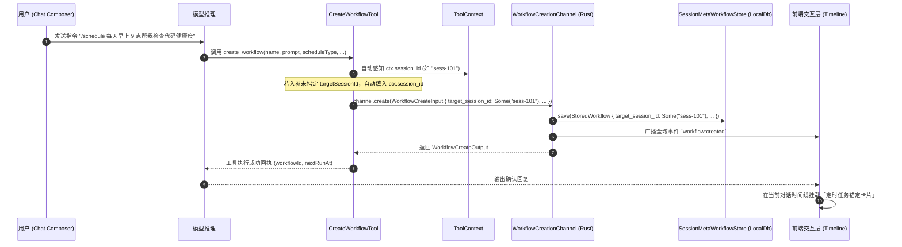
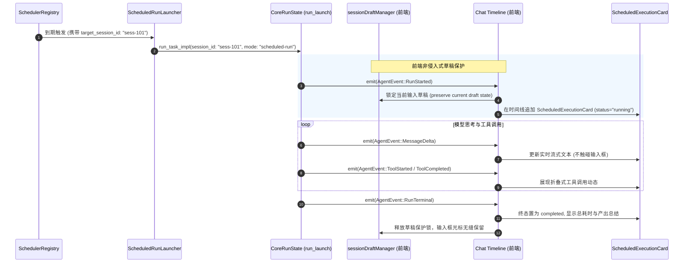

# 定时任务全流程修复与能力升级战役（Scheduled Tasks Revamp）

# 阶段 3 独立方案：目标会话绑定与对话内自动化定时任务能力

> **方案文档路径**：`docs/scheduled-tasks-revamp/independent-plans/agent2-phase3-session-workflow.md`  
> **负责人**：Subagent 2（执行驱动与会话绑定专家 · Execution Pipeline & Session Binding Architect）  
> **阶段定位**：阶段 3 (Phase 3) · 目标会话绑定与对话内自动化定时任务能力（Target Session Binding & In-Conversation Scheduled Automation）  
> **核心涉及模块与文件域**：
>
> - `apps/agent-workbench/src-tauri/src/workflow_commands.rs`（`StoredWorkflow` 结构体、IPC 接口、会话持久化与事件通知）
> - `crates/agent-tools/src/tools/create_workflow.rs`（`CreateWorkflowTool`、`WorkflowCreateInput`、会话上下文自动感知）
> - `crates/agent-tools/src/context.rs`（`ToolContext.session_id` 注入与安全传递）
> - `apps/agent-workbench/src-tauri/src/sched.rs`（调度条目与目标会话路由）
> - `apps/crish-desktop/src/components/chat-card/`（`ChatCard`、`useChatInput`、时间线卡片接入）
> - `apps/crish-desktop/src/api/draft/sessionDraftManager.ts`（草稿保护机制、非侵入式消息追加）
> - `apps/crish-desktop/src/api/workflow-api/`（`workflowAssistantCard.ts`、`workflowConfirm.ts`、`workflowRunner.ts`）
> - `apps/crish-desktop/src/components/workflow-confirm/WorkflowConfirmCard.tsx`（对话内确认卡片扩展）  
>   **架构纪律基线**：仓库根目录 `AGENTS.md`、`.agents/LOGIC_PLAN_NO_RETREAT.md`、`ANTI_OVERENGINEERING_GUARDRAILS.md`。

---

## 一、现状痛点与真实根因深度分析

在现有的 Conex / Crish 桌面客户端中，定时任务（Workflow）与用户正在进行的对话会话（Chat Session）之间存在一条无法逾越的“数据断层”：**用户在特定对话内请求 Agent 建立定时任务，但该任务创建后无法绑定回原对话，执行时也无法在原对话中呈现任何动态思考与产出。**

### 1.1 现状痛点与代码级断点

#### 痛点 1：数据持久化结构与契约中会话绑定字段全链路缺失

- **代码坐标**：`apps/agent-workbench/src-tauri/src/workflow_commands.rs:275-301`
  ```rust
  pub(crate) struct StoredWorkflow {
      pub cron_id: String,
      pub expression: String,
      pub prompt: String,
      pub max_iterations: Option<u64>,
      pub is_daemon: bool,
      pub next_fire_at_ms: u64,
      pub fired_count: u64,
      pub enabled: bool,
      pub name: String,
      pub cwd: Option<String>,
      pub mode: Option<String>,
      pub schedule: WorkflowScheduleWire,
      pub created_at_ms: u64,
      pub updated_at_ms: u64,
      pub last_run_at_ms: Option<u64>,
      // 致命断点：没有任何记录该任务目标归属会话的字段！
  }
  ```
- **代码坐标**：`apps/crish-desktop/src/api/workflow-api/workflowRunner.ts:21-34`
  前端的 TypeScript 类型定义 `WorkflowDefinition` 与 `WorkflowWire` 中同样完全缺失 `targetSessionId` / `targetMode` 属性。
- **根因分析**：
  从 Rust 存储层（`session_meta` 的 `sched_<cron_id>` 键）到 IPC 传输层，整个数据协议从未对“执行结果向哪个会话输出”进行建模。

#### 痛点 2：工具执行器显式忽视 `ToolContext` 中的会话标识

- **代码坐标**：`crates/agent-tools/src/tools/create_workflow.rs:219-255`
  ```rust
  async fn execute(&self, _ctx: &ToolContext, args: Value) -> Result<Value, ToolError> {
      // 致命断点：_ctx 被前置下划线显式忽略！
      let name = super::require_string(&args, "name")?;
      let prompt = super::require_string(&args, "prompt")?;
      ...
      let output = channel.create(WorkflowCreateInput {
          name, prompt, schedule_type, daily_time, interval_minutes, cron_expression, cwd, enabled,
          // 致命断点：无法将当前会话 ID 透传给引擎！
      }).await...
  }
  ```
- **根因分析**：
  `crates/agent-tools/src/context.rs:123` 中原本已经存在完备的 `pub session_id: String` 字段。但在 `CreateWorkflowTool` 实现中，直接使用了 `_ctx` 忽略了该上下文，同时 `WorkflowCreateInput` 与工具 Schema 也未提供 `target_session_id` 字段，导致 AI 在当前会话执行工具注册任务时，对自身所在的宿主会话完全“失明”。

#### 痛点 3：触发路由硬编码幽灵会话 `sched-{cron_id}`，导致跨会话队列彻底失联

- **代码坐标**：`apps/agent-workbench/src-tauri/src/sched.rs:231` & `apps/agent-workbench/src-tauri/src/workflow_commands.rs:659`
  ```rust
  let entry = SteeringInputEntry {
      session_id: format!("sched-{cron_id}"), // 硬编码幽灵会话
      id: format!("{cron_id}-{enqueued_at_ms}"),
      text,
      ...
  };
  ```
- **根因分析**：
  由于缺乏 `target_session_id` 记录，调度层只能捏造一个 `sched-<cron_id>` 假会话。而当前正在与用户交互的 `session_id` 永远无法匹配该条目。用户无法在自己的对话中感知任何任务触发。

#### 痛点 4：缺乏非侵入式流式呈现机制，容易冲刷用户未提交的草稿

- **代码坐标**：`apps/crish-desktop/src/components/chat-card/useChatInput.ts:50-110`
  用户在对话窗口中可能正在输入长篇 Prompt 或修改草稿。如果后台定时任务直接向当前激活会话强行注入消息或重置状态，会导致：
  1. 输入框焦点丢失；
  2. `sessionDraftManager` 中的未提交草稿被意外覆盖或提前发送；
  3. 用户正在交互的上下文与定时触发的汇报混杂在一起，造成视觉污染与语义混乱。

---

## 二、架构设计与会话绑定双模模型

为了满足不同场景下的使用需求，本方案设计了**会话绑定双模模型（Dual-Mode Session Target Model）**：

```
                                  ┌───────────────────────────────┐
                                  │      用户创建定时任务请求      │
                                  └───────────────┬───────────────┘
                                                  │
                                                  ▼
                                 ┌─────────────────────────────────┐
                                 │      会话目标模式 (target_mode)  │
                                 └────────┬───────────────┬────────┘
                                          │               │
                 ┌────────────────────────┘               └────────────────────────┐
                 ▼                                                                 ▼
 ┌───────────────────────────────┐                                 ┌───────────────────────────────┐
 │ 模式 A: 当前会话绑定 (Bound)  │                                 │ 模式 B: 独立专用会话 (Isolated)│
 │ target_session_id = Some(sid) │                                 │ target_session_id = None      │
 └───────────────┬───────────────┘                                 └───────────────┬───────────────┘
                 │                                                                 │
                 ▼                                                                 ▼
 ┌───────────────────────────────┐                                 ┌───────────────────────────────┐
 │ 运行于当前宿主会话:           │                                 │ 运行于独立专用会话:           │
 │ - 继承当前项目与上下文        │                                 │ - 独立会话ID: sched-<cron_id> │
 │ - 追加 ScheduledTaskCard      │                                 │ - 不打扰任何正在工作的对话   │
 │ - 非侵入式草稿保护隔离        │                                 │ - 侧边栏专属归档展示          │
 └───────────────────────────────┘                                 └───────────────────────────────┘
```

1. **当前会话绑定模式（Bound Session Mode，默认）**：
   - 适用场景：针对当前项目进行的日常检查、PR 跟踪、特定研究报告的持续追加。
   - 行为特征：任务到期时，执行流直接定位至绑定的 `target_session_id`。在会话时间线末尾追加定时执行卡片，展示思考过程和工具调用；草稿管理器（`sessionDraftManager`）被严格隔离，绝不影响用户当前在输入框中的键入内容。
2. **独立专用会话模式（Isolated Session Mode）**：
   - 适用场景：系统级日常维护、全局资讯抓取、跨项目的独立巡检。
   - 行为特征：系统自动分配/复用专用的独立会话（例如 `sched-sess-<cron_id>`），在独立的对话流中执行，用户可在侧边栏或通过任务面板一键跳转查阅。

---

## 三、端到端时序图与执行流

### 3.1 对话内创建并绑定当前会话时序图 (Mermaid)



### 3.2 到期触发时在目标会话内的流式呈现时序图 (Mermaid)



---

## 四、具体数据结构与契约代码级改造

### 4.1 Rust 数据结构改造 (`workflow_commands.rs`)

#### 1. `StoredWorkflow` 增加 `target_session_id` 与 `target_mode`

在 `apps/agent-workbench/src-tauri/src/workflow_commands.rs:275-301`：

```rust
#[derive(Debug, Clone, Serialize, Deserialize)]
#[serde(rename_all = "camelCase")]
pub(crate) struct StoredWorkflow {
    // ── 既有字段保持向后兼容 ──
    pub cron_id: String,
    pub expression: String,
    pub prompt: String,
    pub max_iterations: Option<u64>,
    pub is_daemon: bool,
    pub next_fire_at_ms: u64,
    pub fired_count: u64,
    pub enabled: bool,
    pub name: String,
    pub cwd: Option<String>,
    pub mode: Option<String>,
    pub schedule: WorkflowScheduleWire,
    pub created_at_ms: u64,
    pub updated_at_ms: u64,
    pub last_run_at_ms: Option<u64>,

    // ── 阶段 3 新增会话绑定扩展字段 ──
    /// 绑定的目标会话 ID（Some = 绑定到特定会话；None = 独立专用会话）
    #[serde(default, skip_serializing_if = "Option::is_none")]
    pub target_session_id: Option<String>,
    /// 会话绑定模式："current"（当前对话）| "isolated"（独立会话）| "custom"（指定会话）
    #[serde(default = "default_target_mode")]
    pub target_mode: String,
}

fn default_target_mode() -> String {
    "current".to_string()
}
```

#### 2. `WorkflowView` 与 `WorkflowPatch` 契约增强

```rust
#[derive(Debug, Clone, Serialize)]
#[serde(rename_all = "camelCase")]
pub(crate) struct WorkflowView {
    pub id: String,
    pub name: String,
    pub prompt: String,
    pub cwd: Option<String>,
    pub mode: Option<String>,
    pub enabled: bool,
    pub schedule: WorkflowScheduleWire,
    pub created_at: String,
    pub updated_at: String,
    pub next_run_at: Option<String>,
    pub last_run_at: Option<String>,
    // 阶段 3 新增输出
    pub target_session_id: Option<String>,
    pub target_mode: String,
}

#[derive(Default, Deserialize)]
#[serde(rename_all = "camelCase")]
pub(crate) struct WorkflowPatch {
    pub name: Option<String>,
    pub prompt: Option<String>,
    pub schedule: Option<WorkflowScheduleWire>,
    pub cwd: Option<String>,
    pub mode: Option<String>,
    pub enabled: Option<bool>,
    // 阶段 3 新增更新支持
    pub target_session_id: Option<String>,
    pub target_mode: Option<String>,
}
```

### 4.2 `create_workflow` 工具增强与会话感知 (`crates/agent-tools`)

#### 1. `WorkflowCreateInput` 增加会话绑定参数

在 `crates/agent-tools/src/tools/create_workflow.rs:75-93`：

```rust
#[derive(Debug, Clone)]
pub struct WorkflowCreateInput {
    pub name: String,
    pub prompt: String,
    pub schedule_type: String,
    pub daily_time: Option<String>,
    pub interval_minutes: Option<u64>,
    pub cron_expression: Option<String>,
    pub cwd: Option<String>,
    pub enabled: Option<bool>,
    // 阶段 3 新增
    pub target_session_id: Option<String>,
    pub target_mode: Option<String>,
}
```

#### 2. 工具 Schema 扩展与 `ToolContext` 自动感知

在 `crates/agent-tools/src/tools/create_workflow.rs:180-256`：

```rust
// 1. JSON Schema 增加 targetSessionId 与 targetMode 定义
"targetSessionId": {
    "type": "string",
    "description": "目标会话 ID（可选；缺省自动绑定当前会话）"
},
"targetMode": {
    "type": "string",
    "enum": ["current", "isolated"],
    "description": "目标执行模式（可选，缺省 current）：current 绑定当前对话；isolated 运行于独立后台会话"
}

// 2. execute 实现：消除 _ctx 忽略，主动读取当前会话！
async fn execute(&self, ctx: &ToolContext, args: Value) -> Result<Value, ToolError> {
    let name = super::require_string(&args, "name")?;
    let prompt = super::require_string(&args, "prompt")?;
    let schedule_type = super::optional_string(&args, "scheduleType")
        .unwrap_or_else(|| SCHEDULE_TYPE_MANUAL.to_string());

    // 智能会话归属决策：
    // 若模型显式传入 targetSessionId，优先尊重；
    // 否则自动感知当前执行上下文 ctx.session_id！
    let explicit_target = super::optional_string(&args, "targetSessionId");
    let target_mode = super::optional_string(&args, "targetMode")
        .unwrap_or_else(|| "current".to_string());

    let target_session_id = if target_mode == "isolated" {
        None
    } else {
        explicit_target.or_else(|| {
            if ctx.session_id.is_empty() {
                None
            } else {
                Some(ctx.session_id.clone())
            }
        })
    };

    let output = channel.create(WorkflowCreateInput {
        name,
        prompt,
        schedule_type,
        daily_time: super::optional_string(&args, "dailyTime"),
        interval_minutes: super::optional_u64(&args, "intervalMinutes"),
        cron_expression: super::optional_string(&args, "cronExpression"),
        cwd: super::optional_string(&args, "cwd"),
        enabled: super::optional_bool(&args, "enabled"),
        target_session_id,
        target_mode: Some(target_mode),
    }).await.map_err(|e| ToolError::new(e.code(), e.message()))?;
    ...
}
```

### 4.3 前端类型与 API 改造 (`apps/crish-desktop`)

#### 1. `workflowRunner.ts` 类型升级

在 `apps/crish-desktop/src/api/workflow-api/workflowRunner.ts`：

```typescript
export type WorkflowDefinition = {
  id: string;
  name: string;
  prompt: string;
  cwd?: string;
  mode?: string;
  enabled?: boolean;
  schedule?: WorkflowSchedule;
  createdAt?: string;
  updatedAt?: string;
  nextRunAt?: string;
  lastRunAt?: string;
  targetSessionId?: string;
  targetMode?: 'current' | 'isolated' | 'custom';
  [key: string]: unknown;
};
```

#### 2. `workflowConfirm.ts` 与确认卡片参数透传

在 `apps/crish-desktop/src/api/workflow-api/workflowConfirm.ts`：

```typescript
export interface WorkflowConfirmPayload {
  name: string;
  prompt: string;
  scheduleType: 'manual' | 'daily' | 'intervalMinutes' | 'cron';
  dailyTime?: string;
  intervalMinutes?: number;
  cronExpression?: string;
  cwd?: string;
  enabled?: boolean;
  targetSessionId?: string;
  targetMode?: 'current' | 'isolated';
}
```

当用户在对话中通过自然语言对齐并点击确认时，`registerWorkflowFromGrillMe` 会自动将当前处于激活状态的 `activeSessionId` 作为 `targetSessionId` 下发给后端。

---

## 五、对话内流式呈现机制与草稿防冲刷保障

在目标会话中呈现定时任务执行流，最大的技术挑战在于：**如何既让用户清晰感知任务的流式进展，又绝对不打乱用户当前的输入草稿与交互视口。**

### 5.1 专用对话呈现卡片：`ScheduledTaskExecutionCard`

在对话时间线中，定时任务的触发不以普通用户消息的形式插队，而是以结构化的**定时任务执行卡片（Scheduled Task Execution Card）**呈现：

```
┌─────────────────────────────────────────────────────────────────────────────┐
│ ⏰ 定时任务触发 · 每日代码体检 (第 12 次)              [运行中...] 2026-10-12 09:00 │
├─────────────────────────────────────────────────────────────────────────────┤
│ 💡 任务指令：git pull 检查最近提交并运行单元测试门禁                          │
├─────────────────────────────────────────────────────────────────────────────┤
│ ▾ Agent 思考与执行细节 (点击折叠)                                           │
│   > 正在拉取远程分支 origin/main...                                         │
│   > 执行工具：shell(cargo test --workspace)                                 │
│   > 测试通过：73 套件全绿，零回归。                                         │
├─────────────────────────────────────────────────────────────────────────────┤
│ 📋 执行结论：本日代码库处于健康状态，未检测到回归隐患。                       │
└─────────────────────────────────────────────────────────────────────────────┘
```

- **数据隔离**：卡片内部维护专属的 `runId` 事件流，消息归属于 `sender: 'assistant'` 且元数据中标记 `metadata.kind = 'scheduled-task-execution'`。
- **状态感知**：动态响应 `AgentEvent::RunStarted`、`MessageDelta`、`ToolStarted`、`ToolCompleted`、`RunTerminal`。

### 5.2 草稿保护与交互防冲刷机制（Draft Guardrails）

依据 `apps/crish-desktop/src/api/draft/sessionDraftManager.ts` 的既有架构：

1. **输入框数据源单一真实性（SSOT）**：
   - 用户的输入框草稿受 `useChatInput` 与 `sessionDraftManager` 统一管控，以 300ms 防抖隔离在专属的草稿桶中；
   - 定时任务在目标会话中派生 Run 时，其 `clientMessageId` 使用系统专属前缀（`msg-sched-*`），绝不借用输入框的 draft ID。
2. **免抢占焦点纪律**：
   - 定时任务事件到达时，前端 UI 绝对禁止调用 `composerRef.focus()` 或主动滚动抢占屏幕焦点；
   - 若用户正在滚动查看历史或处于非底部位置，定时任务生成的新内容保持“静默在底部追加”，并显示“底部有新消息”的轻量胶囊提醒，杜绝视口剧烈跳动。
3. **撤销堆栈隔离**：
   - 定时任务追加的内容进入会话消息历史列表（`SessionMessage[]`），不进入输入框的撤销/重做堆栈（Undo/Redo Stack），用户在输入框按 `Ctrl+Z` 仅作用于自己键入的文字。

---

## 六、侧边栏会话与任务列表的双向导航与锚定

为了形成闭环使用体验，必须消除任务与会话割裂的“孤岛感”：

### 6.1 从任务面板跳转至目标会话

在定时任务管理面板（`ScheduledTasksPanel.tsx` 与 `SettingsScheduleTab.tsx`）的列表中：

- 若任务包含 `targetSessionId`：
  - 显示“绑定会话：[会话标题]”胶囊标签；
  - 提供快捷点击按钮：“💬 打开对应对话”；
  - 点击后调用 `useSessionStore.getState().setActiveSessionId(targetSessionId)`，瞬间平滑切换到该会话。
- 若会话已被删除：
  - 标签提示“原会话已删除”，并提供“重新绑定到当前会话”的操作项。

### 6.2 在会话侧边栏与头部展示托管状态

- 在对话头部（`ChatHeaderControls.tsx`）或详情面板中，若检测到当前会话存在活跃绑定的定时任务：
  - 展示小闹钟徽标（`ClockIcon`）与提示“本会话已绑定 1 个定时任务：每日代码体检”；
  - 点击即可呼出该定时任务的快速控制抽屉（查看下次执行时间、就地暂停/开启、立即手动触发一次）。

---

## 七、实施步骤与时间表

```
┌─────────────────────────────────────────────────────────────────────────────┐
│ 步骤 1：数据结构与 IPC 契约改造                                             │
│ - 修改 StoredWorkflow、WorkflowView、WorkflowPatch，增加 target_session_id  │
│ - 升级 SessionMetaWorkflowStore 读写逻辑，确保数据库持久化无损兼容          │
├─────────────────────────────────────────────────────────────────────────────┤
│ 步骤 2：工具上下文与自动感知增强                                             │
│ - 修改 CreateWorkflowTool::execute，接线 ctx.session_id                     │
│ - 扩展 WorkflowCreateInput 与 WorkflowCreationChannelBinding                │
├─────────────────────────────────────────────────────────────────────────────┤
│ 步骤 3：路由分发与执行对齐                                                  │
│ - 改造 ScheduledRunLauncher，将任务准确分发到 target_session_id             │
│ - 消除硬编码 sched- 幽灵会话，打通 Pending 队列消费                         │
├─────────────────────────────────────────────────────────────────────────────┤
│ 步骤 4：前端对话内流式卡片与草稿保护                                        │
│ - 实现 ScheduledTaskExecutionCard 组件                                      │
│ - 验证 sessionDraftManager 在后台执行期间对用户草稿的零干扰                 │
├─────────────────────────────────────────────────────────────────────────────┤
│ 步骤 5：双向导航与端到端闭环验收                                            │
│ - 实现任务面板与会话列表的双向跳转锚点                                      │
│ - 编写完整端到端测试与集成验证用例                                          │
└─────────────────────────────────────────────────────────────────────────────┘
```

---

## 八、自动化测试与立体验证方案

遵循 `AGENTS.md` 铁律，不凭主观猜测，建立严密的自动化测试防线：

### 8.1 核心测试用例清单

1. **会话上下文自动感知测试 (`create_workflow_session_test.rs`)**：
   - 构造 `ToolContext` 携带 `session_id = "sess-test-42"`；
   - 调用 `CreateWorkflowTool::execute`（未显式传递 `targetSessionId`）；
   - 断言后端存储生成的 `StoredWorkflow` 中 `target_session_id == Some("sess-test-42")`。
2. **显式覆盖会话测试**：
   - 构造 `ToolContext` 携带 `session_id = "sess-test-42"`；
   - 调用工具并显式传入 `targetMode = "isolated"`；
   - 断言生成的 `StoredWorkflow` 中 `target_session_id.is_none()` 且 `target_mode == "isolated"`。
3. **目标会话路由与事件一致性测试**：
   - 模拟到期触发，断言发射的 `AgentEvent::RunStarted`、`CronFired` 与 `SteeringInputEntry` 的 `session_id` 均严格等于绑定的 `sess-test-42`。
4. **前端草稿隔离单元测试 (`chatStreamDraftIsolation.test.tsx`)**：
   - 模拟用户在输入框键入草稿 `"My draft text"`；
   - 模拟后端推送定时任务执行事件流；
   - 断言时间线正确挂载执行卡片，且输入框中的草稿内容与未提交状态 100% 完整保留，未发生任何覆盖或清空。

### 8.2 验收门禁命令

```powershell
# 1. 验证 agent-tools 与会话感知
cargo test -p agent-tools create_workflow

# 2. 验证工作流存储与目标会话读写
cargo test -p crish-agent-workbench --lib workflow_commands::tests

# 3. 验证前端草稿隔离与卡片渲染
npm run test -- apps/crish-desktop/src/components/chat-card/__tests__/chatStreamDraftIsolation.test.tsx
```
