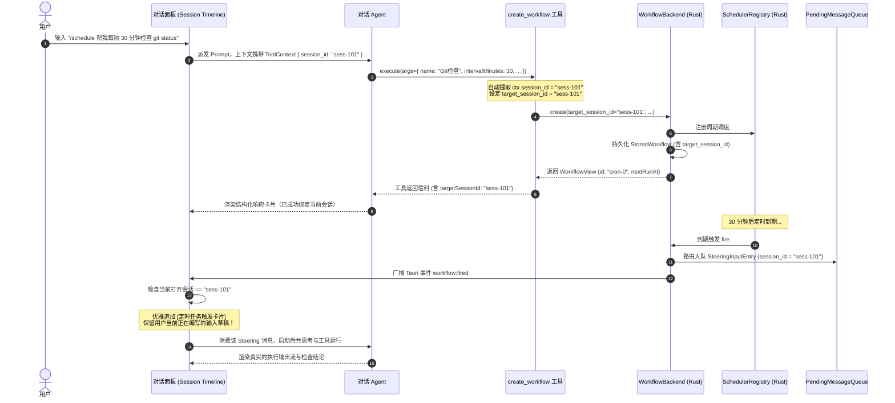

# 定时任务全流程修复与能力升级战役（Scheduled Tasks Revamp）

# 阶段 3 独立方案：目标会话绑定与对话内自动化定时任务能力

> **方案文档路径**：`docs/scheduled-tasks-revamp/independent-plans/agent3-phase3-session-workflow.md`  
> **负责人**：Subagent 3（会话编排与 IPC 命令契约专家）  
> **阶段定位**：阶段 3 (Phase 3) · 目标会话绑定与对话内自动化定时任务能力（Session Binding & In-Conversation Automation）  
> **核心涉及模块与文件域**：
>
> - `apps/agent-workbench/src-tauri/src/workflow_commands.rs`（数据结构、命令面、会话句柄传递与事件发射）
> - `crates/agent-tools/src/tools/create_workflow.rs`（工具契约、上下文感知与会话绑定入参）
> - `crates/agent-tools/src/context.rs`（会话上下文 `ToolContext.session_id` 读取）
> - `apps/agent-workbench/src-tauri/src/sched.rs`（调度条目与 Steering 会话路由）
> - `crates/orchestrator/src/steering_queue.rs`（跨会话强隔离 SteeringInputEntry）
> - `apps/crish-desktop/src/components/chat-composer/` & `src/hooks/chat-stream/`（对话内创建与执行呈现）
> - `apps/crish-desktop/src/components/settings/workflowsSharedLib.ts` & `ScheduledTasksPanel.tsx`（会话双向导航与占位逻辑）  
>   **架构纪律基线**：仓库根目录 `AGENTS.md`、`.agents/LOGIC_PLAN_NO_RETREAT.md`、`ANTI_OVERENGINEERING_GUARDRAILS.md`。

---

## 一、现状痛点与真实根因分析

在当前的 Conex / Crish 架构中，定时任务（Workflow / Scheduled Tasks）与对话会话（Chat Session）处于几乎完全割裂的孤岛状态。用户在具体对话中通过自然语言或 `/schedule` 命令请求 Agent 创建定时任务，即使成功注册，任务也无法与当前对话形成任何有效的闭环关联。

### 1.1 核心痛点与代码级断点

#### 痛点 1：数据模型与工具契约中会话标识 `target_session_id` 完全缺失

- **代码断点**：`apps/agent-workbench/src-tauri/src/workflow_commands.rs:275-301`
  在 `StoredWorkflow` 结构体中，仅包含 `cron_id`、`expression`、`prompt`、`name`、`cwd`、`mode`、`schedule`、`created_at_ms` 等字段，**完全没有记录该任务归属哪个会话的 `target_session_id` 字段**。对外暴露的 `WorkflowView`（329-341 行）亦同样缺失。
- **代码断点**：`crates/agent-tools/src/tools/create_workflow.rs:76-93` & `219-255`
  `WorkflowCreateInput` 及 `CreateWorkflowTool::execute` 的 JSON Schema 定义中，完全没有 `target_session_id` 属性。
  尤为严重的是，在 `CreateWorkflowTool::execute(&self, _ctx: &ToolContext, args: Value)` 中，执行入参中的 `_ctx` 被使用下划线前缀显式忽略（`_ctx`）。尽管 `ToolContext` 早已由 `crates/agent-tools/src/context.rs:123` 提供了可靠的 `pub session_id: String`，但工具层直接对当前运行环境“失明”，既不主动感知当前会话，也不允许模型显式传递目标会话。

#### 痛点 2：触发唤醒硬编码幽灵会话 `sched-{cron_id}`，导致跨会话隔离队列被永久阻断

- **代码断点**：`apps/agent-workbench/src-tauri/src/workflow_commands.rs:659` & `apps/agent-workbench/src-tauri/src/sched.rs:231`
  ```rust
  let entry = SteeringInputEntry {
      session_id: format!("sched-{cron_id}"), // 硬编码前缀与 cron_id
      id: format!("{cron_id}-{enqueued_at_ms}"),
      text,
      attachments: Vec::new(),
      enqueued_at: enqueued_at_ms,
      group_id: Some(steering_group_id(cron_id)),
      is_steering: true,
  };
  queue.replace_or_enqueue(entry);
  ```
- **真实根因**：
  在 `crates/orchestrator/src/steering_queue.rs:226-229` 中，为了防止全局唤醒风暴，引擎设计了严格的按会话消费机制：
  ```rust
  pub fn dequeue_all_for(&mut self, session_id: &str) -> Vec<SteeringInputEntry> {
      self.withdraw(|e| e.session_id == session_id)
  }
  ```
  当用户在对话 `session-abc` 中工作时，前端或引擎只轮询和消费 `session_id == "session-abc"` 的条目。由于定时任务触发时将条目无脑压入了 `session_id == "sched-cron-0"`，导致用户所处的目标会话永远无法收到该 steering 消息；而幽灵会话 `sched-cron-0` 如果未被用户主动激活启动，该消息便死锁在内存队列中，永远无法被消费，形成无人知晓的“死队列”。

#### 痛点 3：缺乏对话内执行卡片与响应流渲染闭环

- **代码断点**：`apps/crish-desktop/src/components/settings/workflowsSharedLib.ts:109-159`
  现有的 `ensureScheduledSession` 函数在触发后试图在前端直接插入虚假的静态文本消息（145-157 行），用伪造的字符串冒充执行产出，根本没有接入真正的 Agent 会话流。在用户真实使用的对话中，既无法看到定时任务按时触发的动态卡片，更无法看到 Agent 思考（Thinking）、工具调用（Tool Calls）及产出的过程。

#### 痛点 4：缺乏非侵入式呈现，破坏用户当前正在进行的对话交互

- 若在现有会话粗暴追加消息，一旦用户正在输入框编辑草稿（Draft Composer）或正与模型互动，定时任务触发的事件可能抢占输入焦点、冲刷编辑状态或导致上下文污染。缺乏精细的会话状态守卫（执行期独立隔离、时间线优雅追加、草稿免擦除）。

#### 痛点 5：侧边栏会话与任务列表的双向锚定缺失

- 侧边栏的对话项无法辨识是否由某个定时任务托管；定时任务详情列表中也没有提供“跳转到目标对话”的快捷入口，用户难以在任务定义和运行成果之间自由跳转。

---

## 二、架构设计与会话绑定模型

为了从根本上消除会话割裂，实现“在对话中创建、向对话中汇报、跨会话可隔离”的设计目标，阶段 3 引入**目标会话双模绑定模型（Dual-Mode Session Target Model）**。

```
┌─────────────────────────────────────────────────────────────────────────────────┐
│                           用户与 Agent 交互层 (Frontend UI)                     │
│  ┌───────────────────────────────┐           ┌───────────────────────────────┐  │
│  │   当前对话 (Session Timeline) │           │    定时任务面板 (Task Panel)  │  │
│  │  - /schedule 对话发起         │           │  - 显示绑定的 targetSession   │  │
│  │  - 定时触发优雅追加卡片       │◄─────────►│  - 一键跳转至对应对话         │  │
│  │  - 不干扰用户当前输入草稿     │           │  - 支持切换绑定模式           │  │
│  └───────────────┬───────────────┘           └───────────────▲───────────────┘  │
└──────────────────┼───────────────────────────────────────────┼──────────────────┘
                   │                                           │
                   │ 1. 自动感知 ctx.session_id                │ 5. 双向状态同步
                   │    或显式传入 targetSessionId             │
                   ▼                                           │
┌──────────────────────────────────────────────────────────────┴──────────────────┐
│                      工具与 IPC 契约层 (Agent Tools & IPC)                       │
│  ┌───────────────────────────────────────────────────────────────────────────┐  │
│  │ CreateWorkflowTool: ctx.session_id 注入 + 智能参数校验                     │  │
│  │ WorkflowBackend: 扩展 target_session_id，持久化至 StoredWorkflow          │  │
│  └──────────────────────────────────────┬────────────────────────────────────┘  │
└─────────────────────────────────────────┼───────────────────────────────────────┘
                                          │
                                          │ 2. 调度触发与路由分发
                                          ▼
┌─────────────────────────────────────────────────────────────────────────────────┐
│                      执行路由与唤醒调度层 (Execution Routing)                    │
│  ┌───────────────────────────────────────────────────────────────────────────┐  │
│  │ 判定 target_session_id：                                                  │  │
│  │  ├─► Some(sid): 绑定模式 ──► 注入 Steering(session_id = sid) ──► 目标对话 │  │
│  │  └─► None: 独立模式 ────────► 激活专有会话 (sched-<cronId>) ───► 侧栏归档 │  │
│  └───────────────────────────────────────────────────────────────────────────┘  │
└─────────────────────────────────────────────────────────────────────────────────┘
```

### 2.1 目标会话语义定义

每个定时任务可配置且仅配置一种目标会话模式：

1. **绑定指定对话模式 (`Bound Mode`, `target_session_id = Some("sess-xxx")`)**：
   - **典型场景**：用户在专属项目讨论、Bug 追踪或日报整理的特定对话中设定定时任务，期望 Agent 在该会话内定期汇报进度。
   - **路由语义**：到期触发时，Steering 消息的 `session_id` 严格设置为绑定的 `target_session_id`。由执行引擎在目标会话的时间线末尾优雅追加执行节点，保证上下文历史对齐。
2. **独立专有会话模式 (`Independent Mode`, `target_session_id = None`)**：
   - **典型场景**：高频轮询（如每 5 分钟健康检查）、后台静默监控、不希望打扰日常思考流的任务。
   - **路由语义**：到期触发时，自动路由至专属隔离会话（`sched-{cron_id}`，自动格式化标题为 `定时 · {name}`），完全不污染用户的任何普通对话。

### 2.2 上下文自动感知原则（Context-Aware Auto-Binding）

在对话中调用工具时，遵循**“智能感知为先，显式覆盖兜底”**的原则：

- 当用户在某个正在进行的会话中指示 Agent：“每隔 1 小时检查一次代码并在本对话汇报”，Agent 在调用 `create_workflow` 时：
  - 若模型**未传递** `targetSessionId`：工具自动提取 `ToolContext.session_id` 作为绑定目标。
  - 若模型显式传入了有效会话 ID：以显式传入为准。
  - 若模型或用户显式传入 `"independent"`、`"none"` 或 `null`：显式声明为独立会话模式，`target_session_id` 置为 `None`。

---

## 三、数据结构与 IPC 契约改造方案

### 3.1 Rust 核心数据结构升级

#### 1. `StoredWorkflow` 结构体扩展 (`apps/agent-workbench/src-tauri/src/workflow_commands.rs`)

在持久化数据结构中引入 `target_session_id`，并增加向前兼容宏（`#[serde(default)]`）：

```rust
#[derive(Debug, Clone, Serialize, Deserialize)]
#[serde(rename_all = "camelCase")]
pub(crate) struct StoredWorkflow {
    // ── §4.4 CronTask 冻结字段 ──
    pub cron_id: String,
    pub expression: String,
    pub prompt: String,
    pub max_iterations: Option<u64>,
    pub is_daemon: bool,
    pub next_fire_at_ms: u64,
    pub fired_count: u64,
    pub enabled: bool,
    // ── workflow 扩展字段 ──
    pub name: String,
    pub cwd: Option<String>,
    pub mode: Option<String>,
    pub schedule: WorkflowScheduleWire,
    pub created_at_ms: u64,
    pub updated_at_ms: u64,
    pub last_run_at_ms: Option<u64>,
    /// 目标会话绑定 ID（Phase 3 升级：None = 独立专有会话；Some = 绑定目标对话）
    #[serde(default)]
    pub target_session_id: Option<String>,
}
```

#### 2. `WorkflowView` 输出视图同步

```rust
#[derive(Debug, Clone, Serialize, Deserialize)]
#[serde(rename_all = "camelCase")]
pub(crate) struct WorkflowView {
    pub id: String,
    pub name: String,
    pub prompt: String,
    pub cwd: Option<String>,
    pub mode: Option<String>,
    pub enabled: bool,
    pub schedule: WorkflowScheduleWire,
    pub created_at: String,
    pub updated_at: String,
    pub next_run_at: Option<String>,
    pub last_run_at: Option<String>,
    /// 目标会话绑定 ID
    pub target_session_id: Option<String>,
}
```

#### 3. `WorkflowPatch` 增加目标会话更新能力

允许用户后续修改任务归属（在现有会话与独立会话之间切换）：

```rust
#[derive(Default)]
pub(crate) struct WorkflowPatch {
    pub name: Option<String>,
    pub prompt: Option<String>,
    pub schedule: Option<WorkflowScheduleWire>,
    pub cwd: Option<String>,
    pub mode: Option<String>,
    pub enabled: Option<bool>,
    /// 目标会话补丁：Some(None) 表示解除绑定转为独立会话，Some(Some(id)) 表示重新绑定
    pub target_session_id: Option<Option<String>>,
}
```

### 3.2 `agent-tools` 工具契约改造 (`crates/agent-tools/src/tools/create_workflow.rs`)

#### 1. `WorkflowCreateInput` 扩展

```rust
#[derive(Debug, Clone)]
pub struct WorkflowCreateInput {
    pub name: String,
    pub prompt: String,
    pub schedule_type: String,
    pub daily_time: Option<String>,
    pub interval_minutes: Option<u64>,
    pub cron_expression: Option<String>,
    pub cwd: Option<String>,
    pub enabled: Option<bool>,
    /// 目标会话绑定 ID（Phase 3 扩展）
    pub target_session_id: Option<String>,
}
```

#### 2. 工具定义 Schema 与智能感知实现

```rust
impl CreateWorkflowTool {
    pub(crate) fn with_channel(channel: Option<Arc<dyn WorkflowCreationChannel>>) -> Self {
        Self {
            def: ToolDefinition {
                name: "create_workflow".to_string(),
                description: "创建定时任务（注册到引擎调度器，按调度周期自动触发并在每次触发时执行 prompt 指令）：\
                              输入任务名称 name、执行指令 prompt、调度 scheduleType、可选目标工作区 cwd、\
                              可选目标会话 targetSessionId（默认自动绑定当前对话；设为 'independent' 则创建独立会话）以及\
                              是否启用 enabled（缺省 true）。创建成功后返回 workflowId、下次执行时刻及目标会话状态。".to_string(),
                input_schema: serde_json::json!({
                    "type": "object",
                    "properties": {
                        "name": { "type": "string", "description": "任务名称（必填非空，简明语义化标识）" },
                        "prompt": { "type": "string", "description": "每次触发时执行的具体操作指令（必填非空）" },
                        "scheduleType": {
                            "type": "string",
                            "enum": ["manual", "daily", "intervalMinutes", "cron"],
                            "description": "调度类型（可选，缺省 manual）"
                        },
                        "dailyTime": { "type": "string", "description": "每日时刻（HH:mm，本机时区）" },
                        "intervalMinutes": { "type": "number", "description": "间隔分钟（1–10080 整数）" },
                        "cronExpression": { "type": "string", "description": "5 字段 cron 表达式" },
                        "cwd": { "type": "string", "description": "目标工作区绝对路径（可选）" },
                        "targetSessionId": {
                            "type": "string",
                            "description": "目标会话 ID（可选）：指定任务触发时追加消息的目标对话。缺省自动绑定当前对话；若传入 'independent' 或空串则表示独立后台会话。"
                        },
                        "enabled": { "type": "boolean", "description": "是否启用（可选，缺省 true）" }
                    },
                    "required": ["name", "prompt"],
                    "additionalProperties": false
                }),
                dangerous: false,
                fatal_on_error: false,
            },
            channel,
        }
    }
}

#[async_trait]
impl Tool for CreateWorkflowTool {
    // ...
    async fn execute(&self, ctx: &ToolContext, args: Value) -> Result<Value, ToolError> {
        let name = super::require_string(&args, "name")?;
        let prompt = super::require_string(&args, "prompt")?;
        let schedule_type = super::optional_string(&args, "scheduleType")
            .map(|s| s.trim().to_string())
            .filter(|s| !s.is_empty())
            .unwrap_or_else(|| SCHEDULE_TYPE_MANUAL.to_string());
        let daily_time = super::optional_string(&args, "dailyTime");
        let interval_minutes = super::optional_u64(&args, "intervalMinutes");
        let cron_expression = super::optional_string(&args, "cronExpression");
        let cwd = super::optional_string(&args, "cwd");
        let enabled = super::optional_bool(&args, "enabled");

        // Phase 3 核心改动：解析并智能感知 targetSessionId
        let target_session_id = match super::optional_string(&args, "targetSessionId") {
            Some(explicit) => {
                let trimmed = explicit.trim();
                if trimmed.is_empty() || trimmed.eq_ignore_ascii_case("independent") || trimmed.eq_ignore_ascii_case("none") {
                    None
                } else {
                    Some(trimmed.to_string())
                }
            }
            None => {
                // 未显式指定时，自动感知当前 ToolContext 所在的会话
                if !ctx.session_id.trim().is_empty() {
                    Some(ctx.session_id.trim().to_string())
                } else {
                    None
                }
            }
        };

        let Some(channel) = &self.channel else {
            return Err(ToolError::new(
                codes::COMMON_UNSUPPORTED,
                "create_workflow 未接线：工作流创建通道未装配（引擎集成后可用）",
            ));
        };

        let output = channel
            .create(WorkflowCreateInput {
                name,
                prompt,
                schedule_type,
                daily_time,
                interval_minutes,
                cron_expression,
                cwd,
                enabled,
                target_session_id: target_session_id.clone(),
            })
            .await
            .map_err(|e| ToolError::new(e.code(), e.message()))?;

        let session_desc = match &target_session_id {
            Some(sid) => format!("已绑定当前对话（会话 ID: {}）", sid),
            None => "独立专有会话".to_string(),
        };

        let text = match &output.next_run_at {
            Some(next) => format!(
                "定时任务「{}」已创建（ID {}，{}），下次执行 {}",
                output.name, output.workflow_id, session_desc, next
            ),
            None => format!(
                "定时任务「{}」已创建（ID {}，{}，手动触发）",
                output.name, output.workflow_id, session_desc
            ),
        };

        Ok(serde_json::json!({
            "workflowId": output.workflow_id,
            "name": output.name,
            "nextRunAt": output.next_run_at,
            "targetSessionId": target_session_id,
            "text": text,
        }))
    }
}
```

### 3.3 Steering 队列路由重构 (`apps/agent-workbench/src-tauri/src/workflow_commands.rs`)

彻底重构 `SteeringSink` 及触发逻辑，消除对 `format!("sched-{cron_id}")` 的无条件硬编码：

```rust
pub(crate) trait SteeringSink: Send + Sync {
    /// 写入一条 steering 条目（支持传递目标 session_id）
    fn enqueue_steering(
        &self,
        cron_id: &str,
        session_id: &str,
        text: String,
        enqueued_at_ms: u64,
    );
}

impl SteeringSink for QueueSteeringSink {
    fn enqueue_steering(
        &self,
        cron_id: &str,
        session_id: &str,
        text: String,
        enqueued_at_ms: u64,
    ) {
        let entry = SteeringInputEntry {
            session_id: session_id.to_string(),
            id: format!("{cron_id}-{enqueued_at_ms}"),
            text,
            attachments: Vec::new(),
            enqueued_at: enqueued_at_ms,
            group_id: Some(format!("{CRON_ID_PREFIX}{cron_id}")),
            is_steering: true,
        };
        let mut queue = self.queue.lock().unwrap_or_else(|e| e.into_inner());
        queue.replace_or_enqueue(entry);
    }
}
```

在 `WorkflowBackend::trigger` 中：

```rust
let effective_session_id = workflow
    .target_session_id
    .as_deref()
    .filter(|s| !s.trim().is_empty())
    .map(ToString::to_string)
    .unwrap_or_else(|| format!("sched-{}-{}", workflow.cron_id, workflow.fired_count));

self.sink.enqueue_steering(
    cron_id,
    &effective_session_id,
    format!(
        "{}（cron {} 第 {} 次触发）",
        workflow.prompt, workflow.cron_id, workflow.fired_count
    ),
    now,
);
```

---

## 四、对话级定时任务端到端交互闭环

### 4.1 对话内生命周期交互时序



### 4.2 非侵入式呈现与草稿保护策略（Composer Draft Protection）

当绑定的目标会话到期被触发唤醒时，若用户正在该会话中打字（Composer 处于激活或草稿暂存态），必须严防输入丢失。

1. **草稿隔离存储**：前端输入框内容严格由 `sessionDraftManager` 基于 `activeSessionId` 进行持久隔离，定时任务的入站消息由 `useSessionStore.addMessage` 追加到 Timeline，**绝不触碰** `inputDraft` 状态。
2. **时间线节点渲染 (`WorkflowExecutionCard`)**：
   - 在时间线上新增专有组件 `WorkflowExecutionCard`，带有明确的视觉标志：
     - 标签：`[定时任务 · 自动化执行]`
     - 字段：任务名称、触发批次（如第 5 次触发）、调度周期、执行状态指示灯（运行中 / 已完成 / 异常）。
     - 展开区：完整展现该轮 Agent 的真实思考过程（Thinking Block）与输出内容。
   - 避免直接用普通 User 气泡伪造用户发言，明确区分“用户主动发言”与“系统定时驱动”。

### 4.3 侧边栏与任务面板的双向导航联动

1. **侧栏会话项标识**：
   - 若某普通会话绑定了处于启用状态的定时任务，侧栏会话项右侧渲染一个小巧的时钟微标（Clock Icon）。悬停提示：“此对话绑定了 1 个定时任务”。
2. **从会话一键跳转至任务管理**：
   - 点击时钟微标或在对话顶部菜单点击“查看关联定时任务”，自动滑出 `ScheduledTasksPanel` 并高亮该任务。
3. **从任务管理一键跳转至目标对话**：
   - 在 `ScheduledTasksPanel` 列表项及详情卡片中，当 `target_session_id` 存在时，渲染蓝色外链按钮：“跳转到目标对话”。
   - 点击时调用 `useSessionStore.getState().setActiveSessionId(targetSessionId)` 并切换表面至 `chat`，实现无缝锚定。

---

## 五、详细实现伪代码与测试套件

### 5.1 Rust 后端伪代码：`workflow_commands.rs` 改造

```rust
// 1. WorkflowBackend::create 增加 target_session_id 参数
pub(crate) async fn create(
    &self,
    name: String,
    prompt: String,
    schedule: WorkflowScheduleWire,
    cwd: Option<String>,
    mode: Option<String>,
    enabled: bool,
    target_session_id: Option<String>,
) -> Result<WorkflowView, CoreError> {
    // 基础非空校验
    let name = name.trim().to_string();
    let prompt = prompt.trim().to_string();
    if name.is_empty() {
        return Err(CoreError::InvalidInput("名称不能为空".to_string()));
    }
    if prompt.is_empty() {
        return Err(CoreError::InvalidInput("提示词不能为空".to_string()));
    }
    let target_session_id = target_session_id
        .map(|s| s.trim().to_string())
        .filter(|s| !s.is_empty());

    let expression = schedule_to_expression(&schedule).unwrap_or_default();
    let now = now_ms();

    // 若委托激活，经注册表注册
    let cron_id = if let Some(registry) = self.registry() {
        if !expression.is_empty() {
            let input = CronTaskInput {
                expression: expression.clone(),
                prompt: prompt.clone(),
                max_iterations: None,
                is_daemon: false,
            };
            registry.register(input).await.map_err(map_scheduler_err)?
        } else {
            let seq = self.seq.fetch_add(1, Ordering::SeqCst);
            format!("{CRON_ID_PREFIX}{seq}")
        }
    } else {
        if !expression.is_empty() {
            validate_cron_expression(&expression).map_err(CoreError::InvalidInput)?;
        }
        let seq = self.seq.fetch_add(1, Ordering::SeqCst);
        format!("{CRON_ID_PREFIX}{seq}")
    };

    let next_fire_at_ms = if expression.is_empty() {
        0
    } else {
        next_fire_after_ms(&expression, now).unwrap_or(0)
    };

    let workflow = StoredWorkflow {
        cron_id,
        expression,
        prompt,
        max_iterations: None,
        is_daemon: false,
        next_fire_at_ms,
        fired_count: 0,
        enabled,
        name,
        cwd: cwd.map(|c| c.trim().to_string()).filter(|c| !c.is_empty()),
        mode: mode.map(|m| m.trim().to_string()).filter(|m| !m.is_empty()),
        schedule,
        created_at_ms: now,
        updated_at_ms: now,
        last_run_at_ms: None,
        target_session_id,
    };

    self.store.save(&workflow);
    tracing::info!(
        target: "workflow",
        cron_id = %workflow.cron_id,
        target_session = ?workflow.target_session_id,
        "workflow 已创建并落盘"
    );
    Ok(workflow.view())
}
```

### 5.2 前端 API 映射伪代码：`workflowRunner.ts`

```typescript
export type WorkflowDefinition = {
  id: string;
  name: string;
  prompt: string;
  cwd?: string;
  mode?: string;
  enabled?: boolean;
  schedule?: WorkflowSchedule;
  targetSessionId?: string | null;
  createdAt?: string;
  updatedAt?: string;
  nextRunAt?: string;
  lastRunAt?: string;
};

export async function createWorkflow(input: {
  name: string;
  prompt: string;
  schedule?: WorkflowSchedule;
  cwd?: string;
  enabled?: boolean;
  targetSessionId?: string | null;
}): Promise<{
  ok: boolean;
  workflow?: WorkflowDefinition;
  error?: string;
  kind?: string;
}> {
  const res = await invokeTyped<WorkflowMutationWire>('create-workflow', {
    name: input.name,
    prompt: input.prompt,
    schedule: input.schedule,
    ...(input.cwd !== undefined && { cwd: input.cwd }),
    ...(input.enabled !== undefined && { enabled: input.enabled }),
    ...(input.targetSessionId !== undefined && {
      targetSessionId: input.targetSessionId,
    }),
  });
  if (res.status !== 'ok') {
    return { ok: false, error: res.message, kind: res.kind };
  }
  const workflow = parseWorkflowWire(res.data.workflow);
  return { ok: true, workflow };
}
```

### 5.3 单元与集成测试设计

在 `crates/agent-tools/src/tools/create_workflow.rs` 与 `apps/agent-workbench/src-tauri/src/workflow_commands.rs` 增加针对性测试：

#### 测试用例 1：`create_workflow` 自动感知当前会话并成功注入

```rust
#[tokio::test]
async fn test_create_workflow_auto_binds_session_context() {
    let channel = Arc::new(RecordingWorkflowChannel::new(Ok(ok_output())));
    let tool = CreateWorkflowTool::with_channel(Some(channel.clone()));

    // 构造模拟上下文，携带具体 session_id
    let mut ctx = create_mock_tool_context();
    ctx.session_id = "test-session-999".to_string();

    let out = tool.execute(&ctx, serde_json::json!({
        "name": "自动绑定测试",
        "prompt": "巡检任务",
        "scheduleType": "intervalMinutes",
        "intervalMinutes": 15
    })).await.unwrap();

    let calls = channel.calls();
    assert_eq!(calls.len(), 1);
    assert_eq!(calls[0].target_session_id.as_deref(), Some("test-session-999"));
    assert_eq!(out["targetSessionId"], "test-session-999");
    assert!(out["text"].as_str().unwrap().contains("已绑定当前对话"));
}
```

#### 测试用例 2：显式指定 `"independent"` 成功退化为独立专有会话

```rust
#[tokio::test]
async fn test_create_workflow_explicit_independent() {
    let channel = Arc::new(RecordingWorkflowChannel::new(Ok(ok_output())));
    let tool = CreateWorkflowTool::with_channel(Some(channel.clone()));

    let mut ctx = create_mock_tool_context();
    ctx.session_id = "test-session-999".to_string();

    let out = tool.execute(&ctx, serde_json::json!({
        "name": "独立任务",
        "prompt": "静默巡检",
        "scheduleType": "manual",
        "targetSessionId": "independent"
    })).await.unwrap();

    let calls = channel.calls();
    assert_eq!(calls.len(), 1);
    assert_eq!(calls[0].target_session_id, None, "independent 应被安全解析为 None");
    assert!(out["targetSessionId"].is_null());
    assert!(out["text"].as_str().unwrap().contains("独立专有会话"));
}
```

#### 测试用例 3：Trigger 触发时 Steering 路由严格匹配 `target_session_id`

```rust
#[test]
fn test_trigger_routes_to_target_session() {
    let store = Arc::new(MemoryWorkflowStore::default());
    let sink = Arc::new(RecordingSteeringSink::default());
    let backend = WorkflowBackend::new(store.clone(), sink.clone());

    // 预存一条绑定了 session-456 的 workflow
    let now = now_ms();
    let wf = StoredWorkflow {
        cron_id: "cron-target-test".to_string(),
        expression: "*/5 * * * *".to_string(),
        prompt: "测试 prompt".to_string(),
        max_iterations: None,
        is_daemon: false,
        next_fire_at_ms: now + 300_000,
        fired_count: 0,
        enabled: true,
        name: "目标会话测试".to_string(),
        cwd: None,
        mode: None,
        schedule: WorkflowScheduleWire::IntervalMinutes { interval_minutes: 5 },
        created_at_ms: now,
        updated_at_ms: now,
        last_run_at_ms: None,
        target_session_id: Some("session-456".to_string()),
    };
    store.save(&wf);

    // 触发执行
    let res = backend.trigger("cron-target-test").unwrap();
    assert!(res.session_id.is_some());

    // 校验 Steering 队列中的条目 session_id 必须为 session-456
    let entries = sink.entries();
    assert_eq!(entries.len(), 1);
    assert_eq!(entries[0].session_id, "session-456", "Steering 条目必须精确路由至 target_session_id");
}
```

---

## 六、向后兼容性与回滚策略

1. **旧数据反序列化防御**：
   `StoredWorkflow.target_session_id` 声明带有 `#[serde(default)]`。对于升级前已经写入本地数据库的 `sched_*` 键，读取时自动默认为 `None`，平滑回退至独立专有会话模式，不会引发反序列化崩塌。
2. **工具输入容错**：
   无论前端或老版本提示词是否携带 `targetSessionId`，若该字段缺省，自动按照上下文感知处理；若传入不支持的值（如特殊符号），通过安全 trim 校验回退至 `None`。
3. **渐进式启用**：
   前端在拉取到含有 `targetSessionId` 的 `WorkflowView` 时才渲染会话锚定外链；若为 `null` 则渲染标准的“独立会话”标识，保持跨版本 UI 兼容。
