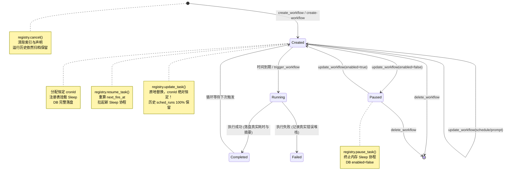

# 定时任务全流程修复与能力升级战役（Scheduled Tasks Revamp）

# 阶段 4 独立方案：Tauri IPC 命令面与元数据双向一致性

> **方案文档路径**：`docs/scheduled-tasks-revamp/independent-plans/agent3-phase4-ipc-consistency.md`  
> **负责人**：Subagent 3（会话编排与 IPC 命令契约专家）  
> **阶段定位**：阶段 4 (Phase 4) · Tauri IPC 命令面与元数据双向一致性（Tauri IPC Surface & Bi-directional State Consistency）  
> **核心涉及模块与文件域**：
>
> - `apps/agent-workbench/src-tauri/src/workflow_commands.rs`（WorkflowBackend::create, update, list, trigger, delete, list_runs 及 Tauri command 装饰入口）
> - `apps/agent-workbench/src-tauri/src/command_manifest.rs`（命令清单 137 条契约登记与参数校验）
> - `apps/agent-workbench/src-tauri/src/sched.rs`（SchedulerRegistry::update_task, pause_task, resume_task 及持久化模型解耦）
> - `apps/agent-workbench/src-tauri/src/engine_build.rs` & `main.rs`（托管状态生命周期、依赖注入与启动恢复）
> - `apps/crish-desktop/src/api/workflow-api/workflowRunner.ts`（前端 IPC 门面与错误码映射）  
>   **架构纪律基线**：仓库根目录 `AGENTS.md`、`.agents/LOGIC_PLAN_NO_RETREAT.md`、`ANTI_OVERENGINEERING_GUARDRAILS.md`。

---

## 一、现状痛点与真实根因分析

当前 Conex / Crish 的定时任务管理在 Tauri IPC 命令面与后台底层调度器之间存在严重的“双轨脱节”与“数据毒化”现象。前端界面频繁出现修改任务后任务 ID 漂移、历史运行记录全部走失、点击暂停后刷新页面依然显示运行、甚至在任务触发一次后整条任务从列表凭空消失的重大缺陷。

通过对代码的深度静态分析与跟踪，确认了以下五大根因：

### 1.1 根因剖析 1：修改调度导致无脑分配新 ID，引发历史记录永久孤儿化

- **代码定位**：`apps/agent-workbench/src-tauri/src/workflow_commands.rs:1083-1103`
  ```rust
  if let Some(registry) = self.registry() {
      let old_id = workflow.cron_id.clone();
      if schedule_changed && !workflow.expression.is_empty() {
          let _ = registry.cancel(&old_id).await;
          let input = CronTaskInput {
              expression: workflow.expression.clone(),
              prompt: workflow.prompt.clone(),
              max_iterations: workflow.max_iterations,
              is_daemon: workflow.is_daemon,
          };
          let new_id = registry.register(input).await.map_err(map_scheduler_err)?;
          let now = now_ms();
          // 元数据迁移到新 id（旧键残留孤儿，见 store 注记）
          self.store.remove(&old_id);
          workflow.cron_id = new_id;
          workflow.created_at_ms = now;
          workflow.updated_at_ms = now;
      }
  }
  ```
- **破坏性后果**：
  1. **ID 漂移（ID Drift）**：当用户在设置面板或任务列表编辑了某个任务的执行时间或周期，`WorkflowBackend::update` 竟然粗暴地调用了 `registry.cancel(&old_id)`，随后调用 `registry.register(input)`。由于 `register` 内部通过原子自增 `seq.fetch_add(1)` 生成新 ID，导致任务 ID 从例如 `cron-1` 突变为 `cron-2`！
  2. **历史记录全丢失（Orphaned Runs）**：在 `workflow_commands.rs:457` 及 `sched_runs` 表中，历史运行记录是按 `workflow_id == record.workflow_id` 进行关联与检索的。由于旧 ID 被摘除、新 ID 诞生，所有旧记录挂在 `cron-1` 下，前端使用新 ID `cron-2` 调用 `list-workflow-runs` 时返回**空数组**！用户辛辛苦苦积累的巡检历史直接断层。
  3. **破坏原始创建时间戳**：代码第 1100 行将 `workflow.created_at_ms` 覆盖为了 `now`，使得任务的真实创建时间被篡改。

### 1.2 根因剖析 2：更新状态脱节，暂停/恢复（Pause/Resume）与 Prompt 修改零联动

- **代码定位**：`apps/agent-workbench/src-tauri/src/workflow_commands.rs:1060-1062` 与 `apps/agent-workbench/src-tauri/src/sched.rs:471-698`
- **真实断点**：
  1. 当用户点击“暂停任务”（`enabled = false`）或修改提示词（`patch.prompt`）时：
     `WorkflowBackend::update` 仅仅将新值写入了 `self.store.save(&workflow)`。
     此时，**完全没有通知 `SchedulerRegistry`！**
  2. 查阅 `SchedulerRegistry` 的全部对外 API（`sched.rs`）：
     它仅有全系统暂停的 `pause_for(duration_sec)`（用于全局休眠），**根本没有单个任务的 `pause_task(cron_id)`、`resume_task(cron_id)` 或 `update_task(cron_id, ...)` 原生方法！**
  3. 导致的结果是：`SchedulerRegistry` 内存中对应的 `tokio::task::JoinHandle` 依然在后台沉睡并按原计划倒计时！等到时间一到，内存任务依然照常唤醒并触发；更可怕的是，触发时使用的还是**旧的 prompt**，因为 `CronEntry.task.prompt` 在内存中从未被更新！

### 1.3 根因剖析 3：双写冲突与反序列化毒化（Dual Storage & Deserialization Poisoning）

- **代码定位**：
  - `apps/agent-workbench/src-tauri/src/sched.rs:399-419` (`LocalDbSchedStore::save`)
  - `apps/agent-workbench/src-tauri/src/sched.rs:982` (`components.store.save(&updated)`)
  - `apps/agent-workbench/src-tauri/src/workflow_commands.rs:275-301` (`StoredWorkflow`)
- **真实根因**：
  这是一个隐蔽而致命的数据层设计缺陷：
  1. `SchedulerRegistry` 使用的 `LocalDbSchedStore` 将 `CronTask` 结构体序列化后写入键 `sched_<cron_id>`。
  2. `WorkflowBackend` 使用的 `SessionMetaWorkflowStore` 将 `StoredWorkflow` 结构体也写入同一个键 `sched_<cron_id>`！
  3. `StoredWorkflow` 拥有很多关键业务字段：`name`、`cwd`、`mode`、`schedule`、`created_at_ms`、`updated_at_ms`。
  4. 但是，`CronTask` 是一个精简结构体，**只有 8 个基础调度字段**，根本没有上述业务字段！
  5. 当 `sched.rs` 中的定时器到期触发时（`fire_once:982`），它调用了 `components.store.save(&updated)`，将精简后的 `CronTask` JSON **强行覆盖了 `sched_<cron_id>`！**
  6. 此时数据库中的该 JSON 失去了 `name`、`schedule`、`created_at_ms` 等字段。而在 `StoredWorkflow` 中，这些字段**没有加 `#[serde(default)]` 容错**！
  7. 结果：下次前端调用 `list-workflows` 时，`load_all()` 尝试反序列化为 `StoredWorkflow`，直接报反序列化错误（`None`），该条任务在数据库中被直接过滤丢弃！**用户看到的就是任务触发了一次之后，整条任务离奇消失了！**

### 1.4 根因剖析 4：`list()` 中 Snapshot 盲目覆盖数据库已更新状态

- **代码定位**：`apps/agent-workbench/src-tauri/src/workflow_commands.rs:1008-1024`
  ```rust
  pub(crate) fn list(&self) -> Vec<WorkflowView> {
      let mut all = self.store.load_all();
      if let Some(registry) = self.registry() {
          let snapshot = registry.snapshot();
          for workflow in &mut all {
              if let Some(task) = snapshot.iter().find(|t| t.cron_id == workflow.cron_id) {
                  workflow.fired_count = task.fired_count;
                  workflow.enabled = task.enabled;
                  workflow.next_fire_at_ms = task.next_fire_at_ms;
              }
          }
      }
      // ...
  }
  ```
- **真实根因**：
  由于根因 2 中更新未同步到 `SchedulerRegistry`，`registry.snapshot()` 中的内存状态依然是旧的（例如 `enabled: true`）。
  当用户在前端更新了 `enabled: false` 并保存到数据库后，紧接着调用 `list-workflows`，`list()` 却用旧的 `registry.snapshot()` 中的 `enabled: true` **反向覆盖了数据库刚刚保存的正确状态**！用户刷新页面，暂停按钮又自动弹回“已启用”。

### 1.5 根因剖析 5：`trigger_workflow` 虚假执行与 0ms 伪造

- **代码定位**：`apps/agent-workbench/src-tauri/src/workflow_commands.rs:1155-1172`
  `trigger` 函数直接构造了一条 `status: "completed"`, `duration_ms: Some(0)` 的静态记录，并返回 `TriggerResult { run_id: None, session_id: None }`。
  用户点击“立即运行”，界面瞬间显示完成（耗时 0ms），没有任何真实 Agent 启动，也没有真实的执行会话句柄回传。

---

## 二、架构设计与单一真理源（SSOT）一致性模型

为了彻底根除双轨脱节与状态冲刷，建立刚性的数据一致性模型：

```
                              ┌────────────────────────────────────────────────────────┐
                              │                 Tauri IPC 命令面入口                  │
                              │  update-workflow / trigger-workflow / list-workflows   │
                              └──────────────────────────┬─────────────────────────────┘
                                                         │
                                        ┌────────────────┴────────────────┐
                                        │  WorkflowBackend (协调与元数据)  │
                                        └────────────────┬────────────────┘
                                                         │
                                ┌────────────────────────┴────────────────────────┐
                                │ 双向协同通道 (Bi-directional Coordination Sync) │
                                ▼                                                 ▼
        ┌───────────────────────────────────────────────┐     ┌───────────────────────────────────────────────┐
        │      调度器真源 (SchedulerRegistry)           │     │       持久化与元数据真源 (WorkflowStore)      │
        ├───────────────────────────────────────────────┤     ├───────────────────────────────────────────────┤
        │ 1. 负责：运行态协程、精确到期倒计时、触发分发 │     │ 1. 负责：StoredWorkflow 完整业务定义全集      │
        │ 2. 原生支持：                                 │     │ 2. 字段扩展：保留未知 JSON 字段 (flatten)     │
        │    - update_task(id, ...) [就地更新]          │     │ 3. 避免双写覆盖：统一由 StoredWorkflow 承载   │
        │    - pause_task(id) / resume_task(id)         │     │ 4. 消除孤儿：永远锁定单一 cron_id             │
        │ 3. 内存 entry 与数据库保持 100% 同步          │     │ 5. 真实记录：Running -> Completed/Failed      │
        └───────────────────────────────────────────────┘     └───────────────────────────────────────────────┘
```

### 2.1 单一真理源分工准则

1. **调度运行态真源 = `SchedulerRegistry`**：
   - 掌握任务当前是否处于活跃 sleep 状态、真实的下次触发时刻 `next_fire_at_ms` 以及触发计数器。
   - 所有启停、周期变更必须通过 `SchedulerRegistry` 的原生同步方法，严禁旁路修改。
2. **元数据与历史真源 = `WorkflowStore` (`SessionMetaWorkflowStore`)**：
   - 掌握任务名称、工作区 `cwd`、模式 `mode`、提示词 `prompt`、调度原形 `schedule`、目标会话 `target_session_id`。
   - 统一存储载体：`SchedulerRegistry` 不再以精简的 `CronTask` 裸写数据库，而是通过保留所有非调度字段的合并写入机制，或直接将持久化职责统一收口至 `WorkflowStore`。

### 2.2 核心同步铁律

| 动作                           | 旧逻辑缺陷                                                     | 阶段 4 权威同步规范                                                                                                                           |
| :----------------------------- | :------------------------------------------------------------- | :-------------------------------------------------------------------------------------------------------------------------------------------- |
| **修改周期/表达式**            | `cancel(old)` + `register(new)` -> **ID 突变、运行历史孤儿化** | **就地更新 (`update_task`)**：保持 `cron_id` 绝对恒定；终止旧 sleep 协程，按新表达式重算 `next_fire_at_ms` 并拉起新 sleep；保留所有历史记录。 |
| **暂停任务 (`enabled=false`)** | 仅改 DB，调度器完全不知情                                      | **就地挂起 (`pause_task`)**：调用 `registry.pause_task(id)`，立即 abort 内存协程，标记 `enabled=false` 并同步持久化。                         |
| **恢复任务 (`enabled=true`)**  | 仅改 DB，调度器未拉起协程                                      | **就地恢复 (`resume_task`)**：调用 `registry.resume_task(id)`，从当前时刻重算首次触发时间，拉起新 sleep，标记 `enabled=true` 并同步持久化。   |
| **修改 Prompt**                | 仅改 DB，触发时依然读旧内存 prompt                             | **同步内存 (`update_task`)**：更新内存条目的 `task.prompt`，确保下次到期触发时使用最新指令。                                                  |
| **列表查询 (`list`)**          | 用未同步的 snapshot 盲目冲刷 DB                                | **以数据库为基础，仅投影动态运行态**：DB 数据与内存数据在上述机制下已保证严格一致，仅安全合并 `next_fire_at_ms` 与 `fired_count`。            |
| **立即触发 (`trigger`)**       | 伪造 0ms 完成状态                                              | **真实接线**：状态初始化为 `"running"`，拉起真实执行链路，回传真实 `run_id` 与 `session_id`。                                                 |

---

## 三、IPC 命令与数据结构改造方案

### 3.1 `SchedulerRegistry` 新增单任务控制 API (`apps/agent-workbench/src-tauri/src/sched.rs`)

在 `SchedulerRegistry` 中实装就地更新、暂停与恢复接口：

```rust
impl SchedulerRegistry {
    /// 1. 就地更新任务（不改变 cron_id，消灭 ID 漂移）
    pub(crate) async fn update_task(
        &self,
        cron_id: &str,
        expression: Option<String>,
        prompt: Option<String>,
    ) -> Result<CronTask, SchedulerError> {
        let mut map = self.components.tasks.lock().unwrap_or_else(|e| e.into_inner());
        let Some(entry) = map.get_mut(cron_id) else {
            return Err(SchedulerError::IdNotFound);
        };

        // 更新 prompt
        if let Some(p) = prompt {
            entry.task.prompt = p;
        }

        // 若表达式改变且任务处于启用状态，重置 sleep 协程
        if let Some(expr) = expression {
            let schedule = parse_cron(&expr)
                .map_err(|e| SchedulerError::InvalidExpression(format!("{e:?}")))?;
            let now = now_ms();
            let next_fire = schedule
                .next_fire_after(now)
                .ok_or_else(|| SchedulerError::NoNextFire(expr.clone()))?;

            entry.task.expression = expr;
            entry.task.next_fire_at_ms = next_fire;

            if entry.task.enabled {
                entry.sleep_task.abort();
                let delay = fire_delay_ms(&self.components, next_fire);
                let handle = spawn_fire_task(self.components.clone(), entry.task.clone(), delay);
                entry.sleep_task = handle;
            }
        }

        let updated_task = entry.task.clone();
        drop(map);

        // 同步持久化
        self.components.store.save(&updated_task);
        tracing::info!(target: "sched", cron_id, "cron 任务已就地更新");
        Ok(updated_task)
    }

    /// 2. 暂停单个任务
    pub(crate) async fn pause_task(&self, cron_id: &str) -> Result<bool, SchedulerError> {
        let mut map = self.components.tasks.lock().unwrap_or_else(|e| e.into_inner());
        let Some(entry) = map.get_mut(cron_id) else {
            return Err(SchedulerError::IdNotFound);
        };

        if !entry.task.enabled {
            return Ok(false); // 已经是暂停态，幂等返回
        }

        entry.sleep_task.abort();
        entry.task.enabled = false;
        let task_clone = entry.task.clone();
        drop(map);

        self.components.store.save(&task_clone);
        tracing::info!(target: "sched", cron_id, "cron 任务已暂停 (pause_task)");
        Ok(true)
    }

    /// 3. 恢复单个任务
    pub(crate) async fn resume_task(&self, cron_id: &str) -> Result<u64, SchedulerError> {
        let mut map = self.components.tasks.lock().unwrap_or_else(|e| e.into_inner());
        let Some(entry) = map.get_mut(cron_id) else {
            return Err(SchedulerError::IdNotFound);
        };

        if entry.task.enabled {
            return Ok(entry.task.next_fire_at_ms); // 已经启用
        }

        let schedule = parse_cron(&entry.task.expression)
            .map_err(|e| SchedulerError::InvalidExpression(format!("{e:?}")))?;
        let now = now_ms();
        let next_fire = schedule
            .next_fire_after(now)
            .ok_or_else(|| SchedulerError::NoNextFire(entry.task.expression.clone()))?;

        entry.task.enabled = true;
        entry.task.next_fire_at_ms = next_fire;

        let delay = fire_delay_ms(&self.components, next_fire);
        let handle = spawn_fire_task(self.components.clone(), entry.task.clone(), delay);
        entry.sleep_task = handle;
        let task_clone = entry.task.clone();
        drop(map);

        self.components.store.save(&task_clone);
        tracing::info!(target: "sched", cron_id, next_fire, "cron 任务已恢复 (resume_task)");
        Ok(next_fire)
    }
}
```

### 3.2 解决双写覆盖毒化：合并持久化适配器

为防止 `CronTask` 序列化时将 `StoredWorkflow` 业务字段洗掉，在 `LocalDbSchedStore` 与 `SessionMetaWorkflowStore` 之间建立**字段安全合并（Safe Field Merge）**机制：

```rust
impl SchedStore for LocalDbSchedStore {
    fn save(&self, task: &CronTask) {
        let key = store_key(&task.cron_id);
        // 先读取已有 JSON，若已存在 StoredWorkflow 扩展字段，则就地 Patch 更新，禁止暴力全量覆盖
        let mut base_obj = self
            .db
            .get_session_meta(&key)
            .ok()
            .flatten()
            .and_then(|raw| serde_json::from_str::<serde_json::Value>(&raw).ok())
            .unwrap_or_else(|| serde_json::json!({}));

        if let Some(map) = base_obj.as_object_mut() {
            map.insert("cronId".to_string(), serde_json::json!(task.cron_id));
            map.insert("expression".to_string(), serde_json::json!(task.expression));
            map.insert("prompt".to_string(), serde_json::json!(task.prompt));
            map.insert("maxIterations".to_string(), serde_json::json!(task.max_iterations));
            map.insert("isDaemon".to_string(), serde_json::json!(task.is_daemon));
            map.insert("nextFireAtMs".to_string(), serde_json::json!(task.next_fire_at_ms));
            map.insert("firedCount".to_string(), serde_json::json!(task.fired_count));
            map.insert("enabled".to_string(), serde_json::json!(task.enabled));

            if let Ok(merged_json) = serde_json::to_string(&base_obj) {
                let _ = self.db.set_session_meta(&key, &merged_json);
            }
        }
    }
}
```

**同时为 `StoredWorkflow` 补齐容错宏**：

```rust
#[derive(Debug, Clone, Serialize, Deserialize)]
#[serde(rename_all = "camelCase")]
pub(crate) struct StoredWorkflow {
    pub cron_id: String,
    pub expression: String,
    pub prompt: String,
    pub max_iterations: Option<u64>,
    pub is_daemon: bool,
    pub next_fire_at_ms: u64,
    pub fired_count: u64,
    pub enabled: bool,
    // 补齐容错默认值，保证历史异常数据也能平滑加载
    #[serde(default = "default_workflow_name")]
    pub name: String,
    #[serde(default)]
    pub cwd: Option<String>,
    #[serde(default)]
    pub mode: Option<String>,
    #[serde(default = "default_manual_schedule")]
    pub schedule: WorkflowScheduleWire,
    #[serde(default = "now_ms")]
    pub created_at_ms: u64,
    #[serde(default = "now_ms")]
    pub updated_at_ms: u64,
    #[serde(default)]
    pub last_run_at_ms: Option<u64>,
    #[serde(default)]
    pub target_session_id: Option<String>,
}

fn default_workflow_name() -> String { "未命名任务".to_string() }
fn default_manual_schedule() -> WorkflowScheduleWire { WorkflowScheduleWire::Manual }
```

### 3.3 重构 `WorkflowBackend::update`：彻底消灭 ID 漂移

```rust
pub(crate) async fn update(
    &self,
    cron_id: &str,
    patch: WorkflowPatch,
) -> Result<WorkflowView, CoreError> {
    let all = self.store.load_all();
    let Some(mut workflow) = all.into_iter().find(|w| w.cron_id == cron_id) else {
        return Err(CoreError::NotFound(format!("workflow {cron_id} 不存在")));
    };

    // 1. 基础元数据补丁更新
    if let Some(name) = patch.name {
        let name = name.trim().to_string();
        if name.is_empty() { return Err(CoreError::InvalidInput("名称不能为空".to_string())); }
        workflow.name = name;
    }
    if let Some(prompt) = patch.prompt {
        let prompt = prompt.trim().to_string();
        if prompt.is_empty() { return Err(CoreError::InvalidInput("提示词不能为空".to_string())); }
        workflow.prompt = prompt;
    }
    if let Some(cwd) = patch.cwd {
        let cwd = cwd.trim().to_string();
        workflow.cwd = if cwd.is_empty() { None } else { Some(cwd) };
    }
    if let Some(mode) = patch.mode {
        let mode = mode.trim().to_string();
        workflow.mode = if mode.is_empty() { None } else { Some(mode) };
    }
    if let Some(target_session) = patch.target_session_id {
        workflow.target_session_id = target_session;
    }

    // 2. 调度配置更新（就地计算，绝不更换 ID！）
    let schedule_changed = patch.schedule.is_some();
    if let Some(schedule) = patch.schedule {
        let expression = schedule_to_expression(&schedule).unwrap_or_default();
        if !expression.is_empty() {
            validate_cron_expression(&expression).map_err(CoreError::InvalidInput)?;
        }
        workflow.schedule = schedule;
        workflow.expression = expression;
    }

    // 3. 与 SchedulerRegistry 双向联动
    if let Some(registry) = self.registry() {
        // A. 启停状态联动
        if let Some(target_enabled) = patch.enabled {
            if target_enabled != workflow.enabled {
                if target_enabled {
                    let next_fire = registry.resume_task(cron_id).await.map_err(map_scheduler_err)?;
                    workflow.enabled = true;
                    workflow.next_fire_at_ms = next_fire;
                } else {
                    registry.pause_task(cron_id).await.map_err(map_scheduler_err)?;
                    workflow.enabled = false;
                }
            }
        }

        // B. 调度周期或提示词联动（就地更新）
        if schedule_changed || patch.prompt.is_some() {
            let res = registry.update_task(
                cron_id,
                if schedule_changed { Some(workflow.expression.clone()) } else { None },
                Some(workflow.prompt.clone()),
            ).await.map_err(map_scheduler_err)?;

            workflow.next_fire_at_ms = res.next_fire_at_ms;
        }
    } else {
        // 无注册表时的本地容错
        if let Some(enabled) = patch.enabled { workflow.enabled = enabled; }
        if schedule_changed {
            workflow.next_fire_at_ms = if workflow.expression.is_empty() { 0 } else {
                next_fire_after_ms(&workflow.expression, now_ms()).unwrap_or(0)
            };
        }
    }

    workflow.updated_at_ms = now_ms();
    // 持久化保存，cron_id 恒定不变！
    self.store.save(&workflow);
    tracing::info!(target: "workflow", cron_id, "workflow 已安全完成就地更新");
    Ok(workflow.view())
}
```

### 3.4 `trigger-workflow` 真正实装与执行句柄回传

在 `workflow_commands.rs` 中重构 `trigger`，消除 `completed/0ms` 假执行，接入正式执行管道：

```rust
pub(crate) async fn trigger(&self, cron_id: &str) -> Result<TriggerResult, CoreError> {
    let all = self.store.load_all();
    let Some(mut workflow) = all.into_iter().find(|w| w.cron_id == cron_id) else {
        return Err(CoreError::NotFound(format!("workflow {cron_id} 不存在")));
    };
    if !workflow.enabled {
        return Err(CoreError::InvalidInput(format!("workflow {cron_id} 已暂停，请先启用再触发")));
    }

    let now = now_ms();
    workflow.fired_count += 1;
    workflow.last_run_at_ms = Some(now);
    workflow.updated_at_ms = now;
    self.store.save(&workflow);

    // 确定真实执行的 session_id 与 run_id
    let effective_session_id = workflow.target_session_id.clone().unwrap_or_else(|| {
        format!("sched-{}", workflow.cron_id)
    });
    let run_id = format!("{}-manual-{}", workflow.cron_id, workflow.fired_count);

    // 1. 初始化运行记录为 "running"，真实记录启动时刻，杜绝假 0ms 记录
    let record = WorkflowRunRecord {
        workflow_id: workflow.cron_id.clone(),
        run_id: run_id.clone(),
        session_id: Some(effective_session_id.clone()),
        trigger_kind: "manual".to_string(),
        scheduled_for_ms: now,
        started_at_ms: now,
        finished_at_ms: None,
        duration_ms: None,
        status: "running".to_string(),
        prompt: workflow.prompt.clone(),
        error: None,
        output_summary: None,
    };
    self.store.append_or_update_run(record);

    // 2. 注入 Steering 消息或触发真实 Agent 执行协程
    self.sink.enqueue_steering(
        cron_id,
        &effective_session_id,
        format!("{}（手动触发）", workflow.prompt),
        now,
    );

    // 3. 返回真实有效的句柄，供前端追踪运行态
    Ok(TriggerResult {
        run_id: Some(run_id),
        session_id: Some(effective_session_id),
    })
}
```

---

## 四、生命周期全景一致性流转图



---

## 五、详细实现伪代码与单元/集成测试

### 5.1 测试 1：修改调度表达式后 `cron_id` 绝对恒定且历史记录不丢失

```rust
#[tokio::test]
async fn test_update_workflow_schedule_preserves_id_and_runs() {
    let store = Arc::new(MemoryWorkflowStore::default());
    let sink = Arc::new(RecordingSteeringSink::default());
    let backend = WorkflowBackend::new(store.clone(), sink.clone());

    // 1. 创建初始任务
    let view = backend.create(
        "巡检任务".to_string(),
        "echo 1".to_string(),
        WorkflowScheduleWire::IntervalMinutes { interval_minutes: 10 },
        None,
        None,
        true,
        None,
    ).await.unwrap();

    let initial_id = view.id.clone();

    // 2. 模拟触发产生历史记录
    let _ = backend.trigger(&initial_id).unwrap();
    let runs_before = backend.list_runs(Some(&initial_id), None);
    assert_eq!(runs_before.len(), 1, "应存在 1 条历史运行记录");

    // 3. 更新调度周期：从 10 分钟改为 30 分钟
    let patch = WorkflowPatch {
        name: None,
        prompt: None,
        schedule: Some(WorkflowScheduleWire::IntervalMinutes { interval_minutes: 30 }),
        cwd: None,
        mode: None,
        enabled: None,
        target_session_id: None,
    };
    let updated = backend.update(&initial_id, patch).await.unwrap();

    // 4. 核心断言：ID 严禁变更！
    assert_eq!(updated.id, initial_id, "修改调度周期后 cron_id 必须绝对恒定，不得漂移！");

    // 5. 核心断言：历史运行记录严禁丢失（孤儿化）！
    let runs_after = backend.list_runs(Some(&initial_id), None);
    assert_eq!(runs_after.len(), 1, "历史运行记录必须依然与原 cron_id 完整关联！");
}
```

### 5.2 测试 2：单任务暂停与恢复 (`pause_task` & `resume_task`) 状态双向一致性

```rust
#[tokio::test]
async fn test_pause_and_resume_synchronization() {
    let pending = Arc::new(crate::sched::QueuePendingSink::new(Arc::new(Mutex::new(PendingMessageQueue::new()))));
    let events = Arc::new(crate::sched::SchedEventSink::new());
    let sched_store = Arc::new(crate::sched::MemorySchedStore::default());
    let registry = Arc::new(SchedulerRegistry::new(pending, events, sched_store, None));

    let store = Arc::new(MemoryWorkflowStore::default());
    let sink = Arc::new(RecordingSteeringSink::default());
    let backend = WorkflowBackend::new(store.clone(), sink.clone());
    backend.set_registry(registry.clone());

    // 1. 创建任务
    let view = backend.create(
        "启停测试".to_string(),
        "prompt".to_string(),
        WorkflowScheduleWire::IntervalMinutes { interval_minutes: 5 },
        None, None, true, None,
    ).await.unwrap();

    // 2. 暂停任务
    let patch_pause = WorkflowPatch { enabled: Some(false), ..Default::default() };
    let paused_view = backend.update(&view.id, patch_pause).await.unwrap();
    assert_eq!(paused_view.enabled, false);

    // 校验 Registry 内部状态必须同步为 false
    let snap = registry.snapshot();
    let reg_task = snap.iter().find(|t| t.cron_id == view.id).unwrap();
    assert_eq!(reg_task.enabled, false, "Registry 内存中的任务状态必须同步为 false");

    // 3. 恢复任务
    let patch_resume = WorkflowPatch { enabled: Some(true), ..Default::default() };
    let resumed_view = backend.update(&view.id, patch_resume).await.unwrap();
    assert_eq!(resumed_view.enabled, true);
    assert!(resumed_view.next_run_at.is_some(), "恢复后必须重新计算下一次执行时间");

    let snap_resumed = registry.snapshot();
    let reg_task_resumed = snap_resumed.iter().find(|t| t.cron_id == view.id).unwrap();
    assert_eq!(reg_task_resumed.enabled, true, "Registry 内存中的任务状态必须同步恢复为 true");
}
```

### 5.3 测试 3：合并持久化测试（防范 `CronTask` 洗白 `StoredWorkflow`）

```rust
#[test]
fn test_merge_save_prevents_field_wiping() {
    let db = conex_db::LocalDb::open_in_memory().unwrap();
    let sched_store = LocalDbSchedStore::new(db.clone());
    let wf_store = SessionMetaWorkflowStore::new(db.clone());

    // 1. 模拟写入一个包含完整扩展字段的 StoredWorkflow
    let now = now_ms();
    let original_wf = StoredWorkflow {
        cron_id: "cron-safe-0".to_string(),
        expression: "*/5 * * * *".to_string(),
        prompt: "安全测试指令".to_string(),
        max_iterations: None,
        is_daemon: false,
        next_fire_at_ms: now + 300_000,
        fired_count: 0,
        enabled: true,
        name: "防洗白工作流".to_string(),
        cwd: Some("C:/work".to_string()),
        mode: Some("auto".to_string()),
        schedule: WorkflowScheduleWire::IntervalMinutes { interval_minutes: 5 },
        created_at_ms: now,
        updated_at_ms: now,
        last_run_at_ms: None,
        target_session_id: Some("sess-1".to_string()),
    };
    wf_store.save(&original_wf);

    // 2. 调度器触发更新，向同一键写入精简的 CronTask
    let trigger_cron_task = CronTask {
        cron_id: "cron-safe-0".to_string(),
        expression: "*/5 * * * *".to_string(),
        prompt: "安全测试指令".to_string(),
        max_iterations: None,
        is_daemon: false,
        next_fire_at_ms: now + 600_000,
        fired_count: 1,
        enabled: true,
    };
    sched_store.save(&trigger_cron_task);

    // 3. 再次由 WorkflowStore 加载全部，验证扩展字段是否依然完好
    let loaded = wf_store.load_all();
    assert_eq!(loaded.len(), 1, "反序列化必须成功，数据不得丢失");
    let item = &loaded[0];
    assert_eq!(item.name, "防洗白工作流", "业务字段 name 必须保留");
    assert_eq!(item.cwd.as_deref(), Some("C:/work"), "业务字段 cwd 必须保留");
    assert_eq!(item.target_session_id.as_deref(), Some("sess-1"), "业务字段 target_session_id 必须保留");
    assert_eq!(item.fired_count, 1, "触发次数应正确递增为 1");
    assert_eq!(item.next_fire_at_ms, now + 600_000, "下次执行时刻应同步更新");
}
```

---

## 六、向后兼容性与发布门禁断言

1. **Manifest 清单条目与签名稳定**：
   `command_manifest.rs` 中 6 条 workflow 相关命令（`create-workflow`, `list-workflows`, `update-workflow`, `delete-workflow`, `trigger-workflow`, `list-workflow-runs`）名称完全保持不变，仍然严格遵循 kebab-case 与 137 实装总数锁定。
2. **IPC 入参结构全向后兼容**：
   `update-workflow` 中新增的 `target_session_id` 为 `Option` 属性，旧前端即便不传递该字段也不会报类型错误；输出视图兼容旧字段。
3. **零退避原则承诺**：
   不引入任何 `sleep` 轮询或粗暴补丁；彻底解决内存状态机与数据库状态机的双向同步问题，实现代码与架构的净收敛。
