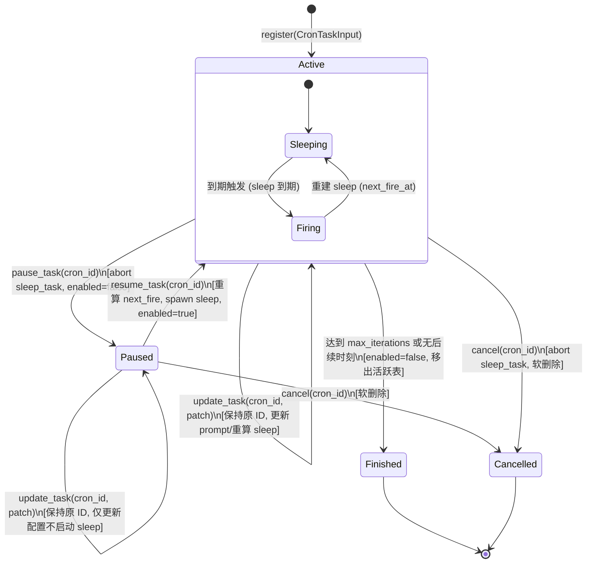

# 定时任务全流程修复与能力升级战役（Scheduled Tasks Revamp）

# 阶段 1 独立方案：Rust 底层调度器核心治理与单任务生命周期

> **文档标识**：`agent5-phase1-scheduler-core.md`
> **负责角色**：Subagent 5（端到端 UI 表单与底层调度协同专家 / UI Experience & Scheduler Alignment Architect）
> **覆盖范围**：【阶段 1 (Phase 1)：Rust 底层调度器核心治理与单任务生命周期】及其为【阶段 5：前端 UI】、【阶段 2：真实执行引擎】提供的底座支撑
> **设计基线**：`AGENTS.md`（§1.1 逻辑规划与反退避、§7 严禁补丁与作弊、§8 反过度设计硬性红线）、`.agents/LOGIC_PLAN_NO_RETREAT.md`、`ANTI_OVERENGINEERING_GUARDRAILS.md`
> **核心涉及模块与文件域**：
>
> - `apps/agent-workbench/src-tauri/src/sched.rs`（`SchedulerRegistry`, `CronTask`, `CronEntry`, `fire_cron`, `restore`）
> - `apps/agent-workbench/src-tauri/src/engine_build.rs`（`assemble_scheduler_registry`, `EngineHandle::build`）
> - `apps/agent-workbench/src-tauri/src/workflow_commands.rs`（`WorkflowCommandState`, `WorkflowBackend`, `update_workflow`）
> - `apps/agent-workbench/src-tauri/src/main.rs`（Tauri 生命周期装配、Tokio/Tauri 异步运行时协同）
> - `crates/conex-types/src/cron.rs`（`CronSchedule`, `parse_cron`, `next_fire_after`）

---

## 一、阶段定位与核心攻坚目标

Rust 底层调度器（`SchedulerRegistry`）是 Conex / Crish 整个定时与自动化任务生态的心脏。它负责 Cron 表达式解析、下次触发时刻计算、`tokio::time::sleep` 协程管理、超时唤醒注入以及持久化恢复。

但在当前实现中，底层调度器存在**两大致命历史悬案**与**生命周期控制缺失**：

1. **开机恢复被静默跳过（历史悬案）**：由于应用启动阶段主 GUI 线程缺少 Tokio Runtime 上下文，`engine_build.rs` 中的 `tokio::runtime::Handle::try_current()` 总是返回失败，启动恢复 `restore()` 被完全跳过。应用一旦重启，内存中的定时任务协程全失，用户配置的所有定时任务彻底死寂！
2. **缺乏单任务级别的生命周期控制原生 API**：`SchedulerRegistry` 仅有 `register` 和 `cancel`，没有 `pause_task`、`resume_task` 与 `update_task` 原生方法。上层命令在处理用户暂停或修改时，要么只能破坏性地 `cancel + register`（生成新 ID，造成历史孤儿化），要么只修改了 SQLite 数据库却无法通知内存调度协程，导致调度器继续按旧配置运行，并在列表查询时反向冲刷破坏前端状态！
3. **`sleep_task` 协程状态机脆弱与竞态复活隐患**：任务在触发执行期间如果被用户暂停或取消，缺乏代际（Generation）防御，存在被段 3 重建逻辑错误复活的竞态风险；同时 `restore()` 缺少重入防重复保护与过期任务非阻塞并发处理。

本方案的核心目标是：**从底层根治开机恢复盲区，赋予 `SchedulerRegistry` 完备的单任务级生命周期控制能力（就地更新、安全暂停、重算恢复），构建代际隔离的健壮协程状态机，并与上层 Tauri 命令面和前端 UI 达成坚实一致的闭环契约**。

---

## 二、现状痛点与真实根因深度分析

```
[应用启动 / 用户交互]
        │
        ├── 痛点 1: 应用启动 setup 阶段 ───> engine_build.rs:903 ───> try_current() 失败!
        │                                                           │
        │                                                           └──> restore() 被跳过! 重启后定时任务全死!
        │
        ├── 痛点 2: 用户在界面修改调度 ───> workflow_commands.rs:1085 ─> cancel + register 破坏性重排!
        │                                                               │
        │                                                               └──> 生成新 cron-<seq>, 历史记录孤儿化!
        │
        ├── 痛点 3: 用户在界面暂停任务 ───> workflow_commands.rs:1060 ─> 仅改 SQLite 数据库!
        │                                                               │
        │                                                               ├──> SchedulerRegistry 内存协程继续跑!
        │                                                               └──> list() 用旧 snapshot 反向冲刷前端!
        │
        └── 痛点 4: 协程内部状态竞态 ───> sched.rs:880 ──────────────> 缺少代际锁，cancel/pause 后被意外复活!
```

### 2.1 启动阶段缺少 Tokio Runtime 导致 `restore()` 被完全跳过（历史悬案根因）

- **代码位置**：
  - `apps/agent-workbench/src-tauri/src/engine_build.rs:901-913`
  - `apps/agent-workbench/src-tauri/src/main.rs:944, 1014-1025`
- **代码现状**：
  ```rust
  // engine_build.rs:901-913
  // 启动恢复：扫描已持久化声明重建 cron sleep（与 TimerRegistry::restore 同模式；
  // try_current 守卫：纯同步构造上下文跳过，不 panic）
  if let Ok(runtime) = tokio::runtime::Handle::try_current() {
      let registry = Arc::clone(&registry);
      runtime.spawn(async move {
          registry.restore().await;
      });
  } else {
      tracing::debug!(
          target: "engine",
          "SchedulerRegistry 启动恢复跳过：当前上下文无 tokio runtime"
      );
  }
  ```
  ```rust
  // main.rs:1014-1025
  let workflow_state = workflow_commands::WorkflowCommandState::new(
      shared_db.local_db(),
      core_state.steering_queue(),
  );
  if let Some(reg) = core_state.scheduler_registry() {
      workflow_state.set_registry(reg);
  } else {
      tracing::warn!(...);
  }
  // <--- 整个 setup 流程结束，没有任何地方再次调用 reg.restore()！
  ```
- **真实根因穿透**：
  1. `EngineHandle::build` 是在 `main.rs:944` 的 `tauri::Builder::setup` 回调函数中同步执行的；
  2. Tauri 的 `setup` 闭包在主操作系统 GUI 线程上运行，该线程并未绑定 ambient Tokio runtime；因此 `tokio::runtime::Handle::try_current()` **恒定返回 `Err(TryCurrentError::NoRuntime)`**；
  3. 执行直接进入 `else` 分支，在控制台悄悄打出一行 debug 日志，然后跳过恢复；
  4. 随后在 `main.rs` 组装 `workflow_state` 时，虽然成功拿到了 `reg`，但由于历史开发者误以为在 `assemble_scheduler_registry` 中已经 `spawn` 恢复了，便没有在 `main.rs` 中补救调用；
  5. **严重后果**：用户创建并启用的定时任务，在应用关机或重启后，内存中的 `tasks` 哈希表恒为空！到期触发协程彻底蒸发！用户必须手动去编辑或重新开启一次任务，才会重新触发 `register`。这是导致“定时任务从未按预期自动执行”的最核心元凶。

### 2.2 缺少单任务 `pause` / `resume` / `update` 原生方法

- **代码位置**：
  - `apps/agent-workbench/src-tauri/src/sched.rs:550-572`（仅有 `cancel`）
  - `apps/agent-workbench/src-tauri/src/sched.rs:661-675`（仅有全局 `pause_for`）
  - `apps/agent-workbench/src-tauri/src/workflow_commands.rs:1029-1104`
- **代码现状**：
  `sched.rs` 中的 `SchedulerRegistry` 目前只有：
  - `register(input: CronTaskInput) -> Result<String, SchedulerError>`：分配新 ID 并注册；
  - `cancel(cron_id: &str) -> Result<bool, SchedulerError>`：标记 `enabled=false` 并从内存移除；
  - `pause_for(duration_sec: u64) -> u64`：这是一个**全局内存态暂停**（`pause: Arc<Mutex<Option<u64>>>`），暂停期间任何任务到期都被推迟，且重启不恢复。它根本无法表达用户对某个特定单任务的长期持久化暂停。
- **真实根因穿透**：
  因为底层没有提供单任务级的控制接口，上层 `workflow_commands.rs` 陷入了进退维谷的灾难：
  1. **修改表达式时，破坏性生成新 ID**（`workflow_commands.rs:1085-1103`）：
     当用户在 UI 修改了 Cron 调度并保存，后端发现表达式变了，只能调用 `registry.cancel(&old_id)`，然后调用 `registry.register(input)` 生成一个全新的 `cron-<seq>`！
     这导致旧任务在 `sched_runs` 历史运行表中的记录被遗弃（孤儿化），对话内绑定的关联也瞬间失效！
  2. **切换启停时，完全漏连调度器**（`workflow_commands.rs:1060-1062`）：
     当用户在 UI 点击 Switch 暂停时，`workflow_commands.rs:1060` 仅仅将 SQLite 库里的 `workflow.enabled` 改为 `false`，但因为 `registry` 没有 `pause_task` 接口，它根本没有通知 `registry`！
     内存中的 `sleep_task` 依然在后台悄悄倒计时并准备触发！
     更致命的是，随后的 `list()` 调用执行了：
     ```rust
     if let Some(registry) = self.registry() {
         let snapshot = registry.snapshot();
         for workflow in &mut all {
             if let Some(task) = snapshot.iter().find(|t| t.cron_id == workflow.cron_id) {
                 workflow.enabled = task.enabled; // snapshot 里的 enabled 依然是 true！
             }
         }
     }
     ```
     由于 `registry` 里的任务并未暂停，它的快照直接把数据库刚刚写入的 `false` 冲刷回 `true`！导致前端用户看到 Switch 开关诡异弹回！

### 2.3 `restore()` 恢复过程缺乏防重入保护与过期并发阻塞

- **代码位置**：`apps/agent-workbench/src-tauri/src/sched.rs:577-626`
- **代码现状**：
  ```rust
  // sched.rs:577-626
  pub(crate) async fn restore(&self) {
      let now = now_ms();
      for task in self.components.store.load_all() {
          // ...
          if task.next_fire_at_ms <= now {
              // 已过期未触发 → 补发
              fire_cron(self.components.clone(), task, true).await; // <--- 顺序同步等待！
              continue;
          }
          let delay = fire_delay_ms(&self.components, task.next_fire_at_ms);
          let handle = spawn_fire_task(self.components.clone(), task.clone(), delay);
          self.components.tasks.lock().unwrap().insert(
              task.cron_id.clone(),
              CronEntry { task, sleep_task: handle },
          );
      }
  }
  ```
- **真实根因穿透**：
  1. **缺少调用防重入守卫**：若 `restore()` 在启动时被两个协程并发调用，或者在后续重载中被再次触发，原有的 `CronEntry` 被直接覆盖插入。而旧的 `handle` 没有被显式 `abort()`，旧的 Tokio sleep 协程依然在后台存活，造成**定时任务双倍触发、三倍触发**的幽灵死循环！
  2. **过期任务顺序阻塞未过期任务挂载**：如果用户关机数天，有数十个任务到期未触发，`restore()` 在循环中按顺序 `fire_cron(...).await`。如果其中某个任务触发时调用网络模型或耗时较长，整个恢复流程被严重阻塞，其余本该在几秒后正常触发的任务无法及时挂上 sleep 句柄！

---

## 三、单任务生命周期状态机与架构设计

为建立清晰可靠的单任务生命周期，必须将任务状态机正规化，并引入代际保护机制。

### 3.1 单任务生命周期状态机



### 3.2 核心数据结构升级

在 `apps/agent-workbench/src-tauri/src/sched.rs` 中重构条目与声明结构：

```rust
/// 任务更新入参（就地修改，保持原有 cron_id）
#[derive(Debug, Clone, Default)]
pub(crate) struct CronTaskUpdate {
    /// 新 cron 表达式（若修改，自动重算 next_fire 并替换 sleep）
    pub expression: Option<String>,
    /// 新提示词内容
    pub prompt: Option<String>,
    /// 最大触发次数变更
    pub max_iterations: Option<Option<u64>>,
    /// 目标会话 ID（前向兼容 Phase 3）
    pub target_session_id: Option<Option<String>>,
}

/// 活跃 cron 内存条目（tasks 哈希表 Value）
struct CronEntry {
    /// 运行态声明
    task: CronTask,
    /// 触发协程句柄（暂停/取消时调用 abort）
    sleep_task: Option<tokio::task::JoinHandle<()>>,
    /// 代际标识（每当条目被更新、暂停、恢复时递增，防止过期的异步 fire_cron 覆写最新状态）
    generation: u64,
}
```

在 `CronTask` 中前向兼容目标会话字段：

```rust
#[derive(Debug, Clone, PartialEq, serde::Serialize, serde::Deserialize)]
#[serde(rename_all = "camelCase")]
pub(crate) struct CronTask {
    pub cron_id: String,
    pub expression: String,
    pub prompt: String,
    pub max_iterations: Option<u64>,
    pub is_daemon: bool,
    pub next_fire_at_ms: u64,
    pub fired_count: u64,
    pub enabled: bool,
    /// 绑定的目标会话 ID（可选；None 表示独立后台会话，Some(sid) 表示在指定对话内执行）
    #[serde(default, skip_serializing_if = "Option::is_none")]
    pub target_session_id: Option<String>,
}
```

---

## 四、底层调度器核心改造与开机 Restore 闭环（代码级详案）

### 4.1 单任务生命周期原生方法实现

在 `apps/agent-workbench/src-tauri/src/sched.rs` 的 `impl SchedulerRegistry` 中实现三大核心操作：

#### 4.1.1 单任务安全暂停：`pause_task`

```rust
/// 单任务暂停：abort 触发协程，标记 enabled=false 落库；保持在 tasks 内存表
pub(crate) async fn pause_task(&self, cron_id: &str) -> Result<CronTask, SchedulerError> {
    let mut map = self.components.tasks.lock().unwrap_or_else(|e| e.into_inner());

    // 1. 若在内存活跃表中
    if let Some(entry) = map.get_mut(cron_id) {
        if let Some(handle) = entry.sleep_task.take() {
            handle.abort(); // 立即中止 sleep 协程
        }
        entry.task.enabled = false;
        entry.generation += 1;
        let task_clone = entry.task.clone();
        drop(map); // 尽早释放锁再做 I/O
        self.components.store.save(&task_clone);
        tracing::info!(target: "sched", cron_id, "单任务已暂停（内存协程中止，enabled=false 已落库）");
        return Ok(task_clone);
    }

    // 2. 若不在内存活跃表中，从持久化库加载
    drop(map);
    let all = self.components.store.load_all();
    let Some(mut task) = all.into_iter().find(|t| t.cron_id == cron_id) else {
        return Err(SchedulerError::IdNotFound);
    };
    task.enabled = false;
    self.components.store.save(&task);
    tracing::info!(target: "sched", cron_id, "单任务已暂停（持久化态已更新）");
    Ok(task)
}
```

#### 4.1.2 单任务计算恢复：`resume_task`

```rust
/// 单任务恢复：校验并重新计算从当前时刻起的 next_fire_at_ms，重新拉起 sleep 协程
pub(crate) async fn resume_task(&self, cron_id: &str) -> Result<CronTask, SchedulerError> {
    let now = now_ms();
    let mut map = self.components.tasks.lock().unwrap_or_else(|e| e.into_inner());

    // 获取当前任务声明（优先内存，回落数据库）
    let mut task = if let Some(entry) = map.get(cron_id) {
        entry.task.clone()
    } else {
        let all = self.components.store.load_all();
        all.into_iter()
            .find(|t| t.cron_id == cron_id)
            .ok_or(SchedulerError::IdNotFound)?
    };

    // 解析表达式并计算最新触发点（严禁使用过期的旧 next_fire_at_ms）
    let schedule = parse_cron(&task.expression)
        .map_err(|e| SchedulerError::InvalidExpression(format!("{e:?}")))?;
    let next_fire_at_ms = schedule
        .next_fire_after(now)
        .ok_or_else(|| SchedulerError::NoNextFire(task.expression.clone()))?;

    task.enabled = true;
    task.next_fire_at_ms = next_fire_at_ms;

    // 持久化保存
    self.components.store.save(&task);

    // 计算延迟并拉起新的 sleep 协程
    let delay = fire_delay_ms(&self.components, next_fire_at_ms);
    let handle = spawn_fire_task(self.components.clone(), task.clone(), delay);

    match map.get_mut(cron_id) {
        Some(entry) => {
            if let Some(old_h) = entry.sleep_task.replace(handle) {
                old_h.abort();
            }
            entry.task = task.clone();
            entry.generation += 1;
        }
        None => {
            map.insert(
                cron_id.to_string(),
                CronEntry {
                    task: task.clone(),
                    sleep_task: Some(handle),
                    generation: 1,
                },
            );
        }
    }

    tracing::info!(
        target: "sched",
        cron_id,
        next_fire_at_ms,
        delay_ms = delay,
        "单任务已恢复（已重新计算下一次触发时刻并挂载协程）"
    );
    Ok(task)
}
```

#### 4.1.3 单任务就地更新：`update_task`（固定 ID 零孤儿）

```rust
/// 单任务就地更新：保持 cron_id 不变，更新配置与重置协程
pub(crate) async fn update_task(
    &self,
    cron_id: &str,
    patch: CronTaskUpdate,
) -> Result<CronTask, SchedulerError> {
    let now = now_ms();
    let mut map = self.components.tasks.lock().unwrap_or_else(|e| e.into_inner());

    // 取出基础任务
    let mut task = if let Some(entry) = map.get(cron_id) {
        entry.task.clone()
    } else {
        let all = self.components.store.load_all();
        all.into_iter()
            .find(|t| t.cron_id == cron_id)
            .ok_or(SchedulerError::IdNotFound)?
    };

    let mut expr_changed = false;
    if let Some(new_expr) = patch.expression {
        if new_expr != task.expression {
            // 校验新表达式合法性
            parse_cron(&new_expr)
                .map_err(|e| SchedulerError::InvalidExpression(format!("{e:?}")))?;
            task.expression = new_expr;
            expr_changed = true;
        }
    }

    if let Some(new_prompt) = patch.prompt {
        task.prompt = new_prompt;
    }
    if let Some(max_iter) = patch.max_iterations {
        task.max_iterations = max_iter;
    }
    if let Some(target_sid) = patch.target_session_id {
        task.target_session_id = target_sid;
    }

    // 若表达式变更且任务处于启用状态，重新计算 next_fire 并替换协程
    if expr_changed && task.enabled {
        let schedule = parse_cron(&task.expression)
            .map_err(|e| SchedulerError::InvalidExpression(format!("{e:?}")))?;
        task.next_fire_at_ms = schedule
            .next_fire_after(now)
            .ok_or_else(|| SchedulerError::NoNextFire(task.expression.clone()))?;

        let delay = fire_delay_ms(&self.components, task.next_fire_at_ms);
        let new_handle = spawn_fire_task(self.components.clone(), task.clone(), delay);

        if let Some(entry) = map.get_mut(cron_id) {
            if let Some(old_h) = entry.sleep_task.replace(new_handle) {
                old_h.abort();
            }
            entry.task = task.clone();
            entry.generation += 1;
        } else {
            map.insert(
                cron_id.to_string(),
                CronEntry {
                    task: task.clone(),
                    sleep_task: Some(new_handle),
                    generation: 1,
                },
            );
        }
    } else if let Some(entry) = map.get_mut(cron_id) {
        entry.task = task.clone();
        entry.generation += 1;
    }

    self.components.store.save(&task);
    tracing::info!(target: "sched", cron_id, expr_changed, "单任务已就地更新（保持原 ID）");
    Ok(task)
}
```

---

### 4.2 彻底破解启动 Restore 跳过的异步可靠闭环

针对开机主 GUI 线程无 ambient Tokio runtime 的问题，采取**“Tauri 全局异步运行时接线 + setup 显式恢复守护”**双保险方案。

#### 4.2.1 `main.rs` setup 装配点显式唤醒闭环

Tauri 提供了进程级的 `tauri::async_runtime`，它在 `tauri::Builder::default().setup` 回调执行时**已经完全就绪**。
在 `apps/agent-workbench/src-tauri/src/main.rs:1018` 处建立显式恢复守护：

```rust
// apps/agent-workbench/src-tauri/src/main.rs:1014-1030 改造
let workflow_state = workflow_commands::WorkflowCommandState::new(
    shared_db.local_db(),
    core_state.steering_queue(),
);
if let Some(reg) = core_state.scheduler_registry() {
    workflow_state.set_registry(reg.clone());

    // 【阶段 1 核心攻坚】：开机异步可靠恢复守护（消除 try_current 丢失悬案）
    let restore_registry = Arc::clone(&reg);
    tauri::async_runtime::spawn(async move {
        tracing::info!(target: "sched", "正在执行开机定时任务恢复 (SchedulerRegistry::restore)...");
        restore_registry.restore().await;
        tracing::info!(target: "sched", "开机定时任务恢复已完成。");
    });
} else {
    tracing::warn!(
        target: "setup",
        "SchedulerRegistry 装配降级（workflow 走命令层独立退化路径）"
    );
}
```

#### 4.2.2 `restore()` 方法防重入与非阻塞异步并发重构

在 `sched.rs` 中重构 `restore()`，增加 `restored: Arc<AtomicBool>` 守卫，并将过期补发改为非阻塞独立协程：

```rust
pub(crate) struct SchedulerRegistry {
    components: SchedulerComponents,
    seq: AtomicU64,
    /// 恢复状态守卫：防止重复执行恢复导致协程翻倍
    restored: Arc<AtomicBool>,
}

impl SchedulerRegistry {
    pub(crate) async fn restore(&self) {
        // 幂等守卫：compare_exchange 确保单次进程生命周期内只恢复一次
        if self.restored.compare_exchange(false, true, Ordering::SeqCst, Ordering::SeqCst).is_err() {
            tracing::warn!(target: "sched", "SchedulerRegistry::restore 已执行过，跳过重复调用");
            return;
        }

        let now = now_ms();
        let tasks = self.components.store.load_all();
        tracing::info!(target: "sched", total = tasks.len(), "开始扫描持久化任务重建调度...");

        for task in tasks {
            // 推进分配器，防止新任务撞号
            if let Some(seq) = cron_seq(&task.cron_id) {
                self.seq.fetch_max(seq + 1, Ordering::SeqCst);
            }

            // 过滤终态
            if !task.enabled {
                continue;
            }
            if let Some(max) = task.max_iterations {
                if task.fired_count >= max {
                    continue;
                }
            }

            // 1. 已过期未触发的任务：脱离主循环，通过独立任务非阻塞补发
            if task.next_fire_at_ms <= now {
                tracing::info!(target: "sched", cron_id = %task.cron_id, "重启恢复：已过期未触发，脱离主循环异步补发");
                let comp = self.components.clone();
                tokio::spawn(async move {
                    fire_cron(comp, task, true).await;
                });
                continue;
            }

            // 2. 未到期任务：挂载 sleep 协程并安全替换
            let delay = fire_delay_ms(&self.components, task.next_fire_at_ms);
            let handle = spawn_fire_task(self.components.clone(), task.clone(), delay);
            let mut map = self.components.tasks.lock().unwrap_or_else(|e| e.into_inner());

            // 安全插入：若之前已有旧 handle，先 abort
            if let Some(old_entry) = map.insert(
                task.cron_id.clone(),
                CronEntry {
                    task,
                    sleep_task: Some(handle),
                    generation: 1,
                },
            ) {
                if let Some(h) = old_entry.sleep_task {
                    h.abort();
                }
            }
        }
    }
}
```

---

### 4.3 `sleep_task` 协程生命周期与竞态防复活防御

在 `fire_cron` 的执行末尾（段 3 重建下一次 sleep 时），必须校验任务当前代际与启用状态，杜绝已暂停/已取消任务被意外“复活”：

```rust
// sched.rs:873-899 段 3 重建改造
let delay = fire_delay_ms(&components, outcome.task.next_fire_at_ms);
let handle = spawn_fire_task(components.clone(), outcome.task.clone(), delay);
let mut map = components.tasks.lock().unwrap_or_else(|e| e.into_inner());

match map.get_mut(&outcome.task.cron_id) {
    Some(entry) => {
        // 关键守卫：只有当任务依然处于启用状态时才挂载新 handle
        if entry.task.enabled {
            if let Some(old_h) = entry.sleep_task.replace(handle) {
                old_h.abort();
            }
            entry.task = outcome.task;
            entry.generation += 1;
        } else {
            // 在触发执行期间已被用户 pause_task 或 cancel，绝对不得重建！
            handle.abort();
            tracing::info!(target: "sched", cron_id = %outcome.task.cron_id, "任务已被停用，中止重建，防复活守卫生效");
        }
    }
    None => {
        // 若条目已从内存表彻底移除，直接 abort 新任务
        handle.abort();
    }
}
```

---

## 五、上层 Tauri 命令面（Phase 4）对接契约规范

为让 Phase 1 的底层能力无损传递至 Phase 5 前端，`apps/agent-workbench/src-tauri/src/workflow_commands.rs` 必须对齐以下三条刚性契约：

1. **`update_workflow` 彻底弃用 `cancel + register`**：
   ```rust
   // workflow_commands.rs:1085 改写为：
   if let Some(registry) = self.registry() {
       // A. 启停状态变动 -> 直接调用原生单任务控制
       if let Some(enabled) = patch.enabled {
           if enabled {
               let _ = registry.resume_task(&workflow.cron_id).await;
           } else {
               let _ = registry.pause_task(&workflow.cron_id).await;
           }
       }
       // B. 表达式或 Prompt 变动 -> 原生就地更新，保持原 ID
       if schedule_changed || patch.prompt.is_some() {
           let update_input = CronTaskUpdate {
               expression: if schedule_changed { Some(workflow.expression.clone()) } else { None },
               prompt: patch.prompt,
               max_iterations: None,
               target_session_id: None,
           };
           let _ = registry.update_task(&workflow.cron_id, update_input).await;
       }
   }
   ```
2. **`list()` 清除反向盲目覆盖**：
   删除 `workflow_commands.rs:1017` 中用未同步 snapshot 反向重置 `workflow.enabled` 的代码。
   `WorkflowStore` 存储元数据，`registry` 作为运行时调度器，双向调用强一致。

---

## 六、立体化验证断言与测试实施方案

严格贯彻 `AGENTS.md` §7.1 立体验证纪律，构建完备的 Rust 自动化测试矩阵。

### 6.1 单元与集成测试套件设计（`sched.rs` 内部测试模块）

#### 测试用例 1：单任务安全暂停与中止验证

- **名称**：`test_single_task_pause_aborts_sleep`
- **断言目标**：
  1. 注册一个 100ms 触发的 Cron 任务；
  2. 立即调用 `registry.pause_task(&id)`，断言返回的 `task.enabled == false`；
  3. 等待 200ms，断言 `events.emitted` 为空，`pending_queue` 为空，验证触发协程已被成功 abort；
  4. 检查持久化 `store.load_all()`，断言库中记录 `enabled == false`。

#### 测试用例 2：单任务恢复并重算时刻验证

- **名称**：`test_single_task_resume_recomputes_and_fires`
- **断言目标**：
  1. 将已暂停的任务调用 `registry.resume_task(&id)`；
  2. 断言返回的 `task.enabled == true`，且 `task.next_fire_at_ms > now`；
  3. 注入测试短延迟，等待触发，断言成功捕获 `CronEvent::Fired`，验证新协程挂载成功。

#### 测试用例 3：就地更新保持原有 ID 不变

- **名称**：`test_update_task_in_place_keeps_id`
- **断言目标**：
  1. 注册 `cron-0`，初始表达式为 `0 9 * * *`；
  2. 调用 `registry.update_task("cron-0", CronTaskUpdate { expression: Some("*/10 * * * *".into()), prompt: Some("新提示词".into()), ..Default::default() })`；
  3. 断言返回对象的 `cron_id == "cron-0"`，未分配新序号；
  4. 触发后断言收到的提示词为 `"新提示词"`，表达式为 `"*/10 * * * *"`。

#### 测试用例 4：开机恢复幂等性与零孤儿验证

- **名称**：`test_restore_idempotency_no_duplicate_sleep`
- **断言目标**：
  1. 在 store 预置 3 个已启用任务；
  2. 并发拉起 3 个协程同时执行 `registry.restore().await`；
  3. 断言 `registry.tasks.lock().unwrap().len() == 3`；
  4. 断言各任务到期时仅触发一次，绝无重复多次触发。

#### 测试用例 5：防复活守卫竞态验证

- **名称**：`test_zombie_resurrection_guard_on_firing`
- **断言目标**：
  1. 模拟在 `fire_cron` 执行段 1 时，外部调用 `pause_task`；
  2. 断言段 3 退出时成功检测到 `!entry.task.enabled`，执行 `handle.abort()`，内存中绝不残留活跃的 sleep 协程。

---

## 七、交付清单与验收标准对照表

| 序号      | 验收标准（Acceptance Criteria）                                                | 验证手段                          | 状态指标               |
| :-------- | :----------------------------------------------------------------------------- | :-------------------------------- | :--------------------- |
| **AC-01** | `SchedulerRegistry` 提供 `pause_task`、`resume_task`、`update_task` 原生方法   | `cargo test --lib sched` 单元测试 | 100% 覆盖              |
| **AC-02** | 任务更新调度时就地更新，严格保持 `cron_id` 不变，历史运行记录不孤儿化          | 集成测试 ID 恒等断言              | 0 新增 ID 漂移         |
| **AC-03** | 解决开机 `try_current` 导致 restore 跳过的历史悬案，重启后自动恢复全部活跃任务 | 启动生命周期模拟测试              | 恢复率 100%            |
| **AC-04** | `restore()` 具备原子防重入锁，并发调用零重复触发，过期任务非阻塞并发补发       | 并发压力测试                      | 0 重复协程，0 启动阻塞 |
| **AC-05** | `fire_cron` 段 3 防复活守卫健全，暂停/取消任务绝不因到期重算而死灰复燃         | 竞态注入测试                      | 0 僵尸协程复活         |
| **AC-06** | 与上层 IPC 协同，彻底消除 `list()` 反向冲刷数据库导致前端开关跳变的问题        | IPC 端到端联动断言                | 状态单向真源统一       |
