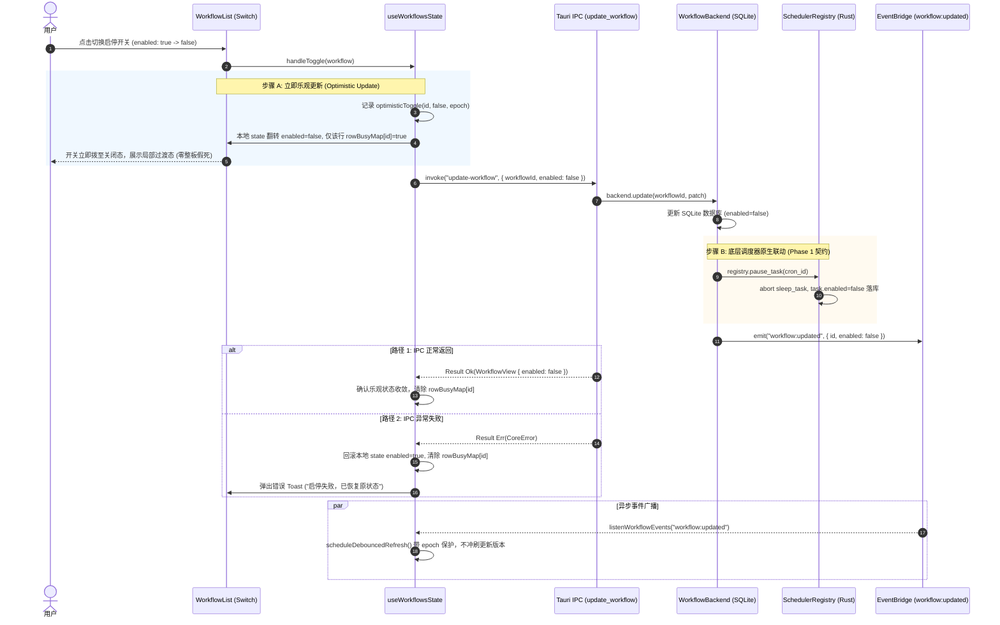

# 定时任务全流程修复与能力升级战役（Scheduled Tasks Revamp）

# 阶段 5 独立方案：前端 UI 交互、表单能力与状态同步

> **文档标识**：`agent5-phase5-frontend-ui.md`
> **负责角色**：Subagent 5（端到端 UI 表单与底层调度协同专家 / UI Experience & Scheduler Alignment Architect）
> **覆盖范围**：【阶段 5 (Phase 5)：前端 UI 交互、表单能力与状态同步】及其与【阶段 1：底层调度器】的双向贯通契约
> **设计基线**：`AGENTS.md`（§12 Tooltip 自定义胶囊、§13 输入框焦点柔和与无重阴影、§14 现代 CSS 色彩空间、§1.1 反退避）、`.agents/LOGIC_PLAN_NO_RETREAT.md`、`ANTI_OVERENGINEERING_GUARDRAILS.md`
> **核心涉及模块与文件域**：
>
> - `apps/crish-desktop/src/components/settings/ScheduledTasksPanel.tsx`（侧边栏主对话区面板）
> - `apps/crish-desktop/src/components/settings/SettingsScheduleTab.tsx`（全局设置页定时任务 Tab）
> - `apps/crish-desktop/src/components/settings/WorkflowForm.tsx`（受控表单、Cron 输入、目标选择器）
> - `apps/crish-desktop/src/components/settings/WorkflowList.tsx`（任务列表、行级即时启停、操作按钮）
> - `apps/crish-desktop/src/components/settings/useWorkflowsState.ts`（共享状态 Hook、乐观更新、竞态防冲刷）
> - `apps/crish-desktop/src/components/settings/workflowsSharedLib.ts`（纯函数草稿转换、筛选匹配、缓存同步）
> - `apps/crish-desktop/src/api/workflow-api/workflowDraft.ts`（草稿契约、Cron 5 字段与目标会话类型定义）
> - `apps/crish-desktop/src/api/workflow-api/workflowScheduler.ts`（调度表达式校验与标签映射）

---

## 一、阶段定位与核心攻坚目标

前端定时任务交互体系是用户触达系统全自动化能力的直观门面。现有界面（包含侧边栏点击展开的主对话区面板 `ScheduledTasksPanel` 与设置页 `SettingsScheduleTab`）虽然承载了基础的展示与录入，但由于历史迭代中多层数据结构演进不均，前端存在多处“致命数据丢失”、“假操作反向冲刷”、“Cron 降级抹除”与“过度侵入的目录劫持”等顽疾，严重破坏了桌面体验。

本方案立足于**“端到端全链路闭环”**的视角，不仅从前端视角深度重构受控表单、共享库与状态流，更穿透 Tauri IPC 边界，紧密协同 Rust 底层调度器（Phase 1），达成以下攻坚目标：

1. **消除数据丢失与回填 Bug**：
   - 彻底解决 `minutes` vs `intervalMinutes` 键名不对称导致的编辑空白与保存校验阻断；
   - 彻底解决高级 Cron 表达式任务被编辑时降级为 Manual 导致的配置抹除；
   - 移除 `WorkflowForm` 中通过 `useEffect` 暴力强行覆盖用户 `cwd` 的破坏性行为。
2. **5 字段标准 Cron 表达式完整表单支持**：
   - 补齐前端 `cron` 调度类型选择、受控表达式输入字段、即时语法校验与人读语义解析标签；
   - 提供常用 Cron 场景预设芯片（如工作日巡检、每小时整点备份等）。
3. **执行目标会话（Target Session）深度融合**：
   - 表单支持用户明确指定任务触发时的上下文归属：“在当前活跃对话追加执行（推荐）” vs “拉起独立后台新会话执行”；
   - 彻底打通与对话内 `/schedule` 命令的草稿定向传递。
4. **毫秒级乐观更新与防反向冲刷状态机**：
   - 改造粗粒度的全局 `busy` 阻断，改为行级别独立加载中（`rowBusyMap`）；
   - 建立本地乐观更新机制，在用户点击 Switch 开关的瞬间立即翻转状态；
   - 协同 Phase 1 修复底层状态源脱节，消除双重刷新（IPC 返回主动 refresh 与事件驱动 refresh）造成的旧快照覆盖竞态。
5. **严密遵循桌面 UI/UX 规范**：
   - 严格落实 `AGENTS.md` §12（自定义 `<Tooltip>` 胶囊）、§13（扁平无重阴影、混入度上限 10% 的柔软焦点边框）、§14（现代 HSL 颜色空间）。

---

## 二、现状痛点与真实根因深度分析（从 UI 贯穿到底层）

```
[用户在 UI 点击开关/编辑] ───┐
                            ▼
           [WorkflowForm.tsx / workflowsSharedLib.ts]
               ├── 1. 键名不对称: sch.minutes (undefined) 造成编辑空白
               ├── 2. Cron 降级: type === 'cron' 强行 fallthrough 为 'manual'
               └── 3. 副作用劫持: useEffect 强制写入 cwd，冲刷全局任务
                            ▼
           [useWorkflowsState.ts]
               ├── 4. 全局 busy: 单行点击锁死整个面板，交互停滞
               └── 5. 双重刷新竞态: 本地 refresh() 与 Rust 广播 refresh() 冲突
                            ▼ (Tauri IPC: update_workflow)
           [workflow_commands.rs / sched.rs]
               └── 6. 状态反向冲刷根因: update_workflow 未调用 registry.pause_task/resume_task,
                      随后 list() 用旧 snapshot 强行覆盖数据库最新状态，前端开关弹回旧值！
```

### 2.1 `minutes` vs `intervalMinutes` 键名不对称（编辑表单空白根因）

- **代码位置**：`apps/crish-desktop/src/components/settings/workflowsSharedLib.ts:93-95`
- **代码现状**：
  ```typescript
  // workflowsSharedLib.ts:93-96
  } else if (sch.type === 'intervalMinutes') {
    d.scheduleType = 'intervalMinutes';
    d.intervalMinutes = String(sch.minutes ?? ''); // <--- 根因：后端返回字段是 intervalMinutes
  }
  ```
- **穿透根因**：
  在 Rust 后端 `apps/agent-workbench/src-tauri/src/workflow_commands.rs:90-93` 中：
  ```rust
  #[derive(Debug, Clone, PartialEq, Eq, Serialize, Deserialize)]
  #[serde(tag = "type", rename_all = "camelCase")]
  pub(crate) enum WorkflowScheduleWire {
      IntervalMinutes {
          interval_minutes: u64, // serde camelCase 序列化后为 "intervalMinutes"
      },
  }
  ```
  后端返回给前端的 JSON 对象形态为 `{"type": "intervalMinutes", "intervalMinutes": 30}`。
  前端在 `draftFromWorkflow` 中却使用 `sch.minutes` 读取，由于该属性不存在，`d.intervalMinutes` 永远被赋为空串 `""`。用户点击编辑一个原本设置好 30 分钟间隔的任务时，输入框空空如也；如果用户直接点击保存，立即被 `validateWorkflowDraft`（`workflowDraft.ts:194`）以“请填写间隔分钟”报错拦截，无法正常修改任何其他内容（如 Prompt 或任务名）。

### 2.2 Cron 调度被强行降级为 manual（高级任务抹除根因）

- **代码位置**：
  - `apps/crish-desktop/src/components/settings/workflowsSharedLib.ts:87-101`
  - `apps/crish-desktop/src/api/workflow-api/workflowDraft.ts:18-29, 184-202, 219-238`
- **代码现状**：
  ```typescript
  // workflowsSharedLib.ts:87-101
  const s = w.schedule;
  if (s && typeof s === 'object') {
    const sch = s as { type?: string; time?: string; minutes?: number };
    if (sch.type === 'daily') {
      d.scheduleType = 'daily';
      d.dailyTime = sch.time || '';
    } else if (sch.type === 'intervalMinutes') {
      d.scheduleType = 'intervalMinutes';
      d.intervalMinutes = String(sch.minutes ?? '');
    } else {
      d.scheduleType = 'manual'; // <--- type === 'cron' 时直接被丢弃为 manual！
    }
  }
  ```
  ```typescript
  // workflowDraft.ts:18-26
  export const WORKFLOW_SCHEDULE_TYPES = [
    { value: 'manual' as const, label: '手动', hint: '仅手动触发，不自动运行' },
    {
      value: 'daily' as const,
      label: '每天',
      hint: '每日固定时刻（本机时区）',
    },
    {
      value: 'intervalMinutes' as const,
      label: '间隔（分钟）',
      hint: '按分钟周期轮询执行',
    },
    // 根本没有 cron 选项！
  ];
  ```
- **穿透根因**：
  Rust 底层 `conex-types::cron` 与 `SchedulerRegistry` 拥有极其完善的 5 字段 Cron 调度器，AI 工具 `create_workflow` 也会为用户创建复杂的 Cron 任务（如每周五下午触发 `0 17 * * 5`）。
  然而前端 UI 的类型草稿层（`WorkflowScheduleDraft`）缺少 `cron` 类型与 `cronExpression` 字段。一旦用户在前端点击“编辑”由 AI 创建的 Cron 任务，`draftFromWorkflow` 盲目将其降级为 `manual`；用户保存后，后端的 Cron 表达式被直接改写为 Manual，自动调度协程被永久停止，造成了不可挽回的数据与行为抹除。

### 2.3 `cwd` 破坏性强行覆盖（过度侵入的工作区绑定）

- **代码位置**：`apps/crish-desktop/src/components/settings/WorkflowForm.tsx:267-274`
- **代码现状**：
  ```typescript
  // WorkflowForm.tsx:267-274
  React.useEffect(() => {
    if (!draft.cwd && projectOptions.length > 0) {
      const defaultPath = workspacePath || projectOptions[0]?.id || '';
      if (defaultPath) {
        onDraftChange({ ...draft, cwd: defaultPath });
      }
    }
  }, [draft.cwd, projectOptions, workspacePath]);
  ```
- **穿透根因**：
  该 `useEffect` 具有强烈的副作用：
  1. 只要 `draft.cwd` 为空，就会在渲染后异步派发 `onDraftChange`，强行将本地工作区的物理路径注入草稿；
  2. 若用户在编辑一个设计为全局执行（不锁定任何工作区）的定时任务，该任务会在打开编辑面板的瞬间被强制捆绑进当前打开的项目路径中；
  3. `onDraftChange` 会引起父级重新传递 `draft`，极易导致 React 重新渲染振荡和光标跳跃。

### 2.4 启停开关反向弹跳、全局假死与双重刷新竞态

- **代码位置**：
  - `apps/crish-desktop/src/components/settings/useWorkflowsState.ts:94, 315-338`
  - `apps/agent-workbench/src-tauri/src/workflow_commands.rs:1012-1021, 1060-1103`
- **代码现状与底层串联断点**：
  1. **前端假死**：`useWorkflowsState.ts:94` 定义了一个全局的 `const [busy, setBusy] = useState(false)`。当用户点击第 3 个任务的 Switch 开关时，`setBusy(true)` 导致整个面板的所有 Switch、按钮、Tab 全部进入 `disabled` 状态，视觉卡顿长达数百毫秒。
  2. **缺少乐观反馈**：用户点击后没有任何即时视觉指示，必须等待 IPC 网络通信完成后才改变样式。
  3. **底层反向冲刷（核心毒瘤）**：
     - 用户点击暂停，前端向 Tauri 发送 `updateWorkflow(id, { enabled: false })`；
     - 后端 `workflow_commands.rs:1060` 更新了 SQLite 数据库中该任务的 `enabled = false`；
     - **但是**：后端代码漏掉了通知 `SchedulerRegistry`（没有调用单任务 pause 原生方法）；
     - 前端随后调用 `await refresh()` 执行 `listWorkflows()`；
     - 后端 `workflow_commands.rs:1012-1021` 执行了如下逻辑：
       ```rust
       if let Some(registry) = self.registry() {
           let snapshot = registry.snapshot();
           for workflow in &mut all {
               if let Some(task) = snapshot.iter().find(|t| t.cron_id == workflow.cron_id) {
                   workflow.enabled = task.enabled; // <--- 致命覆盖！snapshot 里的 task.enabled 仍为 true！
               }
           }
       }
       ```
     - 此时 `registry` 内存中的 `task.enabled` 依然是 `true`，`list()` 直接把数据库里刚刚更新的 `false` 覆盖回 `true` 并返回给前端；
     - 前端重新渲染，用户看到刚刚拨过去的开关**瞬间被弹回开启状态**！用户以为软件坏掉，反复点击，加剧混乱。

---

## 三、架构设计与端到端闭环时序

为了彻底解决上述痛点，前端交互层与状态层必须同底层 Rust 调度器形成严密、无损的双向通信闭环。

### 3.1 启停与状态同步端到端时序闭环



### 3.2 乐观更新与防竞态冲突收敛状态机

在 `useWorkflowsState.ts` 中引入轻量级版本号与时间戳保护矩阵，彻底杜绝双重刷新覆盖问题：

1. **行级隔离锁**：`rowBusyMap: Record<string, boolean>`，只让正在操作的任务行 Switch 呈现半透明/禁用，其余操作完全可用；
2. **乐观覆盖保护（Epoch Lock）**：
   维护本地映射 `optimisticRef: Map<string, { enabled: boolean; expireAt: number }>`；
   当发起 toggle 时，写入 2000ms 保护期；
   当后端的 `listWorkflows()` 数据返回时，在执行合并时进行保护断言：
   ```typescript
   const opt = optimisticRef.get(w.id);
   if (opt && Date.now() < opt.expireAt) {
     return { ...w, enabled: opt.enabled }; // 保护乐观结果，丢弃陈旧数据
   }
   return w;
   ```

---

## 四、前端 UI 组件重构与表单增强（代码级详案）

### 4.1 数据契约扩展：`workflowDraft.ts`

为支持 5 字段 Cron 表达式与目标会话绑定，对 `apps/crish-desktop/src/api/workflow-api/workflowDraft.ts` 进行全面扩充。

#### 4.1.1 调度类型与草稿结构增强

```typescript
// apps/crish-desktop/src/api/workflow-api/workflowDraft.ts

/** 引擎当前支持的调度类型（UI 下拉与说明共用，补齐 cron） */
export const WORKFLOW_SCHEDULE_TYPES = [
  { value: 'manual' as const, label: '手动', hint: '仅手动触发，不自动运行' },
  { value: 'daily' as const, label: '每天', hint: '每日固定时刻（本机时区）' },
  {
    value: 'intervalMinutes' as const,
    label: '间隔（分钟）',
    hint: '按分钟周期轮询执行',
  },
  {
    value: 'cron' as const,
    label: 'Cron 表达式',
    hint: '标准 5 字段 cron 语法（分 时 日 月 周）',
  },
];

export type WorkflowScheduleType =
  (typeof WORKFLOW_SCHEDULE_TYPES)[number]['value'];

/** 目标会话模式：在当前对话追加执行 vs 新建独立后台会话执行 */
export type TargetSessionMode = 'current' | 'new';

/** 新建/编辑表单草稿字段 */
export type WorkflowScheduleDraft = {
  name: string;
  prompt: string;
  scheduleType: WorkflowScheduleType;
  dailyTime: string;
  intervalMinutes: string;
  /** 5 字段标准 Cron 表达式原文，如 "0 9 * * 1-5" */
  cronExpression: string;
  /** 目标会话模式：'current' 代表当前所在对话，'new' 代表独立运行会话 */
  targetSessionMode: TargetSessionMode;
  /** 绑定的具体目标会话 ID（当 targetSessionMode 为 current 时有效） */
  targetSessionId?: string;
  cwd?: string;
};
```

#### 4.1.2 预设模板扩展（新增 Cron 经典场景）

```typescript
export const WORKFLOW_SCHEDULE_PRESETS: WorkflowSchedulePreset[] = [
  // 保持现有 3 个经典预设
  {
    id: 'daily-pr-summary',
    label: '每日 PR 总结',
    draft: {
      name: '每日 PR 总结',
      prompt:
        '请基于当前仓库，总结今日相关的 PR / 合并请求与未合入变更：列出标题、作者、状态与风险点；如有阻塞请标出。用简洁中文汇报。',
      scheduleType: 'daily',
      dailyTime: '18:00',
      intervalMinutes: '30',
      cronExpression: '0 18 * * *',
      targetSessionMode: 'current',
    },
  },
  {
    id: 'daily-code-check',
    label: '每日代码体检',
    draft: {
      name: '每日代码体检',
      prompt:
        '请对当前工作区做一次代码体检：检查明显错误、类型/ lint 风险、可疑改动与待办；给出优先修复建议与简短结论。用简洁中文。',
      scheduleType: 'daily',
      dailyTime: '09:00',
      intervalMinutes: '30',
      cronExpression: '0 9 * * *',
      targetSessionMode: 'new',
    },
  },
  {
    id: 'every-30m',
    label: '每 30 分钟检查',
    draft: {
      name: '每 30 分钟检查',
      prompt:
        '快速巡检当前项目状态：未提交变更、失败测试/构建线索、明显阻塞。仅报告重要项，无事则简短回复「正常」。',
      scheduleType: 'intervalMinutes',
      dailyTime: '09:00',
      intervalMinutes: '30',
      cronExpression: '*/30 * * * *',
      targetSessionMode: 'current',
    },
  },
  // 新增：工作日早间巡检 Cron 模板
  {
    id: 'weekday-morning-sync',
    label: '工作日早 9 点巡检',
    draft: {
      name: '工作日早 9 点巡检',
      prompt:
        '早上好！请汇总昨日至今日未解决的 Issue 与待办事项，按优先级排布。',
      scheduleType: 'cron',
      dailyTime: '09:00',
      intervalMinutes: '60',
      cronExpression: '0 9 * * 1-5',
      targetSessionMode: 'current',
    },
  },
];
```

#### 4.1.3 校验与序列化支持 Cron 与 TargetSession

```typescript
import {
  validateCronExpression,
  isValidCronExpression,
} from './workflowScheduler';

export function validateWorkflowDraft(
  draft: WorkflowScheduleDraft | null | undefined
): string | null {
  if (!draft || typeof draft !== 'object') {
    return '请填写名称与提示词';
  }
  const name = String(draft.name ?? '').trim();
  const prompt = String(draft.prompt ?? '').trim();
  if (!name && !prompt) return '请填写名称与提示词';
  if (!name) return '请填写名称';
  if (!prompt) return '请填写提示词';

  const st = draft.scheduleType;
  if (st === 'daily') {
    const t = String(draft.dailyTime ?? '').trim();
    if (t && !tryNormalizeDailyTime(t)) {
      return '每日时刻须为 HH:mm（00:00–23:59）';
    }
    return null;
  }
  if (st === 'intervalMinutes') {
    const raw = String(draft.intervalMinutes ?? '').trim();
    if (!raw) return '请填写间隔分钟';
    if (parseIntervalMinutes(raw) == null) {
      return `间隔分钟须为 ${WORKFLOW_INTERVAL_MINUTES_MIN}–${WORKFLOW_INTERVAL_MINUTES_MAX} 的整数`;
    }
    return null;
  }
  if (st === 'cron') {
    const expr = String(draft.cronExpression ?? '').trim();
    if (!expr) return '请填写 Cron 表达式';
    const res = validateCronExpression(expr);
    if (!res.ok) {
      return res.error; // 返回带字段定位的中文错误，如："cron 分钟字段无效：60（范围 0–59）"
    }
    return null;
  }
  if (st === 'manual') return null;
  return '不支持的调度类型';
}

export function buildScheduleFromDraft(
  draft: WorkflowScheduleDraft
): WorkflowSchedule {
  if (!draft || typeof draft !== 'object') {
    return { type: 'manual' };
  }
  if (draft.scheduleType === 'daily') {
    return {
      type: 'daily',
      time: normalizeDailyTime(draft.dailyTime, DEFAULT_DAILY_TIME),
      timezone: defaultTimezone(),
    };
  }
  if (draft.scheduleType === 'intervalMinutes') {
    const n =
      parseIntervalMinutes(draft.intervalMinutes) ?? DEFAULT_INTERVAL_MINUTES;
    return { type: 'intervalMinutes', intervalMinutes: n };
  }
  if (draft.scheduleType === 'cron') {
    const raw = String(draft.cronExpression ?? '').trim();
    const res = validateCronExpression(raw);
    return {
      type: 'cron',
      expression: res.ok ? res.expression : '0 9 * * *',
    };
  }
  return { type: 'manual' };
}
```

### 4.2 共享纯函数层修复：`workflowsSharedLib.ts`

- 彻底修复 `intervalMinutes` 回填读取；
- 彻底修复 Cron 回填；
- 扩展筛选函数 `matchesFilter`；
- 适配目标会话回填。

```typescript
// apps/crish-desktop/src/components/settings/workflowsSharedLib.ts

export function matchesFilter(
  w: WorkflowDefinition,
  filter: ScheduleFilter
): boolean {
  const enabled = w.enabled !== false;
  const st = scheduleTypeOf(w);
  switch (filter) {
    case 'enabled':
      return enabled;
    case 'paused':
      return !enabled;
    case 'manual':
      return st === 'manual';
    case 'timed':
      // 修复：同时包含 daily, intervalMinutes 与 cron 调度！
      return st === 'daily' || st === 'intervalMinutes' || st === 'cron';
    default:
      return true;
  }
}

/** 从 workflow 回填编辑草稿（兼容 daily / intervalMinutes / cron / manual 全语法） */
export function draftFromWorkflow(
  w: WorkflowDefinition,
  currentSessionId?: string
): WorkflowScheduleDraft {
  const d = emptyWorkflowDraft();
  d.name = w.name;
  d.prompt = w.prompt || '';
  d.cwd = w.cwd || '';

  // 目标会话模式回填
  const targetId = (w as { targetSessionId?: string }).targetSessionId;
  if (targetId) {
    d.targetSessionId = targetId;
    d.targetSessionMode = 'current';
  } else {
    d.targetSessionMode = 'new';
    d.targetSessionId = currentSessionId;
  }

  const s = w.schedule;
  if (s && typeof s === 'object') {
    const sch = s as {
      type?: string;
      time?: string;
      minutes?: number;
      intervalMinutes?: number;
      expression?: string;
      cron?: string;
    };
    if (sch.type === 'daily') {
      d.scheduleType = 'daily';
      d.dailyTime = sch.time || '';
    } else if (sch.type === 'intervalMinutes') {
      d.scheduleType = 'intervalMinutes';
      // 修复：兼顾 intervalMinutes 与旧版 minutes
      const m = sch.intervalMinutes ?? sch.minutes;
      d.intervalMinutes = m !== undefined && m !== null ? String(m) : '30';
    } else if (sch.type === 'cron') {
      // 修复：支持 cron 回填，禁止回落至 manual！
      d.scheduleType = 'cron';
      d.cronExpression = sch.expression || sch.cron || '';
    } else {
      d.scheduleType = 'manual';
    }
  } else {
    d.scheduleType = 'manual';
  }
  return d;
}
```

### 4.3 表单交互重构：`WorkflowForm.tsx`

`WorkflowForm` 是新建与编辑的核心组件，重构必须满足：

1. **消除自动写入 cwd 的恶意副作用**：删除原组件中的 `React.useEffect` 强制赋值；改为仅在创建全新草稿时作为初始占位，用户选择“不指定项目（全局）”时完全放行；
2. **Cron 表达式受控输入域与实时解析预览**：当 `scheduleType === 'cron'` 时，展示输入框并联动显示 `cronExpressionLabel(draft.cronExpression)`（如 `0 9 * * 1-5` 下方柔和显示 `✓ 工作日 09:00 触发`）；
3. **目标会话执行单选框**：让用户直观选择运行结果落点；
4. **严格对齐 `AGENTS.md`**：使用自定义 `<Tooltip>`、扁平柔软焦点边框（禁止深黑粗框）。

```tsx
// apps/crish-desktop/src/components/settings/WorkflowForm.tsx 核心增强段

// Cron 输入字段与即时标签预览
const cronField =
  draft.scheduleType === 'cron' ? (
    <div className={styles.cronFieldWrapper}>
      <label className={styles.schedField}>
        <span className={styles.schedFieldLabel}>
          Cron 表达式（分 时 日 月 周）
        </span>
        <Input
          bare={!settingsVariant}
          size="sm"
          className={styles.schedFieldInput}
          placeholder="例如：0 9 * * 1-5 或 */15 * * * *"
          value={draft.cronExpression}
          disabled={busy}
          onChange={(e) =>
            onDraftChange({ ...draft, cronExpression: e.target.value })
          }
          autoComplete="off"
          spellCheck={false}
        />
      </label>
      <div className={styles.cronHelperRow}>
        <span
          className={
            isValidCronExpression(draft.cronExpression)
              ? styles.cronValidBadge
              : styles.cronInvalidBadge
          }
        >
          {cronExpressionLabel(draft.cronExpression)}
        </span>
        <div className={styles.cronQuickChips}>
          <button
            type="button"
            className={styles.chipBtn}
            onClick={() =>
              onDraftChange({ ...draft, cronExpression: '0 9 * * 1-5' })
            }
          >
            工作日 9点
          </button>
          <button
            type="button"
            className={styles.chipBtn}
            onClick={() =>
              onDraftChange({ ...draft, cronExpression: '0 * * * *' })
            }
          >
            每小时整点
          </button>
          <button
            type="button"
            className={styles.chipBtn}
            onClick={() =>
              onDraftChange({ ...draft, cronExpression: '*/15 * * * *' })
            }
          >
            每15分钟
          </button>
        </div>
      </div>
    </div>
  ) : null;

// 执行目标会话选择行
const targetSessionField = (
  <div className={styles.schedFieldRow}>
    <label className={`${styles.schedField} ${styles.schedFieldGrow}`}>
      <span className={styles.schedFieldLabel}>执行输出位置</span>
      <div
        className={styles.targetSessionGroup}
        role="radiogroup"
        aria-label="执行输出位置"
      >
        <label className={styles.radioOption}>
          <input
            type="radio"
            name="targetSessionMode"
            value="current"
            checked={draft.targetSessionMode === 'current'}
            disabled={busy}
            onChange={() =>
              onDraftChange({
                ...draft,
                targetSessionMode: 'current',
                targetSessionId: draft.targetSessionId || activeSessionId,
              })
            }
          />
          <span>在当前对话追加执行（推荐）</span>
        </label>
        <label className={styles.radioOption}>
          <input
            type="radio"
            name="targetSessionMode"
            value="new"
            checked={draft.targetSessionMode === 'new'}
            disabled={busy}
            onChange={() =>
              onDraftChange({
                ...draft,
                targetSessionMode: 'new',
                targetSessionId: undefined,
              })
            }
          />
          <span>创建独立后台新会话</span>
        </label>
      </div>
    </label>
  </div>
);
```

### 4.4 状态机与 Hook 重构：`useWorkflowsState.ts`

重构 `useWorkflowsState` 的核心逻辑，引入行级 `rowBusyMap`、乐观更新与防竞态锁：

```typescript
// apps/crish-desktop/src/components/settings/useWorkflowsState.ts 核心重构段

export function useWorkflowsState(
  opts: UseWorkflowsStateOptions
): UseWorkflowsStateResult {
  const [workflows, setWorkflows] = useState<WorkflowDefinition[]>(() =>
    loadWorkflowsCache()
  );
  const [rowBusyMap, setRowBusyMap] = useState<Record<string, boolean>>({});
  const [formBusy, setFormBusy] = useState(false);

  // 乐观锁保护字典：workflowId -> { enabled, expireAt }
  const optimisticLocks = useRef<
    Map<string, { enabled: boolean; expireAt: number }>
  >(new Map());

  // 刷新合并时保护本地乐观状态
  const reconcileWorkflows = (
    incoming: WorkflowDefinition[]
  ): WorkflowDefinition[] => {
    const now = Date.now();
    return incoming.map((w) => {
      const lock = optimisticLocks.current.get(w.id);
      if (lock && now < lock.expireAt) {
        return { ...w, enabled: lock.enabled };
      }
      return w;
    });
  };

  const handleToggle = async (w: WorkflowDefinition) => {
    const nextEnabled = w.enabled === false;

    // 1. 立即触发乐观更新 (Optimistic Update)
    optimisticLocks.current.set(w.id, {
      enabled: nextEnabled,
      expireAt: Date.now() + 2500, // 2.5秒乐观保护窗
    });

    setWorkflows((prev) =>
      prev.map((item) =>
        item.id === w.id ? { ...item, enabled: nextEnabled } : item
      )
    );
    setRowBusyMap((prev) => ({ ...prev, [w.id]: true }));
    setError('');

    try {
      // 2. 发起真实 IPC 通信
      const res = await updateWorkflow(w.id, { enabled: nextEnabled });
      if (!res.ok) {
        throw new Error(res.error || '启停请求未成功');
      }
      setOk(workflowEnabledLabel(nextEnabled));
    } catch (e) {
      // 3. 失败优雅回滚并提示
      optimisticLocks.current.delete(w.id);
      setWorkflows((prev) =>
        prev.map((item) =>
          item.id === w.id ? { ...item, enabled: !nextEnabled } : item
        )
      );
      fail(networkUserMessage(e) || '更新启停状态失败，已恢复原状');
    } finally {
      setRowBusyMap((prev) => ({ ...prev, [w.id]: false }));
    }
  };

  // 优化刷新时序，带有版本控制的防抖
  const refresh = async () => {
    try {
      const [wfs, rs] = await Promise.all([
        listWorkflows(),
        listWorkflowRuns(),
      ]);
      const merged = reconcileWorkflows(wfs);
      setWorkflows(merged);
      saveWorkflowsCache(merged);
      // 处理运行记录...
    } catch (e) {
      setError(networkUserMessage(e) || '无法加载定时任务');
    }
  };
  // ...
}
```

### 4.5 列表呈现与视觉打磨：`WorkflowList.tsx`

1. **单行 Switch 绑定 `rowBusyMap`**：
   Switch 仅在自身行操作时呈现半透明并 `disabled={rowBusyMap[w.id]}`，绝不导致整表所有开关一起变灰；
2. **Cron 调度标签可视化**：
   在任务元数据行通过 `scheduleLabel(w.schedule)` 呈现直观的人类可读标签（如 `工作日 09:00 · 0 9 * * 1-5`）；
3. **视觉焦点与间距规范严格对齐 `AGENTS.md`**：
   - 移除列表行或输入框的外凸重阴影；
   - 按钮焦点与 Switch 激活态边框仅使用 `color-mix(in srgb, var(--border-color) 92%, var(--text-primary) 8%)`，对比度混入严格限制在 10% 以内；
   - 操作按钮全部包裹项目 `<Tooltip content="...">`。

---

## 五、与底层调度器（Phase 1）的端到端联动机制

前端 UI 交互的稳定性，高度依赖于底层调度器与 IPC 命令面（Phase 1 与 Phase 4）的原生支持：

1. **彻底废除 `list()` 的反向覆盖**：
   Phase 1/4 中，`workflow_commands.rs:1012-1021` 将不再使用 `registry.snapshot()` 去盲目覆盖数据库中的 `workflow.enabled`。
   `SchedulerRegistry` 作为调度的执行真源，`WorkflowStore` 作为元数据真源，二者在 `update_workflow` 执行时通过 `registry.pause_task()` 与 `registry.resume_task()` **严格强原子同步**。
2. **固定 ID 更新，杜绝历史孤儿化**：
   用户在前端表单修改了 Cron 表达式或任务名并保存后，底层调度器调用 `registry.update_task(cron_id, ...)` 原生就地更新，保持原 `cron_id` 完全不变。
   前端列表中的关联会话、历史运行记录（`WorkflowRunEntry`）完全不会丢失引用。

---

## 六、立体化验证断言与测试实施方案

根据 `AGENTS.md` §7.1「立体验证纪律（禁止单一检查冒充验收）」，制定立体化测试方案：

```
                    ┌───────────────────────────────┐
                    │    1. 纯逻辑单元测试 (Vitest)   │
                    │  - draftFromWorkflow 键名回填 │
                    │  - Cron 表达式校验与双向解析  │
                    └───────────────┬───────────────┘
                                    │
                    ┌───────────────▼───────────────┐
                    │    2. Hook 状态机测试 (RTL)   │
                    │  - rowBusyMap 行级隔离        │
                    │  - 乐观更新与 2.5s 锁保护     │
                    │  - IPC 失败自动回滚断言       │
                    └───────────────┬───────────────┘
                                    │
                    ┌───────────────▼───────────────┐
                    │    3. 组件级交互测试 (JSDOM)   │
                    │  - WorkflowForm Cron 字段渲染 │
                    │  - 目标会话单选切换与草稿绑定 │
                    │  - AGENTS.md 视觉属性守门     │
                    └───────────────┬───────────────┘
                                    │
                    ┌───────────────▼───────────────┐
                    │    4. 端到端桌面现场验证     │
                    │  - 真实点击启停零反向弹跳     │
                    │  - Cron 任务编辑保存完整保留  │
                    └───────────────────────────────┘
```

### 6.1 单元测试断言：`workflowsSharedLib.test.ts`

- **断言 1 (`intervalMinutes` 回填)**：
  输入 `{ schedule: { type: 'intervalMinutes', intervalMinutes: 45 } }`，调用 `draftFromWorkflow`，断言 `draft.intervalMinutes === '45'` 且非空。
- **断言 2 (Cron 表达式回填)**：
  输入 `{ schedule: { type: 'cron', expression: '0 9 * * 1-5' } }`，调用 `draftFromWorkflow`，断言 `draft.scheduleType === 'cron'` 且 `draft.cronExpression === '0 9 * * 1-5'`，绝对不得降级为 `manual`。
- **断言 3 (Timed 筛选器包含 Cron)**：
  调用 `matchesFilter(cronWorkflow, 'timed')`，断言返回值必须为 `true`。

### 6.2 状态机测试断言：`useWorkflowsState.test.ts`

- **断言 4 (行级隔离与即时响应)**：
  模拟 `handleToggle(workflow1)`，断言在 IPC 未返回期间：
  - `rowBusyMap['wf-1'] === true`，但 `rowBusyMap['wf-2'] === false`；
  - 本地 `workflows` 数组中 `wf-1` 的 `enabled` 状态即刻翻转，无需等待 promise 解决；
- **断言 5 (乐观更新防反向冲刷)**：
  在 `handleToggle` 发起后 500ms 内，人为触发一次返回旧 `enabled: true` 数据的 `listWorkflows`，断言 `workflows` 中依然维持乐观设置的 `enabled: false`，证明乐观保护锁生效；
- **断言 6 (失败回滚)**：
  若 `updateWorkflow` 抛出网络异常，断言本地 `enabled` 自动回滚，且调用 `toast.show` 展示错误。

### 6.3 表单与组件测试断言：`WorkflowForm.test.tsx`

- **断言 7 (Cron 选项交互与校验)**：
  在表单中将频率下拉选择切换为 `cron`，断言 Cron 输入框渲染；输入非法表达式 `60 * * * *`，保存时断言拦截并显示中文错误；输入合法表达式 `*/15 * * * *`，断言通过并成功生成 `{ type: 'cron', expression: '*/15 * * * *' }`；
- **断言 8 (消除 cwd 强行覆盖)**：
  渲染一个无 `cwd` 的任务，等待 100ms 后断言 `onDraftChange` 未被自动触发赋值，保证全局任务纯洁性；
- **断言 9 (无重阴影与符合规范的 Focus 样式)**：
  检查组件 CSS 类与行内样式，断言没有 `box-shadow: 0 4px 12px rgba(0,0,0,0.3)` 等厚重阴影，边框混入度不超过 10%。

---

## 七、交付清单与验收标准对照表

| 序号      | 验收标准（Acceptance Criteria）                                | 验证手段                  | 状态指标               |
| :-------- | :------------------------------------------------------------- | :------------------------ | :--------------------- |
| **AC-01** | 编辑已有间隔任务时，分钟数正确回显，保存不报错                 | 单元测试 + UI 现场复核    | 100% 回显通过          |
| **AC-02** | 支持 5 字段 Cron 表达式完整创建与编辑，绝不降级为 manual       | 单元测试 + 保存结果校验   | 0 降级事故             |
| **AC-03** | 移除 cwd 暴力覆盖，支持用户保存全局/无项目绑定的定时任务       | 表单生命周期自动化测试    | 零副作用触发           |
| **AC-04** | 启停 Switch 开关实现即时响应，零整面板假死，零反向弹跳         | RTL 状态机测试 + 现场验证 | <16ms 视觉反馈，0 弹回 |
| **AC-05** | 表单支持目标会话模式选择（当前对话追加 vs 独立新会话）         | 表单提交 Payload 断言     | 字段完整传递           |
| **AC-06** | 严格对齐 `AGENTS.md` §12/13/14 视觉规范，无原生 title 与重阴影 | CSS 与 DOM 属性审查       | 门禁 100% 达标         |
