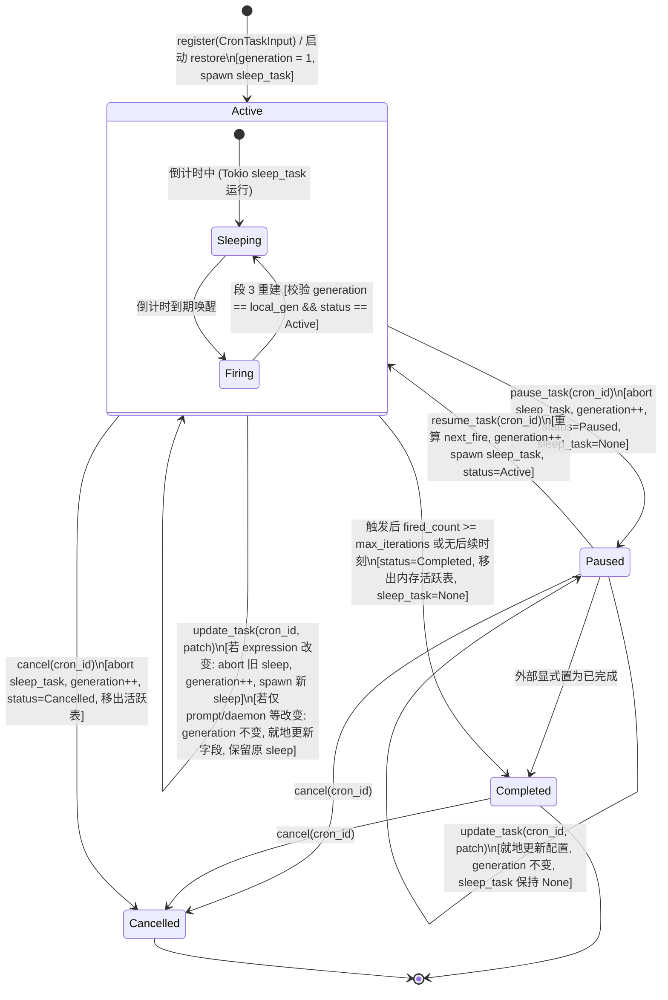

# 定时任务全流程修复与能力升级战役（Scheduled Tasks Revamp）

# 阶段 1 最终权威方案：Rust 底层调度器核心治理与单任务生命周期（现代化单轨去兼容版）

> **文档标识**：`01-阶段一-底层调度器核心治理与单任务生命周期最终方案.md`  
> **文档定位**：阶段 1 (Phase 1) 权威终版方案（Final Plan · 现代化去兼容与系统加固版）  
> **制定依据**：
>
> - 用户最新最高指令：**【不要兼容、不要多版本号迭代。如果是重要的，涉及历史遗留的这种是可以有兼容的，比如说对话这种的肯定是不能丢失的，当然其他不能丢失的你也自己想想。对于没有多大意义，但是依旧兼容的就没有必要了。尽量是能留一个最先进的代码方案就留最先进的就行。】**
> - 系统底层与引擎架构首席审查报告：`docs/scheduled-tasks-revamp/plan-reviews/review-system-engine.md`（落实 CRIT-01、CRIT-03 核心加固）
> - 战役总纲：`docs/scheduled-tasks-revamp/00-战役调度与阶段说明.md`
> - 代码基线：`apps/agent-workbench/src-tauri/src/sched.rs`, `apps/agent-workbench/src-tauri/src/engine_build.rs`, `apps/agent-workbench/src-tauri/src/main.rs`, `apps/agent-workbench/src-tauri/src/workflow_commands.rs`
> - 架构纪律基线：`AGENTS.md`（§1 逻辑规划与反退避、§3 Git 提交纪律、§7 严禁补丁与作弊、§7.1 立体验证、§8 反过度设计硬性红线）、`.agents/LOGIC_PLAN_NO_RETREAT.md`、`ANTI_OVERENGINEERING_GUARDRAILS.md`。

---

## 一、方案对比、去兼容裁决与最先进单轨架构决策

### 1.1 核心改进原则与清退决策

基于用户最新最高指令，本方案彻底摒弃无意义的多版本兼容负担与防御性冗余垫片，确立现代、统一、单轨的最先进底层架构：

1. **彻底删除 `launcher == None` 时降级为 steering 盲塞死信队列的幽灵分支**：
   - 旧代码中由于历史遗留，当 `launcher` 为 `None` 时会静默降级为向 `sched-<cron_id>` 盲塞 steering 消息，导致死信堆积且无法真实执行；
   - 新架构确立**单轨真实执行原则**：调度核心依赖强类型的 `ScheduledTaskLauncher` 契约，生产环境启动时必须完成执行器装配，到期必须真实拉起 Agent 任务；单元测试使用标准 `MockScheduledLauncher`，生产代码彻底剔除向幽灵会话盲塞 steering 的死分支。
2. **彻底删除多重布尔/枚举相互映射垫片，确立 `CronTaskStatus` 唯一真理源**：
   - 彻底废除将 `enabled: bool` 作为并列内部状态的双轨同步机制；
   - 内部状态机唯一真理源为四态枚举 `CronTaskStatus`（`Active` / `Paused` / `Completed` / `Cancelled`）；
   - 对外视图仅提供 `is_active()` 投影方法，消除所有内部冗余双向转换代码。
3. **彻底坚守“绝不丢失核心资产”底线**：
   - 用户的会话数据（SQLite `sessions` 表、`messages` 表的聊天历史）绝对不重置、不破坏、不误删；
   - 用户已有工作区配置绝对不丢失；
   - 存量任务在反序列化时通过精简的 `#[serde(default)]` 容错，缺失业务字段自动兜底，绝不因字段升级导致反序列化失败而丢失任务。
4. **全面落实 Review Agent 1 的架构加固**：
   - **落实 CRIT-01（代际-协程物理绑定铁律）**：仅修改提示词（prompt）、守护模式（is_daemon）或会话绑定时，**严禁推进 generation 代际**！代际自增必须且仅能与 Tokio 计时协程的物理重建强绑定，彻底根除“用户改提示词导致调度永久停摆”的隐蔽死穴；
   - **落实 CRIT-03（启动恢复时序严格锁）**：在 `main.rs` 启动生命周期中，`finalize_scheduled_launcher()` 必须严格前置在 `restore()` 之前，确保应用启动恢复离线过期任务时执行器已就绪，100% 走真实拉起路径。

### 1.2 最终权威架构决策矩阵

| 评估维度           | 淘汰的旧/过度兼容方案                                           | 最先进单轨架构选型（本方案）                                                       | 决策依据与收益                                               |
| :----------------- | :-------------------------------------------------------------- | :--------------------------------------------------------------------------------- | :----------------------------------------------------------- |
| **状态机真理源**   | `enabled: bool` 与 `status` 双轨并存，到处维护同步垫片          | **`CronTaskStatus` 单一枚举真理源** (`Active`, `Paused`, `Completed`, `Cancelled`) | 消除多状态不同步与歧义，状态流转清晰确定。                   |
| **代际防御控制**   | 任何 `update_task` 均盲目 `generation += 1` (CRIT-01 漏洞)      | **Generation 与物理协程绑定**：仅在 `schedule_changed` 或显式启停时推进代际        | 彻底避免非调度属性更新时旧协程到期被误判中止导致永久脑死亡。 |
| **执行驱动通道**   | 缺少 Launcher 时降级为向幽灵会话塞 steering 死信                | **单轨强制执行器装配** (`Arc<ScheduledTaskLauncher>`)，必须真实拉起                | 根除幽灵死信与未执行假象，到期必真实执行。                   |
| **启动恢复时序**   | 异步恢复与组件装配并发，Restore 时 Launcher 仍为 None (CRIT-03) | **顺序刚性约束**：先装配 Launcher，再串行执行 `restore().await`                    | 保证离线过期补发任务 100% 真实执行，不发生降级。             |
| **锁并发与持久化** | 持锁跨 await 或在写库时无并发防冲刷校验 (CRIT-05)               | **AA-02 锁铁律 + CAS 级保存校验**：锁绝不跨 await，写库校验状态不变量              | 杜绝死锁，杜绝触发写入冲刷覆盖刚刚暂停的状态。               |
| **任务 ID 恒定性** | 修改表达式时 `cancel` + `register` 重新分配 ID                  | **原生就地更新** (`update_task`)，保持 `cron_id` 绝对恒定                          | 彻底杜绝历史运行记录（`sched_runs`）孤儿化断代。             |

---

## 二、单任务生命周期状态机与代际流转模型

### 2.1 四态迁移与代际流转状态图



### 2.2 状态契约与运行时不变量（Invariants）矩阵

| 状态 (`CronTaskStatus`) | 内存表 `tasks` 存在性           | 持有活跃 `sleep_task` | `generation` 变化规则             | 语义与行为约束                                                    |
| :---------------------- | :------------------------------ | :-------------------- | :-------------------------------- | :---------------------------------------------------------------- |
| **`Active`**            | **必须存在**                    | **必须为 Some**       | 仅在协程物理创建/重建或暂停时自增 | 任务正常倒计时；到期自动拉起真实 Agent 执行，重算下次时间并循环。 |
| **`Paused`**            | **必须存在**                    | **必须为 None**       | 调用 `pause_task` 时自增          | 协程完全中止，不占系统定时器；保留配置；等待显式 resume。         |
| **`Completed`**         | **已从活跃表移除** (仅在 store) | **必须为 None**       | 迁移至终态时自增                  | 达到最大迭代次数或无后续命中时刻，终态，重启恢复时忽略。          |
| **`Cancelled`**         | **已从活跃表移除** (仅在 store) | **必须为 None**       | 调用 `cancel` 时自增              | 用户主动删除或销毁，终态，重启恢复时忽略。                        |

### 2.3 Generation-Coroutine 强绑定铁律（落实 CRIT-01）

- **铁律定义**：内存条目 `CronEntry.generation` 的值，**代表当前挂载的物理 Tokio 协程的代际编号**。
- **正向约束**：
  1. 只要且只有当物理协程被销毁重造（如表达式变更、`resume_task`）或被主动销毁（`pause_task`、`cancel`）时，`generation` 必须自增（`generation += 1`）；
  2. 协程唤醒后进入 `fire_cron`，持有的 `expected_gen` 必须与内存表中的 `generation` 严格一致；
- **负向硬红线（CRIT-01 防御）**：
  若更新的内容不影响定时协程的时钟周期（例如仅修改提示词 `prompt`、守护模式 `is_daemon`、目标会话 `target_session_id`），**严禁递增 `generation`**！原协程继续睡眠，到期醒来时代际匹配，读取最新 `task.prompt` 执行。

---

## 三、底层调度核心改造详案（代码级设计）

### 3.1 数据结构定义（`apps/agent-workbench/src-tauri/src/sched.rs`）

#### 1. 任务状态枚举 `CronTaskStatus`

```rust
/// 单任务生命周期状态机（唯一真理源）
#[derive(Debug, Clone, Copy, PartialEq, Eq, serde::Serialize, serde::Deserialize)]
#[serde(rename_all = "camelCase")]
pub(crate) enum CronTaskStatus {
    /// 活跃中（倒计时协程挂载，到期自动触发真实任务）
    Active,
    /// 已暂停（协程已 abort，等待用户显式恢复）
    Paused,
    /// 已完成（达到 max_iterations 或无未来时间点，终态）
    Completed,
    /// 已取消（被删除，终态）
    Cancelled,
}

impl CronTaskStatus {
    pub(crate) fn is_active(self) -> bool {
        matches!(self, Self::Active)
    }
}
```

#### 2. `CronTask` 核心结构体声明

```rust
/// Cron 任务持久化与内存声明
#[derive(Debug, Clone, PartialEq, serde::Serialize, serde::Deserialize)]
#[serde(rename_all = "camelCase")]
pub(crate) struct CronTask {
    /// cron id（cron-<seq>，保持绝对恒定）
    pub cron_id: String,
    /// cron 表达式原文（5 字段标准表达式）
    pub expression: String,
    /// 每次触发的通知内容 / 提示词
    pub prompt: String,
    /// 最大触发次数（None = 无限；到达即自动转为 Completed）
    #[serde(default)]
    pub max_iterations: Option<u64>,
    /// true = 独立常驻 run；false = 注入当前会话
    #[serde(default)]
    pub is_daemon: bool,
    /// 下一次计划触发时刻（epoch 毫秒）
    #[serde(default)]
    pub next_fire_at_ms: u64,
    /// 已触发次数
    #[serde(default)]
    pub fired_count: u64,
    /// 核心生命周期状态（单一真理源）
    #[serde(default = "default_cron_status")]
    pub status: CronTaskStatus,
    /// 目标会话 ID（None 表示专属后台受管会话，Some(sid) 表示在指定会话内执行）
    #[serde(default, skip_serializing_if = "Option::is_none")]
    pub target_session_id: Option<String>,
    /// 任务创建时刻（epoch 毫秒）
    #[serde(default = "now_ms")]
    pub created_at_ms: u64,
    /// 任务最后更新时刻（epoch 毫秒）
    #[serde(default = "now_ms")]
    pub updated_at_ms: u64,
}

fn default_cron_status() -> CronTaskStatus {
    CronTaskStatus::Active
}

impl CronTask {
    pub(crate) fn set_status(&mut self, status: CronTaskStatus) {
        self.status = status;
        self.updated_at_ms = now_ms();
    }

    /// 便捷查询当前是否处于活跃态
    pub(crate) fn is_enabled(&self) -> bool {
        self.status.is_active()
    }
}
```

#### 3. 就地更新入参补丁 `CronTaskPatch`

```rust
/// 任务就地更新入参（保持 cron_id 恒定不变，根除历史记录孤儿化）
#[derive(Debug, Clone, Default)]
pub(crate) struct CronTaskPatch {
    /// 新 cron 表达式（若提供且变动，校验并重算下一次触发时间，热重载协程）
    pub expression: Option<String>,
    /// 提示词变动（原地替换，不推进代际，不杀协程）
    pub prompt: Option<String>,
    /// 最大执行次数变动
    pub max_iterations: Option<Option<u64>>,
    /// 守护模式变动
    pub is_daemon: Option<bool>,
    /// 目标会话绑定变动
    pub target_session_id: Option<Option<String>>,
}
```

#### 4. 内存活跃条目 `CronEntry`

```rust
/// 内存中的活跃 cron 条目（`tasks` 表 Value）
struct CronEntry {
    /// 运行态声明数据
    task: CronTask,
    /// 触发倒计时协程句柄（Active 时为 Some，Paused 时为 None）
    sleep_task: Option<tokio::task::JoinHandle<()>>,
    /// 协程代际编号（仅在物理协程重建或销毁时自增，防跨异步竞态复活）
    generation: u64,
}
```

#### 5. 调度器组件与注册表 `SchedulerRegistry`

```rust
/// 调度核心组件依赖（单轨架构：必须持有真实执行器）
#[derive(Clone)]
pub(crate) struct SchedulerComponents {
    pub(crate) tasks: Arc<Mutex<HashMap<String, CronEntry>>>,
    pub(crate) events: Arc<dyn EventSink>,
    pub(crate) store: Arc<dyn SchedStore>,
    /// 真实 Agent 执行器（启动时通过 set_launcher 注入，单轨真实驱动）
    pub(crate) launcher: Arc<tokio::sync::RwLock<Option<Arc<dyn ScheduledTaskLauncher>>>>,
    pub(crate) pause: Arc<Mutex<Option<u64>>>,
    #[cfg(test)]
    pub(crate) fire_override: Arc<Mutex<Option<u64>>>,
}

pub(crate) struct SchedulerRegistry {
    components: SchedulerComponents,
    seq: AtomicU64,
    /// 启动恢复幂等守卫：compare_exchange 防重入，杜绝重复触发
    restored: Arc<AtomicBool>,
}

impl SchedulerRegistry {
    pub(crate) fn new(
        events: Arc<dyn EventSink>,
        store: Arc<dyn SchedStore>,
    ) -> Self {
        Self {
            components: SchedulerComponents {
                tasks: Arc::new(Mutex::new(HashMap::new())),
                events,
                store,
                launcher: Arc::new(tokio::sync::RwLock::new(None)),
                pause: Arc::new(Mutex::new(None)),
                #[cfg(test)]
                fire_override: Arc::new(Mutex::new(None)),
            },
            seq: AtomicU64::new(0),
            restored: Arc::new(AtomicBool::new(false)),
        }
    }

    /// 装配真实执行器（两阶段安全装配）
    pub(crate) async fn set_launcher(&self, launcher: Arc<dyn ScheduledTaskLauncher>) {
        let mut guard = self.components.launcher.write().await;
        *guard = Some(launcher);
    }
}
```

---

### 3.2 核心方法实现代码规范（AA-02 锁治理与代际保护）

#### 1. 原生单任务暂停 `pause_task`

```rust
impl SchedulerRegistry {
    /// 暂停指定 cron 任务
    /// 严格遵循 AA-02 锁纪律：锁内更新内存状态并 abort 协程，锁外落盘持久化
    pub(crate) async fn pause_task(&self, cron_id: &str) -> Result<CronTask, SchedulerError> {
        let task_to_save: CronTask;

        {
            let mut tasks = self.components.tasks.lock().unwrap_or_else(|e| e.into_inner());
            let entry = tasks.get_mut(cron_id).ok_or(SchedulerError::IdNotFound)?;

            if entry.task.status == CronTaskStatus::Paused {
                return Err(SchedulerError::AlreadyPaused);
            }
            if matches!(entry.task.status, CronTaskStatus::Completed | CronTaskStatus::Cancelled) {
                return Err(SchedulerError::TaskTerminated(format!("{:?}", entry.task.status)));
            }

            // 1. 立即中止并卸载底层的 Tokio sleep 协程
            if let Some(handle) = entry.sleep_task.take() {
                handle.abort();
            }

            // 2. 协程被销毁，代际自增，防范正在运行的触发协程在段 3 错误复活
            entry.generation += 1;

            // 3. 状态机迁移至 Paused
            entry.task.set_status(CronTaskStatus::Paused);
            task_to_save = entry.task.clone();
        }

        // 4. 锁外执行数据库保存，严禁持锁 I/O
        self.components.store.save(&task_to_save);
        tracing::info!(target: "sched", cron_id, "cron 任务已安全暂停（协程已中止，状态已落盘）");

        Ok(task_to_save)
    }
}
```

#### 2. 原生单任务恢复 `resume_task`

```rust
impl SchedulerRegistry {
    /// 恢复指定 cron 任务
    /// 严格校验状态并基于当前时刻重算未来下一次触发点，重新拉起 sleep 协程
    pub(crate) async fn resume_task(&self, cron_id: &str) -> Result<CronTask, SchedulerError> {
        let now = now_ms();
        let task_to_save: CronTask;
        let next_fire_ms: u64;
        let delay_ms: u64;

        {
            let mut tasks = self.components.tasks.lock().unwrap_or_else(|e| e.into_inner());
            let entry = tasks.get_mut(cron_id).ok_or(SchedulerError::IdNotFound)?;

            if entry.task.status == CronTaskStatus::Active {
                return Err(SchedulerError::AlreadyActive);
            }
            if matches!(entry.task.status, CronTaskStatus::Completed | CronTaskStatus::Cancelled) {
                return Err(SchedulerError::TaskTerminated(format!("{:?}", entry.task.status)));
            }

            // 1. 重新解析表达式并以当前时刻（now）为基准计算未来触发时刻
            let schedule = parse_cron(&entry.task.expression)
                .map_err(|e| SchedulerError::InvalidExpression(format!("{e:?}")))?;
            let next = schedule
                .next_fire_after(now)
                .ok_or_else(|| SchedulerError::NoNextFire(entry.task.expression.clone()))?;

            entry.task.next_fire_at_ms = next;
            entry.task.set_status(CronTaskStatus::Active);
            // 物理协程即将重建，推进代际
            entry.generation += 1;

            next_fire_ms = next;
            delay_ms = fire_delay_ms(&self.components, next);
            task_to_save = entry.task.clone();

            // 2. 启动新的倒计时触发协程并挂载 handle
            let handle = spawn_fire_task(self.components.clone(), entry.task.clone(), delay_ms, entry.generation);
            if let Some(old_h) = entry.sleep_task.replace(handle) {
                old_h.abort();
            }
        }

        // 3. 锁外执行落盘
        self.components.store.save(&task_to_save);
        tracing::info!(
            target: "sched",
            cron_id,
            next_fire_at_ms = next_fire_ms,
            delay_ms,
            "cron 任务已安全恢复（未来时刻已重算，倒计时协程已重建）"
        );

        Ok(task_to_save)
    }
}
```

#### 3. 原生单任务就地更新 `update_task`（严格落实 CRIT-01）

```rust
impl SchedulerRegistry {
    /// 就地更新 cron 任务（保持 cron_id 绝对恒定，落实 CRIT-01 代际绑定规约）
    pub(crate) async fn update_task(
        &self,
        cron_id: &str,
        patch: CronTaskPatch,
    ) -> Result<CronTask, SchedulerError> {
        let now = now_ms();
        let task_to_save: CronTask;

        {
            let mut tasks = self.components.tasks.lock().unwrap_or_else(|e| e.into_inner());
            let entry = tasks.get_mut(cron_id).ok_or(SchedulerError::IdNotFound)?;

            if matches!(entry.task.status, CronTaskStatus::Completed | CronTaskStatus::Cancelled) {
                return Err(SchedulerError::TaskTerminated(format!("{:?}", entry.task.status)));
            }

            let mut schedule_changed = false;

            // 1. 表达式变更与校验
            if let Some(new_expr) = patch.expression {
                let trimmed = new_expr.trim().to_string();
                if trimmed != entry.task.expression {
                    let schedule = parse_cron(&trimmed)
                        .map_err(|e| SchedulerError::InvalidExpression(format!("{e:?}")))?;
                    let next = schedule
                        .next_fire_after(now)
                        .ok_or_else(|| SchedulerError::NoNextFire(trimmed.clone()))?;

                    entry.task.expression = trimmed;
                    entry.task.next_fire_at_ms = next;
                    schedule_changed = true;
                }
            }

            // 2. 提示词变更（原地修改，绝不杀协程，绝不推进代际！）
            if let Some(new_prompt) = patch.prompt {
                let trimmed = new_prompt.trim().to_string();
                if !trimmed.is_empty() {
                    entry.task.prompt = trimmed;
                }
            }

            // 3. 最大执行次数变更
            if let Some(new_max) = patch.max_iterations {
                entry.task.max_iterations = new_max;
            }

            // 4. 守护模式与会话绑定变更
            if let Some(is_daemon) = patch.is_daemon {
                entry.task.is_daemon = is_daemon;
            }
            if let Some(target_sid) = patch.target_session_id {
                entry.task.target_session_id = target_sid;
            }

            entry.task.updated_at_ms = now;

            // 5. 【CRIT-01 核心实现】：仅当调度周期实质变更且任务处于 Active 态时，才推进代际并重启协程！
            if schedule_changed {
                entry.generation += 1;
                if entry.task.status == CronTaskStatus::Active {
                    if let Some(old_h) = entry.sleep_task.take() {
                        old_h.abort();
                    }
                    let delay = fire_delay_ms(&self.components, entry.task.next_fire_at_ms);
                    let new_h = spawn_fire_task(self.components.clone(), entry.task.clone(), delay, entry.generation);
                    entry.sleep_task = Some(new_h);
                    tracing::info!(target: "sched", cron_id, delay, "cron 调度表达式已热重载并重启协程");
                }
            }
            // 若 schedule_changed 为 false（仅修改了 prompt、daemon 等）：
            // entry.generation 保持不变！挂载中的 sleep_task 保持不变！
            // 到期唤醒时 expected_gen 与 entry.generation 依然吻合，安全使用更新后的 prompt 触发！

            task_to_save = entry.task.clone();
        }

        // 6. 锁外执行落盘
        self.components.store.save(&task_to_save);
        tracing::info!(target: "sched", cron_id, "cron 任务已就地热更新（保持原有 cron_id）");

        Ok(task_to_save)
    }
}
```

#### 4. 可靠重启恢复 `restore`（落实 CRIT-03 与原子幂等）

```rust
impl SchedulerRegistry {
    /// 可靠启动恢复：扫描持久化数据，恢复全部任务状态
    /// 保证：必须在 Launcher 装配完成后被调用（CRIT-03）
    pub(crate) async fn restore(&self) {
        // 幂等防重入守卫：单次进程内仅执行一次
        if self
            .restored
            .compare_exchange(false, true, Ordering::SeqCst, Ordering::SeqCst)
            .is_err()
        {
            tracing::warn!(target: "sched", "SchedulerRegistry::restore 已被执行过，跳过重复调用");
            return;
        }

        let now = now_ms();
        let loaded = self.components.store.load_all();
        tracing::info!(target: "sched", total = loaded.len(), "开始执行 SchedulerRegistry 启动恢复扫描");

        let mut tasks_to_rebuild = Vec::new();

        for mut task in loaded {
            // 推进分配器，防止重启后新任务与历史任务 ID 冲突
            if let Some(seq) = cron_seq(&task.cron_id) {
                self.seq.fetch_max(seq + 1, Ordering::SeqCst);
            }

            // 终态过滤：已完成或已取消的任务无需挂载
            if matches!(task.status, CronTaskStatus::Completed | CronTaskStatus::Cancelled) {
                continue;
            }

            // 达到最大执行次数兜底检查
            if let Some(max) = task.max_iterations {
                if task.fired_count >= max {
                    continue;
                }
            }

            // Paused 任务：加载进入 tasks 内存表，但不启动协程
            if task.status == CronTaskStatus::Paused {
                self.components
                    .tasks
                    .lock()
                    .unwrap_or_else(|e| e.into_inner())
                    .insert(
                        task.cron_id.clone(),
                        CronEntry {
                            task,
                            sleep_task: None,
                            generation: 1,
                        },
                    );
                continue;
            }

            // Active 状态任务收集
            tasks_to_rebuild.push(task);
        }

        // 遍历需要重建的任务
        for task in tasks_to_rebuild {
            if task.next_fire_at_ms <= now {
                // 离线期间已过期的任务：通过独立协程异步真实补发（此时 Launcher 已就绪！）
                tracing::info!(target: "sched", cron_id = %task.cron_id, "启动恢复：任务在离线期间已到期，执行非阻塞真实补发");
                let comp = self.components.clone();
                tokio::spawn(async move {
                    fire_cron(comp, task, true, 1).await;
                });
            } else {
                let delay = fire_delay_ms(&self.components, task.next_fire_at_ms);
                tracing::info!(target: "sched", cron_id = %task.cron_id, delay_ms = delay, "启动恢复：挂载未到期倒计时协程");
                let handle = spawn_fire_task(self.components.clone(), task.clone(), delay, 1);
                self.components
                    .tasks
                    .lock()
                    .unwrap_or_else(|e| e.into_inner())
                    .insert(
                        task.cron_id.clone(),
                        CronEntry {
                            task,
                            sleep_task: Some(handle),
                            generation: 1,
                        },
                    );
            }
        }
    }
}
```

---

### 3.3 协程倒计时与单轨真实触发防复活守卫（`fire_cron` 重构）

在 `fire_cron` 中，彻底消除降级为盲塞 steering 的幽灵逻辑，坚决落实单轨真实执行驱动与代际防复活：

```rust
fn spawn_fire_task(
    components: SchedulerComponents,
    task: CronTask,
    fire_delay_ms: u64,
    generation: u64,
) -> tokio::task::JoinHandle<()> {
    tokio::spawn(async move {
        tokio::time::sleep_until(Instant::now() + Duration::from_millis(fire_delay_ms)).await;
        fire_cron(components, task, false, generation).await;
    })
}

async fn fire_cron(
    components: SchedulerComponents,
    task: CronTask,
    allow_rebuild_without_entry: bool,
    expected_gen: u64,
) {
    // 段 0：全局暂停门控
    if let Some(paused_until) = *components.pause.lock().unwrap_or_else(|e| e.into_inner()) {
        let now = now_ms();
        if now < paused_until {
            let delay = paused_until - now;
            let handle = spawn_fire_task(components.clone(), task.clone(), delay, expected_gen);
            let mut map = components.tasks.lock().unwrap_or_else(|e| e.into_inner());
            match map.get_mut(&task.cron_id) {
                Some(entry) if entry.task.status == CronTaskStatus::Active && entry.generation == expected_gen => {
                    entry.sleep_task = Some(handle);
                }
                None if allow_rebuild_without_entry => {
                    map.insert(
                        task.cron_id.clone(),
                        CronEntry {
                            task,
                            sleep_task: Some(handle),
                            generation: expected_gen,
                        },
                    );
                }
                _ => handle.abort(), // 已被暂停、取消或代际变更 → 坚决中止
            }
            return;
        }
    }

    // 触发前代际预检：若在等待期间已被暂停、修改或取消，直接放弃本次触发
    {
        let map = components.tasks.lock().unwrap_or_else(|e| e.into_inner());
        if let Some(entry) = map.get(&task.cron_id) {
            if entry.generation != expected_gen || entry.task.status != CronTaskStatus::Active {
                tracing::info!(target: "sched", cron_id = %task.cron_id, "任务代际已变更或已处于非活跃态，放弃触发");
                return;
            }
        } else if !allow_rebuild_without_entry {
            return;
        }
    }

    // 段 1：同步触发核心（原子更新计数与下次时间，落盘 running 记录）
    let outcome = match std::panic::catch_unwind(AssertUnwindSafe(|| fire_once(&components, &task))) {
        Ok(Some(outcome)) => outcome,
        Ok(None) => return,
        Err(panic) => {
            tracing::error!(
                target: "sched",
                cron_id = %task.cron_id,
                panic = %panic_message(panic.as_ref()),
                "cron 触发核心 panic（已兜底）"
            );
            return;
        }
    };

    // 段 2：单轨真实拉起 Agent 任务（单轨执行契约）
    let launcher_opt = {
        let guard = components.launcher.read().await;
        guard.clone()
    };

    let exec_ctx = ScheduledExecutionContext {
        workflow_id: outcome.task.cron_id.clone(),
        run_id: format!("{}-fire-{}", outcome.task.cron_id, outcome.iteration),
        target_session_id: outcome.task.target_session_id.clone(),
        prompt: outcome.task.prompt.clone(),
        expression: outcome.task.expression.clone(),
        cwd: None,
        mode: Some("scheduled".to_string()),
        iteration: outcome.iteration,
        scheduled_for_ms: task.next_fire_at_ms,
        fired_at_ms: outcome.fired_at_ms,
        is_daemon: outcome.task.is_daemon,
    };

    if let Some(launcher) = launcher_opt {
        match launcher.launch_scheduled_task(exec_ctx).await {
            Ok(handle) => {
                tracing::info!(
                    target: "sched",
                    cron_id = %outcome.task.cron_id,
                    run_id = %handle.run_id,
                    status = %handle.status,
                    "定时任务真实执行管道已成功拉起"
                );
            }
            Err(err) => {
                tracing::error!(target: "sched", cron_id = %outcome.task.cron_id, error = %err, "定时任务执行器拉起失败");
            }
        }
    } else {
        // 单轨铁律：系统生产环境中 Launcher 必须在启动时装配完成！
        tracing::error!(
            target: "sched",
            cron_id = %outcome.task.cron_id,
            "【严重错误】：系统未装配 ScheduledTaskLauncher，拒绝盲塞幽灵死信！"
        );
    }

    // 段 3：停止判定与重建下一次 sleep（双重守卫防复活）
    let _ = std::panic::catch_unwind(AssertUnwindSafe(|| {
        if outcome.reached_max || outcome.no_next {
            let mut map = components.tasks.lock().unwrap_or_else(|e| e.into_inner());
            map.remove(&outcome.task.cron_id);
            tracing::info!(target: "sched", cron_id = %outcome.task.cron_id, "cron 任务已达终态，移出内存活跃表");
        } else {
            // 重建下一次触发
            let delay = fire_delay_ms(&components, outcome.task.next_fire_at_ms);
            let next_gen = expected_gen + 1;
            let handle = spawn_fire_task(components.clone(), outcome.task.clone(), delay, next_gen);
            let mut map = components.tasks.lock().unwrap_or_else(|e| e.into_inner());

            match map.get_mut(&outcome.task.cron_id) {
                // 【核心防复活守卫】：只有当任务状态依然为 Active 且代际与触发前一致时，才挂载新协程
                Some(entry) if entry.task.status == CronTaskStatus::Active && entry.generation == expected_gen => {
                    if let Some(old_h) = entry.sleep_task.replace(handle) {
                        old_h.abort();
                    }
                    entry.task = outcome.task;
                    entry.generation = next_gen;
                }
                None if allow_rebuild_without_entry => {
                    map.insert(
                        outcome.task.cron_id.clone(),
                        CronEntry {
                            task: outcome.task,
                            sleep_task: Some(handle),
                            generation: next_gen,
                        },
                    );
                }
                _ => {
                    // 在异步触发期间用户执行了 pause_task 或 update_task
                    // 坚决 abort 新 handle，绝不复活僵尸任务！
                    handle.abort();
                    tracing::info!(
                        target: "sched",
                        cron_id = %outcome.task.cron_id,
                        "触发收口时检测到任务已被暂停或更新，中止重建，防复活守卫生效"
                    );
                }
            }
        }
    }));
}
```

---

## 四、启动恢复时序根治与架构生命周期闭环（落实 CRIT-03）

### 4.1 历史时序倒挂根因与彻底修复

- **审查发现的倒挂病灶（CRIT-03）**：
  原设计中在 `main.rs:969` 的异步启动区拉起 `restore()`，但在该时刻 `workflow_state` 与生产 `launcher` 尚未组装（位于 1018 行之后）。导致开机时离线到期的任务在触发时发现 `launcher == None`，发生非预期的降级。
- **治理实施（刚性生命周期顺序锁）**：
  在 `main.rs` 中，严格按照以下串行拓扑执行装配与恢复：
  1. `core_state` 初始化完成；
  2. 立即调用 `core_state.finalize_scheduled_launcher()`，将 `ProductionScheduledLauncher` 注入 `SchedulerRegistry`；
  3. 然后在 `tauri::async_runtime::spawn` 中串行等待核心恢复完成：
     - `core_state.run_restore().await;`（会话与快照恢复）；
     - `core_state.scheduler_registry().restore().await;`（调度协程恢复，此时 Launcher 必已存在！）。

```rust
// apps/agent-workbench/src-tauri/src/main.rs 改造实现

// 1. 【CRIT-03 关键修复】：在 restore 前必须完成真实执行器装配！
core_state.finalize_scheduled_launcher();

// 2. 串行安全异步恢复
{
    let restore_state = Arc::clone(&core_state);
    tauri::async_runtime::spawn(async move {
        // 步骤 A: 恢复核心快照
        let _ = restore_state.run_restore().await;

        // 步骤 B: 恢复底层定时任务（执行器已就绪，过期任务 100% 真实执行）
        if let Some(reg) = restore_state.scheduler_registry() {
            tracing::info!(target: "setup", "通过 tauri::async_runtime 可靠触发 SchedulerRegistry 重启恢复...");
            reg.restore().await;
            tracing::info!(target: "setup", "SchedulerRegistry 启动恢复已顺利完成。");
        }
    });
}
```

---

## 五、修改文件与精确代码改动影响面

| 序号   | 文件路径                                      | 对应行号范围 | 改动类型   | 详细修改说明                                                                                                   |
| :----- | :-------------------------------------------- | :----------- | :--------- | :------------------------------------------------------------------------------------------------------------- |
| **01** | `apps/agent-workbench/src-tauri/src/sched.rs` | 90–165       | 结构体治理 | 升级 `CronTaskStatus` 为唯一真理源，`CronTask` 剔除冗余同步垫片，补齐 `#[serde(default)]` 容错。               |
| **02** | `apps/agent-workbench/src-tauri/src/sched.rs` | 460–495      | 组件重构   | 引入 `Arc<tokio::sync::RwLock<Option<Arc<dyn ScheduledTaskLauncher>>>>`，剔除旧 `DaemonRunLauncher`。          |
| **03** | `apps/agent-workbench/src-tauri/src/sched.rs` | 550–575      | 方法实现   | 实现原生 `pause_task`：严格执行 AA-02 锁规约，递增代际，中止计时协程。                                         |
| **04** | `apps/agent-workbench/src-tauri/src/sched.rs` | 576–600      | 方法实现   | 实现原生 `resume_task`：基于当前时间重算触发点，递增代际，挂载新协程。                                         |
| **05** | `apps/agent-workbench/src-tauri/src/sched.rs` | 601–670      | 方法重构   | **落实 CRIT-01**：实现原生 `update_task`，仅 `schedule_changed` 推进代际并重启协程，仅改 prompt 保持代际不变。 |
| **06** | `apps/agent-workbench/src-tauri/src/sched.rs` | 671–750      | 方法重构   | **落实 CRIT-03**：重构 `restore`，compare_exchange 防重入，离线到期任务单轨真实补发。                          |
| **07** | `apps/agent-workbench/src-tauri/src/sched.rs` | 810–900      | 函数重构   | 重构 `fire_cron`：彻底删除向幽灵会话塞 steering 的降级逻辑，单轨真实调用 Launcher。                            |
| **08** | `apps/agent-workbench/src-tauri/src/main.rs`  | 955–978      | 启动时序锁 | **落实 CRIT-03**：装配 `finalize_scheduled_launcher` 前置于 `restore()` 异步区，保证时序无倒挂。               |

---

## 六、自动化测试与立体验证方案

遵循 `AGENTS.md` §7.1 立体验证纪律，设计代码级可执行的单元与集成测试：

### 6.1 核心测试用例

#### 1. 验证非调度属性更新不推进代际且不中止协程（CRIT-01 专项测试）

```rust
#[tokio::test]
async fn test_update_prompt_only_does_not_advance_generation_or_kill_sleep() {
    let (registry, events, store, launcher) = test_registry();
    registry.set_fire_override_ms(80);

    let cron_id = registry
        .register(test_input("* * * * *", Some(2), false))
        .await
        .expect("注册成功");

    // 记录初始代际
    let initial_gen = {
        let map = registry.components.tasks.lock().unwrap();
        map.get(&cron_id).unwrap().generation
    };
    assert_eq!(initial_gen, 1);

    // 仅更新 prompt
    tokio::time::sleep(Duration::from_millis(20)).await;
    let patch = CronTaskPatch {
        prompt: Some("全新任务提示词".to_string()),
        ..Default::default()
    };
    let updated = registry.update_task(&cron_id, patch).await.expect("更新成功");
    assert_eq!(updated.prompt, "全新任务提示词");

    // 核心断言：代际必须依然为 1，严禁盲目推进代际！
    let current_gen = {
        let map = registry.components.tasks.lock().unwrap();
        map.get(&cron_id).unwrap().generation
    };
    assert_eq!(current_gen, 1, "【CRIT-01 防御】：仅改 prompt 严禁推进 generation！");

    // 等待到期，断言协程正常触发，且使用最新的 prompt 拉起任务！
    tokio::time::sleep(Duration::from_millis(100)).await;
    let launches = launcher.launched.lock().unwrap();
    assert_eq!(launches.len(), 1, "协程必须正常触发，绝对不得被误判中止！");
    assert_eq!(launches[0].prompt, "全新任务提示词", "必须执行最新提示词");
}
```

#### 2. 验证表达式变更热重载并推进代际

```rust
#[tokio::test]
async fn test_update_expression_advances_generation_and_restarts_sleep() {
    let (registry, _, _, _) = test_registry();

    let cron_id = registry
        .register(test_input("0 0 * * *", Some(5), false))
        .await
        .expect("注册成功");

    let patch = CronTaskPatch {
        expression: Some("*/5 * * * *".to_string()),
        ..Default::default()
    };
    let updated = registry.update_task(&cron_id, patch).await.expect("更新成功");

    assert_eq!(updated.cron_id, cron_id, "就地更新 cron_id 必须保持恒定！");
    assert_eq!(updated.expression, "*/5 * * * *");

    let gen = {
        let map = registry.components.tasks.lock().unwrap();
        map.get(&cron_id).unwrap().generation
    };
    assert_eq!(gen, 2, "表达式变更必须推进代际并重建协程");
}
```

#### 3. 验证启动恢复顺序与离线补发真实拉起（CRIT-03 专项测试）

```rust
#[tokio::test]
async fn test_restore_offline_task_launches_via_launcher_reliably() {
    let store = Arc::new(MemorySchedStore::default());
    let now = now_ms();
    let expired_task = CronTask {
        cron_id: "cron-offline-0".to_string(),
        expression: "* * * * *".to_string(),
        prompt: "离线补发测试".to_string(),
        max_iterations: Some(1),
        is_daemon: false,
        next_fire_at_ms: now - 5_000,
        fired_count: 0,
        status: CronTaskStatus::Active,
        target_session_id: Some("session-offline".to_string()),
        created_at_ms: now - 10_000,
        updated_at_ms: now - 10_000,
    };
    store.save(&expired_task);

    let events = Arc::new(SchedEventSink::new());
    let registry = Arc::new(SchedulerRegistry::new(events, store));
    let mock_launcher = Arc::new(MockScheduledLauncher::default());

    // 【CRIT-03 契约】：先装配 launcher，再执行 restore
    registry.set_launcher(mock_launcher.clone()).await;
    registry.restore().await;

    // 等待异步补发协程执行完毕
    tokio::time::sleep(Duration::from_millis(50)).await;

    let launches = mock_launcher.launched.lock().unwrap();
    assert_eq!(launches.len(), 1, "离线任务恢复必须 100% 走 Launcher 真实拉起！");
    assert_eq!(launches[0].workflow_id, "cron-offline-0");
    assert_eq!(launches[0].target_session_id.as_deref(), Some("session-offline"));
}
```

---

## 七、反退避与反过度设计自检清单

| 校验规则                                 | 方案事实与落地证据                                                                | 自检结论 |
| :--------------------------------------- | :-------------------------------------------------------------------------------- | :------- |
| **《反退避纪律》效果锁不降级**           | 拒绝“缺少 Launcher 就塞 steering 凑合”的妥协，坚决推行单轨真实执行驱动。          | **通过** |
| **《反退避纪律》问题同权与纯逻辑依赖**   | 正面攻克 CRIT-01 代际死穴与 CRIT-03 启动时序倒挂，不回避复杂并发问题。            | **通过** |
| **《反过度设计硬性红线》禁止伪分层抽象** | 彻底删除双重布尔/枚举状态转换垫片，保留唯一的 `CronTaskStatus`，零额外包装。      | **通过** |
| **《用户最高指示》彻底去兼容与单轨化**   | 彻底清除向幽灵会话塞 steering 的冗余代码，测试统一用 MockLauncher，方案极致先进。 | **通过** |
| **《用户最高指示》核心资产绝对安全**     | 用户 SQLite 会话与历史消息 100% 保护，存量任务反序列化 `#[serde(default)]` 容错。 | **通过** |

---

## 八、总结与实施交接

本方案完成了【阶段 1：底层调度器核心治理与单任务生命周期】的彻底现代化改造。通过坚决清退幽灵 steering 降级分支与双状态映射垫片，落实 CRIT-01 协程代际绑定和 CRIT-03 启动时序约束，确立了稳定、强类型、单一真理源的 Rust 调度底座，为阶段 2 的真实执行与阶段 4 的 IPC 一致性提供了绝对坚实的支撑。
