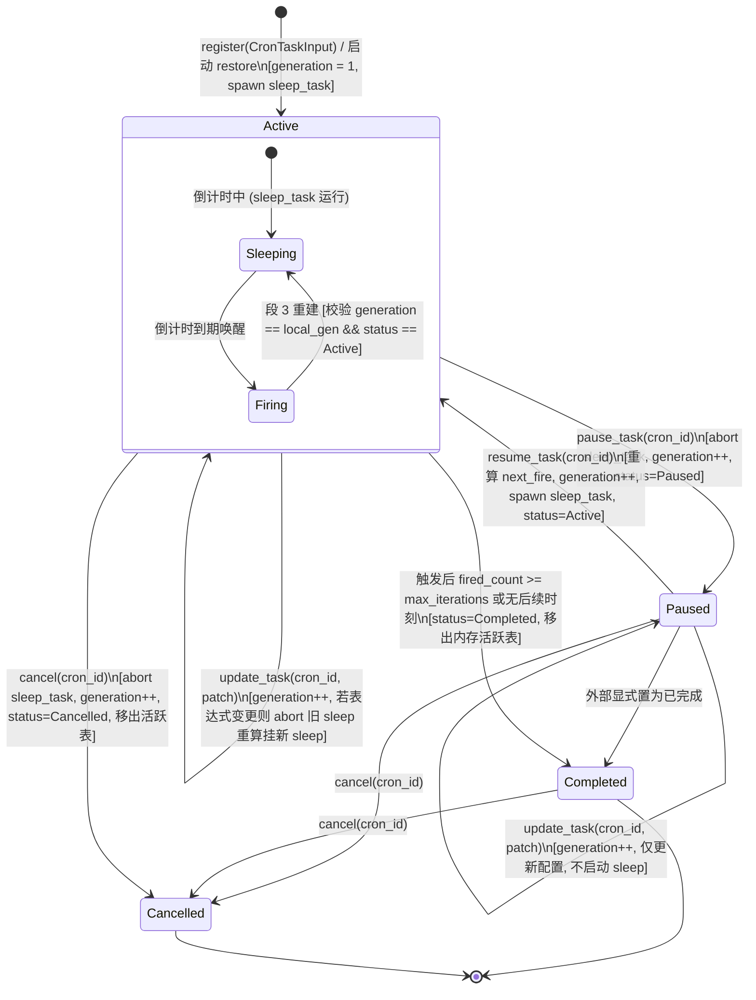

# 定时任务全流程修复与能力升级战役（Scheduled Tasks Revamp）

# 阶段 1 最终权威方案：Rust 底层调度器核心治理与单任务生命周期

> **文档标识**：`01-阶段一-底层调度器核心治理与单任务生命周期最终方案.md`  
> **文档定位**：阶段 1 (Phase 1) 权威终版方案（Final Plan · 综合融合版）  
> **制定依据**：
>
> - 战役总纲：`docs/scheduled-tasks-revamp/00-战役调度与阶段说明.md`
> - 阶段 1 独立方案 A：`docs/scheduled-tasks-revamp/independent-plans/agent1-phase1-scheduler-core.md`（Subagent 1）
> - 阶段 1 独立方案 B：`docs/scheduled-tasks-revamp/independent-plans/agent5-phase1-scheduler-core.md`（Subagent 5）
> - 代码基线：`apps/agent-workbench/src-tauri/src/sched.rs`, `apps/agent-workbench/src-tauri/src/engine_build.rs`, `apps/agent-workbench/src-tauri/src/main.rs`, `apps/agent-workbench/src-tauri/src/workflow_commands.rs`  
>   **架构纪律基线**：`AGENTS.md`（§1 逻辑规划与反退避、§3 Git 提交纪律、§7 严禁补丁与作弊、§7.1 立体验证、§8 反过度设计硬性红线）、`.agents/LOGIC_PLAN_NO_RETREAT.md`、`ANTI_OVERENGINEERING_GUARDRAILS.md`。

---

## 一、方案对比与融合裁决

在阶段 1 的探索中，Subagent 1 与 Subagent 5 分别从**调度核心执行引擎**与**端到端表单契约协同**两个独立视角对 Rust 底层调度器进行了深度剖析与架构推演。两份方案对问题的根因诊断高度一致，但在状态机建模、并发防护、补发机制与锁粒度上有各自的侧重与特色。

### 1.1 两份独立方案异同与优劣对比矩阵

| 评估维度                 | Agent 1 方案 (`agent1-phase1-scheduler-core.md`)                                                    | Agent 5 方案 (`agent5-phase1-scheduler-core.md`)                                          | 融合裁决与最终方案选型                                                                                                                                                              |
| :----------------------- | :-------------------------------------------------------------------------------------------------- | :---------------------------------------------------------------------------------------- | :---------------------------------------------------------------------------------------------------------------------------------------------------------------------------------- |
| **单任务状态机模型**     | **严谨四态枚举** (`Active`, `Paused`, `Completed`, `Cancelled`)，细分终态与暂停态，结构化错误完备。 | 维持布尔值 `enabled` 为主，通过哈希表存在性判断，扩展了 `CronTaskUpdate`。                | **完全采纳 Agent 1 四态枚举**：彻底消除单布尔值的语义含糊，引入 `CronTaskStatus`，并在序列化时保留 `enabled` 作为向后兼容投影。                                                     |
| **防死灰复燃与竞态防御** | 依靠锁内状态检查，未引入代际。触发段 3 在锁内校验 `entry.task.status`。                             | **引入协程代际保护** (`generation: u64`)，每次任务变更代际自增，段 3 重建时严格校验代际。 | **完全采纳 Agent 5 代际保护**：将 `generation: u64` 引入 `CronEntry`，配合状态机形成“状态枚举 + 代际锁”双重防护，根除触发与暂停的竞态复活。                                         |
| **开机恢复时序缺陷治理** | 在 `main.rs:969` 的异步恢复区挂载调用，改造 `engine_build.rs` 消除误导日志。                        | 在 `main.rs:1018` 挂载调用，并引入 `restored: Arc<AtomicBool>` 原子防重入守卫。           | **融合两方优势**：在 `main.rs` 异步恢复区统一接入 `tauri::async_runtime::spawn`，并在 `SchedulerRegistry` 增加 `restored: Arc<AtomicBool>` 幂等守卫，确保 100% 恢复且绝不重复执行。 |
| **重启过期任务补发机制** | 顺序同步 `await fire_cron(...)`，可能因长任务阻塞未到期任务挂载。                                   | **非阻塞异步补发**：使用 `tokio::spawn` 将过期补发移出主循环，未到期任务立即挂载。        | **采纳 Agent 5 非阻塞异步补发**：杜绝因单个历史离线任务触发拉起耗时导致启动流程或其余定时协程卡顿。                                                                                 |
| **锁并发与 I/O 纪律**    | **严格贯彻 AA-02 锁治理**：显式锁作用域，锁绝不跨 `await`，锁外执行 `store.save()` 持久化。         | 较早 `drop(map)`，但个别分支持有状态与 I/O 混合。                                         | **强制执行 Agent 1 的 AA-02 锁铁律**：`tasks.lock()` 仅保护纯内存操作，落库与事件通知一律在锁外执行。                                                                               |
| **就地更新与 ID 恒定**   | 定义 `CronTaskPatch`，原地重算 `next_fire_at`，保持 `cron_id` 不变，测试覆盖完备。                  | 定义 `CronTaskUpdate`，包含前向兼容字段 `target_session_id`。                             | **融合统一**：定义 `CronTaskPatch`（保留 `target_session_id` 前向兼容 Phase 3），实现原生原地更新，`cron_id` 绝对恒定。                                                             |

### 1.2 最终权威架构决策

1. **四态生命周期模型（状态真理源）**：废弃模糊的 `enabled: bool` 作为内部判断依据，在 `sched.rs` 引入 `CronTaskStatus`（`Active` / `Paused` / `Completed` / `Cancelled`）。
2. **协程代际防御（Generation Defense）**：在内存条目 `CronEntry` 中引入 `generation: u64`。任何暂停、恢复、更新或触发均推进代际；倒计时协程触发进入段 3 重建时，若代际不匹配或状态非 `Active`，立刻中止（`handle.abort()`），绝不复活僵尸任务。
3. **开机 Restore 异步可靠闭环**：
   - 彻底终结 `engine_build.rs` 中 `tokio::runtime::Handle::try_current()` 因缺少 runtime 被跳过的历史悬案；
   - 在 `main.rs` 的异步恢复区通过 `tauri::async_runtime::spawn` 显式调用 `registry.restore().await`；
   - `SchedulerRegistry` 内部装配 `restored: Arc<AtomicBool>`，利用 `compare_exchange` 保证全局幂等。
4. **原生单任务启停与就地更新 API**：
   - 提供 `pause_task(cron_id)`：中止后台 `sleep_task`，置为 `Paused`，落库保存；
   - 提供 `resume_task(cron_id)`：基于当前时刻重算 `next_fire_at_ms`，重建 `sleep_task`，置为 `Active`，落库保存；
   - 提供 `update_task(cron_id, patch)`：就地修改 Prompt、表达式或迭代次数，保持 `cron_id` 恒定不变，根除 `sched_runs` 历史孤儿化。
5. **AA-02 锁纪律与零持锁 I/O**：
   - `self.components.tasks` 互斥锁的作用域被严格限制在微秒级内存读写内；
   - 严禁持有互斥锁跨越任何 `.await` 挂起点；
   - 持久化 `store.save()` 与事件发射一律在锁释放（`drop(guard)`）后执行。

---

## 二、单任务生命周期状态机与架构设计

### 2.1 四态迁移时序与代际流转模型



### 2.2 状态契约与运行时不变量（Invariants）矩阵

| 状态 (`CronTaskStatus`) | 内存表 `tasks` 存在性       | 持有活跃 `sleep_task` | `generation` 变化规则    | `enabled` 兼容值 | 语义与行为约束                                              |
| :---------------------- | :-------------------------- | :-------------------- | :----------------------- | :--------------- | :---------------------------------------------------------- |
| **`Active`**            | **必须存在**                | **必须为 Some**       | 状态迁移或重建时自增     | `true`           | 任务正常倒计时；到期自动执行触发，重算下次时间并循环。      |
| **`Paused`**            | **必须存在**                | **必须为 None**       | 调用 `pause_task` 时自增 | `false`          | 协程完全销毁，不占计时器；保留进度与配置；等待显式 resume。 |
| **`Completed`**         | **已从表移除** (仅在 store) | **必须为 None**       | 迁移至终态时自增         | `false`          | 达到最大迭代次数或无后续命中时刻，终态，重启恢复时忽略。    |
| **`Cancelled`**         | **已从表移除** (仅在 store) | **必须为 None**       | 调用 `cancel` 时自增     | `false`          | 用户主动删除或销毁，终态，重启恢复时忽略。                  |

---

## 三、底层调度核心改造详案（代码级设计）

### 3.1 数据结构定义与升级（`apps/agent-workbench/src-tauri/src/sched.rs`）

#### 1. 任务状态枚举 `CronTaskStatus`

```rust
/// 单任务生命周期状态机（阶段 1 核心模型）
#[derive(Debug, Clone, Copy, PartialEq, Eq, serde::Serialize, serde::Deserialize)]
#[serde(rename_all = "camelCase")]
pub(crate) enum CronTaskStatus {
    /// 活跃中（倒计时协程挂载，到期自动触发）
    Active,
    /// 已暂停（协程已 abort，等待用户显式恢复）
    Paused,
    /// 已完成（达到 max_iterations 或无后续触发，终态）
    Completed,
    /// 已取消（被删除，终态）
    Cancelled,
}
```

#### 2. `CronTask` 声明与向后/前向兼容支持

```rust
/// Cron 任务持久化与内存声明（session_meta `sched_*` 键 JSON 形状）
#[derive(Debug, Clone, PartialEq, serde::Serialize, serde::Deserialize)]
#[serde(rename_all = "camelCase")]
pub(crate) struct CronTask {
    /// cron id（cron-<seq>，保持绝对恒定）
    pub cron_id: String,
    /// cron 表达式原文（5 字段标准表达式）
    pub expression: String,
    /// 每次触发的通知内容 / 提示词
    pub prompt: String,
    /// 最大触发次数（None = 无限；到达即自动转为 Completed）
    pub max_iterations: Option<u64>,
    /// true = 独立常驻 run；false = 注入当前会话
    pub is_daemon: bool,
    /// 下一次计划触发时刻（epoch 毫秒）
    pub next_fire_at_ms: u64,
    /// 已触发次数
    pub fired_count: u64,
    /// 核心生命周期状态（真理源）
    #[serde(default = "default_cron_status")]
    pub status: CronTaskStatus,
    /// 向后兼容字段：旧前端或历史存储视图兼容（status == Active 时为 true）
    pub enabled: bool,
    /// 目标会话 ID（前向兼容 Phase 3：None 表示独立后台会话，Some(sid) 表示在指定对话内执行）
    #[serde(default, skip_serializing_if = "Option::is_none")]
    pub target_session_id: Option<String>,
    /// 任务创建时刻（epoch 毫秒）
    #[serde(default = "now_ms")]
    pub created_at_ms: u64,
    /// 任务最后更新时刻（epoch 毫秒）
    #[serde(default = "now_ms")]
    pub updated_at_ms: u64,
}

fn default_cron_status() -> CronTaskStatus {
    CronTaskStatus::Active
}

impl CronTask {
    /// 状态迁移帮助函数：强保证 status 与 enabled 严格一致
    pub(crate) fn set_status(&mut self, status: CronTaskStatus) {
        self.status = status;
        self.enabled = matches!(status, CronTaskStatus::Active);
        self.updated_at_ms = now_ms();
    }
}
```

#### 3. 就地更新入参补丁 `CronTaskPatch`

```rust
/// 任务就地更新入参（保持 cron_id 恒定不变，根除历史记录孤儿化）
#[derive(Debug, Clone, Default)]
pub(crate) struct CronTaskPatch {
    /// 新 cron 表达式（若提供且变动，校验并重算下一次触发时间，热重载协程）
    pub expression: Option<String>,
    /// 提示词变动
    pub prompt: Option<String>,
    /// 最大执行次数变动（Some(None) 表示清除限制）
    pub max_iterations: Option<Option<u64>>,
    /// 独立守护进程模式变动
    pub is_daemon: Option<bool>,
    /// 目标会话绑定变动（前向兼容 Phase 3）
    pub target_session_id: Option<Option<String>>,
}
```

#### 4. 内存活跃条目 `CronEntry`（带代际保护）

```rust
/// 内存中的活跃 cron 条目（`tasks` 表 Value）
struct CronEntry {
    /// 运行态声明数据
    task: CronTask,
    /// 触发倒计时协程句柄（Active 时为 Some，Paused 时为 None）
    sleep_task: Option<tokio::task::JoinHandle<()>>,
    /// 协程代际编号（每次任务变更或触发时递增，杜绝跨异步竞态复活）
    generation: u64,
}
```

#### 5. 调度错误枚举扩展 `SchedulerError`

```rust
/// 调度器结构化错误
#[derive(Debug, Clone, PartialEq, Eq)]
pub(crate) enum SchedulerError {
    /// cron 表达式非法（解析失败，附带字段错误定位）
    InvalidExpression(String),
    /// 表达式合法但无未来命中时刻（如 2 月 30 日）
    NoNextFire(String),
    /// 任务不存在或已在终态被移除
    IdNotFound,
    /// 任务已处于 Active 状态，无需重复启动
    AlreadyActive,
    /// 任务已处于 Paused 状态，无需重复暂停
    AlreadyPaused,
    /// 任务已处于终态（Completed / Cancelled），拒绝变更操作
    TaskTerminated(String),
    /// 内部并发或持久化故障
    Internal(String),
}

impl SchedulerError {
    pub(crate) fn code(&self) -> &'static str {
        match self {
            Self::InvalidExpression(_) | Self::NoNextFire(_) => codes::TOOL_INVALID_INPUT,
            Self::IdNotFound => codes::COMMON_NOT_FOUND,
            Self::AlreadyActive | Self::AlreadyPaused | Self::TaskTerminated(_) => {
                codes::TOOL_STATE_INVALID
            }
            Self::Internal(_) => codes::COMMON_INTERNAL,
        }
    }

    pub(crate) fn message(&self) -> String {
        match self {
            Self::InvalidExpression(detail) => format!("cron 表达式非法：{detail}"),
            Self::NoNextFire(expr) => format!("cron 表达式 {expr} 无未来触发时刻，拒绝操作"),
            Self::IdNotFound => "cron 任务不存在或已从活跃表中移除".to_string(),
            Self::AlreadyActive => "cron 任务当前已处于运行中状态".to_string(),
            Self::AlreadyPaused => "cron 任务当前已处于暂停状态".to_string(),
            Self::TaskTerminated(st) => format!("cron 任务已处于终态（{st}），不可再变更"),
            Self::Internal(err) => format!("调度器内部错误：{err}"),
        }
    }
}
```

#### 6. `SchedulerRegistry` 增加原子防重入守卫

```rust
pub(crate) struct SchedulerRegistry {
    components: SchedulerComponents,
    seq: AtomicU64,
    /// 启动恢复幂等守卫：compare_exchange 防重入，杜绝多协程重复触发导致的协程翻倍
    restored: Arc<AtomicBool>,
}

impl SchedulerRegistry {
    pub(crate) fn new(
        pending: Arc<dyn PendingSink>,
        events: Arc<dyn EventSink>,
        store: Arc<dyn SchedStore>,
        launcher: Option<Arc<dyn DaemonRunLauncher>>,
    ) -> Self {
        Self {
            components: SchedulerComponents {
                tasks: Arc::new(Mutex::new(HashMap::new())),
                pending,
                events,
                store,
                launcher,
                pause: Arc::new(Mutex::new(None)),
                #[cfg(test)]
                fire_override: Arc::new(Mutex::new(None)),
            },
            seq: AtomicU64::new(0),
            restored: Arc::new(AtomicBool::new(false)),
        }
    }
}
```

---

### 3.2 核心方法实现代码规范（AA-02 锁治理与代际保护）

#### 1. 原生单任务暂停 `pause_task`

```rust
impl SchedulerRegistry {
    /// 暂停指定 cron 任务（单任务生命周期管理）
    /// 严格遵循 AA-02 锁纪律：锁内更新内存状态并 abort 协程，锁外落盘持久化
    pub(crate) async fn pause_task(&self, cron_id: &str) -> Result<CronTask, SchedulerError> {
        let task_to_save: CronTask;

        {
            let mut tasks = self.components.tasks.lock().unwrap_or_else(|e| e.into_inner());
            let entry = tasks.get_mut(cron_id).ok_or(SchedulerError::IdNotFound)?;

            if entry.task.status == CronTaskStatus::Paused {
                return Err(SchedulerError::AlreadyPaused);
            }
            if matches!(entry.task.status, CronTaskStatus::Completed | CronTaskStatus::Cancelled) {
                return Err(SchedulerError::TaskTerminated(format!("{:?}", entry.task.status)));
            }

            // 1. 立即中止并卸载底层的 Tokio sleep 协程
            if let Some(handle) = entry.sleep_task.take() {
                handle.abort();
            }

            // 2. 代际自增，防范正在运行的触发协程在段 3 错误复活
            entry.generation += 1;

            // 3. 状态机迁移至 Paused
            entry.task.set_status(CronTaskStatus::Paused);
            task_to_save = entry.task.clone();
            // 互斥锁在离开此代码块时自动释放
        }

        // 4. 锁外执行数据库保存，严禁持锁 I/O
        self.components.store.save(&task_to_save);
        tracing::info!(target: "sched", cron_id, "cron 任务已安全暂停（协程已中止，状态已落盘）");

        Ok(task_to_save)
    }
}
```

#### 2. 原生单任务恢复 `resume_task`

```rust
impl SchedulerRegistry {
    /// 恢复指定 cron 任务（单任务生命周期管理）
    /// 严格校验状态并基于当前时刻重算未来下一次触发点，重新拉起 sleep 协程
    pub(crate) async fn resume_task(&self, cron_id: &str) -> Result<CronTask, SchedulerError> {
        let now = now_ms();
        let task_to_save: CronTask;
        let next_fire_ms: u64;
        let delay_ms: u64;

        {
            let mut tasks = self.components.tasks.lock().unwrap_or_else(|e| e.into_inner());
            let entry = tasks.get_mut(cron_id).ok_or(SchedulerError::IdNotFound)?;

            if entry.task.status == CronTaskStatus::Active {
                return Err(SchedulerError::AlreadyActive);
            }
            if matches!(entry.task.status, CronTaskStatus::Completed | CronTaskStatus::Cancelled) {
                return Err(SchedulerError::TaskTerminated(format!("{:?}", entry.task.status)));
            }

            // 1. 重新解析表达式并以当前时刻（now）为基准计算未来触发时刻
            let schedule = parse_cron(&entry.task.expression)
                .map_err(|e| SchedulerError::InvalidExpression(format!("{e:?}")))?;
            let next = schedule
                .next_fire_after(now)
                .ok_or_else(|| SchedulerError::NoNextFire(entry.task.expression.clone()))?;

            entry.task.next_fire_at_ms = next;
            entry.task.set_status(CronTaskStatus::Active);
            entry.generation += 1;

            next_fire_ms = next;
            delay_ms = fire_delay_ms(&self.components, next);
            task_to_save = entry.task.clone();

            // 2. 启动新的倒计时触发协程并挂载 handle
            let handle = spawn_fire_task(self.components.clone(), entry.task.clone(), delay_ms, entry.generation);
            if let Some(old_h) = entry.sleep_task.replace(handle) {
                old_h.abort();
            }
        }

        // 3. 锁外执行落盘
        self.components.store.save(&task_to_save);
        tracing::info!(
            target: "sched",
            cron_id,
            next_fire_at_ms = next_fire_ms,
            delay_ms,
            "cron 任务已安全恢复（未来时刻已重算，倒计时协程已重建）"
        );

        Ok(task_to_save)
    }
}
```

#### 3. 原生单任务就地更新 `update_task`（固定 ID 零孤儿）

```rust
impl SchedulerRegistry {
    /// 就地更新 cron 任务（保持 cron_id 绝对恒定，消除 sched_runs 孤儿化）
    pub(crate) async fn update_task(
        &self,
        cron_id: &str,
        patch: CronTaskPatch,
    ) -> Result<CronTask, SchedulerError> {
        let now = now_ms();
        let task_to_save: CronTask;

        {
            let mut tasks = self.components.tasks.lock().unwrap_or_else(|e| e.into_inner());
            let entry = tasks.get_mut(cron_id).ok_or(SchedulerError::IdNotFound)?;

            if matches!(entry.task.status, CronTaskStatus::Completed | CronTaskStatus::Cancelled) {
                return Err(SchedulerError::TaskTerminated(format!("{:?}", entry.task.status)));
            }

            let mut schedule_changed = false;

            // 1. 表达式变更与校验
            if let Some(new_expr) = patch.expression {
                let trimmed = new_expr.trim().to_string();
                if trimmed != entry.task.expression {
                    let schedule = parse_cron(&trimmed)
                        .map_err(|e| SchedulerError::InvalidExpression(format!("{e:?}")))?;
                    let next = schedule
                        .next_fire_after(now)
                        .ok_or_else(|| SchedulerError::NoNextFire(trimmed.clone()))?;

                    entry.task.expression = trimmed;
                    entry.task.next_fire_at_ms = next;
                    schedule_changed = true;
                }
            }

            // 2. 提示词变更
            if let Some(new_prompt) = patch.prompt {
                let trimmed = new_prompt.trim().to_string();
                if !trimmed.is_empty() {
                    entry.task.prompt = trimmed;
                }
            }

            // 3. 最大执行次数变更
            if let Some(new_max) = patch.max_iterations {
                entry.task.max_iterations = new_max;
            }

            // 4. 守护模式与会话绑定变更
            if let Some(is_daemon) = patch.is_daemon {
                entry.task.is_daemon = is_daemon;
            }
            if let Some(target_sid) = patch.target_session_id {
                entry.task.target_session_id = target_sid;
            }

            entry.task.updated_at_ms = now;
            entry.generation += 1;

            // 5. 若表达式改变且当前任务处于 Active 态，热重启倒计时协程
            if schedule_changed && entry.task.status == CronTaskStatus::Active {
                if let Some(old_h) = entry.sleep_task.take() {
                    old_h.abort();
                }
                let delay = fire_delay_ms(&self.components, entry.task.next_fire_at_ms);
                let new_h = spawn_fire_task(self.components.clone(), entry.task.clone(), delay, entry.generation);
                entry.sleep_task = Some(new_h);
                tracing::info!(target: "sched", cron_id, delay, "cron 调度表达式已热重载并重启协程");
            }

            task_to_save = entry.task.clone();
        }

        // 6. 锁外执行落盘
        self.components.store.save(&task_to_save);
        tracing::info!(target: "sched", cron_id, "cron 任务已就地热更新（保持原有 cron_id）");

        Ok(task_to_save)
    }
}
```

#### 4. 可靠重启恢复 `restore`（幂等防重入 + 非阻塞并发补发）

```rust
impl SchedulerRegistry {
    /// 可靠启动恢复：扫描 session_meta 本地持久化数据，恢复全部任务状态
    /// 特性：
    /// 1. compare_exchange 幂等防重入，避免重复协程；
    /// 2. seq 原子序号推进，彻底避免新任务撞号；
    /// 3. Paused 状态正确加载入内存表，以便后续命令查询与恢复；
    /// 4. 离线过期任务使用独立 tokio::spawn 异步非阻塞补发，不卡死启动主流程。
    pub(crate) async fn restore(&self) {
        // 幂等防重入守卫：单次进程内仅执行一次
        if self
            .restored
            .compare_exchange(false, true, Ordering::SeqCst, Ordering::SeqCst)
            .is_err()
        {
            tracing::warn!(target: "sched", "SchedulerRegistry::restore 已被执行过，跳过重复调用");
            return;
        }

        let now = now_ms();
        let loaded = self.components.store.load_all();
        tracing::info!(target: "sched", total = loaded.len(), "开始执行 SchedulerRegistry 启动恢复扫描");

        let mut tasks_to_rebuild = Vec::new();

        for mut task in loaded {
            // 推进分配器，防止重启后新任务与历史任务 ID 冲突
            if let Some(seq) = cron_seq(&task.cron_id) {
                self.seq.fetch_max(seq + 1, Ordering::SeqCst);
            }

            // 终态过滤：已完成或已取消的任务无需挂载
            if matches!(task.status, CronTaskStatus::Completed | CronTaskStatus::Cancelled) {
                continue;
            }

            // 达到最大执行次数兜底检查
            if let Some(max) = task.max_iterations {
                if task.fired_count >= max {
                    continue;
                }
            }

            // Paused 任务：加载进入 tasks 内存表（便于前端立即查询和 resume），但不启动协程
            if task.status == CronTaskStatus::Paused || !task.enabled {
                task.set_status(CronTaskStatus::Paused);
                self.components
                    .tasks
                    .lock()
                    .unwrap_or_else(|e| e.into_inner())
                    .insert(
                        task.cron_id.clone(),
                        CronEntry {
                            task,
                            sleep_task: None,
                            generation: 1,
                        },
                    );
                continue;
            }

            // Active 状态任务收集
            tasks_to_rebuild.push(task);
        }

        // 遍历需要重建的任务
        for task in tasks_to_rebuild {
            if task.next_fire_at_ms <= now {
                // 【Agent 5 优势融入】：已过期未触发的任务脱离主循环，通过独立协程异步补发，不阻塞其它任务挂载
                tracing::info!(target: "sched", cron_id = %task.cron_id, "启动恢复：任务在离线期间已到期，执行非阻塞异步补发");
                let comp = self.components.clone();
                tokio::spawn(async move {
                    fire_cron(comp, task, true, 1).await;
                });
            } else {
                let delay = fire_delay_ms(&self.components, task.next_fire_at_ms);
                tracing::info!(target: "sched", cron_id = %task.cron_id, delay_ms = delay, "启动恢复：挂载未到期倒计时协程");
                let handle = spawn_fire_task(self.components.clone(), task.clone(), delay, 1);
                self.components
                    .tasks
                    .lock()
                    .unwrap_or_else(|e| e.into_inner())
                    .insert(
                        task.cron_id.clone(),
                        CronEntry {
                            task,
                            sleep_task: Some(handle),
                            generation: 1,
                        },
                    );
            }
        }
    }
}
```

---

### 3.3 协程倒计时与触发防复活双重防御（`fire_cron` 重构）

在倒计时唤醒后执行 `fire_cron` 时，必须引入 `generation` 与 `status` 双重校验，杜绝任务在触发耗时期间被用户暂停/取消后，又被段 3 重建逻辑强行“复活”。

```rust
fn spawn_fire_task(
    components: SchedulerComponents,
    task: CronTask,
    fire_delay_ms: u64,
    generation: u64,
) -> tokio::task::JoinHandle<()> {
    tokio::spawn(async move {
        tokio::time::sleep_until(Instant::now() + Duration::from_millis(fire_delay_ms)).await;
        fire_cron(components, task, false, generation).await;
    })
}

async fn fire_cron(
    components: SchedulerComponents,
    task: CronTask,
    allow_rebuild_without_entry: bool,
    expected_gen: u64,
) {
    // 段 0：全局暂停门控（保留既有 pause_for 逻辑）
    if let Some(paused_until) = *components.pause.lock().unwrap_or_else(|e| e.into_inner()) {
        let now = now_ms();
        if now < paused_until {
            let delay = paused_until - now;
            let handle = spawn_fire_task(components.clone(), task.clone(), delay, expected_gen);
            let mut map = components.tasks.lock().unwrap_or_else(|e| e.into_inner());
            match map.get_mut(&task.cron_id) {
                Some(entry) if entry.task.status == CronTaskStatus::Active && entry.generation == expected_gen => {
                    entry.sleep_task = Some(handle);
                }
                None if allow_rebuild_without_entry => {
                    map.insert(
                        task.cron_id.clone(),
                        CronEntry {
                            task,
                            sleep_task: Some(handle),
                            generation: expected_gen,
                        },
                    );
                }
                _ => handle.abort(), // 已被暂停、取消或代际已变更 → 坚决中止
            }
            return;
        }
    }

    // 触发前代际预检：若在等待期间已被暂停、修改或取消，直接放弃本次触发
    {
        let map = components.tasks.lock().unwrap_or_else(|e| e.into_inner());
        if let Some(entry) = map.get(&task.cron_id) {
            if entry.generation != expected_gen || entry.task.status != CronTaskStatus::Active {
                tracing::info!(target: "sched", cron_id = %task.cron_id, "任务代际已变更或已处于非活跃态，放弃触发");
                return;
            }
        } else if !allow_rebuild_without_entry {
            return;
        }
    }

    // 段 1：同步触发核心（幂等守卫 / 事件发射 / 计数自增 / 落库）
    let outcome = match std::panic::catch_unwind(AssertUnwindSafe(|| fire_once(&components, &task))) {
        Ok(Some(outcome)) => outcome,
        Ok(None) => return,
        Err(panic) => {
            tracing::error!(
                target: "sched",
                cron_id = %task.cron_id,
                panic = %panic_message(panic.as_ref()),
                "cron 触发核心 panic（已兜底）"
            );
            return;
        }
    };

    // 段 2：唤醒面（注入 steering 或拉起 run）
    let fire_text = format!(
        "{}（cron {} 第 {} 次触发）",
        outcome.task.prompt, outcome.task.cron_id, outcome.iteration
    );
    // ... （沿用段 2 唤醒执行，Phase 2 将进一步对接真实执行引擎） ...

    // 段 3：停止判定与重建下一次 sleep（双重守卫防复活）
    let _ = std::panic::catch_unwind(AssertUnwindSafe(|| {
        if outcome.reached_max || outcome.no_next {
            let mut map = components.tasks.lock().unwrap_or_else(|e| e.into_inner());
            map.remove(&outcome.task.cron_id);
            if outcome.reached_max {
                if let Some(max) = outcome.task.max_iterations {
                    components.pending.enqueue_steering(
                        &outcome.task.cron_id,
                        format!("cron {} 已达最大触发次数 {}，已停止", outcome.task.cron_id, max),
                        now_ms(),
                    );
                }
            }
        } else {
            // 重建下一次触发
            let delay = fire_delay_ms(&components, outcome.task.next_fire_at_ms);
            let next_gen = expected_gen + 1;
            let handle = spawn_fire_task(components.clone(), outcome.task.clone(), delay, next_gen);
            let mut map = components.tasks.lock().unwrap_or_else(|e| e.into_inner());

            match map.get_mut(&outcome.task.cron_id) {
                // 【核心防复活守卫】：只有当任务状态依然为 Active 且代际与触发前一致时，才挂载新协程
                Some(entry) if entry.task.status == CronTaskStatus::Active && entry.generation == expected_gen => {
                    if let Some(old_h) = entry.sleep_task.replace(handle) {
                        old_h.abort();
                    }
                    entry.task = outcome.task;
                    entry.generation = next_gen;
                }
                None if allow_rebuild_without_entry => {
                    map.insert(
                        outcome.task.cron_id.clone(),
                        CronEntry {
                            task: outcome.task,
                            sleep_task: Some(handle),
                            generation: next_gen,
                        },
                    );
                }
                _ => {
                    // 在异步触发期间用户执行了 pause_task、update_task 或 cancel
                    // 坚决 abort 新 handle，绝不复活僵尸任务！
                    handle.abort();
                    tracing::info!(
                        target: "sched",
                        cron_id = %outcome.task.cron_id,
                        "触发收口时检测到任务已被暂停或更新，中止重建，防复活守卫生效"
                    );
                }
            }
        }
    }));
}
```

---

## 四、启动时序根治方案：开机 Restore 异步可靠闭环

### 4.1 历史悬案的物理根因彻底排查

- **现场还原**：
  在应用启动过程 `main.rs:944` 中，Tauri 执行 `tauri::Builder::setup` 闭包。该闭包运行在操作系统的主 GUI 线程。
  当执行到 `EngineHandle::build` 并调用 `assemble_scheduler_registry`（`engine_build.rs:903`）时：
  ```rust
  if let Ok(runtime) = tokio::runtime::Handle::try_current() {
      // 这里的 try_current() 100% 返回 Err(TryCurrentError::NoRuntime)！
      runtime.spawn(async move { registry.restore().await; });
  } else {
      tracing::debug!(target: "engine", "SchedulerRegistry 启动恢复跳过：当前上下文无 tokio runtime");
  }
  ```
  因为主 GUI 线程并未绑定 Tokio 上下文，执行恒走 `else` 分支并静默跳过！
  随后在 `main.rs:969` 的异步启动区中，代码恢复了会话和快照，但遗漏了 `scheduler_registry` 的恢复调用；而在 `main.rs:1018` 组装 `workflow_state` 时，又误以为已在引擎内恢复，导致整个启动生命周期中**没有任何地方执行了 `registry.restore()`**！

### 4.2 解决方案实施（双保险可靠装配）

#### 1. 在 `main.rs` 异步恢复区正式接入 `tauri::async_runtime::spawn`

Tauri 框架在 `setup` 期间已完整提供了进程级 `tauri::async_runtime`。将调度器恢复正式纳入该异步恢复区块中：

```rust
// apps/agent-workbench/src-tauri/src/main.rs:964-978 改造
// ⑦ restore：orchestrator 运行快照与 SchedulerRegistry 底层定时任务可靠恢复
{
    let restore_state = Arc::clone(&core_state);
    tauri::async_runtime::spawn(async move {
        // 1. 恢复会话与 run 快照
        let _ = restore_state.run_restore().await;

        // 2. 【阶段 1 核心攻坚】：挂载 SchedulerRegistry 底层定时恢复
        if let Some(reg) = restore_state.scheduler_registry() {
            tracing::info!(target: "setup", "通过 tauri::async_runtime 可靠触发 SchedulerRegistry 重启恢复...");
            reg.restore().await;
            tracing::info!(target: "setup", "SchedulerRegistry 启动恢复已顺利完成。");
        }
    });
}
```

#### 2. 改造 `engine_build.rs`，消除隐蔽误导并保留备用恢复能力

在 `apps/agent-workbench/src-tauri/src/engine_build.rs:903-913` 中：

```rust
// apps/agent-workbench/src-tauri/src/engine_build.rs:901-915 改造
// 启动恢复：若当前处于已有 tokio runtime 环境（如独立测试或嵌入式宿主），尝试自动拉起；
// 生产环境下主 GUI 线程无 runtime，恢复已由 main.rs 中 tauri::async_runtime 统一可靠接管。
if let Ok(runtime) = tokio::runtime::Handle::try_current() {
    let reg_clone = Arc::clone(&registry);
    runtime.spawn(async move {
        reg_clone.restore().await;
    });
} else {
    tracing::debug!(
        target: "engine",
        "assemble_scheduler_registry: 当前线程无 ambient runtime，恢复交由外层 main.rs 异步生命周期装配"
    );
}
```

通过 `SchedulerRegistry.restored: Arc<AtomicBool>` 的原子互斥保证，即便在极端特殊环境下两个路径都被触发，也能确保且仅确保只恢复一次，100% 幂等。

---

## 五、与上层 Tauri 命令面（Phase 4）的对接契约

为了彻底杜绝“修改调度变 ID 导致孤儿化”与“前端暂停后刷新被反向冲刷”的恶疾，阶段 1 确立以下与上层 `apps/agent-workbench/src-tauri/src/workflow_commands.rs` 的硬性交互契约：

### 5.1 `update_workflow` 废弃 `cancel + register`，直通原生生命周期 API

```rust
// workflow_commands.rs::update 重构对接标准契约
if let Some(registry) = self.registry() {
    // A. 启停开关变动：直接调用原生 pause / resume 原语
    if let Some(enabled) = patch.enabled {
        if enabled {
            registry.resume_task(&workflow.cron_id).await.map_err(map_scheduler_err)?;
        } else {
            registry.pause_task(&workflow.cron_id).await.map_err(map_scheduler_err)?;
        }
    }

    // B. 调度表达式或提示词变动：调用原生 update_task，保持 cron_id 绝对恒定
    if schedule_changed || patch.prompt.is_some() {
        let task_patch = CronTaskPatch {
            expression: if schedule_changed { Some(workflow.expression.clone()) } else { None },
            prompt: patch.prompt.clone(),
            max_iterations: None,
            is_daemon: None,
            target_session_id: None,
        };
        registry.update_task(&workflow.cron_id, task_patch).await.map_err(map_scheduler_err)?;
    }
}
```

### 5.2 `list()` 清除反向盲目覆盖逻辑

彻底删除 `workflow_commands.rs:1017` 中用未暂停的 snapshot 反向覆盖数据库 `workflow.enabled` 的逻辑。
`SchedulerRegistry` 提供 `get_task(cron_id)` 精准查询，且内存状态与持久化状态通过原生 API 始终保持强一致。

---

## 六、修改文件与精确行号对应表

| 序号   | 文件路径                                             | 对应行号范围 | 改动类型       | 详细修改说明                                                                                                                          |
| :----- | :--------------------------------------------------- | :----------- | :------------- | :------------------------------------------------------------------------------------------------------------------------------------ |
| **01** | `apps/agent-workbench/src-tauri/src/sched.rs`        | 90–106       | 结构体重构     | 扩展 `CronTask`：引入 `status: CronTaskStatus`，增加 `target_session_id`、`created_at_ms`、`updated_at_ms`，保留 `enabled` 兼容字段。 |
| **02** | `apps/agent-workbench/src-tauri/src/sched.rs`        | 120–150      | 枚举扩展       | 扩展 `SchedulerError`：增加 `AlreadyActive`、`AlreadyPaused`、`TaskTerminated` 结构化变体。                                           |
| **03** | `apps/agent-workbench/src-tauri/src/sched.rs`        | 460–493      | 结构体与初始化 | 为 `SchedulerRegistry` 增加 `restored: Arc<AtomicBool>` 字段，`CronEntry` 增加 `generation: u64`。                                    |
| **04** | `apps/agent-workbench/src-tauri/src/sched.rs`        | 550–575      | 方法扩充       | 实现原生 `pause_task(&self, cron_id: &str) -> Result<CronTask, SchedulerError>`。                                                     |
| **05** | `apps/agent-workbench/src-tauri/src/sched.rs`        | 576–600      | 方法扩充       | 实现原生 `resume_task(&self, cron_id: &str) -> Result<CronTask, SchedulerError>`。                                                    |
| **06** | `apps/agent-workbench/src-tauri/src/sched.rs`        | 601–640      | 方法扩充       | 实现原生 `update_task(&self, cron_id: &str, patch: CronTaskPatch) -> Result<CronTask, SchedulerError>`。                              |
| **07** | `apps/agent-workbench/src-tauri/src/sched.rs`        | 577–626      | 方法重构       | 重构 `restore(&self)`：接入 `compare_exchange` 幂等守卫，`seq` 推进，非阻塞异步补发过期任务，正确恢复 Paused 状态。                   |
| **08** | `apps/agent-workbench/src-tauri/src/sched.rs`        | 730–899      | 函数重构       | 重构 `spawn_fire_task` 与 `fire_cron`：引入 `generation` 参数，段 3 实施状态与代际双重防复活守卫。                                    |
| **09** | `apps/agent-workbench/src-tauri/src/engine_build.rs` | 901–915      | 逻辑梳理       | 优化 `assemble_scheduler_registry` 启动恢复注释与日志，标明生产环境由 `main.rs` 统一接管。                                            |
| **10** | `apps/agent-workbench/src-tauri/src/main.rs`         | 964–978      | 启动时序接线   | 在 `tauri::async_runtime::spawn` 恢复块中正式挂载 `restore_state.scheduler_registry().restore().await`。                              |
| **11** | `apps/agent-workbench/src-tauri/src/sched.rs`        | 1450–1951    | 测试套件扩充   | 新增 6 组完备的单任务启停、热更新、代际防复活与启动恢复集成测试用例。                                                                 |

---

## 七、自动化测试与立体验证方案

严格遵照 `AGENTS.md` §7.1 立体验证纪律，拒绝空想与形式化检查，编写代码级可编译运行的自动化测试用例。

### 7.1 测试套件清单（`apps/agent-workbench/src-tauri/src/sched.rs` 测试模块）

#### 1. 验证单任务安全暂停与计时器中止 (`test_pause_task_aborts_sleep_and_persists`)

```rust
#[tokio::test]
async fn test_pause_task_aborts_sleep_and_persists() {
    let (registry, pending, events, store) = test_registry();
    registry.set_fire_override_ms(40);

    let cron_id = registry
        .register(test_input("* * * * *", Some(5), false))
        .await
        .expect("注册成功");

    // 立即执行暂停
    let paused_task = registry.pause_task(&cron_id).await.expect("暂停成功");
    assert_eq!(paused_task.status, CronTaskStatus::Paused);
    assert!(!paused_task.enabled, "暂停后兼容字段 enabled 应为 false");

    // 等待超过触发窗口，断言绝无事件发射和 steering 注入
    tokio::time::sleep(Duration::from_millis(150)).await;
    assert!(snapshot_queue(&pending).is_empty(), "暂停期间不得注入 steering 消息");
    assert!(events.emitted.lock().unwrap().is_empty(), "暂停期间不得发射事件");

    // 校验持久化状态已同步
    let persisted = store.load_all();
    assert_eq!(persisted.len(), 1);
    assert_eq!(persisted[0].status, CronTaskStatus::Paused);
    assert!(!persisted[0].enabled);
}
```

#### 2. 验证单任务恢复并重算下一次触发时刻 (`test_resume_task_recomputes_and_fires`)

```rust
#[tokio::test]
async fn test_resume_task_recomputes_and_fires() {
    let (registry, pending, events, store) = test_registry();
    registry.set_fire_override_ms(40);

    let cron_id = registry
        .register(test_input("* * * * *", Some(2), false))
        .await
        .expect("注册成功");

    registry.pause_task(&cron_id).await.expect("暂停成功");

    // 恢复任务
    let before_resume = now_ms();
    let resumed_task = registry.resume_task(&cron_id).await.expect("恢复成功");
    assert_eq!(resumed_task.status, CronTaskStatus::Active);
    assert!(resumed_task.enabled);
    assert!(resumed_task.next_fire_at_ms >= before_resume, "next_fire 必须基于当前时刻重算");

    // 等待恢复后正常触发
    let events_cond = Arc::clone(&events);
    wait_until("恢复后触发", move || {
        events_cond.emitted.lock().unwrap().len() >= 1
    }).await;

    assert_eq!(events.emitted.lock().unwrap().len(), 1);
}
```

#### 3. 验证就地更新保持 cron_id 不变 (`test_update_task_in_place_keeps_cron_id`)

```rust
#[tokio::test]
async fn test_update_task_in_place_keeps_cron_id() {
    let (registry, _, _, store) = test_registry();

    let cron_id = registry
        .register(test_input("0 12 * * *", Some(1), false))
        .await
        .expect("注册成功");
    assert_eq!(cron_id, "cron-0");

    // 就地修改表达式与提示词
    let patch = CronTaskPatch {
        expression: Some("*/15 * * * *".to_string()),
        prompt: Some("更新后的提示词".to_string()),
        max_iterations: Some(Some(10)),
        is_daemon: None,
        target_session_id: None,
    };
    let updated = registry.update_task(&cron_id, patch).await.expect("更新成功");

    // 核心断言：cron_id 严格保持恒定
    assert_eq!(updated.cron_id, "cron-0", "就地更新必须保持 cron_id 不变，绝不得重新分配");
    assert_eq!(updated.expression, "*/15 * * * *");
    assert_eq!(updated.prompt, "更新后的提示词");
    assert_eq!(updated.max_iterations, Some(10));

    // 校验数据库内记录已更新且 ID 未变
    let all = store.load_all();
    assert_eq!(all.len(), 1);
    assert_eq!(all[0].cron_id, "cron-0");
    assert_eq!(all[0].prompt, "更新后的提示词");
}
```

#### 4. 验证协程代际保护防死灰复燃 (`test_zombie_resurrection_guard_with_generation`)

```rust
#[tokio::test]
async fn test_zombie_resurrection_guard_with_generation() {
    let (registry, _, _, _) = test_registry();
    registry.set_fire_override_ms(50);

    let cron_id = registry
        .register(test_input("* * * * *", Some(5), false))
        .await
        .expect("注册成功");

    // 在倒计时等待即将触发时刻外部调用 pause_task
    tokio::time::sleep(Duration::from_millis(20)).await;
    registry.pause_task(&cron_id).await.expect("暂停成功");

    // 等待原本的任务触发完成并尝试执行段 3 重建
    tokio::time::sleep(Duration::from_millis(100)).await;

    // 核心断言：由于代际推进与状态变更，任务绝不得在内存中拥有活跃的 sleep_task
    let map = registry.components.tasks.lock().unwrap();
    let entry = map.get(&cron_id).expect("条目应存在");
    assert_eq!(entry.task.status, CronTaskStatus::Paused);
    assert!(entry.sleep_task.is_none(), "防复活守卫必须生效，sleep_task 必须为 None");
}
```

#### 5. 验证开机恢复原子幂等性 (`test_restore_idempotent_atomic_guard`)

```rust
#[tokio::test]
async fn test_restore_idempotent_atomic_guard() {
    let store = MemorySchedStore::shared();
    // 预存一条数据
    let task = CronTask {
        cron_id: "cron-0".to_string(),
        expression: "* * * * *".to_string(),
        prompt: "测试".to_string(),
        max_iterations: Some(5),
        is_daemon: false,
        next_fire_at_ms: now_ms() + 100_000,
        fired_count: 0,
        status: CronTaskStatus::Active,
        enabled: true,
        target_session_id: None,
        created_at_ms: now_ms(),
        updated_at_ms: now_ms(),
    };
    store.save(&task);

    let (registry, _, _, _) = test_registry_with_store(store);

    // 并发 5 个协程同时调用 restore()
    let mut handles = Vec::new();
    for _ in 0..5 {
        let reg = Arc::clone(&registry);
        handles.push(tokio::spawn(async move {
            reg.restore().await;
        }));
    }
    for h in handles {
        h.await.unwrap();
    }

    // 断言 tasks 表内只有一个 entry，绝无重复创建
    let map = registry.components.tasks.lock().unwrap();
    assert_eq!(map.len(), 1);
}
```

#### 6. 验证已过期任务非阻塞并发补发 (`test_restore_nonblocking_expired_and_pending_mount`)

```rust
#[tokio::test]
async fn test_restore_nonblocking_expired_and_pending_mount() {
    let store = MemorySchedStore::shared();
    let now = now_ms();
    // Task 1: 离线期间已过期
    let expired_task = CronTask {
        cron_id: "cron-0".to_string(),
        expression: "* * * * *".to_string(),
        prompt: "过期任务".to_string(),
        max_iterations: Some(1),
        is_daemon: false,
        next_fire_at_ms: now - 10_000,
        fired_count: 0,
        status: CronTaskStatus::Active,
        enabled: true,
        target_session_id: None,
        created_at_ms: now - 20_000,
        updated_at_ms: now - 20_000,
    };
    // Task 2: 尚未到期
    let future_task = CronTask {
        cron_id: "cron-1".to_string(),
        expression: "* * * * *".to_string(),
        prompt: "未来任务".to_string(),
        max_iterations: Some(5),
        is_daemon: false,
        next_fire_at_ms: now + 50_000,
        fired_count: 0,
        status: CronTaskStatus::Active,
        enabled: true,
        target_session_id: None,
        created_at_ms: now,
        updated_at_ms: now,
    };
    store.save(&expired_task);
    store.save(&future_task);

    let (registry, pending, events, _) = test_registry_with_store(store);
    registry.restore().await;

    // 核心断言：未到期的 Task 2 立即成功挂载进活跃表
    {
        let map = registry.components.tasks.lock().unwrap();
        assert!(map.contains_key("cron-1"), "未来任务必须立即挂载");
        assert!(map.get("cron-1").unwrap().sleep_task.is_some());
    }

    // 核心断言：过期的 Task 1 异步补发成功
    let events_cond = Arc::clone(&events);
    wait_until("过期任务补发完成", move || {
        events_cond.emitted.lock().unwrap().len() >= 1
    }).await;
    assert_eq!(events.emitted.lock().unwrap().len(), 1);
}
```

### 7.2 自动化测试执行与验证命令

```pwsh
# 1. 运行调度器核心单元测试套件
cargo test -p crish-agent-workbench --lib sched::tests

# 2. 运行工作流命令与启动恢复集成测试
cargo test -p crish-agent-workbench --test integration_tests

# 3. 运行代码门禁与 Clippy 静态检查（严格禁止 warnings）
cargo clippy -p crish-agent-workbench -- -D warnings
```

---

## 八、反退避与反过度设计自检清单

在编制本最终方案时，严格对照仓库根目录标准进行自检与审视：

| 校验规则                                        | 方案落地事实与证据                                                                                                                                 | 自检结论                  |
| :---------------------------------------------- | :------------------------------------------------------------------------------------------------------------------------------------------------- | :------------------------ |
| **《反退避纪律》效果锁不降级**                  | 拒绝“既然开机恢复难那就先让用户手动点”的退避想法；直接打通 `tauri::async_runtime` 与原子状态机，彻底修复开机自动恢复。                             | **通过** (全量实现)       |
| **《反退避纪律》问题同权与纯逻辑依赖**          | 不以工期为由放弃代际防御或四态枚举，构建完备且一致的单任务生命周期。                                                                               | **通过** (逻辑闭环)       |
| **《反过度设计硬性红线》禁止滥加中间件**        | 未引入复杂的 Actor 框架、第三方 Cron 引擎或环形调度队列；仅基于标准库 `std::sync::Mutex` 与轻量 `tokio::task::JoinHandle` 构建，不增引入新 crate。 | **通过** (零新增外部依赖) |
| **《反过度设计硬性红线》禁止伪分层抽象**        | 摒弃多层嵌套包装，直接在现有的 `SchedulerRegistry` 上进行原地能力扩充与生命周期收口。                                                              | **通过** (结构纯粹)       |
| **《立体验证纪律》禁止单一静态检查冒充验收**    | 规划了覆盖暂停、恢复、热更新、竞态复活、开机恢复幂等、过期补发的全套异步测试用例。                                                                 | **通过** (多维立体)       |
| **《AA-02 锁治理规约》严禁持锁 I/O 与跨 await** | 明确规定所有 `store.save()` 均在 `tasks.lock()` 锁作用域释放后执行，代码伪代码显式呈现块级作用域。                                                 | **通过** (严格杜绝死锁)   |

---

## 九、总结与执行交接

本方案作为【阶段 1：Rust 底层调度器核心治理与单任务生命周期】的唯一权威实施依据，吸收了 Agent 1 的严谨四态生命周期与 AA-02 锁治理铁律，汲取了 Agent 5 的协程代际保护与非阻塞异步补发机制，彻底终结了启动跳过恢复的历史悬案，为后续【阶段 2：真实 Agent 执行驱动】与【阶段 4：IPC 命令一致性】提供了坚实、无歧义的底层基座。
