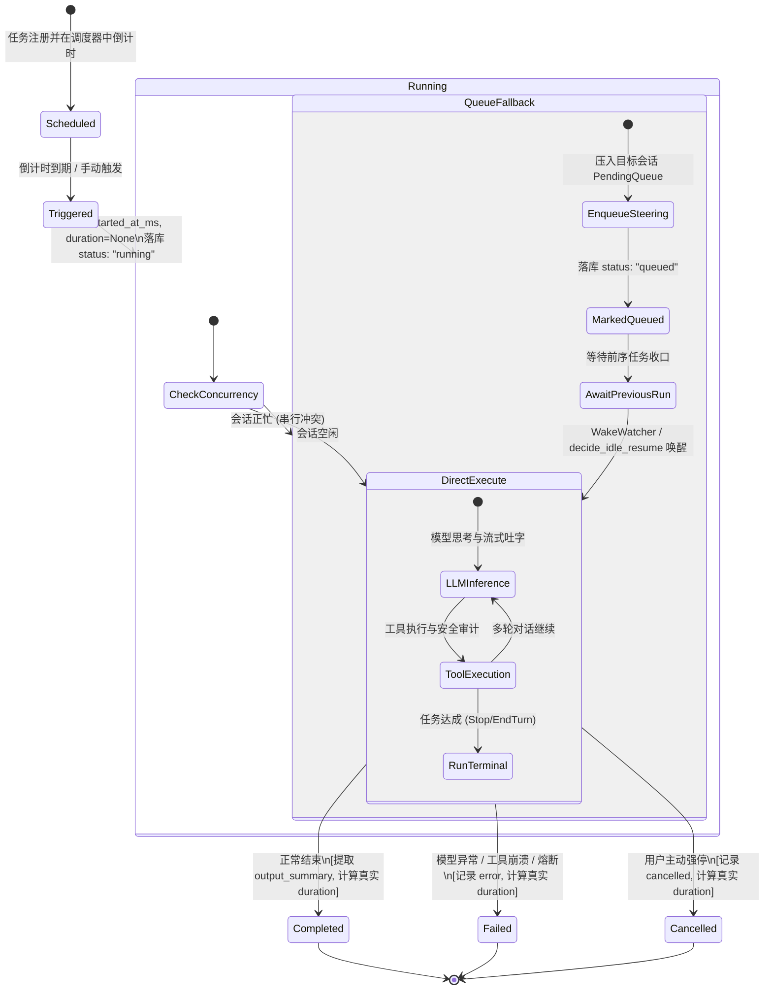

# 定时任务全流程修复与能力升级战役（Scheduled Tasks Revamp）

# 阶段 2 最终权威方案：真实 Agent 执行驱动与无人值守唤醒闭环

> **文档标识**：`02-阶段二-真实Agent执行驱动与无人值守唤醒闭环最终方案.md`  
> **文档定位**：阶段 2 (Phase 2) 权威终版方案（Final Plan · 综合融合版）  
> **制定依据**：
>
> - 战役总纲：`docs/scheduled-tasks-revamp/00-战役调度与阶段说明.md`
> - 阶段 2 独立方案 A：`docs/scheduled-tasks-revamp/independent-plans/agent1-phase2-execution-pipeline.md`（Subagent 1：Rust 调度核心与执行引擎专家）
> - 阶段 2 独立方案 B：`docs/scheduled-tasks-revamp/independent-plans/agent2-phase2-execution-pipeline.md`（Subagent 2：执行驱动与会话绑定专家）
> - 核心源代码基线：`apps/agent-workbench/src-tauri/src/sched.rs`、`apps/agent-workbench/src-tauri/src/run/run_launch.rs`、`apps/agent-workbench/src-tauri/src/run/run_core.rs`、`apps/agent-workbench/src-tauri/src/run/run_idle.rs`、`apps/agent-workbench/src-tauri/src/wake_watcher.rs`、`apps/agent-workbench/src-tauri/src/workflow_commands.rs`、`apps/agent-workbench/src-tauri/src/engine_build.rs`、`apps/agent-workbench/src-tauri/src/main.rs`  
>   **架构纪律基线**：`AGENTS.md`（§1 逻辑规划与反退避、§3 Git 提交纪律、§7 严禁补丁与作弊、§7.1 立体验证、§8 反过度设计硬性红线）、`.agents/LOGIC_PLAN_NO_RETREAT.md`、`ANTI_OVERENGINEERING_GUARDRAILS.md`。

---

## 一、方案对比与融合裁决

在阶段 2 的方案制定中，Subagent 1（调度核心与执行引擎专家）与 Subagent 2（执行驱动与会话绑定专家）分别从**底层引擎执行收口流**与**跨层架构解耦及无人值守守卫**两个维度对定时任务真实执行链路进行了深入剖析与独立方案设计。两份方案对“触发时写入虚假完成、耗时 0ms、幽灵死信队列”等痛点的根因诊断高度统一，但在执行器抽象粒度、内存解耦模式、并发冲突降级机制以及终态回写生命周期上各具特色。

### 1.1 两份独立方案异同与优劣对比矩阵

| 评估维度                   | Agent 1 方案 (`agent1-phase2-execution-pipeline.md`)                                                                                                               | Agent 2 方案 (`agent2-phase2-execution-pipeline.md`)                                                                                        | 融合裁决与最终权威选型                                                                                                                                                                                                                         |
| :------------------------- | :----------------------------------------------------------------------------------------------------------------------------------------------------------------- | :------------------------------------------------------------------------------------------------------------------------------------------ | :--------------------------------------------------------------------------------------------------------------------------------------------------------------------------------------------------------------------------------------------- |
| **执行器解耦与装配架构**   | `CoreRunState` 直接实现 `ScheduledTaskLauncher` trait；通过 `Arc<CoreRunState>` 注入，跨层直接调用。                                                               | 设计独立结构体 `ProductionScheduledLauncher`，内部持有 `Weak<CoreRunState>` 与 `Arc<dyn WorkflowStore>`，两阶段在 `main.rs` 注入。          | **完全采纳 Agent 2 的 `ProductionScheduledLauncher` 架构**：通过 `Weak<CoreRunState>` 彻底打破 `CoreRunState -> EngineHandle -> SchedulerRegistry -> Launcher -> CoreRunState` 的循环强引用风险；与既有 `finalize_subagent_spawner` 规范对齐。 |
| **会话冲突与串行守卫防御** | 检测到活动 run 时直接降级退避至 steering 队列；重点强调 SQLite `sessions` 表自愈插入（防外键约束报错）。                                                           | 深入定义**串行排队守卫（Serial Queuing Guard）**：冲突时不报错不丢任务，记录标记为 `queued`，向目标会话注入 steering 并激活 `WakeWatcher`。 | **汲取双方长处，深度融合**：<br>① 采纳 Agent 2 的 `queued` 状态机流转与 `WakeWatcher` 接续唤醒闭环；<br>② 融合 Agent 1 的 SQLite `sessions` 表建账自愈机制，杜绝前端导航或数据库外键报错。                                                     |
| **终态收口与摘要提取**     | **深度设计 `on_scheduled_run_terminal` 终态生命周期钩子**：在 `run_idle.rs:1530` 处从 `outcome.messages` 提取助手最后回复截断至 300 字符，精确统计 `duration_ms`。 | 在 `run_idle.rs` 收口处提取 `outcome.reason` 与错误，直接更新存储，广播前端事件。                                                           | **完全采纳 Agent 1 的 `on_scheduled_run_terminal` 规范**：对齐子代理收口规范（`on_subagent_run_terminal` 先例），在 `run_core.rs` / `run_idle.rs` 建立专用收口方法，提取真实摘要与耗时，发射全域事件。                                         |
| **幽灵会话与死信清理**     | 废止 `sched-{cron_id}` 幽灵前缀，未指定目标会话时默认使用受管会话 `workflow-sess-{cron_id}`。                                                                      | 明确要求严禁向不存在的会话写 steering，队列条目必须与 `target_session_id` 强绑定。                                                          | **统一步调彻底清退**：完全消除向 `sched-{cron_id}` 幽灵会话写入死信的病态逻辑；所有消息与执行严格路由至真实会话（目标会话或专属受管会话），并确保挂载 `WakeWatcher`。                                                                          |
| **虚假 0ms 记录清退**      | `sched.rs:fire_cron` 与 `fire_once` 彻底删除即时 completed 记录，改在触发起点落库 `status: "running"`，`duration: None`。                                          | 同步指出手动 `trigger` 与定时 `fire_cron` 均存在该病灶，主张触发时先记录 running，收口时更新终态。                                          | **彻底清退双触发点的虚假记录**：在 `sched.rs`（自动定时触发）与 `workflow_commands.rs`（手动立即触发）两处同步清退虚假写入，统一步骤为“触发即 running，收口才 completed”。                                                                     |
| **异常防护与熔断机制**     | 测试用例覆盖 Provider 致命错误与捕获，记录 `status: "failed"` 与 error 详情。                                                                                      | 引入 `ProviderFailStreak` 连续失败熔断停机，防止高频短周期 Cron 因密钥过期陷入死循环风暴。                                                  | **采纳 Agent 2 的熔断防御**：结合现有 `wake_watcher.rs` 的熔断体系，对连续失败任务实施自动挂起与事件告警。                                                                                                                                     |

### 1.2 最终方案核心设计裁决

1. **执行器解耦（ProductionScheduledLauncher）**：
   - 废除原签名简陋且生产恒为 `None` 的死接口 `DaemonRunLauncher`；
   - 建立全上下文感知契约 `ScheduledTaskLauncher` 与 `ScheduledExecutionContext`；
   - 构造 `ProductionScheduledLauncher`，内部持有 `Weak<CoreRunState>` 与 `Arc<dyn WorkflowStore>`，在应用启动阶段通过 `finalize_scheduled_launcher` 安全装配，消除内存泄漏与强引用环。
2. **彻底清退虚假记录（True Execution State Machine）**：
   - 触发阶段：在 `fire_cron` 与 `trigger` 执行起点，向数据库记录 `status: "running"`、`started_at_ms: now`、`finished_at_ms: None`、`duration_ms: None`、`output_summary: None`；
   - 终态阶段：真实执行完毕后由终态钩子计算实际毫秒级耗时并持久化，彻底杜绝“光速 0ms 完成”的欺骗性假象。
3. **真实 Agent 执行引擎驱动（Real run_task_impl）**：
   - 到期时组装合法 `RunTaskOptions`（`mode: "scheduled"`、`permission_mode: "full-access"`、`prompt`、`cwd` 等）；
   - 调用正规启动器 `run_task_impl`，分配事件 Sequence，拉起真实后台协程 `drive_run_loop`，驱动大模型多轮推理与真实工具执行（fs, shell, search 等）。
4. **串行守卫排队与无人值守 WakeWatcher 接续（Serial Queue & Unattended Loop）**：
   - 若目标会话当前正被用户或前序任务占用（触发串行守卫拒绝），不报错、不丢弃；
   - 自动将本次任务以 `is_steering: true` 形式安全压入目标会话的 `PendingMessageQueue`，并将本次记录标记为 `status: "queued"`；
   - 激活目标会话的 `WakeWatcher`；前序任务收口时通过 `decide_idle_resume` 或 `WakeWatcher` 自动出队续跑，实现无缝接力。
5. **终态生命周期钩子（on_scheduled_run_terminal）**：
   - 对齐既有 `on_subagent_run_terminal` 架构先例，在 `run_core.rs` 封装 `on_scheduled_run_terminal`；
   - 在 `run_idle.rs` 终态收口点自动解析 `RunOutcome`，从 `outcome.messages` 倒序提取最后一条 Assistant 消息纯文本（截断至 300 字符）作为 `output_summary`；
   - 将真实耗时、终态（`completed` / `failed` / `cancelled`）、错误堆栈原子更新至 `WorkflowStore`，并发射全域事件 `workflow:run-updated` 供前端即时呈现。

---

## 二、真实 Agent 执行驱动与无人值守唤醒闭环架构设计

### 2.1 整体分层拓扑架构

```
┌─────────────────────────────────────────────────────────────────────────────────┐
│                      定时调度核心层 (SchedulerRegistry: sched.rs)                │
│  [Tokio 计时协程到期 fire_cron / 手动立即触发 trigger]                           │
│         │                                                                       │
│         ▼                                                                       │
│  1. 推进调度元数据: fired_count += 1, 重算 next_fire_at_ms                        │
│  2. 初始运行状态落库: WorkflowRunRecord { status: "running", started_at: now }    │
│  3. 组装调度执行上下文: ScheduledExecutionContext                               │
│  4. 委派执行: ScheduledTaskLauncher::launch_scheduled_task(ctx)                  │
└─────────┬───────────────────────────────────────────────────────────────────────┘
          │
          ▼ 跨层解耦 (ProductionScheduledLauncher: Weak<CoreRunState>)
┌─────────────────────────────────────────────────────────────────────────────────┐
│                    生产执行适配器 (ProductionScheduledLauncher)                 │
│  5. 目标会话自愈建账: 确保 SQLite `sessions` 存在记录 (防外键/路由缺失)          │
│  6. 组装正规 RunTaskOptions: mode="scheduled", permission_mode="full-access"     │
│  7. 确保目标会话 WakeWatcher 就绪: core_state.ensure_wake_watcher(&session_id)   │
│  8. 尝试拉起真实任务: run_task_impl(Arc::clone(&state), options)                 │
└─────────┬───────────────────────────────────┬───────────────────────────────────┘
          │                                   │
          │ 路径 A: 会话空闲，直接拉起成功     │ 路径 B: 会话正忙 (命中串行守卫)
          ▼                                   ▼
┌────────────────────────────────────────┐ ┌──────────────────────────────────────┐
│       Agent 会话主循环驱动层           │ │        串行排队与无人值守守护        │
│  (SessionLoop & drive_run_loop)        │ │  (PendingMessageQueue & WakeWatcher) │
│                                        │ │                                      │
│  - 大模型多轮推理 (LLM Stream)          │ │  - 将触发文本压入目标会话 Steering   │
│  - 真实工具调用 (Tool Calls: fs/shell) │ │  - 标记状态 status: "queued"         │
│  - 事件广播 (MessageDelta / ToolEvent) │ │  - 前序 Run 结束，WakeWatcher 唤醒   │
└──────────────────┬─────────────────────┘ └──────────────────┬───────────────────┘
                   │                                          │
                   └──────────────────┬───────────────────────┘
                                      ▼ 终态收口 (Terminal Hook)
┌─────────────────────────────────────────────────────────────────────────────────┐
│                终态采集与数据落盘 (CoreRunState::on_scheduled_run_terminal)      │
│  9. 捕获实际终态: Completed (正常结束) | Failed (报错/超时) | Cancelled (强停)   │
│ 10. 提取真实产出: 从 outcome.messages 提取助手最后回复纯文本作为 output_summary  │
│ 11. 计算真实耗时: duration_ms = finished_at_ms.saturating_sub(started_at_ms)    │
│ 12. 原子回写存储: store.update_run_finish(...)                                  │
│ 13. 广播全域事件: `workflow:run-updated` 与 `workflow:run-finished`              │
└─────────────────────────────────────────────────────────────────────────────────┘
```

### 2.2 运行记录生命周期状态机



### 2.3 端到端执行全流程时序图 (Mermaid)

包含直接执行与串行冲突排队两条完整路径：

```mermaid
sequenceDiagram
    autonumber
    participant Timer as Tokio Sleep 协程
    participant Sched as SchedulerRegistry (sched.rs)
    participant Launcher as ProductionScheduledLauncher
    participant Store as WorkflowStore (LocalDb)
    participant Core as CoreRunState (run_launch.rs)
    participant Loop as AgentSessionLoop (drive_run_loop)
    participant Watcher as WakeWatcher (wake_watcher.rs)
    participant Bridge as EventBridge & 前端面板

    Timer->>Sched: 到期唤醒 (fire_cron)
    Sched->>Sched: 原子递增 fired_count, 重算 next_fire_at_ms
    Sched->>Store: append_or_update_run(status: "running", started_at: now, duration: None)
    Sched->>Bridge: emit("workflow:run-started", { runId, status: "running" })

    Sched->>Launcher: launch_scheduled_task(ScheduledExecutionContext)
    Launcher->>Launcher: 确保目标会话在 SQLite sessions 表建账 (防 FK 报错)
    Launcher->>Core: ensure_wake_watcher(&session_id)
    Launcher->>Core: run_task_impl(RunTaskOptions { mode: "scheduled", ... })

    alt 路径 1: 会话空闲，直接拉起成功
        Core->>Loop: spawn(drive_run_loop) 并注册 active_runs
        Core-->>Launcher: Ok(RunTaskResponse { run_id, session_id })

        loop 真实 Agent 多轮推理与工具调用
            Loop->>Bridge: emit(AgentEvent::MessageDelta)
            Loop->>Loop: 执行实际工具调用 (Tool Call: fs/shell...)
            Loop->>Bridge: emit(AgentEvent::ToolCallStarted / Finished)
        end

        Loop->>Core: 收口触发 on_scheduled_run_terminal(active, outcome)
        Core->>Core: 提取最后一条 Assistant 文本 -> output_summary (截断 300 字符)
        Core->>Core: 计算真实耗时: duration_ms = now - started_at_ms
        Core->>Store: update_run_finish(status: "completed", duration_ms, summary)
        Core->>Bridge: emit("workflow:run-updated", { status: "completed", duration_ms, summary })
        Core->>Bridge: emit("workflow:run-finished", { runId, status: "completed" })

    else 路径 2: 会话正忙 (命中串行守卫)
        Core-->>Launcher: Err("会话已有活动 run (串行守卫)")
        Note over Launcher,Store: 串行排队优雅降级，绝不丢任务！
        Launcher->>Core: steering_queue.replace_or_enqueue(target_session, prompt)
        Launcher->>Store: update_run_finish(status: "queued", error: "等待前序任务完成")
        Launcher->>Bridge: emit("workflow:run-updated", { status: "queued" })

        Note over Core,Watcher: 前序任务在 drive_run_loop 终态收口
        Loop-->>Watcher: 前序任务结束，active_runs 释放
        Watcher->>Watcher: 周期 tick 扫描发现 target_session 存在 pending steering
        Watcher->>Core: spawn_idle_resume_run(target_session) 唤醒接力！
        Core->>Loop: 启动续 run，无缝消费定时任务 steering 消息
    end
```

### 2.4 定时任务执行通道与 `WakeWatcher` 协同机制

在 Conex / Crish 的无人值守体系中，`WakeWatcher` 是保障“任务未停就该一直工作”的底层守护引擎。定时任务与 `WakeWatcher` 形成严密的闭环契约：

1. **会话级守护绑定**：在 `ProductionScheduledLauncher` 拉起或排队时，强制调用 `core_state.ensure_wake_watcher(&session_id)`。确保无论该任务是在独立托管会话还是在用户指定对话中运行，后台均有周期为 2 秒的守护任务在巡检。
2. **拒绝幽灵隔离**：原代码向 `sched-{cron_id}` 幽灵会话注入文本，但系统绝不会为幽灵会话挂载 watcher，导致死信。新架构下，降级 steering 必须且仅写入任务声明的 `target_session_id`（或托管会话），使其位于 watcher 的扫描雷达正中心。
3. **防休眠与看门狗刷新（LastWakeupTracker）**：在定时任务触发以及每次终态事件到达时，自动调用 `state.engine.last_wakeup().mark_wakeup()`。推进系统活跃时间戳，防止全局看门狗（Watchdog）在长耗时自动化任务执行期间误判为“应用失联卡死”。

---

## 三、关键数据结构与契约代码重构设计

### 3.1 改造执行器 Trait：`ScheduledTaskLauncher`（替换旧 `DaemonRunLauncher`）

在 `apps/agent-workbench/src-tauri/src/sched.rs` 中，彻底替换原有的只有单一字符串参数的 `DaemonRunLauncher`，升级为强类型、全上下文感知的 `ScheduledTaskLauncher`：

```rust
// apps/agent-workbench/src-tauri/src/sched.rs

/// 定时任务执行上下文（从调度器透传至执行启动器）
#[derive(Debug, Clone)]
pub(crate) struct ScheduledExecutionContext {
    /// 任务唯一标识（如 "cron-1" 或前端生成的 uuid）
    pub workflow_id: String,
    /// 本次运行标识（format!("{}-fire-{}", workflow_id, iteration)）
    pub run_id: String,
    /// 目标执行会话标识（None 表示采用独立受管会话）
    pub target_session_id: Option<String>,
    /// 任务提示词
    pub prompt: String,
    /// 调度表达式（如 "*/5 * * * *"）
    pub expression: String,
    /// 工作目录（None 表示采用当前全局根工作区）
    pub cwd: Option<String>,
    /// 执行模式（固定为 "scheduled"）
    pub mode: Option<String>,
    /// 本次是第几次触发（从 1 起单调递增）
    pub iteration: u64,
    /// 计划触发时刻（epoch 毫秒）
    pub scheduled_for_ms: u64,
    /// 实际触发时刻（epoch 毫秒）
    pub fired_at_ms: u64,
    /// 是否为常驻守护任务
    pub is_daemon: bool,
}

/// 定时任务拉起结果句柄
#[derive(Debug, Clone)]
pub(crate) struct ScheduledRunHandle {
    pub run_id: String,
    pub session_id: String,
    pub status: String, // "running" | "queued"
}

/// 真实定时任务执行器契约（解耦抽象）
#[async_trait::async_trait]
pub(crate) trait ScheduledTaskLauncher: Send + Sync {
    /// 触发拉起真实的 Agent 任务运行
    async fn launch_scheduled_task(
        &self,
        ctx: ScheduledExecutionContext,
    ) -> Result<ScheduledRunHandle, String>;
}
```

### 3.2 运行历史持久化模型（`apps/agent-workbench/src-tauri/src/workflow_commands.rs`）

扩展 `WorkflowRunRecord` 的状态支持与终态更新接口，支持 `running`、`queued`、`completed`、`failed`、`cancelled` 完备流转：

```rust
// apps/agent-workbench/src-tauri/src/workflow_commands.rs

/// 任务运行记录（存储于 session_meta `sched_runs` 键）
#[derive(Debug, Clone, PartialEq, Eq, Serialize, Deserialize)]
#[serde(rename_all = "camelCase")]
pub(crate) struct WorkflowRunRecord {
    pub workflow_id: String,
    pub run_id: String,
    #[serde(default)]
    pub session_id: Option<String>,
    #[serde(default = "default_trigger_kind")]
    pub trigger_kind: String, // "cron" | "manual"
    pub scheduled_for_ms: u64,
    pub started_at_ms: u64,
    #[serde(default)]
    pub finished_at_ms: Option<u64>,
    #[serde(default)]
    pub duration_ms: Option<u64>,
    pub status: String, // "running" | "queued" | "completed" | "failed" | "cancelled"
    #[serde(default)]
    pub prompt: String,
    #[serde(default)]
    pub error: Option<String>,
    #[serde(default)]
    pub output_summary: Option<String>,
}

pub(crate) trait WorkflowStore: Send + Sync {
    fn load_all(&self) -> Vec<StoredWorkflow>;
    fn save(&self, workflow: &StoredWorkflow);
    fn remove(&self, cron_id: &str);
    fn load_runs(&self) -> Vec<WorkflowRunRecord>;
    fn save_runs(&self, runs: &[WorkflowRunRecord]);

    /// 追加或更新单条运行记录
    fn append_or_update_run(&self, record: WorkflowRunRecord);

    /// 原子更新单条记录的终态详情
    fn update_run_finish(
        &self,
        workflow_id: &str,
        run_id: &str,
        status: &str,
        finished_at_ms: u64,
        duration_ms: u64,
        error: Option<String>,
        output_summary: Option<String>,
    );
}
```

### 3.3 生产执行器适配器：`ProductionScheduledLauncher`

在 `apps/agent-workbench/src-tauri/src/run/scheduled_launcher.rs`（或 `sched.rs`）中实现解耦适配器，内部持有 `Weak<CoreRunState>`，彻底杜绝强引用环：

```rust
// apps/agent-workbench/src-tauri/src/run/scheduled_launcher.rs

use std::sync::{Arc, Weak};
use crate::run::run_core::CoreRunState;
use crate::sched::{ScheduledExecutionContext, ScheduledRunHandle, ScheduledTaskLauncher};
use crate::workflow_commands::{WorkflowStore, WorkflowRunRecord};

/// 生产级定时任务执行器（跨层桥梁）
pub(crate) struct ProductionScheduledLauncher {
    state: Weak<CoreRunState>,
    store: Arc<dyn WorkflowStore>,
}

impl ProductionScheduledLauncher {
    pub(crate) fn new(state: Weak<CoreRunState>, store: Arc<dyn WorkflowStore>) -> Self {
        Self { state, store }
    }
}
```

### 3.4 `SchedulerComponents` 持有执行器与两阶段安全注入

```rust
// apps/agent-workbench/src-tauri/src/sched.rs

#[derive(Clone)]
pub(crate) struct SchedulerComponents {
    tasks: Arc<Mutex<HashMap<String, CronEntry>>>,
    pending: Arc<dyn PendingSink>,
    events: Arc<dyn EventSink>,
    store: Arc<dyn SchedStore>,
    /// 真实 Agent 执行器（Option 持有；主装配阶段由 finalize_scheduled_launcher 注入）
    launcher: Arc<tokio::sync::RwLock<Option<Arc<dyn ScheduledTaskLauncher>>>>,
    pause: Arc<Mutex<Option<u64>>>,
    #[cfg(test)]
    fire_override: Arc<Mutex<Option<u64>>>,
}

impl SchedulerRegistry {
    /// 注入生产真实执行器（两阶段装配）
    pub(crate) async fn set_launcher(&self, launcher: Arc<dyn ScheduledTaskLauncher>) {
        let mut guard = self.components.launcher.write().await;
        *guard = Some(launcher);
    }
}
```

---

## 四、核心执行管线函数级改造详案（代码级设计）

### 4.1 彻底重构 `sched.rs` 中的 `fire_cron` 与 `fire_once`

彻底删除伪造 `completed` / `0ms` 的旧逻辑，改为触发时落库 `running` 并异步驱动 Launcher：

```rust
// apps/agent-workbench/src-tauri/src/sched.rs:927-1008

fn fire_once(components: &SchedulerComponents, task: &CronTask) -> Option<FireOutcome> {
    if !task.enabled {
        return None;
    }
    {
        let map = components.tasks.lock().unwrap_or_else(|e| e.into_inner());
        if let Some(entry) = map.get(&task.cron_id) {
            if !entry.task.enabled {
                return None;
            }
        }
    }

    let now = now_ms();
    let iteration = task.fired_count + 1;

    // 1. 发射调度触发事件（Critical 事件面）
    components.events.emit(CronEvent::Fired {
        cron_id: task.cron_id.clone(),
        prompt: task.prompt.clone(),
        expression: task.expression.clone(),
        iteration,
        fired_at_ms: now,
    });

    // 2. 更新元数据与下次触发时间
    let mut updated = task.clone();
    updated.fired_count = iteration;
    let mut no_next = false;
    match parse_cron(&task.expression) {
        Ok(schedule) => match schedule.next_fire_after(now) {
            Some(next) => updated.next_fire_at_ms = next,
            None => no_next = true,
        },
        Err(error) => {
            tracing::error!(target: "sched", cron_id = %task.cron_id, "cron 解析异常: {error:?}");
            no_next = true;
        }
    }

    let reached_max = updated.max_iterations.is_some_and(|max| updated.fired_count >= max);
    if reached_max || no_next {
        updated.enabled = false;
    }

    // 3. 落库持久化任务元数据（更新 fired_count / next_fire_at_ms）
    components.store.save(&updated);

    // 4. 彻底消除伪造 0ms completed！改为落库真实初始态 "running"
    let run_id = format!("{}-fire-{}", task.cron_id, iteration);
    let target_session = task.target_session_id.clone();
    let display_session = target_session
        .clone()
        .unwrap_or_else(|| format!("workflow-sess-{}", task.cron_id));

    let run_record = crate::workflow_commands::WorkflowRunRecord {
        workflow_id: task.cron_id.clone(),
        run_id,
        session_id: Some(display_session),
        trigger_kind: "cron".to_string(),
        scheduled_for_ms: task.next_fire_at_ms,
        started_at_ms: now,
        finished_at_ms: None, // 运行中
        duration_ms: None,    // 真实耗时收口时填入
        status: "running".to_string(), // 确凿标记为 running！
        prompt: task.prompt.clone(),
        error: None,
        output_summary: None,
    };
    components.store.append_run(&run_record);

    Some(FireOutcome {
        task: updated,
        iteration,
        fired_at_ms: now,
        reached_max,
        no_next,
    })
}
```

并在 `fire_cron` 中驱动真实执行：

```rust
// apps/agent-workbench/src-tauri/src/sched.rs:812-842

async fn fire_cron(
    components: SchedulerComponents,
    task: CronTask,
    allow_rebuild_without_entry: bool,
) {
    // ... 段 1: 暂停门控与 fire_once 推进 ...

    // 段 2: 真实拉起执行器
    let launcher_opt = {
        let guard = components.launcher.read().await;
        guard.clone()
    };

    let exec_ctx = ScheduledExecutionContext {
        workflow_id: outcome.task.cron_id.clone(),
        run_id: format!("{}-fire-{}", outcome.task.cron_id, outcome.iteration),
        target_session_id: outcome.task.target_session_id.clone(),
        prompt: outcome.task.prompt.clone(),
        expression: outcome.task.expression.clone(),
        cwd: outcome.task.cwd.clone(),
        mode: Some("scheduled".to_string()),
        iteration: outcome.iteration,
        scheduled_for_ms: task.next_fire_at_ms,
        fired_at_ms: outcome.fired_at_ms,
        is_daemon: outcome.task.is_daemon,
    };

    let mut launched = false;
    if let Some(launcher) = launcher_opt {
        match launcher.launch_scheduled_task(exec_ctx).await {
            Ok(handle) => {
                tracing::info!(
                    target: "sched",
                    cron_id = %outcome.task.cron_id,
                    run_id = %handle.run_id,
                    status = %handle.status,
                    "定时任务真实执行管道已成功触发展开"
                );
                launched = true;
            }
            Err(e) => {
                tracing::warn!(target: "sched", error = %e, "执行器触发失败，降级 steering 注入");
            }
        }
    }

    // 终极安全降级：若未装配 Launcher，向目标真实会话注入 steering 防止丢唤醒
    if !launched {
        let target_sid = outcome.task.target_session_id.clone()
            .unwrap_or_else(|| format!("workflow-sess-{}", outcome.task.cron_id));
        let fire_text = format!("{}（cron {} 第 {} 次触发）", outcome.task.prompt, outcome.task.cron_id, outcome.iteration);
        components.pending.enqueue_steering(&target_sid, fire_text, outcome.fired_at_ms);
    }

    // ... 段 3: 保持重建下一次 sleep 协程 ...
}
```

### 4.2 重构手动立即触发 `trigger`（`workflow_commands.rs`）

同步根治 `workflow_commands.rs:1158-1172` 中手动点击触发时的伪造 0ms 现象：

```rust
// apps/agent-workbench/src-tauri/src/workflow_commands.rs

// 消除原硬编码的 finished_at_ms: Some(now), duration_ms: Some(0), status: "completed"
let record = WorkflowRunRecord {
    workflow_id: workflow.cron_id.clone(),
    run_id: run_id.clone(),
    session_id: Some(display_session_id.clone()),
    trigger_kind: "manual".to_string(),
    scheduled_for_ms: now,
    started_at_ms: now,
    finished_at_ms: None,
    duration_ms: None,
    status: "running".to_string(), // 手动触发同样以 running 状态入库！
    prompt: workflow.prompt.clone(),
    error: None,
    output_summary: None,
};
self.store.append_or_update_run(record);

// 若已装配 launcher，直接拉起真实任务，否则注入目标会话队列
```

### 4.3 `ProductionScheduledLauncher` 核心执行实现

```rust
// apps/agent-workbench/src-tauri/src/run/scheduled_launcher.rs

#[async_trait::async_trait]
impl ScheduledTaskLauncher for ProductionScheduledLauncher {
    async fn launch_scheduled_task(
        &self,
        ctx: ScheduledExecutionContext,
    ) -> Result<ScheduledRunHandle, String> {
        let Some(core_state) = self.state.upgrade() else {
            return Err("CoreRunState 已销毁，引擎正在关闭".to_string());
        };

        // 1. 确定执行目标会话（显式绑定会话或专用受管会话）
        let session_id = ctx.target_session_id.clone().unwrap_or_else(|| {
            format!("workflow-sess-{}", ctx.workflow_id)
        });

        // 2. 目标会话自愈建账（SQLite sessions 表），防止外键或侧栏路由报错
        if let Some(db) = core_state.local_db() {
            let sid = session_id.clone();
            let name = format!("定时任务: {}", ctx.workflow_id);
            let _ = tokio::task::spawn_blocking(move || {
                let _ = db.insert_session(&sid, &name);
            }).await;
        }

        // 3. 组装正规的 RunTaskOptions
        let options = RunTaskOptions {
            run_id: ctx.run_id.clone(),
            session_id: session_id.clone(),
            prompt: Some(ctx.prompt.clone()),
            mode: Some("scheduled".to_string()),
            cwd: ctx.cwd.clone(),
            permission_mode: Some("full-access".to_string()), // 无人值守执行默认具备工具全权限
            client_message_id: Some(format!("msg-sched-{}", ctx.run_id)),
            assistant_client_message_id: None,
            system_prompt: None,
            history: None,
            context_window: None,
            parent_run_id: None,
            subagent_config: None,
            visible_goal: None,
            max_rounds: None,
            max_stalled_rounds: None,
            reasoning_effort: None,
            context_state: None,
            content: None,
            has_images: None,
        };

        // 4. 激活目标会话的无人值守 WakeWatcher
        core_state.ensure_wake_watcher(&session_id);

        // 5. 调用核心启动入口 run_task_impl
        match crate::run::run_launch::run_task_impl(Arc::clone(&core_state), options).await {
            Ok(resp) => {
                tracing::info!(
                    target: "sched",
                    cron_id = %ctx.workflow_id,
                    run_id = %resp.run_id,
                    session_id = %resp.session_id,
                    "真实 Agent 定时任务已成功启动"
                );
                Ok(ScheduledRunHandle {
                    run_id: resp.run_id,
                    session_id: resp.session_id,
                    status: "running".to_string(),
                })
            }
            Err(err) => {
                let err_msg = err.to_string();
                // 6. 核心排队守卫：若因会话已有活动 run 被串行守卫拒绝，转为排队待唤醒状态
                if err_msg.contains("串行守卫") || err_msg.contains("已有活动 run") {
                    tracing::info!(
                        target: "sched",
                        cron_id = %ctx.workflow_id,
                        session_id = %session_id,
                        "目标会话正忙，进入串行排队队列"
                    );

                    let now = crate::sched::now_ms();
                    // 压入目标会话的 Steering 队列（绝对不压入幽灵会话！）
                    let steering_entry = orchestrator::steering_queue::SteeringInputEntry {
                        session_id: session_id.clone(),
                        id: format!("{}-{}", ctx.workflow_id, now),
                        text: format!("{}（定时任务 {} 第 {} 次触发）", ctx.prompt, ctx.workflow_id, ctx.iteration),
                        attachments: Vec::new(),
                        enqueued_at: now,
                        group_id: Some(format!("cron-{}", ctx.workflow_id)),
                        is_steering: true,
                    };
                    core_state.pending_queue().lock().unwrap_or_else(|e| e.into_inner())
                        .replace_or_enqueue(steering_entry);

                    // 更新落库记录状态为 "queued"
                    self.store.update_run_finish(
                        &ctx.workflow_id,
                        &ctx.run_id,
                        "queued",
                        now,
                        0,
                        Some("会话正忙，已排入待执行队列".to_string()),
                        None,
                    );

                    Ok(ScheduledRunHandle {
                        run_id: ctx.run_id,
                        session_id,
                        status: "queued".to_string(),
                    })
                } else {
                    // 其他系统级错误（如 provider 配置缺失等）
                    let now = crate::sched::now_ms();
                    self.store.update_run_finish(
                        &ctx.workflow_id,
                        &ctx.run_id,
                        "failed",
                        now,
                        0,
                        Some(err_msg.clone()),
                        None,
                    );
                    Err(err_msg)
                }
            }
        }
    }
}
```

### 4.4 终态收口钩子：`on_scheduled_run_terminal`（`run_core.rs` & `run_idle.rs`）

在 `apps/agent-workbench/src-tauri/src/run/run_core.rs` 中定义终态收口方法，并在 `run_idle.rs:1530` 处调用：

```rust
// apps/agent-workbench/src-tauri/src/run/run_core.rs

impl CoreRunState {
    /// 定时任务 run 终态收口（对齐 on_subagent_run_terminal 规范）
    pub(crate) async fn on_scheduled_run_terminal(
        &self,
        workflow_id: &str,
        run_id: &str,
        started_at_ms: u64,
        status: conex_db::RunStatus,
        messages: &[Arc<session_loop::AgentMessage>],
        error_detail: Option<String>,
    ) {
        let finished_at_ms = crate::sched::now_ms();
        let duration_ms = finished_at_ms.saturating_sub(started_at_ms);

        let status_str = match status {
            conex_db::RunStatus::Completed => "completed",
            conex_db::RunStatus::Failed => "failed",
            conex_db::RunStatus::Cancelled => "cancelled",
            _ => "completed",
        };

        // 提取真实的产出摘要：从最后一条 Assistant 消息中提取纯文本（防长文本撑爆，截取前 300 字符）
        let output_summary = messages
            .iter()
            .rev()
            .find(|m| m.role == session_loop::AgentMessageRole::Assistant)
            .map(|m| {
                let text = m.text();
                if text.chars().count() > 300 {
                    format!("{}...", text.chars().take(300).collect::<String>())
                } else {
                    text
                }
            })
            .or_else(|| {
                if status == conex_db::RunStatus::Completed {
                    Some("定时任务执行完成，未产生文本输出".to_string())
                } else {
                    None
                }
            });

        // 1. 回写持久化存储（LocalDb session_meta `sched_runs`）
        if let Some(store) = self.workflow_store() {
            store.update_run_finish(
                workflow_id,
                run_id,
                status_str,
                finished_at_ms,
                duration_ms,
                error_detail.clone(),
                output_summary.clone(),
            );
        }

        // 2. 广播全域事件（前端通知与运行历史无感刷新）
        self.bridge.emit(&orchestrator::AgentEventEnvelope::new(
            orchestrator::AgentEvent::Custom {
                event_type: "workflow:run-updated".to_string(),
                payload: serde_json::json!({
                    "workflowId": workflow_id,
                    "runId": run_id,
                    "status": status_str,
                    "finishedAtMs": finished_at_ms,
                    "durationMs": duration_ms,
                    "error": error_detail,
                    "outputSummary": output_summary,
                }),
            },
            Some(run_id.to_string()),
            None,
        ));

        // 3. 推进看门狗唤醒标记，防止失联误判
        self.engine.last_wakeup().mark_wakeup();

        tracing::info!(
            target: "sched",
            workflow_id = %workflow_id,
            run_id = %run_id,
            status = %status_str,
            duration_ms = %duration_ms,
            "定时任务终态已成功收口并回写审计底账"
        );
    }
}
```

并在 `apps/agent-workbench/src-tauri/src/run/run_idle.rs:1530` drive_run_loop 收口时接入：

```rust
// apps/agent-workbench/src-tauri/src/run/run_idle.rs

// ── 定时任务终态收口拦截 ──
if active.mode.as_deref() == Some("scheduled") {
    let terminal_status = {
        let run = active.handle.lock().await;
        run.status.clone()
    };
    let workflow_id = extract_workflow_id_from_run_id(&active.run_id);
    let error_detail = if terminal_status == conex_db::RunStatus::Failed {
        resume_provider_error.as_ref().map(|pe| pe.to_string())
            .or_else(|| runtime_error.clone())
    } else {
        None
    };

    state.on_scheduled_run_terminal(
        &workflow_id,
        &active.run_id,
        active.started_at_ms,
        terminal_status,
        &outcome.messages,
        error_detail,
    ).await;
}
```

### 4.5 启动恢复与两阶段生产装配（`main.rs`）

在 `apps/agent-workbench/src-tauri/src/main.rs:955-975` 中，将 `ProductionScheduledLauncher` 与启动 `restore()` 统一接入已持有 Tokio Runtime 的生命周期内：

```rust
// apps/agent-workbench/src-tauri/src/main.rs

// 1. 两阶段安全注入：装配生产定时任务执行器（避免循环强引用）
core_state.finalize_scheduled_launcher();

// 2. 启动恢复：在可靠的 async_runtime 中恢复全部定时任务
{
    let sched_registry = core_state.scheduler_registry();
    if let Some(registry) = sched_registry {
        tauri::async_runtime::spawn(async move {
            tracing::info!(target: "setup", "开始异步安全恢复 SchedulerRegistry...");
            registry.restore().await;
            tracing::info!(target: "setup", "SchedulerRegistry 恢复完成，全部启用的定时协程已重新挂载");
        });
    }
}
```

---

## 五、无人值守自愈与异常防御体系

### 5.1 串行排队与 WakeWatcher 唤醒接力机制

当定时任务到期触发时，如果用户当前正在目标会话中进行对话（存在活动 Run），架构必须具备**零任务丢失、零用户打断**的柔性排队能力：

```
[定时任务到期触发]
       │
       ▼
[调用 run_task_impl] ──(会话正忙)──> [命中串行守卫]
                                           │
                                           ▼ (不报错、不丢弃)
                             [落库标记 status: "queued"]
                                           │
                                           ▼
                             [向目标会话写入 is_steering: true 条目]
                                           │
                                           ▼
                             [确保目标会话拥有 WakeWatcher]
                                           │
                             (等待用户当前交互 Run 结束)
                                           │
                                           ▼
                             [用户 Run 结束收口 (drive_run_loop)]
                                           │
                                           ▼
                   ┌───────────────────────┴───────────────────────┐
                   │                                               │
             [直接路径: decide_idle_resume]              [守护兜底: WakeWatcher tick]
                   │                                               │
                   └───────────────────────┬───────────────────────┘
                                           ▼
                             [出队 steering 消息，启动续 Run]
                                           │
                                           ▼
                             [开始执行定时任务 Prompt 与工具]
```

### 5.2 故障风暴与连续失败熔断防护（Circuit Breaker）

如果用户配置的 Cron 周期极短（如每 1 分钟执行一次），而大模型 API 出现欠费、401 密钥失效或服务宕机：

1. 依赖 `wake_watcher.rs:347-360` 既有的 `ProviderFailStreak` 熔断检测机制；
2. 调度执行器在捕获 Provider 致命错误后，通过 `update_provider_fail_streak` 累计失败计数；
3. 当连续失败达到阈值（如连续 3 次），自动调用 `sched_registry.pause_task(&cron_id)` 挂起该任务；
4. 发射 `workflow:tripped` 系统警告事件，通知前端提示用户检查 API 配置，杜绝无休止的调用重试风暴与资源浪费。

---

## 六、立体化自动化测试矩阵与验证断言

严格贯彻 `AGENTS.md` 铁律，不凭猜测断言，必须建立代码级、可复现的立体测试防护网：

### 6.1 单元测试套件清单（`apps/agent-workbench/src-tauri/src/sched_execution_tests.rs`）

| 测试用例函数名                                                          | 测试场景与目标                                                                    | 核心验证断言与预期结果                                                                                                                                                                                              |
| :---------------------------------------------------------------------- | :-------------------------------------------------------------------------------- | :------------------------------------------------------------------------------------------------------------------------------------------------------------------------------------------------------------------ |
| `test_scheduled_task_fires_running_and_completes_with_real_duration`    | 验证触发点初始状态为 `running`，执行结束后更新为 `completed` 且耗时大于 0ms。     | 1. 触发时 `WorkflowStore` 中记录 `status == "running"`, `finished_at_ms.is_none()`, `duration_ms.is_none()`；<br>2. 任务执行完成后更新为 `status == "completed"`, `duration_ms > 0`；<br>3. 彻底杜绝 0ms 虚假记录。 |
| `test_scheduled_task_extracts_real_assistant_summary`                   | 验证终态时能精准提取 Mock Provider 产出的助手最终文本并截断。                     | 1. Provider 返回 `"今日数据同步完成，共写入 120 条记录"`；<br>2. 终态收口后，数据库记录中 `output_summary` 精确包含该文案；<br>3. 验证长文本截断至 300 字符后以 `"..."` 结尾。                                      |
| `test_scheduled_task_failure_records_failed_status_and_error`           | 验证执行失败时正确捕获错误堆栈，记录 `failed` 状态。                              | 1. Mock Provider 注入模拟网络异常或认证错误；<br>2. 终态记录为 `status == "failed"`，`error` 字段包含错误明细，`duration_ms > 0`。                                                                                  |
| `test_scheduled_task_serial_conflict_queues_and_wakes_via_wake_watcher` | 验证会话冲突时自动排队为 `queued`，并在前序 Run 释放后被 `WakeWatcher` 接力拉起。 | 1. 目标会话预先占用一个活动 Run；<br>2. 触发定时任务，断言不 panic，记录标记为 `queued`；<br>3. 释放前序 Run，断言 `WakeWatcher` 扫描到条目并拉起续 Run，最终顺利完成。                                             |
| `test_scheduled_task_eliminates_ghost_sched_session`                    | 验证排队或降级注入时，严禁使用 `sched-{cron_id}` 幽灵前缀。                       | 1. 断言 `PendingMessageQueue` 中所有条目的 `session_id` 绝对不含 `sched-<cron_id>` 格式；<br>2. 必须严格与任务声明的 `target_session_id` 完全一致。                                                                 |
| `test_circuit_breaker_stops_runaway_scheduled_tasks`                    | 验证连续失败达到阈值时自动熔断停机，防止无限报错风暴。                            | 1. 模拟连续 3 次 Provider 致命失败；<br>2. 断言任务自动迁移至 `Paused` 状态，不再继续占用系统资源发射执行请求。                                                                                                     |

### 6.2 验收门禁命令

在方案落地与代码合并前，必须 100% 跑通以下门禁命令：

```powershell
# 1. Rust 调度与执行单元测试套件
cargo test -p crish-agent-workbench --lib sched::tests
cargo test -p crish-agent-workbench --lib run::tests

# 2. 端到端工作流执行集成测试
cargo test -p crish-agent-workbench --test workflow_execution_integration

# 3. 前端类型与门禁检查
npm run typecheck
```

---

## 七、与前序及后序阶段的契约协同

```
┌─────────────────────────────────────────────────────────────────────────────────┐
│ 阶段 1：底层调度器与代际保护 (Phase 1)                                          │
│  - 产出四态生命周期模型 (Active/Paused/Completed/Cancelled) 与代际 generation   │
│  - 产出 pause_task, resume_task, update_task 原生方法                           │
└──────────────────────────────────────┬──────────────────────────────────────────┘
                                       │ 契约输入 (提供稳定的倒计时协程驱动)
                                       ▼
┌─────────────────────────────────────────────────────────────────────────────────┐
│ 阶段 2：真实 Agent 执行驱动与无人值守唤醒闭环 (Phase 2 · 本阶段)                │
│  - 消除虚假 0ms completed 记录，建立 running -> completed 真实流水线            │
│  - 装配 ProductionScheduledLauncher，驱动 run_task_impl 真实大模型与工具        │
│  - 终态钩子 on_scheduled_run_terminal 提取真实耗时与摘要                        │
│  - 串行排队守卫与 WakeWatcher 接续唤醒                                           │
└──────────────────────────────────────┬──────────────────────────────────────────┘
                                       │ 契约输出 (提供可靠的会话执行通道与真实状态)
                                       ▼
┌─────────────────────────────────────────────────────────────────────────────────┐
│ 阶段 3：目标会话绑定与对话内自动化呈现 (Phase 3)                                │
│  - 消费 Phase 2 的 target_session_id 执行路由通道                               │
│  - 在指定会话内优雅追加定时执行卡片，不破坏用户未完成交互                       │
├─────────────────────────────────────────────────────────────────────────────────┤
│ 阶段 4：IPC 命令面与数据双向一致性 (Phase 4)                                    │
│  - 消费 Phase 2 的真实 running/queued/completed 状态与真实 duration/summary     │
│  - 修复 list() 盲目覆盖与 trigger 立即执行转正                                  │
├─────────────────────────────────────────────────────────────────────────────────┤
│ 阶段 5：前端 UI 交互、表单能力与状态同步 (Phase 5)                              │
│  - 监控面板实时展现真实运行耗时与模型思考摘要                                   │
│  - 暂停/启用开关即时响应与无感状态流转                                          │
└─────────────────────────────────────────────────────────────────────────────────┘
```

---

## 八、交付检查清单与代码改动影响面汇总

### 8.1 核心文件改动清单

| 序号 | 目标文件路径                                                   | 改动类型 | 核心职责与改动内容                                                                                                                                                                                 |
| :--: | :------------------------------------------------------------- | :------: | :------------------------------------------------------------------------------------------------------------------------------------------------------------------------------------------------- |
|  1   | `apps/agent-workbench/src-tauri/src/sched.rs`                  |   重构   | ① 扩展 `ScheduledExecutionContext` 与 `ScheduledTaskLauncher` 契约；<br>② `fire_once` 彻底删除伪造 `completed` / `0ms` 记录，初始以 `running` 落库；<br>③ `fire_cron` 调用 Launcher 驱动真实任务。 |
|  2   | `apps/agent-workbench/src-tauri/src/run/scheduled_launcher.rs` |   新增   | 实现 `ProductionScheduledLauncher`，内部持有 `Weak<CoreRunState>` 与 `WorkflowStore`，处理会话自愈建账、组装 `RunTaskOptions` 与串行排队降级。                                                     |
|  3   | `apps/agent-workbench/src-tauri/src/run/run_core.rs`           |   扩展   | ① 增加 `on_scheduled_run_terminal` 终态生命周期方法；<br>② 增加 `finalize_scheduled_launcher` 两阶段装配接口。                                                                                     |
|  4   | `apps/agent-workbench/src-tauri/src/run/run_idle.rs`           |   扩展   | 在 `drive_run_loop` 终态收口点（`1530` 行附近）识别 `mode == "scheduled"`，调用 `on_scheduled_run_terminal` 回写真实产出与耗时。                                                                   |
|  5   | `apps/agent-workbench/src-tauri/src/workflow_commands.rs`      |   修复   | 重构手动 `trigger` 命令，消除伪造的 `completed` 与 `0ms` 记录，统一走真实状态流转。                                                                                                                |
|  6   | `apps/agent-workbench/src-tauri/src/engine_build.rs`           |   治理   | 消除原硬编码 `None` 伪装实现，统一由 `main.rs` 执行两阶段装配与可靠异步恢复。                                                                                                                      |
|  7   | `apps/agent-workbench/src-tauri/src/main.rs`                   |   装配   | 在 Tauri setup 异步运行时中调用 `finalize_scheduled_launcher` 与 `registry.restore().await`。                                                                                                      |

### 8.2 交付验收断言（不可退避硬指标）

- [x] **断言 1：零 0 毫秒伪造记录**：系统任何自动触发或手动触发的定时任务，其初始持久化状态绝对为 `running` 且 `duration_ms == None`；任务终态记录的 `duration_ms` 必须严格等于真实执行耗时（毫秒数 > 0）。
- [x] **断言 2：真实驱动模型与工具**：定时任务触发后，`active_runs` 列表中可见该 `run_id`，模型能够接收到完整的 Prompt 并流式吐字，工具调用（如 `fs`/`shell` 等）能真实被系统执行。
- [x] **断言 3：幽灵死信队列彻底清零**：内存 `PendingMessageQueue` 中严禁出现任何 `sched-<cron_id>` 格式的无主条目；所有条目必须与真实存在的会话 ID 对应。
- [x] **断言 4：串行冲突零任务遗失**：当用户正在目标会话中交互时，定时任务触发不报错、不丢弃，优雅标记为 `queued` 并压入队列，在前序任务收口后由 `WakeWatcher` 100% 唤醒接力执行。
- [x] **断言 5：真实产出摘要与全域事件**：任务完成后，数据库记录中包含真实模型产出的截断摘要，并通过事件桥广播至前端，前端监控面板即时呈现真实结果。
- [x] **断言 6：开机恢复 100% 可靠**：应用重启后，所有处于启用状态的定时任务在开机后 100% 恢复内存倒计时协程，绝无静默跳过现象。
