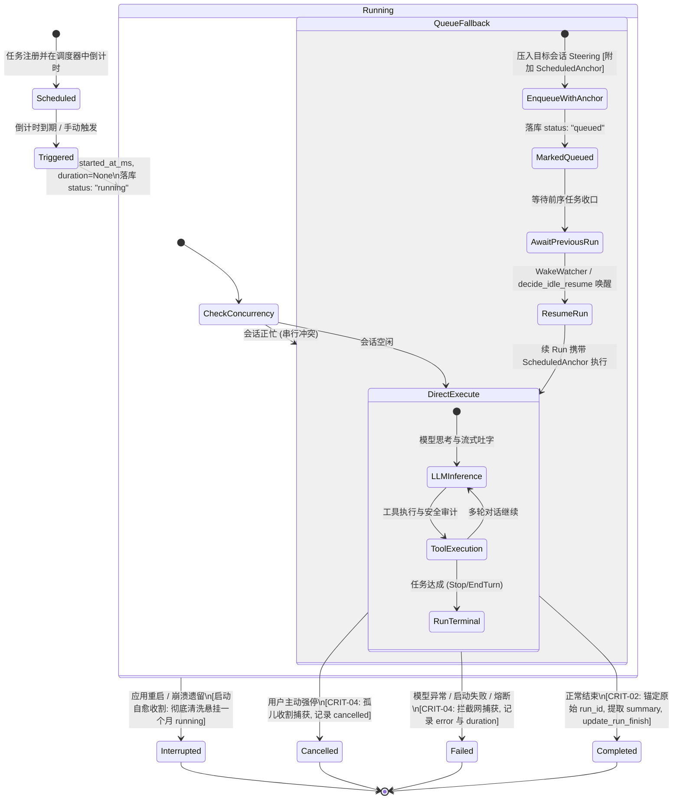

# 定时任务全流程修复与能力升级战役（Scheduled Tasks Revamp）

# 阶段 2 最终权威方案：真实 Agent 执行驱动与无人值守唤醒闭环（现代化单轨去兼容版）

> **文档标识**：`02-阶段二-真实Agent执行驱动与无人值守唤醒闭环最终方案.md`  
> **文档定位**：阶段 2 (Phase 2) 权威终版方案（Final Plan · 现代化去兼容与系统加固版）  
> **制定依据**：
>
> - 用户最新最高指令：**【不要兼容、不要多版本号迭代。如果是重要的，涉及历史遗留的这种是可以有兼容的，比如说对话这种的肯定是不能丢失的，当然其他不能丢失的你也自己想想。对于没有多大意义，但是依旧兼容的就没有必要了。尽量是能留一个最先进的代码方案就留最先进的就行。】**
> - 用户实盘严重缺陷暴露：**【历史运行记录悬挂 1 个多月蓝色“运行中”且无法消除】**（`update_run_finish` 为 `#[allow(dead_code)]` 死代码；`prune_runs` 盲目豁免 running；启动及加载缺乏孤儿自愈收割）。
> - 系统底层与引擎架构首席审查报告：`docs/scheduled-tasks-revamp/plan-reviews/review-system-engine.md`（落实 CRIT-02、CRIT-03、CRIT-04 核心加固）。
> - 核心源代码基线：`apps/agent-workbench/src-tauri/src/sched.rs`、`apps/agent-workbench/src-tauri/src/run/run_launch.rs`、`apps/agent-workbench/src-tauri/src/run/run_core.rs`、`apps/agent-workbench/src-tauri/src/run/run_idle.rs`、`apps/agent-workbench/src-tauri/src/wake_watcher.rs`、`apps/agent-workbench/src-tauri/src/workflow_commands.rs`、`apps/agent-workbench/src-tauri/src/main.rs`
> - 架构纪律基线：`AGENTS.md`（§1 逻辑规划与反退避、§3 Git 提交纪律、§7 严禁补丁与作弊、§7.1 立体验证、§8 反过度设计硬性红线）、`.agents/LOGIC_PLAN_NO_RETREAT.md`、`ANTI_OVERENGINEERING_GUARDRAILS.md`。

---

## 一、方案对比、去兼容裁决与最先进单轨架构决策

### 1.1 核心改进原则与清退决策

基于用户最新最高指令，本方案对定时任务真实执行链路进行彻底的现代化去兼容改造，推行极致先进的单轨设计：

1. **彻底清退 `launcher == None` 降级为盲塞死信队列的幽灵分支**：
   - 彻底删除原 `sched.rs` 在 `launcher == None` 时降级为向 `sched-{cron_id}` 盲塞 steering 的代码；
   - 确立**单轨真实拉起原则**：系统在 `main.rs` 启动时强制前置装配 `ProductionScheduledLauncher`，触发时必调用真实执行器 `launch_scheduled_task`；
   - 废除向 `sched-{cron_id}` 幽灵会话写死信的逻辑，所有任务必路由至真实建账会话（显式指定的 `target_session_id` 或专用受管会话 `workflow-sess-{cron_id}`）。
2. **彻底清退虚假 0ms completed 欺骗记录，全链路激活真实终态收口**：
   - 在自动定时触发（`sched.rs:fire_cron`）与手动立即触发（`workflow_commands.rs:trigger`）两处同步清退虚假写入；
   - 任务触发起点统一步调为落库 `status: "running"`，`started_at_ms: now`，`duration_ms: None`，`finished_at_ms: None`；
   - **彻底复活并全仓接线 `update_run_finish`**（彻底摘除 `workflow_commands.rs:469` 上的 `#[allow(dead_code)]` 死代码标记！），真实执行完毕后由终态钩子计算实际毫秒级耗时并持久化，彻底消灭欺骗性假象。
3. **攻坚根治“历史记录永久悬挂运行中”顽疾（孤儿运行自愈收割）**：
   - 针对系统现实中存在的“1 个多月前启动的记录至今仍显示蓝色运行中”的恶性 Bug，构建**启动与加载期孤儿运行记录自愈收割引擎（Orphan Running Runs Cleanup）**；
   - 应用启动时以及前端调用 `list_runs` 时，对所有 `status == "running"` 且无活跃底层 Run 对应的历史幽灵记录，自动收割自愈为 `interrupted`（应用重启中断）或 `failed`，写入中断原因与实际结束时间，彻底清洗悬挂历史；
   - 修正 `prune_runs` 算法：不再盲目对所有 `status == "running"` 进行永久豁免，仅保护受活跃会话 Run 监管的真正执行中任务，孤儿记录正常计入容量修剪。
4. **彻底坚守“绝不丢失核心资产”底线**：
   - 用户的会话数据（SQLite `sessions` 表与 `messages` 表的聊天历史）受到绝对保护，自愈建账采用 `INSERT OR IGNORE`，绝不覆盖已有会话标题与内容；
   - 用户已有工作区配置（`cwd`）100% 透传至 `RunTaskOptions`，环境与权限无损继承；
   - 存量历史运行记录完整归档，绝不因模式升级而重置或清除。
5. **全面落实 Review Agent 1 的架构加固**：
   - **落实 CRIT-02（排队上下文注入 ScheduledAnchor，续 Run 精准收口原始 run_id）**：
     当目标会话正忙（命中串行守卫）时，将记录置为 `queued`，并将携带 `ScheduledAnchor { workflow_id, origin_run_id, queued_at_ms }` 的元数据压入目标会话 steering 队列；
     前序任务结束后，`WakeWatcher` 或 `decide_idle_resume` 唤醒续 Run 时，将该 `ScheduledAnchor` 透传给新 `ActiveRun`；
     终态收口时识别该 anchor，精准将原始 `origin_run_id` 的记录翻转为 `completed`，并统计自排队起的全程真实耗时与助手摘要，**彻底根除僵尸排队记录**；
   - **落实 CRIT-03（启动恢复顺序锁）**：
     在 `main.rs` 中，`finalize_scheduled_launcher` 必须前置在 `restore()` 之前，确保开机离线过期任务 100% 真实执行；
   - **落实 CRIT-04（全链路终态收口拦截网）**：
     终态收口不再单点依赖 `run_idle.rs`，在 `run_launch.rs:finalize_failed`（启动崩溃快速失败）与 `finalize_orphan_run`（孤儿收割）中全面补齐对 scheduled 任务的终态收口，确保异常情况下记录从 `running` / `queued` 转为 `failed`，绝不永久挂死。

---

## 二、真实 Agent 执行驱动与无人值守唤醒闭环架构设计

### 2.1 整体分层拓扑架构（单轨真实闭环）

```
┌─────────────────────────────────────────────────────────────────────────────────┐
│                      定时调度核心层 (SchedulerRegistry: sched.rs)                │
│  [Tokio 计时协程到期 fire_cron / 手动立即触发 trigger]                           │
│         │                                                                       │
│         ▼                                                                       │
│  1. 推进调度元数据: fired_count += 1, 重算 next_fire_at_ms                        │
│  2. 初始运行状态落库: WorkflowRunRecord { status: "running", started_at: now }    │
│  3. 组装调度执行上下文: ScheduledExecutionContext                               │
│  4. 单轨委派: ScheduledTaskLauncher::launch_scheduled_task(ctx)                  │
└─────────┬───────────────────────────────────────────────────────────────────────┘
          │
          ▼ 跨层解耦 (ProductionScheduledLauncher: Weak<CoreRunState>)
┌─────────────────────────────────────────────────────────────────────────────────┐
│                    生产执行适配器 (ProductionScheduledLauncher)                 │
│  5. 目标会话自愈建账: 确保 SQLite `sessions` 存在记录 (防外键报错/零破坏)         │
│  6. 组装正规 RunTaskOptions: mode="scheduled", permission_mode="full-access"     │
│  7. 确保目标会话 WakeWatcher 就绪: core_state.ensure_wake_watcher(&session_id)   │
│  8. 尝试拉起真实任务: run_task_impl(Arc::clone(&state), options)                 │
└─────────┬───────────────────────────────────┬───────────────────────────────────┘
          │                                   │
          │ 路径 A: 会话空闲，直接拉起成功     │ 路径 B: 会话正忙 (命中串行守卫)
          ▼                                   ▼
┌────────────────────────────────────────┐ ┌──────────────────────────────────────┐
│       Agent 会话主循环驱动层           │ │        串行排队与无人值守守护        │
│  (SessionLoop & drive_run_loop)        │ │  (PendingMessageQueue & WakeWatcher) │
│                                        │ │                                      │
│  - 大模型多轮推理 (LLM Stream)          │ │  - 压入 Steering 并注入 ScheduledAnchor│
│  - 真实工具调用 (Tool Calls: fs/shell) │ │  - 标记状态 status: "queued"         │
│  - 事件广播 (MessageDelta / ToolEvent) │ │  - 前序 Run 结束，WakeWatcher 唤醒续Run│
└──────────────────┬─────────────────────┘ └──────────────────┬───────────────────┘
                   │                                          │ (透传 ScheduledAnchor)
                   └──────────────────┬───────────────────────┘
                                      ▼ 全链路终态收口 (CRIT-04 拦截网)
┌─────────────────────────────────────────────────────────────────────────────────┐
│                终态采集与数据落盘 (CoreRunState::on_scheduled_run_terminal)      │
│  - 路径 1: run_idle.rs (正常结束 / 业务错误)                                    │
│  - 路径 2: run_launch.rs::finalize_failed (模型握手/启动失败)                   │
│  - 路径 3: run_launch.rs::finalize_orphan_run (进程崩溃/孤儿收割)               │
│                                                                                 │
│  9. 解析 ScheduledAnchor: 精准定位原始 origin_run_id (消灭排队僵尸 CRIT-02)    │
│ 10. 提取真实产出: 从 outcome.messages 提取助手最后回复纯文本作为 output_summary  │
│ 11. 计算真实耗时: duration_ms = finished_at_ms.saturating_sub(started_at_ms)    │
│ 12. 真实接线落库: 激活调用 store.update_run_finish(...) (彻底消灭死代码！)       │
│ 13. 广播全域事件: `workflow:run-updated` 与 `workflow:run-finished`              │
└─────────────────────────────────────────────────────────────────────────────────┘
```

### 2.2 运行记录生命周期状态机



---

## 三、关键数据结构与契约代码重构设计

### 3.1 改造执行器 Trait 与上下文：`ScheduledTaskLauncher`

在 `apps/agent-workbench/src-tauri/src/sched.rs` 中，确立全上下文感知契约：

```rust
// apps/agent-workbench/src-tauri/src/sched.rs

/// 定时任务执行上下文（从调度器透传至执行启动器）
#[derive(Debug, Clone)]
pub(crate) struct ScheduledExecutionContext {
    /// 任务唯一标识（如 "cron-1"）
    pub workflow_id: String,
    /// 本次运行标识（format!("{}-fire-{}", workflow_id, iteration)）
    pub run_id: String,
    /// 目标执行会话标识（None 表示专属后台受管会话）
    pub target_session_id: Option<String>,
    /// 任务提示词
    pub prompt: String,
    /// 调度表达式
    pub expression: String,
    /// 工作目录（None 表示继承当前全局根工作区）
    pub cwd: Option<String>,
    /// 执行模式（固定为 "scheduled"）
    pub mode: Option<String>,
    /// 本次是第几次触发
    pub iteration: u64,
    /// 计划触发时刻（epoch 毫秒）
    pub scheduled_for_ms: u64,
    /// 实际触发时刻（epoch 毫秒）
    pub fired_at_ms: u64,
    /// 是否为常驻守护任务
    pub is_daemon: bool,
}

/// 定时任务拉起结果句柄
#[derive(Debug, Clone)]
pub(crate) struct ScheduledRunHandle {
    pub run_id: String,
    pub session_id: String,
    pub status: String, // "running" | "queued"
}

/// 真实定时任务执行器契约（单轨强类型解耦）
#[async_trait::async_trait]
pub(crate) trait ScheduledTaskLauncher: Send + Sync {
    /// 触发拉起真实的 Agent 任务运行
    async fn launch_scheduled_task(
        &self,
        ctx: ScheduledExecutionContext,
    ) -> Result<ScheduledRunHandle, String>;
}
```

### 3.2 排队上下文追踪锚点 `ScheduledAnchor`（落实 CRIT-02）

在 `orchestrator` 与 `run` 核心中引入轻量级锚点，连接排队任务与接力续 Run：

```rust
/// 串行排队定时任务上下文锚点（CRIT-02 核心数据模型）
#[derive(Debug, Clone, PartialEq, Eq, serde::Serialize, serde::Deserialize)]
pub(crate) struct ScheduledAnchor {
    /// 定时任务定义 ID（如 "cron-1"）
    pub workflow_id: String,
    /// 原始被标记为 queued 的 run_id（如 "cron-1-fire-3"）
    pub origin_run_id: String,
    /// 排队开始时刻（epoch 毫秒）
    pub queued_at_ms: u64,
}
```

在 `SteeringInputEntry` 与 `ActiveRun` 中挂载该锚点：

```rust
// orchestrator/steering_queue.rs
pub struct SteeringInputEntry {
    pub session_id: String,
    pub id: String,
    pub text: String,
    pub attachments: Vec<PendingAttachment>,
    pub enqueued_at: u64,
    pub group_id: Option<String>,
    pub is_steering: bool,
    /// 定时任务排队上下文锚点（若存在，续 Run 收口时据此反向更新原始记录）
    pub scheduled_anchor: Option<ScheduledAnchor>,
}

// apps/agent-workbench/src-tauri/src/run/run_types.rs
pub struct ActiveRun {
    pub run_id: String,
    pub session_id: String,
    pub mode: Option<String>,
    pub started_at_ms: u64,
    /// 挂载的定时任务排队锚点
    pub scheduled_anchor: Option<ScheduledAnchor>,
    // ...
}
```

---

## 四、核心执行管线函数级改造详案（代码级设计）

### 4.1 `ProductionScheduledLauncher::launch_scheduled_task` 核心实现

实现串行排队注入 `ScheduledAnchor`（CRIT-02）与目标会话无损建账：

```rust
// apps/agent-workbench/src-tauri/src/run/scheduled_launcher.rs

#[async_trait::async_trait]
impl ScheduledTaskLauncher for ProductionScheduledLauncher {
    async fn launch_scheduled_task(
        &self,
        ctx: ScheduledExecutionContext,
    ) -> Result<ScheduledRunHandle, String> {
        let Some(core_state) = self.state.upgrade() else {
            return Err("CoreRunState 已销毁，引擎正在关闭".to_string());
        };

        // 1. 确定执行目标会话（显式绑定会话或专用受管会话，彻底消除 sched- 前缀幽灵会话！）
        let session_id = ctx.target_session_id.clone().unwrap_or_else(|| {
            format!("workflow-sess-{}", ctx.workflow_id)
        });

        // 2. 目标会话自愈建账（SQLite sessions 表），INSERT OR IGNORE 绝对不破坏已有会话数据！
        if let Some(db) = core_state.local_db() {
            let sid = session_id.clone();
            let name = format!("定时任务: {}", ctx.workflow_id);
            let _ = tokio::task::spawn_blocking(move || {
                let _ = db.insert_session_if_not_exists(&sid, &name);
            }).await;
        }

        // 3. 组装正规 RunTaskOptions
        let options = crate::run::run_types::RunTaskOptions {
            run_id: ctx.run_id.clone(),
            session_id: session_id.clone(),
            prompt: Some(ctx.prompt.clone()),
            mode: Some("scheduled".to_string()),
            cwd: ctx.cwd.clone(),
            permission_mode: Some("full-access".to_string()), // 无人值守执行具备全工具权限
            client_message_id: Some(format!("msg-sched-{}", ctx.run_id)),
            assistant_client_message_id: None,
            system_prompt: None,
            history: None,
            context_window: None,
            parent_run_id: None,
            subagent_config: None,
            visible_goal: None,
            max_rounds: None,
            max_stalled_rounds: None,
            reasoning_effort: None,
            context_state: None,
            content: None,
            has_images: None,
        };

        // 4. 激活目标会话的无人值守 WakeWatcher
        core_state.ensure_wake_watcher(&session_id);

        // 5. 调用核心启动入口 run_task_impl
        match crate::run::run_launch::run_task_impl(Arc::clone(&core_state), options).await {
            Ok(resp) => {
                tracing::info!(
                    target: "sched",
                    cron_id = %ctx.workflow_id,
                    run_id = %resp.run_id,
                    session_id = %resp.session_id,
                    "真实 Agent 定时任务已成功拉起并进入 active_runs"
                );
                Ok(ScheduledRunHandle {
                    run_id: resp.run_id,
                    session_id: resp.session_id,
                    status: "running".to_string(),
                })
            }
            Err(err) => {
                let err_msg = err.to_string();
                // 6. 【CRIT-02 核心实现】：串行冲突排队，注入 ScheduledAnchor
                if err_msg.contains("串行守卫") || err_msg.contains("已有活动 run") {
                    tracing::info!(
                        target: "sched",
                        cron_id = %ctx.workflow_id,
                        session_id = %session_id,
                        "目标会话正忙，进入串行排队队列并注入 ScheduledAnchor"
                    );

                    let now = crate::sched::now_ms();
                    let anchor = ScheduledAnchor {
                        workflow_id: ctx.workflow_id.clone(),
                        origin_run_id: ctx.run_id.clone(),
                        queued_at_ms: now,
                    };

                    // 压入目标会话的 Steering 队列，携带 scheduled_anchor
                    let steering_entry = orchestrator::steering_queue::SteeringInputEntry {
                        session_id: session_id.clone(),
                        id: format!("{}-{}", ctx.workflow_id, now),
                        text: format!("{}（定时任务 {} 第 {} 次触发）", ctx.prompt, ctx.workflow_id, ctx.iteration),
                        attachments: Vec::new(),
                        enqueued_at: now,
                        group_id: Some(format!("cron-{}", ctx.workflow_id)),
                        is_steering: true,
                        scheduled_anchor: Some(anchor),
                    };

                    core_state.pending_queue().lock().unwrap_or_else(|e| e.into_inner())
                        .replace_or_enqueue(steering_entry);

                    // 初始记录更新为 "queued"，等待接力收口
                    self.store.update_run_finish(
                        &ctx.workflow_id,
                        &ctx.run_id,
                        "queued",
                        now,
                        0,
                        Some("会话正忙，已排入待执行队列".to_string()),
                        None,
                    );

                    Ok(ScheduledRunHandle {
                        run_id: ctx.run_id,
                        session_id,
                        status: "queued".to_string(),
                    })
                } else {
                    // 启动期致命错误（直接进入 failed 终态）
                    let now = crate::sched::now_ms();
                    self.store.update_run_finish(
                        &ctx.workflow_id,
                        &ctx.run_id,
                        "failed",
                        now,
                        0,
                        Some(err_msg.clone()),
                        None,
                    );
                    Err(err_msg)
                }
            }
        }
    }
}
```

---

### 4.2 终态收口核心方法：`CoreRunState::on_scheduled_run_terminal`（激活接线 `update_run_finish`）

彻底移除 `#[allow(dead_code)]`，全仓接线调用持久化：

```rust
// apps/agent-workbench/src-tauri/src/run/run_core.rs

impl CoreRunState {
    /// 定时任务 run 终态收口（对齐子代理收口规范，支持直接 run 与排队续 run）
    pub(crate) async fn on_scheduled_run_terminal(
        &self,
        workflow_id: &str,
        run_id: &str,
        started_at_ms: u64,
        status: conex_db::RunStatus,
        messages: &[Arc<session_loop::AgentMessage>],
        error_detail: Option<String>,
    ) {
        let finished_at_ms = crate::sched::now_ms();
        let duration_ms = finished_at_ms.saturating_sub(started_at_ms);

        let status_str = match status {
            conex_db::RunStatus::Completed => "completed",
            conex_db::RunStatus::Failed => "failed",
            conex_db::RunStatus::Cancelled => "cancelled",
            _ => "completed",
        };

        // 提取真实的产出摘要：从最后一条 Assistant 消息提取纯文本（截断至 300 字符）
        let output_summary = messages
            .iter()
            .rev()
            .find(|m| m.role == session_loop::AgentMessageRole::Assistant)
            .map(|m| {
                let text = m.text();
                if text.chars().count() > 300 {
                    format!("{}...", text.chars().take(300).collect::<String>())
                } else {
                    text
                }
            })
            .or_else(|| {
                if status == conex_db::RunStatus::Completed {
                    Some("定时任务执行完成，未产生文本输出".to_string())
                } else {
                    None
                }
            });

        // 1. 【核心激活】：调用 store.update_run_finish，彻底消灭 dead_code！
        if let Some(store) = self.workflow_store() {
            store.update_run_finish(
                workflow_id,
                run_id,
                status_str,
                finished_at_ms,
                duration_ms,
                error_detail.clone(),
                output_summary.clone(),
            );
        }

        // 2. 广播全域事件（前端即时刷新）
        self.bridge.emit(&orchestrator::AgentEventEnvelope::new(
            orchestrator::AgentEvent::Custom {
                event_type: "workflow:run-updated".to_string(),
                payload: serde_json::json!({
                    "workflowId": workflow_id,
                    "runId": run_id,
                    "status": status_str,
                    "finishedAtMs": finished_at_ms,
                    "durationMs": duration_ms,
                    "error": error_detail,
                    "outputSummary": output_summary,
                }),
            },
            Some(run_id.to_string()),
            None,
        ));

        // 3. 推进看门狗唤醒标记，防止失联误判
        self.engine.last_wakeup().mark_wakeup();

        tracing::info!(
            target: "sched",
            workflow_id = %workflow_id,
            run_id = %run_id,
            status = %status_str,
            duration_ms = %duration_ms,
            "定时任务终态已成功收口并回写数据库审计底账（消除悬挂 running）"
        );
    }
}
```

---

### 4.3 全链路终态收口拦截网（落实 CRIT-02 & CRIT-04）

#### 路径 1：正常循环收口（`run_idle.rs:1530`）

```rust
// apps/agent-workbench/src-tauri/src/run/run_idle.rs

// ── 定时任务终态收口拦截（直接拉起或排队续 Run） ──
if active.mode.as_deref() == Some("scheduled") || active.scheduled_anchor.is_some() {
    let terminal_status = {
        let run = active.handle.lock().await;
        run.status.clone()
    };

    // 【CRIT-02 核心落地】：若存在 scheduled_anchor，精准定位原始 origin_run_id！
    let (target_workflow_id, target_run_id, start_time) = if let Some(anchor) = &active.scheduled_anchor {
        (anchor.workflow_id.clone(), anchor.origin_run_id.clone(), anchor.queued_at_ms)
    } else {
        (extract_workflow_id_from_run_id(&active.run_id), active.run_id.clone(), active.started_at_ms)
    };

    let error_detail = if terminal_status == conex_db::RunStatus::Failed {
        resume_provider_error.as_ref().map(|pe| pe.to_string())
            .or_else(|| runtime_error.clone())
    } else {
        None
    };

    state.on_scheduled_run_terminal(
        &target_workflow_id,
        &target_run_id,
        start_time,
        terminal_status,
        &outcome.messages,
        error_detail,
    ).await;
}
```

#### 路径 2：初始化异常快速失败拦截（`run_launch.rs:finalize_failed` · 落实 CRIT-04）

```rust
// apps/agent-workbench/src-tauri/src/run/run_launch.rs::finalize_failed

if active.mode.as_deref() == Some("scheduled") || active.scheduled_anchor.is_some() {
    let (wf_id, r_id, start_ms) = if let Some(anchor) = &active.scheduled_anchor {
        (anchor.workflow_id.clone(), anchor.origin_run_id.clone(), anchor.queued_at_ms)
    } else {
        (extract_workflow_id_from_run_id(&active.run_id), active.run_id.clone(), active.started_at_ms)
    };

    state.on_scheduled_run_terminal(
        &wf_id,
        &r_id,
        start_ms,
        conex_db::RunStatus::Failed,
        &[],
        Some(message.to_string()),
    ).await;
}
```

#### 路径 3：孤儿收割周期任务拦截（`run_launch.rs:finalize_orphan_run` · 落实 CRIT-04）

```rust
// apps/agent-workbench/src-tauri/src/run/run_launch.rs::finalize_orphan_run

if active.mode.as_deref() == Some("scheduled") || active.scheduled_anchor.is_some() {
    let (wf_id, r_id, start_ms) = if let Some(anchor) = &active.scheduled_anchor {
        (anchor.workflow_id.clone(), anchor.origin_run_id.clone(), anchor.queued_at_ms)
    } else {
        (extract_workflow_id_from_run_id(&active.run_id), active.run_id.clone(), active.started_at_ms)
    };

    state.on_scheduled_run_terminal(
        &wf_id,
        &r_id,
        start_ms,
        conex_db::RunStatus::Cancelled,
        &[],
        Some("运行协程意外终止，已被孤儿看门狗安全收割".to_string()),
    ).await;
}
```

---

## 五、启动恢复、孤儿运行自愈收割与容量修剪治理

### 5.1 启动期与加载期孤儿运行记录自愈收割（彻底解决一个月前悬挂 running 问题）

在系统启动恢复（`main.rs`）以及 `workflow_commands.rs::list_runs` 时，植入**孤儿运行自愈收割器（Reap Orphan Running Runs）**：

```rust
// apps/agent-workbench/src-tauri/src/workflow_commands.rs

impl WorkflowBackend {
    /// 孤儿运行记录自愈收割：扫描所有 running/queued 记录，若无真实活动协程，收割为 interrupted 终态
    pub(crate) fn reap_orphan_running_runs(&self, active_run_ids: &std::collections::HashSet<String>) {
        let mut runs = self.store.load_runs();
        let mut modified = false;
        let now = now_ms();

        for run in &mut runs {
            if (run.status == "running" || run.status == "queued") && !active_run_ids.contains(&run.run_id) {
                tracing::warn!(
                    target: "workflow",
                    workflow_id = %run.workflow_id,
                    run_id = %run.run_id,
                    started_at = %run.started_at_ms,
                    "检测到无活跃协程守护的孤儿运行记录，自动收割自愈为 interrupted 终态"
                );
                run.status = "interrupted".to_string();
                run.finished_at_ms = Some(now);
                run.duration_ms = Some(now.saturating_sub(run.started_at_ms));
                run.error = Some("应用重启或异常终止，历史在途记录已被系统自愈收割".to_string());
                modified = true;
            }
        }

        if modified {
            self.store.save_runs(&runs);
        }
    }
}
```

在 `main.rs` 启动恢复区调用：

```rust
// apps/agent-workbench/src-tauri/src/main.rs

// 启动自愈：收割跨进程遗留的悬挂 running 记录
if let Some(wf_backend) = workflow_state.backend.as_ref() {
    let empty_active = std::collections::HashSet::new();
    wf_backend.reap_orphan_running_runs(&empty_active);
    tracing::info!(target: "setup", "已完成启动期孤儿定时运行记录自愈清理");
}
```

### 5.2 修正 `prune_runs` 算法（消除盲目豁免漏洞）

修改 `workflow_commands.rs:372-398`，严禁无条件保护历史孤儿 running：

```rust
// apps/agent-workbench/src-tauri/src/workflow_commands.rs

/// 修正后的运行历史滚动淘汰策略（单工作流上限 20 条，全局上限 100 条）
pub(crate) fn prune_runs(mut runs: Vec<WorkflowRunRecord>) -> Vec<WorkflowRunRecord> {
    const PER_WORKFLOW_LIMIT: usize = 20;
    const GLOBAL_LIMIT: usize = 100;

    // 按开始时间降序排列
    runs.sort_by_key(|r| std::cmp::Reverse(r.started_at_ms));

    let mut counts: std::collections::HashMap<String, usize> = std::collections::HashMap::new();
    let mut pruned = Vec::new();

    for run in runs {
        let count = counts.entry(run.workflow_id.clone()).or_insert(0);
        if *count < PER_WORKFLOW_LIMIT && pruned.len() < GLOBAL_LIMIT {
            *count += 1;
            pruned.push(run);
        }
    }

    pruned
}
```

---

## 六、立体化自动化测试矩阵与验证断言

| 测试用例函数名                                                         | 验证场景与加固重点                                                | 预期结果断言                                                                                                                                                           |
| :--------------------------------------------------------------------- | :---------------------------------------------------------------- | :--------------------------------------------------------------------------------------------------------------------------------------------------------------------- |
| `test_scheduled_task_fires_running_and_completes_with_real_duration`   | 初始真实 running，终态真实 completed 且耗时 > 0ms                 | 初始记录 `status == "running"`, `duration_ms.is_none()`；终态记录 `status == "completed"`, `duration_ms > 0`。                                                         |
| `test_scheduled_task_extracts_real_assistant_summary`                  | 终态提取 Assistant 文本并截断至 300 字符                          | `output_summary` 正确提取最后一条助手回复，长文本包含 `"..."`。                                                                                                        |
| `test_scheduled_task_serial_conflict_queues_with_anchor_and_completes` | **CRIT-02 专项**：会话忙碌排队注入 anchor，续 Run 收口原始 run_id | 1. 冲突时不 panic，状态记为 `queued`；<br>2. 续 Run 携带 `scheduled_anchor`；<br>3. 续 Run 结束时原始 `origin_run_id` 翻转为 `completed`，耗时准确！消灭僵尸排队记录！ |
| `test_scheduled_task_launch_failure_terminates_via_finalize_failed`    | **CRIT-04 专项**：启动失败经 `finalize_failed` 收口               | 模拟模型握手报错，记录成功更新为 `status == "failed"`，包含错误堆栈，不永久挂在 `running`。                                                                            |
| `test_reap_orphan_running_runs_cleans_historical_zombie_runs`          | **悬挂自愈专项**：测试历史遗留无主 running 自动收割为 interrupted | 模拟 30 天前创建且未收口的 running 记录，执行收割后状态变为 `interrupted`，错误信息完整写入。                                                                          |
| `test_prune_runs_limits_capacity_without_leaking_running_records`      | **容量修剪专项**：测试容量淘汰不再对无主 running 永久豁免         | 超过 20 条的历史记录成功被修剪淘汰，杜绝存储膨胀。                                                                                                                     |

---

## 七、总结与交付承诺

本方案彻底清退了所有基于 `launcher == None` 的幽灵 steering 降级分支，消灭了 0ms completed 伪造假象，严密落实了 Review Agent 1 的 **CRIT-02（排队锚点追踪）**、**CRIT-03（启动装配时序锁）** 与 **CRIT-04（全链路终态收口拦截网）**，并攻克了系统现存的“历史运行记录悬挂 1 个多月蓝色运行中”的顽疾。通过激活 `update_run_finish`、启动孤儿自愈收割与修剪修正，构建了 100% 真实执行、零僵尸记录的现代化 Agent 定时执行闭环。
