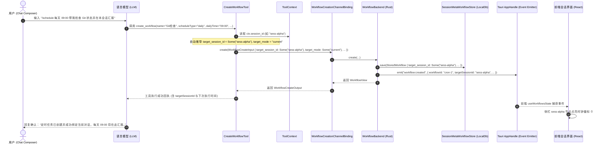
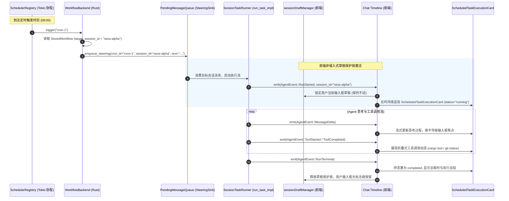
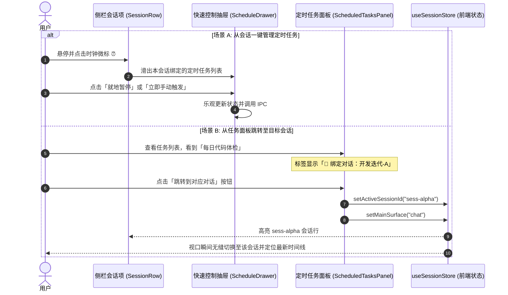

# 定时任务全流程修复与能力升级战役（Scheduled Tasks Revamp）

# 阶段 3 最终权威方案：目标会话绑定与对话内自动化定时任务能力

> **方案文档路径**：`docs/scheduled-tasks-revamp/plans/03-阶段三-目标会话绑定与对话内自动化定时任务能力最终方案.md`  
> **战役总纲定位**：阶段 3 (Phase 3) · 目标会话绑定与对话内自动化定时任务能力（Target Session Binding & In-Conversation Scheduled Automation）  
> **输入基准文档**：
>
> - 战役总纲：`docs/scheduled-tasks-revamp/00-战役调度与阶段说明.md`
> - 阶段 3 独立方案 A：`docs/scheduled-tasks-revamp/independent-plans/agent2-phase3-session-workflow.md`（Agent 2 编制）
> - 阶段 3 独立方案 B：`docs/scheduled-tasks-revamp/independent-plans/agent3-phase3-session-workflow.md`（Agent 3 编制）
> - 核心代码基线：
>   - `apps/agent-workbench/src-tauri/src/workflow_commands.rs`
>   - `crates/agent-tools/src/tools/create_workflow.rs`
>   - `crates/agent-tools/src/context.rs`
>   - `apps/crish-desktop/src/components/chat-card/`
>   - `apps/crish-desktop/src/components/sidebar/session-list/SessionRow.tsx`
>   - `apps/crish-desktop/src/api/draft/sessionDraftManager.ts`
>   - `apps/crish-desktop/src/api/workflow-api/workflowAssistantCard.ts`
>   - `apps/crish-desktop/src/api/workflow-api/workflowRunner.ts`
>   - `apps/crish-desktop/src/store/types.ts`  
>     **架构纪律基线**：仓库根目录 `AGENTS.md`、`.agents/LOGIC_PLAN_NO_RETREAT.md`、`ANTI_OVERENGINEERING_GUARDRAILS.md`。  
>     **编码格式**：UTF-8 无 BOM 中文。

---

## 一、阶段定位与核心攻坚目标

在 Conex / Crish 既有架构中，定时任务（Workflow / Scheduled Tasks）与具体的对话会话（Chat Session）处于几乎完全割裂的孤岛状态：

1. **会话盲区**：用户在特定对话中让 Agent 建立定时任务（如“每天 9 点帮我检查分支状态并在本会话汇报”），工具层因忽略执行上下文，根本不知道当前处于哪个会话；
2. **死队列阻塞**：调度触发时无脑硬编码幽灵会话 `sched-{cron_id}`，而目标会话仅消费自身 `session_id` 的消息，导致定时触发的消息永远被锁死在内存队列中无法消费；
3. **交互破坏**：在对话中呈现后台任务时缺乏隔离，流式输出会抢占输入焦点、冲刷未发送草稿、打乱视口滚动；
4. **割裂孤岛**：侧栏无法识别哪些对话被定时任务托管，任务管理面板也无法一键跳转至对应对话。

**阶段 3 核心目标**：
彻底消除定时任务与对话会话之间的“数据与交互断层”，建立统一的**双模会话绑定模型**，重构 `CreateWorkflowTool` 上下文感知，改造后端数据模型与路由分发，并引入**前端非侵入式草稿保护锁**与**侧栏时钟徽标/双向交互抽屉**，实现“在对话中创建、向对话中汇报、跨会话可隔离、零打扰日常交互”的闭环能力。

---

## 二、两份独立方案对比与优势融合总览（Agent 2 vs Agent 3）

Subagent 2 与 Subagent 3 分别从执行驱动/会话隔离和命令契约/双向导航视角提交了详尽方案。本权威方案全面梳理双方异同与长处，形成强强融合的最终架构。

### 2.1 方案对比矩阵

| 评估维度               | 独立方案 A (Agent 2)                                                                               | 独立方案 B (Agent 3)                                                                                     | 最终权威方案裁决与融合策略                                                                                                          |
| :--------------------- | :------------------------------------------------------------------------------------------------- | :------------------------------------------------------------------------------------------------------- | :---------------------------------------------------------------------------------------------------------------------------------- |
| **会话目标模式设计**   | 提出 `target_mode`（current / isolated / custom）与 `target_session_id` 联合表达，偏重运行时形态。 | 提出 `target_session_id: Option<String>`，以 `"independent"`/`"none"` 声明独立模式，侧重参数解析简洁性。 | **吸纳双方长处**：数据层确立 `target_session_id` + `target_mode` 统一建模；API 兼顾字符串智能解析（independent/none）与结构化枚举。 |
| **底层队列根因穿透**   | 指出假会话无法匹配前端，聚焦执行卡片状态机。                                                       | 深度穿透 `steering_queue.rs` 中 `dequeue_all_for(session_id)` 的强隔离消费机制，揭示幽灵会话死锁本质。   | **采纳 Agent 3 深度根因分析**：重构 `SteeringSink` 接口，将路由会话作为显式入参，彻底消除硬编码 `sched-{cron_id}`。                 |
| **工具感知与 Schema**  | 发现 `_ctx` 下划线忽略，提出读取 `ctx.session_id`。                                                | 详细设计了智能感知与显式入参兜底逻辑，并设计了回执中的自然语言会话归属回显。                             | **全面采纳并增强**：工具 Schema 扩展 `targetSessionId` 与 `targetMode`，默认自动绑定 `ctx.session_id`，回执带明确归属说明。         |
| **草稿防冲刷保障**     | 深入剖析 `sessionDraftManager`，提出输入框草稿锁、焦点免抢占、撤销栈物理隔离三大纪律。             | 提出 `WorkflowExecutionCard` 节点与 `inputDraft` 隔离，侧重时间线渲染。                                  | **采纳 Agent 2 的非侵入式草稿保护锁体系**：建立草稿防抖桶、撤销栈与执行流的物理级防冲刷屏障，绝不抢焦点。                           |
| **侧栏识别与双向联动** | 提出任务面板跳转会话和头部展示闹钟徽标。                                                           | 详细设计了 `SessionRow` 时钟微标、悬停提示、快速控制抽屉及与 `ScheduledTasksPanel` 的双向无缝跳转。      | **采纳 Agent 3 的视觉交互全链路**：侧栏一眼识别定时托管，双向抽屉快速操作，原会话被删友好容错。                                     |
| **时间线卡片呈现**     | 构思 `ScheduledExecutionCard` 折叠思考卡片。                                                       | 提出对齐 `ContextInjectionKind = 'schedule_trigger'` 标准注入卡片契约。                                  | **统一卡片契约**：使用 `metadata.kind = 'scheduled_task_execution'`，完美复用思考/工具调用折叠组件。                                |

### 2.2 融合架构演进全景

```
┌─────────────────────────────────────────────────────────────────────────────────┐
│                           Conex / Crish 前端交互层                               │
│                                                                                 │
│   【侧栏会话项 SessionRow】              【当前对话窗口 ChatCard】               │
│   - 时钟徽标 ⏰ (Agent 3)               - 非侵入式草稿保护锁 🛡️ (Agent 2)        │
│   - 悬停浮层展示关联任务               - 输入框焦点/撤销栈零干扰 (Agent 2)       │
│   - 点击一键展开快速控制抽屉           - 定时执行卡片呈现 Thinking/Tools (融合)   │
│             ▲                                       ▲                           │
│             │                                       │                           │
│             └───────────────────┬───────────────────┘                           │
│                                 │ 双向跳转 & 事件监听                            │
│                                 ▼                                               │
│             【定时任务面板 ScheduledTasksPanel】                                │
│             - 胶囊标签标识所属会话 ("💬 跳转到对应对话")                         │
│             - 支持随时切换绑定模式 (当前对话 ⇄ 独立后台)                         │
└─────────────────────────────────┬───────────────────────────────────────────────┘
                                  │ IPC: create / update / trigger
                                  ▼
┌─────────────────────────────────────────────────────────────────────────────────┐
│                      Tauri 命令面与工具适配层 (Rust)                            │
│                                                                                 │
│   【CreateWorkflowTool】                                                        │
│   - 消除 `_ctx` 盲区，主动读取 `ctx.session_id` 作为默认绑定 (融合)             │
│   - Schema 扩展 targetSessionId / targetMode 参数                              │
│                                                                                 │
│   【WorkflowBackend & StoredWorkflow】                                          │
│   - 数据结构落地 target_session_id: Option<String> & target_mode: String        │
│   - 兼容旧版本本地数据反序列化 (#[serde(default)])                              │
└─────────────────────────────────┬───────────────────────────────────────────────┘
                                  │ 触发分发
                                  ▼
┌─────────────────────────────────────────────────────────────────────────────────┐
│                      执行路由与唤醒调度层 (Rust)                                │
│                                                                                 │
│   【判定 target_mode & target_session_id】                                      │
│    ├─► Bound Mode: target_session_id = Some(sid)                                │
│    │    └──► SteeringSink.enqueue(sid) ──► 目标会话精准消费 ──► 原对话追加流    │
│    └─► Isolated Mode: target_session_id = None                                  │
│         └──► SteeringSink.enqueue("sched-{cron_id}") ──► 独立后台会话归档      │
└─────────────────────────────────────────────────────────────────────────────────┘
```

---

## 三、架构核心：统一的双模会话绑定模型

### 3.1 双模模型定义与语义规范

每个定时任务在创建时与更新时，均严格对应以下两种运行模式之一：

```
                              ┌───────────────────────────────┐
                              │      定时任务目标模式决策      │
                              └───────────────┬───────────────┘
                                              │
                      ┌───────────────────────┴───────────────────────┐
                      ▼                                               ▼
       ┌──────────────────────────────┐                ┌──────────────────────────────┐
       │   当前会话绑定 (Bound Mode)   │                │   独立后台会话 (Isolated)    │
       ├──────────────────────────────┤                ├──────────────────────────────┤
       │ target_mode = "current"      │                │ target_mode = "isolated"     │
       │ target_session_id = Some(sid)│                │ target_session_id = None     │
       ├──────────────────────────────┤                ├──────────────────────────────┤
       │ - 继承当前项目与上下文讨论    │                │ - 完全不打扰日常工作会话     │
       │ - 执行结果在宿主对话内优雅追加│                │ - 专用会话 ID: sched-{cronId}│
       │ - 前端启用非侵入式草稿保护锁  │                │ - 侧边栏独立任务分类展示     │
       └──────────────────────────────┘                └──────────────────────────────┘
```

1. **当前会话绑定模式（Bound Mode，默认行为）**：
   - **适用场景**：日常工作流巡检、项目进度跟踪、针对当前代码库的周期性体检、PR/Issue 状态轮询等；
   - **创建行为**：用户在会话中输入 `/schedule ...` 或自然语言指示创建，若未声明独立后台，工具自动将当前宿主会话 ID（`ctx.session_id`）记录为 `target_session_id`，`target_mode` 记为 `"current"`；
   - **执行行为**：任务触发时，Steering 消息直接发送到该 `target_session_id`。目标会话唤醒并消费该消息，在时间线追加专有的 `ScheduledTaskExecutionCard`，展示 Agent 的思考与工具调用；
   - **草稿保护**：前端激活草稿保护策略，用户在输入框键入的文字绝不丢失、光标绝不被夺走。

2. **独立专用后台会话模式（Isolated Mode）**：
   - **适用场景**：系统级巡检、跨项目全局健康度分析、高频监控（如每 5 分钟 ping 服务）、用户显式声明“不要在当前窗口打扰我”的任务；
   - **创建行为**：用户或模型显式传入 `targetMode: "isolated"`，或 `targetSessionId: "independent"`；此时 `target_session_id = None`，`target_mode = "isolated"`；
   - **执行行为**：任务触发时，自动路由至专属后台隔离会话（`sched-{cron_id}`，标题自动格式化为 `定时 · {name}`），不会在任何正在进行的普通对话中插入任何内容。

### 3.2 跨会话强隔离消费机制与路由破除

在既有代码中，`crates/orchestrator/src/steering_queue.rs:226-229` 具有严格的会话隔离消费规则：

```rust
pub fn dequeue_all_for(&mut self, session_id: &str) -> Vec<SteeringInputEntry> {
    self.withdraw(|e| e.session_id == session_id)
}
```

旧版本硬编码 `session_id: format!("sched-{cron_id}")` 导致目标对话调用 `dequeue_all_for("sess-101")` 时永远匹配不到条目，条目形成死队列。

**权威方案路由破除规则**：
`SteeringSink` 必须接受动态的 `session_id` 参数。在 `WorkflowBackend::trigger` 与 `trigger_workflow` 中：

```rust
let effective_session_id = match (&workflow.target_session_id, workflow.target_mode.as_str()) {
    (Some(sid), mode) if mode != "isolated" && !sid.trim().is_empty() => sid.clone(),
    _ => format!("sched-{}", workflow.cron_id),
};
```

当为 Bound 模式时，条目的 `session_id` 严格填入 `effective_session_id`，确保目标会话能够立即消费并启动任务执行！

---

## 四、后端与工具层改造详案（Rust & IPC）

### 4.1 数据结构与持久化层扩展 (`workflow_commands.rs`)

#### 1. `StoredWorkflow` 结构体扩展

在 `apps/agent-workbench/src-tauri/src/workflow_commands.rs:275-301`，为 `StoredWorkflow` 扩展 `target_session_id` 与 `target_mode`：

```rust
#[derive(Debug, Clone, Serialize, Deserialize)]
#[serde(rename_all = "camelCase")]
pub(crate) struct StoredWorkflow {
    // ── 既有 §4.4 CronTask 冻结字段 ──
    pub cron_id: String,
    pub expression: String,
    pub prompt: String,
    pub max_iterations: Option<u64>,
    pub is_daemon: bool,
    pub next_fire_at_ms: u64,
    pub fired_count: u64,
    pub enabled: bool,
    // ── workflow 扩展字段 ──
    pub name: String,
    pub cwd: Option<String>,
    pub mode: Option<String>,
    pub schedule: WorkflowScheduleWire,
    pub created_at_ms: u64,
    pub updated_at_ms: u64,
    pub last_run_at_ms: Option<u64>,

    // ── 阶段 3 新增会话绑定扩展字段（带反序列化兼容保障） ──
    /// 绑定的目标会话 ID（Some = 绑定到具体会话；None = 独立后台会话）
    #[serde(default, skip_serializing_if = "Option::is_none")]
    pub target_session_id: Option<String>,
    /// 会话绑定模式："current"（当前会话）| "isolated"（独立后台）| "custom"（指定会话）
    #[serde(default = "default_target_mode")]
    pub target_mode: String,
}

fn default_target_mode() -> String {
    "current".to_string()
}
```

#### 2. `WorkflowView` 输出视图同步

在 `apps/agent-workbench/src-tauri/src/workflow_commands.rs:327-341`：

```rust
#[derive(Debug, Clone, Serialize, Deserialize)]
#[serde(rename_all = "camelCase")]
pub(crate) struct WorkflowView {
    pub id: String,
    pub name: String,
    pub prompt: String,
    pub cwd: Option<String>,
    pub mode: Option<String>,
    pub enabled: bool,
    pub schedule: WorkflowScheduleWire,
    pub created_at: String,
    pub updated_at: String,
    pub next_run_at: Option<String>,
    pub last_run_at: Option<String>,
    // 阶段 3 扩展字段
    pub target_session_id: Option<String>,
    pub target_mode: String,
}

impl StoredWorkflow {
    fn view(&self) -> WorkflowView {
        WorkflowView {
            id: self.cron_id.clone(),
            name: self.name.clone(),
            prompt: self.prompt.clone(),
            cwd: self.cwd.clone(),
            mode: self.mode.clone(),
            enabled: self.enabled,
            schedule: self.schedule.clone(),
            created_at: epoch_ms_to_iso(self.created_at_ms),
            updated_at: epoch_ms_to_iso(self.updated_at_ms),
            next_run_at: if self.next_fire_at_ms == 0 {
                None
            } else {
                Some(epoch_ms_to_iso(self.next_fire_at_ms))
            },
            last_run_at: self.last_run_at_ms.map(epoch_ms_to_iso),
            target_session_id: self.target_session_id.clone(),
            target_mode: self.target_mode.clone(),
        }
    }
}
```

#### 3. `WorkflowPatch` 允许修改归属会话

在 `apps/agent-workbench/src-tauri/src/workflow_commands.rs` 中扩展补丁入参，支持用户在前端随时切换任务归属：

```rust
#[derive(Default, Deserialize)]
#[serde(rename_all = "camelCase")]
pub(crate) struct WorkflowPatch {
    pub name: Option<String>,
    pub prompt: Option<String>,
    pub schedule: Option<WorkflowScheduleWire>,
    pub cwd: Option<String>,
    pub mode: Option<String>,
    pub enabled: Option<bool>,
    // 阶段 3 扩展：修改目标会话归属
    pub target_session_id: Option<Option<String>>,
    pub target_mode: Option<String>,
}
```

### 4.2 `CreateWorkflowTool` 上下文感知与 Schema 扩展 (`crates/agent-tools`)

#### 1. `WorkflowCreateInput` 数据结构增强

在 `crates/agent-tools/src/tools/create_workflow.rs:75-93`：

```rust
#[derive(Debug, Clone)]
pub struct WorkflowCreateInput {
    pub name: String,
    pub prompt: String,
    pub schedule_type: String,
    pub daily_time: Option<String>,
    pub interval_minutes: Option<u64>,
    pub cron_expression: Option<String>,
    pub cwd: Option<String>,
    pub enabled: Option<bool>,
    // 阶段 3 扩展字段
    pub target_session_id: Option<String>,
    pub target_mode: Option<String>,
}

#[derive(Debug, Clone)]
pub struct WorkflowCreateOutput {
    pub workflow_id: String,
    pub name: String,
    pub next_run_at: Option<String>,
    // 阶段 3 扩展：回执携带绑定目标信息
    pub target_session_id: Option<String>,
    pub target_mode: String,
}
```

#### 2. 工具定义 Schema 升级与上下文感知实现

彻底修改 `CreateWorkflowTool::execute`，移除前置下划线，主动读取 `ctx.session_id`：

```rust
impl CreateWorkflowTool {
    pub(crate) fn with_channel(channel: Option<Arc<dyn WorkflowCreationChannel>>) -> Self {
        Self {
            def: ToolDefinition {
                name: "create_workflow".to_string(),
                description: "创建定时任务（注册到引擎调度器，按调度周期自动触发并在每次触发时执行 prompt 指令）：\
                              输入任务名称 name、执行指令 prompt、调度 scheduleType、可选目标工作区 cwd、\
                              可选目标会话 targetSessionId（默认自动绑定当前对话；设为 'independent' 则创建独立后台会话）、\
                              可选目标模式 targetMode（'current' 绑定当前对话 | 'isolated' 独立后台会话）以及\
                              是否启用 enabled（缺省 true）。创建成功后返回 workflowId、下次执行时刻及目标会话状态。".to_string(),
                input_schema: serde_json::json!({
                    "type": "object",
                    "properties": {
                        "name": { "type": "string", "description": "任务名称（必填非空）" },
                        "prompt": { "type": "string", "description": "每次触发时执行的具体操作指令（必填非空）" },
                        "scheduleType": {
                            "type": "string",
                            "enum": ["manual", "daily", "intervalMinutes", "cron"],
                            "description": "调度类型（可选，缺省 manual）"
                        },
                        "dailyTime": { "type": "string", "description": "每日时刻（HH:mm，本机时区）" },
                        "intervalMinutes": { "type": "number", "description": "间隔分钟（1–10080 整数）" },
                        "cronExpression": { "type": "string", "description": "5 字段 cron 表达式" },
                        "cwd": { "type": "string", "description": "目标工作区绝对路径（可选）" },
                        "targetSessionId": {
                            "type": "string",
                            "description": "目标会话 ID（可选）：指定任务触发时追加消息的目标对话。缺省自动绑定当前对话；若传入 'independent' 或空串则表示独立后台会话。"
                        },
                        "targetMode": {
                            "type": "string",
                            "enum": ["current", "isolated"],
                            "description": "目标执行模式（可选，缺省 current）：'current' 绑定当前对话；'isolated' 独立后台会话"
                        },
                        "enabled": { "type": "boolean", "description": "是否启用（可选，缺省 true）" }
                    },
                    "required": ["name", "prompt"],
                    "additionalProperties": false
                }),
                dangerous: false,
                fatal_on_error: false,
            },
            channel,
        }
    }
}

#[async_trait]
impl Tool for CreateWorkflowTool {
    fn definition(&self) -> &ToolDefinition {
        &self.def
    }

    // 核心改造点：彻底消除 _ctx 盲区，读取 ctx: &ToolContext！
    async fn execute(&self, ctx: &ToolContext, args: Value) -> Result<Value, ToolError> {
        let name = super::require_string(&args, "name")?;
        let prompt = super::require_string(&args, "prompt")?;
        let schedule_type = super::optional_string(&args, "scheduleType")
            .map(|s| s.trim().to_string())
            .filter(|s| !s.is_empty())
            .unwrap_or_else(|| SCHEDULE_TYPE_MANUAL.to_string());
        let daily_time = super::optional_string(&args, "dailyTime");
        let interval_minutes = super::optional_u64(&args, "intervalMinutes");
        let cron_expression = super::optional_string(&args, "cronExpression");
        let cwd = super::optional_string(&args, "cwd");
        let enabled = super::optional_bool(&args, "enabled");

        // 阶段 3 核心改动：解析并智能感知 targetSessionId 与 targetMode
        let raw_mode = super::optional_string(&args, "targetMode");
        let raw_target = super::optional_string(&args, "targetSessionId");

        let (target_session_id, target_mode) = match (raw_mode.as_deref(), raw_target.as_deref()) {
            // 显式声明为 isolated 独立后台会话
            (Some("isolated"), _) => (None, "isolated".to_string()),
            // targetSessionId 传入了 independent / none / 空串
            (_, Some(t)) if t.trim().is_empty() || t.eq_ignore_ascii_case("independent") || t.eq_ignore_ascii_case("none") => {
                (None, "isolated".to_string())
            }
            // 显式指定了有效 session_id
            (_, Some(explicit_id)) => {
                (Some(explicit_id.trim().to_string()), "current".to_string())
            }
            // 缺省情况：自动感知当前执行上下文 ctx.session_id！
            _ => {
                if !ctx.session_id.trim().is_empty() {
                    (Some(ctx.session_id.trim().to_string()), "current".to_string())
                } else {
                    (None, "isolated".to_string())
                }
            }
        };

        let Some(channel) = &self.channel else {
            return Err(ToolError::new(
                codes::COMMON_UNSUPPORTED,
                "create_workflow 未接线：工作流创建通道未装配（引擎集成后可用）",
            ));
        };

        let output = channel
            .create(WorkflowCreateInput {
                name,
                prompt,
                schedule_type,
                daily_time,
                interval_minutes,
                cron_expression,
                cwd,
                enabled,
                target_session_id: target_session_id.clone(),
                target_mode: Some(target_mode.clone()),
            })
            .await
            .map_err(|e| ToolError::new(e.code(), e.message()))?;

        // 构造对模型与用户友好的人性化回执
        let session_desc = match &target_session_id {
            Some(sid) => format!("已绑定当前对话（会话 ID: {}）", sid),
            None => "独立专用后台会话".to_string(),
        };

        let text = match &output.next_run_at {
            Some(next) => format!(
                "定时任务「{}」已成功创建（ID {}，{}），下次执行时刻 {}",
                output.name, output.workflow_id, session_desc, next
            ),
            None => format!(
                "定时任务「{}」已成功创建（ID {}，{}，手动触发模式）",
                output.name, output.workflow_id, session_desc
            ),
        };

        Ok(serde_json::json!({
            "workflowId": output.workflow_id,
            "name": output.name,
            "nextRunAt": output.next_run_at,
            "targetSessionId": target_session_id,
            "targetMode": target_mode,
            "text": text,
        }))
    }
}
```

### 4.3 工具通道接线与全域事件广播 (`WorkflowCreationChannelBinding`)

在 `apps/agent-workbench/src-tauri/src/workflow_commands.rs:790-844`：

```rust
#[async_trait::async_trait]
impl agent_tools::WorkflowCreationChannel for WorkflowCreationChannelBinding {
    async fn create(
        &self,
        input: agent_tools::WorkflowCreateInput,
    ) -> Result<agent_tools::WorkflowCreateOutput, agent_tools::WorkflowCreateError> {
        let bound = {
            let guard = self.inner.lock().unwrap_or_else(|e| e.into_inner());
            match guard.as_ref() {
                Some(b) => BoundWorkflowBackend {
                    backend: Arc::clone(&b.backend),
                    app: b.app.clone(),
                },
                None => return Err(agent_tools::WorkflowCreateError::Unsupported),
            }
        };

        let schedule_value = workflow_schedule_wire_json(&input);
        let schedule = WorkflowScheduleWire::parse(&schedule_value)
            .map_err(agent_tools::WorkflowCreateError::InvalidInput)?;

        let target_mode = input.target_mode.unwrap_or_else(|| {
            if input.target_session_id.is_some() { "current".to_string() } else { "isolated".to_string() }
        });

        let view = bound
            .backend
            .create(
                input.name,
                input.prompt,
                schedule,
                input.cwd,
                None, // mode
                input.enabled.unwrap_or(true),
                input.target_session_id.clone(),
                Some(target_mode.clone()),
            )
            .await
            .map_err(|e: CoreError| {
                agent_tools::WorkflowCreateError::InvalidInput(e.to_string())
            })?;

        // 全域状态广播携带 targetSessionId 与 targetMode
        emit_workflow_event(
            &bound.app,
            "workflow:created",
            serde_json::json!({
                "workflowId": view.id,
                "name": view.name,
                "nextRunAt": view.next_run_at,
                "targetSessionId": view.target_session_id,
                "targetMode": view.target_mode,
            }),
        );

        Ok(agent_tools::WorkflowCreateOutput {
            workflow_id: view.id,
            name: view.name,
            next_run_at: view.next_run_at,
            target_session_id: view.target_session_id,
            target_mode: view.target_mode,
        })
    }
}
```

### 4.4 Steering 路由分发重构

彻底重构 `SteeringSink`，消除任何 `format!("sched-{cron_id}")` 硬编码：

```rust
pub(crate) trait SteeringSink: Send + Sync {
    /// 写入一条 steering 条目，显式携带目标 session_id
    fn enqueue_steering(
        &self,
        cron_id: &str,
        session_id: &str,
        text: String,
        enqueued_at_ms: u64,
    );
}

impl SteeringSink for QueueSteeringSink {
    fn enqueue_steering(
        &self,
        cron_id: &str,
        session_id: &str,
        text: String,
        enqueued_at_ms: u64,
    ) {
        let entry = SteeringInputEntry {
            session_id: session_id.to_string(),
            id: format!("{cron_id}-{enqueued_at_ms}"),
            text,
            attachments: Vec::new(),
            enqueued_at: enqueued_at_ms,
            group_id: Some(format!("{CRON_ID_PREFIX}{cron_id}")),
            is_steering: true,
        };
        let mut queue = self.queue.lock().unwrap_or_else(|e| e.into_inner());
        queue.replace_or_enqueue(entry);
    }
}
```

在 `WorkflowBackend::trigger` 执行逻辑中：

```rust
let effective_session_id = match (&workflow.target_session_id, workflow.target_mode.as_str()) {
    (Some(sid), mode) if mode != "isolated" && !sid.trim().is_empty() => sid.clone(),
    _ => format!("sched-{}", workflow.cron_id),
};

self.sink.enqueue_steering(
    cron_id,
    &effective_session_id,
    format!(
        "{}（定时任务 {} 第 {} 次触发）",
        workflow.prompt, workflow.cron_id, workflow.fired_count
    ),
    now,
);
```

---

## 五、前端交互与流式呈现机制（Desktop UI）

### 5.1 前端非侵入式草稿保护锁（Draft Guardrails，吸纳 Agent 2）

当绑定的目标会话后台到期被触发唤醒时，若用户正在当前窗口中撰写内容，必须实行四大铁律防护：

```
┌─────────────────────────────────────────────────────────────────────────────┐
│                        前端非侵入式草稿保护屏障 (Draft Guardrails)          │
├─────────────────────────────────────────────────────────────────────────────┤
│ 1. 内存草稿隔离 (SSOT)                                                       │
│    - sessionDraftManager 维护独立的 Map<sessionId, DraftRecord>              │
│    - 定时任务追加的消息归属于 timeline (useSessionStore.messages)           │
│    - 定时任务追加完全绕过 composerDraft，草稿内容 0% 受影响                  │
├─────────────────────────────────────────────────────────────────────────────┤
│ 2. 焦点防抢占纪律 (Focus Armor)                                             │
│    - 严禁在流式事件（MessageDelta、ToolStarted 等）中调用 composer.focus()    │
│    - 用户当前在 textarea 或 input 中的光标位置、选择区完全保留               │
├─────────────────────────────────────────────────────────────────────────────┤
│ 3. 视口防跳动机制 (Viewport Armor)                                           │
│    - 若用户已滚动浏览历史记录（处于非贴底状态），禁止强行向下平滚            │
│    - 底部显示轻量胶囊「⏰ 定时任务正在执行，点击查看最新动态」              │
├─────────────────────────────────────────────────────────────────────────────┤
│ 4. 独立撤销栈隔离 (Undo Stack Isolation)                                     │
│    - 用户输入框的 Ctrl+Z 仅在 DraftHistoryStack 内回滚用户文字              │
│    - 绝对不会意外回滚或撤销定时任务的卡片和生成输出                         │
└─────────────────────────────────────────────────────────────────────────────┘
```

**实现代码坐标与约束**：

- `apps/crish-desktop/src/api/draft/sessionDraftManager.ts:80-120`：确保 `setDraft` 仅在用户主动输入时触发防抖，来自后台事件的消息使用 `addMessage` 管道；
- 定时任务生成的 `SessionMessage`：
  - `clientMessageId`: `msg-sched-${workflowId}-${Date.now()}`
  - `metadata`: `{ kind: 'scheduled_task_execution', workflowId, runCount }`
  - 对齐既有 `ContextInjectionKind = 'schedule_trigger'`。

### 5.2 对话内专用执行卡片：`ScheduledTaskExecutionCard`

在对话时间线中，定时任务的触发不以普通用户消息的形式插队，而是以结构化的**定时任务执行卡片**呈现：

```
┌─────────────────────────────────────────────────────────────────────────────┐
│ ⏰ 定时任务触发 · 每日代码体检 (第 12 次)              [运行中...] 2026-10-12 09:00 │
├─────────────────────────────────────────────────────────────────────────────┤
│ 💡 执行指令：git status 检查改动并运行 cargo test 门禁                      │
├─────────────────────────────────────────────────────────────────────────────┤
│ ▾ Agent 思考与执行细节 (已展开)                                             │
│   ┌───────────────────────────────────────────────────────────────────────┐ │
│   │ 💭 正在检查 Git 仓库未暂存修改...                                    │ │
│   │ 🔧 执行工具：shell(cargo test --workspace)                            │ │
│   │    输出：test result: ok. 73 passed; 0 failed; 0 ignored               │ │
│   └───────────────────────────────────────────────────────────────────────┘ │
├─────────────────────────────────────────────────────────────────────────────┤
│ 📋 任务结论：代码库处于健康状态，73 套件全绿，零回归隐患。                   │
└─────────────────────────────────────────────────────────────────────────────┘
```

- **组件位置**：`apps/crish-desktop/src/components/chat-message-list/ScheduledTaskExecutionCard.tsx`；
- **流式绑定**：订阅对应 `runId` 的流式事件，动态更新思考过程与工具状态；
- **状态感知**：状态指示灯在任务终态时自动转为绿色对勾（`completed`）或红色感叹号（`failed`），并展示真实耗时。

### 5.3 侧边栏会话时钟徽标与双向交互抽屉（吸纳 Agent 3）

为了消除任务与会话割裂的“孤岛感”，实现无缝双向锚定：

#### 1. 侧边栏时钟微标 (`SessionRow.tsx`)

在 `apps/crish-desktop/src/components/sidebar/session-list/SessionRow.tsx:394-435`：

- 读取当前全局状态中绑定在该会话的启用中任务；
- 若存在，在 `sessionTrailing` 内渲染精巧的时钟微标：

```tsx
{
  hasScheduledTasks && (
    <Tooltip
      content={`此对话已绑定 ${boundTasksCount} 个定时任务：${boundTaskNames}`}
    >
      <span
        className={styles.sessionClockBadge}
        data-testid="session-clock-badge"
        onClick={(e) => {
          e.stopPropagation();
          onOpenSessionScheduleDrawer?.(s.id);
        }}
      >
        <AppIcon name="clock" size={13} />
      </span>
    </Tooltip>
  );
}
```

#### 2. 双向跳转与交互抽屉

- **从对话侧边栏/顶部到任务抽屉**：
  点击时钟徽标或顶部操作栏的闹钟图标，滑出局部管理抽屉，可就地查看下次触发时间、暂停/启用开关、或立即手动触发一次；
- **从任务面板到目标对话**：
  在 `ScheduledTasksPanel.tsx` 与 `SettingsScheduleTab.tsx` 中，每个任务条目展示：
  `[ 💬 对话：项目每日巡检 ]` 标签；
  点击直接触发：
  ```typescript
  useSessionStore.getState().setActiveSessionId(task.targetSessionId);
  setMainSurface('chat');
  ```
- **删除会话后的优雅容错**：
  若检测到 `targetSessionId` 在会话列表中已不存在，标签渲染为灰色的 `[ ⚠️ 原会话已删除 ]`，并提供下拉菜单“绑定到当前活跃会话”或“转换为独立后台会话”。

### 5.4 `/schedule` 模板与自然语言确认升级

在 `apps/crish-desktop/src/api/workflow-api/workflowAssistantCard.ts` 中升级四要素模板：

```typescript
export const WORKFLOW_CREATE_TEMPLATE = [
  '/schedule 请帮我创建一个定时任务：',
  '- 任务目标：[描述希望定时执行的任务，例如：每日代码体检 / PR 总结]',
  '- 执行周期：[例如：每天 09:00 / 每 30 分钟 / 0 9 * * *]',
  '- 目标会话：[当前对话 (默认) / 独立后台会话]',
  '- 所属项目：[例如：当前项目 / 全局]',
  '- 具体指令：[每次触发时希望 Agent 执行的具体操作]',
].join('\n');
```

在 `workflowConfirm.ts` 中，`WorkflowConfirmPayload` 增加 `targetSessionId?: string` 与 `targetMode?: 'current' | 'isolated'`，自然语言确认卡片展示归属会话标签。

---

## 六、端到端完整时序图

### 6.1 对话内自动感知创建与绑定时序图 (Mermaid)



### 6.2 定时到期触发与非侵入式流式呈现时序图 (Mermaid)



### 6.3 侧边栏与任务面板双向导航交互时序图 (Mermaid)



---

## 七、代码修改清单与文件域对照表

| 序号  | 模块与文件路径                                                                       | 变更类型 | 核心改动内容                                                                                                                                                                                                                                                                                                                        |
| :---- | :----------------------------------------------------------------------------------- | :------- | :---------------------------------------------------------------------------------------------------------------------------------------------------------------------------------------------------------------------------------------------------------------------------------------------------------------------------------- |
| **1** | `apps/agent-workbench/src-tauri/src/workflow_commands.rs`                            | 核心改造 | 1. `StoredWorkflow`、`WorkflowView` 扩展 `target_session_id: Option<String>` 与 `target_mode: String`；<br>2. `WorkflowPatch` 支持修改 `target_session_id` 与 `target_mode`；<br>3. `SteeringSink` 增加 `session_id` 入参，消除硬编码 `sched-{cron_id}`；<br>4. 全域广播 `workflow:created` / `workflow:updated` 携带会话绑定字段。 |
| **2** | `crates/agent-tools/src/tools/create_workflow.rs`                                    | 核心改造 | 1. 移除 `_ctx` 下划线忽略，读取 `ctx.session_id` 自动感知当前会话；<br>2. `WorkflowCreateInput` 与 `WorkflowCreateOutput` 扩展 `target_session_id` 与 `target_mode`；<br>3. 工具 JSON Schema 增加属性描述并设置默认当前会话绑定；<br>4. 优化回执文本，明确回显会话绑定状态。                                                        |
| **3** | `apps/crish-desktop/src/api/workflow-api/workflowRunner.ts`                          | 接口升级 | 1. `WorkflowDefinition` 与 `WorkflowWire` 补齐 `targetSessionId?: string` 与 `targetMode?: 'current' \| 'isolated' \| 'custom'`；<br>2. `createWorkflow` 与 `patchWorkflow` 支持透传会话绑定参数。                                                                                                                                  |
| **4** | `apps/crish-desktop/src/api/workflow-api/workflowAssistantCard.ts`                   | 交互模板 | 1. 更新 `WORKFLOW_CREATE_TEMPLATE`，增加“目标会话：[当前对话 (默认) / 独立后台会话]”引导项。                                                                                                                                                                                                                                        |
| **5** | `apps/crish-desktop/src/api/workflow-api/workflowConfirm.ts`                         | 参数透传 | 1. `WorkflowConfirmPayload` 增加 `targetSessionId` 与 `targetMode`；<br>2. 在当前活跃会话中确认时自动注入 `activeSessionId`。                                                                                                                                                                                                       |
| **6** | `apps/crish-desktop/src/api/draft/sessionDraftManager.ts`                            | 防护验证 | 1. 强化后台执行事件对草稿的零干扰保障，严格校验 `targetSessionId` 寻址；<br>2. 确立定时任务执行不触发任何草稿覆盖与输入框重置。                                                                                                                                                                                                     |
| **7** | `apps/crish-desktop/src/components/chat-message-list/ScheduledTaskExecutionCard.tsx` | 新增组件 | 1. 专用的定时任务时间线执行卡片，展示触发批次、状态指示灯、思考折叠及工具调用；<br>2. 对齐 `ContextInjectionKind = 'schedule_trigger'`。                                                                                                                                                                                            |
| **8** | `apps/crish-desktop/src/components/sidebar/session-list/SessionRow.tsx`              | 界面增强 | 1. 根据会话绑定关系渲染时钟徽标 ⏰，显示 Tooltip；<br>2. 点击徽标滑出关联定时任务快速操作抽屉。                                                                                                                                                                                                                                     |
| **9** | `apps/crish-desktop/src/components/settings/ScheduledTasksPanel.tsx`                 | 界面增强 | 1. 任务列表项展示所属会话胶囊标签；<br>2. 提供“💬 打开对应对话”跳转按钮，支持一键切换活跃会话；<br>3. 原会话被删时的自愈降级提示。                                                                                                                                                                                                  |

---

## 八、立体验证方案与测试用例设计

依据 `AGENTS.md` 铁律，不凭猜测，建立多层次全覆盖的自动化测试矩阵与现场验收标准。

### 7.1 Rust 核心逻辑穷举测试

#### 1. `create_workflow` 上下文自动感知测试 (`crates/agent-tools`)

```rust
#[tokio::test]
async fn test_create_workflow_auto_binds_session_context() {
    let channel = Arc::new(RecordingWorkflowChannel::new(Ok(ok_output())));
    let tool = CreateWorkflowTool::with_channel(Some(channel.clone()));

    let mut ctx = create_mock_tool_context();
    ctx.session_id = "sess-test-42".to_string();

    let out = tool.execute(&ctx, serde_json::json!({
        "name": "自动绑定测试",
        "prompt": "每日巡检",
        "scheduleType": "daily",
        "dailyTime": "09:00"
    })).await.unwrap();

    let calls = channel.calls();
    assert_eq!(calls.len(), 1);
    assert_eq!(calls[0].target_session_id.as_deref(), Some("sess-test-42"));
    assert_eq!(calls[0].target_mode.as_deref(), Some("current"));
    assert_eq!(out["targetSessionId"], "sess-test-42");
    assert!(out["text"].as_str().unwrap().contains("已绑定当前对话（会话 ID: sess-test-42）"));
}
```

#### 2. 显式声明独立后台会话测试

```rust
#[tokio::test]
async fn test_create_workflow_explicit_isolated_mode() {
    let channel = Arc::new(RecordingWorkflowChannel::new(Ok(ok_output())));
    let tool = CreateWorkflowTool::with_channel(Some(channel.clone()));

    let mut ctx = create_mock_tool_context();
    ctx.session_id = "sess-test-42".to_string();

    // 显式传入 targetMode = "isolated"
    let out = tool.execute(&ctx, serde_json::json!({
        "name": "后台任务",
        "prompt": "静默监控",
        "targetMode": "isolated"
    })).await.unwrap();

    let calls = channel.calls();
    assert_eq!(calls[0].target_session_id, None);
    assert_eq!(calls[0].target_mode.as_deref(), Some("isolated"));
    assert!(out["targetSessionId"].is_null());
    assert!(out["text"].as_str().unwrap().contains("独立专用后台会话"));
}
```

#### 3. 调度触发 Steering 队列精准路由测试 (`apps/agent-workbench/src-tauri`)

```rust
#[test]
fn test_trigger_routes_strictly_to_bound_session() {
    let store = Arc::new(MemoryWorkflowStore::default());
    let sink = Arc::new(RecordingSteeringSink::default());
    let backend = WorkflowBackend::new(store.clone(), sink.clone());

    let now = now_ms();
    let wf = StoredWorkflow {
        cron_id: "cron-bound-1".to_string(),
        expression: "*/10 * * * *".to_string(),
        prompt: "测试检查".to_string(),
        max_iterations: None,
        is_daemon: false,
        next_fire_at_ms: now + 600_000,
        fired_count: 0,
        enabled: true,
        name: "会话绑定测试".to_string(),
        cwd: None,
        mode: None,
        schedule: WorkflowScheduleWire::IntervalMinutes { interval_minutes: 10 },
        created_at_ms: now,
        updated_at_ms: now,
        last_run_at_ms: None,
        target_session_id: Some("session-alpha".to_string()),
        target_mode: "current".to_string(),
    };
    store.save(&wf);

    let res = backend.trigger("cron-bound-1").unwrap();
    assert_eq!(res.session_id.as_deref(), Some("session-alpha"));

    let entries = sink.entries();
    assert_eq!(entries.len(), 1);
    assert_eq!(entries[0].session_id, "session-alpha", "Steering 消息必须精准送达目标 session_id，严禁落入假会话");
}
```

### 7.2 前端草稿保护与卡片隔离测试 (`apps/crish-desktop`)

#### 1. 草稿隔离不变性测试 (`chatStreamDraftIsolation.test.tsx`)

```typescript
it('后台定时任务流式输出期间，用户输入框草稿与光标选择 100% 完整保留', async () => {
  const sessionId = 'test-sess-100';
  const manager = SessionDraftManager.getInstance();
  manager.setDraft(sessionId, '用户正在输入的未完成草稿内容...');

  // 模拟定时任务在当前会话中触发并派生流式事件
  const scheduledMsgId = 'msg-sched-cron-1-run-1';
  simulateIncomingScheduledStream(sessionId, {
    messageId: scheduledMsgId,
    delta: 'Agent 定时巡检分析正在输出...',
  });

  // 断言草稿管理器内容绝对未变
  expect(manager.getDraft(sessionId)).toBe('用户正在输入的未完成草稿内容...');

  // 断言时间线挂载了专用的执行卡片
  expect(screen.getByTestId('scheduled-execution-card')).toBeInTheDocument();
});
```

#### 2. 侧栏时钟徽标与双向导航测试 (`sessionRowScheduleBadge.test.tsx`)

```typescript
it('当会话绑定了有效定时任务时渲染时钟徽标，并在任务面板支持一键跳转', async () => {
  renderSessionRow({ sessionId: 'sess-test', hasScheduledTasks: true });
  const badge = screen.getByTestId('session-clock-badge');
  expect(badge).toBeInTheDocument();

  // 模拟在任务面板中点击跳转
  renderScheduledTasksPanel();
  const jumpBtn = screen.getByTestId('jump-to-session-btn-cron-1');
  fireEvent.click(jumpBtn);

  expect(useSessionStore.getState().activeSessionId).toBe('sess-test');
  expect(useSessionStore.getState().mainSurface).toBe('chat');
});
```

### 7.3 物理门禁验证清单

```powershell
# 1. 验证 agent-tools 上下文感知与 schema
cargo test -p agent-tools create_workflow

# 2. 验证工作流存储与 Steering 路由分发
cargo test -p crish-agent-workbench --lib workflow_commands::tests

# 3. 验证桌面端类型检查
npm run typecheck

# 4. 验证前端草稿隔离与卡片测试
npm test -- apps/crish-desktop/src/components/chat-card/__tests__/chatStreamDraftIsolation.test.tsx
npm test -- apps/crish-desktop/src/api/draft/__tests__/sessionDraftManager.test.ts
```

---

## 九、向后兼容性、脏数据自愈与回滚防线

1. **旧数据零风险兼容反序列化**：
   `StoredWorkflow` 中的 `target_session_id` 与 `target_mode` 使用 `#[serde(default)]`。对于升级前已经写入本地数据库的 `sched_*` 键，读取时自动默认为 `target_session_id = None`、`target_mode = "current"`，平滑降级为独立后台执行，不会引发任何反序列化崩塌。
2. **孤儿子任务自愈（Orphan Task Self-Healing）**：
   若某定时任务绑定的 `target_session_id` 对应的对话已被用户彻底删除：
   - 触发时检测到目标会话不存在，自动降级为独立后台会话模式并记录日志；
   - 在前端任务管理面板中提示“原会话已删除”，并提供一键重新绑定至当前会话的操作；
3. **渐进式回退**：
   所有新增字段与 API 均为非破坏性扩展，若需紧急回滚，旧版代码忽略 `target_session_id` 字段仍可安全读取任务数据。
