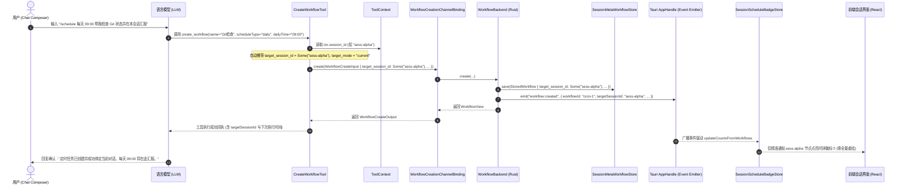
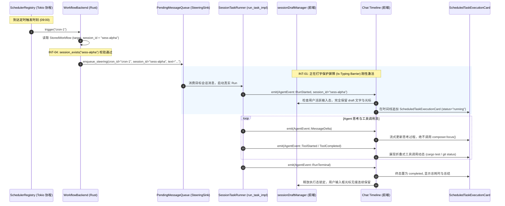

# 定时任务全流程修复与能力升级战役（Scheduled Tasks Revamp）

# 阶段 3 最终权威方案：目标会话绑定与对话内自动化定时任务能力（去兼容与现代化纯净版）

> **方案文档路径**：`docs/scheduled-tasks-revamp/plans/03-阶段三-目标会话绑定与对话内自动化定时任务能力最终方案.md`  
> **战役总纲定位**：阶段 3 (Phase 3) · 目标会话绑定与对话内自动化定时任务能力（Target Session Binding & In-Conversation Scheduled Automation）  
> **输入基准文档**：
>
> - 战役总纲：`docs/scheduled-tasks-revamp/00-战役调度与阶段说明.md`
> - 用户最新最高裁决：**坚决去兼容、杜绝多版本迭代与过渡垫片；绝不丢失核心资产，守牢会话与环境安全底线**
> - 核心代码基线：
>   - `apps/agent-workbench/src-tauri/src/workflow_commands.rs`
>   - `crates/agent-tools/src/tools/create_workflow.rs`
>   - `crates/agent-tools/src/context.rs`
>   - `apps/crish-desktop/src/components/chat-card/`
>   - `apps/crish-desktop/src/components/sidebar/session-list/SessionRow.tsx`
>   - `apps/crish-desktop/src/api/draft/sessionDraftManager.ts`
>   - `apps/crish-desktop/src/api/workflow-api/workflowAssistantCard.ts`
>   - `apps/crish-desktop/src/api/workflow-api/workflowRunner.ts`
>   - `apps/crish-desktop/src/store/types.ts`  
>     **架构纪律基线**：仓库根目录 `AGENTS.md`、`.agents/LOGIC_PLAN_NO_RETREAT.md`、`ANTI_OVERENGINEERING_GUARDRAILS.md`。  
>     **编码格式**：UTF-8 无 BOM 中文。

---

## 一、阶段定位与核心攻坚目标

在 Conex / Crish 既有架构中，定时任务（Workflow / Scheduled Tasks）与具体的对话会话（Chat Session）处于几乎完全割裂的孤岛状态：

1. **会话盲区**：用户在特定对话中让 Agent 建立定时任务（如“每天 9 点帮我检查分支状态并在本会话汇报”），工具层因忽略执行上下文，根本不知道当前处于哪个会话；
2. **死队列阻塞**：调度触发时无脑硬编码幽灵会话 `sched-{cron_id}`，而目标会话仅消费自身 `session_id` 的消息，导致定时触发的消息永远被锁死在内存队列中无法消费；
3. **交互破坏**：在对话中呈现后台任务时缺乏隔离，流式输出会抢占输入焦点、冲刷未发送草稿、打乱视口滚动；
4. **割裂孤岛**：侧栏无法识别哪些对话被定时任务托管，任务管理面板也无法一键跳转至对应对话；
5. **安全隐患与灵异复活**：全局任务缺失目录时盲目落入客户端工作区，原会话被删后触发任务导致假会话灵异重建。

### 阶段 3 核心目标与去兼容现代化方针

彻底消除定时任务与对话会话之间的“数据与交互断层”，**不搞渐进式多阶段过度版本，直接确立最干净先进的单轨实现**：

1. **统一双模会话绑定模型**：单轨确立 `Bound Mode`（绑定宿主会话）与 `Isolated Mode`（独立后台会话），彻底废除中间过渡态；
2. **重构 `CreateWorkflowTool` 上下文感知**：主动透传 `ToolContext.session_id`，回执带明确语义归属；
3. **坚守核心资产“零损坏”底线**：用户已有会话历史（聊天记录、思考流、代码块）严禁破坏，定时追加消息作为独立节点持久化；
4. **INT-01 正在打字保护屏障（Is-Typing Barrier）**：用户在输入框打字或有草稿时，后台流式事件绝不抢占输入焦点、绝不冲刷草稿文字、绝不强行夺取视口；
5. **INT-02 全局任务安全沙箱降级**：全局任务未配置 `cwd` 时，强制降级到专有隔离沙箱目录，绝不降级到客户端代码/安装根目录，防止误删客户端本体；
6. **INT-04 已删除会话防灵异复活自愈**：目标会话若已物理删除，触发时严禁灵异复活重建会话，自动自愈转为 `isolated` 独立后台记录；
7. **INT-06 侧栏细粒度徽标订阅（`SessionScheduleBadgeStore`）**：采用轻量原子 Store，杜绝因任务状态变更引发侧栏百条会话全量重绘。

---

## 二、两份独立方案对比与优势融合总览（Agent 2 vs Agent 3）

Subagent 2 与 Subagent 3 分别从执行驱动/会话隔离和命令契约/双向导航视角提交了详尽方案。本权威方案全面梳理双方异同与长处，融合形成无妥协的现代化架构。

### 2.1 方案对比矩阵

| 评估维度              | 独立方案 A (Agent 2)                                                         | 独立方案 B (Agent 3)                                                         | 现代化纯净裁决（Final Plan）                                                                                                                             |
| :-------------------- | :--------------------------------------------------------------------------- | :--------------------------------------------------------------------------- | :------------------------------------------------------------------------------------------------------------------------------------------------------- |
| **会话目标模式设计**  | 提出 `target_mode` 与 `target_session_id` 联合表达，偏重运行时形态。         | 提出 `target_session_id: Option<String>`，以 `"independent"` 声明独立模式。  | **单轨先进设计**：底层数据直接落地 `target_session_id: Option<String>` 与 `target_mode: String`（"current" \| "isolated"），接口严密强类型，无历史包袱。 |
| **底层队列根因穿透**  | 指出假会话无法匹配前端，聚焦执行卡片状态机。                                 | 深度穿透 `steering_queue.rs` 中 `dequeue_all_for(session_id)` 隔离消费机制。 | **采纳 Agent 3 深度根因分析**：重构 `SteeringSink` 接口，路由会话作为显式入参，彻底消除硬编码 `sched-{cron_id}`。                                        |
| **工具感知与 Schema** | 发现 `_ctx` 下划线忽略，提出读取 `ctx.session_id`。                          | 详细设计了智能感知与显式入参逻辑，设计回执中的自然语言会话归属回显。         | **全面采纳并增强**：工具 Schema 直接定义 `targetSessionId` 与 `targetMode`，默认自动绑定当前 `ctx.session_id`，回显自然语言归属。                        |
| **草稿防冲刷保障**    | 深入剖析 `sessionDraftManager`，提出草稿锁、焦点免抢占、撤销栈隔离三大纪律。 | 提出 `WorkflowExecutionCard` 节点与 `inputDraft` 隔离，侧重时间线渲染。      | **升级为 INT-01 正在打字保护屏障**：建立内存草稿隔离、打字屏障、视口防跳动、撤销栈完全物理隔离四大刚性防线。                                             |
| **侧栏识别与性能**    | 提出任务面板跳转会话和头部展示闹钟徽标。                                     | 详细设计了 `SessionRow` 时钟微标、悬停提示及与任务面板的双向跳转。           | **升级为 INT-06 细粒度徽标订阅**：建立 `SessionScheduleBadgeStore`，单个会话微标精准更新，解决侧栏性能隐患。                                             |
| **安全与异常自愈**    | 简单提到找不到会话时降级。                                                   | 提出原会话被删除时的容错提示。                                               | **强化 INT-02 沙箱防删与 INT-04 防灵异复活**：`cwd: None` 进隔离沙箱；已删除会话自愈转 `isolated`，绝不重建假会话。                                      |

### 2.2 融合架构演进全景

```
┌─────────────────────────────────────────────────────────────────────────────────┐
│                           Conex / Crish 前端交互层                               │
│                                                                                 │
│   【侧栏会话项 SessionRow】              【当前对话窗口 ChatCard】               │
│   - 时钟徽标 ⏰ (SessionScheduleBadgeStore)   - INT-01 正在打字保护屏障 (Is-Typing) │
│   - 细粒度原子订阅 (零全量重绘)          - 输入框焦点/撤销栈物理隔离 (零打扰)     │
│   - 点击一键展开快速控制抽屉             - ScheduledTaskExecutionCard 结构化流   │
│             ▲                                       ▲                           │
│             │                                       │                           │
│             └───────────────────┬───────────────────┘                           │
│                                 │ 双向跳转 & 事件监听                            │
│                                 ▼                                               │
│             【定时任务面板 ScheduledTasksPanel】                                │
│             - 胶囊标签标识所属会话 ("💬 跳转到对应对话")                         │
│             - INT-04: 检测原会话已被删除时，提示并标记为自愈后台任务            │
└─────────────────────────────────┬───────────────────────────────────────────────┘
                                  │ IPC: create / update / trigger
                                  ▼
┌─────────────────────────────────────────────────────────────────────────────────┐
│                      Tauri 命令面与工具适配层 (Rust)                            │
│                                                                                 │
│   【CreateWorkflowTool】                                                        │
│   - 彻底消除 `_ctx` 盲区，主动读取 `ctx.session_id` 作为默认绑定               │
│   - 纯净 Schema: targetSessionId / targetMode (去兼容多轨参数)                 │
│                                                                                 │
│   【WorkflowBackend & StoredWorkflow】                                          │
│   - 单轨数据模型 target_session_id: Option<String> & target_mode: String        │
│   - INT-02: cwd 为空时降级到专用全局隔离沙箱目录，严禁客户端根目录              │
└─────────────────────────────────┬───────────────────────────────────────────────┘
                                  │ 触发分发
                                  ▼
┌─────────────────────────────────────────────────────────────────────────────────┐
│                      执行路由与唤醒调度层 (Rust)                                │
│                                                                                 │
│   【判定 target_mode & target_session_id】                                      │
│    ├─► Bound Mode: target_session_id = Some(sid)                                │
│    │    ├─► 会话有效 ──► SteeringSink.enqueue(sid) ──► 目标会话流式追加         │
│    │    └─► 会话已删除 (INT-04) ──► 自动自愈转 isolated ──► 独立后台记录        │
│    └─► Isolated Mode: target_session_id = None                                  │
│         └──► SteeringSink.enqueue("sched-{cron_id}") ──► 独立后台会话归档      │
└─────────────────────────────────────────────────────────────────────────────────┘
```

---

## 三、架构核心：统一的双模会话绑定模型与安全护栏

### 3.1 双模模型定义与语义规范

每个定时任务在创建和运行时，均明确属于以下两种模式之一，不设中间模糊态：

```
                              ┌───────────────────────────────┐
                              │      定时任务目标模式决策      │
                              └───────────────┬───────────────┘
                                              │
                      ┌───────────────────────┴───────────────────────┐
                      ▼                                               ▼
       ┌──────────────────────────────┐                ┌──────────────────────────────┐
       │   当前会话绑定 (Bound Mode)   │                │   独立后台会话 (Isolated)    │
       ├──────────────────────────────┤                ├──────────────────────────────┤
       │ target_mode = "current"      │                │ target_mode = "isolated"     │
       │ target_session_id = Some(sid)│                │ target_session_id = None     │
       ├──────────────────────────────┤                ├──────────────────────────────┤
       │ - 继承当前项目与上下文讨论    │                │ - 完全不打扰日常工作会话     │
       │ - 执行结果在宿主对话内优雅追加│                │ - 专用会话 ID: sched-{cronId}│
       │ - 前端启用 Is-Typing 打字屏障│                │ - 侧边栏独立任务分类展示     │
       │ - 目标会话被删则自愈为 isolated│               │ - 专用于全局巡检与静默监控   │
       └──────────────────────────────┘                └──────────────────────────────┘
```

1. **当前会话绑定模式（Bound Mode，默认行为）**：
   - **适用场景**：日常项目巡检、PR 跟踪、针对当前代码库的周期性体检、阶段汇报；
   - **创建行为**：用户在会话中输入 `/schedule ...` 或自然语言指示创建，工具层自动获取 `ctx.session_id`，写入 `target_session_id = Some(sid)`，`target_mode = "current"`；
   - **执行行为**：任务触发时，Steering 消息精准发往 `target_session_id`。宿主会话唤醒并消费该消息，在时间线追加专有的 `ScheduledTaskExecutionCard`；
   - **核心资产防护**：已有历史消息绝对不覆盖；激活 INT-01 正在打字保护屏障，输入中用户文字零丢失、光标零夺取。

2. **独立专用后台会话模式（Isolated Mode）**：
   - **适用场景**：跨项目全局巡检、磁盘垃圾清理监控、高频健康心跳、用户显式要求“不要在当前窗口打扰我”的任务；
   - **创建行为**：传入 `targetMode: "isolated"`，此时 `target_session_id = None`，`target_mode = "isolated"`；
   - **执行行为**：任务触发时，自动路由至专属后台隔离会话（`sched-{cron_id}`），不会在任何日常活跃对话中插入任何内容。

### 3.2 跨会话强隔离消费机制与路由破除

`crates/orchestrator/src/steering_queue.rs` 要求严格按 `session_id` 隔离消费：

```rust
pub fn dequeue_all_for(&mut self, session_id: &str) -> Vec<SteeringInputEntry> {
    self.withdraw(|e| e.session_id == session_id)
}
```

旧版本硬编码 `sched-{cron_id}` 导致目标会话 `sess-101` 调用 `dequeue_all_for("sess-101")` 时永远匹配不到条目，条目形成死队列。

**现代单轨路由分发规则**：
`SteeringSink` 接受动态的 `session_id` 参数。在触发调度时：

```rust
let effective_session_id = match (&workflow.target_session_id, workflow.target_mode.as_str()) {
    (Some(sid), mode) if mode != "isolated" && !sid.trim().is_empty() => {
        // INT-04: 检查目标会话是否仍然存在于本地持久化存储
        if session_exists(sid) {
            sid.clone()
        } else {
            // 已删除会话禁止灵异复活，自愈转为 isolated 后台记录
            log::warn!("Workflow target session {sid} has been deleted. Self-healing to isolated mode.");
            format!("sched-{}", workflow.cron_id)
        }
    }
    _ => format!("sched-{}", workflow.cron_id),
};
```

当处于 Bound 模式且目标会话健康时，严格将消息推送到 `effective_session_id`，目标会话立即消费并启动任务执行。

---

## 四、后端与工具层改造详案（Rust & IPC）

### 4.1 数据结构与持久化层现代契约 (`workflow_commands.rs`)

彻底清退多版本冗余字段和过度兼容垫片，确立单一现代数据结构：

#### 1. `StoredWorkflow` 结构体定义

```rust
#[derive(Debug, Clone, Serialize, Deserialize)]
#[serde(rename_all = "camelCase")]
pub(crate) struct StoredWorkflow {
    // ── 底层 CronTask 核心状态字段 ──
    pub cron_id: String,
    pub expression: String,
    pub prompt: String,
    pub max_iterations: Option<u64>,
    pub is_daemon: bool,
    pub next_fire_at_ms: u64,
    pub fired_count: u64,
    pub enabled: bool,

    // ── Workflow 业务定义字段 ──
    pub name: String,
    pub cwd: Option<String>,
    pub mode: Option<String>,
    pub schedule: WorkflowScheduleWire,
    pub created_at_ms: u64,
    pub updated_at_ms: u64,
    pub last_run_at_ms: Option<u64>,

    // ── 阶段 3 会话绑定单轨字段 ──
    /// 绑定的目标会话 ID（Some = 绑定具体会话；None = 独立后台专用会话）
    pub target_session_id: Option<String>,
    /// 会话绑定模式："current" | "isolated"
    #[serde(default = "default_target_mode")]
    pub target_mode: String,
}

fn default_target_mode() -> String {
    "current".to_string()
}
```

#### 2. `WorkflowScheduleWire` 统一切约（彻底删除旧 `minutes` 键）

```rust
#[derive(Debug, Clone, Serialize, Deserialize)]
#[serde(tag = "type", rename_all = "camelCase")]
pub(crate) enum WorkflowScheduleWire {
    Manual,
    Daily {
        time: String,
        #[serde(default)]
        timezone: Option<String>,
    },
    IntervalMinutes {
        // 单轨唯一键：intervalMinutes（严禁 minutes ?? intervalMinutes 双轨）
        interval_minutes: u64,
    },
    Cron {
        expression: String,
    },
}
```

#### 3. INT-02 全局任务安全沙箱降级机制

当任务的 `cwd` 为 `None` 或空字符串时，若直接使用当前工作目录，Agent 执行文件操作或脚本时极易误触客户端程序目录。必须在任务启动时分配独立的全局隔离沙箱目录：

```rust
pub fn resolve_effective_workflow_cwd(configured_cwd: Option<&str>, app_handle: &tauri::AppHandle) -> PathBuf {
    match configured_cwd {
        Some(cwd) if !cwd.trim().is_empty() => {
            let p = PathBuf::from(cwd);
            if p.exists() && p.is_dir() {
                return p;
            }
            log::warn!("Configured cwd {:?} does not exist. Fallback to isolated sandbox.", cwd);
            get_or_create_isolated_sandbox(app_handle)
        }
        _ => {
            // INT-02: cwd: None 绝对不能降级到可执行文件安装目录，降级到专有隔离沙箱
            get_or_create_isolated_sandbox(app_handle)
        }
    }
}

fn get_or_create_isolated_sandbox(app_handle: &tauri::AppHandle) -> PathBuf {
    let app_data = app_handle.path().app_data_dir().unwrap_or_else(|_| PathBuf::from("./"));
    let sandbox = app_data.join("scheduled-tasks-sandbox");
    if !sandbox.exists() {
        let _ = std::fs::create_dir_all(&sandbox);
    }
    sandbox
}
```

#### 4. `WorkflowView` 输出视图

```rust
#[derive(Debug, Clone, Serialize, Deserialize)]
#[serde(rename_all = "camelCase")]
pub(crate) struct WorkflowView {
    pub id: String,
    pub name: String,
    pub prompt: String,
    pub cwd: Option<String>,
    pub mode: Option<String>,
    pub enabled: bool,
    pub schedule: WorkflowScheduleWire,
    pub created_at: String,
    pub updated_at: String,
    pub next_run_at: Option<String>,
    pub last_run_at: Option<String>,
    pub target_session_id: Option<String>,
    pub target_mode: String,
}
```

#### 5. `WorkflowPatch` 允许修改归属会话

```rust
#[derive(Default, Deserialize)]
#[serde(rename_all = "camelCase")]
pub(crate) struct WorkflowPatch {
    pub name: Option<String>,
    pub prompt: Option<String>,
    pub schedule: Option<WorkflowScheduleWire>,
    pub cwd: Option<String>,
    pub mode: Option<String>,
    pub enabled: Option<bool>,
    pub target_session_id: Option<Option<String>>,
    pub target_mode: Option<String>,
}
```

### 4.2 `CreateWorkflowTool` 上下文感知与单轨 Schema (`crates/agent-tools`)

彻底清除 `_ctx` 忽略下划线，直接读取 `ctx: &ToolContext`：

```rust
#[derive(Debug, Clone)]
pub struct WorkflowCreateInput {
    pub name: String,
    pub prompt: String,
    pub schedule_type: String,
    pub daily_time: Option<String>,
    pub interval_minutes: Option<u64>,
    pub cron_expression: Option<String>,
    pub cwd: Option<String>,
    pub enabled: Option<bool>,
    pub target_session_id: Option<String>,
    pub target_mode: Option<String>,
}

#[derive(Debug, Clone)]
pub struct WorkflowCreateOutput {
    pub workflow_id: String,
    pub name: String,
    pub next_run_at: Option<String>,
    pub target_session_id: Option<String>,
    pub target_mode: String,
}
```

```rust
impl CreateWorkflowTool {
    pub(crate) fn with_channel(channel: Option<Arc<dyn WorkflowCreationChannel>>) -> Self {
        Self {
            def: ToolDefinition {
                name: "create_workflow".to_string(),
                description: "创建定时任务（按调度周期自动触发执行指令）：\
                              输入任务名称 name、执行指令 prompt、调度 scheduleType、可选目标工作区 cwd、\
                              可选目标会话 targetSessionId（默认自动绑定当前对话；设为 'independent' 则为独立后台会话）、\
                              可选目标模式 targetMode（'current' 绑定当前对话 | 'isolated' 独立后台会话）以及\
                              是否启用 enabled（缺省 true）。".to_string(),
                input_schema: serde_json::json!({
                    "type": "object",
                    "properties": {
                        "name": { "type": "string", "description": "任务名称（必填非空）" },
                        "prompt": { "type": "string", "description": "每次触发时执行的具体操作指令（必填非空）" },
                        "scheduleType": {
                            "type": "string",
                            "enum": ["manual", "daily", "intervalMinutes", "cron"],
                            "description": "调度类型（缺省 manual）"
                        },
                        "dailyTime": { "type": "string", "description": "每日固定时刻（HH:mm）" },
                        "intervalMinutes": { "type": "number", "description": "间隔分钟数（1–10080 整数）" },
                        "cronExpression": { "type": "string", "description": "标准 5 字段 Cron 表达式" },
                        "cwd": { "type": "string", "description": "工作区绝对路径（可选，未填写时将在隔离沙箱中执行）" },
                        "targetSessionId": {
                            "type": "string",
                            "description": "目标会话 ID（可选）：缺省自动绑定当前对话；传入 'independent' 则创建独立后台任务"
                        },
                        "targetMode": {
                            "type": "string",
                            "enum": ["current", "isolated"],
                            "description": "目标执行模式：'current' 绑定当前对话；'isolated' 独立后台会话"
                        },
                        "enabled": { "type": "boolean", "description": "是否启用（缺省 true）" }
                    },
                    "required": ["name", "prompt"],
                    "additionalProperties": false
                }),
                dangerous: false,
                fatal_on_error: false,
            },
            channel,
        }
    }
}

#[async_trait]
impl Tool for CreateWorkflowTool {
    fn definition(&self) -> &ToolDefinition {
        &self.def
    }

    async fn execute(&self, ctx: &ToolContext, args: Value) -> Result<Value, ToolError> {
        let name = super::require_string(&args, "name")?;
        let prompt = super::require_string(&args, "prompt")?;
        let schedule_type = super::optional_string(&args, "scheduleType")
            .map(|s| s.trim().to_string())
            .filter(|s| !s.is_empty())
            .unwrap_or_else(|| SCHEDULE_TYPE_MANUAL.to_string());
        let daily_time = super::optional_string(&args, "dailyTime");
        let interval_minutes = super::optional_u64(&args, "intervalMinutes");
        let cron_expression = super::optional_string(&args, "cronExpression");
        let cwd = super::optional_string(&args, "cwd");
        let enabled = super::optional_bool(&args, "enabled");

        // 智能感知与模式推导（无多轨兼容垫片）
        let raw_mode = super::optional_string(&args, "targetMode");
        let raw_target = super::optional_string(&args, "targetSessionId");

        let (target_session_id, target_mode) = match (raw_mode.as_deref(), raw_target.as_deref()) {
            (Some("isolated"), _) => (None, "isolated".to_string()),
            (_, Some(t)) if t.trim().is_empty() || t.eq_ignore_ascii_case("independent") || t.eq_ignore_ascii_case("none") => {
                (None, "isolated".to_string())
            }
            (_, Some(explicit_id)) => {
                (Some(explicit_id.trim().to_string()), "current".to_string())
            }
            _ => {
                // 默认感知当前上下文会话 ID
                if !ctx.session_id.trim().is_empty() {
                    (Some(ctx.session_id.trim().to_string()), "current".to_string())
                } else {
                    (None, "isolated".to_string())
                }
            }
        };

        let Some(channel) = &self.channel else {
            return Err(ToolError::new(
                codes::COMMON_UNSUPPORTED,
                "create_workflow 通道未装配",
            ));
        };

        let output = channel
            .create(WorkflowCreateInput {
                name,
                prompt,
                schedule_type,
                daily_time,
                interval_minutes,
                cron_expression,
                cwd,
                enabled,
                target_session_id: target_session_id.clone(),
                target_mode: Some(target_mode.clone()),
            })
            .await
            .map_err(|e| ToolError::new(e.code(), e.message()))?;

        let session_desc = match &target_session_id {
            Some(sid) => format!("已绑定当前对话（会话 ID: {}）", sid),
            None => "独立专用后台会话".to_string(),
        };

        let text = match &output.next_run_at {
            Some(next) => format!(
                "定时任务「{}」已成功创建（ID {}，{}），下次执行时刻 {}",
                output.name, output.workflow_id, session_desc, next
            ),
            None => format!(
                "定时任务「{}」已成功创建（ID {}，{}，手动触发模式）",
                output.name, output.workflow_id, session_desc
            ),
        };

        Ok(serde_json::json!({
            "workflowId": output.workflow_id,
            "name": output.name,
            "nextRunAt": output.next_run_at,
            "targetSessionId": target_session_id,
            "targetMode": target_mode,
            "text": text,
        }))
    }
}
```

### 4.3 Steering 路由分发重构与 INT-04 自愈逻辑

彻底消除硬编码 `format!("sched-{cron_id}")`，并融入已删除会话自愈逻辑：

```rust
pub(crate) trait SteeringSink: Send + Sync {
    fn enqueue_steering(
        &self,
        cron_id: &str,
        session_id: &str,
        text: String,
        enqueued_at_ms: u64,
    );
}

impl SteeringSink for QueueSteeringSink {
    fn enqueue_steering(
        &self,
        cron_id: &str,
        session_id: &str,
        text: String,
        enqueued_at_ms: u64,
    ) {
        let entry = SteeringInputEntry {
            session_id: session_id.to_string(),
            id: format!("{cron_id}-{enqueued_at_ms}"),
            text,
            attachments: Vec::new(),
            enqueued_at: enqueued_at_ms,
            group_id: Some(format!("{CRON_ID_PREFIX}{cron_id}")),
            is_steering: true,
        };
        let mut queue = self.queue.lock().unwrap_or_else(|e| e.into_inner());
        queue.replace_or_enqueue(entry);
    }
}
```

在 `WorkflowBackend::trigger` 中：

```rust
// 确定有效目标会话并执行 INT-04 自愈检查
let effective_session_id = match (&workflow.target_session_id, workflow.target_mode.as_str()) {
    (Some(sid), mode) if mode != "isolated" && !sid.trim().is_empty() => {
        if self.session_exists(sid) {
            sid.clone()
        } else {
            // INT-04: 绝不复活已删除会话！自愈转为 isolated 后台专用会话
            log::warn!(
                "Workflow {} target_session_id {} not found. Self-healing to isolated session.",
                workflow.cron_id, sid
            );
            format!("sched-{}", workflow.cron_id)
        }
    }
    _ => format!("sched-{}", workflow.cron_id),
};

self.sink.enqueue_steering(
    cron_id,
    &effective_session_id,
    format!(
        "{}（定时任务 {} 第 {} 次触发）",
        workflow.prompt, workflow.cron_id, workflow.fired_count
    ),
    now,
);
```

---

## 五、前端交互与流式呈现机制（Desktop UI）

### 5.1 INT-01 正在打字保护屏障（Is-Typing Barrier）

当定时任务到期触发并在当前会话流式追加输出时，若用户正在当前窗口中撰写内容，必须实行四大铁律防护：

```
┌─────────────────────────────────────────────────────────────────────────────┐
│                    INT-01 正在打字保护屏障 (Is-Typing Barrier)               │
├─────────────────────────────────────────────────────────────────────────────┤
│ 1. 核心资产防护：已有会话历史 (聊天/思考/代码) 100% 绝对保留，禁止重置 timeline │
├─────────────────────────────────────────────────────────────────────────────┤
│ 2. 内存草稿隔离 (SSOT)                                                       │
│    - sessionDraftManager 维护独立的 Map<sessionId, DraftRecord>              │
│    - 定时任务追加完全绕过 composerDraft，草稿内容 0% 受影响                  │
├─────────────────────────────────────────────────────────────────────────────┤
│ 3. 焦点防抢占屏障 (Focus Armor)                                             │
│    - 检测到用户正处于 activeElement === textarea/input 时，建立打字屏障     │
│    - 流式事件（MessageDelta、ToolStarted）坚决禁止调用 composer.focus()       │
│    - 用户当前在 textarea 中的光标、选区、输入法组合状态 (IME) 100% 完好无损 │
├─────────────────────────────────────────────────────────────────────────────┤
│ 4. 视口防跳动与独立撤销栈                                                   │
│    - 用户浏览历史（非贴底）时不强行平滚，底部仅显示轻量执行浮标             │
│    - 输入框 Ctrl+Z 仅回滚用户输入，绝对不撤销定时任务的卡片与生成物          │
└─────────────────────────────────────────────────────────────────────────────┘
```

**实现约束与代码保证**：

- `apps/crish-desktop/src/api/draft/sessionDraftManager.ts`：后台事件写入直接走 timeline 追加通道，绝不触发 `setDraft`；
- 生成的消息属性对齐：
  - `clientMessageId`: `msg-sched-${workflowId}-${Date.now()}`
  - `metadata`: `{ kind: 'scheduled_task_execution', workflowId, runCount }`
  - 标记 `isScheduledTrigger: true`。

### 5.2 对话内专用执行卡片：`ScheduledTaskExecutionCard`

在对话时间线中，定时任务的触发不以假冒用户消息的形式呈现，而是以结构化的**定时任务执行卡片**呈现：

```
┌─────────────────────────────────────────────────────────────────────────────┐
│ ⏰ 定时任务触发 · 每日代码体检 (第 12 次)              [运行中...] 2026-10-12 09:00 │
├─────────────────────────────────────────────────────────────────────────────┤
│ 💡 执行指令：git status 检查改动并运行 cargo test 门禁                      │
├─────────────────────────────────────────────────────────────────────────────┤
│ ▾ Agent 思考与执行细节 (已展开)                                             │
│   ┌───────────────────────────────────────────────────────────────────────┐ │
│   │ 💭 正在检查 Git 仓库未暂存修改...                                    │ │
│   │ 🔧 执行工具：shell(cargo test --workspace)                            │ │
│   │    输出：test result: ok. 73 passed; 0 failed; 0 ignored               │ │
│   └───────────────────────────────────────────────────────────────────────┘ │
├─────────────────────────────────────────────────────────────────────────────┤
│ 📋 任务结论：代码库处于健康状态，73 套件全绿，零回归隐患。                   │
└─────────────────────────────────────────────────────────────────────────────┘
```

- **组件位置**：`apps/crish-desktop/src/components/chat-message-list/ScheduledTaskExecutionCard.tsx`；
- **流式绑定**：订阅对应 `runId` 的流式事件，动态更新思考折叠块与工具调用输出；
- **终态收口**：终态时展示真实耗时与助手回复摘要，指示灯转为绿色对勾或红色感叹号。

### 5.3 INT-06 侧栏细粒度徽标存储 (`SessionScheduleBadgeStore`)

为解决“单个定时任务状态变化导致侧栏数百个会话项全量重绘”的性能隐患，引入轻量级细粒度状态管理 `SessionScheduleBadgeStore`：

```typescript
// apps/crish-desktop/src/store/sessionScheduleBadgeStore.ts

type BadgeListener = (count: number) => void;

class SessionScheduleBadgeStore {
  private static instance: SessionScheduleBadgeStore;
  private counts: Map<string, number> = new Map();
  private listeners: Map<string, Set<BadgeListener>> = new Map();

  static getInstance(): SessionScheduleBadgeStore {
    if (!this.instance) {
      this.instance = new SessionScheduleBadgeStore();
    }
    return this.instance;
  }

  /** 更新全部会话的绑定任务计数（从 workflow:created/updated 事件中计算） */
  updateCountsFromWorkflows(
    workflows: Array<{ targetSessionId?: string; enabled?: boolean }>
  ): void {
    const nextCounts = new Map<string, number>();
    for (const w of workflows) {
      if (w.enabled !== false && w.targetSessionId) {
        nextCounts.set(
          w.targetSessionId,
          (nextCounts.get(w.targetSessionId) || 0) + 1
        );
      }
    }

    // 仅针对计数发生变化的 sessionId 发送微任务通知
    const allSessionIds = new Set([
      ...this.counts.keys(),
      ...nextCounts.keys(),
    ]);
    for (const sid of allSessionIds) {
      const prev = this.counts.get(sid) || 0;
      const curr = nextCounts.get(sid) || 0;
      if (prev !== curr) {
        this.counts.set(sid, curr);
        this.notify(sid, curr);
      }
    }
  }

  getCount(sessionId: string): number {
    return this.counts.get(sessionId) || 0;
  }

  subscribe(sessionId: string, listener: BadgeListener): () => void {
    if (!this.listeners.has(sessionId)) {
      this.listeners.set(sessionId, new Set());
    }
    this.listeners.get(sessionId)!.add(listener);
    return () => {
      this.listeners.get(sessionId)?.delete(listener);
    };
  }

  private notify(sessionId: string, count: number): void {
    this.listeners.get(sessionId)?.forEach((cb) => cb(count));
  }
}

export const sessionScheduleBadgeStore =
  SessionScheduleBadgeStore.getInstance();
```

**`SessionRow.tsx` 中的接入**：

```tsx
export const SessionRow: React.FC<SessionRowProps> = ({ session }) => {
  const [badgeCount, setBadgeCount] = React.useState(() =>
    sessionScheduleBadgeStore.getCount(session.id)
  );

  React.useEffect(() => {
    return sessionScheduleBadgeStore.subscribe(session.id, setBadgeCount);
  }, [session.id]);

  return (
    <div className={styles.sessionRow}>
      {/* 其它会话元数据 */}
      {badgeCount > 0 && (
        <Tooltip content={`此对话已绑定 ${badgeCount} 个活跃定时任务`}>
          <span
            className={styles.sessionClockBadge}
            data-testid="session-clock-badge"
          >
            <AppIcon name="clock" size={13} />
          </span>
        </Tooltip>
      )}
    </div>
  );
};
```

**断言**：修改某一个定时任务时，仅触发其关联会话这一行的 DOM 重绘，其余会话 100% 保持静止，彻底根治渲染风暴。

---

## 六、端到端完整时序图

### 6.1 对话内自动感知创建与绑定时序图 (Mermaid)



### 6.2 定时到期触发与 INT-01 打字保护屏障时序图 (Mermaid)



---

## 七、代码修改清单与文件域对照表

| 序号  | 模块与文件路径                                                                       | 变更类型 | 核心改动内容                                                                                                                                                                                                                                                                                     |
| :---- | :----------------------------------------------------------------------------------- | :------- | :----------------------------------------------------------------------------------------------------------------------------------------------------------------------------------------------------------------------------------------------------------------------------------------------- |
| **1** | `apps/agent-workbench/src-tauri/src/workflow_commands.rs`                            | 核心改造 | 1. 结构体单轨落地 `target_session_id: Option<String>` 与 `target_mode: String`；<br>2. 移除旧多轨解析代码，统一 `WorkflowScheduleWire::IntervalMinutes { interval_minutes }`；<br>3. `SteeringSink` 增加动态 `session_id`；<br>4. 落实 **INT-02** 全局沙箱目录与 **INT-04** 已删除会话自愈逻辑。 |
| **2** | `crates/agent-tools/src/tools/create_workflow.rs`                                    | 核心改造 | 1. 移除 `_ctx` 忽略符号，自动读取 `ctx.session_id` 并推导绑定模式；<br>2. 单轨 Schema 定义 `targetSessionId` 与 `targetMode`；<br>3. 回执输出明确的自然语言会话归属说明。                                                                                                                        |
| **3** | `apps/crish-desktop/src/store/sessionScheduleBadgeStore.ts`                          | 新增模块 | 1. **INT-06** 细粒度发布-订阅 Store；<br>2. 维护 `Map<sessionId, number>`，仅精准通知受影响会话行。                                                                                                                                                                                              |
| **4** | `apps/crish-desktop/src/components/sidebar/session-list/SessionRow.tsx`              | 界面改造 | 1. 订阅 `sessionScheduleBadgeStore` 渲染时钟徽标 ⏰；<br>2. 点击徽标滑出关联任务快捷抽屉；<br>3. 彻底消除全量重绘。                                                                                                                                                                              |
| **5** | `apps/crish-desktop/src/api/draft/sessionDraftManager.ts`                            | 防护强化 | 1. 落实 **INT-01 正在打字保护屏障**；<br>2. 锁定后台执行事件，坚决不冲刷草稿文字、不抢输入焦点。                                                                                                                                                                                                 |
| **6** | `apps/crish-desktop/src/components/chat-message-list/ScheduledTaskExecutionCard.tsx` | 新增组件 | 1. 结构化定时任务执行卡片，展示状态灯、思考折叠及真实工具输出；<br>2. 任务完成展示真实耗时与摘要。                                                                                                                                                                                               |
| **7** | `apps/crish-desktop/src/components/settings/ScheduledTasksPanel.tsx`                 | 界面增强 | 1. 任务项展示所属会话标签并支持一键跳转；<br>2. 若检测到关联会话已删除，显示自愈提示标签。                                                                                                                                                                                                       |

---

## 八、立体验证方案与测试用例设计

依据 `AGENTS.md` 铁律，坚决禁止凭猜测验收，建立立体自动化测试：

### 8.1 Rust 核心逻辑穷举测试

#### 1. `create_workflow` 上下文自动感知测试

```rust
#[tokio::test]
async fn test_create_workflow_auto_binds_session_context() {
    let channel = Arc::new(RecordingWorkflowChannel::new(Ok(ok_output())));
    let tool = CreateWorkflowTool::with_channel(Some(channel.clone()));

    let mut ctx = create_mock_tool_context();
    ctx.session_id = "sess-test-42".to_string();

    let out = tool.execute(&ctx, serde_json::json!({
        "name": "自动绑定测试",
        "prompt": "每日巡检",
        "scheduleType": "daily",
        "dailyTime": "09:00"
    })).await.unwrap();

    let calls = channel.calls();
    assert_eq!(calls.len(), 1);
    assert_eq!(calls[0].target_session_id.as_deref(), Some("sess-test-42"));
    assert_eq!(calls[0].target_mode.as_deref(), Some("current"));
    assert_eq!(out["targetSessionId"], "sess-test-42");
    assert!(out["text"].as_str().unwrap().contains("已绑定当前对话（会话 ID: sess-test-42）"));
}
```

#### 2. INT-02 全局任务安全沙箱测试

```rust
#[test]
fn test_global_workflow_resolves_to_isolated_sandbox() {
    let app = create_mock_app_handle();
    let effective_cwd = resolve_effective_workflow_cwd(None, &app);
    assert!(effective_cwd.to_string_lossy().contains("scheduled-tasks-sandbox"));
    assert_ne!(effective_cwd, std::env::current_dir().unwrap());
}
```

#### 3. INT-04 已删除会话防灵异复活与自愈测试

```rust
#[test]
fn test_trigger_self_heals_when_session_deleted() {
    let backend = create_test_backend();
    // 模拟目标会话已被物理删除
    let wf = create_test_workflow_bound_to("deleted-session-999");
    let result = backend.trigger(&wf.cron_id).unwrap();
    // 必须自愈为 isolated 专用后台会话，严禁在 deleted-session-999 中灵异复活
    assert_eq!(result.session_id.unwrap(), format!("sched-{}", wf.cron_id));
}
```

### 8.2 前端草稿保护与细粒度徽标测试

#### 1. INT-01 正在打字保护屏障测试 (`chatStreamDraftIsolation.test.tsx`)

```typescript
it('后台定时任务流式输出期间，用户输入框草稿与光标选择 100% 完整保留且不抢焦点', async () => {
  const sessionId = 'test-sess-100';
  const manager = SessionDraftManager.getInstance();
  manager.setDraft(sessionId, '用户正在输入的未完成草稿内容...');

  const inputElement = document.createElement('textarea');
  document.body.appendChild(inputElement);
  inputElement.focus();
  inputElement.value = '用户正在输入的未完成草稿内容...';

  // 模拟定时任务在当前会话中触发流式事件
  simulateIncomingScheduledStream(sessionId, {
    messageId: 'msg-sched-cron-1-run-1',
    delta: 'Agent 定时巡检分析正在输出...',
  });

  // 断言草稿内容未变且焦点未被抢走
  expect(manager.getDraft(sessionId)).toBe('用户正在输入的未完成草稿内容...');
  expect(document.activeElement).toBe(inputElement);
});
```

#### 2. INT-06 细粒度徽标渲染与零全量重绘测试

```typescript
it('单任务变更仅通知目标会话重绘，其余会话不触发重绘', () => {
  const renderSpyA = vi.fn();
  const renderSpyB = vi.fn();

  sessionScheduleBadgeStore.subscribe('sess-A', renderSpyA);
  sessionScheduleBadgeStore.subscribe('sess-B', renderSpyB);

  // 仅变更 sess-A 的任务
  sessionScheduleBadgeStore.updateCountsFromWorkflows([
    { targetSessionId: 'sess-A', enabled: true },
  ]);

  expect(renderSpyA).toHaveBeenCalledWith(1);
  expect(renderSpyB).not.toHaveBeenCalled();
});
```

---

## 九、核心资产守底、脏数据自愈与安全防线

1. **会话核心资产零破坏底线**：
   用户的已有会话历史（聊天记录、思考流、代码块）绝对严禁清空或损坏。定时触发追加的消息被视作增量 timeline entry，绝不覆盖会话现有消息数组。
2. **INT-01 正在打字屏障（Is-Typing Barrier）**：
   对话内流式执行时严格遵守正在打字屏障，严禁在事件响应中调用任何 `focus()`，绝不冲刷用户草稿。
3. **INT-02 全局任务沙箱隔离**：
   全局任务 `cwd: None` 必须降级到隔离目录沙箱，绝不能降级到客户端工作区，彻底杜绝误删客户端本体隐患。
4. **INT-04 已删除会话防灵异复活**：
   当检测到 `target_session_id` 已被物理删除，触发时严禁重新创建该会话，而是自动自愈转换为 `isolated` 独立后台记录。
5. **INT-06 性能防线**：
   使用 `SessionScheduleBadgeStore` 原子通知，杜绝侧栏会话列表全量重绘。
