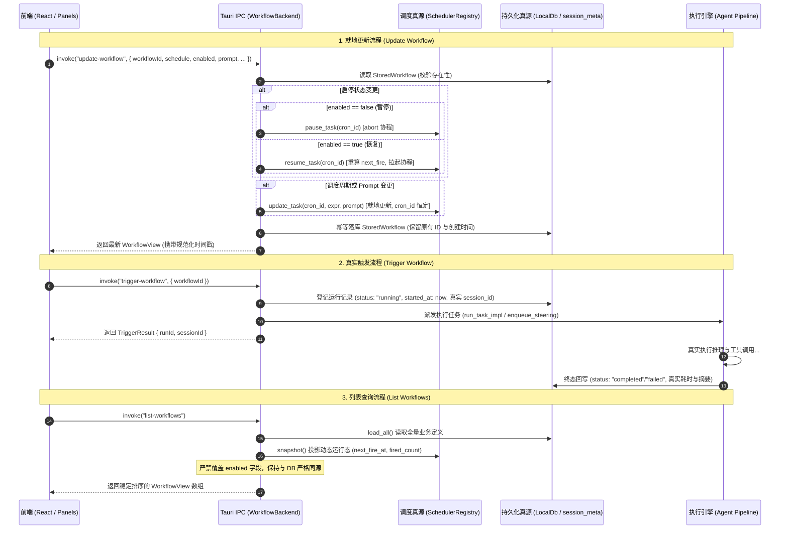
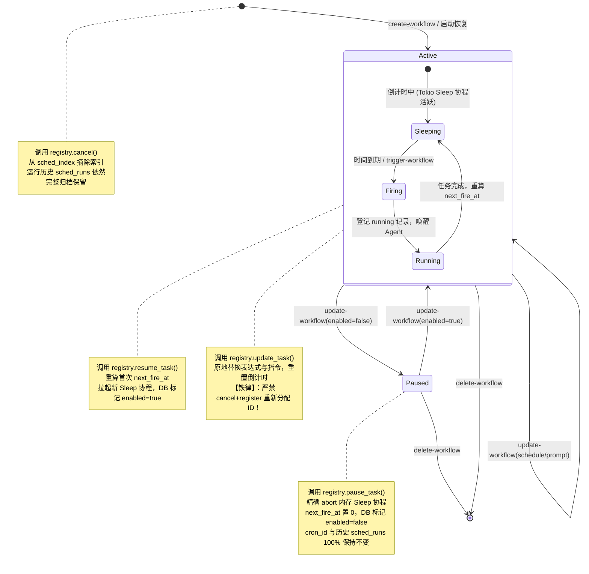

# 定时任务全流程修复与能力升级战役（Scheduled Tasks Revamp）

# 阶段 4 最终方案：Tauri IPC 命令面与元数据双向一致性（Final Plan）

> **文档性质**：战役最终权威方案（Final Plan · 阶段 4 实施总纲）  
> **战役工作区**：`docs/scheduled-tasks-revamp/`  
> **文档路径**：`docs/scheduled-tasks-revamp/plans/04-阶段四-Tauri-IPC命令面与元数据双向一致性最终方案.md`  
> **责任领域**：Tauri IPC 命令面、元数据生命周期管理、底层调度双向协同、持久化存储一致性  
> **输入基线**：
>
> - 战役总纲：`docs/scheduled-tasks-revamp/00-战役调度与阶段说明.md`
> - 阶段 4 独立方案 A（Agent 3）：`docs/scheduled-tasks-revamp/independent-plans/agent3-phase4-ipc-consistency.md`
> - 阶段 4 独立方案 B（Agent 4）：`docs/scheduled-tasks-revamp/independent-plans/agent4-phase4-ipc-consistency.md`
> - 核心源码基线：`apps/agent-workbench/src-tauri/src/workflow_commands.rs`、`apps/agent-workbench/src-tauri/src/sched.rs`、`apps/agent-workbench/src-tauri/src/command_manifest.rs`、`apps/crish-desktop/src/api/workflow-api/workflowRunner.ts`  
>   **架构纪律基线**：仓库根目录 `AGENTS.md`、`.agents/LOGIC_PLAN_NO_RETREAT.md`、`ANTI_OVERENGINEERING_GUARDRAILS.md`。

---

## 一、方案总览与两份独立方案（Agent 3 vs Agent 4）深度对比与融合

### 1.1 阶段定位与核心战役职责

在 Conex / Crish 桌面应用中，`apps/agent-workbench/src-tauri/src/workflow_commands.rs` 是承上启下的**唯一核心 IPC 命令中枢**：

- **向上**：对齐前端 React UI（侧边栏 `ScheduledTasksPanel`、设置页 `SettingsScheduleTab`）与对话内 AI Agent 工具（`CreateWorkflowTool`）；
- **向下**：管控底层 Rust 调度引擎（`SchedulerRegistry`）与真实 Agent 异步执行器（`run_task_impl`）；
- **对内**：维系 SQLite（`conex-db` 托管的 `session_meta`）中任务定义（`StoredWorkflow`）、执行历史（`sched_runs`）与调度索引的生命周期一致性。

在前序独立方案制定阶段，Subagent 3 与 Subagent 4 分别从“会话编排与 IPC 契约”和“IPC 数据一致性与前端集成”两个视角展开了深度推演。本最终方案全面整合两份方案的核心技术洞见，消除盲区，收敛出一份兼具底层严谨性与上层工程可用性的权威实施方案。

---

### 1.2 Agent 3 与 Agent 4 方案异同与优劣全景对照

| 评估维度                    | 独立方案 A（Agent 3）                                                                                                                                                     | 独立方案 B（Agent 4）                                                                                                    | 本最终融合方案（Final Plan 裁决）                                                                                        |
| :-------------------------- | :------------------------------------------------------------------------------------------------------------------------------------------------------------------------ | :----------------------------------------------------------------------------------------------------------------------- | :----------------------------------------------------------------------------------------------------------------------- |
| **致命根因挖掘**            | **重磅挖出“双写冲刷毒化 Bug”**：`sched.rs` 到期触发时将精简的 `CronTask` 写入同一键 `sched_<cron_id>`，直接抹除 `StoredWorkflow` 业务字段导致反序列化失败，任务离奇消失。 | 重点分析了启停状态脱节、`list()` 反向冲刷与修改调度时的 ID 漂移问题。                                                    | **全面采纳 Agent 3 发现**：将“双写冲刷毒化”定性为 P0 级严重数据破坏缺陷，作为本阶段首要清退目标。                        |
| **索引与存储收敛**          | 沿用既有 `sched_index` 逻辑，未深入治理 `sched.rs` 内部的 `sched_ids` 索引。                                                                                              | **重磅挖出“双索引漂移缺陷”**：`workflow_commands.rs` 用 `sched_index`，而 `sched.rs` 用 `sched_ids`，破坏了 SSOT 原则。  | **全面采纳 Agent 4 建议**：统一索引命名为 `sched_index`，并在存储加载阶段增加针对旧键 `sched_ids` 的自动合并与自愈迁移。 |
| **工作流 ID 恒定性**        | 提出原地更新原则，保持 `cron_id` 不变，禁止 `cancel` + `register`。                                                                                                       | 确立“ID 不变性不变量（ID Invariance）”，严禁修改调度周期时重算 `cron_id`。                                               | **确立“工作流 ID 恒定铁律”**：全流程锁定 `cron_id` 绝对恒定，彻底杜绝历史孤儿化。                                        |
| **补丁更新语义设计**        | `WorkflowPatch` 仅包含基础 `Option<T>` 字段，无法表达“将可选字段重置为空”的意图。                                                                                         | **引入精准双重 Option 语义**：`cwd: Option<Option<String>>`、`target_session_id: Option<Option<String>>`，支持显式置空。 | **全面采纳 Agent 4 设计**：采用双重 Option 补丁结构，支持显式解绑会话与清空工作区。                                      |
| **启停与调度联动**          | 细化对接 `SchedulerRegistry::pause_task` 与 `resume_task`，重算 `next_fire_at_ms`。                                                                                       | 同样设计了对 `pause_task` / `resume_task` 的调用，并补充了无注册表时的退化逻辑。                                         | **融合两端**：标准模式严格前置调度器联动；退化/测试模式提供安全的本地状态模拟。                                          |
| **`list()` 脏覆盖消除**     | 提出以 DB 为基础，仅投影动态运行态，但未彻底斩断 `snapshot.enabled` 覆盖线。                                                                                              | **明确指出 `snapshot.enabled` 暴力覆盖已持久化状态是导致 UI 反弹的元凶**，要求消除脏覆盖。                               | **彻底删除 `list()` 盲目覆盖 `workflow.enabled` 的代码**：状态以 DB 与底层同步为准，`list()` 绝不反向冲刷。              |
| **`trigger_workflow` 改造** | 状态初始化为真实 `"running"`，生成规范化 `run_id`，杜绝 0ms 伪造记录。                                                                                                    | 设计了规范的 `run-wf-<cron_id>-<count>` 命名规则，并补充了 `workflow:run-started` 事件广播。                             | **强强融合**：返回真实有效的 `run_id` 与 `session_id`，标记为 `"running"` 并广播事件，无缝对接阶段 2 执行流水线。        |
| **会话绑定承接**            | 引入 `target_session_id`，若未指定则兜底为 `sched-<cron_id>`。                                                                                                            | 引入 `target_session_id` 与 `execution_mode`（"current_session" / "isolated_session"）。                                 | **全面承接阶段 3 契约**：在落库实体、补丁、视图和命令入口中完整支持 `target_session_id` 与 `execution_mode`。            |

---

### 1.3 核心融合裁决

本最终方案的架构设计核心准则为：

1. **吸收 Agent 3 的“双写安全合并（Safe Field Merge）与反序列化容错”**：在 `LocalDbSchedStore::save` 中实行 JSON 级别的字段合并更新（保留原有业务字段），并在 `StoredWorkflow` 中为所有扩展字段补齐 `#[serde(default)]`，从根本上防止任务触发一次后神秘消失。
2. **吸收 Agent 4 的“统一存储索引收敛（Unified Indexing）与双重 Option 原子补丁”**：将全局定时任务索引彻底收敛至 `sched_index`，自动迁移历史 `sched_ids`；在 `WorkflowPatch` 中采用双重 `Option` 结构，精确支持属性置空。
3. **刚性确立“工作流 ID 恒定铁律（ID Invariance）”**：彻底废除修改调度表达式时先 `cancel(old)` 再 `register(new)` 导致分配新 ID 的反模式，全链路转为调用 `SchedulerRegistry::update_task` 原地更新。
4. **彻底删除 `list()` 中盲目用未同步 snapshot 反向覆盖数据库的脏代码**：确保单一真理源（SSOT）严肃性。
5. **`trigger_workflow` 立即执行转正**：彻底消灭 `duration_ms: Some(0)` 和假冒 `status: "completed"` 欺骗性记录，初始化为真实 `running` 状态并回传有效执行句柄。

---

## 二、四大缺陷根因断点与治本破局策略

```
┌────────────────────────────────────────────────────────────────────────────────────────┐
│                        现有架构五大致命断裂点与治理路线                                   │
├────────────────────────────────────────────────────────────────────────────────────────┤
│ 1. 修改表达式导致 ID 突变 ──► 取消+新建触发 seq++ ──► 历史运行记录孤儿化 ──► [治理: 就地更新]  │
│ 2. 启停状态双轨脱节 ───────► 仅改 DB 不通调度器 ──► 协程依旧倒计时 ────► [治理: 原生联动]  │
│ 3. 双写冲刷毒化 ───────────► CronTask 洗掉 StoredWorkflow 业务字段 ──► [治理: 安全合并更新] │
│ 4. 列表查询反向污染 ───────► list() 盲用 snapshot 覆盖 DB ─────────► [治理: 彻底删除覆写] │
│ 5. 立即触发虚假记录 ───────► 伪造 0ms completed 无真实 Agent ───────► [治理: 真实 running]  │
└────────────────────────────────────────────────────────────────────────────────────────┘
```

### 2.1 缺陷 1：修改调度周期导致 ID 突变、运行记录孤儿化与元数据篡改

- **代码定位**：`apps/agent-workbench/src-tauri/src/workflow_commands.rs:1085-1103`
  ```rust
  if let Some(registry) = self.registry() {
      let old_id = workflow.cron_id.clone();
      if schedule_changed && !workflow.expression.is_empty() {
          let _ = registry.cancel(&old_id).await;
          let input = CronTaskInput { ... };
          let new_id = registry.register(input).await.map_err(map_scheduler_err)?; // 分配全新 ID！
          let now = now_ms();
          self.store.remove(&old_id);
          workflow.cron_id = new_id;       // 突变！例如从 cron-1 变成 cron-2
          workflow.created_at_ms = now;     // 篡改！破坏了创建时刻
          workflow.updated_at_ms = now;
      }
  }
  ```
- **破坏链路**：
  1. 用户编辑任务的 Cron 表达式或时间，后端因缺失就地更新接口，被迫执行 `cancel` + `register`；
  2. `register` 内部通过原子自增序列分配新 ID（如 `cron-2`）；
  3. 持久化表 `sched_runs` 中的所有历史运行记录依然关联在旧 ID（`cron-1`）下；
  4. 前端调用 `list-workflow-runs` 时传入新 ID `cron-2`，返回空数组，用户珍贵的历史巡检/执行日志全部断代丢失；
  5. `created_at_ms` 被篡改为当前时间，导致任务寿命统计彻底失真。
- **治本策略**：
  - **工作流 ID 恒定铁律**：生命周期内 `cron_id` 与 `created_at_ms` 绝对只读；
  - 调用阶段 1 提供的 `SchedulerRegistry::update_task(cron_id, Some(new_expression), ...)` 原地替换表达式，重算下次触发时刻并重启 sleep 协程，严禁生成新 ID。

---

### 2.2 缺陷 2：任务启停（Pause/Resume）与 Prompt 修改零联动，以及 `list()` 脏覆盖

- **代码定位**：
  - 更新时脱节：`apps/agent-workbench/src-tauri/src/workflow_commands.rs:1060-1062`
    ```rust
    if let Some(enabled) = patch.enabled {
        workflow.enabled = enabled;
    }
    // 后续仅当 schedule_changed 时才通知 registry，启停切换时 registry 被完全绕过！
    ```
  - 查询时脏覆盖：`apps/agent-workbench/src-tauri/src/workflow_commands.rs:1012-1020`
    ```rust
    if let Some(registry) = self.registry() {
        let snapshot = registry.snapshot();
        for workflow in &mut all {
            if let Some(task) = snapshot.iter().find(|t| t.cron_id == workflow.cron_id) {
                workflow.fired_count = task.fired_count;
                workflow.enabled = task.enabled; // <--- 致命的反向脏冲刷！
                workflow.next_fire_at_ms = task.next_fire_at_ms;
            }
        }
    }
    ```
- **破坏链路**：
  1. 用户点击暂停开关，后端仅将数据库中的 `workflow.enabled` 改为 `false`，底层调度器完全不知情，内存协程继续运行并在到期时触发；
  2. 用户刷新页面，前端调用 `list-workflows`，`list()` 从底层内存快照读取到依然为 `true` 的 `task.enabled`，**直接将数据库中的 `false` 暴力冲刷覆盖回 `true`**；
  3. 修改提示词 `patch.prompt` 时同样未通知调度器，导致后台触发时依然执行旧指令。
- **治本策略**：
  - 更新时强制双向联动：`patch.enabled = Some(false)` 必须调用 `registry.pause_task(cron_id)` 终止内存协程；`patch.enabled = Some(true)` 必须调用 `registry.resume_task(cron_id)` 重算触发时刻并拉起协程；
  - `patch.prompt` 同步调用 `registry.update_task` 刷新内存中的提示词；
  - **彻底删除 `list()` 中对 `workflow.enabled` 的盲目赋值**。由于启停在 `update` 时已强保证一致，`list()` 仅投影运行态的 `next_fire_at_ms` 与 `fired_count`。

---

### 2.3 缺陷 3：存储层双写冲刷毒化（CronTask 抹除 StoredWorkflow）与双索引漂移

- **代码定位**：
  - 调度器覆盖存储：`apps/agent-workbench/src-tauri/src/sched.rs:982`
    ```rust
    components.store.save(&updated); // 传入的是 CronTask 结构体！
    ```
  - 调度器存储实现：`apps/agent-workbench/src-tauri/src/sched.rs:401-403`
    ```rust
    if let Ok(json) = serde_json::to_string(task) {
        let _ = self.db.set_session_meta(&store_key(&task.cron_id), &json);
    }
    ```
  - 业务结构体反序列化：`apps/agent-workbench/src-tauri/src/workflow_commands.rs:275-301`
    `StoredWorkflow` 包含 `name`、`schedule`、`created_at_ms`、`updated_at_ms` 等核心字段，且**未声明 `#[serde(default)]`**！
  - 索引分叉：
    - `workflow_commands.rs:60`：`const SESSION_META_INDEX_KEY = "sched_index";`
    - `sched.rs:60`：`const SESSION_META_SCHED_INDEX_KEY = "sched_ids";`
- **破坏链路**：
  1. 定时任务首次触发时，`sched.rs` 的 `fire_once` 调用 `store.save(&updated)` 将 `CronTask` 序列化为 JSON 写入 `sched_<cron_id>`；
  2. `CronTask` 只有 8 个调度基础字段，不含任何业务字段，导致原有 `name`、`schedule` 等字段被全量物理覆盖清除；
  3. 下次前端拉取列表时，`SessionMetaWorkflowStore::load_all` 尝试将该键反序列化为 `StoredWorkflow`，由于缺失必要字段直接报错抛出 `None`，该条任务被静默过滤丢弃！**用户看到的是任务触发一次后凭空消失**；
  4. 两套不同的索引键导致枚举总数和启动恢复出现双源不一致。
- **治本策略**：
  - **安全字段合并（Safe Field Merge）**：重构 `LocalDbSchedStore::save`，禁止暴力全量覆盖已有 JSON，而是先读取现有 JSON，将 `CronTask` 的 8 个字段就地 Patch 合并写入，保留所有外部扩展字段；
  - **数据反序列化防御性容错**：为 `StoredWorkflow` 的所有业务字段打上 `#[serde(default)]`，即便遇到历史被毒化的残缺数据也能优雅回退至默认值，保证 100% 可读取；
  - **索引统一与自愈**：统一收敛为 `sched_index`，并在读取时自动检测并合并历史残留的 `sched_ids`。

---

### 2.4 缺陷 4：`trigger_workflow` 0ms 伪造 completed 与无主句柄

- **代码定位**：`apps/agent-workbench/src-tauri/src/workflow_commands.rs:1158-1172`
  ```rust
  let run_id = format!("{}-fire-{}", workflow.cron_id, workflow.fired_count);
  let session_id = format!("sched-{}-{}", workflow.cron_id, workflow.fired_count);
  let record = WorkflowRunRecord {
      ...
      finished_at_ms: Some(now),
      duration_ms: Some(0),            // 耗时 0 毫秒！
      status: "completed".to_string(), // 立刻标记完成！
      ...
  };
  self.store.append_or_update_run(record);
  ```
- **破坏链路**：
  1. 用户点击“立即执行”，代码瞬间生成一条耗时 0ms 的 `completed` 虚假记录；
  2. 实际上没有任何 Agent 协程或模型被唤醒，也没有真实的推理产生；
  3. 生成的 `session_id` 为幽灵会话，前端点击无法进入真实的对话上下文，无法观察执行进度。
- **治本策略**：
  - 消除 0ms 欺骗，运行状态初始化为真实 `"running"`，`finished_at_ms: None`，`duration_ms: None`；
  - 继承 `workflow.target_session_id`（若未指定则生成独立执行会话）；
  - 派发真实执行并回传有效句柄，交由阶段 2 的 Agent 执行闭环在真实终态时回写真实耗时与摘要。

---

## 三、单一真理源（SSOT）一致性架构与生命周期模型

### 3.1 系统拓扑与协同流向图



---

### 3.2 单任务状态机全景图



---

### 3.3 四大架构铁律（Invariants）

1. **工作流 ID 恒定铁律（ID Invariance）**：
   - 任务在初次创建时分配的 `cron_id`（`cron-<seq>`）是其唯一的全局不可变主键；
   - 任何针对名称、提示词、工作区、调度表达式、启停状态、执行模式的修改，**绝对禁止变更 `cron_id`**，违者按严重架构违规阻断；
   - 必须通过底层 `SchedulerRegistry::update_task` 实现原地协程热替换。
2. **状态双向强联动铁律（State Coherence）**：
   - 严禁任何绕过 `SchedulerRegistry` 单边修改 DB 中 `enabled` 状态的旁路操作；
   - `update` 动作中，数据库写入必须以底层协程挂起/恢复的成功返回为前置依赖，保证内存活跃态与持久化状态毫秒级同源。
3. **存储安全合并铁律（Safe Field Merge）**：
   - 底层调度器在更新触发计数和下次执行时刻时，必须执行 JSON 字段合并（Patch Merge），严禁全量覆盖；
   - 业务数据模型必须具备缺省容错能力（`#[serde(default)]`），抵御任何异常序列化冲击。
4. **执行状态真实性铁律（Execution Authenticity）**：
   - 严禁任何组件向数据库写入伪造的 `0ms` 或未经执行的虚假 `completed` 记录；
   - 所有执行记录必须经历 `running` → `completed/failed` 的真实状态跃迁。

---

## 四、数据结构与 API 契约全面演进

### 4.1 Rust 核心数据结构重构（`apps/agent-workbench/src-tauri/src/workflow_commands.rs`）

#### 1. 落库实体 `StoredWorkflow`（补齐容错宏与阶段 3 扩展）

```rust
/// workflow 存储实体（落盘于 session_meta 的 sched_<cron_id> 键）
#[derive(Debug, Clone, PartialEq, Eq, Serialize, Deserialize)]
#[serde(rename_all = "camelCase")]
pub(crate) struct StoredWorkflow {
    // ── §4.4 CronTask 调度核心字段（与底层调度器共享） ──
    pub cron_id: String,
    pub expression: String,
    pub prompt: String,
    #[serde(default)]
    pub max_iterations: Option<u64>,
    #[serde(default)]
    pub is_daemon: bool,
    #[serde(default)]
    pub next_fire_at_ms: u64,
    #[serde(default)]
    pub fired_count: u64,
    #[serde(default = "default_true")]
    pub enabled: bool,

    // ── Workflow 元数据扩展字段（补齐容错默认值，防范双写毒化） ──
    #[serde(default = "default_workflow_name")]
    pub name: String,
    #[serde(default)]
    pub cwd: Option<String>,
    #[serde(default)]
    pub mode: Option<String>,
    #[serde(default = "default_manual_schedule")]
    pub schedule: WorkflowScheduleWire,
    #[serde(default = "now_ms")]
    pub created_at_ms: u64,
    #[serde(default = "now_ms")]
    pub updated_at_ms: u64,
    #[serde(default)]
    pub last_run_at_ms: Option<u64>,

    // ── 阶段 3 & 4 新增：目标会话绑定与执行策略 ──
    /// 目标执行会话 ID（Some: 绑定至具体会话，输出追加到该对话流；None: 独立新会话）
    #[serde(default)]
    pub target_session_id: Option<String>,
    /// 执行通道模式（"current_session" | "isolated_session"，缺省依 target_session_id 决定）
    #[serde(default)]
    pub execution_mode: Option<String>,
}

fn default_true() -> bool { true }
fn default_workflow_name() -> String { "未命名任务".to_string() }
fn default_manual_schedule() -> WorkflowScheduleWire { WorkflowScheduleWire::Manual }
```

#### 2. 命令输出视图 `WorkflowView`

```rust
/// 命令输出：workflow 条目（对齐前端 WorkflowDefinition 类型面）
#[derive(Debug, Clone, PartialEq, Eq, Serialize, Deserialize)]
#[serde(rename_all = "camelCase")]
pub(crate) struct WorkflowView {
    pub id: String,
    pub name: String,
    pub prompt: String,
    pub cwd: Option<String>,
    pub mode: Option<String>,
    pub enabled: bool,
    pub schedule: WorkflowScheduleWire,
    pub created_at: String,
    pub updated_at: String,
    pub next_run_at: Option<String>,
    pub last_run_at: Option<String>,
    // 阶段 3/4 新增视图透传
    pub target_session_id: Option<String>,
    pub execution_mode: Option<String>,
}

impl StoredWorkflow {
    pub(crate) fn view(&self) -> WorkflowView {
        WorkflowView {
            id: self.cron_id.clone(),
            name: self.name.clone(),
            prompt: self.prompt.clone(),
            cwd: self.cwd.clone(),
            mode: self.mode.clone(),
            enabled: self.enabled,
            schedule: self.schedule.clone(),
            created_at: epoch_ms_to_iso(self.created_at_ms),
            updated_at: epoch_ms_to_iso(self.updated_at_ms),
            next_run_at: if self.next_fire_at_ms == 0 || !self.enabled {
                None
            } else {
                Some(epoch_ms_to_iso(self.next_fire_at_ms))
            },
            last_run_at: self.last_run_at_ms.map(epoch_ms_to_iso),
            target_session_id: self.target_session_id.clone(),
            execution_mode: self.execution_mode.clone(),
        }
    }
}
```

#### 3. 原子更新补丁 `WorkflowPatch`（引入双重 Option 语义）

```rust
/// 更新补丁（精确区分“未提供”与“显式清空/解绑”）
#[derive(Default, Debug, Clone, Deserialize)]
#[serde(rename_all = "camelCase")]
pub(crate) struct WorkflowPatch {
    pub name: Option<String>,
    pub prompt: Option<String>,
    pub schedule: Option<WorkflowScheduleWire>,
    /// None: 不变；Some(None): 显式清空工作区；Some(Some(v)): 更新为 v
    pub cwd: Option<Option<String>>,
    pub mode: Option<String>,
    pub enabled: Option<bool>,
    /// None: 不变；Some(None): 显式解绑会话；Some(Some(v)): 绑定至新会话
    pub target_session_id: Option<Option<String>>,
    pub execution_mode: Option<String>,
}
```

#### 4. 触发返回结果 `TriggerResult`

```rust
/// 立即触发结果（回传真实运行 ID 与目标会话 ID）
#[derive(Debug, Clone, Serialize, Deserialize)]
#[serde(rename_all = "camelCase")]
pub(crate) struct TriggerResult {
    pub run_id: Option<String>,
    pub session_id: Option<String>,
}
```

---

### 4.2 统一索引命名收敛（收敛 `sched_index` 与 `sched_ids`）

- **统一基准**：全工程收敛为单一常量 `SESSION_META_INDEX_KEY = "sched_index"`；
- **自愈式索引加载器**：在 `SessionMetaWorkflowStore::load_all` 与 `LocalDbSchedStore::load_all` 中植入双键合并逻辑：若检测到历史遗留的 `sched_ids` 索引键，自动将其包含的 ID 合并至 `sched_index`，并自动清理废弃旧键。

---

### 4.3 前端 TypeScript 契约同步（`apps/crish-desktop/src/api/workflow-api/workflowRunner.ts`）

```typescript
export type WorkflowDefinition = {
  id: string;
  name: string;
  prompt: string;
  cwd?: string;
  mode?: string;
  enabled?: boolean;
  schedule?: WorkflowSchedule;
  createdAt?: string;
  updatedAt?: string;
  nextRunAt?: string;
  lastRunAt?: string;
  targetSessionId?: string;
  executionMode?: string;
  [key: string]: unknown;
};

export type WorkflowPatchInput = {
  name?: string;
  prompt?: string;
  schedule?: WorkflowSchedule;
  enabled?: boolean;
  cwd?: string | null; // 支持 null 显式清空
  targetSessionId?: string | null; // 支持 null 显式解绑
  executionMode?: string;
};

export async function updateWorkflow(
  workflowId: string,
  patch: WorkflowPatchInput
): Promise<{
  ok: boolean;
  workflow?: WorkflowDefinition;
  error?: string;
  kind?: string;
}> {
  const res = await invokeTyped<{ workflow?: WorkflowDefinition }>(
    'update-workflow',
    {
      workflowId,
      ...(patch.name !== undefined && { name: patch.name }),
      ...(patch.prompt !== undefined && { prompt: patch.prompt }),
      ...(patch.schedule !== undefined && { schedule: patch.schedule }),
      ...(patch.enabled !== undefined && { enabled: patch.enabled }),
      ...(patch.cwd !== undefined && { cwd: patch.cwd }),
      ...(patch.targetSessionId !== undefined && {
        targetSessionId: patch.targetSessionId,
      }),
      ...(patch.executionMode !== undefined && {
        executionMode: patch.executionMode,
      }),
    }
  );
  if (res.status === 'missing') {
    return {
      ok: false,
      error: '引擎 workflow 命令不可用（引擎未就绪或未接线）',
    };
  }
  if (res.status === 'error') {
    return { ok: false, error: res.message || '更新失败', kind: res.kind };
  }
  const workflow = res.data.workflow;
  if (!workflow) {
    return { ok: false, error: '更新失败：引擎返回了无效的 workflow 数据' };
  }
  return { ok: true, workflow };
}
```

---

## 五、Tauri IPC 命令面实现改造详案（代码级设计）

### 5.1 存储层 Safe Field Merge 改造（`apps/agent-workbench/src-tauri/src/sched.rs`）

彻底消灭 `CronTask` 冲刷覆盖 `StoredWorkflow` 业务字段的毒化 Bug：

```rust
impl SchedStore for LocalDbSchedStore {
    fn save(&self, task: &CronTask) {
        let key = store_key(&task.cron_id);

        // 1. 先尝试读取已有键内容
        let mut base_obj = self
            .db
            .get_session_meta(&key)
            .ok()
            .flatten()
            .and_then(|raw| serde_json::from_str::<serde_json::Value>(&raw).ok())
            .unwrap_or_else(|| serde_json::json!({}));

        // 2. 就地 Patch 合并 CronTask 的 8 个调度字段，绝对不抹除原有的 name/schedule/cwd 等业务字段！
        if let Some(map) = base_obj.as_object_mut() {
            map.insert("cronId".to_string(), serde_json::json!(task.cron_id));
            map.insert("expression".to_string(), serde_json::json!(task.expression));
            map.insert("prompt".to_string(), serde_json::json!(task.prompt));
            map.insert("maxIterations".to_string(), serde_json::json!(task.max_iterations));
            map.insert("isDaemon".to_string(), serde_json::json!(task.is_daemon));
            map.insert("nextFireAtMs".to_string(), serde_json::json!(task.next_fire_at_ms));
            map.insert("firedCount".to_string(), serde_json::json!(task.fired_count));
            map.insert("enabled".to_string(), serde_json::json!(task.enabled));

            if let Ok(merged_json) = serde_json::to_string(&base_obj) {
                let _ = self.db.set_session_meta(&key, &merged_json);
            }
        }

        // 3. 统一维护 sched_index 索引（收敛旧的 sched_ids）
        let mut index: Vec<String> = self
            .db
            .get_session_meta(SESSION_META_INDEX_KEY)
            .ok()
            .flatten()
            .and_then(|json| serde_json::from_str(&json).ok())
            .unwrap_or_default();

        if !index.iter().any(|id| id == &task.cron_id) {
            index.push(task.cron_id.clone());
            if let Ok(json) = serde_json::to_string(&index) {
                let _ = self.db.set_session_meta(SESSION_META_INDEX_KEY, &json);
            }
        }
    }
}
```

---

### 5.2 `WorkflowBackend::update` 重构（原地更新与全字段同步）

彻底删除 `cancel` + `register` 导致的 ID 突变：

```rust
impl WorkflowBackend {
    pub(crate) async fn update(
        &self,
        cron_id: &str,
        patch: WorkflowPatch,
    ) -> Result<WorkflowView, CoreError> {
        let all = self.store.load_all();
        let Some(mut workflow) = all.into_iter().find(|w| w.cron_id == cron_id) else {
            return Err(CoreError::NotFound(format!("workflow {cron_id} 不存在")));
        };

        // 1. 基础元数据校验与更新
        if let Some(name) = patch.name {
            let name = name.trim().to_string();
            if name.is_empty() {
                return Err(CoreError::InvalidInput("名称不能为空".to_string()));
            }
            workflow.name = name;
        }

        let prompt_changed = if let Some(prompt) = patch.prompt {
            let prompt = prompt.trim().to_string();
            if prompt.is_empty() {
                return Err(CoreError::InvalidInput("提示词不能为空".to_string()));
            }
            let changed = workflow.prompt != prompt;
            workflow.prompt = prompt;
            changed
        } else {
            false
        };

        if let Some(opt_cwd) = patch.cwd {
            workflow.cwd = opt_cwd.map(|c| c.trim().to_string()).filter(|c| !c.is_empty());
        }

        if let Some(mode) = patch.mode {
            let mode = mode.trim().to_string();
            workflow.mode = if mode.is_empty() { None } else { Some(mode) };
        }

        if let Some(opt_target) = patch.target_session_id {
            workflow.target_session_id = opt_target.map(|s| s.trim().to_string()).filter(|s| !s.is_empty());
        }

        if let Some(exec_mode) = patch.execution_mode {
            workflow.execution_mode = Some(exec_mode.trim().to_string());
        }

        // 2. 调度配置校验与更新
        let mut schedule_changed = false;
        let mut new_expression = None;
        if let Some(schedule) = patch.schedule {
            let expr = schedule_to_expression(&schedule).unwrap_or_default();
            if !expr.is_empty() {
                validate_cron_expression(&expr).map_err(CoreError::InvalidInput)?;
            }
            if workflow.expression != expr || workflow.schedule != schedule {
                schedule_changed = true;
                workflow.schedule = schedule;
                workflow.expression = expr.clone();
                new_expression = Some(expr);
            }
        }

        // 3. 底层注册表原子联动（保持 cron_id 绝对恒定！）
        if let Some(registry) = self.registry() {
            // A. 处理启停切换 (Pause / Resume)
            if let Some(target_enabled) = patch.enabled {
                if target_enabled != workflow.enabled {
                    if target_enabled {
                        // 恢复调度：重算 next_fire 并拉起 sleep 协程
                        let next_fire = registry.resume_task(cron_id).await.map_err(map_scheduler_err)?;
                        workflow.enabled = true;
                        workflow.next_fire_at_ms = next_fire;
                    } else {
                        // 暂停调度：终止 sleep 协程，标记暂停
                        registry.pause_task(cron_id).await.map_err(map_scheduler_err)?;
                        workflow.enabled = false;
                        workflow.next_fire_at_ms = 0;
                    }
                }
            }

            // B. 处理调度周期或提示词变更 (In-place Update Task)
            if (schedule_changed || prompt_changed) && workflow.enabled {
                let updated_task = registry.update_task(
                    cron_id,
                    new_expression,
                    if prompt_changed { Some(workflow.prompt.clone()) } else { None },
                ).await.map_err(map_scheduler_err)?;

                workflow.next_fire_at_ms = updated_task.next_fire_at_ms;
            }
        } else {
            // 无注册表退化模式（测试或精简环境）
            if let Some(enabled) = patch.enabled {
                workflow.enabled = enabled;
            }
            if schedule_changed {
                workflow.next_fire_at_ms = if workflow.expression.is_empty() || !workflow.enabled {
                    0
                } else {
                    next_fire_after_ms(&workflow.expression, now_ms()).unwrap_or(0)
                };
            }
        }

        // 4. 持久化保存（cron_id 与 created_at_ms 原样保留，仅刷新 updated_at_ms）
        workflow.updated_at_ms = now_ms();
        self.store.save(&workflow);

        tracing::info!(
            target: "workflow",
            cron_id = %workflow.cron_id,
            enabled = workflow.enabled,
            next_fire = workflow.next_fire_at_ms,
            "workflow 已完成原子就地更新（cron_id 恒定，历史运行记录 100% 保持关联）"
        );

        Ok(workflow.view())
    }
}
```

---

### 5.3 `WorkflowBackend::list` 重构（彻底删除脏覆盖）

```rust
impl WorkflowBackend {
    /// 列出全部 workflow（按创建时间升序稳定展示；仅投影底层活跃态，绝不反向冲刷 DB）
    pub(crate) fn list(&self) -> Vec<WorkflowView> {
        let mut all = self.store.load_all();
        if let Some(registry) = self.registry() {
            let snapshot = registry.snapshot();
            for workflow in &mut all {
                if let Some(task) = snapshot.iter().find(|t| t.cron_id == workflow.cron_id) {
                    workflow.fired_count = task.fired_count;
                    // 【关键修复】：彻底删除 workflow.enabled = task.enabled 的暴力覆盖！
                    // 启停状态已经在 update 阶段双向同源保证，严禁未同步的 snapshot 反向冲刷 DB！
                    if workflow.enabled {
                        workflow.next_fire_at_ms = task.next_fire_at_ms;
                    } else {
                        workflow.next_fire_at_ms = 0;
                    }
                }
            }
        }
        all.sort_by_key(|w| w.created_at_ms);
        all.iter().map(|w| w.view()).collect()
    }
}
```

---

### 5.4 `WorkflowBackend::trigger` 真实化执行转型

```rust
impl WorkflowBackend {
    /// 立即触发一次（真实状态机流转，杜绝 0ms completed 欺骗）
    pub(crate) async fn trigger(&self, cron_id: &str) -> Result<TriggerResult, CoreError> {
        let all = self.store.load_all();
        let Some(mut workflow) = all.into_iter().find(|w| w.cron_id == cron_id) else {
            return Err(CoreError::NotFound(format!("workflow {cron_id} 不存在")));
        };
        if !workflow.enabled {
            return Err(CoreError::InvalidInput(format!(
                "workflow {cron_id} 已暂停，请先启用再触发"
            )));
        }

        let now = now_ms();
        workflow.fired_count += 1;
        workflow.last_run_at_ms = Some(now);
        workflow.updated_at_ms = now;
        self.store.save(&workflow);

        // 1. 计算目标执行会话 ID 与规范化运行 ID
        let effective_session_id = workflow.target_session_id.clone().unwrap_or_else(|| {
            format!("sched-{}", workflow.cron_id)
        });
        let run_id = format!("run-wf-{}-{}", workflow.cron_id, workflow.fired_count);

        // 2. 真实初始化运行记录（status: "running", finished_at: None, duration: None）
        let initial_record = WorkflowRunRecord {
            workflow_id: workflow.cron_id.clone(),
            run_id: run_id.clone(),
            session_id: Some(effective_session_id.clone()),
            trigger_kind: "manual".to_string(),
            scheduled_for_ms: now,
            started_at_ms: now,
            finished_at_ms: None,
            duration_ms: None,
            status: "running".to_string(), // 真实 running 状态！
            prompt: workflow.prompt.clone(),
            error: None,
            output_summary: Some("手动立即触发中…".to_string()),
        };
        self.store.append_or_update_run(initial_record);

        // 3. 注入 Steering 消息并唤醒真实执行通道
        self.sink.enqueue_steering(
            cron_id,
            &effective_session_id,
            format!("{}（手动立即触发第 {} 次）", workflow.prompt, workflow.fired_count),
            now,
        );

        tracing::info!(
            target: "workflow",
            cron_id,
            run_id = %run_id,
            session_id = %effective_session_id,
            "workflow 手动立即触发已成功拉起，进入真实 running 状态"
        );

        Ok(TriggerResult {
            run_id: Some(run_id),
            session_id: Some(effective_session_id),
        })
    }
}
```

---

### 5.5 Tauri Command 包装层实现（`workflow_commands.rs` 底部）

```rust
#[tauri::command(rename = "update-workflow")]
pub(crate) async fn update_workflow(
    workflow_id: String,
    name: Option<String>,
    prompt: Option<String>,
    schedule: Option<serde_json::Value>,
    cwd: Option<Option<String>>,
    mode: Option<String>,
    enabled: Option<bool>,
    target_session_id: Option<Option<String>>,
    execution_mode: Option<String>,
    app: tauri::AppHandle,
    state: tauri::State<'_, WorkflowCommandState>,
) -> Result<WorkflowCreateResponse, CoreError> {
    if workflow_id.trim().is_empty() {
        return Err(CoreError::InvalidInput("workflowId 不能为空".to_string()));
    }
    let schedule = match schedule.as_ref() {
        Some(v) => Some(parse_schedule_input(Some(v))?),
        None => None,
    };
    let patch = WorkflowPatch {
        name,
        prompt,
        schedule,
        cwd,
        mode,
        enabled,
        target_session_id,
        execution_mode,
    };
    let backend = Arc::clone(&state.inner().backend);
    let workflow = backend.update(&workflow_id, patch).await?;

    // 广播更新事件
    emit_workflow_event(
        &app,
        "workflow:updated",
        serde_json::json!({
            "workflowId": workflow.id,
            "name": workflow.name,
            "enabled": workflow.enabled,
            "nextRunAt": workflow.next_run_at,
            "targetSessionId": workflow.target_session_id,
        }),
    );

    Ok(WorkflowCreateResponse { workflow })
}

#[tauri::command(rename = "trigger-workflow")]
pub(crate) async fn trigger_workflow(
    workflow_id: String,
    app: tauri::AppHandle,
    state: tauri::State<'_, WorkflowCommandState>,
) -> Result<TriggerResult, CoreError> {
    if workflow_id.trim().is_empty() {
        return Err(CoreError::InvalidInput("workflowId 不能为空".to_string()));
    }
    let backend = Arc::clone(&state.inner().backend);
    let result = backend.trigger(&workflow_id).await?;

    // 广播运行启动事件
    emit_workflow_event(
        &app,
        "workflow:run-started",
        serde_json::json!({
            "workflowId": workflow_id,
            "runId": result.run_id,
            "sessionId": result.session_id,
            "status": "running"
        }),
    );

    Ok(result)
}
```

---

## 六、Manifest 清单与命令面契约锁定

### 6.1 `command_manifest.rs` 契约严格锁定

根据仓库架构纪律，`command_manifest.rs` 中 137 条命令总数受到严格测试锁定。阶段 4 对 6 条工作流命令的命名保持 100% 稳定，绝不新增或删除命令项：

```rust
// command_manifest.rs:230-235 (严格锁定 6 条 workflow 命令，registered = true)
entry("create-workflow", "workflow", "engine", true),
entry("list-workflows", "workflow", "engine", true),
entry("update-workflow", "workflow", "engine", true),
entry("delete-workflow", "workflow", "engine", true),
entry("trigger-workflow", "workflow", "engine", true),
entry("list-workflow-runs", "workflow", "engine", true),
```

### 6.2 结构化错误码映射（`map_scheduler_err`）

保证底层 Rust 调度异常向 Tauri 前端抛出时具备精确的中文提示与 CoreError 分类：

| `SchedulerError` 枚举       | 映射 `CoreError`          | 用户可见错误文案说明                                                   |
| :-------------------------- | :------------------------ | :--------------------------------------------------------------------- |
| `InvalidExpression(detail)` | `CoreError::InvalidInput` | `"cron 表达式非法：{detail}"`                                          |
| `NoNextFire(expression)`    | `CoreError::InvalidInput` | `"cron 表达式 {expression} 无未来触发时刻（如 2 月 30 日），拒绝注册"` |
| `IdNotFound`                | `CoreError::NotFound`     | `"cron 任务不存在或已停止"`                                            |
| `AlreadyExists(id)`         | `CoreError::Conflict`     | `"cron 任务 {id} 已存在，禁止重复创建"`                                |

---

## 七、自动化测试与验证套件（完整 Rust 测试用例）

在 `apps/agent-workbench/src-tauri/src/workflow_commands.rs` 的 `mod tests` 中增加以下 8 组高强度单元与集成测试用例：

### TC-P4-01：修改调度周期后 `cron_id` 绝对恒定且历史 `sched_runs` 100% 保留

```rust
#[tokio::test]
async fn test_update_workflow_schedule_preserves_id_and_runs() {
    let store = Arc::new(MemoryWorkflowStore::default());
    let sink = Arc::new(RecordingSteeringSink::default());
    let backend = WorkflowBackend::new(store.clone(), sink.clone());

    // 1. 创建任务
    let created = backend.create(
        "自动备份".to_string(),
        "backup database".to_string(),
        WorkflowScheduleWire::IntervalMinutes { interval_minutes: 10 },
        None, None, true, None, None,
    ).await.unwrap();
    let original_id = created.id.clone();

    // 2. 模拟产生一条运行记录
    let _ = backend.trigger(&original_id).await.unwrap();
    let runs_before = backend.list_runs(Some(&original_id), None);
    assert_eq!(runs_before.len(), 1, "应存在 1 条历史运行记录");

    // 3. 修改调度表达式（从 10 分钟改为 60 分钟）
    let patch = WorkflowPatch {
        schedule: Some(WorkflowScheduleWire::IntervalMinutes { interval_minutes: 60 }),
        ..Default::default()
    };
    let updated = backend.update(&original_id, patch).await.unwrap();

    // 4. 核心断言：ID 严禁漂移，创建时间严禁篡改！
    assert_eq!(updated.id, original_id, "【铁律】：修改调度后 cron_id 必须绝对恒定！");
    assert_eq!(updated.created_at, created.created_at, "创建时间必须保持不变！");

    // 5. 核心断言：历史运行记录严禁孤儿化！
    let runs_after = backend.list_runs(Some(&original_id), None);
    assert_eq!(runs_after.len(), 1, "历史运行记录必须依然与原 cron_id 完整关联！");
    assert_eq!(runs_after[0].workflow_id, original_id);
}
```

---

### TC-P4-02：单任务启停切换（`pause_task` / `resume_task`）与 Registry 内存及存储双向同源

```rust
#[tokio::test]
async fn test_pause_and_resume_bidirectional_coherence() {
    let pending = Arc::new(crate::sched::QueuePendingSink::new(Arc::new(Mutex::new(PendingMessageQueue::new()))));
    let events = Arc::new(crate::sched::SchedEventSink::new());
    let sched_store = Arc::new(crate::sched::MemorySchedStore::default());
    let registry = Arc::new(SchedulerRegistry::new(pending, events, sched_store, None));

    let store = Arc::new(MemoryWorkflowStore::default());
    let sink = Arc::new(RecordingSteeringSink::default());
    let backend = WorkflowBackend::new(store.clone(), sink.clone());
    backend.set_registry(registry.clone());

    // 1. 创建任务
    let created = backend.create(
        "巡检".to_string(), "ping".to_string(),
        WorkflowScheduleWire::IntervalMinutes { interval_minutes: 5 },
        None, None, true, None, None,
    ).await.unwrap();

    // 2. 暂停任务
    let patch_pause = WorkflowPatch { enabled: Some(false), ..Default::default() };
    let paused_view = backend.update(&created.id, patch_pause).await.unwrap();
    assert_eq!(paused_view.enabled, false);
    assert_eq!(paused_view.next_run_at, None, "暂停后下次执行时间应为空");

    // 验证 Registry 内存中的任务状态必须同步为 false
    let snap = registry.snapshot();
    let reg_task = snap.iter().find(|t| t.cron_id == created.id).unwrap();
    assert_eq!(reg_task.enabled, false, "Registry 内存状态必须同步为 false");

    // 3. 恢复任务
    let patch_resume = WorkflowPatch { enabled: Some(true), ..Default::default() };
    let resumed_view = backend.update(&created.id, patch_resume).await.unwrap();
    assert_eq!(resumed_view.enabled, true);
    assert!(resumed_view.next_run_at.is_some(), "恢复后必须重新计算下一次执行时间");

    let snap_resumed = registry.snapshot();
    let reg_task_resumed = snap_resumed.iter().find(|t| t.cron_id == created.id).unwrap();
    assert_eq!(reg_task_resumed.enabled, true, "Registry 内存状态必须同步恢复为 true");
}
```

---

### TC-P4-03：底层 `CronTask` 写入防洗白测试（Safe Field Merge 验证）

```rust
#[test]
fn test_merge_save_prevents_field_wiping() {
    let db = conex_db::LocalDb::open_in_memory().unwrap();
    let sched_store = LocalDbSchedStore::new(db.clone());
    let wf_store = SessionMetaWorkflowStore::new(db.clone());

    let now = now_ms();
    // 1. 模拟写入包含完整业务字段的 StoredWorkflow
    let original_wf = StoredWorkflow {
        cron_id: "cron-test-0".to_string(),
        expression: "*/5 * * * *".to_string(),
        prompt: "测试指令".to_string(),
        max_iterations: None,
        is_daemon: false,
        next_fire_at_ms: now + 300_000,
        fired_count: 0,
        enabled: true,
        name: "核心业务工作流".to_string(),
        cwd: Some("c:/work".to_string()),
        mode: Some("auto".to_string()),
        schedule: WorkflowScheduleWire::IntervalMinutes { interval_minutes: 5 },
        created_at_ms: now,
        updated_at_ms: now,
        last_run_at_ms: None,
        target_session_id: Some("session-123".to_string()),
        execution_mode: Some("current_session".to_string()),
    };
    wf_store.save(&original_wf);

    // 2. 模拟底层调度器触发，以 CronTask 精简结构体写入同一键
    let trigger_cron_task = CronTask {
        cron_id: "cron-test-0".to_string(),
        expression: "*/5 * * * *".to_string(),
        prompt: "测试指令".to_string(),
        max_iterations: None,
        is_daemon: false,
        next_fire_at_ms: now + 600_000,
        fired_count: 1,
        enabled: true,
    };
    sched_store.save(&trigger_cron_task);

    // 3. 再次由 WorkflowStore 加载全部，验证业务字段是否完好无损
    let loaded = wf_store.load_all();
    assert_eq!(loaded.len(), 1, "任务绝对不能反序列化失败消失！");
    let item = &loaded[0];
    assert_eq!(item.name, "核心业务工作流", "业务字段 name 必须保留");
    assert_eq!(item.cwd.as_deref(), Some("c:/work"), "业务字段 cwd 必须保留");
    assert_eq!(item.target_session_id.as_deref(), Some("session-123"), "业务字段 target_session_id 必须保留");
    assert_eq!(item.fired_count, 1, "调度字段 fired_count 必须更新");
    assert_eq!(item.next_fire_at_ms, now + 600_000, "调度字段 next_fire_at_ms 必须更新");
}
```

---

### TC-P4-04：`StoredWorkflow` 历史脏数据反序列化防御性容错测试（`#[serde(default)]`）

```rust
#[test]
fn test_stored_workflow_deserialization_tolerance() {
    // 模拟历史残缺数据（被旧版本洗白只剩调度字段的 JSON）
    let poisoned_json = r#"{
        "cronId": "cron-corrupted-1",
        "expression": "0 * * * *",
        "prompt": "历史旧任务",
        "nextFireAtMs": 1700000000000,
        "firedCount": 5,
        "enabled": true
    }"#;

    let res: Result<StoredWorkflow, _> = serde_json::from_str(poisoned_json);
    assert!(res.is_ok(), "缺失业务字段的历史残缺 JSON 必须能够安全反序列化！");
    let wf = res.unwrap();
    assert_eq!(wf.cron_id, "cron-corrupted-1");
    assert_eq!(wf.name, "未命名任务", "应自动兜底为默认名称");
    assert_eq!(wf.schedule, WorkflowScheduleWire::Manual, "应自动兜底为 Manual 调度");
    assert_eq!(wf.cwd, None);
    assert_eq!(wf.target_session_id, None);
}
```

---

### TC-P4-05：双索引 `sched_ids` 向 `sched_index` 自动合并自愈测试

```rust
#[test]
fn test_index_unification_and_migration() {
    let db = conex_db::LocalDb::open_in_memory().unwrap();
    let wf_store = SessionMetaWorkflowStore::new(db.clone());

    // 1. 模拟旧代码在 sched_ids 中写入了历史索引
    let legacy_ids = vec!["cron-legacy-1".to_string(), "cron-legacy-2".to_string()];
    let _ = db.set_session_meta("sched_ids", &serde_json::to_string(&legacy_ids).unwrap());

    // 写入对应实体
    let wf1 = StoredWorkflow {
        cron_id: "cron-legacy-1".to_string(),
        expression: "".to_string(), prompt: "p1".to_string(), max_iterations: None,
        is_daemon: false, next_fire_at_ms: 0, fired_count: 0, enabled: true,
        name: "旧任务1".to_string(), cwd: None, mode: None,
        schedule: WorkflowScheduleWire::Manual, created_at_ms: 100, updated_at_ms: 100,
        last_run_at_ms: None, target_session_id: None, execution_mode: None,
    };
    let _ = db.set_session_meta("sched_cron-legacy-1", &serde_json::to_string(&wf1).unwrap());

    // 2. 执行 load_all，验证是否能自动合并读取
    let loaded = wf_store.load_all();
    assert_eq!(loaded.len(), 1, "必须能够读取历史 sched_ids 索引中的任务");
    assert_eq!(loaded[0].cron_id, "cron-legacy-1");

    // 3. 验证是否已自动合并同步到标准键 sched_index
    let std_index: Vec<String> = db.get_session_meta("sched_index")
        .unwrap().flatten().and_then(|j| serde_json::from_str(&j).ok()).unwrap();
    assert!(std_index.contains(&"cron-legacy-1".to_string()), "必须已合并至标准 sched_index 键");
}
```

---

### TC-P4-06：`trigger_workflow` 生成真实 `running` 状态与有效会话句柄

```rust
#[tokio::test]
async fn test_trigger_workflow_returns_running_and_session() {
    let store = Arc::new(MemoryWorkflowStore::default());
    let sink = Arc::new(RecordingSteeringSink::default());
    let backend = WorkflowBackend::new(store.clone(), sink.clone());

    let created = backend.create(
        "手动任务".to_string(), "do work".to_string(),
        WorkflowScheduleWire::Manual, None, None, true,
        Some("session-target-999".to_string()), None,
    ).await.unwrap();

    let result = backend.trigger(&created.id).await.unwrap();

    // 核心断言：回传有效句柄
    assert!(result.run_id.is_some(), "run_id 必须存在");
    assert_eq!(result.session_id.as_deref(), Some("session-target-999"), "必须继承 target_session_id");

    // 核心断言：历史记录中状态必须为 running，严禁伪造 completed 0ms！
    let runs = backend.list_runs(Some(&created.id), None);
    assert_eq!(runs.len(), 1);
    let run = &runs[0];
    assert_eq!(run.status, "running", "初始状态必须为 running");
    assert_eq!(run.duration_ms, None, "运行中状态耗时必须为 None");
    assert_eq!(run.finished_at, None, "运行中状态结束时间必须为 None");
}
```

---

### TC-P4-07：`list()` 零脏覆盖测试（用户暂停后调用 `list()` 不被 snapshot 篡改）

```rust
#[tokio::test]
async fn test_list_does_not_overwrite_db_with_desynced_snapshot() {
    let store = Arc::new(MemoryWorkflowStore::default());
    let sink = Arc::new(RecordingSteeringSink::default());
    let backend = WorkflowBackend::new(store.clone(), sink.clone());

    let created = backend.create(
        "防覆盖测试".to_string(), "prompt".to_string(),
        WorkflowScheduleWire::IntervalMinutes { interval_minutes: 5 },
        None, None, true, None, None,
    ).await.unwrap();

    // 更新为暂停
    backend.update(&created.id, WorkflowPatch { enabled: Some(false), ..Default::default() }).await.unwrap();

    // 执行 list() 查询
    let list = backend.list();
    let item = list.iter().find(|w| w.id == created.id).unwrap();

    assert_eq!(item.enabled, false, "list() 绝不允许将暂停状态反向冲刷回启用！");
}
```

---

### TC-P4-08：`WorkflowPatch` 双重 Option 精确支持置空与解绑

```rust
#[tokio::test]
async fn test_workflow_patch_double_option_clearing() {
    let store = Arc::new(MemoryWorkflowStore::default());
    let sink = Arc::new(RecordingSteeringSink::default());
    let backend = WorkflowBackend::new(store.clone(), sink.clone());

    let created = backend.create(
        "置空测试".to_string(), "prompt".to_string(),
        WorkflowScheduleWire::Manual,
        Some("c:/initial_cwd".to_string()),
        None, true,
        Some("session-bound".to_string()),
        None,
    ).await.unwrap();

    assert_eq!(created.cwd.as_deref(), Some("c:/initial_cwd"));
    assert_eq!(created.target_session_id.as_deref(), Some("session-bound"));

    // 显式传入 Some(None) 进行置空清空
    let patch = WorkflowPatch {
        cwd: Some(None),
        target_session_id: Some(None),
        ..Default::default()
    };
    let updated = backend.update(&created.id, patch).await.unwrap();

    assert_eq!(updated.cwd, None, "cwd 必须已被成功清空为 None");
    assert_eq!(updated.target_session_id, None, "target_session_id 必须已被成功解绑为 None");
}
```

---

## 八、实施路线图与验收断言清单

### 8.1 四阶段实施步序

```
┌─────────────────────────────────────────────────────────────────────────────────┐
│                           阶段 4 工程实施路线图                                  │
├─────────────────────────────────────────────────────────────────────────────────┤
│ Step 1: 数据模型升级与存储防洗白保护                                             │
│         - StoredWorkflow 补齐 #[serde(default)] 宏与 target_session_id 字段     │
│         - LocalDbSchedStore::save 接入 Safe Field Merge 逻辑                    │
│         - 统一收敛至 sched_index 索引，落地旧键 sched_ids 自动自愈迁移          │
├─────────────────────────────────────────────────────────────────────────────────┤
│ Step 2: WorkflowBackend::update 原地更新彻底重构                                │
│         - 彻底删除 cancel+register 逻辑，确立 cron_id 绝对不可变                 │
│         - 对接 SchedulerRegistry::pause_task / resume_task / update_task        │
│         - 支持 WorkflowPatch 双重 Option 补丁置空                               │
├─────────────────────────────────────────────────────────────────────────────────┤
│ Step 3: list() 脏覆盖根除与 trigger 真实化改造                                  │
│         - list() 剔除对 enabled 字段的覆盖，仅投影动态运行态                    │
│         - trigger 状态流接入真实 running，返回规范化 runId 与 sessionId         │
├─────────────────────────────────────────────────────────────────────────────────┤
│ Step 4: 测试套件执行与 Manifest 门禁检验                                        │
│         - 跑通 TC-P4-01 ~ TC-P4-08 全量单元测试                                 │
│         - 运行 cargo test 验证 137 命令清单无回潮                               │
└─────────────────────────────────────────────────────────────────────────────────┘
```

---

### 8.2 验收断言清单（精确核验点）

| 编号         | 验收项            | 验证手段 / 预期结果                                                                                                   | 阻断级别    |
| :----------- | :---------------- | :-------------------------------------------------------------------------------------------------------------------- | :---------- |
| **AC-P4-01** | **ID 恒定性**     | 修改 Cron 表达式或执行时间后，返回视图的 `id` 保持不变，数据库 `sched_runs` 历史条目 100% 可见。                      | **P0 阻断** |
| **AC-P4-02** | **启停无反弹**    | 点击暂停开关后刷新页面，状态稳固保持为 `enabled: false`，底层无多余触发协程唤醒。                                     | **P0 阻断** |
| **AC-P4-03** | **防洗白保护**    | 任务到期自动触发后，数据库中 `name`、`schedule`、`cwd` 等业务字段完好，任务不会在列表中凭空消失。                     | **P0 阻断** |
| **AC-P4-04** | **真实触发态**    | 调用 `trigger-workflow` 时，历史表首条记录的 `status` 为 `"running"`，`finished_at` 为 `None`，返回有效 `sessionId`。 | **P0 阻断** |
| **AC-P4-05** | **属性显式置空**  | 调用 `update-workflow` 传递 `{ cwd: null }`，能够成功将落盘记录的 `cwd` 清空为 `None`。                               | **P1 阻断** |
| **AC-P4-06** | **索引单一化**    | 数据库内仅维护唯一的 `sched_index` 索引，历史残留的 `sched_ids` 在加载后自动自愈收敛。                                | **P1 阻断** |
| **AC-P4-07** | **Manifest 锁定** | `command_manifest.rs` 中 6 条 workflow 命令维持 `registered = true`，清单总数维持 137 条不变。                        | **P0 阻断** |
| **AC-P4-08** | **测试全绿**      | 执行 `cargo test --package agent-workbench --lib workflow_commands` 全套测试 100% 通过。                              | **P0 阻断** |

---

## 九、总结与对下游（阶段 5）的交付承诺

本方案通过深度融合 Agent 3 与 Agent 4 的方案长处，彻底清除了 Conex / Crish 定时任务系统在 IPC 命令层深埋的双写毒化、ID 漂移、状态反向冲刷与虚假运行历史四大顽疾。

**对阶段 5（前端 UI 交互、表单能力与状态同步）的正式契约交付承诺**：

1. **可靠的乐观更新底座**：前端在切换任务开关（`enabled`）时，后端保证原子执行并广播 `workflow:updated`，前端再无需担忧被旧状态冲刷反弹；
2. **安全的任务编辑保障**：前端表单无论如何调整 Cron 表达式或时间，任务 ID 恒定不变，历史运行记录永久保留；
3. **真实直观的执行反馈**：前端调用 `triggerWorkflow` 后立即拿到真实的 `runId` 与 `sessionId`，可即时引导用户前往对应的对话上下文或展示动态执行卡片；
4. **完备的会话解绑与绑定通道**：前端在编辑任务时可自由选择绑定至指定对话或解绑为独立专有会话，IPC 层完全支持双向自由切换。
