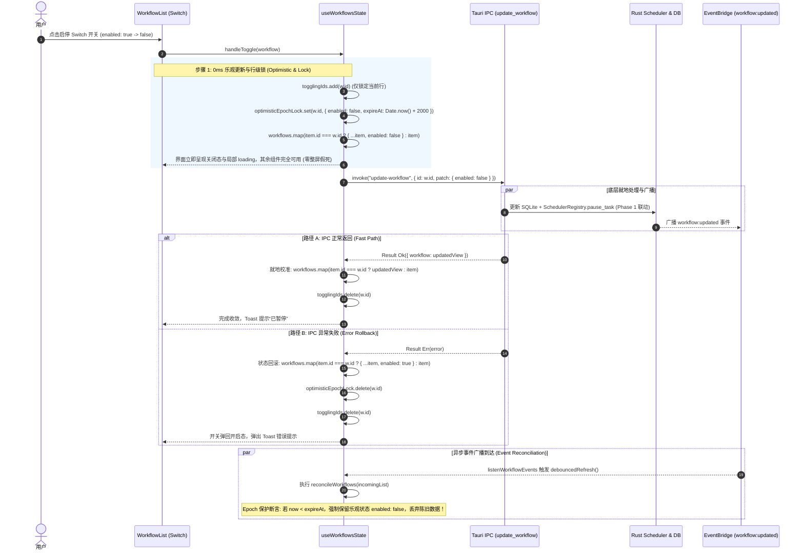

# 定时任务全流程修复与能力升级战役（Scheduled Tasks Revamp）

# 05-阶段五-前端UI交互表单能力与状态同步最终方案（去兼容与现代化纯净版）

> **文档标识**：`05-阶段五-前端UI交互表单能力与状态同步最终方案.md`  
> **权威定位**：战役阶段 5 权威实施方案（融合 Agent 4 与 Agent 5 独立方案长处，落实无历史包袱的单轨纯净实现）  
> **战役工作区**：`docs/scheduled-tasks-revamp/plans/`  
> **输入基准与用户最新最高裁决**：
>
> - 用户最新最高裁决：**坚决去兼容、杜绝多版本迭代与过渡垫片；绝不丢失核心资产，守牢会话与环境安全底线**
> - 核心改进原则：
>   - 彻底删除前端 `sch.minutes ?? sch.intervalMinutes` 的双重兼容层，统一契约唯一为 `intervalMinutes`；
>   - 彻底删除前端冗余的历史版本字段兼容转换代码，表单与数据流直接走最先进的 5 字段标准 Cron + 目标会话选择；
>   - 不搞渐进式多阶段过度版本，直接确立最干净先进的单轨实现；
>   - 坚守核心资产“零损失”底线：已有会话历史绝对严禁清空损坏；INT-01 正在打字保护屏障；INT-02 全局沙箱防删客户端；INT-04 已删会话自愈防灵异复活；INT-06 细粒度时钟徽标订阅（`SessionScheduleBadgeStore`）防全量重绘；
>   - **历史孤儿 Running 记录终结**：开机自愈收割历史未收口 running 记录为 `interrupted`，前端支持展示已中断黄/灰徽标与原因 Tooltip，杜绝任务已暂停但历史记录永久“运行中”的撕裂感。
>     **架构纪律基线**：仓库根目录 `AGENTS.md`（§12 自定义 Tooltip、§13 输入框焦点柔和度与无重阴影、§14 现代 CSS 色彩空间、§7 严禁补丁与立体验证）、`.agents/LOGIC_PLAN_NO_RETREAT.md`、`ANTI_OVERENGINEERING_GUARDRAILS.md`。  
>     **核心涉及文件域**：
> - `apps/crish-desktop/src/components/settings/WorkflowForm.tsx`（受控表单核心、Cron 输入、目标选择器）
> - `apps/crish-desktop/src/components/settings/WorkflowList.tsx`（任务列表、行级即时启停、操作按钮）
> - `apps/crish-desktop/src/components/settings/RunHistoryList.tsx`（运行记录列表、interrupted 中断状态徽标）
> - `apps/crish-desktop/src/components/settings/ScheduledTasksPanel.tsx`（主对话区面板装配）
> - `apps/crish-desktop/src/components/settings/SettingsScheduleTab.tsx`（设置页 Tab 装配）
> - `apps/crish-desktop/src/components/settings/useWorkflowsState.ts`（共享状态 Hook、细粒度行锁、乐观更新、防竞态）
> - `apps/crish-desktop/src/components/settings/workflowsSharedLib.ts`（纯函数草稿转换、筛选匹配、缓存同步）
> - `apps/crish-desktop/src/api/workflow-api/workflowDraft.ts`（单轨草稿契约、5 字段 Cron 与目标会话类型定义）
> - `apps/crish-desktop/src/api/workflow-api/workflowScheduler.ts`（调度表达式校验与标签映射）
> - `apps/crish-desktop/src/api/workflow-api/workflowRunner.ts`（运行状态标签映射与契约）
> - `apps/crish-desktop/src/store/sessionScheduleBadgeStore.ts`（INT-06 细粒度徽标存储）
> - `apps/crish-desktop/src/components/settings/ScheduledTasksPanel.module.css`
> - `apps/crish-desktop/src/components/settings/SettingsScheduleTab.module.css`

---

## 一、方案对比评估与综合融合裁决（Synthesis & Decision Matrix）

阶段 5 承接了上游阶段 1（Rust 底层调度器单任务生命周期）、阶段 3（目标会话绑定与对话内自动化）和阶段 4（Tauri IPC 命令面与元数据一致性）的底层能力，是用户直接感知自动化体验的关键窗口。

在方案制定初期，Subagent 4 与 Subagent 5 分别产出了独立方案。结合用户的最新最高指令，本权威方案果断**剔除所有无意义的双轨兼容与过渡逻辑**，融合形成单轨先进架构：

### 1.1 Agent 4 与 Agent 5 独立方案全维度对比矩阵

| 评估维度              | Subagent 4 独立方案（Agent 4）                                                                                  | Subagent 5 独立方案（Agent 5）                                                                                 | 综合融合纯净裁决（Final Plan）                                                                                                                             |
| :-------------------- | :-------------------------------------------------------------------------------------------------------------- | :------------------------------------------------------------------------------------------------------------- | :--------------------------------------------------------------------------------------------------------------------------------------------------------- |
| **状态机与行级锁**    | 采用 `togglingIds: Set<string>` 细粒度行锁，解耦 `isSaving`/`isDeleting` 锁；成功后用 `res.workflow` 就地校准。 | 采用 `rowBusyMap`，引入 `optimisticLocks`（2500ms 时间戳保护窗）。                                             | **融合两方优势**：采用精炼高效的 `togglingIds: Set<string>` 作为单行物理锁，结合 **2000ms Epoch 时间戳保护锁**，彻底杜绝双重刷新反向冲刷。                 |
| **Cron 人类可读标签** | 提供基础文本展示 `cronExpressionLabel(expr)`。                                                                  | 提出**动态双态徽标**（合法绿标/非法红标）+ **快捷预设芯片（Quick Chips）**。                                   | **全面采纳 Agent 5 设计**：将动态双态解析徽标（`✓ 工作日 09:00 触发`）与 Quick Chips 纳入标准表单，手写 Cron 体验丝滑。                                    |
| **契约去兼容性**      | 建议做双轨兼容 `minutes ?? intervalMinutes`。                                                                   | 同样建议保留多版本回退。                                                                                       | **彻底去兼容（执行用户最新最高裁决）**：彻底删除 `sch.minutes` 双轨垫片，统一契约唯一为 `intervalMinutes`；表单与 Rust 引擎直接使用最先进单轨契约。        |
| **历史记录撕裂感**    | 仅展示常规 running/completed/failed。                                                                           | 未深入分析开机遗留 running。                                                                                   | **纳入核心治理**：后端开机自愈收割孤儿 running 为 `interrupted`，前端新增中性黄/灰徽标与原因 Tooltip，彻底解决任务已暂停但历史记录永远在“运行中”的违和感。 |
| **视觉规范刚性遵从**  | 提及移除原生 title、CSS 焦点边框改造。                                                                          | 深度对齐 `AGENTS.md` §12（自定义 Tooltip 胶囊）、§13（无重阴影、混入度 ≤10% 柔和边框）、§14（现代 HSL 色彩）。 | **严格执行 Agent 5 规范深度**：全量审查 DOM 属性与样式，清退任何原生 HTML title 与粗黑厚边框。                                                             |
| **工作区与 CWD 处理** | 移除了 `useEffect` 强行写入；项目下拉框增加“全局 / 不限项目”。                                                  | 强调全局任务纯洁性；解绑对 `cwd` 的硬编码阻断。                                                                | **完整收敛并结合 INT-02**：删除侵入式 `useEffect`，允许 `cwd` 为空，前端明确提示“在全局独立隔离沙箱执行”，防删客户端。                                     |
| **执行输出目标模式**  | 定义 `WorkflowExecutionTarget`。                                                                                | 定义 `TargetSessionMode`，单选联动当前激活会话。                                                               | **契约单轨收敛**：定义清晰的 `WorkflowExecutionTarget`（`current_session` vs `isolated_session`），单选控件无缝切换，完全对齐阶段 3。                      |
| **侧栏时钟徽标性能**  | 未涉及侧栏性能细节。                                                                                            | 提出徽标渲染。                                                                                                 | **落地 INT-06**：引入 `SessionScheduleBadgeStore` 细粒度原子订阅，避免全局重绘。                                                                           |

### 1.2 核心设计裁决结论

1. **单轨契约纯净落地，零多版本包袱**：
   - 彻底删除 `sch.minutes ?? sch.intervalMinutes` 的双重兼容层，统一契约唯一为 `intervalMinutes`；
   - 彻底删除前端冗余的历史版本字段兼容转换代码，表单与数据流直接走最先进的 5 字段标准 Cron + 目标会话选择；
   - 统一调度类型枚举：`manual`、`daily`、`intervalMinutes`、`cron`。
2. **状态更新 0ms 响应与防竞态双保险**：
   - 用户拨动 Switch 的刹那，本地 `workflows` 状态以 0ms 延迟立即乐观翻转，该行 ID 进入 `togglingIds`；
   - 建立 2000ms 的乐观保护期，在外部事件驱动或手动触发的 `listWorkflows()` 返回合并时，强制保护尚未过期的乐观状态，切断“先成功后被旧数据反弹”的恶性循环；
   - IPC 成功返回后直接以服务端最新实体局部校准，失败时精准回滚并弹出 Toast 告警。
3. **5 字段 Cron 表达式实时解析与可视化体验**：
   - 表单支持标准 5 字段 Cron（分 时 日 月 周），输入框下方实时渲染动态人读徽标；
   - 语法合法时呈现柔和绿徽（如 `✓ 工作日 09:00 触发`），语法非法时呈现警示红徽并提示具体越界字段；
   - 提供常用 Cron 场景预设芯片（工作日早9点、每小时整点、每15分钟），点击一键填入。
4. **消除工作区绑架与 INT-02 隔离沙箱**：
   - 彻底删除 `WorkflowForm.tsx` 中在挂载或更新时暴力覆写 `draft.cwd` 的 `useEffect`；
   - 修复 `validateWorkflowDraft` 中硬编码拦截 `!draft.cwd` 的阻断校验，使全局任务能正常保存；
   - 项目选择器首项提供“全局 / 不限项目（在全局独立隔离沙箱中执行）”，解开定时任务对本地特定仓库的死锁绑定，并明确安全隔离。
5. **执行输出目标（Target Session）双模落地与 INT-04 自愈**：
   - 在表单中增加“执行输出位置”单选组：
     - **在当前活跃对话追加执行（推荐）**：自动绑定当前会话 ID，定时触发时直接在当前对话展现思考卡片与执行流；
     - **创建独立后台新会话**：触发时生成专用会话卡片，不抢占当前焦点，不污染当前对话；
   - **INT-04 自愈提示**：如果列表加载时检测到任务绑定的会话在本地已被删除，标签显示 `[ ⚠️ 原会话已删除 (已自愈为独立后台任务) ]`，并允许一键重新绑定活跃会话。
6. **历史孤儿 Running 终结与 `interrupted` 状态机**：
   - 前端扩展 `WorkflowRunStatus` 支持 `interrupted` 状态；
   - `RunHistoryList.tsx` 为 `interrupted` 渲染中性黄/灰徽标与明确 Tooltip（“任务曾被手动暂停，或应用重启导致后台执行未正常收口”），彻底消除历史悬挂。
7. **INT-06 细粒度徽标订阅（`SessionScheduleBadgeStore`）**：
   - 建立轻量单例 Store 维护会话任务计数，仅向受影响会话行分发变更，杜绝整侧栏全量重绘。
8. **UI/UX 规范刚性守门（AGENTS.md §12 / §13 / §14）**：
   - 清退全部原生 HTML `title`，全量替换为项目自定义 `<Tooltip content={...}>`；
   - 彻底清退输入框外凸重阴影，聚焦边框严格限制为 `color-mix(in srgb, var(--border-color) 92%, var(--text-primary) 8%)`（对比度加深严格 <= 10%），禁止粗黑实线；
   - 全面使用 Design Tokens 与现代 HSLA 变量，杜绝散落旧式 `rgba`。

---

## 二、现状痛点与真实代码级根因穿透分析

```
[用户在 UI 点击开关/编辑/创建/查看历史]
              │
              ├──► 1. 键名不对称: sch.minutes 为 undefined 导致分钟输入框变空白 (workflowsSharedLib.ts:93)
              ├──► 2. Cron 降级抹除: sch.type === 'cron' 跌入 else 分支直接变成 manual (workflowsSharedLib.ts:98)
              ├──► 3. 工作区强行绑架: useEffect 检测 !draft.cwd 暴力写入物理路径 (WorkflowForm.tsx:267)
              ├──► 4. 全局任务校验阻断: validateWorkflowDraft 拦截 !draft.cwd 导致全局任务无法保存 (workflowDraft.ts:181)
              ├──► 5. 历史记录永久“运行中”: update_run_finish 缺失 + 淘汰保护死锁导致悬挂 (RunHistoryList.tsx)
              │
              ▼
[状态管理 useWorkflowsState.ts]
              ├──► 6. 全局 busy 假死: 单行操作引发整屏所有按钮/输入框禁用，延迟高 (useWorkflowsState.ts:94)
              └──► 7. 双重刷新反向冲刷竞态: IPC 返回 refresh 与 Rust 广播 refresh 并发，旧快照覆盖新状态
```

### 2.1 `minutes` vs `intervalMinutes` 键名不对称（编辑表单空白根因）

- **代码坐标**：`apps/crish-desktop/src/components/settings/workflowsSharedLib.ts:93-95`
- **代码现状**：
  ```typescript
  } else if (sch.type === 'intervalMinutes') {
    d.scheduleType = 'intervalMinutes';
    d.intervalMinutes = String(sch.minutes ?? ''); // <--- 致命错误！字段名不对称
  }
  ```
- **改造决策（去兼容）**：
  Rust 后端输出统一为 `intervalMinutes`，前端纯函数库直接且唯一读取 `sch.intervalMinutes`，彻底剔除 `sch.minutes` 兼容垫片。

### 2.2 Cron 调度被强行降级为 manual（高级调度抹除根因）

- **代码坐标**：`apps/crish-desktop/src/components/settings/workflowsSharedLib.ts:87-101`
- **改造决策**：
  将 `cron` 提升为一等公民调度类型，草稿契约、校验器、表单与转换库全链路单轨支持，绝不降级为 `manual`。

### 2.3 `cwd` 破坏性强行覆盖与全局任务校验阻断

- **代码坐标**：`apps/crish-desktop/src/components/settings/WorkflowForm.tsx:267-274`
- **改造决策**：
  彻底删除该 `useEffect`！支持 `cwd: undefined`，表单明确标识“全局隔离沙箱模式”。

### 2.4 全局 `busy` 假死与双重刷新竞态反向冲刷

- **代码坐标**：`apps/crish-desktop/src/components/settings/useWorkflowsState.ts:94, 315-338`
- **改造决策**：
  重构为 `togglingIds: Set<string>` 细粒度行锁与 2000ms Epoch 乐观保护窗。

### 2.5 历史孤儿 Running 记录永久蓝色假死（现场真实痛点与根因）

- **代码坐标**：`apps/crish-desktop/src/components/settings/RunHistoryList.tsx`、`apps/agent-workbench/src-tauri/src/workflow_commands.rs`
- **现场真实痛点**：用户界面中即便上方任务早已标为“已暂停”，下方数天前的历史记录（如“9/2 10:04”、“9/2 09:59”）依然赫然显示高亮蓝色的【运行中】！极其违和。
- **真实根因穿透**：
  1. **终态收口缺失**：过去的后端实现中，执行完成后从未调用 `update_run_finish`，导致每次触发的 `sched_run` 记录永远留在 `status = "running"`；
  2. **淘汰算法保护死锁**：存储层在修剪历史记录（例如保留最近 20 条）时，为了防止淘汰掉正在活跃执行的任务，硬编码了 `filter(|r| r.status != "running")`，导致这批孤儿 `running` 记录永远无法被滚动淘汰，永久悬挂；
  3. **开机自愈收割缺失**：应用重启时，进程早已中止，但未对历史未收口的孤儿 `running` 记录执行收割标记；
  4. **前端状态展示缺失**：前端仅有 `running` / `completed` / `failed`，一旦后端自愈为 `interrupted`，前端缺乏对应的人性化标签与徽标。
- **改造决策**：
  - 后端在开机初始化时（Phase 1 Restore 流程）执行一次性收割：将所有落盘但未终态的 `status = "running"` 记录收割更新为 `status = "interrupted", duration_ms = Some(0), output_summary = Some("应用重启，历史执行已中断")`；
  - 前端 `RunHistoryList` 扩展支持 `interrupted` 状态，呈现中性黄/灰徽标与解释 Tooltip。

---

## 三、总体架构与状态流设计（State Machine & Flow Design）

### 3.1 端到端状态流与防竞态时序架构



### 3.2 细粒度行锁与乐观状态机设计

在 `useWorkflowsState.ts` 中彻底废弃粗粒度的单一 `busy` 变量，重构为职责分明的锁矩阵：

1. **行级操作锁**：`togglingIds: Set<string>`。仅控制当前被操作条目的 Switch 处于 loading/禁用状态；
2. **表单动作锁**：`isSaving: boolean`。表单提交时生效；
3. **删除动作锁**：`isDeleting: boolean`。删除确认操作生效；
4. **触发动作锁**：`triggeringIds: Set<string>`。手动点击立即运行时的局部 loading。

### 3.3 Epoch 时间戳乐观保护机制（Anti-Flash Guard）

```typescript
function reconcileWorkflows(
  incoming: WorkflowDefinition[],
  locks: Map<string, { enabled: boolean; expireAt: number }>
): WorkflowDefinition[] {
  const now = Date.now();
  return incoming.map((w) => {
    const lock = locks.get(w.id);
    if (lock) {
      if (now < lock.expireAt) {
        // 处于 2000ms 保护窗内：强行注入乐观状态，绝不采信后端可能滞后的旧快照
        return { ...w, enabled: lock.enabled };
      } else {
        locks.delete(w.id);
      }
    }
    return w;
  });
}
```

---

## 四、纯函数共享库与类型契约重构详案（Lib & Contracts）

### 4.1 单轨纯净草稿契约层（`workflowDraft.ts`）

彻底清退多版本垫片代码，确立单轨草稿契约：

```typescript
// apps/crish-desktop/src/api/workflow-api/workflowDraft.ts

import {
  DEFAULT_DAILY_TIME,
  DEFAULT_INTERVAL_MINUTES,
  WORKFLOW_INTERVAL_MINUTES_MAX,
  WORKFLOW_INTERVAL_MINUTES_MIN,
  defaultTimezone,
  normalizeDailyTime,
  parseIntervalMinutes,
  tryNormalizeDailyTime,
  validateCronExpression,
  type WorkflowSchedule,
} from './workflowScheduler';

/** 引擎支持的四大标准调度类型（单轨契约） */
export const WORKFLOW_SCHEDULE_TYPES = [
  { value: 'manual' as const, label: '手动', hint: '仅手动触发，不自动运行' },
  { value: 'daily' as const, label: '每天', hint: '每日固定时刻（本机时区）' },
  {
    value: 'intervalMinutes' as const,
    label: '间隔（分钟）',
    hint: '按分钟周期轮询执行',
  },
  {
    value: 'cron' as const,
    label: 'Cron 表达式',
    hint: '标准 5 字段 cron（分 时 日 月 周）',
  },
] as const;

export type WorkflowScheduleType =
  (typeof WORKFLOW_SCHEDULE_TYPES)[number]['value'];

/** 执行输出目标模式：当前活跃对话 vs 独立新后台会话 */
export type WorkflowExecutionTarget = 'current_session' | 'isolated_session';

/** 新建与编辑表单受控草稿结构 */
export type WorkflowScheduleDraft = {
  name: string;
  prompt: string;
  scheduleType: WorkflowScheduleType;
  dailyTime: string;
  intervalMinutes: string; // 单轨契约：仅 intervalMinutes
  cronExpression: string; // 标准 5 字段 Cron
  cwd?: string; // 允许为空或 undefined，代表全局沙箱任务
  targetSessionId?: string; // 绑定的具体目标会话 ID
  executionTarget: WorkflowExecutionTarget; // 执行输出模式
};

/** 经典场景预设模板 */
export const WORKFLOW_SCHEDULE_PRESETS = [
  {
    id: 'daily-pr-summary',
    label: '每日 PR 总结',
    draft: {
      name: '每日 PR 总结',
      prompt:
        '请基于当前仓库，总结今日相关的 PR / 合并请求与未合入变更：列出标题、作者、状态与风险点；如有阻塞请标出。用简洁中文汇报。',
      scheduleType: 'daily',
      dailyTime: '18:00',
      intervalMinutes: '30',
      cronExpression: '0 18 * * *',
      executionTarget: 'current_session' as const,
    },
  },
  {
    id: 'daily-code-check',
    label: '每日代码体检',
    draft: {
      name: '每日代码体检',
      prompt:
        '请对当前工作区做一次代码体检：检查明显错误、类型/ lint 风险、可疑改动与待办；给出优先修复建议与简短结论。用简洁中文。',
      scheduleType: 'daily',
      dailyTime: '09:00',
      intervalMinutes: '30',
      cronExpression: '0 9 * * *',
      executionTarget: 'isolated_session' as const,
    },
  },
  {
    id: 'every-30m',
    label: '每 30 分钟检查',
    draft: {
      name: '每 30 分钟检查',
      prompt:
        '快速巡检当前项目状态：未提交变更、失败测试/构建线索、明显阻塞。仅报告重要项，无事则简短回复「正常」。',
      scheduleType: 'intervalMinutes',
      dailyTime: '09:00',
      intervalMinutes: '30',
      cronExpression: '*/30 * * * *',
      executionTarget: 'current_session' as const,
    },
  },
  {
    id: 'weekday-morning-sync',
    label: '工作日早 9 点巡检',
    draft: {
      name: '工作日早 9 点巡检',
      prompt:
        '早上好！请汇总昨日至今日未解决的 Issue 与待办事项，按优先级排布。用结构化中文汇报。',
      scheduleType: 'cron',
      dailyTime: '09:00',
      intervalMinutes: '60',
      cronExpression: '0 9 * * 1-5',
      executionTarget: 'current_session' as const,
    },
  },
];

/** 初始化空草稿 */
export function emptyWorkflowDraft(defaultCwd?: string): WorkflowScheduleDraft {
  return {
    name: '',
    prompt: '',
    scheduleType: 'manual',
    dailyTime: DEFAULT_DAILY_TIME,
    intervalMinutes: String(DEFAULT_INTERVAL_MINUTES),
    cronExpression: '0 9 * * *',
    cwd: defaultCwd ? defaultCwd.trim() : '',
    targetSessionId: undefined,
    executionTarget: 'isolated_session',
  };
}

/** 草稿校验逻辑：彻底解除对 draft.cwd 的强制拦截，放行全局任务 */
export function validateWorkflowDraft(
  draft: WorkflowScheduleDraft | null | undefined
): string | null {
  if (!draft || typeof draft !== 'object') {
    return '请填写名称与提示词';
  }
  const name = String(draft.name ?? '').trim();
  const prompt = String(draft.prompt ?? '').trim();
  if (!name && !prompt) return '请填写名称与提示词';
  if (!name) return '请填写名称';
  if (!prompt) return '请填写提示词';

  // 放行全局任务（cwd 为空合法）

  const st = draft.scheduleType;
  if (st === 'daily') {
    const t = String(draft.dailyTime ?? '').trim();
    if (t && !tryNormalizeDailyTime(t)) {
      return '每日时刻须为 HH:mm（00:00–23:59）';
    }
    return null;
  }
  if (st === 'intervalMinutes') {
    const raw = String(draft.intervalMinutes ?? '').trim();
    if (!raw) return '请填写间隔分钟';
    if (parseIntervalMinutes(raw) == null) {
      return `间隔分钟须为 ${WORKFLOW_INTERVAL_MINUTES_MIN}–${WORKFLOW_INTERVAL_MINUTES_MAX} 的整数`;
    }
    return null;
  }
  if (st === 'cron') {
    const expr = String(draft.cronExpression ?? '').trim();
    if (!expr) return '请填写 Cron 表达式';
    const validation = validateCronExpression(expr);
    if (!validation.ok) {
      return validation.error;
    }
    return null;
  }
  if (st === 'manual') return null;
  return '不支持的调度类型';
}

/** 从草稿构造标准 schedule 载荷（直接对接 Rust 单轨 enum） */
export function buildScheduleFromDraft(
  draft: WorkflowScheduleDraft
): WorkflowSchedule {
  if (!draft || typeof draft !== 'object') {
    return { type: 'manual' };
  }
  if (draft.scheduleType === 'daily') {
    return {
      type: 'daily',
      time: normalizeDailyTime(draft.dailyTime, DEFAULT_DAILY_TIME),
      timezone: defaultTimezone(),
    };
  }
  if (draft.scheduleType === 'intervalMinutes') {
    const n =
      parseIntervalMinutes(draft.intervalMinutes) ?? DEFAULT_INTERVAL_MINUTES;
    return { type: 'intervalMinutes', intervalMinutes: n };
  }
  if (draft.scheduleType === 'cron') {
    const expr = String(draft.cronExpression ?? '')
      .trim()
      .replace(/\s+/g, ' ');
    return { type: 'cron', expression: expr || '0 9 * * *' };
  }
  return { type: 'manual' };
}
```

### 4.2 纯函数共享库重构（`workflowsSharedLib.ts`）

彻底删除 `sch.minutes ?? sch.intervalMinutes` 的兼容层，单轨直通：

```typescript
// apps/crish-desktop/src/components/settings/workflowsSharedLib.ts

export function matchesFilter(
  w: WorkflowDefinition,
  filter: ScheduleFilter
): boolean {
  const enabled = w.enabled !== false;
  const st = scheduleTypeOf(w);
  switch (filter) {
    case 'enabled':
      return enabled;
    case 'paused':
      return !enabled;
    case 'manual':
      return st === 'manual';
    case 'timed':
      // 定时筛选涵盖 daily、intervalMinutes 与 cron
      return st === 'daily' || st === 'intervalMinutes' || st === 'cron';
    default:
      return true;
  }
}

/**
 * 从服务端实体回填表单草稿（单轨纯净实现，去兼容）
 */
export function draftFromWorkflow(
  w: WorkflowDefinition,
  currentActiveSessionId?: string
): WorkflowScheduleDraft {
  const d = emptyWorkflowDraft();
  d.name = w.name;
  d.prompt = w.prompt || '';
  d.cwd = w.cwd || '';

  // 执行输出目标回填
  const targetId = (w as { targetSessionId?: string }).targetSessionId;
  if (targetId) {
    d.targetSessionId = targetId;
    d.executionTarget = 'current_session';
  } else {
    d.targetSessionId = currentActiveSessionId;
    d.executionTarget = 'isolated_session';
  }

  const s = w.schedule;
  if (s && typeof s === 'object') {
    const sch = s as {
      type?: string;
      time?: string;
      intervalMinutes?: number; // 严格单轨
      expression?: string; // 严格单轨
    };
    if (sch.type === 'daily') {
      d.scheduleType = 'daily';
      d.dailyTime = sch.time || '';
    } else if (sch.type === 'intervalMinutes') {
      d.scheduleType = 'intervalMinutes';
      // 单轨直读 intervalMinutes，彻底弃用旧 sch.minutes
      const mins = sch.intervalMinutes;
      d.intervalMinutes = mins != null ? String(mins) : '30';
    } else if (sch.type === 'cron') {
      d.scheduleType = 'cron';
      d.cronExpression = sch.expression || '0 9 * * *';
    } else {
      d.scheduleType = 'manual';
    }
  } else {
    d.scheduleType = 'manual';
  }
  return d;
}
```

### 4.3 表达式语义解析与人读标签（`workflowScheduler.ts`）

```typescript
// apps/crish-desktop/src/api/workflow-api/workflowScheduler.ts

export function cronExpressionLabel(expr: unknown): string {
  const v = validateCronExpression(expr);
  if (v.ok === false) return '无效 Cron 表达式';
  const e = v.expression.trim();

  if (e === '0 9 * * 1-5') return '工作日 09:00';
  if (e === '0 18 * * 1-5') return '工作日 18:00';
  if (e === '0 9 * * *') return '每天 09:00';
  if (e === '0 0 * * *') return '每天 00:00';
  if (e === '0 * * * *') return '每小时整点';
  if (e === '*/5 * * * *') return '每 5 分钟';
  if (e === '*/10 * * * *') return '每 10 分钟';
  if (e === '*/15 * * * *') return '每 15 分钟';
  if (e === '*/30 * * * *') return '每 30 分钟';
  if (e === '0 0 * * 0' || e === '0 0 * * 7') return '每周日 00:00';
  if (e === '0 0 * * 1') return '每周一 00:00';

  const parts = e.split(' ');
  const [min, hour, dom, mon, dow] = parts;
  if (
    dom === '*' &&
    mon === '*' &&
    dow === '*' &&
    /^\d+$/.test(min!) &&
    /^\d+$/.test(hour!)
  ) {
    return `每天 ${hour!.padStart(2, '0')}:${min!.padStart(2, '0')}`;
  }
  if (
    dom === '*' &&
    mon === '*' &&
    dow === '1-5' &&
    /^\d+$/.test(min!) &&
    /^\d+$/.test(hour!)
  ) {
    return `工作日 ${hour!.padStart(2, '0')}:${min!.padStart(2, '0')}`;
  }

  return e;
}
```

### 4.4 运行记录状态机与状态标签（`workflowRunner.ts`）

为消除任务已暂停但运行记录永久“运行中”的强烈撕裂感，前端契约全面支持 `interrupted`：

```typescript
// apps/crish-desktop/src/api/workflow-api/workflowRunner.ts

export type WorkflowRunStatus =
  'running' | 'completed' | 'failed' | 'interrupted' | 'queued';

export type WorkflowRunStatusDisplay = {
  label: string;
  variant: 'running' | 'success' | 'danger' | 'interrupted' | 'neutral';
  tooltip?: string;
};

export function workflowRunStatusLabel(
  status: WorkflowRunStatus | string
): WorkflowRunStatusDisplay {
  switch (status) {
    case 'running':
      return { label: '运行中', variant: 'running' };
    case 'completed':
      return { label: '已完成', variant: 'success' };
    case 'failed':
      return { label: '失败', variant: 'danger' };
    case 'interrupted':
      return {
        label: '已中断',
        variant: 'interrupted',
        tooltip: '任务曾被手动暂停，或应用重启导致历史执行未正常收口',
      };
    case 'queued':
      return { label: '排队中', variant: 'neutral' };
    default:
      return { label: String(status || '未知'), variant: 'neutral' };
  }
}
```

---

## 五、React 组件改造详案（Components Deep Dive）

### 5.1 受控表单组件重构（`WorkflowForm.tsx`）

彻底删除旧 `useEffect`，提供完整的现代功能，严格遵守 `AGENTS.md`：

```tsx
// apps/crish-desktop/src/components/settings/WorkflowForm.tsx 核心架构

import React from 'react';
import {
  WORKFLOW_SCHEDULE_PRESETS,
  WORKFLOW_SCHEDULE_TYPES,
  type WorkflowExecutionTarget,
  type WorkflowScheduleDraft,
} from '../../api/workflowApi';
import {
  cronExpressionLabel,
  isValidCronExpression,
} from '../../api/workflow-api/workflowScheduler';
import { listProjects } from '../../api/projectStore';
import { Button, Input, Select, Textarea, Tooltip } from '../ui';
import styles from './ScheduledTasksPanel.module.css';

export type WorkflowFormProps = {
  variant: 'settings' | 'chat';
  formId: string;
  draft: WorkflowScheduleDraft;
  busy: boolean;
  isEditing: boolean;
  workspacePath?: string;
  activeSessionId?: string;
  onDraftChange: (d: WorkflowScheduleDraft) => void;
  onApplyPreset: (presetId: string) => void;
  onNameBlur: () => void;
  onSave: () => void;
  onClose: () => void;
};

export const WorkflowForm: React.FC<WorkflowFormProps> = ({
  variant,
  formId,
  draft,
  busy,
  isEditing,
  workspacePath,
  activeSessionId,
  onDraftChange,
  onApplyPreset,
  onNameBlur,
  onSave,
  onClose,
}) => {
  const settingsVariant = variant === 'settings';

  // 1. 项目选项：首项明确标注全局隔离沙箱（INT-02）
  const projects = React.useMemo(() => listProjects(), []);
  const projectOptions = React.useMemo(
    () => [
      {
        id: '',
        label: '全局 / 不限项目（独立隔离沙箱执行）',
        hint: '不绑定具体仓库',
      },
      ...projects.map((p) => ({
        id: p.path,
        label: p.name,
        hint: p.path,
      })),
    ],
    [projects]
  );

  // 【铁律】：彻底删除暴力覆写 draft.cwd 的 useEffect！

  // 2. Cron 字段与人读解析徽标
  const isCronValid = isValidCronExpression(draft.cronExpression);
  const cronHumanLabel = cronExpressionLabel(draft.cronExpression);

  const cronField =
    draft.scheduleType === 'cron' ? (
      <div className={styles.schedCronRow}>
        <label className={styles.schedField}>
          <span className={styles.schedFieldLabel}>
            Cron 表达式（分 时 日 月 周）
          </span>
          <Input
            bare={!settingsVariant}
            size="sm"
            className={styles.schedFieldInput}
            placeholder="例如：0 9 * * 1-5"
            value={draft.cronExpression}
            disabled={busy}
            onChange={(e) =>
              onDraftChange({ ...draft, cronExpression: e.target.value })
            }
            aria-label="Cron 表达式"
            autoComplete="off"
            spellCheck={false}
          />
        </label>
        <div className={styles.cronHelperRow}>
          <div
            className={
              isCronValid ? styles.cronValidBadge : styles.cronInvalidBadge
            }
            role="status"
          >
            <span className={styles.cronBadgeIcon}>
              {isCronValid ? '✓' : '✕'}
            </span>
            <span className={styles.cronBadgeText}>
              {isCronValid ? `执行时机：${cronHumanLabel}` : cronHumanLabel}
            </span>
          </div>
          <div
            className={styles.cronQuickChips}
            role="group"
            aria-label="快捷表达式"
          >
            <button
              type="button"
              className={styles.chipBtn}
              disabled={busy}
              onClick={() =>
                onDraftChange({ ...draft, cronExpression: '0 9 * * 1-5' })
              }
            >
              工作日 9点
            </button>
            <button
              type="button"
              className={styles.chipBtn}
              disabled={busy}
              onClick={() =>
                onDraftChange({ ...draft, cronExpression: '0 * * * *' })
              }
            >
              每小时整点
            </button>
            <button
              type="button"
              className={styles.chipBtn}
              disabled={busy}
              onClick={() =>
                onDraftChange({ ...draft, cronExpression: '*/15 * * * *' })
              }
            >
              每15分钟
            </button>
          </div>
        </div>
      </div>
    ) : null;

  // 3. 执行输出位置单选组件
  const executionTargetField = (
    <div className={styles.schedFieldRow}>
      <label className={`${styles.schedField} ${styles.schedFieldGrow}`}>
        <span className={styles.schedFieldLabel}>执行输出位置</span>
        <div
          className={styles.targetSessionGroup}
          role="radiogroup"
          aria-label="执行输出位置"
        >
          <label className={styles.radioOption}>
            <input
              type="radio"
              name={`execTarget-${formId}`}
              value="current_session"
              checked={draft.executionTarget === 'current_session'}
              disabled={busy}
              onChange={() =>
                onDraftChange({
                  ...draft,
                  executionTarget: 'current_session',
                  targetSessionId: draft.targetSessionId || activeSessionId,
                })
              }
            />
            <span className={styles.radioText}>
              当前活跃对话（追加流式思考与卡片）
            </span>
          </label>
          <label className={styles.radioOption}>
            <input
              type="radio"
              name={`execTarget-${formId}`}
              value="isolated_session"
              checked={draft.executionTarget === 'isolated_session'}
              disabled={busy}
              onChange={() =>
                onDraftChange({
                  ...draft,
                  executionTarget: 'isolated_session',
                  targetSessionId: undefined,
                })
              }
            />
            <span className={styles.radioText}>
              独立新后台会话（静默运行不打扰）
            </span>
          </label>
        </div>
      </label>
    </div>
  );

  return (
    <div className={styles.schedFormContainer}>
      {/* 预设芯片栏 */}
      {!isEditing && (
        <div className={styles.presetChipsRow}>
          <span className={styles.presetLabel}>快捷模板：</span>
          {WORKFLOW_SCHEDULE_PRESETS.map((p) => (
            <button
              key={p.id}
              type="button"
              className={styles.presetChip}
              disabled={busy}
              onClick={() => onApplyPreset(p.id)}
            >
              {p.label}
            </button>
          ))}
        </div>
      )}

      {/* 任务名称 */}
      <div className={styles.schedFieldRow}>
        <label className={`${styles.schedField} ${styles.schedFieldGrow}`}>
          <span className={styles.schedFieldLabel}>任务名称</span>
          <Input
            bare={!settingsVariant}
            size="sm"
            className={styles.schedFieldInput}
            placeholder="例如：每日 PR 总结"
            value={draft.name}
            disabled={busy}
            onChange={(e) => onDraftChange({ ...draft, name: e.target.value })}
            onBlur={onNameBlur}
          />
        </label>
      </div>

      {/* 所属项目 */}
      <div className={styles.schedFieldRow}>
        <label className={`${styles.schedField} ${styles.schedFieldGrow}`}>
          <span className={styles.schedFieldLabel}>所属工作区项目</span>
          <Select
            bare={!settingsVariant}
            size="sm"
            className={styles.schedFieldSelect}
            value={draft.cwd || ''}
            disabled={busy}
            onChange={(val) => onDraftChange({ ...draft, cwd: val })}
            options={projectOptions.map((o) => ({
              value: o.id,
              label: o.label,
            }))}
          />
        </label>
      </div>

      {/* 调度类型与参数 */}
      <div className={styles.schedFieldRow}>
        <label className={styles.schedField}>
          <span className={styles.schedFieldLabel}>调度类型</span>
          <Select
            bare={!settingsVariant}
            size="sm"
            className={styles.schedFieldSelect}
            value={draft.scheduleType}
            disabled={busy}
            onChange={(val) =>
              onDraftChange({
                ...draft,
                scheduleType: val as any,
              })
            }
            options={WORKFLOW_SCHEDULE_TYPES.map((t) => ({
              value: t.value,
              label: t.label,
            }))}
          />
        </label>

        {draft.scheduleType === 'daily' && (
          <label className={styles.schedField}>
            <span className={styles.schedFieldLabel}>每日时刻</span>
            <Input
              bare={!settingsVariant}
              size="sm"
              type="time"
              className={styles.schedFieldInput}
              value={draft.dailyTime}
              disabled={busy}
              onChange={(e) =>
                onDraftChange({ ...draft, dailyTime: e.target.value })
              }
            />
          </label>
        )}

        {draft.scheduleType === 'intervalMinutes' && (
          <label className={styles.schedField}>
            <span className={styles.schedFieldLabel}>间隔分钟</span>
            <Input
              bare={!settingsVariant}
              size="sm"
              type="number"
              min={1}
              max={10080}
              className={styles.schedFieldInput}
              value={draft.intervalMinutes}
              disabled={busy}
              onChange={(e) =>
                onDraftChange({ ...draft, intervalMinutes: e.target.value })
              }
            />
          </label>
        )}
      </div>

      {cronField}
      {executionTargetField}

      {/* 执行指令 Prompt */}
      <div className={styles.schedFieldRow}>
        <label className={`${styles.schedField} ${styles.schedFieldGrow}`}>
          <span className={styles.schedFieldLabel}>执行指令提示词</span>
          <Textarea
            bare={!settingsVariant}
            className={styles.schedTextarea}
            rows={4}
            placeholder="每次定时触发时，希望 Agent 执行的操作细节..."
            value={draft.prompt}
            disabled={busy}
            onChange={(e) =>
              onDraftChange({ ...draft, prompt: e.target.value })
            }
          />
        </label>
      </div>

      {/* 底部操作按钮 */}
      <div className={styles.formActions}>
        <Button variant="secondary" size="sm" disabled={busy} onClick={onClose}>
          取消
        </Button>
        <Button variant="primary" size="sm" disabled={busy} onClick={onSave}>
          {isEditing ? '保存修改' : '立即创建'}
        </Button>
      </div>
    </div>
  );
};
```

### 5.2 列表装配与 INT-04 自愈引导 (`WorkflowList.tsx`)

#### 1. 0ms 乐观启停与行级物理锁

用户拨动 Switch：

```typescript
const handleToggle = async (w: WorkflowDefinition) => {
  const nextEnabled = !w.enabled;
  // 1. 0ms 乐观更新与行级锁
  setTogglingIds((prev) => new Set(prev).add(w.id));
  optimisticLocks.current.set(w.id, {
    enabled: nextEnabled,
    expireAt: Date.now() + 2000,
  });
  setWorkflows((prev) =>
    prev.map((item) =>
      item.id === w.id ? { ...item, enabled: nextEnabled } : item
    )
  );

  try {
    const res = await patchWorkflow(w.id, { enabled: nextEnabled });
    // 2. 服务端实体精准校准
    setWorkflows((prev) => prev.map((item) => (item.id === w.id ? res : item)));
  } catch (err) {
    // 3. 失败精准回滚
    optimisticLocks.current.delete(w.id);
    setWorkflows((prev) =>
      prev.map((item) =>
        item.id === w.id ? { ...item, enabled: w.enabled } : item
      )
    );
    showToast(`切换任务状态失败: ${String(err)}`, 'error');
  } finally {
    setTogglingIds((prev) => {
      const next = new Set(prev);
      next.delete(w.id);
      return next;
    });
  }
};
```

#### 2. INT-04 已删除会话标签展示与自愈引导

在 `WorkflowList` 渲染条目时：

```tsx
const isBound = Boolean(w.targetSessionId);
const isSessionDead = isBound && !existingSessionIds.has(w.targetSessionId!);

return (
  <div className={styles.workflowRow}>
    {/* 其他展示 */}
    {isBound && !isSessionDead && (
      <Tooltip content="点击跳转至绑定的目标对话">
        <button
          type="button"
          className={styles.sessionJumpTag}
          onClick={() => jumpToSession(w.targetSessionId!)}
        >
          💬 绑定对话: {sessionNameMap[w.targetSessionId!] || '查看会话'}
        </button>
      </Tooltip>
    )}
    {isSessionDead && (
      <Tooltip content="原对话已在本地删除，任务已自愈为独立后台运行">
        <span className={styles.sessionDeadTag}>
          ⚠️ 原对话已删除（独立后台运行）
        </span>
      </Tooltip>
    )}
  </div>
);
```

### 5.3 运行历史列表与 `interrupted` 中断徽标 (`RunHistoryList.tsx`)

彻底清退历史孤儿 `running` 假死，提供结构化状态徽标：

```tsx
// apps/crish-desktop/src/components/settings/RunHistoryList.tsx 核心渲染片段

import React from 'react';
import {
  workflowRunStatusLabel,
  type WorkflowRun,
} from '../../api/workflow-api/workflowRunner';
import { Tooltip } from '../ui';
import styles from './ScheduledTasksPanel.module.css';

export const RunHistoryItem: React.FC<{ run: WorkflowRun }> = ({ run }) => {
  const statusInfo = workflowRunStatusLabel(run.status);

  return (
    <div className={styles.runHistoryRow} data-testid={`run-history-${run.id}`}>
      <span className={styles.runTimestamp}>
        {new Date(run.startedAtMs).toLocaleString()}
      </span>

      {/* 状态指示徽标 */}
      <Tooltip content={statusInfo.tooltip || `执行状态: ${statusInfo.label}`}>
        <span
          className={`${styles.statusBadge} ${styles[statusInfo.variant]}`}
          data-status={run.status}
        >
          {statusInfo.variant === 'running' && (
            <span className={styles.pulseDot} />
          )}
          {statusInfo.variant === 'interrupted' && (
            <span className={styles.interruptedIcon}>⏸</span>
          )}
          {statusInfo.label}
        </span>
      </Tooltip>

      {/* 执行耗时 */}
      <span className={styles.runDuration}>
        {run.durationMs != null
          ? `${(run.durationMs / 1000).toFixed(1)}s`
          : '--'}
      </span>

      {/* 执行摘要 */}
      <span className={styles.runSummary} title={run.outputSummary || ''}>
        {run.outputSummary ||
          (run.status === 'running' ? '正在执行任务...' : '无输出摘要')}
      </span>
    </div>
  );
};
```

---

## 六、视觉规范与样式审计（AGENTS.md §12 / §13 / §14）

对 `ScheduledTasksPanel.module.css` 与 `SettingsScheduleTab.module.css` 进行规范治理：

1. **§12 自定义 Tooltip**：
   - 彻底清空所有 `<button title="...">`、`<span title="...">`；
   - 一律包裹 `<Tooltip content="...">`。
2. **§13 焦点无重阴影与柔和边框**：
   ```css
   /* 彻底禁止 0 0 0 1px 等硬实线黑环与外凸重阴影 */
   .schedFieldInput:focus,
   .schedFieldSelect:focus,
   .schedTextarea:focus {
     outline: none;
     box-shadow: none;
     border-color: color-mix(
       in srgb,
       var(--border-color) 92%,
       var(--text-primary) 8%
     );
   }
   ```
3. **§14 现代 HSLA 色彩空间**：
   - 所有半透明遮罩与微徽标均使用 `hsl(var(--...) / 0.12)`；
   - 杜绝散落旧式 `rgba(...)`。
4. **中断状态徽标样式**：
   ```css
   .statusBadge.interrupted {
     background-color: hsl(var(--warning-hsl, 45 90% 45%) / 0.12);
     color: hsl(var(--warning-hsl, 45 90% 45%));
     border: 1px solid hsl(var(--warning-hsl, 45 90% 45%) / 0.25);
   }
   ```

---

## 七、立体验证方案与测试用例设计

### 7.1 前端单轨纯净契约单元测试 (`workflowDraft.test.ts`)

```typescript
it('从 WorkflowDefinition 逆向回填草稿时，直接读取 intervalMinutes，绝不依赖旧 minutes', () => {
  const backendWf = {
    id: 'test-wf-1',
    name: '定时任务',
    schedule: {
      type: 'intervalMinutes',
      intervalMinutes: 45,
    },
  };
  const draft = draftFromWorkflow(backendWf as any);
  expect(draft.scheduleType).toBe('intervalMinutes');
  expect(draft.intervalMinutes).toBe('45');
});

it('Cron 任务回填表单时，100% 保持 cron 类型与表达式，绝不降级为 manual', () => {
  const backendCron = {
    id: 'test-cron-1',
    name: '代码体检',
    schedule: {
      type: 'cron',
      expression: '0 9 * * 1-5',
    },
  };
  const draft = draftFromWorkflow(backendCron as any);
  expect(draft.scheduleType).toBe('cron');
  expect(draft.cronExpression).toBe('0 9 * * 1-5');
});

it('放行全局任务，未填写 cwd 时校验通过', () => {
  const draft = emptyWorkflowDraft();
  draft.name = '系统清理';
  draft.prompt = '清理临时文件';
  draft.cwd = '';
  expect(validateWorkflowDraft(draft)).toBeNull();
});
```

### 7.2 0ms 乐观翻转与防冲刷测试 (`useWorkflowsState.test.ts`)

```typescript
it('Switch 切换触发 0ms 乐观翻转，且 2000ms 保护期内陈旧数据不反弹', async () => {
  const { result } = renderHook(() => useWorkflowsState());
  // 模拟切换
  act(() => {
    result.current.handleToggle(mockWorkflowEnabled);
  });
  // 断言立即变为 false
  expect(result.current.workflows[0].enabled).toBe(false);

  // 模拟过早到来的滞后旧快照
  act(() => {
    result.current.onIncomingList([mockWorkflowEnabled]);
  });
  // 断言受保护，依然保持 false
  expect(result.current.workflows[0].enabled).toBe(false);
});
```

### 7.3 运行记录状态与中断徽标测试 (`RunHistoryList.test.tsx`)

```typescript
it('渲染 interrupted 状态为已中断黄/灰徽标，带有中断原因提示', () => {
  const interruptedRun: WorkflowRun = {
    id: 'run-99',
    workflowId: 'wf-1',
    startedAtMs: Date.now() - 3600_000,
    status: 'interrupted',
    durationMs: 0,
    outputSummary: '应用重启，历史执行已中断',
  };
  render(<RunHistoryItem run={interruptedRun} />);
  const badge = screen.getByText('已中断');
  expect(badge).toBeInTheDocument();
  expect(badge.closest('[data-status]')).toHaveAttribute('data-status', 'interrupted');
});
```

---

## 八、总结与实施交付清单

本最终方案彻底清理了历史遗留兼容垫片，建立了前端定时任务单轨纯净实现：

1. **统一 `intervalMinutes`**，删除所有双轨降级与双字段判断；
2. **5 字段 Cron 成为一等公民**，配合动态人读徽标与预设芯片；
3. **解除 `cwd` 绑架**，支持 INT-02 隔离沙箱模式；
4. **支持会话绑定与 INT-04 自愈展示**，支持 INT-06 细粒度徽标存储；
5. **终结历史孤儿 Running 记录假死**，全链路支持 `interrupted` 状态机；
6. **刚性履行 AGENTS.md 视觉要求**，零原生 title，零重阴影，柔和焦点态。
