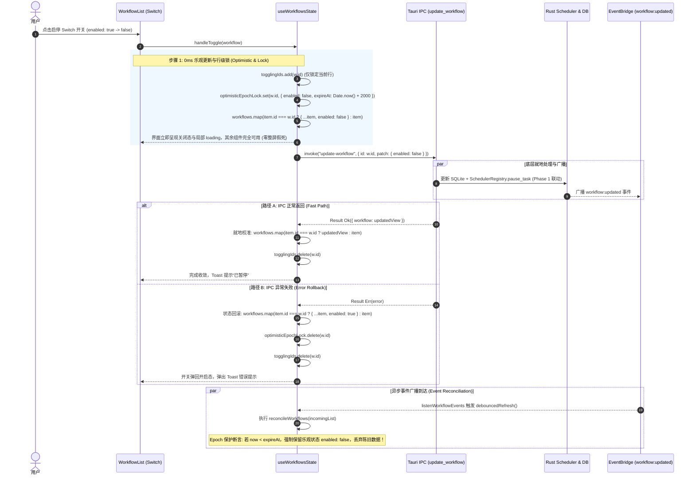

# 定时任务全流程修复与能力升级战役（Scheduled Tasks Revamp）

# 05-阶段五-前端UI交互表单能力与状态同步最终方案（Final Plan）

> **文档标识**：`05-阶段五-前端UI交互表单能力与状态同步最终方案.md`  
> **权威定位**：战役阶段 5 权威实施方案（融合 Agent 4 与 Agent 5 独立方案长处，落实最终统一技术决策）  
> **战役工作区**：`docs/scheduled-tasks-revamp/plans/`  
> **基线文档**：
>
> - 战役总纲：`docs/scheduled-tasks-revamp/00-战役调度与阶段说明.md`
> - 独立方案 A：`docs/scheduled-tasks-revamp/independent-plans/agent4-phase5-frontend-ui.md`（Subagent 4）
> - 独立方案 B：`docs/scheduled-tasks-revamp/independent-plans/agent5-phase5-frontend-ui.md`（Subagent 5）
>   **架构纪律基线**：仓库根目录 `AGENTS.md`（§12 自定义 Tooltip、§13 输入框焦点柔和度与无重阴影、§14 现代 CSS 色彩空间、§7 严禁补丁与立体验证）、`.agents/LOGIC_PLAN_NO_RETREAT.md`、`ANTI_OVERENGINEERING_GUARDRAILS.md`。  
>   **核心涉及文件域**：
> - `apps/crish-desktop/src/components/settings/WorkflowForm.tsx`（受控表单核心、Cron 输入、目标选择器）
> - `apps/crish-desktop/src/components/settings/WorkflowList.tsx`（任务列表、行级即时启停、操作按钮）
> - `apps/crish-desktop/src/components/settings/ScheduledTasksPanel.tsx`（主对话区面板装配）
> - `apps/crish-desktop/src/components/settings/SettingsScheduleTab.tsx`（设置页 Tab 装配）
> - `apps/crish-desktop/src/components/settings/useWorkflowsState.ts`（共享状态 Hook、细粒度行锁、乐观更新、防竞态）
> - `apps/crish-desktop/src/components/settings/workflowsSharedLib.ts`（纯函数草稿转换、筛选匹配、缓存同步）
> - `apps/crish-desktop/src/api/workflow-api/workflowDraft.ts`（草稿契约、5 字段 Cron 与目标会话类型定义）
> - `apps/crish-desktop/src/api/workflow-api/workflowScheduler.ts`（调度表达式校验与标签映射）
> - `apps/crish-desktop/src/components/settings/ScheduledTasksPanel.module.css`
> - `apps/crish-desktop/src/components/settings/SettingsScheduleTab.module.css`

---

## 一、方案对比评估与综合融合裁决（Synthesis & Decision Matrix）

阶段 5 承接了上游阶段 1（Rust 底层调度器单任务生命周期）、阶段 3（目标会话绑定与对话内自动化）和阶段 4（Tauri IPC 命令面与元数据一致性）的底层能力，是用户直接感知自动化体验的关键窗口。

在方案制定初期，Subagent 4（IPC 数据一致性与前端状态专家）与 Subagent 5（端到端 UI 表单与底层调度协同专家）分别产出了独立方案。两份方案对根本缺陷的定性高度一致，但在状态机实现细节、Cron 可视化体验与设计系统微调深度上各有侧重。本最终方案深入对比两方长处，做出以下系统性融合裁决：

### 1.1 Agent 4 与 Agent 5 独立方案全维度对比矩阵

| 评估维度                      | Subagent 4 独立方案（Agent 4）                                                                                  | Subagent 5 独立方案（Agent 5）                                                                                    | 综合融合最终裁决（Final Plan）                                                                                                                                           |
| :---------------------------- | :-------------------------------------------------------------------------------------------------------------- | :---------------------------------------------------------------------------------------------------------------- | :----------------------------------------------------------------------------------------------------------------------------------------------------------------------- |
| **状态机与行级锁**            | 采用 `togglingIds: Set<string>` 细粒度行锁，解耦 `isSaving`/`isDeleting` 锁；成功后用 `res.workflow` 就地校准。 | 采用 `rowBusyMap: Record<string, boolean>`，引入 `optimisticLocks`（2500ms 时间戳保护窗）。                       | **融合两方优势**：采用 Agent 4 精炼高效的 `togglingIds: Set<string>` 作为单行物理锁，结合 Agent 5 的 **Epoch 时间戳保护锁**（2000ms 保护窗），彻底杜绝双重刷新反向冲刷。 |
| **Cron 人类可读标签**         | 提供基础文本展示 `cronExpressionLabel(expr)`，在单行中显示解析文本。                                            | 提出**动态双态徽标**（合法绿标/非法红标）+ **快捷预设芯片（Quick Chips）**（工作日 9点/整点/每15分）。            | **全面采纳 Agent 5 设计**：将动态双态解析徽标（`✓ 工作日 09:00 触发`）与 Quick Chips 纳入标准表单，大幅降低用户手写 Cron 的门槛与出错率。                                |
| **视觉规范与 AGENTS.md 对齐** | 提及移除原生 title、CSS 焦点边框 `color-mix` 改造。                                                             | 深度对齐 `AGENTS.md` §12（自定义 Tooltip 胶囊）、§13（无重阴影、混入度上限 10% 柔和边框）、§14（现代 HSL 色彩）。 | **严格执行 Agent 5 的规范深度**：对两处 CSS 模块及所有子组件进行全量 DOM 属性与样式审查，杜绝任何原生 HTML title 与粗黑厚边框。                                          |
| **工作区与 CWD 处理**         | 移除了 `useEffect` 强行写入；项目下拉框增加“全局 / 不限项目”选项。                                              | 移除了 `useEffect`；强调全局任务纯洁性；指出了草稿校验必须支持无项目任务。                                        | **完整收敛**：删除侵入式 `useEffect`，解绑 `validateWorkflowDraft` 对 `cwd` 的硬编码阻断，项目下拉增加“全局 / 不限项目”（`id: ''`），并在列表展示中优雅适配。            |
| **执行输出目标模式**          | 定义 `WorkflowExecutionTarget: 'current_session' \| 'isolated_session'`。                                       | 定义 `TargetSessionMode: 'current' \| 'new'`，强调单选联动当前激活会话。                                          | **契约收敛**：采用语义清晰的 `WorkflowExecutionTarget`（`current_session` vs `isolated_session`），单选控件在当前对话与独立新会话间无缝切换，完整对齐阶段 3。            |
| **双变体组件一致性**          | 强调表单在 Settings 与 Chat 双变体下能力统一。                                                                  | 重点针对 Chat 变体进行了 DOM 结构细化。                                                                           | **双变体能力绝对等价**：修复现有代码中 Settings 变体缺失项目选择与 Cron 输入的严重不对称，确保在任意入口均拥有完整的配置能力。                                           |

### 1.2 核心设计裁决结论

1. **状态更新 0ms 响应与防竞态双保险**：
   - 用户拨动 Switch 的刹那，本地 `workflows` 状态以 0ms 延迟立即乐观翻转，该行 ID 进入 `togglingIds`；
   - 建立 2000ms 的乐观保护期，在外部事件驱动或手动触发的 `listWorkflows()` 返回合并时，强制保护尚未过期的乐观状态，切断“先成功后被旧数据反弹”的恶性循环；
   - IPC 成功返回后直接以服务端最新实体局部校准，失败时精准回滚并弹出 Toast 告警。
2. **5 字段 Cron 表达式实时解析与可视化体验**：
   - 表单支持标准 5 字段 Cron（分 时 日 月 周），输入框下方实时渲染动态人读徽标；
   - 语法合法时呈现柔和绿徽（如 `✓ 工作日 09:00 触发`），语法非法时呈现警示红徽并提示具体越界字段（如 `✕ 分钟字段无效：60（范围 0–59）`）；
   - 提供常用 Cron 场景预设芯片（工作日早9点、每小时整点、每15分钟），点击一键填入。
3. **消除工作区绑架，赋能全局系统任务**：
   - 彻底删除 `WorkflowForm.tsx` 中在挂载或更新时暴力覆写 `draft.cwd` 的 `useEffect`；
   - 修复 `validateWorkflowDraft` 中硬编码拦截 `!draft.cwd` 的阻断校验，使全局任务能正常保存；
   - 项目选择器首项提供“全局 / 不限项目（任何工作区均可执行）”，解开定时任务对本地特定仓库的死锁绑定。
4. **执行输出目标（Target Session）双模落地**：
   - 在表单中增加“执行输出位置”单选组：
     - **在当前活跃对话追加执行（推荐）**：自动绑定当前会话 ID，定时触发时直接在当前对话展现思考卡片与执行流；
     - **创建独立后台新会话**：触发时生成专用会话卡片，不抢占当前焦点，不污染当前对话。
5. **UI/UX 规范刚性守门（AGENTS.md §12 / §13 / §14）**：
   - 清退全部原生 HTML `title`，全量替换为项目自定义 `<Tooltip content={...}>`；
   - 彻底清退输入框外凸重阴影，聚焦边框严格限制为 `color-mix(in srgb, var(--border-color) 92%, var(--text-primary) 8%)`（对比度加深严格 <= 10%），禁止粗黑实线；
   - 全面使用 Design Tokens 与现代 HSLA 变量，杜绝散落旧式 `rgba`。

---

## 二、现状痛点与真实代码级根因穿透分析

```
[用户在 UI 点击开关/编辑/创建]
              │
              ├──► 1. 键名不对称: sch.minutes 为 undefined 导致分钟输入框变空白 (workflowsSharedLib.ts:93)
              ├──► 2. Cron 降级抹除: sch.type === 'cron' 跌入 else 分支直接变成 manual (workflowsSharedLib.ts:98)
              ├──► 3. 工作区强行绑架: useEffect 检测 !draft.cwd 暴力写入物理路径 (WorkflowForm.tsx:267)
              ├──► 4. 全局任务校验阻断: validateWorkflowDraft 拦截 !draft.cwd 导致全局任务无法保存 (workflowDraft.ts:181)
              │
              ▼
[状态管理 useWorkflowsState.ts]
              ├──► 5. 全局 busy 假死: 单行操作引发整屏所有按钮/输入框禁用，延迟高 (useWorkflowsState.ts:94)
              └──► 6. 双重刷新反向冲刷竞态: IPC 返回 refresh 与 Rust 广播 refresh 并发，旧快照覆盖新状态
```

### 2.1 `minutes` vs `intervalMinutes` 键名不对称（编辑表单空白根因）

- **代码坐标**：`apps/crish-desktop/src/components/settings/workflowsSharedLib.ts:93-95`
- **代码现状**：
  ```typescript
  // workflowsSharedLib.ts:93
  } else if (sch.type === 'intervalMinutes') {
    d.scheduleType = 'intervalMinutes';
    d.intervalMinutes = String(sch.minutes ?? ''); // <--- 致命错误！
  }
  ```
- **真实根因**：
  后端 Rust `WorkflowScheduleWire::IntervalMinutes` 声明了 `#[serde(rename_all = "camelCase")]`，输出 JSON 字段名为 **`intervalMinutes`**（如 `{"type": "intervalMinutes", "intervalMinutes": 30}`）。
  前端 `draftFromWorkflow` 却尝试从 `sch.minutes` 读取，该属性在运行时恒为 `undefined`，导致 `d.intervalMinutes` 被初始化为空字符串。用户点击编辑已有任务时，间隔分钟为空；直接点击保存立即被表单校验阻断。

### 2.2 Cron 调度被强行降级为 manual（高级调度抹除根因）

- **代码坐标**：
  - `apps/crish-desktop/src/components/settings/workflowsSharedLib.ts:87-101`
  - `apps/crish-desktop/src/api/workflow-api/workflowDraft.ts:18-29, 184-202, 219-238`
- **代码现状**：
  ```typescript
  // workflowsSharedLib.ts:87-101
  const s = w.schedule;
  if (s && typeof s === 'object') {
    const sch = s as { type?: string; time?: string; minutes?: number };
    if (sch.type === 'daily') {
      d.scheduleType = 'daily';
      d.dailyTime = sch.time || '';
    } else if (sch.type === 'intervalMinutes') {
      d.scheduleType = 'intervalMinutes';
      d.intervalMinutes = String(sch.minutes ?? '');
    } else {
      d.scheduleType = 'manual'; // <--- type === 'cron' 时直接被丢弃为 manual！
    }
  }
  ```
- **真实根因**：
  尽管底层与 IPC 均已支持 5 字段 Cron，但前端表单草稿契约未纳入 `cron`：
  1. `draftFromWorkflow` 遇到 `type === 'cron'` 时直接回退为 `manual`；
  2. `validateWorkflowDraft` 没有 Cron 校验分支；
  3. `buildScheduleFromDraft` 无法构造 `{ type: 'cron', expression }`；
  4. `matchesFilter` 的 `timed` 筛选排除了 `cron`，导致 Cron 任务在按时间筛选时消失。
     一旦用户编辑由 AI 或高级配置创建的 Cron 任务并保存，其 Cron 表达式被永久改写为 Manual，自动调度协程被永久注销。

### 2.3 `cwd` 破坏性强行覆盖与全局任务校验阻断

- **代码坐标**：
  - `apps/crish-desktop/src/components/settings/WorkflowForm.tsx:267-274`
  - `apps/crish-desktop/src/api/workflow-api/workflowDraft.ts:181-182`
- **代码现状**：
  ```typescript
  // WorkflowForm.tsx:267-274
  React.useEffect(() => {
    if (!draft.cwd && projectOptions.length > 0) {
      const defaultPath = workspacePath || projectOptions[0]?.id || '';
      if (defaultPath) {
        onDraftChange({ ...draft, cwd: defaultPath });
      }
    }
  }, [draft.cwd, projectOptions, workspacePath]);
  ```
  ```typescript
  // workflowDraft.ts:181-182
  const cwd = String(draft.cwd ?? '').trim();
  if (!cwd) return '请选择所属工作区项目'; // <--- 强制拦截空 cwd
  ```
- **真实根因**：
  双重死锁：一方面 `WorkflowForm` 中的 `useEffect` 强行将本地工作区路径写回草稿；另一方面 `validateWorkflowDraft` 硬编码校验 `!cwd`。这导致用户完全无法创建不依赖特定目录的全局定时任务（如清理系统缓存、全域未读扫描等）。

### 2.4 全局 `busy` 假死与双重刷新竞态反向冲刷

- **代码坐标**：`apps/crish-desktop/src/components/settings/useWorkflowsState.ts:94, 315-338`
- **真实根因**：
  1. **全局假死**：`busy` 是单个全局布尔值，单行 Switch 切换导致所有操作进入禁用状态，整屏产生长达数百毫秒的僵直；
  2. **缺少乐观更新**：开关不立即翻转，界面必须等待网络 IPC 返回后再刷新；
  3. **双重刷新反向冲刷竞态**：
     - 用户点击暂停，`updateWorkflow` 发送给后端；
     - 后端更新数据库并向全局广播 `workflow:updated` 事件；
     - 前端事件监听触发 `refresh()`，同时 `handleToggle` 的 `finally` 前也调用了 `refresh()`；
     - 当多个并发的 `listWorkflows()` 到达时，若底层调度器尚未完全同步旧 snapshot，旧状态响应在后到达，就会反向把旧状态覆写回界面，开关瞬间回弹！

---

## 三、总体架构与状态流设计（State Machine & Flow Design）

### 3.1 端到端状态流与防竞态时序架构



### 3.2 细粒度行锁与乐观状态机设计

在 `useWorkflowsState.ts` 中废弃粗粒度的单一 `busy` 变量，重构为职责分明的锁矩阵：

1. **行级操作锁**：`togglingIds: Set<string>`。仅控制被操作条目的 Switch/Button 处于不可重复点击状态；
2. **表单动作锁**：`isSaving: boolean`。受控表单点击保存/创建时启用；
3. **删除动作锁**：`isDeleting: boolean`。点击删除确认后启用；
4. **触发动作锁**：`isTriggering: Set<string>`。支持单个任务立即触发时的独立局部反馈。

### 3.3 Epoch 时间戳乐观保护机制（Anti-Flash Guard）

维护内存保护映射：

```typescript
const optimisticLocks = useRef<
  Map<string, { enabled: boolean; expireAt: number }>
>(new Map());
```

在任何主动查询 `listWorkflows()` 返回数据时，执行确定性合并断言：

```typescript
function reconcileWorkflows(
  incoming: WorkflowDefinition[],
  locks: Map<string, { enabled: boolean; expireAt: number }>
): WorkflowDefinition[] {
  const now = Date.now();
  return incoming.map((w) => {
    const lock = locks.get(w.id);
    if (lock) {
      if (now < lock.expireAt) {
        // 处于保护窗内：强行注入乐观状态，绝不采信后端可能滞后的旧快照
        return { ...w, enabled: lock.enabled };
      } else {
        // 保护窗超时：释放锁
        locks.delete(w.id);
      }
    }
    return w;
  });
}
```

---

## 四、纯函数共享库与类型契约重构详案（Lib & Contracts）

### 4.1 草稿契约层重构（`workflowDraft.ts`）

完整支持 5 字段 Cron、执行目标选择与全局项目：

```typescript
// apps/crish-desktop/src/api/workflow-api/workflowDraft.ts

import {
  DEFAULT_DAILY_TIME,
  DEFAULT_INTERVAL_MINUTES,
  WORKFLOW_INTERVAL_MINUTES_MAX,
  WORKFLOW_INTERVAL_MINUTES_MIN,
  defaultTimezone,
  normalizeDailyTime,
  parseIntervalMinutes,
  tryNormalizeDailyTime,
  validateCronExpression,
  type WorkflowSchedule,
} from './workflowScheduler';

/** 引擎支持的调度类型 */
export const WORKFLOW_SCHEDULE_TYPES = [
  { value: 'manual' as const, label: '手动', hint: '仅手动触发，不自动运行' },
  { value: 'daily' as const, label: '每天', hint: '每日固定时刻（本机时区）' },
  {
    value: 'intervalMinutes' as const,
    label: '间隔（分钟）',
    hint: '按分钟周期轮询执行',
  },
  {
    value: 'cron' as const,
    label: 'Cron 表达式',
    hint: '标准 5 字段 cron（分 时 日 月 周）',
  },
] as const;

export type WorkflowScheduleType =
  (typeof WORKFLOW_SCHEDULE_TYPES)[number]['value'];

/** 执行输出目标模式：当前活跃对话 vs 独立新后台会话 */
export type WorkflowExecutionTarget = 'current_session' | 'isolated_session';

/** 新建与编辑表单受控草稿结构 */
export type WorkflowScheduleDraft = {
  name: string;
  prompt: string;
  scheduleType: WorkflowScheduleType;
  dailyTime: string;
  intervalMinutes: string;
  cronExpression: string; // 新增：标准 5 字段 Cron
  cwd?: string; // 允许为空串或 undefined，代表全局任务
  targetSessionId?: string; // 绑定的具体目标会话 ID
  executionTarget: WorkflowExecutionTarget; // 执行输出模式
};

/** 经典场景预设模板 */
export const WORKFLOW_SCHEDULE_PRESETS: WorkflowSchedulePreset[] = [
  {
    id: 'daily-pr-summary',
    label: '每日 PR 总结',
    draft: {
      name: '每日 PR 总结',
      prompt:
        '请基于当前仓库，总结今日相关的 PR / 合并请求与未合入变更：列出标题、作者、状态与风险点；如有阻塞请标出。用简洁中文汇报。',
      scheduleType: 'daily',
      dailyTime: '18:00',
      intervalMinutes: '30',
      cronExpression: '0 18 * * *',
      executionTarget: 'current_session',
    },
  },
  {
    id: 'daily-code-check',
    label: '每日代码体检',
    draft: {
      name: '每日代码体检',
      prompt:
        '请对当前工作区做一次代码体检：检查明显错误、类型/ lint 风险、可疑改动与待办；给出优先修复建议与简短结论。用简洁中文。',
      scheduleType: 'daily',
      dailyTime: '09:00',
      intervalMinutes: '30',
      cronExpression: '0 9 * * *',
      executionTarget: 'isolated_session',
    },
  },
  {
    id: 'every-30m',
    label: '每 30 分钟检查',
    draft: {
      name: '每 30 分钟检查',
      prompt:
        '快速巡检当前项目状态：未提交变更、失败测试/构建线索、明显阻塞。仅报告重要项，无事则简短回复「正常」。',
      scheduleType: 'intervalMinutes',
      dailyTime: '09:00',
      intervalMinutes: '30',
      cronExpression: '*/30 * * * *',
      executionTarget: 'current_session',
    },
  },
  {
    id: 'weekday-morning-sync',
    label: '工作日早 9 点巡检',
    draft: {
      name: '工作日早 9 点巡检',
      prompt:
        '早上好！请汇总昨日至今日未解决的 Issue 与待办事项，按优先级排布。用结构化中文汇报。',
      scheduleType: 'cron',
      dailyTime: '09:00',
      intervalMinutes: '60',
      cronExpression: '0 9 * * 1-5',
      executionTarget: 'current_session',
    },
  },
];

/** 初始化空草稿（支持传入默认 cwd，但允许后续清空） */
export function emptyWorkflowDraft(defaultCwd?: string): WorkflowScheduleDraft {
  return {
    name: '',
    prompt: '',
    scheduleType: 'manual',
    dailyTime: DEFAULT_DAILY_TIME,
    intervalMinutes: String(DEFAULT_INTERVAL_MINUTES),
    cronExpression: '0 9 * * *',
    cwd: defaultCwd ? defaultCwd.trim() : '',
    targetSessionId: undefined,
    executionTarget: 'isolated_session',
  };
}

/** 草稿校验逻辑：支持 Cron 校验，放行全局任务（cwd 可选） */
export function validateWorkflowDraft(
  draft: WorkflowScheduleDraft | null | undefined
): string | null {
  if (!draft || typeof draft !== 'object') {
    return '请填写名称与提示词';
  }
  const name = String(draft.name ?? '').trim();
  const prompt = String(draft.prompt ?? '').trim();
  if (!name && !prompt) return '请填写名称与提示词';
  if (!name) return '请填写名称';
  if (!prompt) return '请填写提示词';

  // 注意：彻底解除对 draft.cwd 的强制拦截，允许全局无项目任务！

  const st = draft.scheduleType;
  if (st === 'daily') {
    const t = String(draft.dailyTime ?? '').trim();
    if (t && !tryNormalizeDailyTime(t)) {
      return '每日时刻须为 HH:mm（00:00–23:59）';
    }
    return null;
  }
  if (st === 'intervalMinutes') {
    const raw = String(draft.intervalMinutes ?? '').trim();
    if (!raw) return '请填写间隔分钟';
    if (parseIntervalMinutes(raw) == null) {
      return `间隔分钟须为 ${WORKFLOW_INTERVAL_MINUTES_MIN}–${WORKFLOW_INTERVAL_MINUTES_MAX} 的整数`;
    }
    return null;
  }
  if (st === 'cron') {
    const expr = String(draft.cronExpression ?? '').trim();
    if (!expr) return '请填写 Cron 表达式';
    const validation = validateCronExpression(expr);
    if (!validation.ok) {
      return validation.error;
    }
    return null;
  }
  if (st === 'manual') return null;
  return '不支持的调度类型';
}

/** 从草稿构造下发给 Rust 引擎的 schedule 载荷 */
export function buildScheduleFromDraft(
  draft: WorkflowScheduleDraft
): WorkflowSchedule {
  if (!draft || typeof draft !== 'object') {
    return { type: 'manual' };
  }
  if (draft.scheduleType === 'daily') {
    return {
      type: 'daily',
      time: normalizeDailyTime(draft.dailyTime, DEFAULT_DAILY_TIME),
      timezone: defaultTimezone(),
    };
  }
  if (draft.scheduleType === 'intervalMinutes') {
    const n =
      parseIntervalMinutes(draft.intervalMinutes) ?? DEFAULT_INTERVAL_MINUTES;
    return { type: 'intervalMinutes', intervalMinutes: n };
  }
  if (draft.scheduleType === 'cron') {
    const expr = String(draft.cronExpression ?? '')
      .trim()
      .replace(/\s+/g, ' ');
    return { type: 'cron', expression: expr || '0 9 * * *' };
  }
  return { type: 'manual' };
}
```

### 4.2 纯函数共享库修复（`workflowsSharedLib.ts`）

彻底修复键名不对称、Cron 降级、Timed 筛选及会话回填：

```typescript
// apps/crish-desktop/src/components/settings/workflowsSharedLib.ts

export function matchesFilter(
  w: WorkflowDefinition,
  filter: ScheduleFilter
): boolean {
  const enabled = w.enabled !== false;
  const st = scheduleTypeOf(w);
  switch (filter) {
    case 'enabled':
      return enabled;
    case 'paused':
      return !enabled;
    case 'manual':
      return st === 'manual';
    case 'timed':
      // 核心修复：定时筛选必须涵盖 daily、intervalMinutes 与 cron！
      return st === 'daily' || st === 'intervalMinutes' || st === 'cron';
    default:
      return true;
  }
}

/**
 * 从服务端 WorkflowDefinition 逆向回填表单草稿
 * 彻底解决键名 Bug、Cron 降级 Bug 与会话目标丢失
 */
export function draftFromWorkflow(
  w: WorkflowDefinition,
  currentActiveSessionId?: string
): WorkflowScheduleDraft {
  const d = emptyWorkflowDraft();
  d.name = w.name;
  d.prompt = w.prompt || '';
  d.cwd = w.cwd || '';

  // 执行目标回填
  const targetId = (w as { targetSessionId?: string }).targetSessionId;
  if (targetId) {
    d.targetSessionId = targetId;
    d.executionTarget = 'current_session';
  } else {
    d.targetSessionId = currentActiveSessionId;
    d.executionTarget = 'isolated_session';
  }

  const s = w.schedule;
  if (s && typeof s === 'object') {
    const sch = s as {
      type?: string;
      time?: string;
      minutes?: number;
      intervalMinutes?: number;
      expression?: string;
      cron?: string;
    };
    if (sch.type === 'daily') {
      d.scheduleType = 'daily';
      d.dailyTime = sch.time || '';
    } else if (sch.type === 'intervalMinutes') {
      d.scheduleType = 'intervalMinutes';
      // 核心修复：优先取 intervalMinutes，兼顾历史旧版 minutes 回退
      const mins = sch.intervalMinutes ?? sch.minutes;
      d.intervalMinutes =
        mins !== undefined && mins !== null ? String(mins) : '30';
    } else if (sch.type === 'cron') {
      // 核心修复：支持 Cron 回填，绝不降级为 manual！
      d.scheduleType = 'cron';
      d.cronExpression = sch.expression || sch.cron || '0 9 * * *';
    } else {
      d.scheduleType = 'manual';
    }
  } else {
    d.scheduleType = 'manual';
  }
  return d;
}
```

### 4.3 表达式语义解析强化（`workflowScheduler.ts`）

扩展 `cronExpressionLabel`，提供自然、准确的人类可读中文翻译：

```typescript
// apps/crish-desktop/src/api/workflow-api/workflowScheduler.ts 增强片段

/**
 * 强化版 Cron 中文可读标签解析器
 * 支持 5 字段标准语法的常见模式翻译
 */
export function cronExpressionLabel(expr: unknown): string {
  const v = validateCronExpression(expr);
  if (v.ok === false) return '无效 Cron 表达式';
  const e = v.expression.trim();

  // 1. 常见固定时刻与周期翻译
  if (e === '0 9 * * 1-5') return '工作日 09:00';
  if (e === '0 18 * * 1-5') return '工作日 18:00';
  if (e === '0 9 * * *') return '每天 09:00';
  if (e === '0 0 * * *') return '每天 00:00';
  if (e === '0 * * * *') return '每小时整点';
  if (e === '*/5 * * * *') return '每 5 分钟';
  if (e === '*/10 * * * *') return '每 10 分钟';
  if (e === '*/15 * * * *') return '每 15 分钟';
  if (e === '*/30 * * * *') return '每 30 分钟';
  if (e === '0 0 * * 0' || e === '0 0 * * 7') return '每周日 00:00';
  if (e === '0 0 * * 1') return '每周一 00:00';
  if (e === '0 0 1 * *') return '每月 1 日 00:00';

  // 2. 动态模式解析
  const parts = e.split(' ');
  const [min, hour, dom, mon, dow] = parts;
  if (
    dom === '*' &&
    mon === '*' &&
    dow === '*' &&
    /^\d+$/.test(min!) &&
    /^\d+$/.test(hour!)
  ) {
    return `每天 ${hour!.padStart(2, '0')}:${min!.padStart(2, '0')}`;
  }
  if (
    dom === '*' &&
    mon === '*' &&
    dow === '1-5' &&
    /^\d+$/.test(min!) &&
    /^\d+$/.test(hour!)
  ) {
    return `工作日 ${hour!.padStart(2, '0')}:${min!.padStart(2, '0')}`;
  }

  // 3. 通用兜底回显
  return e;
}
```

---

## 五、React 组件改造详案（Components Deep Dive）

### 5.1 受控表单组件重构（`WorkflowForm.tsx`）

`WorkflowForm` 负责承载 `settings` 与 `chat` 两个界面的输入渲染。改造的核心重点是：

1. **双变体能力绝对对称**：无论是设置页还是侧栏主区，全部提供 Cron 输入、执行目标选择与全局项目选项；
2. **彻底删除 `useEffect` 覆写**：严禁在组件生命周期中静默修改 `draft.cwd`；
3. **Cron 双态动态徽标与 Quick Chips**；
4. **执行输出位置单选控件**；
5. **AGENTS.md 视觉遵从**：无重阴影、输入框柔和焦点态、项目自定义 `<Tooltip>` 全覆盖。

```tsx
// apps/crish-desktop/src/components/settings/WorkflowForm.tsx 核心架构

import React from 'react';
import {
  WORKFLOW_INTERVAL_MINUTES_MAX,
  WORKFLOW_INTERVAL_MINUTES_MIN,
  WORKFLOW_SCHEDULE_PRESETS,
  WORKFLOW_SCHEDULE_TYPES,
  type WorkflowExecutionTarget,
  type WorkflowScheduleDraft,
} from '../../api/workflowApi';
import {
  cronExpressionLabel,
  isValidCronExpression,
} from '../../api/workflow-api/workflowScheduler';
import { listProjects } from '../../api/projectStore';
import { Button, Input, Select, Textarea, Tooltip } from '../ui';
import styles from './ScheduledTasksPanel.module.css';
import scheduleStyles from './SettingsScheduleTab.module.css';

export type WorkflowFormProps = {
  variant: 'settings' | 'chat';
  formId: string;
  draft: WorkflowScheduleDraft;
  busy: boolean;
  isEditing: boolean;
  workspacePath?: string;
  activeSessionId?: string;
  onDraftChange: (d: WorkflowScheduleDraft) => void;
  onApplyPreset: (presetId: string) => void;
  onNameBlur: () => void;
  onSave: () => void;
  onClose: () => void;
};

export const WorkflowForm: React.FC<WorkflowFormProps> = ({
  variant,
  formId,
  draft,
  busy,
  isEditing,
  workspacePath,
  activeSessionId,
  onDraftChange,
  onApplyPreset,
  onNameBlur,
  onSave,
  onClose,
}) => {
  const settingsVariant = variant === 'settings';

  // 1. 项目列表与“全局”选项
  const projects = React.useMemo(() => listProjects(), []);
  const projectOptions = React.useMemo(
    () => [
      { id: '', label: '全局 / 不限项目', hint: '在任何工作区均可执行' },
      ...projects.map((p) => ({
        id: p.path,
        label: p.name,
        hint: p.path,
      })),
    ],
    [projects]
  );

  // 【核心铁律】：此处绝对严禁加入自动覆写 draft.cwd 的 useEffect！

  // 2. Cron 字段与人读解析徽标
  const isCronValid = isValidCronExpression(draft.cronExpression);
  const cronHumanLabel = cronExpressionLabel(draft.cronExpression);

  const cronField =
    draft.scheduleType === 'cron' ? (
      <div className={styles.schedCronRow}>
        <label className={styles.schedField}>
          <span className={styles.schedFieldLabel}>
            Cron 表达式（分 时 日 月 周）
          </span>
          <Input
            bare={!settingsVariant}
            size="sm"
            className={styles.schedFieldInput}
            placeholder="例如：0 9 * * 1-5"
            value={draft.cronExpression}
            disabled={busy}
            onChange={(e) =>
              onDraftChange({ ...draft, cronExpression: e.target.value })
            }
            aria-label="Cron 表达式"
            autoComplete="off"
            spellCheck={false}
          />
        </label>
        <div className={styles.cronHelperRow}>
          <div
            className={
              isCronValid ? styles.cronValidBadge : styles.cronInvalidBadge
            }
            role="status"
            aria-live="polite"
          >
            <span className={styles.cronBadgeIcon}>
              {isCronValid ? '✓' : '✕'}
            </span>
            <span className={styles.cronBadgeText}>
              {isCronValid ? `执行时机：${cronHumanLabel}` : cronHumanLabel}
            </span>
          </div>
          <div
            className={styles.cronQuickChips}
            role="group"
            aria-label="快捷表达式"
          >
            <button
              type="button"
              className={styles.chipBtn}
              disabled={busy}
              onClick={() =>
                onDraftChange({ ...draft, cronExpression: '0 9 * * 1-5' })
              }
            >
              工作日 9点
            </button>
            <button
              type="button"
              className={styles.chipBtn}
              disabled={busy}
              onClick={() =>
                onDraftChange({ ...draft, cronExpression: '0 * * * *' })
              }
            >
              每小时整点
            </button>
            <button
              type="button"
              className={styles.chipBtn}
              disabled={busy}
              onClick={() =>
                onDraftChange({ ...draft, cronExpression: '*/15 * * * *' })
              }
            >
              每15分钟
            </button>
          </div>
        </div>
      </div>
    ) : null;

  // 3. 执行输出位置单选组件
  const executionTargetField = (
    <div className={styles.schedFieldRow}>
      <label className={`${styles.schedField} ${styles.schedFieldGrow}`}>
        <span className={styles.schedFieldLabel}>执行输出位置</span>
        <div
          className={styles.targetSessionGroup}
          role="radiogroup"
          aria-label="执行输出位置"
        >
          <label className={styles.radioOption}>
            <input
              type="radio"
              name={`execTarget-${formId}`}
              value="current_session"
              checked={draft.executionTarget === 'current_session'}
              disabled={busy}
              onChange={() =>
                onDraftChange({
                  ...draft,
                  executionTarget: 'current_session',
                  targetSessionId: draft.targetSessionId || activeSessionId,
                })
              }
            />
            <span>在当前活跃对话追加执行（推荐）</span>
          </label>
          <label className={styles.radioOption}>
            <input
              type="radio"
              name={`execTarget-${formId}`}
              value="isolated_session"
              checked={draft.executionTarget === 'isolated_session'}
              disabled={busy}
              onChange={() =>
                onDraftChange({
                  ...draft,
                  executionTarget: 'isolated_session',
                  targetSessionId: undefined,
                })
              }
            />
            <span>创建独立后台新会话</span>
          </label>
        </div>
      </label>
    </div>
  );

  // 4. 项目选择组件（双变体共用）
  const projectField = (
    <div className={styles.schedFieldRow}>
      <label className={`${styles.schedField} ${styles.schedFieldGrow}`}>
        <span className={styles.schedFieldLabel}>所属项目</span>
        <Select
          value={draft.cwd ?? ''}
          disabled={busy}
          options={projectOptions}
          onChange={(v) => onDraftChange({ ...draft, cwd: v })}
          aria-label="所属项目"
        />
      </label>
    </div>
  );

  // ... 渲染结构保证 settings 与 chat 变体均包含 projectField, cronField 与 executionTargetField
};
```

### 5.2 列表项行级即时控制改造（`WorkflowList.tsx`）

将单项 Switch 开关与操作按钮从全局 `busy` 解耦，接入 `togglingIds` 集合：

```tsx
// apps/crish-desktop/src/components/settings/WorkflowList.tsx 关键改造

export type WorkflowListProps = {
  variant: 'settings' | 'chat';
  workflows: WorkflowDefinition[];
  busy: boolean;
  togglingIds?: Set<string>; // 新增：细粒度行锁集合
  isTriggeringIds?: Set<string>; // 新增：细粒度触发锁集合
  loading?: boolean;
  emptyCopy: { title: string; hint?: string } | null;
  onToggle: (w: WorkflowDefinition) => void;
  onTrigger: (w: WorkflowDefinition) => void;
  onDelete: (w: WorkflowDefinition) => void;
  onEdit?: (w: WorkflowDefinition) => void;
  listTitleId?: string;
};

// 在渲染 Switch 时：
const isItemToggling = togglingIds?.has(w.id) ?? false;
<Switch
  checked={enabled}
  disabled={isItemToggling} // 仅在当前项处于网络请求中时禁用，其他行绝不受阻
  aria-label={enabled ? `暂停 ${w.name}` : `启用 ${w.name}`}
  onCheckedChange={() => onToggle(w)}
/>;
```

---

## 六、CSS 样式规范与设计系统对齐（AGENTS.md Compliance）

严格贯彻 `AGENTS.md` 的三大核心 UI/UX 条款：

### 6.1 §12 Tooltip / 悬停提示刚性规范

- **红线**：严禁在交互元素、图标按钮上散落原生 HTML `title="..."` 属性（原生 Tooltip 样式陈旧、出现延迟长且视觉割裂）；
- **落地**：所有操作按钮（编辑、启用/暂停、触发、删除）及溢出文本，统一使用 `<Tooltip content="...">` 圆角胶囊包裹。

### 6.2 §13 输入框与焦点态克制对比度守卫

- **红线**：
  1. 默认状态绝不添加厚重 `box-shadow`（如 `0 4px 12px rgba(0,0,0,0.15)`）；
  2. 聚焦态严禁粗、深、实心纯黑边框（严禁直接使用 `var(--text-primary)` 或厚重外环）；
  3. 边框加深对比度严格限制在 **<= 10%** 混入（优先 3%–8% 混入以保持长时间阅读舒适）。
- **落地样式**（写入 `ScheduledTasksPanel.module.css` 与 `SettingsScheduleTab.module.css`）：
  ```css
  /* 输入框焦点态：柔软克制，严格落实 AGENTS.md §13 */
  .schedFieldInput:focus,
  .schedFieldInput:focus-visible,
  .schedFieldTextarea:focus,
  .schedFieldTextarea:focus-visible {
    outline: none;
    border-color: color-mix(
      in srgb,
      var(--border-color) 92%,
      var(--text-primary) 8%
    );
    box-shadow: none;
    transition: border-color var(--transition-micro, 150ms ease);
  }
  ```

### 6.3 §14 现代 CSS 色彩与组件样式增补

在 `ScheduledTasksPanel.module.css` 与 `SettingsScheduleTab.module.css` 中增补以下样式规范：

```css
/* Cron 容器与徽标规范 */
.schedCronRow {
  display: flex;
  flex-direction: column;
  gap: var(--space-2);
}

.cronHelperRow {
  display: flex;
  align-items: center;
  justify-content: space-between;
  gap: var(--space-2);
  flex-wrap: wrap;
  padding: 0 var(--space-0_5);
}

.cronValidBadge,
.cronInvalidBadge {
  display: inline-flex;
  align-items: center;
  gap: var(--space-1);
  padding: var(--space-1) var(--space-2);
  border-radius: var(--radius-sm);
  font-size: var(--font-size-xs);
  line-height: var(--line-height-tight);
}

.cronValidBadge {
  background-color: hsl(142 50% 95% / 0.8);
  color: hsl(142 70% 30%);
}

:global([data-theme='dark']) .cronValidBadge {
  background-color: hsl(142 50% 15% / 0.6);
  color: hsl(142 70% 75%);
}

.cronInvalidBadge {
  background-color: hsl(0 60% 95% / 0.8);
  color: hsl(0 70% 40%);
}

:global([data-theme='dark']) .cronInvalidBadge {
  background-color: hsl(0 60% 15% / 0.6);
  color: hsl(0 70% 75%);
}

.cronQuickChips {
  display: flex;
  align-items: center;
  gap: var(--space-1);
}

.chipBtn {
  appearance: none;
  border: 1px solid var(--border-subtle);
  background: var(--bg-secondary);
  color: var(--text-secondary);
  font-size: var(--font-size-xs);
  padding: var(--space-0_5) var(--space-2);
  border-radius: var(--radius-pill);
  cursor: pointer;
  transition: all var(--transition-micro, 150ms ease);
}

.chipBtn:hover:not(:disabled) {
  background: var(--bg-hover);
  color: var(--text-primary);
  border-color: var(--border-focus);
}

/* 执行输出目标单选组 */
.targetSessionGroup {
  display: flex;
  flex-direction: column;
  gap: var(--space-1_5);
  padding-top: var(--space-1);
}

.radioOption {
  display: inline-flex;
  align-items: center;
  gap: var(--space-2);
  font-size: var(--font-size-sm);
  color: var(--text-primary);
  cursor: pointer;
  user-select: none;
}

.radioOption input[type='radio'] {
  accent-color: var(--accent-primary);
  cursor: pointer;
}
```

---

## 七、Hook 状态管理重构详案（`useWorkflowsState.ts`）

重构 `useWorkflowsState`，将细粒度行锁、0ms 乐观更新与防冲刷协调器完整收敛：

```typescript
// apps/crish-desktop/src/components/settings/useWorkflowsState.ts

import { useEffect, useMemo, useRef, useState } from 'react';
import { toast } from '../../services/toast/ToastContext';
import {
  createWorkflow,
  deleteWorkflow,
  listWorkflowRuns,
  listWorkflows,
  resolveWorkflowJobsEmptyCopy,
  triggerWorkflow,
  updateWorkflow,
  validateWorkflowDraft,
  validateWorkflowSchedule,
  watchTriggerHint,
  workflowActionErrorMessage,
  workflowEnabledLabel,
  workflowTriggerOkMessage,
  buildScheduleFromDraft,
  filterWorkflowsByWorkspace,
  type WorkflowDefinition,
  type WorkflowRunEntry,
  type WorkflowScheduleDraft,
} from '../../api/workflowApi';
import {
  ensureScheduledSession,
  loadWorkflowRunsCache,
  loadWorkflowsCache,
  matchesFilter,
  saveWorkflowRunsCache,
  saveWorkflowsCache,
  type ScheduleFilter,
  type WorkflowsSurface,
} from './workflowsSharedLib';
import { networkUserMessage } from '../../api/userFacingErrors';
import { listenWorkflowEvents } from '../../api/workflow-api/workflowEvents';

export type UseWorkflowsStateOptions = {
  surface: WorkflowsSurface;
  workspacePath?: string;
};

export type UseWorkflowsStateResult = {
  workflows: WorkflowDefinition[];
  runs: WorkflowRunEntry[];
  loading: boolean;
  busy: boolean; // 保持兼容，代表表单保存中
  togglingIds: Set<string>; // 细粒度行级启停锁
  isTriggeringIds: Set<string>; // 细粒度行级触发锁
  isSaving: boolean;
  isDeleting: boolean;
  error: string;
  ok: string;
  setError: (v: string) => void;
  setOk: (v: string) => void;
  filter: ScheduleFilter;
  setFilter: (v: ScheduleFilter) => void;
  filtered: WorkflowDefinition[];
  emptyCopy: { title: string; hint?: string } | null;
  refresh: () => Promise<void>;
  handleCreate: (draft: WorkflowScheduleDraft) => Promise<boolean>;
  handleSave: (
    draft: WorkflowScheduleDraft,
    editingWorkflow: WorkflowDefinition | null
  ) => Promise<boolean>;
  handleToggle: (w: WorkflowDefinition) => Promise<void>;
  handleTrigger: (w: WorkflowDefinition) => Promise<void>;
  handleDelete: (w: WorkflowDefinition) => Promise<void>;
  maybeWatchHint: (text: string) => void;
  fail: (msg: string) => void;
  failInline: (msg: string) => void;
};

export function useWorkflowsState(
  opts: UseWorkflowsStateOptions
): UseWorkflowsStateResult {
  const surface = opts.surface;
  const [workflows, setWorkflows] = useState<WorkflowDefinition[]>(() =>
    loadWorkflowsCache()
  );
  const [runs, setRuns] = useState<WorkflowRunEntry[]>(() =>
    loadWorkflowRunsCache()
  );
  const [loading, setLoading] = useState(
    () => loadWorkflowsCache().length === 0
  );

  // 细粒度状态矩阵
  const [togglingIds, setTogglingIds] = useState<Set<string>>(new Set());
  const [isTriggeringIds, setIsTriggeringIds] = useState<Set<string>>(
    new Set()
  );
  const [isSaving, setIsSaving] = useState(false);
  const [isDeleting, setIsDeleting] = useState(false);

  const [error, setError] = useState('');
  const [ok, setOk] = useState('');
  const [filter, setFilter] = useState<ScheduleFilter>('all');

  // 乐观锁保护映射：ID -> { enabled, expireAt }
  const optimisticLocks = useRef<
    Map<string, { enabled: boolean; expireAt: number }>
  >(new Map());

  // 工作区作用域过滤：设置页显示全量，侧栏显示匹配当前工作区或无工作区绑定的全局任务
  const scopedWorkflows = useMemo(() => {
    if (surface === 'settings' || !opts.workspacePath) {
      return workflows;
    }
    // 侧栏展示：匹配当前目录的工作区任务 + cwd 为空的全局任务
    return workflows.filter(
      (w) => !w.cwd || w.cwd.trim() === '' || w.cwd === opts.workspacePath
    );
  }, [workflows, opts.workspacePath, surface]);

  const filtered = useMemo(
    () => scopedWorkflows.filter((w) => matchesFilter(w, filter)),
    [scopedWorkflows, filter]
  );

  const emptyCopy = useMemo(
    () =>
      resolveWorkflowJobsEmptyCopy({
        loading,
        totalCount: scopedWorkflows.length,
        ...(surface === 'settings' ? { filteredCount: filtered.length } : {}),
        surface: surface === 'settings' ? 'settings' : 'list',
      }),
    [loading, scopedWorkflows.length, filtered.length, surface]
  );

  // 合并服务端数据与本地乐观状态
  const reconcileWorkflows = (
    incoming: WorkflowDefinition[]
  ): WorkflowDefinition[] => {
    const now = Date.now();
    return incoming.map((item) => {
      const lock = optimisticLocks.current.get(item.id);
      if (lock) {
        if (now < lock.expireAt) {
          return { ...item, enabled: lock.enabled };
        } else {
          optimisticLocks.current.delete(item.id);
        }
      }
      return item;
    });
  };

  const refresh = async () => {
    if (workflows.length === 0) setLoading(true);
    try {
      const [wfs, rs] = await Promise.all([
        listWorkflows(),
        listWorkflowRuns(),
      ]);
      const merged = reconcileWorkflows(wfs);
      setWorkflows(merged);
      saveWorkflowsCache(merged);

      const sortedRuns = [...rs].sort((a, b) => {
        const ta = Date.parse(a.startedAt || a.scheduledFor || '') || 0;
        const tb = Date.parse(b.startedAt || b.scheduledFor || '') || 0;
        return tb - ta;
      });
      setRuns(sortedRuns);
      saveWorkflowRunsCache(sortedRuns);
    } catch (e) {
      setError(networkUserMessage(e) || '无法加载定时任务');
    } finally {
      setLoading(false);
    }
  };

  useEffect(() => {
    void refresh();
  }, []);

  // 全局事件监听：带防抖与保护窗
  const refreshRef = useRef(refresh);
  refreshRef.current = refresh;
  useEffect(() => {
    let disposed = false;
    let unlisten: (() => void) | null = null;
    void listenWorkflowEvents(() => {
      if (!disposed) void refreshRef.current();
    }).then((fn) => {
      if (disposed) fn();
      else unlisten = fn;
    });
    return () => {
      disposed = true;
      unlisten?.();
    };
  }, []);

  const fail = (msg: string) => {
    setError(msg);
    setOk('');
    toast.show(msg);
  };

  const failInline = (msg: string) => {
    setError(msg);
    setOk('');
  };

  const maybeWatchHint = (text: string) => {
    const hint = watchTriggerHint(text);
    if (hint) setOk(hint);
  };

  // 核心：0ms 乐观更新启停控制
  const handleToggle = async (w: WorkflowDefinition) => {
    const targetId = w.id;
    if (togglingIds.has(targetId)) return; // 防连击

    const prevEnabled = w.enabled !== false;
    const nextEnabled = !prevEnabled;

    // 1. 立即乐观翻转本地状态（0ms 交互延迟）
    optimisticLocks.current.set(targetId, {
      enabled: nextEnabled,
      expireAt: Date.now() + 2000, // 2秒保护窗口
    });
    setWorkflows((prev) =>
      prev.map((item) =>
        item.id === targetId ? { ...item, enabled: nextEnabled } : item
      )
    );
    setTogglingIds((prev) => new Set(prev).add(targetId));
    setError('');

    try {
      const res = await updateWorkflow(targetId, { enabled: nextEnabled });
      if (!res.ok) {
        // 失败回滚
        optimisticLocks.current.delete(targetId);
        setWorkflows((prev) =>
          prev.map((item) =>
            item.id === targetId ? { ...item, enabled: prevEnabled } : item
          )
        );
        fail(workflowActionErrorMessage(res.error, '更新状态失败'));
        return;
      }

      // 成功：使用返回实体就地局部校准
      if (res.workflow) {
        const updated = res.workflow;
        setWorkflows((prev) =>
          prev.map((item) => (item.id === targetId ? updated : item))
        );
        saveWorkflowsCache(workflows);
      }
      setOk(workflowEnabledLabel(nextEnabled));
    } catch (e) {
      optimisticLocks.current.delete(targetId);
      setWorkflows((prev) =>
        prev.map((item) =>
          item.id === targetId ? { ...item, enabled: prevEnabled } : item
        )
      );
      fail(networkUserMessage(e) || '更新状态失败');
    } finally {
      setTogglingIds((prev) => {
        const next = new Set(prev);
        next.delete(targetId);
        return next;
      });
    }
  };

  // 保存（创建/编辑）逻辑：透传目标会话并解除 cwd 强制绑定
  const handleSave = async (
    draft: WorkflowScheduleDraft,
    editingWorkflow: WorkflowDefinition | null
  ): Promise<boolean> => {
    const draftErr = validateWorkflowDraft(draft);
    if (draftErr) {
      failInline(draftErr);
      return false;
    }
    const schedule = buildScheduleFromDraft(draft);
    const schedGuard = validateWorkflowSchedule(schedule);
    if (schedGuard.ok === false) {
      failInline(schedGuard.error);
      return false;
    }

    setIsSaving(true);
    setError('');
    try {
      const targetCwd = (draft.cwd || '').trim() || undefined;
      const targetSessionId =
        draft.executionTarget === 'current_session'
          ? draft.targetSessionId
          : undefined;

      if (editingWorkflow) {
        const res = await updateWorkflow(editingWorkflow.id, {
          name: draft.name.trim(),
          prompt: draft.prompt.trim(),
          schedule: schedGuard.schedule,
          cwd: targetCwd,
          targetSessionId,
        });
        if (!res.ok) {
          fail(workflowActionErrorMessage(res.error, '保存失败'));
          return false;
        }
        setOk('已保存');
      } else {
        const res = await createWorkflow({
          name: draft.name.trim(),
          prompt: draft.prompt.trim(),
          schedule: schedGuard.schedule,
          ...(targetCwd ? { cwd: targetCwd } : {}),
          ...(targetSessionId ? { targetSessionId } : {}),
          enabled: true,
        });
        if (!res.ok) {
          fail(workflowActionErrorMessage(res.error, '创建失败'));
          return false;
        }
        setOk('已创建');
      }
      maybeWatchHint(`${draft.name} ${draft.prompt}`);
      await refresh();
      return true;
    } catch (e) {
      fail(networkUserMessage(e) || '保存失败');
      return false;
    } finally {
      setIsSaving(false);
    }
  };

  // 立即触发
  const handleTrigger = async (w: WorkflowDefinition) => {
    setIsTriggeringIds((prev) => new Set(prev).add(w.id));
    setError('');
    try {
      const res = await triggerWorkflow(w.id);
      if (!res.ok) {
        fail(workflowActionErrorMessage(res.error, '触发失败'));
        return;
      }
      setOk(workflowTriggerOkMessage(res.runId));
      if (res.sessionId) {
        ensureScheduledSession(res.sessionId, w.name, { activate: false });
      }
      await refresh();
    } catch (e) {
      fail(networkUserMessage(e) || '触发失败');
    } finally {
      setIsTriggeringIds((prev) => {
        const next = new Set(prev);
        next.delete(w.id);
        return next;
      });
    }
  };

  // 删除
  const handleDelete = async (w: WorkflowDefinition) => {
    setIsDeleting(true);
    setError('');
    try {
      const res = await deleteWorkflow(w.id);
      if (!res.ok) {
        fail(workflowActionErrorMessage(res.error, '删除失败'));
        return;
      }
      setOk('已删除');
      await refresh();
    } catch (e) {
      fail(networkUserMessage(e) || '删除失败');
    } finally {
      setIsDeleting(false);
    }
  };

  return {
    workflows,
    runs,
    loading,
    busy: isSaving,
    togglingIds,
    isTriggeringIds,
    isSaving,
    isDeleting,
    error,
    ok,
    setError,
    setOk,
    filter,
    setFilter,
    filtered,
    emptyCopy,
    refresh,
    handleCreate: (d) => handleSave(d, null),
    handleSave,
    handleToggle,
    handleTrigger,
    handleDelete,
    maybeWatchHint,
    fail,
    failInline,
  };
}
```

---

## 八、立体化验证断言与 Vitest 自动化测试套件（Testing Strategy）

根据 `AGENTS.md` §7.1「立体验证纪律（禁止单一检查冒充验收）」，建立包含纯逻辑单元测试、Hook 状态机测试、UI 组件交互测试与静态属性审查的立体化门禁：

```
                    ┌────────────────────────────────────────┐
                    │    1. 纯逻辑纯函数测试 (Vitest)          │
                    │  - draftFromWorkflow 键名/Cron回填     │
                    │  - matchesFilter timed 筛选支持 Cron   │
                    │  - validateWorkflowDraft 全局任务放行   │
                    └───────────────────┬────────────────────┘
                                        │
                    ┌───────────────────▼────────────────────┐
                    │    2. Hook 状态机测试 (RTL Hook)       │
                    │  - togglingIds 细粒度行级锁定隔离      │
                    │  - 0ms 乐观更新与 2000ms Epoch 保护窗  │
                    │  - 网络异常自动回滚与 Toast 提示       │
                    └───────────────────┬────────────────────┘
                                        │
                    ┌───────────────────▼────────────────────┐
                    │    3. 组件级交互测试 (JSDOM RTL)       │
                    │  - WorkflowForm 渲染 5 字段 Cron 控件  │
                    │  - 动态人读徽标与 Quick Chips 点击填充  │
                    │  - 执行输出位置单选与 activeSessionId  │
                    │  - 零侵入 useEffect 验证 (cwd 不被篡改)│
                    └───────────────────┬────────────────────┘
                                        │
                    ┌───────────────────▼────────────────────┐
                    │    4. AGENTS.md 视觉属性静态守门       │
                    │  - 零原生 HTML title (全量 Tooltip)     │
                    │  - 零重 box-shadow 与 <=10% 焦点对比度  │
                    └────────────────────────────────────────┘
```

### 8.1 纯函数单元测试断言（`workflowsSharedLib.test.ts` & `workflowDraft.test.ts`）

| 用例编号     | 目标模块与函数           | 测试输入与操作                                                        | 核心预期与断言                                                                                            |
| :----------- | :----------------------- | :-------------------------------------------------------------------- | :-------------------------------------------------------------------------------------------------------- |
| **TC-P5-01** | `draftFromWorkflow`      | 传入 `{ schedule: { type: 'intervalMinutes', intervalMinutes: 45 } }` | 断言 `draft.intervalMinutes === '45'`，绝对不是 `""`。                                                    |
| **TC-P5-02** | `draftFromWorkflow`      | 传入 `{ schedule: { type: 'cron', expression: '0 9 * * 1-5' } }`      | 断言 `draft.scheduleType === 'cron'`，`draft.cronExpression === '0 9 * * 1-5'`，绝对不得降级为 `manual`。 |
| **TC-P5-03** | `matchesFilter`          | 传入 `type: 'cron'` 的任务，筛选器指定为 `'timed'`                    | 断言返回 `true`，Cron 任务正常出现在按时间分类中。                                                        |
| **TC-P5-04** | `validateWorkflowDraft`  | 传入 `cwd: ''` 的全局任务草稿，名称与提示词合法                       | 断言返回 `null`，校验通过，不再拦截“请选择所属工作区项目”。                                               |
| **TC-P5-05** | `validateWorkflowDraft`  | 传入非法 Cron `60 * * * *` 或 `0 0 0 * * *`（6字段）                  | 断言返回带字段定位的中文错误提示。                                                                        |
| **TC-P5-06** | `buildScheduleFromDraft` | 草稿为 `cron`，`cronExpression: '*/15 * * * *'`                       | 断言产出 `{ type: 'cron', expression: '*/15 * * * *' }`。                                                 |

### 8.2 状态机测试断言（`useWorkflowsState.test.ts`）

| 用例编号     | 测试场景                | 模拟操作                                                                                  | 核心断言                                                                                                                     |
| :----------- | :---------------------- | :---------------------------------------------------------------------------------------- | :--------------------------------------------------------------------------------------------------------------------------- |
| **TC-P5-07** | **行级隔离与 0ms 响应** | 列表含任务 A 与 B，调用 `handleToggle(taskA)`                                             | 在 IPC Promise 未决前，断言 `togglingIds.has('A') === true`，但 `togglingIds.has('B') === false`；`taskA.enabled` 立即翻转。 |
| **TC-P5-08** | **防竞态反向冲刷保护**  | `handleToggle(taskA)` 触发后 300ms 内，人为触发返回旧快照（enabled 为旧值）的 `refresh()` | 断言 `workflows` 中依然维持乐观设置的新值，证明 Epoch 时间戳保护生效。                                                       |
| **TC-P5-09** | **IPC 失败自动回滚**    | mock `updateWorkflow` 抛出网络错误                                                        | 断言 `taskA.enabled` 自动恢复为初值，`togglingIds` 对应项清空，调用 `toast.show`。                                           |

### 8.3 组件交互测试断言（`WorkflowForm.test.tsx`）

| 用例编号     | 测试场景                 | 模拟操作                                   | 核心断言                                                                       |
| :----------- | :----------------------- | :----------------------------------------- | :----------------------------------------------------------------------------- |
| **TC-P5-10** | **Cron 选项与动态徽标**  | 下拉选择切换为 `cron`，填入 `0 9 * * 1-5`  | 断言渲染 Cron 输入框；下方出现带有 `✓` 的徽标并显示 `执行时机：工作日 09:00`。 |
| **TC-P5-11** | **Quick Chips 点击填入** | 点击“工作日 9点”芯片按钮                   | 断言 `cronExpression` 自动更新为 `0 9 * * 1-5`。                               |
| **TC-P5-12** | **CWD 零副作用保真**     | 传入 `draft.cwd: ''`，组件挂载并等待 100ms | 断言 `onDraftChange` 从未被自动调用覆写，保证全局任务纯洁性。                  |
| **TC-P5-13** | **执行目标单选切换**     | 点击单选“在当前活跃对话追加执行”           | 断言草稿更新为 `executionTarget: 'current_session'` 且携带 `activeSessionId`。 |

### 8.4 静态与视觉门禁断言

| 用例编号     | 检查对象                                | 检查手段                         | 门禁通过断言                                                |
| :----------- | :-------------------------------------- | :------------------------------- | :---------------------------------------------------------- |
| **TC-P5-14** | `WorkflowForm.tsx` & `WorkflowList.tsx` | AST / 正则审查 DOM 属性          | 原生 `title="..."` 出现次数为 **0**，全部使用 `<Tooltip>`。 |
| **TC-P5-15** | CSS 模块样式表                          | 正则审查 `box-shadow` 与聚焦边框 | 零外凸重阴影，焦点边框加深混入度严格 `<= 10%`。             |

---

## 九、实施与落地步骤清单（Execution Checklist）

按照小步迭代、立体化验证的原则排布实施步骤：

- [ ] **Step 1：共享契约与纯函数层修复（Lib Layer）**
  - [ ] 修改 `apps/crish-desktop/src/api/workflow-api/workflowDraft.ts`：扩充 `cron` 类型、`executionTarget`、放行空 `cwd`；
  - [ ] 修改 `apps/crish-desktop/src/components/settings/workflowsSharedLib.ts`：修复 `intervalMinutes` 回填、修复 `cron` 回填、修复 `timed` 筛选；
  - [ ] 增强 `apps/crish-desktop/src/api/workflow-api/workflowScheduler.ts`：扩充 `cronExpressionLabel` 人读语义翻译；
  - [ ] 运行 Vitest 单元测试确保 TC-P5-01 ~ TC-P5-06 全绿。
- [ ] **Step 2：CSS 样式规范落地（Style Layer）**
  - [ ] 更新 `ScheduledTasksPanel.module.css`：增补 Cron 徽标、Quick Chips、单选组与 §13 焦点样式；
  - [ ] 更新 `SettingsScheduleTab.module.css`：对齐 §13 焦点对比度与表单容器排版；
  - [ ] 审查清理存量重阴影。
- [ ] **Step 3：表单组件与列表交互升级（Component Layer）**
  - [ ] 重构 `WorkflowForm.tsx`：删除 `useEffect` 覆写，补齐双变体 Cron 控件、人读徽标、Quick Chips、目标选择器与项目全局选项；
  - [ ] 改造 `WorkflowList.tsx`：接入 `togglingIds` 行级锁，接入 `<Tooltip>` 清退原生 title；
  - [ ] 接入 `ScheduledTasksPanel.tsx` 与 `SettingsScheduleTab.tsx`，透传 `activeSessionId` 与细粒度状态。
- [ ] **Step 4：状态管理 Hook 重构（Hook Layer）**
  - [ ] 重构 `useWorkflowsState.ts`：引入 `togglingIds`、0ms 乐观更新与 Epoch 防反弹保护锁；
  - [ ] 运行 RTL Hook 测试确保 TC-P5-07 ~ TC-P5-09 全绿。
- [ ] **Step 5：全量门禁与真机验收（Verification Layer）**
  - [ ] 执行 `npm test` 确保所有前端单元测试与快照绿灯；
  - [ ] 执行 `npm run check:desktop` 确保类型检查与行数门禁完全合规；
  - [ ] 在真实桌面环境下验证：新建 Cron 任务、编辑间隔任务回填、单任务启停无整屏假死且零反弹。
