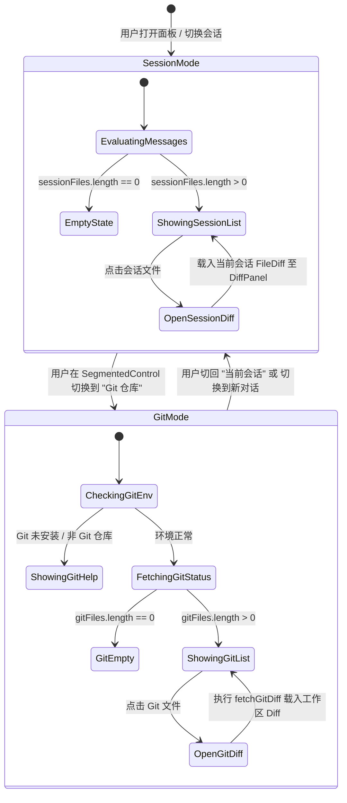

# 会话级改动隔离与全量组件化重构独立架构方案

> **文件标识**：`docs/session-changes-refactor/independent-plans/01-子Agent-会话改动隔离与组件化方案.md`  
> **任务类型**：独立架构设计方案（盲审基准）  
> **核心目标**：彻底切断右侧抽屉「改动」面板对 Git 全局未提交修改的错误绑定，确立「当前会话改动（Session-Scoped Changes）」为第一公民与默认纯净视图；全面清退文件内硬编码样式与逻辑，接入 `@/components/ui` 设计系统原子组件库；合理归位 Git 仓库改动的次级查看交互。

---

## 一、现状代码缺陷与硬编码清单（精准定位）

经过对当前工作区前端与数据流源码的深度排查，梳理出当前右侧抽屉改动面板存在的 6 项关键架构缺陷与硬编码清单：

### 1. 全局脏改动暴力霸占：优先级倒置致命缺陷
- **定位文件**：[`apps/crish-desktop/src/components/overview/ChangesSection.tsx:68-71`](file:///c:/Software/conex/apps/crish-desktop/src/components/overview/ChangesSection.tsx#L68-L71)
- **源码现场**：
  ```tsx
  const activeFiles =
    treeGitFiles.length > 0 ? treeGitFiles : normalizedConvoFiles;
  const fileCount = activeFiles.length;
  const hasFileList = fileCount > 0;
  ```
- **根因剖析**：
  这里使用了三元操作符 `treeGitFiles.length > 0 ? treeGitFiles : normalizedConvoFiles`。只要当前 Git 仓库存在任何未提交的文件（例如当前工作区积累的 51 个改动），`treeGitFiles.length > 0` 就恒为 `true`！
  这导致面板完全沦为「Git 仓库脏改动监视器」；当前会话中 AI 修改了什么、新建了什么，或者在一个全新的纯净对话中，用户的右侧面板都被 51 个无关的 Git 文件彻底掩盖。只有当本地 Git 仓库处于绝对 clean（0 改动）的极端情况下，会话改动 `normalizedConvoFiles` 才有微弱的机会被展示。这是典型的**优先级倒置**（Inverted Precedence）。

### 2. 会话改动数据源绑定漂移：错误消费跨会话全局 TerminalStore
- **定位文件**：[`apps/crish-desktop/src/components/overview/OverviewCard.tsx:47-48`](file:///c:/Software/conex/apps/crish-desktop/src/components/overview/OverviewCard.tsx#L47-L48) 及 [`96-104`](file:///c:/Software/conex/apps/crish-desktop/src/components/overview/OverviewCard.tsx#L96-L104)
- **源码现场**：
  ```tsx
  47: const diffFiles = useTerminalField(selectDiffFiles);
  48: const activeDiffSource = useTerminalField(selectActiveDiffSource);
  ...
  96: const convoFiles = useMemo(
  97:   () =>
  98:     diffFiles?.length
  99:       ? diffFiles
  100:       : activeDiffSource
  101:         ? [activeDiffSource]
  102:         : [],
  103:   [diffFiles, activeDiffSource]
  104: );
  ```
- **根因剖析**：
  `terminalStore.ts:31-33` 明确注明 `diffFiles` 是「跨会话工作产物缓冲区（diff buffers）」。它记录的是用户全局最近点击打开或通过命令注入的 diff，并不与当前会话 `activeSessionId` 的消息流水绑定。
  `OverviewCard` 根本没有读取当前活跃会话（`selectActiveSession`）中的 `messages`，而是错误地把跨会话全局缓冲当作当前会话的文件改动，造成在不同对话之间切换时，改动列表无法隔离，发生数据串染。

### 3. Header 概念强行绑定 Git：认知模型严重扭曲
- **定位文件**：[`apps/crish-desktop/src/components/overview/ChangesSection.tsx:111-118`](file:///c:/Software/conex/apps/crish-desktop/src/components/overview/ChangesSection.tsx#L111-L118)
- **源码现场**：
  ```tsx
  <GitBranch size={15} strokeWidth={1.75} aria-hidden />
  <span>改动</span>
  {fileCount > 0 ? (
    <span className={styles.pill}>{fileCount}</span>
  ) : null}
  {branch ? (
    <span className={styles.branchLabel}>({branch})</span>
  ) : null}
  ```
- **根因剖析**：
  改动面板将 Header 图标硬编码为 `<GitBranch>`，并强制附加 `({branch})`。会话内部的文件变更属于 Agent 本轮交互产物，其生命周期与分支没有直接归属关系。将 Git 分支概念强加于会话改动，让用户误以为这必须是一个与 Git 绑定的视图。

### 4. 刷新机制与错误帮助完全偏向 Git 物理环境
- **定位文件**：[`apps/crish-desktop/src/components/overview/ChangesSection.tsx:125-143`](file:///c:/Software/conex/apps/crish-desktop/src/components/overview/ChangesSection.tsx#L125-L143) 及 [`151-201`](file:///c:/Software/conex/apps/crish-desktop/src/components/overview/ChangesSection.tsx#L151-L201)
- **源码现场**：
  ```tsx
  aria-label={gitLoading ? '正在刷新' : '刷新 Git'}
  disabled={gitLoading}
  onClick={() => onRefreshGit({ force: true })}
  ```
- **根因剖析**：
  刷新按钮唯一触发的是 `onRefreshGit({ force: true })`，走物理磁盘 `git status` 命令行 IO。如果用户在一个没有安装 Git 或未执行 `git init` 的纯文本工作区工作，面板会直接展示巨大的 `gitHelp` 错误块（“下载 Git”、“打开终端 git init”），直接阻断用户查看当前对话生成的文件。

### 5. 文件点击处理的抢占式 Git 路由
- **定位文件**：[`apps/crish-desktop/src/components/overview/ChangesSection.tsx:73-82`](file:///c:/Software/conex/apps/crish-desktop/src/components/overview/ChangesSection.tsx#L73-L82)
- **源码现场**：
  ```tsx
  const handleOpenFile = useCallback(
    (file: GitStatusFile) => {
      if (rawGitFiles.length > 0) {
        const found = rawGitFiles.find((f) => f.path === file.path);
        if (found) {
          onOpenGitFile(found);
          return;
        }
      }
      ...
  ```
- **根因剖析**：
  点击文件项时，只要 Git 列表中同名存在，就会强行调用 `onOpenGitFile` 去执行 `git diff` 读取。如果 Agent 在会话中生成了结构化行级改动，却因为 Git 仓库中有同名文件的暂存状态，导致无法直接呈现会话工具生成的差异，破坏了从会话到 Diff 视图的纯净映射。

### 6. 裸元素样式散落与反设计系统硬编码
- **定位文件**：
  - [`apps/crish-desktop/src/components/overview/ChangesSection.tsx:114`](file:///c:/Software/conex/apps/crish-desktop/src/components/overview/ChangesSection.tsx#L114)（内联 `.pill` 裸 `<span>` 模拟 Badge）
  - [`apps/crish-desktop/src/components/overview/OverviewChangesList.tsx:161-174`](file:///c:/Software/conex/apps/crish-desktop/src/components/overview/OverviewChangesList.tsx#L161-L174)（手写 `.moreActionRow` 和裸折叠按钮）
  - [`apps/crish-desktop/src/components/overview/ChangesSection.tsx:216-218`](file:///c:/Software/conex/apps/crish-desktop/src/components/overview/ChangesSection.tsx#L216-L218)（硬编码文案 `{git?.found && git.clean ? '干净' : '无改动'}`）
- **根因剖析**：
  没有使用项目现成的 `@/components/ui`（如 `Badge`, `SegmentedControl`, `ScrollArea`），而是随意在 CSS Module 中定义零散样式类，违背了项目设计规范与可维护性要求。

---

## 二、会话级改动数据提取与实时响应方案（纯函数与状态流）

### 1. 单一真理来源（SSOT）确认
当前对话产生的一切文件修改，唯一的、不可篡改的事实源是当前会话的 `SessionState.messages`。
- **消息源**：`useSessionStore` 中的 `sessionsById[activeSessionId].messages`；
- **派生算法**：仓内既有纯函数 [`apps/crish-desktop/src/api/sessionDiffDerivation.ts`](file:///c:/Software/conex/apps/crish-desktop/src/api/sessionDiffDerivation.ts) 中的 `selectSessionDiffFiles`。

#### 纯函数能力复核（已有完备基础，无需重复造轮子）：
1. **工具拦截守卫**：白名单精准捕获 `write_file`, `write_to_file`, `replace_file_content`, `multi_replace_file_content`, `apply_diff`, `edit_file`；
2. **状态纯净化**：过滤掉 `error`, `cancelled`, `rejected`, `aborted`, `pending_approval` 的脏调用；
3. **跨平台路径归一化**：自动处理 Windows 盘符大小写、反斜杠与工作区相对路径剥离（`normalizeSessionFilePath`）；
4. **多轮改动累加**：支持同一个文件在多轮 ToolCall 中被多次修改时的 `additions` 与 `deletions` 自动聚合。

### 2. 会话状态流转与即时响应架构（Reactive Architecture）

为了保证性能（O(1) 检索、阻断无变化重绘）与数据纯净度，设计专有 Hook `useSessionScopedChanges`：

```mermaid
flowchart TD
    subgraph SessionStore [Session Store]
        SID[activeSessionId]
        MSG[sessionsById[activeSessionId].messages]
    end

    subgraph DerivationHook [useSessionScopedChanges Hook]
        SEL[makeSelectSessionMessages Memoized Selector]
        WS[useWorkspaceRoot]
        CALC[selectSessionDiffFiles 纯函数]
        MAP[SessionToUnifiedMapper]
    end

    subgraph UIComponent [ChangesSection UI]
        SC[Session Scope: 纯净当前会话改动]
        EMPTY[纯净空状态: 当前对话暂无改动]
    end

    SID --> SEL
    MSG --> SEL
    SEL --> CALC
    WS --> CALC
    CALC -->|文件列表为空| EMPTY
    CALC -->|文件列表有值| MAP
    MAP --> SC
```

### 3. Hook 核心实现设计：`useSessionScopedChanges.ts`

```typescript
import { useMemo } from 'react';
import { useSessionField } from '../../store/storeAccess';
import {
  selectActiveSessionId,
  makeSelectSessionMessages,
} from '../../store/sessionStore';
import { selectSessionDiffFiles } from '../../api/sessionDiffDerivation';
import type { FileDiff } from '../../store/types';
import type { GitStatusCode, GitStatusFile } from '../../api/gitTreeHelpers';

export interface SessionChangeItem {
  id: string; // 归一化文件相对路径
  filePath: string;
  fileName: string;
  dirPath: string;
  status: GitStatusCode;
  additions: number;
  deletions: number;
  rawDiff: FileDiff;
}

export function useSessionScopedChanges(workspaceRoot?: string) {
  const activeSessionId = useSessionField(selectActiveSessionId);

  // 利用细粒度消息流选择器，防止其他会话变更引发非相关重绘
  const messageSelector = useMemo(
    () => makeSelectSessionMessages(activeSessionId),
    [activeSessionId]
  );
  const messages = useSessionField(messageSelector);

  // 纯函数即时派生会话内文件改动列表
  const rawDiffs = useMemo(() => {
    if (!messages || messages.length === 0) return [];
    return selectSessionDiffFiles(messages, workspaceRoot);
  }, [messages, workspaceRoot]);

  // 映射为统一视图展现模型
  const sessionFiles = useMemo<SessionChangeItem[]>(() => {
    return rawDiffs.map((diff) => {
      const normalized = diff.filePath.replace(/\\/g, '/');
      const lastSlashIndex = normalized.lastIndexOf('/');
      const fileName =
        lastSlashIndex >= 0 ? normalized.slice(lastSlashIndex + 1) : normalized;
      const dirPath =
        lastSlashIndex >= 0 ? normalized.slice(0, lastSlashIndex) : '';

      return {
        id: diff.filePath,
        filePath: diff.filePath,
        fileName: fileName || diff.filePath,
        dirPath,
        status: (diff.gitStatus as GitStatusCode) || (diff.additions > 0 && diff.deletions === 0 ? 'A' : 'M'),
        additions: diff.additions,
        deletions: diff.deletions,
        rawDiff: diff,
      };
    });
  }, [rawDiffs]);

  return {
    activeSessionId,
    sessionFiles,
    totalFiles: sessionFiles.length,
    isEmpty: sessionFiles.length === 0,
  };
}
```

---

## 三、单一职责组件化拆分设计（全量组件化与反硬编码）

现有的 `ChangesSection.tsx`（241 行）与 `OverviewChangesList.tsx`（178 行）存在职责高度耦合问题。重构后将其解耦拆分为 5 个职责单一的组件：

### 1. 组件树架构拓扑

```
ChangesSection (总览面板改动容器)
├── ChangesSectionHeader (面板头部，承载折叠、标题、模式选择与操作按钮)
│   ├── SegmentedControl (设计系统组件：切换「当前会话」vs「Git 仓库」)
│   ├── Badge (设计系统组件：展示改动文件数胶囊)
│   └── IconButton / Tooltip (设计系统组件：刷新操作)
│
├── SessionChangesView (主视图：当前会话改动)
│   ├── ChangesFileList (通用文件列表容器，支持 ScrollArea)
│   │   └── ChangesFileRow (单文件行，接入 GitStatusBadge、DiffStatBar、Tooltip)
│   └── SessionChangesEmpty (专属纯净空状态：克制、优雅无污染)
│
└── GitChangesView (次级视图：Git 仓库未提交改动，按需展示)
    ├── GitStatusBanner (分支名称与工作树干净/脏状态提示)
    ├── GitEnvironmentAlert (仅在 Git 模式下呈现的 gitHelp 引导)
    └── ChangesFileList (复用通用文件列表)
```

### 2. 组件接口契约（Props & Interfaces）

#### (1) `ChangesSection.tsx`（顶层容器）
```typescript
export interface ChangesSectionProps {
  open: boolean;
  onToggle: () => void;
  onOpenPanel: (id: string) => void;
  workspaceRoot?: string;
}
```
*消除 15 个散乱 Props 钻取，组件自身直接通过 Hooks 获取所需业务状态。*

#### (2) `ChangesSectionHeader.tsx`（头部操作栏）
```typescript
export type ChangeScope = 'session' | 'git';

export interface ChangesSectionHeaderProps {
  open: boolean;
  scope: ChangeScope;
  sessionCount: number;
  gitCount: number;
  gitLoading: boolean;
  onToggleOpen: () => void;
  onScopeChange: (scope: ChangeScope) => void;
  onRefreshGit: () => void;
}
```
*接入 `@/components/ui` 中的 `SegmentedControl`, `Badge`, `IconButton`, `Tooltip`。*

#### (3) `ChangesFileList.tsx`（通用改动文件列表）
```typescript
export interface UnifiedFileChange {
  id: string;
  filePath: string;
  fileName: string;
  dirPath: string;
  status: GitStatusCode;
  additions: number;
  deletions: number;
  staged?: boolean;
  conflicted?: boolean;
}

export interface ChangesFileListProps {
  files: UnifiedFileChange[];
  openingPath: string | null;
  onOpenFile: (file: UnifiedFileChange) => void;
  maxInitialFiles?: number;
}
```
*使用 `@/components/ui/ScrollArea` 规整滚动条样式，取代裸 `overflow-y: auto`。*

#### (4) `SessionChangesEmpty.tsx`（会话纯净空状态）
```typescript
export interface SessionChangesEmptyProps {
  hasActiveSession: boolean;
}
```
*展示柔和的空状态图标与提示文案（如：“当前对话暂无文件修改”），杜绝出现 Git 错误或 51 个外部脏改动。*

### 3. 设计系统原子组件（@/components/ui）接入映射规范

| 场景需求 | 原有实现（反模式） | 重构接入设计系统基元 |
| :--- | :--- | :--- |
| **会话/Git 模式切换** | 无，直接用优先级倒置三元组掩盖 | `<SegmentedControl size="xs" options={[{ value: 'session', label: '当前会话' }, { value: 'git', label: 'Git 仓库' }]} />` |
| **改动文件计数徽标** | 手写 `.pill` 裸 `<span>` 样式 | `<Badge tone="neutral" size="sm">{count}</Badge>` |
| **刷新按钮** | 手写 `.iconBtn` 裸 `<button>` | `<IconButton variant="ghost" size="sm" icon={<RefreshCw />} />` |
| **悬停提示** | 散落原生 HTML `title` | 统一包裹 `<Tooltip content="...">` |
| **列表滚动容器** | 裸 `div.changesList { overflow-y: auto; }` | `<ScrollArea maxRelativeHeight={320} type="auto">` |
| **查看更多折叠切换** | 裸手写样式的 Ghost Button | `<Button variant="ghost" size="xs">` |

---

## 四、会话模式 vs Git 模式的交互与状态流转

### 1. 核心交互原则：会话优先，客主分明
- **默认模式（SSOT Default）**：进入任何会话时，面板恒为 `session` 模式；
- **纯净原则**：在 `session` 模式下，面板**只渲染本会话产生的修改**。哪怕 Git 仓库有 51 个未提交的改动，计数器显示依然为 `0`，呈现纯净空状态；
- **次级查看按需激活**：当用户确实需要查看工作区所有的 Git 修改时，点击 Header 上的 `Git 仓库` 分段标签切换至 Git 模式；
- **错误隔离原则**：未安装 Git 或无 Git 仓库的诊断告警（`gitHelp`），**仅在用户主动切入 `Git 仓库` 模式时才会呈现**，严禁在 `session` 模式下弹出干扰用户。

### 2. 状态流转状态机（State Machine）



### 3. Diff 打开与派发行为隔离

在点击具体文件时，两套模式执行解耦的路由逻辑：
- **会话模式点击**：
  ```typescript
  const handleOpenSessionFile = (item: SessionChangeItem) => {
    // 直接推入会话级原生 FileDiff，保留 tools 行级计算产物
    setActiveDiffSource(item.rawDiff);
    pushDiffFile(item.rawDiff);
    onOpenPanel('diff');
  };
  ```
- **Git 模式点击**：
  ```typescript
  const handleOpenGitFile = async (item: UnifiedFileChange) => {
    // 异步拉取物理 Git 工作区差异
    const diff = await fetchGitDiff({ path: item.filePath });
    if (diff.files.length > 0) {
      setActiveDiffSource(diff.files[0]);
    }
    onOpenPanel('diff');
  };
  ```

---

## 五、负产出删除清单与测试验收规划

### 1. 负产出删除清单（Dead Code & Anti-Pattern Retirement）

| 目标文件 | 拟删除代码/结构 | 删除理由与收益 |
| :--- | :--- | :--- |
| `ChangesSection.tsx` | 删除第 68-71 行三元运算符 `treeGitFiles.length > 0 ? treeGitFiles : normalizedConvoFiles` | 根除全局脏改动垄断面板的恶劣缺陷 |
| `ChangesSection.tsx` | 删除第 116-118 行 `({branch})` 分支强绑定文本 | 解除会话改动与 Git 分支概念的不当纠缠 |
| `ChangesSection.tsx` | 删除第 151-201 行在会话主视图无差别弹出的 `gitHelp` 逻辑 | 消除在无 Git 环境下对纯会话修改的阻断干扰 |
| `ChangesSection.tsx` | 删除第 73-82 行优先在 `rawGitFiles` 查找文件的抢占逻辑 | 确保会话产生的文件直通会话 FileDiff 视图 |
| `OverviewCard.tsx` | 删除第 47-48 行与第 96-104 行消费全局 `terminalStore` 的 `diffFiles` 绑定 | 切断跨会话全局数据污染，改为直接消费当前会话 |
| `OverviewCard.module.css` | 删除 `.pill`, `.gitHelp`, `.gitActions`, `.link` 等硬编码未规范样式 | 统归设计系统 `@/components/ui`，样式净收敛 |

### 2. 立体化测试与验收规划

根据《通用协作纪律》§7.1 立体验证纪律，必须建立多维度的自动化验证防线，严禁仅凭编译通过就宣称交付：

#### (1) 单元测试（Unit Tests）
新建并补充覆盖以下测试套件：
- `apps/crish-desktop/src/components/overview/__tests__/useSessionScopedChanges.test.ts`
  - **断言 1**：当会话没有任何消息或工具调用时，`sessionFiles` 严格返回空数组 `[]`，`isEmpty` 为 `true`；
  - **断言 2**：当消息中存在报错状态（`status: 'error'`）或被取消的工具调用时，不计入会话改动；
  - **断言 3**：当会话包含合法的 `write_to_file` 与 `replace_file_content` 时，正确派生出聚合的 `additions` 与 `deletions`；
  - **断言 4**：当 `activeSessionId` 改变时，改动列表立即随之切换为目标会话的数据，严格隔绝跨会话残留。
- `apps/crish-desktop/src/components/overview/__tests__/ChangesSection.test.tsx`
  - **断言 1**：默认加载时以 `session` 模式渲染，即使 Mock 的 `git.files` 包含 51 个文件，面板仍显示为纯净空状态；
  - **断言 2**：切换 `SegmentedControl` 到 `git` 时，才呈现 Git 仓库的 51 个文件；
  - **断言 3**：在 `session` 模式下，即使 Mock `git.found = false`，也不渲染任何 Git 报错横幅。

#### (2) 集成与端到端物理验收（E2E / Host Context Verification）
- **场景 1（脏工作区新建会话）**：
  在存在 51 个未提交文件的本地工作区中启动 Workbench，新建空白对话。
  - **预期**：右侧抽屉文件改动面板显示为 `0`，展现“当前对话暂无文件改动”空状态；Header 不显示任何分支侵入文本；
- **场景 2（当前对话文件生成）**：
  在当前对话中让 Agent 创建一个文件并修改一个文件。
  - **预期**：右侧面板实时更新为 `2`，文件列表准确显示该 2 个文件及精确的 `+ -` 行数统计；
- **场景 3（模式手动切换）**：
  点击 Header 上的 `Git 仓库` 选项卡。
  - **预期**：平滑切换到包含 51 个文件的全局 Git 变更列表，并展示分支名及仓库操作项；点击切回 `当前会话` 瞬间恢复为 2 个文件。
