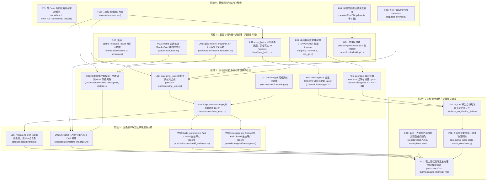

# 会话完整性与持久化单一真理源系统性修复总方案

> **战役工作区**：`docs/session-integrity-repair/`  
> **权威纪律依据**：仓库根目录 `AGENTS.md`、`.agents/LOGIC_PLAN_NO_RETREAT.md`、`ANTI_OVERENGINEERING_GUARDRAILS.md`、`docs/agent-roles/prompts/主控-全流程调度-v3.md`。  
> **核心铁律**：
> 1. **纯逻辑执行拓扑**：零工期、零人天、零人员排期、零 P0/P1 业务优先级。**「同权」指验收标准与交付严肃性同权，不禁止依赖拓扑序**——DAG 只表达逻辑依赖（编译/数据安全），不是业务优先级砍项工具；
> 2. **推进单位是「领域概念」，不是「方案批次」**；
> 3. **杜绝硬编码、杜绝功能伪连通、杜绝多轨并存、杜绝幽灵契约与截肢式降级**；
> 4. **收敛优先于增强（先删后改）**：任何概念有多条路径时，先删/收敛到唯一主路径（SSOT），再谈改进；**落地顺序上，「先建安全路径、再拆旧防护」优先于字面的先删后改**（见 §五 Wave 安全序）；
> 5. **以产品链路真存活为唯一交付验收依据**（五重客观物理物证闭环）。
>
> **契约补丁（2026 后续修订，取代与本文冲突的旧表述）**：
> - **裁决 2 的 SSOT 边界**：`events` 表是 **run 终态与工具生命周期事件** 的法定权威（冷启动以 events 裁决 runs 脑裂）；**消息正文的权威写入路径仍是 `session_messages`（前端/壳层经 `save_session_body*`）**。当前 events **不能**无损重建全文 message body——在实现「events → session_messages 完整投影器」之前，严禁把 `session_messages` 仅当可随时丢弃的缓存；
> - **写放诚实**：增量 Upsert 消除的是 **DELETE+INSERT 毁窗与最坏写放大常数**，**不是**把全量数组保存降为 O(1)。IPC 仍整段数组时，写语句数仍为 O(N)。真正增量化需另立「仅追加」协议，不在本战役默认交付内；
> - **Wave 安全序**：凡「后端仍有全量 DELETE 毁窗」的窗口期，**禁止**拆除前端截断熔断（`isHydrateTruncated` 等）。顺序固定为：后端 Upsert 落地并有负向测试 → 再解绑/删除前端守卫。

---

## 一、战役背景与两大底层致命缺陷

经过对 `crates/session-loop/`、`crates/conex-db/`、`crates/orchestrator/`、`crates/agent-provider/` 与桌面宿主层的纯代码逐行全景审计，系统存在两大危害数据一致性与运行生命期的致命架构断层：

### 1. 领域概念 A：工具中断导致孤儿调用，触发上游模型 400 Bad Request 会话永久坏死
- **一手源码断裂面**：
  - **断面 1（SP-1 前置打断裸退）**：[`crates/session-loop/src/loop/handlers/executing_tools.rs:49-53`](file:///c:/Software/conex/crates/session-loop/src/loop/handlers/executing_tools.rs#L49-L53)，进入工具执行前若控制总线触发 Abort，直接通过 `check_control` 返回 `HandlerOutcome::end(end)` 裸退，整批未执行工具无一生成结果；
  - **断面 2（流式末尾中断黑洞）**：[`crates/session-loop/src/loop/handlers/streaming.rs:269-280`](file:///c:/Software/conex/crates/session-loop/src/loop/handlers/streaming.rs#L269-L280)，模型流式吐出 `tool_calls` 并提交 Assistant 消息后若遇 Abort，直接退出，状态机永不进入 `ExecutingTools`，导致工具调用成为永久悬挂孤儿；
  - **断面 3（空串兜底漏洞）**：[`crates/session-loop/src/exec_batch.rs:188-191`](file:///c:/Software/conex/crates/session-loop/src/exec_batch.rs#L188-L191)，未命中结果时采用 `("", "")` 空串兜底，抹除真实 call ID，破坏匹配性；
  - **断面 4（终态收敛零对账）**：[`crates/session-loop/src/loop/loop_exec.rs:304-351`](file:///c:/Software/conex/crates/session-loop/src/loop/loop_exec.rs#L304-L351)（`converge`），仅兜底 turn-end，未对工具成对性设立守门员；
  - **断面 5（导线层暴露）**：[`crates/agent-provider/src/request/build_anthropic.rs`](file:///c:/Software/conex/crates/agent-provider/src/request/build_anthropic.rs) 与 [`messages.rs`](file:///c:/Software/conex/crates/agent-provider/src/request/messages.rs)，缺乏出站防火墙，孤儿调用直通上游，触发 Anthropic `400 invalid_request_error` 或 OpenAI `400 invalid_parameter`，会话永久死锁。

### 2. 领域概念 B：持久化三源漂移、全量删插反模式与消极对账脑裂
- **一手源码断裂面**：
  - **致命清空窗口与写放大**：[`crates/conex-db/src/messages.rs:112-150`](file:///c:/Software/conex/crates/conex-db/src/messages.rs#L112-L150) 与 [`import.rs:90-95`](file:///c:/Software/conex/crates/conex-db/src/import.rs#L90-L95)，采用 `DELETE FROM session_messages WHERE session_id = ?1` 全量清空再循环 `INSERT`，产生严重 $O(N)$ 写放大与系统崩溃即丢失全量历史的危险窗口；
  - **级联删除抹白灾难（工单 ADD-01）**：[`crates/conex-db/src/agents.rs:198-207`](file:///c:/Software/conex/crates/conex-db/src/agents.rs#L198-L207) 执行全量 `DELETE FROM session_agents`，因 Schema 级联外键（`ON DELETE CASCADE`），每次保存顺带物理抹除 `session_agent_messages` 中所有子代理的历史消息；
  - **写 Actor 单线程重入死锁与嵌套事务崩溃**：`LocalDb::write_blocking` 由单线程 Actor 循环执行，闭包内若调用 `self.*` 会导致 Actor 自身等待自身爆发 100% 永久死锁（`cas_gc.rs:170` 现存实证）；闭包内若调用 `conn.transaction()` 与外层 `BEGIN IMMEDIATE` 冲突崩溃；
  - **WAL 检查点饥饿**：[`crates/conex-db/src/events.rs:49-170`](file:///c:/Software/conex/crates/conex-db/src/events.rs#L49-L170) 读操作裸持主连接锁，改道 `ReaderPool` 若未及时释放游标会导致旧 Read Mark 把持 WAL 阻断 Checkpoint；
  - **G-29 终态矛盾消极妥协**：[`crates/orchestrator/src/restore_manager.rs:178-195, 341-400`](file:///c:/Software/conex/crates/orchestrator/src/restore_manager.rs)，检测到 `events` 表与 `runs` 表终态冲突时“只上报不修正，保持诚实滞留”，放任表级脑裂；
  - **多实例恢复竞态**：恢复过程无并发互斥锁，多进程/多测试并发拉起恢复同一数据库时，会重复合成孤儿事件，导致后续请求因包含两个相同 ID 结果触发 HTTP 400。

---

## 二、主控终审法定裁决体系

依据《主控最终技术决断书》（`docs/session-integrity-repair/plan-reviews/00-主控最终决断书.md`），战役确立六大终审法定裁决：

```
┌──────────────────────────────────────────────────────────────────────────────────────────────────┐
│                             会话完整性与持久化收敛战役：六大终审法定裁决                         │
├──────────────────────────────────────────────────────────────────────────────────────────────────┤
│ 裁决 1【工具成对性闭环】：Tier-1 就地合成（executing_tools + streaming）+                         │
│                           Tier-2 终态集合差集守门（converge）+                                    │
│                           Tier-3 存储落盘与水合自愈。导线层 Fail-Closed 严禁静默伪造。            │
├──────────────────────────────────────────────────────────────────────────────────────────────────┤
│ 裁决 2【持久化权威分层】：events = run 终态/工具生命周期事件权威；                                │
│                           session_messages = 消息正文权威表（增量 Upsert，非可丢缓存）；          │
│                           根除全量 DELETE，锁定 ON CONFLICT(session_id, seq) 增量 Upsert 与      │
│                           DELETE ... WHERE seq >= ?2 差异收缩。                                  │
│                           （契约补丁：废除「events 可无损重建全文」旧口径）                       │
├──────────────────────────────────────────────────────────────────────────────────────────────────┤
│ 裁决 3【灾难级级联删除铲除】：强制将 crates/conex-db/src/agents.rs:198-207 的全量 DELETE          │
│                           纳入最高优先级删除清册（ADD-01），改道基于 (session_id, agent_id)      │
│                           增量 Upsert，彻底消除对外键 session_agent_messages 的抹白灾难。        │
├──────────────────────────────────────────────────────────────────────────────────────────────────┤
│ 裁决 4【G-29 消极妥协根治】：前置 events 表终态探测（Event-Authoritative Decision）；            │
│                           彻底物理删除 restore_manager.rs 中的 reconcile_terminal_conflicts 全函数│
│                           及 ReconcileConflict 结构体，不留中间态，不留死代码。                  │
├──────────────────────────────────────────────────────────────────────────────────────────────────┤
│ 裁决 5【写 Actor 重入防腐与并发安全】：连接级纯函数（*_conn）与 LocalDb 外观严格物理分离；        │
│                           写闭包严禁捕获 self；切除嵌套 conn.transaction() 改用 SAVEPOINT；      │
│                           ReaderPool 读改道游标即时物化；多实例恢复全局租约 + 原子 CAS 查重幂等。 │
├──────────────────────────────────────────────────────────────────────────────────────────────────┤
│ 裁决 6【防腐探针与立体测试网】：SQLite 原生触发器负向守门；修正 check-session-message-upsert     │
│                           放行 >= 正则；清退 write-bypass-exemptions.json 业务豁免；             │
│                           四波平滑删除拓扑确保 TS/Rust 跨 Crate 零编译断裂。                     │
└──────────────────────────────────────────────────────────────────────────────────────────────────┘
```

---

## 三、五大分维详案索引与职责拓扑

全战役划分为 5 份高度解耦、物理边界清晰、严格同权的分维详案：

| 详案文档 | 核心领域 | 责任文件集群 | 核心交付物与断言 |
| :--- | :--- | :--- | :--- |
| **[`02-详案-工具中断合成与孤儿成对性保证.md`](./02-详案-工具中断合成与孤儿成对性保证.md)** (47.0 KB) | 领域 A：会话循环与协议闭环 | `crates/session-loop/src/loop/handlers/executing_tools.rs`<br/>`crates/session-loop/src/loop/handlers/streaming.rs`<br/>`crates/session-loop/src/exec_batch.rs`<br/>`crates/session-loop/src/loop/loop_exec.rs`<br/>`crates/agent-provider/src/request/build_anthropic.rs`<br/>`crates/agent-provider/src/request/messages.rs` | 封死 5 大孤儿逃逸黑洞；Tier 1~3 三级纵深闭环；`loop_exec::converge` 终态集合差集守门；导线层 Fail-Closed 双轨防火墙；标准错误码注册；消除上游 HTTP 400 |
| **[`03-详案-持久化单一真理源收敛与增量化.md`](./03-详案-持久化单一真理源收敛与增量化.md)** (55.4 KB) | 领域 B1：底层存储与 Actor 管道 | `crates/conex-db/src/messages.rs`<br/>`crates/conex-db/src/agents.rs`<br/>`crates/conex-db/src/events.rs`<br/>`crates/conex-db/src/group_commit.rs`<br/>`crates/conex-db/src/cas_gc.rs`<br/>`crates/conex-db/src/schema.rs` | 物理根除 `session_messages` 与 `agents.rs` 全量 DELETE；锁定 `ON CONFLICT(session_id, seq)` 增量 Upsert 与 `seq >= ?2` 差异收缩；连接级纯函数（`*_conn`）消除 Actor 重入死锁；切除嵌套事务改用 `SAVEPOINT`；`ReaderPool` 读改道即时物化 |
| **[`04-详案-冷启动恢复一致性与强制自愈.md`](./04-详案-冷启动恢复一致性与强制自愈.md)** (77.1 KB) | 领域 B2：编排恢复与生命周期 | `crates/orchestrator/src/restore_manager.rs`<br/>`crates/orchestrator/src/restore.rs`<br/>`crates/orchestrator/src/restore_snapshot.rs`<br/>`crates/conex-db/src/sessions.rs`<br/>`apps/agent-workbench/src-tauri/src/core_run_commands_tests.rs` | 恢复时序重塑为事件真理先行（前置查询 events 表）；彻底物理切除 G-29 `reconcile_terminal_conflicts` 全函数与 `ReconcileConflict`；冷启动悬挂孤儿双事件包络自愈；`global_recovery_lease` 30s 恢复租约 + 原子 CAS 查重幂等防脑裂；拔除快照 4 死函数 |
| **[`05-详案-全链路防御性测试与回归断言网.md`](./05-详案-全链路防御性测试与回归断言网.md)** (54.8 KB) | 领域 V：端到端物证与回归测试 | `apps/agent-workbench/src-tauri/tests/`<br/>`crates/session-loop/src/loop/loop_tests.rs`<br/>`crates/conex-db/src/tests.rs`<br/>`crates/orchestrator/tests/crash_consistency.rs` | 五重客观物理物证闭环（触发/传输/介质/消费/负向）；SQLite 原生自爆触发器（`CREATE TRIGGER`）负向防删守门；宿主级真实环境集成测试；流式打断、审批拒绝级联取消、租约竞争、WAL Checkpoint 混沌矩阵；妥协测试重构 |
| **[`06-详案-重复与死层清理及删除面.md`](./06-详案-重复与死层清理及删除面.md)** (53.7 KB) | 领域 C：全仓死层清理与防腐门禁 | 全仓清理清册<br/>`scripts/check-session-message-upsert.mjs`<br/>`scripts/check-tool-pairing-invariants.mjs`<br/>`scripts/check-db-write-bypass.mjs`<br/>`crates/conex-db/write-bypass-exemptions.json`<br/>前端与宿主依赖解绑 | 全仓 38 项死层精准物理删除清册；跨 TS/Rust 零编译断裂四波平滑演进工单拓扑（解绑 → 删定义 → 增量落盘 → 门禁落锁）；三大长效防腐探针建设与五元契约接入 CI |

---

## 四、全战役纯逻辑任务依赖拓扑（无环 DAG）



---

## 五、执行纪律与主控统一提交规范

1. **执行模式与 Wave 安全序**：
   - 严格按照 DAG 依赖拓扑串行推进收敛与删除任务；
   - 处于同一层级且物理文件域互不相交的领域（如阶段 1 的底层连接解耦与循环批次处理）允许并行调度；
   - **数据安全 Wave 序（覆盖 06 详案旧四波中「先拆前端守卫」的危险顺序）**：
     1. 落地后端增量 Upsert + 有界 Diff Shrink + 负向测试（含合法收缩可测通）；
     2. 落地 `session_agents` Upsert + **移除语义**（`agent_id NOT IN` 差集删除）；
     3. 前端解绑并删除截断熔断 / 内存 CAS 守卫；
     4. 静态探针与 CI 落锁。
2. **Git 提交权归主控**：
   - 子 Agent 完成任务后将改动保留在工作区，由主控统一使用 `git commit --only <paths>` 收口提交；
   - 提交信息必须遵循领域动作风格（`feat/fix/refactor/delete + 领域`），严禁包含批次/波次标记；
   - 严禁 `--no-verify`，所有门禁报错必须现场彻底根除。

---

## 六、DAG 节点 ↔ 分维详案工单对照

多 Agent 并行时以本表为唯一编号对照，禁止同一逻辑单元双开：

| DAG 节点 | 含义 | 主详案工单落点 |
| :--- | :--- | :--- |
| F01 | 错误码常量 | 02 §4.1 |
| F02 | ToolErrorKind 扩展 | 02 §4 |
| F03 | workbench 测试桩解绑 | 04 §4.4 / 06 Wave「调用点解绑」1.6 |
| F04 | 前端防御模块解绑 | **仅 Wave 序第 3 步**（06），后端未落地前禁止执行 |
| P01 | `*_conn` + SAVEPOINT | 03 §3 |
| P02 | events 读改道 ReaderPool | 03 / 06 D-P07~P10 |
| P03 | recovery lease 元数据 | 04 §6 |
| O01 | 快照 4 死函数拔除 | 04 §7 / 06 D-O07~O09 |
| L01 | exec_batch 空串消除 | 02 §3.1.3 / 06 D-S02 |
| W01 | 前端死模块删除 | 06，**依赖后端 Upsert 已绿** |
| L02/L03 | Tier-1 就地合成 | 02 §3.1（须遵守幂等规则 §3.1.0） |
| L04 | Tier-2 converge 守门 | 02 §3.2（幂等） |
| P04/P05 | messages/agents Upsert | 03 §2（含 agent 移除差集） |
| O02 | 前置事件权威 + 删 G-29 | 04 §4（Unknown 保真，见 04 契约补丁） |
| L05 | hydrate 修复 | 02 §3.3（受 schema CHECK 约束，见 02） |
| O03 | 冷启动孤儿自愈 | 04 §5（CAS 幂等） |
| W02/W03 | 导线 Fail-Closed | 02 §3.4（Release 须有自愈/可观测闭环） |
| G01/G02 | 触发器 + 静态探针 | 05 §4（修正后触发器原语）/ 06 §5 |
| V01/V02 | 测试重构与 E2E | 05 |
