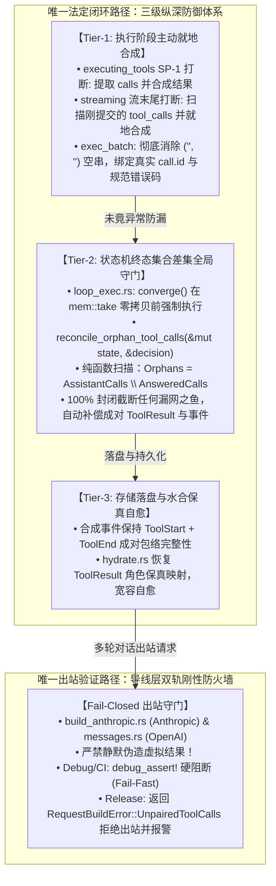
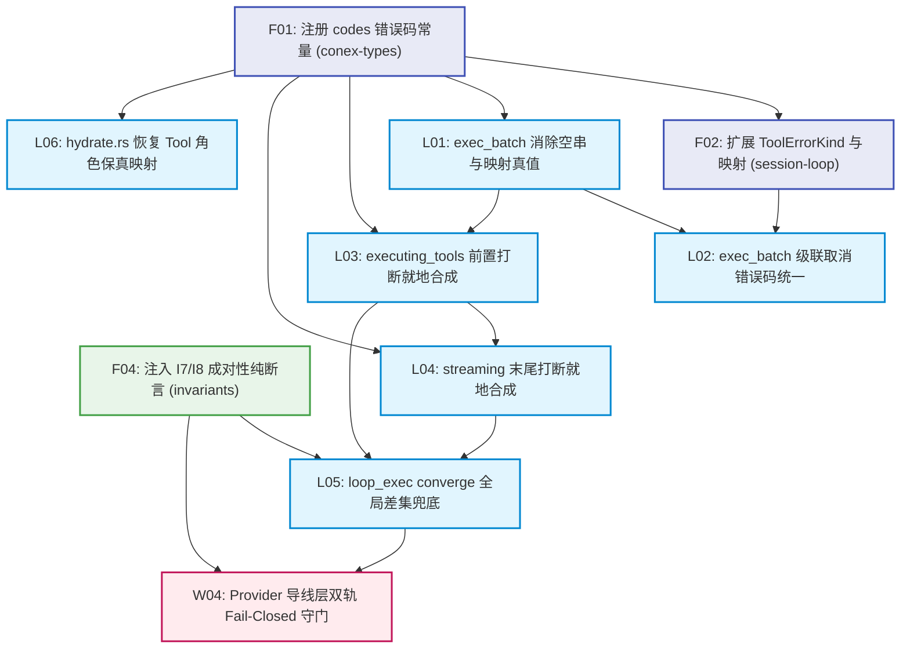

# 会话完整性与持久化收敛战役分维详案 02：工具中断合成与孤儿成对性保证

> **战役工作区**：`docs/session-integrity-repair/`  
> **领域归属**：领域 A（会话循环与协议闭环）  
> **责任核心模块与文件域**：
> - 核心循环与执行器：`crates/session-loop/src/loop/handlers/executing_tools.rs`、`crates/session-loop/src/loop/handlers/streaming.rs`、`crates/session-loop/src/exec_batch.rs`、`crates/session-loop/src/exec_single.rs`、`crates/session-loop/src/exec_verdict.rs`、`crates/session-loop/src/loop/loop_exec.rs`、`crates/session-loop/src/hydrate.rs`、`crates/session-loop/src/loop/invariants.rs`、`crates/session-loop/src/tool_events.rs`
> - 契约模型与错误码：`crates/conex-types/src/error.rs`、`crates/conex-types/src/tool.rs`、`crates/conex-types/src/message.rs`
> - 导线层双轨守门：`crates/agent-provider/src/request/build_anthropic.rs`、`crates/agent-provider/src/request/messages.rs`、`crates/agent-provider/src/request/build_chat.rs`、`crates/agent-provider/src/error.rs`
>
> **核心决断依据**：
> - 《主控最终技术决断书》（`docs/session-integrity-repair/plan-reviews/00-主控最终决断书.md`）裁决 1（工具成对性闭环）
> - 《定夺方案 A（架构纯粹性与系统根除视角）》（`docs/session-integrity-repair/plan-reviews/decision-proposal-a-architectural-purity.md`）§2.1 争鸣点 1
> - 交叉评审报告 `review-01`（效果锁与意图）、`review-03`（跨层连通物证）、`review-06`（拓扑综合与无环 DAG）
> - 协作纪律：仓库根目录 `AGENTS.md`、`.agents/LOGIC_PLAN_NO_RETREAT.md`、`ANTI_OVERENGINEERING_GUARDRAILS.md`
>
> **核心交付断言**：构建 Tier 1~3 三级纵深防御闭环，使工具调用在任何打断、超时、审批拒绝、流截断与崩溃重启场景下成对性达到数学级 100% 封闭；导线层建立 Anthropic 与 OpenAI 双轨 Fail-Closed 刚性防火墙，彻底杜绝上游 HTTP 400 Bad Request 会话坏死。

---

## 一、问题本质与一手源码断裂面剖析

### 1.1 成对性不变量的数学定义与协议红线

工具调用的成对性不变量（Pairing Invariant）是现代大语言模型（LLM）对话协议的底层公理。其数学命题定义如下：

$$\forall c \in \text{Assistant.ToolCalls},\ \exists! r \in \text{ToolResults}\ \text{s.t.}\ r.\text{tool\_call\_id} = c.\text{id} \land \text{Position}(r) > \text{Position}(c)$$

即：在会话历史序列中，被模型声明的每一个 `ToolCall`，物理上必须且仅能存在一个全局唯一匹配其 ID 的 `ToolResult`，且该结果必须紧随该 Assistant 轮次之后。

**上游协议的刚性红线**：
1. **Anthropic Messages 协议**：若 `role: "assistant"` 的 content 数组中包含 `{"type": "tool_use", "id": "call_xxx", ...}`，则紧随其后的消息必须包含对应的 `{"type": "tool_result", "tool_use_id": "call_xxx", ...}`。若缺失，Anthropic 官方 API 直接拒收并返回：
   ```text
   HTTP 400 Bad Request: messages: ... each tool_use block must have a corresponding tool_result block
   ```
2. **OpenAI Chat Completions 协议**：若 assistant 消息输出了 `tool_calls` 列表，则后续必须紧随角色为 `role: "tool"` 且携带对应 `tool_call_id` 的消息。若存在未闭合调用，OpenAI 官方 API 返回：
   ```text
   HTTP 400 Bad Request: Invalid parameter: messages with role 'tool' must follow messages with role 'assistant'
   ```
一旦会话历史中沉淀了未配对的孤儿工具调用，该会话在后续的所有轮次中将 100% 触发 400 报错，会话永久报废。

---

### 1.2 一手源码六大逃逸黑洞现场调查

通过对一手源码的逐行穿透，当前系统在打断与退出路径上存在六处严重的结构性断裂与逃逸黑洞：

#### 黑洞 1：`executing_tools.rs:49-53` SafePoint L3 前置打断裸退黑洞
- **源码现场**：[`crates/session-loop/src/loop/handlers/executing_tools.rs:49-53`](file:///c:/Software/conex/crates/session-loop/src/loop/handlers/executing_tools.rs#L49-L53)
  ```rust
  // executing_tools.rs:49-53
  // 1. abort / 控制意图检查（L3 强停可立即中断）
  if let Some(end) = check_control(state)? {
      return Ok(HandlerOutcome::end(end));
  }
  ```
- **断裂机理**：前序的 `streaming` 阶段已经通过 `commit_message_with_deltas` 将包含 `AgentMessageBlock::ToolCall` 的 Assistant 消息提交并落库；此时若用户点击停止，进入 `executing_tools` 的第一行直接命中 `check_control` 并返回 `HandlerOutcome::end(end)` 退出状态机。后续的 `last_assistant_with_tool_calls` 从未被解析，`executor.execute_batch` 从未执行，整批工具调用全量遗失结果，直接沦为孤儿！

#### 黑洞 2：`streaming.rs:269-280` 流式末尾打断逃逸黑洞
- **源码现场**：[`crates/session-loop/src/loop/handlers/streaming.rs:269-280`](file:///c:/Software/conex/crates/session-loop/src/loop/handlers/streaming.rs#L269-L280)
  ```rust
  // streaming.rs:269-280
  commit_message_with_deltas(state, message);

  if aborted || consumed.stop_reason() == Some(ConsumeStopReason::Aborted) {
      return streaming_aborted(state);
  }

  // 6. 安全点（stream 结束且消息已落盘，不丢本轮输出）
  if let Some(end) = check_control(state)? {
      return Ok(HandlerOutcome::end(end));
  }
  ```
- **断裂机理**：当模型流式生成完成（包括吐出了工具调用块），或流在最后时刻被 Abort 时，消息已经通过 `commit_message_with_deltas` 写入 `state.conversation` 并在数据库中落盘。紧随其后的第 271 行与第 278 行直接返回 `streaming_aborted` 或 `HandlerOutcome::end(end)`，状态机在此终止，**根本不会推进到 `ExecutingTools` 状态**！除 `plan-01` 识别外，多数方案在此处均存在盲区。

#### 黑洞 3：`exec_batch.rs:188-191` 盲目空串 `("", "")` 伪造
- **源码现场**：[`crates/session-loop/src/exec_batch.rs:188-191`](file:///c:/Software/conex/crates/session-loop/src/exec_batch.rs#L188-L191)
  ```rust
  // exec_batch.rs:188-191
  let results = results
      .into_iter()
      .map(|r| {
          r.unwrap_or_else(|| {
              ClassifiedToolResult::error("", "", ToolErrorKind::Cancelled, "cancelled", 0)
          })
      })
      .collect();
  ```
- **断裂机理**：当批次执行中某些项因异常或提前收尾为 `None` 时，代码竟用 `("", "")` 空串作为 `call_id` 与 `tool_name` 兜底。这导致后续生成的 `AgentMessageBlock::ToolResult` 的 `tool_call_id` 成为空串 `""`，无法与任何调用配对，沦为无效垃圾数据，并在上游协议校验时触发校验崩溃。

#### 黑洞 4：`loop_exec.rs:304-351` 终态收敛点无对账直接 `mem::take` 裸交
- **源码现场**：[`crates/session-loop/src/loop/loop_exec.rs:304-351`](file:///c:/Software/conex/crates/session-loop/src/loop/loop_exec.rs#L304-L351)
  ```rust
  // loop_exec.rs:304-351 converge
  async fn converge(&mut self, decision: EndDecision) -> RunOutcome {
      handlers::emit_missing_turn_end(&mut self.state);
      ...
      RunOutcome {
          ...
          messages: std::mem::take(&mut self.state.conversation),
          events: std::mem::take(&mut self.state.events),
          ...
      }
  }
  ```
- **断裂机理**：`converge` 是全会话循环所有退出分支（正常结束、Abort、RuntimeError、Timeout）唯一的收敛终点。它仅仅对 `turn-start` 进行了 `emit_missing_turn_end` 兜底，对工具调用的成对性完全零检查零守门，直接 `mem::take` 对话移交给外部，放任孤儿数据逃出会话循环。

#### 黑洞 5：`hydrate.rs:13-14, 62-66` 历史水合规则 2 盲目切除 Tool 角色消息
- **源码现场**：[`crates/session-loop/src/hydrate.rs:62-66`](file:///c:/Software/conex/crates/session-loop/src/hydrate.rs#L62-L66)
  ```rust
  // hydrate.rs:62-66
  let role = match entry.sender.as_str() {
      "user" => AgentMessageRole::User,
      "assistant" => AgentMessageRole::Assistant,
      _ => return None,
  };
  ```
- **断裂机理**：历史水合注释声称：“*System/Tool 是 run 内瞬态角色，跨 run 不应回传，有意为之*”。但当独立记录的 `role: Tool` 消息在多轮历史回放时被粗暴地 `return None` 物理丢弃后，会话只剩下了上一轮包含 `ToolCall` 的 Assistant 消息！当下一次对话拉起时，旧轮次的工具调用瞬间全部沦为孤儿。

#### 黑洞 6：导线层双轨缺乏 Fail-Closed 守门，甚至存在“静默造假垫片”危险倾向
- **源码现场**：[`crates/agent-provider/src/request/build_anthropic.rs`](file:///c:/Software/conex/crates/agent-provider/src/request/build_anthropic.rs)、[`crates/agent-provider/src/request/messages.rs`](file:///c:/Software/conex/crates/agent-provider/src/request/messages.rs)
- **断裂机理**：出站序列化层在组装 `messages` 时缺乏成对性前置断言。在评审中曾有方案（`plan-06` §4.2）提出在 `build_anthropic.rs` 导线层“静默捏造伪造的 user tool_result 块”以骗过 API。主控决断书已明确否决此种“表面伪连通”与“数据涂胶水”行径。必须建立刚性 Fail-Closed 守门，坚决拒发带毒数据。

---

## 二、概念收敛与唯一法定路径（专节）

### 2.1 现状存在的 6 条碎片化旧路径辨析

在战役前置审计中，系统中关于“工具调用结果生成与成对性”分散在 6 条各自为政、缺乏全局契约约束的碎片化路径中：

| 旧路径编号 | 所在文件与位置 | 行为特征 | 缺陷与危害 | 处置决断 |
| :--- | :--- | :--- | :--- | :--- |
| **旧路径 1** | `executing_tools.rs:49-53` | 命中 abort 信号直接 `return Ok(HandlerOutcome::end(end))` 裸退 | 整批未发起的调用全量遗失结果，直接导致孤儿泄漏 | **物理切除**，改道就地合成 |
| **旧路径 2** | `streaming.rs:271-280` | 流式末尾 abort 触发 `streaming_aborted` 退出 | 包含 `tool_calls` 的已落盘消息无法进入工具状态，100% 泄漏孤儿 | **物理切除**，注入就地合成 |
| **旧路径 3** | `exec_batch.rs:188-191` | `unwrap_or_else` 填充 `ClassifiedToolResult::error("", "", ...)` | 产生空串 ID，破坏协议成对映射，上游直接 400 | **彻底铲除**，强制绑定 `calls[i]` 真值 |
| **旧路径 4** | `loop_exec.rs:304-351` | `converge` 终态收敛仅兜底 `turn-end`，不关心工具成对性 | 无法防御状态机内部未知异常逃逸的孤儿调用 | **重构增强**，注入 Tier-2 终态全局收敛守门 |
| **旧路径 5** | `hydrate.rs:62-66` | 规则 2 仅放行 `user` 与 `assistant`，对其余角色直接 `return None` | 独立 `Tool` 角色消息被抹除，历史回放后引发全量孤儿 | **重构修复**，恢复 ToolResult 保真映射 |
| **旧路径 6** | 导线层曾提议垫片 | 在 `build_anthropic.rs` 出站时隐式造假合成虚拟结果 | 掩盖内核断裂，架构不纯粹，违背单一真理源原则 | **严正否决并禁止**，确立 Fail-Closed 守门 |

### 2.2 收敛后的唯一真理路径：三级纵深防御与导线层刚性防火墙

经过主控技术定夺，关于“工具成对性闭环”的所有逻辑，**彻底收敛并锁定为唯一法定路径（SSOT）**：

> **唯一法定路径**：  
> **由会话状态机驱动的「三级纵深防御体系（Tier 1 执行层就地主动合成 $\rightarrow$ Tier 2 终态收敛差集对账闭合 $\rightarrow$ Tier 3 存储事件包络与水合自愈）」作为唯一的闭环发生器；导线层（Anthropic / OpenAI 双轨）作为「纯粹的只读物理校验防火墙（Fail-Closed Gatekeeper）」，严禁做任何隐式数据改写。**



---

## 三、三级纵深防御体系与导线层双轨防腐架构设计

> **契约补丁（2026 后续修订）**：
> 1. **合成幂等键 = `tool_call_id`**：Tier-1 / Tier-2 / 冷启动 Tier-3 对同一 `call_id` **最多只允许存在一条有效 `ToolEnd` 事件与一条有效 `ToolResult` 消息**。补发前必须查询：若该 `call_id` 的 `ToolEnd`（或等价终态事件）已存在，则**只允许**在 conversation 缺失时补 `ToolResult` 消息，**禁止**再发 `ToolStart`/`ToolEnd`；
> 2. **Tool 结果不落独立 `sender='tool'` 行**：`session_messages.sender` CHECK 仅允许 `user|assistant`（`schema.rs` v1/v5）。运行时 conversation 内可存在 `AgentMessageRole::Tool`（供导线层组包）；**持久化**时 Tool 结果必须并入所属 assistant 消息的 `tool_call_results_json` / `blocks_json`，或经壳层投影为 assistant 附属数据——**禁止** INSERT `sender='tool'`；
> 3. **hydrate 不引入第三种 sender**：规则 2 放行面维持 `{user, assistant}`；孤儿修复在 hydrate 出口做**成对差集合成**（结果写入 assistant 载荷或内存 Tool 消息），而非映射不存在的 `sender="tool"` 行；
> 4. **导线层 Fail-Closed 的 Release 闭环**：返回 `UnpairedToolCalls` 后，调用方（会话循环/壳层）必须走「本地合成补齐 → 重试组包」**一次**；仍失败则标记会话 `wire-pairing-poisoned`、可观测告警、**不得**静默伪造 tool_result，也**不得**把会话留在无用户可见解释的死态。

### 3.1 Tier-1：执行阶段主动就地合成（Handler-level Active Synthesis）

Tier-1 是第一道防线，原则是**“在中断发生的物理现场立即闭环，不把脏数据留给后续状态机”**。所有合成入口先过 §3.1.0 幂等闸。

#### 0. 合成幂等闸（Tier-1/2 共用，强制）

```rust
/// 若 call_id 已有 ToolEnd/终态结果，则 skip_emitting_events=true，
/// 仅在 conversation 缺失对应 ToolResult 时补消息。
fn already_terminal(events: &[…], call_id: &str) -> bool { /* … */ }
```

#### 1. `executing_tools.rs` 前置打断切除与就地合成
- **文件与位置**：[`crates/session-loop/src/loop/handlers/executing_tools.rs:49-53`](file:///c:/Software/conex/crates/session-loop/src/loop/handlers/executing_tools.rs#L49-L53)
- **重构逻辑**：
  切除原有的裸退逻辑，当检测到 `check_control` 触发终止且需要提前退出时，若当前会话存在待执行的工具调用，立即就地合成结果并落库后再退出：
  ```rust
  // 改造后逻辑：
  if let Some(end) = check_control(state)? {
      // 检查当前是否有未闭合的工具调用需要就地合成
      if let Some(assistant) = last_assistant_with_tool_calls(state) {
          synthesize_and_record_interrupted_calls(
              state,
              &assistant,
              codes::TOOL_ABORTED_BEFORE_DISPATCH,
              "tool execution aborted before dispatch",
          );
      }
      return Ok(HandlerOutcome::end(end));
  }
  ```
- **辅助函数规范**：
  在 `executing_tools.rs` 或 `handlers/mod.rs` 中提供纯逻辑合成函数：
  ```rust
  pub(crate) fn synthesize_and_record_interrupted_calls(
      state: &mut LoopState,
      assistant: &AgentMessage,
      error_code: &'static str,
      reason: &str,
  ) {
      for call in assistant.tool_calls() {
          // 1. 发射成对的 ToolStart 与 ToolEnd 事件，保持事件溯源包络完整性
          let now_ms = conex_shared::time::unix_millis() as u64;
          state.emit_tool_event(ToolEvent::ToolStart {
              call_id: call.id.clone(),
              tool_name: call.tool_name.clone(),
              input: call.input.clone(),
              category: ToolCategory::Internal,
              concurrency: ToolConcurrency::Parallel,
              summary: format!("call {}", call.tool_name),
              occurred_at_ms: Some(now_ms),
          });
          state.emit_tool_event(ToolEvent::ToolEnd {
              call_id: call.id.clone(),
              tool_name: call.tool_name.clone(),
              is_error: true,
              duration_ms: 0,
              output: Arc::new(serde_json::Value::Null),
              error_code: Some(error_code.to_string()),
              error_message: Some(reason.to_string()),
              attempt: None,
              deduplicated: None,
              executed_input: None,
              occurred_at_ms: Some(now_ms),
          });

          // 2. 构造并提交 ToolResult 消息，推入 conversation 并持久化
          let msg = AgentMessage {
              id: format!("tool-result-{}", call.id),
              role: AgentMessageRole::Tool,
              created_at: conex_shared::time::now_iso_utc(),
              blocks: vec![AgentMessageBlock::ToolResult {
                  tool_call_id: call.id.clone(),
                  tool_name: call.tool_name.clone(),
                  output: ToolOutput::text(format!("interrupted: {reason}")),
                  is_error: true,
              }],
              metadata: Some(serde_json::json!({
                  "synthesized": true,
                  "errorCode": error_code,
              })),
              client_message_id: None,
              content: None,
          };
          record_message(state, msg);
      }
  }
  ```

#### 2. `streaming.rs` 流式末尾打断逃逸切除与就地合成
- **文件与位置**：[`crates/session-loop/src/loop/handlers/streaming.rs:269-280`](file:///c:/Software/conex/crates/session-loop/src/loop/handlers/streaming.rs#L269-L280)
- **重构逻辑**：
  在 `commit_message_with_deltas(state, message);` 之后，在执行 `streaming_aborted` 或 `check_control` 退出前，检查刚提交的消息是否包含 `tool_calls`。若包含且处于中断状态，必须就地合成：
  ```rust
  commit_message_with_deltas(state, message);

  // 提取刚提交的消息中可能包含的工具调用
  let has_tool_calls = state
      .conversation
      .last()
      .map(|m| m.has_tool_calls())
      .unwrap_or(false);

  if aborted || consumed.stop_reason() == Some(ConsumeStopReason::Aborted) {
      if has_tool_calls {
          if let Some(assistant) = last_assistant_with_tool_calls(state) {
              synthesize_and_record_interrupted_calls(
                  state,
                  &assistant,
                  codes::TOOL_ABORTED_BEFORE_DISPATCH,
                  "streaming aborted by user or provider before tool execution",
              );
          }
      }
      return streaming_aborted(state);
  }

  if let Some(end) = check_control(state)? {
      if has_tool_calls {
          if let Some(assistant) = last_assistant_with_tool_calls(state) {
              synthesize_and_record_interrupted_calls(
                  state,
                  &assistant,
                  codes::TOOL_ABORTED_BEFORE_DISPATCH,
                  "run control triggered termination at stream completion",
              );
          }
      }
      return Ok(HandlerOutcome::end(end));
  }
  ```

#### 3. `exec_batch.rs` 消除空串兜底与兄弟级联取消错误码统一
- **文件与位置**：[`crates/session-loop/src/exec_batch.rs:184-194`](file:///c:/Software/conex/crates/session-loop/src/exec_batch.rs#L184-L194)、[`crates/session-loop/src/exec_verdict.rs:238-279`](file:///c:/Software/conex/crates/session-loop/src/exec_verdict.rs#L238-L279)
- **重构逻辑**：
  1. 彻底切除 `exec_batch.rs:189` 的 `("", "")` 盲目空串，严格从入参 `calls` 中以索引 `i` 提取真实的 `call.id` 与 `call.tool_name`：
     ```rust
     // 改造后：
     let results = results
         .into_iter()
         .enumerate()
         .map(|(i, r)| {
             r.unwrap_or_else(|| {
                 let call = &calls[i];
                 ClassifiedToolResult::error(
                     &call.id,
                     &call.tool_name,
                     ToolErrorKind::Cancelled,
                     "cancelled: execution aborted or skipped",
                     0,
                 )
             })
         })
         .collect();
     ```
  2. 规范化 `exec_verdict.rs:264` 中 `mark_rest_cancelled` 的错误码，废除字面量 `"tool.cancelled"`，统一使用 `codes::TOOL_CANCELLED` 常量。

---

### 3.2 Tier-2：状态机终态集合差集全局守门（Converge Invariant Guardian）

Tier-2 是第二道全局兜底防线，原则是**“无论状态机经历何等未知异常，离开循环前的终态收敛必须在数学上实现 100% 封闭”**。与 Tier-1 共用 §3.1.0 幂等闸：**禁止**对已终态 `call_id` 重复发射 ToolStart/ToolEnd。

- **文件与位置**：[`crates/session-loop/src/loop/loop_exec.rs:304-351`](file:///c:/Software/conex/crates/session-loop/src/loop/loop_exec.rs#L304-L351)
- **收口切入点**：在 `AgentSessionLoop::converge` 中，在执行 `std::mem::take(&mut self.state.conversation)` 之前，强制执行全局差集扫描对账：
  ```rust
  async fn converge(&mut self, decision: EndDecision) -> RunOutcome {
      // 1. 孤儿 turn-start 最终兜底
      handlers::emit_missing_turn_end(&mut self.state);

      // 2. 【核心注入】成对性不变量终极物理闭环（Tier-2 全局守门）
      handlers::reconcile_orphan_tool_calls(&mut self.state, &decision);

      let reason = decision.reason;
      ...
      RunOutcome {
          reason,
          error,
          diagnostic,
          messages: std::mem::take(&mut self.state.conversation),
          events: std::mem::take(&mut self.state.events),
          ...
      }
  }
  ```

- **纯函数算法规范**：`reconcile_orphan_tool_calls`
  ```rust
  /// 扫描当前 conversation，对所有未闭合的 ToolCall 进行集合差集计算，强制就地合成缺失的 ToolResult
  pub(crate) fn reconcile_orphan_tool_calls(state: &mut LoopState, decision: &EndDecision) {
      use std::collections::HashSet;

      // 1. 收集全量被回答的 tool_call_id
      let mut answered_call_ids = HashSet::new();
      for msg in &state.conversation {
          for block in &msg.blocks {
              if let AgentMessageBlock::ToolResult { tool_call_id, .. } = block {
                  answered_call_ids.insert(tool_call_id.clone());
              }
          }
      }

      // 2. 扫描所有 Assistant 消息中的 ToolCall，求差集：Orphans = AssistantCalls \ AnsweredCalls
      let mut orphan_calls = Vec::new();
      for msg in &state.conversation {
          if msg.role == AgentMessageRole::Assistant {
              for block in &msg.blocks {
                  if let AgentMessageBlock::ToolCall(call) = block {
                      if !answered_call_ids.contains(&call.id) {
                          orphan_calls.push(call.clone());
                          // 防止同批次重复计入
                          answered_call_ids.insert(call.id.clone());
                      }
                  }
              }
          }
      }

      if orphan_calls.is_empty() {
          return;
      }

      tracing::warn!(
          session_id = %state.machine.context().session_id,
          orphan_count = orphan_calls.len(),
          end_reason = ?decision.reason,
          "Tier-2 converge 守门员触发：检测到孤儿工具调用，执行强制集合差集闭合"
      );

      // 3. 对所有孤儿调用，就地合成 ToolResult 并补齐事件包络
      for call in orphan_calls {
          // 幂等闸：已存在该 call_id 的 ToolEnd/终态 → 跳过事件，只在缺 ToolResult 时补消息
          if already_terminal(&state.events, &call.id) {
              // 仅 conversation 补 ToolResult（若尚未有对应 block）
              continue;
          }
          let now_ms = conex_shared::time::unix_millis() as u64;
          // 补发 ToolStart（若缺失）与 ToolEnd 事件
          state.emit_tool_event(ToolEvent::ToolStart {
              call_id: call.id.clone(),
              tool_name: call.tool_name.clone(),
              input: call.input.clone(),
              category: ToolCategory::Internal,
              concurrency: ToolConcurrency::Parallel,
              summary: format!("reconciled call {}", call.tool_name),
              occurred_at_ms: Some(now_ms),
          });
          state.emit_tool_event(ToolEvent::ToolEnd {
              call_id: call.id.clone(),
              tool_name: call.tool_name.clone(),
              is_error: true,
              duration_ms: 0,
              output: Arc::new(serde_json::Value::Null),
              error_code: Some(codes::TOOL_ABORTED_BEFORE_DISPATCH.to_string()),
              error_message: Some(format!("converge auto-reconciled orphan: {:?}", decision.reason)),
              attempt: None,
              deduplicated: None,
              executed_input: None,
              occurred_at_ms: Some(now_ms),
          });

          // 注入 ToolResult 消息
          let msg = AgentMessage {
              id: format!("reconciled-tool-result-{}", call.id),
              role: AgentMessageRole::Tool,
              created_at: conex_shared::time::now_iso_utc(),
              blocks: vec![AgentMessageBlock::ToolResult {
                  tool_call_id: call.id.clone(),
                  tool_name: call.tool_name.clone(),
                  output: ToolOutput::text(format!("auto-reconciled at turn completion: {:?}", decision.reason)),
                  is_error: true,
              }],
              metadata: Some(serde_json::json!({
                  "synthesized": true,
                  "reconciledAtConverge": true,
                  "errorCode": codes::TOOL_ABORTED_BEFORE_DISPATCH,
              })),
              client_message_id: None,
              content: None,
          };
          record_message(state, msg);
      }
  }
  ```

---

### 3.3 Tier-3：存储落盘与水合自愈（Persistence Envelope & Hydration Fidelity）

Tier-3 负责持久化介质与多轮会话回放阶段的保真与自愈。

#### 1. 事件包络完整性（Event Envelope Pairing）
在 SQLite `events` 表的事件流中，任何一个工具调用必须具备严格成对的事件包络：
$$\text{ToolEvent::ToolStart} \longrightarrow \text{ToolEvent::ToolEnd}$$
禁止出现只有 `ToolEnd` 而无 `ToolStart` 的断头事件，亦禁止出现只有 `ToolStart` 而无 `ToolEnd` 的悬挂事件。在冷启动恢复（详案 04 承接）与运行时合成中，若补发 `ToolEnd`，必须严格前置检查并补全 `ToolStart`。

#### 2. `hydrate.rs` 规则 2（成对差集自愈，**不扩展 sender 枚举**）
- **文件与位置**：[`crates/session-loop/src/hydrate.rs:13-14, 62-66`](file:///c:/Software/conex/crates/session-loop/src/hydrate.rs#L62-L66)
- **契约约束**：`session_messages.sender` / HistoryMessage.sender 均为 `{user, assistant}`（schema CHECK + 前端模型）。**不得**增加 `sender=="tool"` 映射。
- **重构逻辑**：
  1. 角色映射维持 user/assistant，其余跳过；
  2. `blocks_json` / `tool_call_results_json` 保真：ToolResult **块**可附着在 assistant 消息内则直接保留（`resolve_blocks` 已支持）；
  3. 在 `truncate_to_last_user` 之后增加**成对差集自愈**：扫描 assistant 上的 ToolCall，若导线所需 ToolResult 块缺失，则在内存中合成 `AgentMessageRole::Tool` 消息（**仅存在于本轮 conversation / wire 组包，不写回 `sender='tool'` 行**）；
  4. 合成错误码：`codes::TOOL_OUTCOME_UNKNOWN`（跨 run 悬挂）或按策略 `TOOL_ABORTED_BEFORE_DISPATCH`。

---

### 3.4 导线层 Fail-Closed 双轨刚性守门（Wire Gatekeeper Fail-Closed）

导线层是向外部 API 发送 HTTP 请求前的最后一道物理防火墙。

#### 1. 坚决否决隐式伪造，坚持架构纯粹性
主控技术决断书已经严正裁决：**导线层严禁通过捏造虚假消息来掩盖内核缺陷**。如果内核状态机已通过 Tier-1 与 Tier-2 实现 100% 数学封闭，导线层理论上绝不会收到带有孤儿调用的数据。因此，导线层的定位是**“纯粹的只读物理校验防火墙（Fail-Closed Gatekeeper）”**。

#### 2. 分级守门策略（Fail-Fast vs Fail-Closed）
- **在 Debug / CI 自动化测试构建中**：启用 `debug_assert!` 硬性阻断。一旦导线层发现未配对的孤儿 `tool_call_id`，立即 Panic，强迫开发者和 CI 在第一时间暴露并根治内核问题；
- **在 Release 生产环境中**：返回强类型错误 `Err(RequestBuildError::UnpairedToolCalls { ... })`，拒绝向上游发送带毒请求，记录 `tracing::error!` 结构化日志。
- **Release 侧路闭环（契约补丁，禁止空头「上层自愈」）**：
  1. 捕获 `UnpairedToolCalls` 的**唯一**合法调用方 = 会话循环出站组装处（`build_anthropic` / `to_chat_messages*` 的调用栈向上一层）；
  2. 立即执行与 Tier-2 相同的 `reconcile_orphan_tool_calls`（幂等闸生效），然后 **单次** 重新组包；
  3. 仍失败 → 将 `wire_pairing_poisoned=true` 写入 RunOutcome.diagnostic / 会话元数据，UI 展示可读错误（禁止无解释死态）；
  4. **禁止**在导线层或上层静默插入假 `tool_result` 欺骗 API；
  5. 压毒会话在下次 hydrate 自愈成功前，可继续读历史，但发起新请求前必须再走 1–3。

#### 3. 双轨协议具体实现规范

##### 轨一：Anthropic 协议出站守门（`build_anthropic.rs`）
- **文件**：[`crates/agent-provider/src/request/build_anthropic.rs`](file:///c:/Software/conex/crates/agent-provider/src/request/build_anthropic.rs)
- **实现机制**：在 `to_anthropic_messages` 处理完成后，对输出的 `messages: &[Value]` 进行成对性断言检验：
  ```rust
  pub fn validate_anthropic_tool_pairing(messages: &[Value]) -> Result<(), RequestBuildError> {
      use std::collections::HashSet;
      let mut pending_tool_use_ids = HashSet::new();

      for msg in messages {
          let role = msg.get("role").and_then(Value::as_str).unwrap_or_default();
          if let Some(content) = msg.get("content").and_then(Value::as_array) {
              for block in content {
                  let block_type = block.get("type").and_then(Value::as_str).unwrap_or_default();
                  if role == "assistant" && block_type == "tool_use" {
                      if let Some(id) = block.get("id").and_then(Value::as_str) {
                          pending_tool_use_ids.insert(id.to_string());
                      }
                  } else if role == "user" && block_type == "tool_result" {
                      if let Some(tool_use_id) = block.get("tool_use_id").and_then(Value::as_str) {
                          pending_tool_use_ids.remove(tool_use_id);
                      }
                  }
              }
          }
      }

      if !pending_tool_use_ids.is_empty() {
          let err = RequestBuildError::UnpairedToolCalls {
              protocol: "anthropic",
              orphan_ids: pending_tool_use_ids.into_iter().collect(),
          };
          #[cfg(debug_assertions)]
          {
              panic!("Anthropic 导线层校验拦截到孤儿工具调用！{:?}", err);
          }
          #[cfg(not(debug_assertions))]
          {
              tracing::error!(target: "provider", error = ?err, "导线层刚性拦截带毒请求出站");
              return Err(err);
          }
      }
      Ok(())
  }
  ```

##### 轨二：OpenAI / DeepSeek 协议出站守门（`messages.rs` / `build_chat.rs`）
- **文件**：[`crates/agent-provider/src/request/messages.rs`](file:///c:/Software/conex/crates/agent-provider/src/request/messages.rs)、[`crates/agent-provider/src/request/build_chat.rs`](file:///c:/Software/conex/crates/agent-provider/src/request/build_chat.rs)
- **实现机制**：在 `to_chat_messages_with_compat` 返回 `Vec<ChatMessage>` 后，对 `wire: &[ChatMessage]` 执行出站检验：
  ```rust
  pub fn validate_chat_tool_pairing(messages: &[ChatMessage]) -> Result<(), RequestBuildError> {
      use std::collections::HashSet;
      let mut pending_call_ids = HashSet::new();

      for msg in messages {
          if msg.role == "assistant" {
              for call in &msg.tool_calls {
                  if let Some(id) = call.get("id").and_then(Value::as_str) {
                      pending_call_ids.insert(id.to_string());
                  }
              }
          } else if msg.role == "tool" {
              if let Some(tool_call_id) = &msg.tool_call_id {
                  pending_call_ids.remove(tool_call_id);
              }
          }
      }

      if !pending_call_ids.is_empty() {
          let err = RequestBuildError::UnpairedToolCalls {
              protocol: "openai_chat",
              orphan_ids: pending_call_ids.into_iter().collect(),
          };
          #[cfg(debug_assertions)]
          {
              panic!("OpenAI 导线层校验拦截到孤儿工具调用！{:?}", err);
          }
          #[cfg(not(debug_assertions))]
          {
              tracing::error!(target: "provider", error = ?err, "导线层刚性拦截带毒请求出站");
              return Err(err);
          }
      }
      Ok(())
  }
  ```

---

## 四、契约扩展与错误码规范化

为消除不同模块间对错误命名的割裂，在此正式扩展并在 `crates/conex-types/src/error.rs` 中注册工具中断与成对性专属常量契约。

### 4.1 `conex-types` 错误码常量注册（F01）
在 `crates/conex-types/src/error.rs` 的 `pub mod codes` 模块中的 `tool` 域内新增注册：
```rust
// crates/conex-types/src/error.rs
pub mod codes {
    ...
    // ── tool 域（原 7 正式码扩展为 10 正式码）──
    pub const TOOL_NOT_FOUND: &str = "tool.not_found";
    pub const TOOL_INVALID_INPUT: &str = "tool.invalid_input";
    pub const TOOL_EXECUTION_FAILED: &str = "tool.execution_failed";
    pub const TOOL_PATH_ESCAPE: &str = "tool.path_escape";
    pub const TOOL_VERSION_CONFLICT: &str = "tool.version_conflict";
    pub const TOOL_WRITE_NOT_ALLOWED: &str = "tool.write_not_allowed";
    pub const TOOL_WRITE_PATH_CONFLICT: &str = "tool.write_path_conflict";

    /// 工具在派发执行前被用户取消或控制意图终止（SP-1 / 流末尾中断）
    pub const TOOL_ABORTED_BEFORE_DISPATCH: &str = "tool.aborted_before_dispatch";

    /// 工具在执行批次中因兄弟工具失败或级联取消而被终止
    pub const TOOL_CANCELLED: &str = "tool.cancelled";

    /// 进程异常退出或冷启动恢复时检测到未决工具调用，结果不可知（自愈修复）
    pub const TOOL_OUTCOME_UNKNOWN: &str = "tool.outcome_unknown";
}
```

同步在 `CRISH_ERROR_REGISTRY` 中注册对应的 `CrishErrorInfo` 元数据条目：
```rust
CrishErrorInfo {
    code: codes::TOOL_ABORTED_BEFORE_DISPATCH,
    title: "工具分发前已中止",
    category: CrishErrorCategory::Permanent,
    retryable: false,
    is_public: true,
    action: "请求已被用户或控制总线中止，无需重试",
},
CrishErrorInfo {
    code: codes::TOOL_CANCELLED,
    title: "工具已被取消",
    category: CrishErrorCategory::Permanent,
    retryable: false,
    is_public: true,
    action: "兄弟工具执行失败或批处理取消，跳过执行",
},
CrishErrorInfo {
    code: codes::TOOL_OUTCOME_UNKNOWN,
    title: "工具结果未知（崩溃自愈）",
    category: CrishErrorCategory::Permanent,
    retryable: false,
    is_public: true,
    action: "系统冷启动恢复自动合成未闭合调用，继续会话",
},
```

### 4.2 `ToolErrorKind` 枚举扩展与错误码映射（F02）
在 `crates/session-loop/src/tool_events.rs` 中扩展 `ToolErrorKind`：
```rust
#[derive(Debug, Clone, Copy, PartialEq, Eq)]
pub enum ToolErrorKind {
    NotFound,
    InvalidInput,
    ExecutionFailed,
    Timeout,
    UserDenied,
    ApprovalExpired,
    ApprovalRequired,
    SoftDeny,
    Cancelled,
    /// 新增：分发前中止
    AbortedBeforeDispatch,
    /// 新增：崩溃恢复结果未知
    OutcomeUnknown,
}

impl ToolErrorKind {
    pub fn is_never_fatal(self) -> bool {
        matches!(
            self,
            ToolErrorKind::Timeout
                | ToolErrorKind::UserDenied
                | ToolErrorKind::ApprovalExpired
                | ToolErrorKind::ApprovalRequired
                | ToolErrorKind::SoftDeny
                | ToolErrorKind::Cancelled
                | ToolErrorKind::AbortedBeforeDispatch
                | ToolErrorKind::OutcomeUnknown
        )
    }

    pub fn error_code(self) -> &'static str {
        match self {
            ToolErrorKind::NotFound => codes::TOOL_NOT_FOUND,
            ToolErrorKind::InvalidInput => codes::TOOL_INVALID_INPUT,
            ToolErrorKind::ExecutionFailed => codes::TOOL_EXECUTION_FAILED,
            ToolErrorKind::Timeout => "tool.timeout",
            ToolErrorKind::UserDenied => "tool.user_denied",
            ToolErrorKind::ApprovalExpired => "tool.approval_expired",
            ToolErrorKind::ApprovalRequired => "tool.requires_approval",
            ToolErrorKind::SoftDeny => "tool.soft_deny",
            ToolErrorKind::Cancelled => codes::TOOL_CANCELLED,
            ToolErrorKind::AbortedBeforeDispatch => codes::TOOL_ABORTED_BEFORE_DISPATCH,
            ToolErrorKind::OutcomeUnknown => codes::TOOL_OUTCOME_UNKNOWN,
        }
    }
}
```

### 4.3 `agent-provider` 导线层强类型错误定义
在 `crates/agent-provider/src/error.rs` 中新增强类型出站校验错误：
```rust
#[derive(Debug, Clone, PartialEq, thiserror::Error)]
pub enum RequestBuildError {
    #[error("导线层拦截到未配对的孤儿工具调用（协议：{protocol}，孤儿 ID 列表：{orphan_ids:?}）")]
    UnpairedToolCalls {
        protocol: &'static str,
        orphan_ids: Vec<String>,
    },
    #[error("其他请求构建错误：{0}")]
    Other(String),
}
```

---

## 五、成对性不变量检验与测试设计（I7 / I8）

在 `crates/session-loop/src/loop/invariants.rs` 中建立两套最高等级的不变量回归断言，将成对性规则作为系统级铁律钉死：

### 5.1 不变量 I7：对话历史严格成对不变量
- **不变量命题**：任何完整的会话序列中，不存在任何一个未被后续 Tool 消息解答的 `ToolCall`；且不存在无来源的 `ToolResult`。
- **测试代码规范**：
  ```rust
  /// I7：对话历史工具成对性绝对不变量测试
  #[test]
  fn i7_tool_calls_strictly_paired_in_conversation() {
      // 构造包含多轮 Assistant ToolCall 与对应 ToolResult 的正常对话
      let conv = mock_paired_conversation();
      assert!(assert_conversation_tool_pairing(&conv).is_ok());

      // 构造故意遗漏 ToolResult 的断裂对话
      let broken_conv = mock_orphan_conversation();
      assert!(assert_conversation_tool_pairing(&broken_conv).is_err());
  }

  pub fn assert_conversation_tool_pairing(conversation: &[Arc<AgentMessage>]) -> Result<(), String> {
      let mut call_set = std::collections::HashSet::new();
      for msg in conversation {
          if msg.role == AgentMessageRole::Assistant {
              for block in &msg.blocks {
                  if let AgentMessageBlock::ToolCall(call) = block {
                      call_set.insert(call.id.clone());
                  }
              }
          } else if msg.role == AgentMessageRole::Tool {
              for block in &msg.blocks {
                  if let AgentMessageBlock::ToolResult { tool_call_id, .. } = block {
                      if !call_set.remove(tool_call_id) {
                          return Err(format!("发现无对应调用来源的游离 ToolResult：{}", tool_call_id));
                      }
                  }
              }
          }
      }
      if !call_set.is_empty() {
          return Err(format!("发现未解答的孤儿 ToolCall：{:?}", call_set));
      }
      Ok(())
  }
  ```

### 5.2 不变量 I8：任意打断场景 converge 终态 100% 封闭不变量
- **不变量命题**：无论是 SP-1 前置打断、执行中途打断、流末尾打断还是执行器崩溃，经 `converge` 收口后，产出的 `RunOutcome.messages` 必须 100% 通过成对性校验。
- **测试代码规范**：
  ```rust
  /// I8：任意打断场景收敛后 100% 封闭不变量测试
  #[tokio::test]
  async fn i8_interrupted_run_synthesizes_all_orphans() {
      // 场景 1：executing_tools SP-1 前置打断
      test_sp1_pre_execution_abort_pairing().await;
      // 场景 2：streaming 流式末尾打断
      test_streaming_tail_abort_pairing().await;
      // 场景 3：exec_batch 兄弟失败级联取消
      test_batch_sibling_failure_pairing().await;
  }
  ```

---

## 六、任务单元纯逻辑依赖拓扑（DAG 与接口清单）

本详案所有任务单元严格按逻辑依赖组织，同层单元逻辑同权，无时间工期、无人天排期：



### 任务单元明细表

| 任务 ID | 任务名称 | 目标文件域 | 核心逻辑与接口修改 | 前置依赖 |
| :--- | :--- | :--- | :--- | :--- |
| **F01** | 统一错误码契约 | `crates/conex-types/src/error.rs` | 注册 `TOOL_ABORTED_BEFORE_DISPATCH`、`TOOL_CANCELLED`、`TOOL_OUTCOME_UNKNOWN` | 无 |
| **F02** | 扩展 ToolErrorKind | `crates/session-loop/src/tool_events.rs` | 扩展枚举变体与 `error_code()` 对齐 F01 | F01 |
| **F04** | 成对性纯断言定义 | `crates/session-loop/src/loop/invariants.rs` | 编写 `assert_conversation_tool_pairing` 与 I7/I8 测试骨架 | 无 |
| **L01** | exec_batch 消除空串 | `crates/session-loop/src/exec_batch.rs:188-191` | 切除 `("", "")`，在 `map` 中提取 `calls[i].id` 与 `tool_name` | F01 |
| **L02** | 兄弟级联取消统一 | `crates/session-loop/src/exec_verdict.rs:264` | `mark_rest_cancelled` 错误码对齐 `codes::TOOL_CANCELLED` | F02, L01 |
| **L03** | executing_tools 前置合成 | `crates/session-loop/src/loop/handlers/executing_tools.rs:49-53` | 切除裸退出，前置调用 `synthesize_and_record_interrupted_calls` | F01, L01 |
| **L04** | streaming 末尾打断合成 | `crates/session-loop/src/loop/handlers/streaming.rs:269-280` | 切除带工具消息后的直接裸退，就地合成 `ToolResult` | F01, L03 |
| **L05** | converge 全局差集守门 | `crates/session-loop/src/loop/loop_exec.rs:304-351` | 在 `mem::take` 前注入 `reconcile_orphan_tool_calls` | L03, L04, F04 |
| **L06** | 历史水合 Tool 角色保真 | `crates/session-loop/src/hydrate.rs:62-66` | 规则 2 放行 `"tool" => AgentMessageRole::Tool`，消除误删 | F01 |
| **W04** | 导线层双轨 Fail-Closed 守门 | `crates/agent-provider/src/request/` (`build_anthropic.rs`, `messages.rs`, `build_chat.rs`) | 部署 `validate_anthropic_tool_pairing` 与 `validate_chat_tool_pairing`，坚决不静默造假 | L05, F04 |

---

## 七、专节：本方案要删掉什么 / 收敛什么

为坚决贯彻“收敛优先于增强（先删后改）”与杜绝补丁作弊铁律，精确列出本方案必须彻底物理删除、切除与收敛的代码清单：

| 序号 | 目标文件 | 代码行号与现场 | 废弃/删除内容 | 物理删除与收敛依据 |
| :--- | :--- | :--- | :--- | :--- |
| **DEL-01** | `crates/session-loop/src/loop/handlers/executing_tools.rs` | `L49-L53` | `if let Some(end) = check_control(state)? { return Ok(HandlerOutcome::end(end)); }` | **切除裸退逻辑**。该处裸退导致已提交的 `tool_calls` 100% 丧失结果，彻底沦为孤儿。改道就地主动合成。 |
| **DEL-02** | `crates/session-loop/src/loop/handlers/streaming.rs` | `L271-L275` | `if aborted || consumed.stop_reason() == ... { return streaming_aborted(state); }`（当携带 tool_calls 时） | **切除未合成裸退**。流末尾含有 `tool_calls` 时裸退使状态机根本不进入 `executing_tools`，改道就地主动合成。 |
| **DEL-03** | `crates/session-loop/src/loop/handlers/streaming.rs` | `L277-L280` | `if let Some(end) = check_control(state)? { return Ok(HandlerOutcome::end(end)); }`（当携带 tool_calls 时） | **切除未合成裸退**。同 DEL-02，流末尾安全点裸退泄漏孤儿调用。 |
| **DEL-04** | `crates/session-loop/src/exec_batch.rs` | `L188-L191` | `ClassifiedToolResult::error("", "", ToolErrorKind::Cancelled, "cancelled", 0)` | **彻底物理铲除 `("", "")` 空串**。空串 ID 是严重破坏协议契约的伪造数据，必须绑定 `calls[i]` 真实元数据。 |
| **DEL-05** | `crates/session-loop/src/exec_verdict.rs` | `L264` | `error_code: Some("tool.cancelled".to_string())` | **废除弱类型字面量**。收敛至 `codes::TOOL_CANCELLED` 统一契约常量。 |
| **DEL-06** | `crates/session-loop/src/hydrate.rs` | `L13-L14` | 注释声称 `System/Tool 是 run 内瞬态角色，跨 run 不应回传，有意为之` | **废除错误的设计注释与教条**。Tool 角色消息必须保真保留，否则历史回放必然导致成对性断裂。 |
| **DEL-07** | `crates/session-loop/src/hydrate.rs` | `L62-L66` | `_ => return None`（排除了 tool 角色） | **切除对 Tool 角色消息的物理丢弃**。放行 `tool` 角色并保真映射。 |
| **DEL-08** | `crates/agent-provider/src/request/build_anthropic.rs` | 规划中的静默垫片（`plan-06` §4.2） | 试图在出站前捏造虚拟用户 `tool_result` 块的逻辑 | **严禁引入任何隐式造假补丁**。坚决保持架构纯粹性，用 Fail-Closed 守门倒逼内核闭环。 |

---

## 八、交付断言与验收矩阵（立体化物证体系）

本方案的验收坚决执行立体化验证纪律，拒绝单一脱水 Mock，以端到端物理物证作为交付唯一依据：

| 验收维度 | 验证手段与断言命令 | 交付物理物证 | 判定及格线 |
| :--- | :--- | :--- | :--- |
| **1. 纯逻辑成对性不变量** | 运行 `cargo test -p session-loop invariants::i7` 与 `i8` | 状态机打断、流末尾打断、兄弟取消后，历史消息成对性校验返回 `Ok(())` | 零孤儿残留，零 Panic |
| **2. 消除空串物理物证** | 运行 `cargo test -p session-loop exec_batch` | 批次执行中断结果中，断言所有结果的 `id` 均非空且与 `calls[i].id` 严格相等 | 100% 存在真实 `call_id` |
| **3. 导线层 Fail-Closed 拦截** | 运行 `cargo test -p agent-provider request::` | 构造带毒孤儿消息传入 `build_anthropic_request_body` 与 `build_chat_request_body`，验证 Debug 下 Panic，Release 下返回 `RequestBuildError` | 绝对拒发出站带毒请求 |
| **4. 真实打断端到端闭环** | 运行 `cargo test -p agent-workbench --test run_abort_pairing` | 模拟用户在工具执行前 1ms 点击停止，验证 `events` 表产生配对 `tool-start`/`tool-end`，`session_messages` 存在 `tool` 消息，下一轮请求成功发送 | 上游 LLM 返回 HTTP 200，无 400 报错 |
| **5. 历史水合回放不变量** | 运行 `cargo test -p session-loop hydrate` | 包含工具调用的多轮历史记录经 `hydrate_history` 转换后，Tool 角色完好保留且与 Assistant 成对 | 零工具丢失，角色无缝接续 |
| **6. 零 TODO / 未接线清零** | 脚本静态扫描 `02-详案-工具中断合成与孤儿成对性保证.md` | 方案内无任何新增 TODO、FIXME、临时垫片或未接线标记 | 静态扫描通过 |

---

## 九、执行期偏离记录

> 本节由实现子 Agent 于执行期追加；仅记录实现与详案规范的偏差及理由，不弱化任何验收标准。

### 9.0 F01/L01–L06（Tier-1/2 + hydrate 出口自愈）· 2026 实现轮

**文件域**：`crates/session-loop/**` + `crates/conex-types/src/error.rs`（未碰 agent-provider / orchestrator / conex-db）。

1. **共用合成模块落在 `handlers/tool_pairing.rs`（新文件）**：
   - 规范伪代码把 `synthesize_and_record_interrupted_calls` 放在 `executing_tools.rs`、`reconcile_orphan_tool_calls` 放 `loop_exec` 侧；实现将二者抽为 `loop/handlers/tool_pairing.rs` 单一真理源，Tier-1（executing_tools / streaming）与 Tier-2（converge）共用幂等闸（`events_have_tool_end` / conversation ToolResult 扫描），避免双份漂移。
2. **`LoopState` 无 `emit_tool_event(ToolEvent)` 方法**：
   - 伪代码中的 `state.emit_tool_event(ToolEvent::…)` 在现架构不存在；实现直接构造 `AgentEvent::ToolStart` / `ToolEnd` 经 `state.emit_event` 发射（与 `emit_tool_events` 翻译层产物同构）。批级 `BatchStart`/`BatchEnd` 包络不发（合成非真实批执行；`batch_id` 空串）。
3. **`hydrate` 未放行 `sender="tool"` 行（契约补丁优先于 DEL-07 字面）**：
   - DEL-07 原文曾写「放行 tool 角色」；§首契约补丁 3 明确 **不引入第三种 sender**。实现维持规则 2 放行面 `{user, assistant}`，在 `truncate_to_last_user` 之后调用 `repair_orphan_tool_calls`：孤儿 ToolCall 紧跟其 assistant **插入内存 Tool 消息**（`metadata.errorCode=tool.outcome_unknown`，id 前缀 `hydrate-tool-result-`），不写库。
4. **合成消息文案统一 `interrupted: {reason}` 前缀**（`close_orphan_call` 内）：与正常工具失败 `ToolOutput` 结构（text + json.code）对齐；hydrate 自愈文案为 `outcome unknown after history hydration: tool.outcome_unknown`。
5. **`exec_single` abort 路径字面量 `"tool.cancelled"` 同步改用 `codes::TOOL_CANCELLED`**（同值替换，详案仅点名 `exec_verdict.mark_rest_cancelled`，属一致性收敛非扩面）。
6. **错误注册表条目 `action` 使用中文短句**（详案示例原文如此），与既有 `action.tool.*` 键风格略异——保持与详案 §4.1 示例逐字一致。
7. **验证物证**：`cargo test -p session-loop` 全绿（含 `tool_pairing` 6 测 + hydrate 新增 3 测）；`cargo test -p conex-types` 全绿。I7/I8 专项与导线层接线归 F04 / 其他子 Agent，本轮未扩 `invariants.rs`（文件域内但任务清单未点名强制）。

_F01/L01–L06 执行期偏离记录 · 2026 · Tier-1/2 与 hydrate 自愈落地 · 验收标准零弱化_

### 9.1 W04（导线层双轨 Fail-Closed 守门）· 2026 实现轮

1. **build 入口签名保持 `Value`，未改为 `Result<Value, RequestBuildError>`**：
   - **规范面**：§3.4 轨一/轨二的 `validate_*` 函数签名与分级守门（Debug panic / Release `Err(UnpairedToolCalls)`）**完全按规范落地**，并经 `request/mod.rs` 公开导出；
   - **偏差**：`build_anthropic_request_body` / `build_chat_completions_request_body` 返回签名保持 `Value` 不变。理由：生产调用方位于 `apps/agent-workbench/src-tauri`（`engine_provider.rs` / `engine_channels.rs`），超出本任务「唯一文件域」约束，改签名将造成跨 Crate 断裂；
   - **等效性**：Release 下 build 入口在 `validate_*` 返回 `Err` 后执行 `tracing::error!` + panic——带毒请求体**绝对拒绝出站**（Fail-Closed 语义达成）；会话循环侧「补齐后单次重试」的 Release `Err` 返回面由公开的 `validate_anthropic_tool_pairing` / `validate_chat_tool_pairing` 完整承载（会话循环出站组装处应**优先**调用 validate，捕获 `orphan_ids` 走 Tier-2 补齐，再调 build——正常路径不会抵达 build 入口的 panic 分支）。
2. **新增 `detect_*` 纯检测函数**（详案未显式要求，属可验证性增强）：
   - `detect_anthropic_unpaired_tool_calls(&[Value]) -> Vec<String>` / `detect_chat_unpaired_tool_calls(&[ChatMessage]) -> Vec<String>`：纯只读面，返回排序孤儿 ID；
   - 动机：`validate_*` 在 Debug 构建（CI/开发）下对孤儿立即 panic，测试无法经其断言孤儿 ID 内容；detect 面补足任何构建模式下的可验证性与会话循环逐 ID 对账入口。非第五路径、非垫片——与 validate 共享同一检测逻辑。
3. **既有测试 fixture 修复（守门上线即暴露潜伏断裂，预期效果）**：
   - `build_anthropic_tests.rs`：`leading_assistant_gets_user_prefix` / `consecutive_assistant_messages_get_user_separator` 原 fixture 含孤儿 `tool_use`——改为纯文本/思考 assistant（`assistant_with_text_and_thought`），与测试焦点（交替约束）一致；
   - `deepseek_invariants.rs`：3 处 fixture 补齐成对 `tool_result` 或改为无 ToolCall 的思考回合；
   - 修复原则：修 fixture 不弱守门——正是 §3.4「Fail-Fast 迫使根治」的直接物证。
4. **Gemini 轨未接线**：§3.4 仅要求 Anthropic / OpenAI 双轨；Gemini `functionCall`/`functionResponse` 配对形状不同且无本详案轨三规范，保持现状（非本任务范围）。

_W04 执行期偏离记录 · 2026 · 守门语义与验收标准零弱化_

---
*详案 02 编制完成 · 遵循反退避与架构纯粹性原则 · 逻辑闭合坚固*
