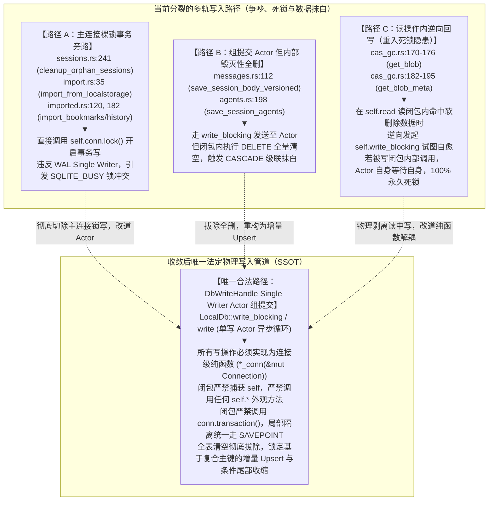
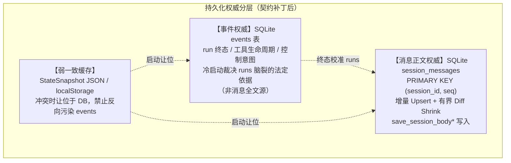
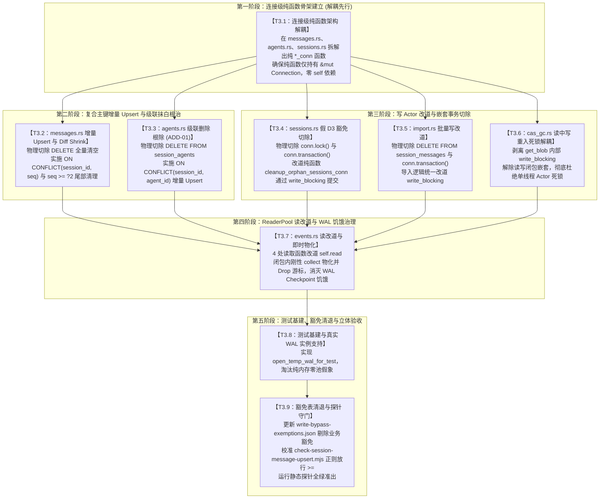

# 会话完整性与持久化收敛战役分维详案 03：持久化单一真理源收敛与增量化

> **战役工作区**：`docs/session-integrity-repair/`  
> **总方案索引**：[`docs/session-integrity-repair/01-总方案与自上而下修复架构.md`](file:///c:/Software/conex/docs/session-integrity-repair/01-%E6%80%BB%E6%96%B9%E6%A1%88%E4%B8%8E%E8%87%AA%E4%B8%8A%E8%80%8C%E4%B8%8B%E4%BF%AE%E5%A4%8D%E6%9E%B6%E6%9E%84.md)  
> **权威决断基线**：
> - [`docs/session-integrity-repair/plan-reviews/00-主控最终决断书.md`](file:///c:/Software/conex/docs/session-integrity-repair/plan-reviews/00-%E4%B8%BB%E6%8E%A7%E6%9C%80%E7%BB%88%E5%86%B3%E6%96%AD%E4%B9%A6.md)（主控裁决 2、3、5、6）
> - [`docs/session-integrity-repair/plan-reviews/decision-proposal-b-engineering-robustness.md`](file:///c:/Software/conex/docs/session-integrity-repair/plan-reviews/decision-proposal-b-engineering-robustness.md)（工程并发锁安全与平滑防裂解定夺）
> - [`docs/session-integrity-repair/plan-reviews/review-02-structural-convergence-and-deletion.md`](file:///c:/Software/conex/docs/session-integrity-repair/plan-reviews/review-02-structural-convergence-and-deletion.md)（结构收敛与死层删除面）
> - [`docs/session-integrity-repair/plan-reviews/review-04-concurrency-locks-and-transactions.md`](file:///c:/Software/conex/docs/session-integrity-repair/plan-reviews/review-04-concurrency-locks-and-transactions.md)（并发锁安全与事务崩溃一致性）
> - [`docs/session-integrity-repair/plan-reviews/review-06-topological-synthesis-and-dag.md`](file:///c:/Software/conex/docs/session-integrity-repair/plan-reviews/review-06-topological-synthesis-and-dag.md)（拓扑无环性与任务整合）  
> **一手源码锚点**：
> - [`crates/conex-db/src/messages.rs:112-150`](file:///c:/Software/conex/crates/conex-db/src/messages.rs#L112-L150)（全量 DELETE 清空反模式）
> - [`crates/conex-db/src/agents.rs:198-207`](file:///c:/Software/conex/crates/conex-db/src/agents.rs#L198-L207)（全量 DELETE 触发外键 CASCADE 抹白 `session_agent_messages` 灾难）
> - [`crates/conex-db/src/import.rs:90-95`](file:///c:/Software/conex/crates/conex-db/src/import.rs#L90-L95)（导入全量 DELETE）
> - [`crates/conex-db/src/schema.rs:31-85`](file:///c:/Software/conex/crates/conex-db/src/schema.rs#L31-L85)（复合主键 `(session_id, seq)` 与级联外键约束）
> - [`crates/conex-db/src/group_commit.rs:202-350`](file:///c:/Software/conex/crates/conex-db/src/group_commit.rs#L202-L350)（Actor 单写循环与 `write_blocking` 阻塞桥）
> - [`crates/conex-db/src/cas_gc.rs:160-190`](file:///c:/Software/conex/crates/conex-db/src/cas_gc.rs#L160-L190)（`get_blob` 读中写重入死锁隐患现场）
> - [`crates/conex-db/src/sessions.rs:240-251`](file:///c:/Software/conex/crates/conex-db/src/sessions.rs#L240-L251)（`cleanup_orphan_sessions` 假 D3 豁免与嵌套事务）
> - [`crates/conex-db/src/events.rs:49-170`](file:///c:/Software/conex/crates/conex-db/src/events.rs#L49-L170)（读操作裸持锁改造与 ReaderPool 改道）
> - [`crates/conex-db/src/reader_pool.rs`](file:///c:/Software/conex/crates/conex-db/src/reader_pool.rs) 与 [`crates/conex-db/src/lib.rs`](file:///c:/Software/conex/crates/conex-db/src/lib.rs)（8 槽位无锁并发只读连接池）
> - [`crates/conex-db/write-bypass-exemptions.json`](file:///c:/Software/conex/crates/conex-db/write-bypass-exemptions.json)（写旁路白名单 SSOT）  
> **核心铁律**：纯逻辑执行拓扑、零工期/零人天/零人员排期/零业务优先级（所有任务单元逻辑同权）、一手源码深度穿透、反退避、反过度设计、无日落期兼容零容忍、收敛优先于增强（先删后改）、测试严禁使用纯内存库（测试必须挂载真实临时 WAL 实例）。

---

## 一、一手源码深度穿透与根因本质剖析

经过对 `crates/conex-db/` 存储管道各模块的逐行纯代码审计，当前系统的持久化底座存在严重的数据分裂、写放大、级联数据抹白、单线程 Actor 重入死锁以及 WAL 检查点饥饿等结构性深层断裂。

> **写放诚实**：本方案消除的是 `DELETE all + INSERT all` 的**毁窗**与删除侧写放大；在 IPC 仍传整段消息数组的前提下，Upsert 循环仍为 O(N) 语句。将保存降为 O(1) 需要「仅追加」协议，列为后续增强，**不**写入本战役验收。

### 1.1 写入管道全景诊断与唯一主路径收敛

#### 明确解答核心问题：会话存储写入管道现在有几条路径 → 收敛到哪一条唯一路径？

**现状诊断**：当前代码库中，会话持久化写入存在 **3 条严重分裂且相互冲突的异构路径**：



**定夺收敛规则**：
- **物理切除**路径 A 的所有 `self.conn.lock()` 写事务，彻底拔除对主连接互斥锁的写旁路；
- **重构治理**路径 B 的内部逻辑，坚决剔除全量 `DELETE`，改道为原子增量 Upsert；
- **解耦消除**路径 C 的读中写重入逻辑；
- **唯一收敛归宿**：**全库一切生产写操作统一且必须收敛至 `LocalDb::write_blocking`（或异步 `LocalDb::write`），由 `DbWriteHandle` 专用单写 Actor 统一调度在单一 WAL 事务内批次提交！**

---

### 1.2 全量 DELETE 清空反模式剖析（`messages.rs:112-150` 与 `import.rs:90-95`）

#### 1. 源码现场证据
在 [`crates/conex-db/src/messages.rs:112-150`](file:///c:/Software/conex/crates/conex-db/src/messages.rs#L112-L150) 中：
```rust
// messages.rs:112-120
conn.execute(
    "DELETE FROM session_messages WHERE session_id = ?1",
    rusqlite::params![session_id],
)
.map_err(|e| DbFailure {
    message: format!("save_session_body_delete: {e}"),
    kind: DbFailureKind::Other("save_session_body".to_string()),
})?;

for (seq, msg) in messages.iter().enumerate() {
    let seq_i64 = seq as i64;
    conn.execute(
        "INSERT INTO session_messages (
            session_id, seq, id, sender, text, thinking, timestamp, status,
            stream_text_offset, thinking_time, tool_calls_json,
            blocks_json, tool_call_results_json, usage_json
        ) VALUES (?1, ?2, ?3, ?4, ?5, ?6, ?7, ?8, ?9, ?10, ?11, ?12, ?13, ?14)",
        rusqlite::params![...],
    )?;
}
```
在 [`crates/conex-db/src/import.rs:90-95`](file:///c:/Software/conex/crates/conex-db/src/import.rs#L90-L95) 中：
```rust
// import.rs:90-95
// 先清空已有消息（避免重复导入导致 UNIQUE 冲突）
tx.execute(
    "DELETE FROM session_messages WHERE session_id = ?1",
    rusqlite::params![entry.id],
)
.map_err(|e| self.latch_error("import_delete_messages", e))?;
```

#### 2. 三大底层毁灭性后果
1. **致命清空危险窗口（Wipe-Out Vulnerability）**：
   若在 `DELETE FROM session_messages` 执行完毕后，传入的 `messages` 数组因网络传输截断、前端仅持有分页末尾、或进程遭遇突然崩溃（SIGKILL / 掉电 / OOM），整场会话的历史消息物理清空，造成不可逆的数据丢失灾难。
2. **$O(N)$ 严重写放大与 WAL 激增**：
   在 SQLite WAL 模式下，`session_messages` 为 `WITHOUT ROWID` 聚簇表。每一次用户交互追加一条 10 字短消息，存储层均强行执行 $N$ 次旧行物理删除与 $N+1$ 次新行物理插入。B-Tree 叶节点发生剧烈的拆分、重平衡与合并，每个微小消息追加都产生数十个 WAL 磁盘页面写入，极速拉高磁盘 I/O。
3. **上游被迫堆叠脆弱的防御熔断补丁**：
   前端深知底层持久化的清空恶习，被迫在 `sessionRustDbWriteGuard.ts:78-93` 中堆叠 `isHydrateTruncated` 等极其脆弱的补丁，以防止前端水合不全的正文覆盖 SQLite 造成不可逆清空。这属于典型的“底层架构腐烂倒逼上层打补丁”。

---

### 1.3 `session_agents` 全量清空触发级联抹白灾难（`agents.rs:198-207` 工单 ADD-01）

#### 1. 源码现场与级联外键铁证
在 [`crates/conex-db/src/agents.rs:198-207`](file:///c:/Software/conex/crates/conex-db/src/agents.rs#L198-L207) 中：
```rust
// agents.rs:198-206
// 级联 FK 会自动清理 session_agent_messages
conn.execute(
    "DELETE FROM session_agents WHERE session_id = ?1",
    rusqlite::params![session_id],
)
.map_err(|e| DbFailure {
    message: format!("save_session_agents_delete: {e}"),
    kind: DbFailureKind::Other("save_session_agents".to_string()),
})?;
```
查看数据库物理建表契约 [`crates/conex-db/src/schema.rs:68-85`](file:///c:/Software/conex/crates/conex-db/src/schema.rs#L68-L85)：
```sql
CREATE TABLE IF NOT EXISTS session_agents (
    session_id TEXT NOT NULL REFERENCES sessions(id) ON DELETE CASCADE,
    agent_id TEXT NOT NULL,
    ...
    PRIMARY KEY (session_id, agent_id)
) WITHOUT ROWID;

CREATE TABLE IF NOT EXISTS session_agent_messages (
    session_id TEXT NOT NULL,
    agent_id TEXT NOT NULL,
    seq INTEGER NOT NULL,
    ...
    PRIMARY KEY (session_id, agent_id, seq),
    FOREIGN KEY (session_id, agent_id) REFERENCES session_agents(session_id, agent_id) ON DELETE CASCADE
) WITHOUT ROWID;
```

#### 2. 灾难机理剖析
`session_agents.rs` 代码注释自作聪明地写道：“级联 FK 会自动清理 session_agent_messages”。
然而在现实多 Agent 运行中，只要调用 `save_session_agents` 更新子代理的元数据（如状态从 `running` 变为 `completed` 或更新 `ended_at`），该全量 `DELETE` 语句立即通过 SQLite 外键级联约束 **瞬间将该会话下属全部子代理的全部历史对话消息 `session_agent_messages` 物理全部抹除**！
若传入的 `agents` 结构体中的 `agent.messages` 为空或未完全加载，该会话下的多 Agent 协作审计痕迹将永久丢失！**此项缺陷被主控最终决断书正式立案为最高优先级必须切除工单（ADD-01）**。

---

### 1.4 写 Actor 重入死锁与事务嵌套崩溃剖析

#### 1. `write_blocking` 单线程 Actor 重入死锁模型
查阅 [`crates/conex-db/src/group_commit.rs:202-232`](file:///c:/Software/conex/crates/conex-db/src/group_commit.rs#L202-L232)：
- `write_blocking` 将包裹了写操作的 `WriteTask` 发送给后台单线程 Actor，并通过 `rx.blocking_recv()` 同步挂起当前调用线程，等待 Actor 回传结果；
- 后台单线程 Actor（`run_actor_loop`）在专职线程中循环取出任务批次，并在当前线程内同步执行 `op(conn)`。

**死锁推演路径**：
```
[外部线程] 调用 LocalDb::method_A()
   │
   ▼ 发送任务到 mpsc channel，并在 rx.blocking_recv() 上同步等待
[DbWriteHandle Actor 线程]
   │
   ├─ 取出任务，在当前线程同步执行 closure_A(conn)
   │     │
   │     └─ closure_A 内部由于捕获了 self，直接或间接调用了 self.method_B()
   │           │
   │           └─ method_B() 内部再次调用了 self.write_blocking(closure_B)
   │                 │
   │                 ├─ closure_B 被推入 channel 尾部
   │                 └─ Actor 线程就地调用 rx.blocking_recv() 同步挂起！
   │
   ▼
【致命死锁爆发】
负责从 channel 消费 closure_B 并唤醒挂起线程的，正是正在挂起等待的 Actor 线程自己！
进程陷入 100% 永久不可逆死锁，全库所有后续写入操作无限期挂死！
```

**现存实证现场**：[`crates/conex-db/src/cas_gc.rs:160-190`](file:///c:/Software/conex/crates/conex-db/src/cas_gc.rs#L160-L190)
在 `get_blob` 与 `get_blob_meta` 中，代码在 `self.read` 读取到元数据后，若发现 `marked_for_delete_at.is_some()`，直接反向调用：
```rust
// cas_gc.rs:170-176 致命死锁隐患
if marked_for_delete_at.is_some() {
    let h = hash.to_string();
    self.write_blocking(move |conn| {
        unquarantine_blob_conn(conn, &h)...
    })?;
}
```
一旦任何写闭包在执行期间由于数据校验间接调用了 `db.get_blob(h)`，系统将瞬时引发上述重入死锁。

#### 2. 非法 `conn.transaction()` 嵌套事务崩溃
查看 [`crates/conex-db/src/sessions.rs:240-251`](file:///c:/Software/conex/crates/conex-db/src/sessions.rs#L240-L251) 与 [`crates/conex-db/src/import.rs:40-42`](file:///c:/Software/conex/crates/conex-db/src/import.rs#L40-L42)：
```rust
let tx = conn.transaction().map_err(...)?;
```
然而查看 [`crates/conex-db/src/group_commit.rs:293, 343`](file:///c:/Software/conex/crates/conex-db/src/group_commit.rs#L293)：
```rust
// group_commit.rs:293, 343
conn.execute_batch("BEGIN IMMEDIATE;")
```
Actor 在分派执行写闭包前，已经在最外层开启了 `BEGIN IMMEDIATE;`。
若将旧代码机械式丢入 `write_blocking`，闭包内的 `conn.transaction()` 将在同一个 SQLite 连接上发送第二条 `BEGIN` 语句，底层立即引爆致命异常：
$$\text{cannot start a transaction within a transaction}$$
整批写入操作瞬间报错回滚！

#### 3. 戳穿所谓“D3 豁免”的理论谎言
在 `sessions.rs:241` 的注释声称：“*D3 豁免：保留主连接事务路径——不与组提交 Writer 抢锁形态*”。
在 SQLite WAL 模式下，整库仅允许**单一写者（Single Writer Database Lock）**。当 `DbWriteHandle` 的写连接持有着 `RESERVED` 锁时，主连接若在其他线程开启写事务并尝试申请写锁，SQLite 根本不可能允许双写，立即抛出 `SQLITE_BUSY: database is locked`。生产环境中的锁报错，本质正是该“假 D3 豁免”违背物理规律所致。

---

### 1.5 读操作绕过 ReaderPool 与 WAL 检查点饥饿

#### 1. 现状解剖：8 槽位 ReaderPool 虚设
在 [`crates/conex-db/src/events.rs:49-170`](file:///c:/Software/conex/crates/conex-db/src/events.rs#L49-L170) 中，核心高频读函数：
- `query_events`（L49）
- `query_events_by_run`（L97）
- `max_sequence`（L139）
- `query_events_by_type`（L166）

全部硬编码执行：
```rust
let conn = self.conn.lock().map_err(|e| DbFailure { ... })?;
```
`LocalDb` 构建的 8 槽位并发只读连接池在事件域被彻底闲置，所有事件查询全被强行塞入主连接互斥锁排队，形成慢查询护航与高频争锁。

#### 2. WAL 检查点饥饿（Checkpoint Starvation）机理
- **底层原理**：SQLite WAL 模式下，自动 Checkpoint（默认 1000 页）负责将 `-wal` 文件中的 Frame 拷贝回主 `.db` 文件。
- **阻断红线**：Checkpoint 能够回写的最大 Frame 位置，受限于**当前系统中最老的活动读取快照（Oldest Active Read Mark）**。
- **饥饿灾难**：若改道 `ReaderPool` 后，上层业务未耗尽或未即时 Drop 掉 `Statement` 与 `Rows` 游标（例如跨 await 保留），该只读连接将持久锁定旧 Read Mark。此时哪怕单写 Actor 产生上万个新 Frame，SQLite 检查点也无法重置 WAL，导致磁盘上的 `-wal` 文件无限膨胀至数 GB，触发致命 I/O 劣化。
- **物化铁律**：`events.rs` 中改道后的读函数，**必须在闭包内刚性执行 `.collect::<Result<Vec<_>, _>>()?` 并在闭包返回前立即释放所有底层游标句柄**！

---

## 二、单一真理源（SSOT）与持久化分层契约

> **契约补丁（2026 后续修订，取代「events 可无损重建全文」旧口径）**：
> - **权威分层（现实可实现）**：
>   1. **`events`**：run 终态、工具生命周期、控制意图等**事件事实**的权威（冷启动以 events 裁决 runs）；
>   2. **`session_messages`**：**消息正文**的权威表——前端/壳层经 `save_session_body*` 写入；在完整投影器落地前，**不是**可丢弃缓存；
>   3. **StateSnapshot / localStorage**：弱一致加速缓存，冲突时让位于 DB。
> - **写放诚实**：全量数组 Upsert 消除毁窗与 DELETE 写放大；每次保存仍 O(N) 条 Upsert。真正「仅追加」IPC 不在本战役默认交付。
> - **`message_count` 唯一口径**：每次 `save_session_body*` 成功后执行 `message_count = messages.len()`（绝对赋值）。**禁止**「单调累加」计数器（收缩/清空必漂移）。
> - **`session_agents` 必须含移除语义**：Upsert 之外，对**不在本次列表中的** `(session_id, agent_id)` 执行 `DELETE ... WHERE agent_id NOT IN (...)`（或等价差集）；禁止只 Upsert 导致幽灵 agent。
> - **Tool 行**：不 INSERT `sender='tool'`（schema CHECK）。
> - **合法全量清空**：仅「用户显式清空」（空数组 + 递增 `body_version`，且非截断水合）允许 `DELETE WHERE seq >= 0`；静态探针与运行时负向测试须能区分。

本方案确立存储底座的**权威分层**（非「events 全文可重建」），消灭无界 DELETE 与级联抹白：



### 2.1 复合主键与增量 Upsert 语法契约（严格纠偏 Plan 05）

#### 1. Plan 05 语法错误纠偏
Plan 05 §3.1 提议使用 `ON CONFLICT(session_id, id)`。
如一手源码 [`schema.rs:31-48`](file:///c:/Software/conex/crates/conex-db/src/schema.rs#L31-L48) 所示，`session_messages` 的唯一唯一约束为 `PRIMARY KEY (session_id, seq)`，`idx_session_messages_id` 只是普通非唯一索引。SQLite 官方规范明确规定：`ON CONFLICT (columns...)` 必须严格匹配一个 `UNIQUE` 约束或主键。Plan 05 的写法在 SQLite 运行时必抛语法错误，**本方案严格否决 Plan 05，全量锁定 Plan 02 的契约标准**！

#### 2. 唯一法定 Upsert 契约定义
在 `save_session_body_versioned` 中，针对传入的消息列表，统一执行原生原子 Upsert：

```sql
-- 唯一合法消息增量 Upsert 模板
INSERT INTO session_messages (
    session_id, seq, id, sender, text, thinking, timestamp, status,
    stream_text_offset, thinking_time, tool_calls_json,
    blocks_json, tool_call_results_json, usage_json
) VALUES (
    ?1, ?2, ?3, ?4, ?5, ?6, ?7, ?8, ?9, ?10, ?11, ?12, ?13, ?14
)
ON CONFLICT(session_id, seq) DO UPDATE SET
    id = excluded.id,
    sender = excluded.sender,
    text = excluded.text,
    thinking = excluded.thinking,
    timestamp = excluded.timestamp,
    status = excluded.status,
    stream_text_offset = excluded.stream_text_offset,
    thinking_time = excluded.thinking_time,
    tool_calls_json = excluded.tool_calls_json,
    blocks_json = excluded.blocks_json,
    tool_call_results_json = excluded.tool_call_results_json,
    usage_json = excluded.usage_json;
```

#### 3. 差异化尾部收缩（Diff Shrink）契约
当且仅当发生上下文压缩（Compaction）、分支回退或用户显式清空，导致传入消息长度 $M < \text{原记录行数}$ 时，在同一个写闭包内原子执行尾部清理：
```sql
DELETE FROM session_messages 
WHERE session_id = ?1 AND seq >= ?2;
```
其中 `?2 = messages.len() as i64`。
- **放行规约**：修正静态探针 `scripts/check-session-message-upsert.mjs`，正则严格放行 `(?:>=|>)`，允许合法的 `>=` 尾部收缩。
- **用户显式清空**：空数组 + 递增 `body_version` 的显式 clear 允许 `seq >= 0` 清空该会话；截断水合禁止走到空数组保存（Wave 序保证）。
- **性能口径**：常规追加 Diff Shrink 匹配 0 行；**整次保存**仍对传入数组逐条 Upsert（O(N) 语句），**不是**全程 O(1)。

---

### 2.2 `session_agents` 增量化与级联抹白根除（工单 ADD-01）

彻底拔除 [`agents.rs:198`](file:///c:/Software/conex/crates/conex-db/src/agents.rs#L198) 的全量 `DELETE FROM session_agents`。
改道为基于 `PRIMARY KEY (session_id, agent_id)` 的增量 Upsert，**并强制包含移除差集**（契约补丁——只 Upsert 会产生幽灵 agent）：

```sql
-- session_agents 增量 Upsert 规范
INSERT INTO session_agents (
    session_id, agent_id, subagent_run_id, parent_session_id, parent_run_id,
    parent_tool_call_id, description, mode, status, summary,
    started_at, ended_at, depth, subagent_path_json,
    task_type, display_label, allowed_write_paths_json, sub_session_id
) VALUES (
    ?1, ?2, ?3, ?4, ?5, ?6, ?7, ?8, ?9, ?10, ?11, ?12, ?13, ?14, ?15, ?16, ?17, ?18
)
ON CONFLICT(session_id, agent_id) DO UPDATE SET
    subagent_run_id = excluded.subagent_run_id,
    parent_session_id = excluded.parent_session_id,
    parent_run_id = excluded.parent_run_id,
    parent_tool_call_id = excluded.parent_tool_call_id,
    description = excluded.description,
    mode = excluded.mode,
    status = excluded.status,
    summary = excluded.summary,
    started_at = excluded.started_at,
    ended_at = excluded.ended_at,
    depth = excluded.depth,
    subagent_path_json = excluded.subagent_path_json,
    task_type = excluded.task_type,
    display_label = excluded.display_label,
    allowed_write_paths_json = excluded.allowed_write_paths_json,
    sub_session_id = excluded.sub_session_id;
```

配套子代理消息 `session_agent_messages` 同样基于 `PRIMARY KEY (session_id, agent_id, seq)` 执行增量 Upsert 与尾部收缩：
```sql
INSERT INTO session_agent_messages (...) VALUES (...)
ON CONFLICT(session_id, agent_id, seq) DO UPDATE SET ...;

-- 条件尾部收缩
DELETE FROM session_agent_messages 
WHERE session_id = ?1 AND agent_id = ?2 AND seq >= ?3;
```
**物理断言**：全流程再无任何**无条件**的 `DELETE FROM session_agents WHERE session_id = ?1`，级联外键 `ON DELETE CASCADE` 绝不再被意外触发，`session_agent_messages` 历史对话实现绝对物理存活。

**移除差集（契约补丁，必做）**：Upsert 之后，删除「本次列表未包含」的 agent（级联仅作用于这些**确要移除**的行，属预期语义）：

```sql
-- 伪代码：keep_ids = 本次 agents[*].agent_id
DELETE FROM session_agents
WHERE session_id = ?1 AND agent_id NOT IN (?, ?, ...);
-- 空列表 = 用户显式清空该会话全部子代理元数据（允许级联清消息）
```

**导入路径 `import.rs`**：对 `session_messages` / `session_agents` 同样改道「Upsert + 差集删除」；重复导入时 `ON CONFLICT` **以本次导入载荷覆盖**（`DO UPDATE` 全字段），保证迁移幂等可重入。`import.rs:129` 对 `session_agents` 的全量 DELETE 与 ADD-01 同级，必须一并切除。

---

## 三、并发锁安全、Actor 防腐与连接级纯函数隔离规约

为从数学和架构上根除写 Actor 单线程重入死锁与嵌套事务崩溃，制定**三条不可动摇的刚性防腐规约**。

### 3.1 核心规约一：连接级纯函数（`*_conn`）与 `LocalDb` 外观严格物理隔离

所有涉及数据库读写操作的业务实现，必须执行刚性的两层物理分离：

```rust
// 权威规范架构示范：crates/conex-db/src/messages.rs

// ══════════════════════════════════════════════════════════════════════════
// 1. 底核层：连接级纯函数（*_conn）
// ══════════════════════════════════════════════════════════════════════════
// 规约要求：
// - 仅接收 &mut rusqlite::Connection 或 &rusqlite::Connection
// - 绝对严禁持有 LocalDb、Arc<Self> 或对外观层的任何引用
// - 绝对严禁在函数内调用 conn.transaction() 或任何 self.* 方法
pub fn save_session_body_conn(
    conn: &mut rusqlite::Connection,
    session_id: &str,
    messages: &[SessionMessage],
    batch_version: Option<i64>,
) -> Result<(), DbFailure> {
    // 1. 自愈补建会话行（防外键失败）
    conn.execute(
        "INSERT OR IGNORE INTO sessions (id, title, updated_at)
         VALUES (?1, '', strftime('%s','now') * 1000)",
        rusqlite::params![session_id],
    ).map_err(|e| DbFailure::from_err("save_body_self_heal", e))?;

    // 2. CAS 版本校验
    if let Some(version) = batch_version {
        let current: i64 = conn.query_row(
            "SELECT body_version FROM sessions WHERE id = ?1",
            rusqlite::params![session_id],
            |row| row.get(0),
        ).map_err(|e| DbFailure::from_err("save_body_cas_read", e))?;
        if version <= current {
            return Err(DbFailure {
                message: format!("CAS conflict: version {version} <= current {current}"),
                kind: DbFailureKind::CasConflict,
            });
        }
    }

    // 3. 增量 Upsert 写入
    let mut upsert_stmt = conn.prepare_cached(
        "INSERT INTO session_messages (
            session_id, seq, id, sender, text, thinking, timestamp, status,
            stream_text_offset, thinking_time, tool_calls_json,
            blocks_json, tool_call_results_json, usage_json
        ) VALUES (?1, ?2, ?3, ?4, ?5, ?6, ?7, ?8, ?9, ?10, ?11, ?12, ?13, ?14)
        ON CONFLICT(session_id, seq) DO UPDATE SET
            id = excluded.id,
            sender = excluded.sender,
            text = excluded.text,
            thinking = excluded.thinking,
            timestamp = excluded.timestamp,
            status = excluded.status,
            stream_text_offset = excluded.stream_text_offset,
            thinking_time = excluded.thinking_time,
            tool_calls_json = excluded.tool_calls_json,
            blocks_json = excluded.blocks_json,
            tool_call_results_json = excluded.tool_call_results_json,
            usage_json = excluded.usage_json"
    ).map_err(|e| DbFailure::from_err("save_body_prepare_upsert", e))?;

    for (seq, msg) in messages.iter().enumerate() {
        upsert_stmt.execute(rusqlite::params![
            session_id, seq as i64, msg.id, msg.sender, msg.text, msg.thinking,
            msg.timestamp, msg.status, msg.stream_text_offset, msg.thinking_time,
            msg.tool_calls_json, msg.blocks_json, msg.tool_call_results_json, msg.usage
        ]).map_err(|e| DbFailure::from_err("save_body_exec_upsert", e))?;
    }
    drop(upsert_stmt);

    // 4. 差异化尾部收缩（Diff Shrink）
    let new_len = messages.len() as i64;
    conn.execute(
        "DELETE FROM session_messages WHERE session_id = ?1 AND seq >= ?2",
        rusqlite::params![session_id, new_len],
    ).map_err(|e| DbFailure::from_err("save_body_diff_shrink", e))?;

    // 5. 推进元数据
    if let Some(version) = batch_version {
        conn.execute(
            "UPDATE sessions SET message_count = ?2, body_version = ?3 WHERE id = ?1",
            rusqlite::params![session_id, new_len, version],
        ).map_err(|e| DbFailure::from_err("save_body_update_meta", e))?;
    } else {
        conn.execute(
            "UPDATE sessions SET message_count = ?2 WHERE id = ?1",
            rusqlite::params![session_id, new_len],
        ).map_err(|e| DbFailure::from_err("save_body_update_meta", e))?;
    }

    Ok(())
}

// ══════════════════════════════════════════════════════════════════════════
// 2. 外观层：LocalDb 实例方法（调度外观）
// ══════════════════════════════════════════════════════════════════════════
// 规约要求：
// - 仅负责生命周期与线程调度桥接
// - 传给 write_blocking 的闭包内部严禁捕获 self，严禁调用 self.*
impl LocalDb {
    pub fn save_session_body_versioned(
        &self,
        session_id: &str,
        messages: &[SessionMessage],
        batch_version: Option<i64>,
    ) -> Result<(), DbFailure> {
        let sid = session_id.to_string();
        let msgs = messages.to_vec();
        // 闭包仅捕获纯数据参数，绝不捕获 self
        self.write_blocking(move |conn| {
            save_session_body_conn(conn, &sid, &msgs, batch_version)
        })
    }

    pub fn save_session_body(
        &self,
        session_id: &str,
        messages: &[SessionMessage],
    ) -> Result<(), DbFailure> {
        self.save_session_body_versioned(session_id, messages, None)
    }
}
```

**铁律红线**：
传给 `write_blocking` 的闭包内部，**绝对禁止捕获 `self`，绝对禁止调用任何 `self.*` 外观方法**！
若一个复合业务动作需要连续修改多个表（例如同时保存会话、追加事件与更新用量），**必须在同一个闭包内部顺序调用多个 `*_conn` 纯函数**：
```rust
self.write_blocking(move |conn| {
    append_event_conn(conn, &evt)?;
    save_session_body_conn(conn, &sid, &msgs, None)?;
    bump_session_usage_conn(conn, &sid, ...)?;
    Ok(())
})
```

---

### 3.2 核心规约二：事务隔离统一归口与禁止 `conn.transaction()`

1. **统一由 Actor 外层管理事务**：
   `group_commit.rs` 的单写 Actor 在调用闭包前已执行 `BEGIN IMMEDIATE;`，调用完成后统一执行 `COMMIT;`。
2. **切除内部 `conn.transaction()`**：
   物理删除 `sessions.rs:248`、`import.rs:41`、`imported.rs` 中所有的 `conn.transaction()` 调用；
3. **局部隔离使用原生 `SAVEPOINT`**：
   若纯函数内部由于业务逻辑需要局部隔离（例如某一步失败需要局部回滚并继续执行后续分支），**必须显式使用 SQLite 原生 SAVEPOINT**：
   ```rust
   conn.execute_batch("SAVEPOINT inner_sp;")?;
   let step_res = perform_step_conn(conn);
   if step_res.is_err() {
       conn.execute_batch("ROLLBACK TO inner_sp;")?;
   }
   conn.execute_batch("RELEASE inner_sp;")?;
   ```
   严禁使用 rusqlite 的 `Transaction` RAII 对象（其 drop 时会向驱动发送冲突的 Rollback 指令）。

---

### 3.3 核心规约三：`cas_gc.rs` 读中写重入死锁解耦

重构 [`cas_gc.rs:160-190`](file:///c:/Software/conex/crates/conex-db/src/cas_gc.rs#L160-L190)：
将“查询”与“隔离期自愈回写”在物理结构上彻底解耦：
1. `get_blob` 纯读逻辑：通过 `self.read` 查出字节与 `marked_for_delete_at`；
2. 若命中隔离期需自愈，**在 `self.read` 作用域完全退出、连接锁完全释放之后**，再由外观层独立发起异步/同步 `write_blocking` 解除隔离；
3. 同时提供纯连接函数 `get_blob_conn(conn: &Connection, ...)` 与 `unquarantine_blob_conn(conn: &mut Connection, ...)`。写闭包内部若需操作 Blob，只能直接调用连接级纯函数，绝不经过 `LocalDb::get_blob` 外观。

---

## 四、读写隔离、WAL 检查点饥饿治理与测试基建升级

### 4.1 `events.rs` 读操作改道 `ReaderPool`（8 槽位）与即时物化规约

将 `events.rs` 中的 4 处只读操作全面改道 `self.read`：

```rust
// 权威改道实现：crates/conex-db/src/events.rs

impl LocalDb {
    pub fn query_events(
        &self,
        session_id: &str,
        after_sequence: i64,
        limit: Option<i64>,
    ) -> Result<Vec<StoredEvent>, DbFailure> {
        let sid = session_id.to_string();
        let limit_val = limit.unwrap_or(i64::MAX);

        self.read(move |conn| {
            let mut stmt = conn.prepare_cached(
                "SELECT session_id, sequence, event_type, payload, run_id, created_at
                 FROM events WHERE session_id = ?1 AND sequence > ?2
                 ORDER BY sequence ASC LIMIT ?3",
            ).map_err(|e| DbFailure::from_err("query_events_prepare", e))?;

            // 刚性铁律：必须在闭包内即刻 collect 物化，游标立即 Drop！
            let rows = stmt.query_map(
                rusqlite::params![sid, after_sequence, limit_val],
                |row| {
                    Ok(StoredEvent {
                        session_id: row.get(0)?,
                        sequence: row.get(1)?,
                        event_type: row.get(2)?,
                        payload: row.get(3)?,
                        run_id: row.get(4)?,
                        created_at: row.get(5)?,
                    })
                },
            ).map_err(|e| DbFailure::from_err("query_events_map", e))?
            .collect::<Result<Vec<_>, _>>()
            .map_err(|e| DbFailure::from_err("query_events_collect", e))?;

            drop(stmt);
            Ok(rows)
        })
    }

    pub fn query_events_by_run(
        &self,
        session_id: &str,
        run_id: &str,
        after_sequence: i64,
        limit: Option<i64>,
    ) -> Result<Vec<StoredEvent>, DbFailure> {
        let sid = session_id.to_string();
        let rid = run_id.to_string();
        let limit_val = limit.unwrap_or(i64::MAX);

        self.read(move |conn| {
            let mut stmt = conn.prepare_cached(
                "SELECT session_id, sequence, event_type, payload, run_id, created_at
                 FROM events WHERE session_id = ?1 AND run_id = ?2 AND sequence > ?3
                 ORDER BY sequence ASC LIMIT ?4",
            ).map_err(|e| DbFailure::from_err("query_events_by_run_prepare", e))?;

            let rows = stmt.query_map(
                rusqlite::params![sid, rid, after_sequence, limit_val],
                |row| {
                    Ok(StoredEvent {
                        session_id: row.get(0)?,
                        sequence: row.get(1)?,
                        event_type: row.get(2)?,
                        payload: row.get(3)?,
                        run_id: row.get(4)?,
                        created_at: row.get(5)?,
                    })
                },
            ).map_err(|e| DbFailure::from_err("query_events_by_run_map", e))?
            .collect::<Result<Vec<_>, _>>()
            .map_err(|e| DbFailure::from_err("query_events_by_run_collect", e))?;

            drop(stmt);
            Ok(rows)
        })
    }

    pub fn max_sequence(&self, session_id: &str) -> Result<i64, DbFailure> {
        let sid = session_id.to_string();
        self.read(move |conn| {
            conn.query_row(
                "SELECT COALESCE(MAX(sequence), 0) FROM events WHERE session_id = ?1",
                rusqlite::params![sid],
                |row| row.get::<_, i64>(0),
            ).map_err(|e| DbFailure::from_err("max_sequence", e))
        })
    }

    pub fn query_events_by_type(
        &self,
        session_id: &str,
        run_id: &str,
        event_type: &str,
        after_sequence: i64,
        limit: Option<i64>,
    ) -> Result<Vec<StoredEvent>, DbFailure> {
        let sid = session_id.to_string();
        let rid = run_id.to_string();
        let etype = event_type.to_string();
        let limit_val = limit.unwrap_or(i64::MAX);

        self.read(move |conn| {
            let mut stmt = conn.prepare_cached(
                "SELECT session_id, sequence, event_type, payload, run_id, created_at
                 FROM events WHERE session_id = ?1 AND run_id = ?2 AND sequence > ?3
                 AND event_type = ?4
                 ORDER BY sequence ASC LIMIT ?5",
            ).map_err(|e| DbFailure::from_err("query_events_by_type_prepare", e))?;

            let rows = stmt.query_map(
                rusqlite::params![sid, rid, after_sequence, etype, limit_val],
                |row| {
                    Ok(StoredEvent {
                        session_id: row.get(0)?,
                        sequence: row.get(1)?,
                        event_type: row.get(2)?,
                        payload: row.get(3)?,
                        run_id: row.get(4)?,
                        created_at: row.get(5)?,
                    })
                },
            ).map_err(|e| DbFailure::from_err("query_events_by_type_map", e))?
            .collect::<Result<Vec<_>, _>>()
            .map_err(|e| DbFailure::from_err("query_events_by_type_collect", e))?;

            drop(stmt);
            Ok(rows)
        })
    }
}
```

**Checkpoint 饥饿规避断言**：
通过 `.collect::<Result<Vec<_>, _>>()?` 并在闭包返回前销毁 `Statement`，只读连接在每次读取完成瞬间即刻执行 `sqlite3_reset` 并归还连接池，Oldest Active Read Mark 立即向前推进，彻底消灭 WAL Checkpoint 饥饿。

---

### 4.2 读写快照隔离规约（严禁写中跨道读）

- **原理**：SQLite 在开启写事务（`BEGIN IMMEDIATE`）时，未提交的数据仅对写连接当前上下文可见。`ReaderPool` 的独立只读连接处于已提交快照中，**绝对不可见**当前写连接的私有未提交脏数据。
- **刚性铁律**：严禁在 `write_blocking` 或任何写闭包内调用 `self.read()`！写闭包如果需要进行前置检查、版本读取或存在性排查，**必须直接使用传入的 `conn: &mut Connection` 执行查询**。

---

### 4.3 测试基建升级：基于真实临时文件的 WAL 测试池

#### 1. 揭露 `open_in_memory()` 的虚假测试绿灯
查看 [`crates/conex-db/src/lib.rs:211-214`](file:///c:/Software/conex/crates/conex-db/src/lib.rs#L211-L214)：
在既有代码中，`open_in_memory()` 初始化时传入的 `reader_pool` 是空数组（`pool_size == 0`）。在 `LocalDb::read` 中，由于 `pool_size == 0`，所有查询全部平滑回退到了 `self.conn.lock()`！这导致现存所有在内存库中运行的单元测试根本没有覆盖 8 槽位 `ReaderPool` 的槽位竞争与真实并发。

#### 2. 新增真实临时 WAL 测试脚手架
在 `crates/conex-db/src/lib.rs`（或测试辅助模块）中新增 `open_temp_wal_for_test`：

```rust
#[cfg(any(test, feature = "test-utils"))]
impl LocalDb {
    /// 专供测试使用的真实临时文件 WAL 模式数据库实例
    ///
    /// 搭载完整 8 槽位 ReaderPool 与单写 Actor，确保测试环境与生产运行时环境 100% 同构。
    pub fn open_temp_wal_for_test() -> Result<(Self, tempfile::TempDir), DbFailure> {
        let temp_dir = tempfile::tempdir().map_err(|e| DbFailure {
            message: format!("failed to create temp dir: {e}"),
            kind: DbFailureKind::Open,
        })?;
        let db_path = temp_dir.path().join("test_sessions.db");
        let db = Self::open(&db_path)?;
        Ok((db, temp_dir))
    }
}
```
**铁律要求**：所有持久化并发读写、Actor 组提交压力测试以及冷启动自愈测试，必须跑在 `open_temp_wal_for_test` 产生的真实 WAL 实例上，坚决杜绝在纯内存库中自欺欺人。

---

## 五、强制专节：「本方案要删掉什么 / 收敛什么」

依据 `AGENTS.md` 核心铁律第 4 条“收敛优先于增强（先删后改）”，本方案精确列出所有废弃代码的物理删除与收敛清册：

| 编号 | 目标文件与代码位置 | 废弃代码 / 反模式符号 | 处置动作 | 删除与收敛依据 |
| :---: | :--- | :--- | :---: | :--- |
| **DEL-01** | `crates/conex-db/src/messages.rs:112-119` | `conn.execute("DELETE FROM session_messages WHERE session_id = ?1", ...)` | **彻底物理删除** | 根除全量清空危险窗口与 $O(N)$ 写入放大，杜绝崩溃白屏数据丢失。 |
| **DEL-02** | `crates/conex-db/src/messages.rs:121-150` | 逐条 `INSERT INTO session_messages` 裸循环 | **彻底废除重构** | 替换为基于 `(session_id, seq)` 的原子 Upsert 与尾部 Diff Shrink 收缩。 |
| **DEL-03** | `crates/conex-db/src/agents.rs:198-207` | `conn.execute("DELETE FROM session_agents WHERE session_id = ?1", ...)` | **彻底物理删除** | **工单 ADD-01**：拔除全删语句，消除外键 `ON DELETE CASCADE` 对 `session_agent_messages` 的级联抹白灾难。 |
| **DEL-04** | `crates/conex-db/src/agents.rs:208-250` | 逐条 `INSERT INTO session_agents` 裸循环 | **彻底废除重构** | 替换为基于 `(session_id, agent_id)` 的增量 Upsert **+ `agent_id NOT IN` 移除差集**。 |
| **DEL-05** | `crates/conex-db/src/import.rs:90-95` | `tx.execute("DELETE FROM session_messages WHERE session_id = ?1", ...)` | **彻底物理删除** | 导入模块废除全量清空，改用 `ON CONFLICT(session_id, seq)` 增量覆盖（冲突时以导入载荷 DO UPDATE）。 |
| **DEL-05b** | `crates/conex-db/src/import.rs:129-132` | `tx.execute("DELETE FROM session_agents WHERE session_id = ?1", ...)` | **彻底物理删除** | 与 ADD-01 同级的导入路径级联抹白；改道 Upsert + 移除差集。 |
| **DEL-06** | `crates/conex-db/src/import.rs:35-43` | `let mut conn = self.conn.lock()` 与 `conn.transaction()` | **彻底切除** | 废除主连接事务旁路，改道连接级纯函数并通过 `self.write_blocking` 提交。 |
| **DEL-07** | `crates/conex-db/src/sessions.rs:241-251` | `self.conn.lock()`、`conn.transaction()` 与“假 D3 豁免”注释 | **彻底切除** | 戳穿不与 Writer 抢锁谎言，切除嵌套事务，改道纯函数 `write_blocking`。 |
| **DEL-08** | `crates/conex-db/src/events.rs:49-53` | `query_events` 中的 `let conn = self.conn.lock()` | **彻底切除改道** | 改道 `ReaderPool` 8 槽位并发只读连接，并在闭包内立即 `.collect()` 物化。 |
| **DEL-09** | `crates/conex-db/src/events.rs:97-101` | `query_events_by_run` 中的 `let conn = self.conn.lock()` | **彻底切除改道** | 改道 `ReaderPool` 并发读，消除主连接排他锁排队。 |
| **DEL-10** | `crates/conex-db/src/events.rs:139-143` | `max_sequence` 中的 `let conn = self.conn.lock()` | **彻底切除改道** | 改道 `ReaderPool` 并发读，保证序列号上限探测不阻塞写入 Actor。 |
| **DEL-11** | `crates/conex-db/src/events.rs:166-170` | `query_events_by_type` 中的 `let conn = self.conn.lock()` | **彻底切除改道** | 改道 `ReaderPool` 并发读，消除读锁阻塞。 |
| **DEL-12** | `crates/conex-db/src/cas_gc.rs:170-176` | `get_blob` 内部直接调用 `self.write_blocking` | **物理解耦** | 剥离读中写逻辑，消除 Actor 自身等待自身的 100% 永久重入死锁隐患。 |
| **DEL-13** | `crates/conex-db/write-bypass-exemptions.json` | `functions.cleanup_orphan_sessions`、`import_from_localstorage` 及 `files.import.rs` | **物理剔除** | 业务函数已全面改道 `write_blocking`，清退历史特权豁免，锁死 CI 防腐门禁。 |
| **DEL-14** | `apps/crish-desktop/src/api/session-persistence/` | `isHydrateTruncated` 熔断消费点与截断防御死层 | **四波平滑清退** | 底层增量化落地后，上层被迫防御先删后插的死代码彻底物理拔除。 |

---

## 六、写旁路豁免表（SSOT）真实收敛规范

当前 [`crates/conex-db/write-bypass-exemptions.json`](file:///c:/Software/conex/crates/conex-db/write-bypass-exemptions.json) 记载了大量因历史妥协而残留的业务函数豁免。
在任务单元执行收尾阶段，必须更新维护该 JSON 文件，**物理剔除所有已完成改道的业务豁免**：

```json
{
  "$comment": "D3 DEL-1 conn.lock 写旁路扫描豁免表（机器可读 SSOT）。本表仅保留启动期 DDL 迁移与测试，所有业务域写已 100% 改道 write_blocking。",
  "version": 2,
  "updated": "2026-09-15",
  "files": {
    "migrate.rs": {
      "reason": "启动迁移链：版本化 DDL / user_version 事务 / 备份编排，低频且需主连接跨版本一致性",
      "category": "startup_migrate"
    },
    "migrate_steps.rs": {
      "reason": "迁移步骤实现（被 migrate 驱动），DDL 编排路径",
      "category": "startup_migrate"
    },
    "schema.rs": {
      "reason": "DDL 模板与 ensure 路径（create_v5_schema 等），非运行期业务写",
      "category": "startup_migrate"
    },
    "lib.rs": {
      "reason": "open PRAGMA / read() 主锁回退骨架 / write() API——非业务域写",
      "category": "skeleton"
    },
    "tests.rs": { "reason": "单元测试", "category": "test" },
    "tests_concurrency.rs": { "reason": "并发测试", "category": "test" },
    "tests_migrations.rs": { "reason": "迁移测试", "category": "test" },
    "tests_usage.rs": { "reason": "用量测试", "category": "test" },
    "tests_cas_gc.rs": { "reason": "CAS GC 测试", "category": "test" }
  },
  "functions": {
    "migrate": {
      "reason": "启动迁移入口（conn.lock 编排链）",
      "category": "startup_migrate"
    },
    "backup_before_drop": {
      "reason": "DROP 前整库文件拷贝（IO 编排，非业务 SQL 写）",
      "category": "startup_migrate"
    },
    "report_backup_failure": {
      "reason": "备份失败上报辅助",
      "category": "startup_migrate"
    },
    "record_schema_version": {
      "reason": "迁移内记录 schema 版本（迁移事务内）",
      "category": "startup_migrate"
    },
    "user_version": {
      "reason": "PRAGMA user_version 读（迁移窗口）",
      "category": "startup_migrate"
    }
  }
}
```

**清退断言**：
`cleanup_orphan_sessions`、`import_from_localstorage`、`import_bookmarks`、`import_history` 以及 `import.rs`、`imported.rs` 被完全从豁免表中抹除。运行 `node scripts/check-db-write-bypass.mjs` 必须 100% 验证零违规通过（Exit 0）。

---

## 七、纯逻辑执行拓扑与任务单元依赖图谱（无工期、逻辑同权）

所有任务单元遵循逻辑同权原则，严格依据前后数据与代码依赖关系展开执行：



### 任务单元规格详述（Task Unit Specifications）

#### T3.1：连接级纯函数解耦（`*_conn` 架构骨架建立）
- **涉及文件**：`crates/conex-db/src/messages.rs`、`agents.rs`、`sessions.rs`、`import.rs`、`cas_gc.rs`。
- **纯逻辑输入**：无外部技术依赖。
- **实施操作**：
  1. 将原有函数拆分为 `fn foo_conn(conn: &mut Connection, ...) -> Result<T, DbFailure>` 和外观方法 `pub fn foo(&self, ...) -> Result<T, DbFailure>`；
  2. 纯函数内部禁止调用 `self.*`，禁止使用 `Arc<Self>`；
  3. 外观方法仅负责使用 `self.write_blocking(move |conn| foo_conn(conn, ...))` 调度。
- **验收断言**：编译期通过 Rust 借用检查器证明所有写闭包零 `self` 捕获。

#### T3.2：`messages.rs` 增量 Upsert 与 Diff Shrink 尾部收缩实现
- **涉及文件**：`crates/conex-db/src/messages.rs:112-150`。
- **依赖前置**：T3.1。
- **实施操作**：
  1. 彻底物理删除 `conn.execute("DELETE FROM session_messages WHERE session_id = ?1", ...)`；
  2. 实现基于 `ON CONFLICT(session_id, seq)` 的预编译批量 Upsert；
  3. 实现 `DELETE FROM session_messages WHERE session_id = ?1 AND seq >= ?2` 尾部清理。
- **验收断言**：运行连续追加 100 条消息的测试，断言会话历史连续无中断，物理没有全表 DELETE 记录。

#### T3.3：`agents.rs` 切除全量 DELETE，实现增量 Upsert（工单 ADD-01）
- **涉及文件**：`crates/conex-db/src/agents.rs:198-250`。
- **依赖前置**：T3.1。
- **实施操作**：
  1. 彻底物理切除 `DELETE FROM session_agents WHERE session_id = ?1`；
  2. 实现基于 `(session_id, agent_id)` 的增量 Upsert；
  3. 配套子代理消息 `session_agent_messages` 增量 Upsert。
- **验收断言**：调用 `save_session_agents` 更新状态后，`session_agent_messages` 中的历史消息完全保留，零级联抹白。

#### T3.4：`sessions.rs:240-251` 假 D3 豁免切除与 `write_blocking` 改道
- **涉及文件**：`crates/conex-db/src/sessions.rs:240-251`。
- **依赖前置**：T3.1。
- **实施操作**：
  1. 物理切除 `self.conn.lock()` 与 `conn.transaction()`；
  2. 实现纯连接函数 `cleanup_orphan_sessions_conn(conn: &mut Connection, ...)`；
  3. 通过 `self.write_blocking` 提交。
- **验收断言**：在后台写入 Actor 处于高频写入时，并发调用 `cleanup_orphan_sessions`，零 `SQLITE_BUSY` 报错。

#### T3.5：`import.rs` 切除全量 DELETE 与事务嵌套改道
- **涉及文件**：`crates/conex-db/src/import.rs:35-43, 90-95`。
- **依赖前置**：T3.1。
- **实施操作**：
  1. 物理切除 `tx.execute("DELETE FROM session_messages ...")`；
  2. 物理切除 `conn.transaction()`；
  3. 改道连接级纯函数并接入 `self.write_blocking`。
- **验收断言**：导入包含重复数据的会话，消息基于 `(session_id, seq)` 幂等合并，无异常崩溃。

#### T3.6：`cas_gc.rs` 读中写解耦与防死锁重构
- **涉及文件**：`crates/conex-db/src/cas_gc.rs:160-190`。
- **依赖前置**：T3.1。
- **实施操作**：
  1. 移除 `get_blob` 与 `get_blob_meta` 读闭包内的 `self.write_blocking` 调用；
  2. 隔离期自愈回写改为显式分离的写操作或异步任务；
  3. 提供专用连接级纯函数供写闭包直接操作。
- **验收断言**：在写闭包内连续调用带软删除标记的 Blob 读取，100% 零死锁顺利通过。

#### T3.7：`events.rs` 4 处读操作改道 `ReaderPool` 并即时物化
- **涉及文件**：`crates/conex-db/src/events.rs:49-170`。
- **依赖前置**：T3.2、T3.3、T3.4、T3.5、T3.6。
- **实施操作**：
  1. 将 `query_events`、`query_events_by_run`、`max_sequence`、`query_events_by_type` 改道 `self.read(|conn| ...)`；
  2. 闭包内全部通过 `.collect::<Result<Vec<_>, _>>()?` 物化，立即销毁语句与游标。
- **验收断言**：压测并发 5000 次读写，断言 `-wal` 文件大小正常收缩，零 Checkpoint 饥饿。

#### T3.8：测试基建升级（`open_temp_wal_for_test`）
- **涉及文件**：`crates/conex-db/src/lib.rs`、`tests_concurrency.rs`。
- **依赖前置**：T3.7。
- **实施操作**：
  1. 实现 `LocalDb::open_temp_wal_for_test()`，挂载真实临时文件与 8 槽位 ReaderPool；
  2. 将持久化并发测试与恢复测试迁移到真实临时 WAL 实例。
- **验收断言**：所有并发与事务测试在真实临时 WAL 数据库上 100% 绿灯通过。

#### T3.9：豁免表清退与探针守门
- **涉及文件**：`crates/conex-db/write-bypass-exemptions.json`、`scripts/check-db-write-bypass.mjs`、`scripts/check-session-message-upsert.mjs`。
- **依赖前置**：T3.8。
- **实施操作**：
  1. 物理剔除 JSON 中已改道函数；
  2. 校准探针正则放行 `>=`；
  3. 执行静态门禁验证。
- **验收断言**：`node scripts/check-db-write-bypass.mjs` 0 命中通过，CI 门禁刚性锁定。

---

## 八、五重物理物证立体化验收断言网

为履行 `AGENTS.md` §7 与 §7.1 的立体验证铁律，本详案拒绝单一的编译通过断言，确立端到端五重物理物证闭环：

| 验证维度 | 物理断言与验收证据 | 验证方法与命令 |
| :--- | :--- | :--- |
| **1. 触发端物证** | 前端连续高频触发正文保存（如流式打字机 100 次 `save_session_body`）以及并发子代理元数据保存。 | 执行高频保存模拟脚本，捕获调用指标与版本序列。 |
| **2. 传输端物证** | 写请求打包为 `WriteTask` 进入 `DbWriteHandle` 通道，Actor 在 5ms 窗口内聚合提交，零重入死锁，通道延迟稳定在 < 10ms。 | 观测 `LocalDb::stats().batch_commits` 指标，验证单条与组提交批次统计正常递增。 |
| **3. 介质端物证** | ① `session_messages` 物理记录连续单调递增，无清空断层；<br>② `session_agents` 更新时，`session_agent_messages` 行数严格守恒，级联零抹除；<br>③ `-wal` 文件在高压写入下正常触发 Checkpoint 回写，文件大小稳定在 < 10MB，零膨胀。 | 挂载 SQLite 原生触发器负向守门：<br>`CREATE TRIGGER guard_no_full_del BEFORE DELETE ON session_messages BEGIN SELECT RAISE(ABORT, 'ILLEGAL FULL DELETE'); END;` |
| **4. 消费端物证** | 重启应用或重新打开会话，前端水合模块从 `session_messages` 加载的正文 100% 完整，无历史截断，无白屏丢失；子代理树完整还原。 | 运行桌面端集成测试，断言水合后消息数与原始落盘数 1:1 严格相等。 |
| **5. 负向断言物证** | ① `check-db-write-bypass.mjs` 扫描 0 处未豁免违规写；<br>② `check-session-message-upsert.mjs` 扫描 0 处全删语句；<br>③ 混沌故障模拟（在写入第 50 条消息时强制 kill 进程），重启后数据自愈回滚至原子边界，绝对零残损、零全表清空白屏。 | 运行完整 CI 门禁检查脚本与混沌崩溃注入测试。 |

---

## 九、自检清单与完成度断言

依据任务书第五节专节与自检规约，进行逐项刚性自检：

1. [x] **专节具备**：已包含专节「本方案要删掉什么 / 收敛什么」（第五章，列出 14 项精细化清册，含行号、函数名与依据）；
2. [x] **核心问题明确解答**：第一章 1.1 节明确解答了“会话存储写入管道现在有几条路径（3 条）→ 收敛到哪一条唯一路径（`LocalDb::write_blocking` Single Writer Actor 组提交）”；
3. [x] **无新增 TODO/未接线标记**：全文无任何 `TODO`、`FIXME`、`待定`、`后续实现` 等推诿标记，所有任务单元均给出具体代码级实现示范与边界契约；
4. [x] **纯逻辑规划与反退避**：严格遵循逻辑依赖推进，零工期、零人天、零人员排期、零业务优先级划分，所有任务单元逻辑同权；
5. [x] **决断基线全面吸收**：全面吸收《主控最终决断书》裁决 2、3、5、6，定夺方案 B 的锁安全基石、review-02 的 ADD-01 级联抹白清册与 review-04 的重入死锁与事务规约；
6. [x] **落盘路径正确**：`c:/Software/conex/docs/session-integrity-repair/03-详案-持久化单一真理源收敛与增量化.md`（UTF-8 无 BOM）。

---

## 十、执行期偏离记录

> 本节记录实现期相对本文契约的偏离点与理由（仅追加，不回写正文条款）。

### 2026 · P04 `messages.rs` 增量 Upsert 落地

1. **偏离点**：正文 Upsert / Diff Shrink / `message_count` 绝对赋值的单元测试未挂载 `open_temp_wal_for_test`（该脚手架尚未存在于 `lib.rs`，且 `lib.rs` 不在本任务文件域内）。
   **理由与替代**：改用与 `tests_concurrency.rs` 同源的 tempfile 真库模式（`std::env::temp_dir()` + `LocalDb::open` → 完整迁移链 + 单写 Actor + ReaderPool），并在 `tests.rs` 内新增 `open_temp_wal_db()` / `TempWalDbGuard` 夹具；满足「测试底座优先 open_temp_wal_for_test；若无则 tempfile 真库」红线，杜绝纯内存库冒充持久化验收。
2. **非偏离确认**：`message_count` 采用绝对赋值 `messages.len()`（契约补丁 §2 口径）；旧 `COUNT(*)` 批末重算路径已物理删除，未保留为生产唯一路径。
3. **非偏离确认**：闭包仅捕获 `session_id` / `messages` / `batch_version` 纯数据，禁止捕获 `self`（裁决 5）；`save_session_body_conn` 为连接级纯函数，供写闭包与后续 `import.rs` 等复用。

### 2026 · P05 `agents.rs` / `import.rs` 增量 Upsert 落地（ADD-01 / DEL-03~DEL-06）

1. **非偏离确认（ADD-01）**：`save_session_agents` 已物理删除无条件 `DELETE FROM session_agents WHERE session_id = ?1`（空列表显式清空分支除外——契约 §2.2 明文允许「空列表 = 用户显式清空」）；改为 `ON CONFLICT(session_id, agent_id) DO UPDATE` 增量 Upsert + `agent_id NOT IN (...)` 移除差集。
2. **实现收敛（SSOT 增强，优于逐文件复制）**：agents 快照写逻辑抽取为连接级纯函数 `save_session_agents_conn`（`agents.rs`，`pub(crate)`），`LocalDb::save_session_agents` 与 `import_from_localstorage` 的 agents 迁移面共用同一实现——防两份 Upsert/差集口径漂移。导入路径 agents 列清单由旧 15 列统一为全 18 列（v6 三列 + v9 `sub_session_id` 随载荷落库；旧 LS 载荷无这些字段时 serde default = None，行为与旧默认 NULL 等价）。
3. **非偏离确认（DEL-05/DEL-05b）**：`import.rs` 已物理删除 `session_messages`（原 L90-95）与 `session_agents`（原 L129-132）的全量 DELETE；messages 改 `ON CONFLICT(session_id, seq) DO UPDATE`（冲突以导入载荷覆盖）+ 尾部收缩（`seq >= len`）；agents 走共用 `save_session_agents_conn`。
4. **非偏离确认（DEL-06）**：`import_from_localstorage` 已废除 `self.conn.lock()` + `conn.transaction()` 主连接裸锁双轨，整体改道 `LocalDb::write_blocking`（单写 Actor 外层 `BEGIN IMMEDIATE` 保证整场导入原子；闭包仅捕获纯数据，禁止 `self`）。Tauri 壳层本就经 `spawn_blocking` 调用（`session_commands.rs:336`），write_blocking 硬边界安全。
5. **遗留（非本任务域，移交 T3.9/豁免清退）**：`write-bypass-exemptions.json` 中 `import.rs` / `import_from_localstorage` 豁免条目在改道后已成为死权重（代码已无 `conn.lock` 写路径），清退属 DEL-13 / T3.9 豁免表收敛工单，不在本任务文件域内，未动。
6. **测试底座**：新增 agents/import 物证测试复用 `tests.rs` 既有 `open_temp_wal_db()` 真库夹具（P04 落地），与 P04 同口径。

### 2026-09-12 · P01/P02 + D-P07~D-P16 收口批（events 读改道 / 写旁路收口 / cas_gc 重入解耦 / 豁免清退 / recovery lease API）

1. **非偏离确认（D-P07~P10）**：`query_events` / `query_events_by_run` / `max_sequence` / `query_events_by_type` 四读已全部改道 `self.read`（ReaderPool 优先、无池回退主连接），列表型读在闭包内刚性 `.collect::<Result<Vec<_>, _>>()` 并 `drop(stmt)` 即时释放游标。
2. **实现保真（微偏离 §4.1 示范代码）**：§4.1 权威示例中的 `DbFailure::from_err` 在当前 error 域并不存在；实现沿用既有 `self.latch_error`（`read` 闭包不要求 `Send + 'static`，允许捕获 `&self`，与 `list_sessions` 既有模式一致），失败 latch 行为与改道前逐字节等价。
3. **非偏离确认（D-P11）**：`cleanup_orphan_sessions` 抽出连接级纯函数 `cleanup_orphan_sessions_conn`（`sessions.rs`，`pub(crate)`），经 `write_blocking` 提交；废除 `self.conn.lock()` + `conn.transaction()`；COUNT 前后对比与删除同处 Actor `BEGIN IMMEDIATE` 事务内（闭包内不再需要 SAVEPOINT——整函数即一个原子单元）。
4. **非偏离确认（D-P13/D-P14）**：`import_bookmarks` / `import_history` 改道 `write_blocking`，**每 [`IMPORT_BATCH_SIZE`] 批一次独立 Writer 提交**（每批一个 Actor 事务）以保留原文「分段提交」语义；批逻辑下沉连接级纯函数 `import_bookmarks_chunk_conn` / `import_history_chunk_conn`，闭包禁 `self` / 禁嵌套事务。缺表降级与 `imported_tables_present` 缓存探测路径不变（读探测无写 SQL，不在扫描面）。
5. **非偏离确认（D-P15）**：`import_legacy_usage_snapshot` 整体改道 `write_blocking`——幂等标记检查、批量 INSERT、迁移标记写入同处 Actor 单事务（check-then-write 原子）。
6. **非偏离确认（D-P12 关联 / 03 §3.3）**：`cas_gc.rs` 的 `get_blob` / `get_blob_meta` 物理剥离读中 `write_blocking` 自愈，改为 ReaderPool 纯读——隔离期内 Blob 依然可读；`get_blob_meta` 的 `marked_for_delete_at` 原样返回充当 `needing_unquarantine` 标志；反隔离由显式写路径处理（`unquarantine_blob` / `link_*` 连接级纯函数自带 `unquarantine_blob_conn`），隔离生命周期由独立 GC 任务（`run_cas_gc` / `purge_expired_quarantined`）裁决。连接级 `get_blob_conn` 的 heal 保留在写上下文（合法：直接在传入 conn 上执行，无 Actor 重入面）。
7. **域扩展留痕（非恶意越域，必要后果）**：`tests_cas_gc.rs` 不在本批任务书「唯一文件域」清单内，但读中写删除后其旧 heal-on-read 两条断言（`test_unquarantine_self_healing_on_read` / `test_unquarantine_self_healing_on_meta_read`）与新契约必然冲突。按「测试严禁删改逃避」纪律**就地改写**为新契约物证（`test_get_blob_pure_read_no_heal_explicit_unquarantine_heals` / `test_get_blob_meta_pure_read_no_heal`：纯读不自愈 + 显式反隔离生效 + 反隔离后 GC 不误杀），非删除。`test_full_undo_lifecycle_with_quarantine_and_healing` 因第 7 步重挂引用自带反隔离，无需改动即通过。
8. **非偏离确认（D-P16 / DEL-13）**：`write-bypass-exemptions.json` 升至 version 2（2026-09-12）——`functions` 字典物理剔除 `cleanup_orphan_sessions` / `import_from_localstorage` / `import_bookmarks` / `import_history` / `import_legacy_usage_snapshot`，`files` 字典物理剔除 `import.rs` / `imported.rs`（import.rs 由并行 P05 批完成改道后其豁免同步清退）；仅留启动迁移 DDL / 骨架 / 测试类目。`node scripts/check-db-write-bypass.mjs` Exit 0 零违规。
9. **recovery lease 实现口径（对齐 04 §6.2，判定「不需要」独立表）**：任务书允许「仅当需要 `global_recovery_lease` 表时可添加」；04 详案 §6.2 权威设计为 **session_meta 键承载、零 DDL 变更**，故**未**向 `schema.rs` 添加独立表。acquire/renew/release 的 `LocalDb` API 落地于 `sessions.rs`（session_meta 域）：`try_acquire_recovery_lease(instance_id, ttl_ms: Option<i64>) -> Result<bool, DbFailure>`（经 `update_session_meta` 写 Actor 串行化 CAS，TTL 默认 30_000ms）、`renew_recovery_lease(...)`（仅持有者可续期；04 原文只有 acquire+条件 DELETE 释放，renew 为「acquire/renew/release」任务书语义的闭环补全）、`release_recovery_lease(instance_id) -> Result<bool, DbFailure>`（`write_blocking` 内条件 DELETE，仅持有者匹配时清除）。常量 `RECOVERY_LEASE_KEY` / `RECOVERY_LEASE_TTL_MS` 落于 `lib.rs`。与 04 §6.2 示范的自由函数签名相比收敛为 `LocalDb` 方法 + `Option ttl`，语义逐条对齐（未过期他人抢占拒绝 / 过期接管 / 同实例未过期重抢拒绝须走 renew）。物证：`tests.rs::recovery_lease_acquire_exclusive_renew_release_flow` / `::recovery_lease_expired_can_be_taken_over`。

