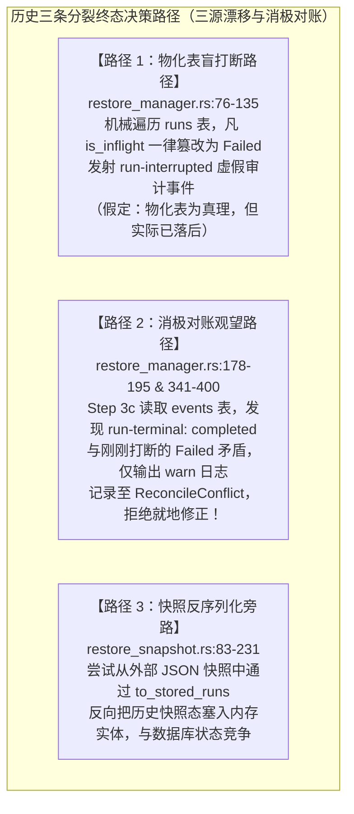
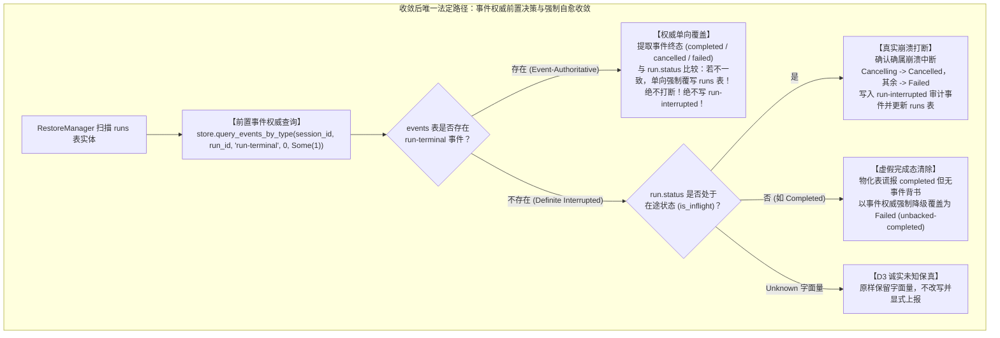
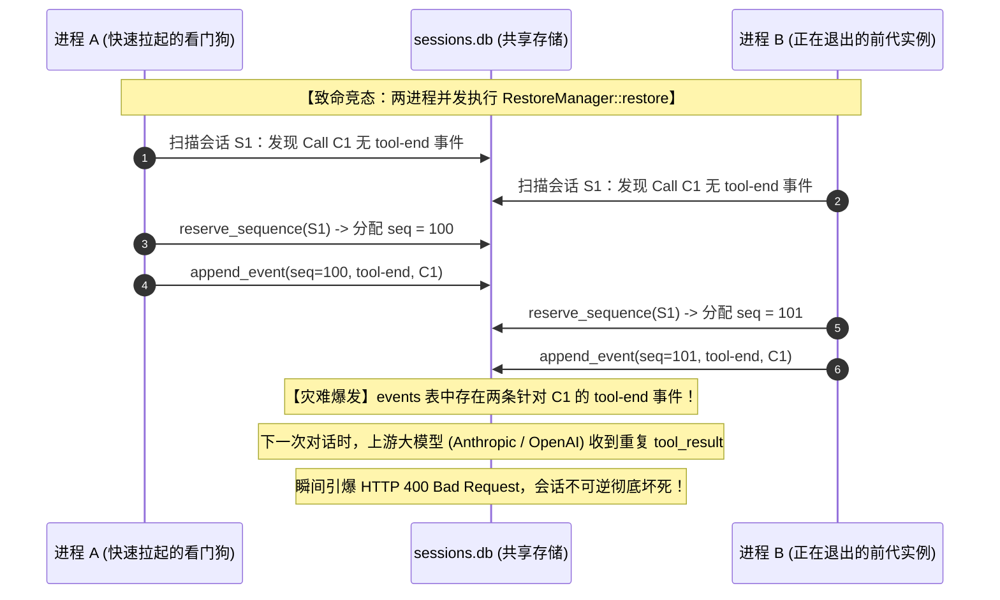
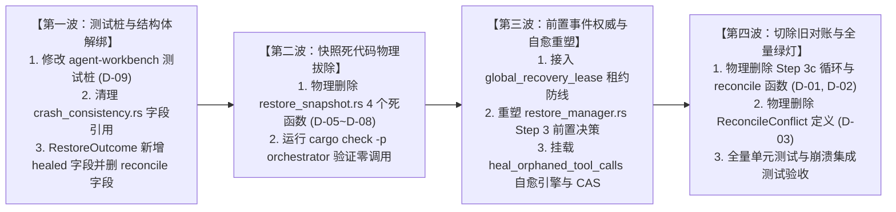
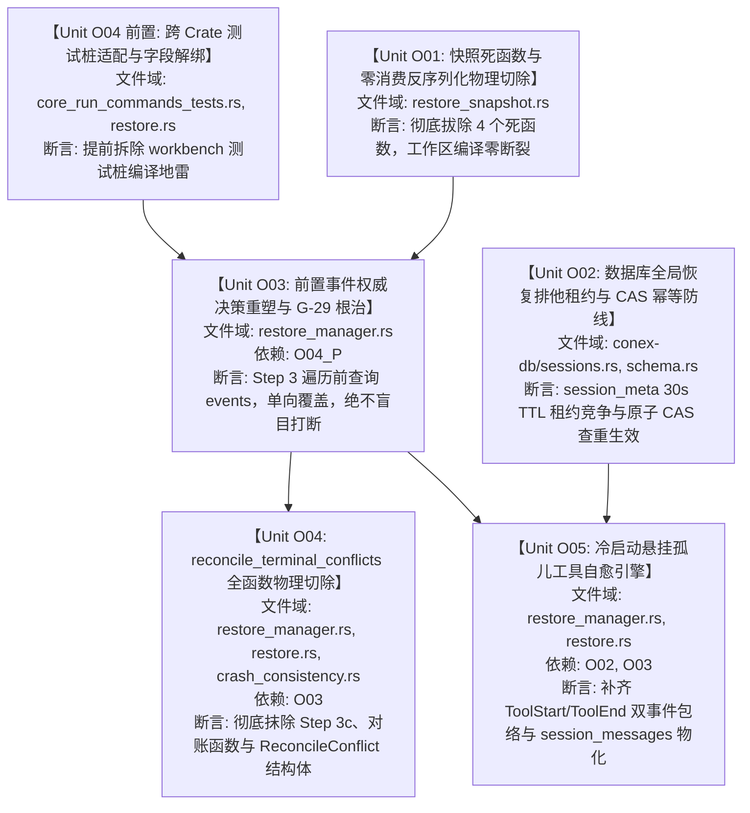

# 会话完整性与持久化收敛战役：详案 04 - 冷启动恢复一致性与强制自愈

> **战役工作区**：`docs/session-integrity-repair/`  
> **落盘路径**：`c:/Software/conex/docs/session-integrity-repair/04-详案-冷启动恢复一致性与强制自愈.md`（UTF-8 无 BOM）  
> **权威纪律依据**：仓库根目录 `AGENTS.md`、`.agents/LOGIC_PLAN_NO_RETREAT.md`、`ANTI_OVERENGINEERING_GUARDRAILS.md`。  
> **核心决断基线**：
> - 《主控最终技术决断书》（[`docs/session-integrity-repair/plan-reviews/00-主控最终决断书.md`](file:///c:/Software/conex/docs/session-integrity-repair/plan-reviews/00-主控最终决断书.md)）
> - 《修改定夺方案 A：架构纯粹性与系统根除视角》（[`decision-proposal-a-architectural-purity.md`](file:///c:/Software/conex/docs/session-integrity-repair/plan-reviews/decision-proposal-a-architectural-purity.md)）
> - 《修改定夺方案 B：工程并发锁安全、零回归防裂解与立体落地定夺》（[`decision-proposal-b-engineering-robustness.md`](file:///c:/Software/conex/docs/session-integrity-repair/plan-reviews/decision-proposal-b-engineering-robustness.md)）
> - 核心评审报告：`review-01`（效果锁与目的性）、`review-02`（结构收敛与死层物理删除）、`review-04`（并发锁安全与崩溃一致性）
>
> **一手源码研读域与锚点**：
> 1. 编排器恢复与生命周期源码集群：
>    - [`crates/orchestrator/src/restore_manager.rs:18-60, 76-195, 341-400`](file:///c:/Software/conex/crates/orchestrator/src/restore_manager.rs)（冷启动扫描、盲目打断循环、G-29 终态矛盾对账消极分支）
>    - [`crates/orchestrator/src/restore.rs:100-144`](file:///c:/Software/conex/crates/orchestrator/src/restore.rs)（`ReconcileConflict` 结构体与 `RestoreOutcome` 容器字段）
>    - [`crates/orchestrator/src/restore_snapshot.rs:83-231`](file:///c:/Software/conex/crates/orchestrator/src/restore_snapshot.rs)（4 个零消费死反序列化函数）
>    - [`crates/orchestrator/src/persist.rs:148-260`](file:///c:/Software/conex/crates/orchestrator/src/persist.rs)（`Store` trait 抽象与 `LocalDbStore` 实现）
>    - [`apps/agent-workbench/src-tauri/src/core_run_commands_tests.rs:4102-4116`](file:///c:/Software/conex/apps/agent-workbench/src-tauri/src/core_run_commands_tests.rs)（`RestoreOutcome` 跨 Crate 编译点适配）
>    - [`crates/orchestrator/tests/crash_consistency.rs:185, 294, 476, 1340-1430`](file:///c:/Software/conex/crates/orchestrator/tests/crash_consistency.rs)（存量妥协测试与 G-29 虚假契约）
> 2. 存储端真理模型与租约机制：
>    - [`crates/conex-db/src/events.rs:7-37, 160-200`](file:///c:/Software/conex/crates/conex-db/src/events.rs)（事件单调序列与 `query_events_by_type`）
>    - [`crates/conex-db/src/runs.rs:110-175`](file:///c:/Software/conex/crates/conex-db/src/runs.rs)（物化表 `update_run_status` 与 `insert_run`）
>    - [`crates/conex-db/src/sessions.rs:180-215`](file:///c:/Software/conex/crates/conex-db/src/sessions.rs)（`update_session_meta` 原子闭包）
>    - [`crates/conex-db/src/schema.rs:87, 147-160`](file:///c:/Software/conex/crates/conex-db/src/schema.rs)（`session_meta` 键值表与 `events` 物理约束）
>
> **核心铁律**：
> 1. **纯逻辑规划**：仅包含纯逻辑依赖、任务单元、代码行号与验收断言，严禁包含工期、人天、排期或 P0/P1 业务优先级（所有任务单元逻辑同权）；
> 2. **事件终态权威（run 域）**：`events` 中 `run-terminal` 等运行生命周期事件是 run 终态法定真理；**消息正文权威仍在 `session_messages`**（events 非全文源，见 03 契约补丁）；
> 3. **根因前置消除，拒绝打补丁式收敛**：推翻“先错改后修正”与“只上报不修复”的消极妥协，时序前置决断，物理切除死代码与消极对账；
> 4. **并发防脑裂与原子幂等**：数据库级全局恢复排他租约（30s TTL + 到期续租）结合原子 CAS 存在性排查，杜绝重复合成与下游 HTTP 400 灾难；
> 5. **平滑演进零编译断裂**：严格遵循无环依赖拓扑，先行适配跨 Crate 测试桩，确保工程步步绿灯。
>
> **契约补丁（2026 后续修订）**：
> - **Unknown 状态统一为本详案口径**：`RunStatus::Unknown(字面量)` **保真保留、不改写 Failed**；仅 warn + 诊断上报。与 06 旧 D-O01 冲突时以本条为准；
> - **仍删除** `reconcile_terminal_conflicts` / `ReconcileConflict` / `reconcile_conflicts` 字段；
> - **批量终态查询**：一次拉齐全部 `run-terminal`，禁止 per-run N+1。

---

## 目录

- [一、旧路径清册与系统性病灶剖析](#一旧路径清册与系统性病灶剖析)
- [二、核心收敛之问：崩溃恢复终态决策路径收敛](#二核心收敛之问崩溃恢复终态决策路径收敛)
  - [2.1 历史三条分裂路径深度解构](#21-历史三条分裂路径深度解构)
  - [2.2 收敛到唯一法定路径：事件权威前置决策与强制自愈收敛路径](#22-收敛到唯一法定路径事件权威前置决策与强制自愈收敛路径)
  - [2.3 状态收敛状态转移方程与数学封闭性证明](#23-状态收敛状态转移方程与数学封闭性证明)
- [三、架构真理模型与单向强制收敛原则](#三架构真理模型与单向强制收敛原则)
  - [3.1 四层真理等级序列（Truth Authority Hierarchy）](#31-四层真理等级序列truth-authority-hierarchy)
  - [3.2 三大单向强制收敛不变量（Invariants）](#32-三大单向强制收敛不变量invariants)
  - [3.3 零盲目重跑原则与执行边界防护](#33-零盲目重跑原则与执行边界防护)
- [四、核心设计一：彻底前置消除终态矛盾（根治 G-29 与时序重塑）](#四核心设计一彻底前置消除终态矛盾根治-g-29-与时序重塑)
  - [4.1 现存缺陷时序：盲目打断、伪对账与“只报不修”](#41-现存缺陷时序盲目打断伪对账与只报不修)
  - [4.2 事件权威前置决策算法与重塑时序拓扑](#42-事件权威前置决策算法与重塑时序拓扑)
  - [4.3 终态单向覆盖与非打断保全机制](#43-终态单向覆盖与非打断保全机制)
  - [4.4 跨 Crate 编译地雷拆除与测试桩同步平滑适配](#44-跨-crate-编译地雷拆除与测试桩同步平滑适配)
- [五、核心设计二：冷启动悬挂孤儿工具自愈引擎](#五核心设计二冷启动悬挂孤儿工具自愈引擎)
  - [5.1 悬挂孤儿调用深度探测算法（Assistant ToolCall vs Event Stream）](#51-悬挂孤儿调用深度探测算法assistant-toolcall-vs-event-stream)
  - [5.2 强制成对补齐 `ToolStart` 与 `ToolEnd` 事件包络完整性](#52-强制成对补齐-toolstart-与-toolend-事件包络完整性)
  - [5.3 `ToolOutcomeUnknown` 修复事件载荷规范与序列原子分配](#53-tooloutcomeunknown-修复事件载荷规范与序列原子分配)
  - [5.4 消息物化视图 `session_messages` 同步增量写入](#54-消息物化视图-session_messages-同步增量写入)
- [六、核心设计三：多实例并发恢复排他防脑裂与原子 CAS 幂等](#六核心设计三多实例并发恢复排他防脑裂与原子-cas-幂等)
  - [6.1 多实例并发恢复引发重复合成与 HTTP 400 灾难机理](#61-多实例并发恢复引发重复合成与-http-400-灾难机理)
  - [6.2 防线一：数据库级全局恢复排他租约（Global Recovery Advisory Lease）](#62-防线一数据库级全局恢复排他租约global-recovery-advisory-lease)
  - [6.3 防线二：自愈合成写入原子 CAS 存在性排查（Check-and-Set Invariant）](#63-防线二自愈合成写入原子-cas-存在性排查check-and-set-invariant)
  - [6.4 SQLite WAL 模式下单写者 Actor 管道与死锁免疫证明](#64-sqlite-wal-模式下单写者-actor-管道与死锁免疫证明)
- [七、核心设计四：快照层死代码物理清理与不可信加速缓存定位](#七核心设计四快照层死代码物理清理与不可信加速缓存定位)
  - [7.1 快照定位：纯粹的不可信加速缓存，严禁反向污染](#71-快照定位纯粹的不可信加速缓存严禁反向污染)
  - [7.2 4 个零消费死反序列化函数物理拔除](#72-4-个零消费死反序列化函数物理拔除)
  - [7.3 快照超前断层防御（Future-Sequence Defense）](#73-快照超前断层防御future-sequence-defense)
- [八、专节：本方案要删掉什么 / 收敛什么（架构净收敛清单）](#八专节本方案要删掉什么--收敛什么架构净收敛清单)
  - [8.1 物理删除清册（文件、行号、符号、处置动作、替代依据）](#81-物理删除清册文件行号符号处置动作替代依据)
  - [8.2 外科改道与平滑解绑清册](#82-外科改道与平滑解绑清册)
  - [8.3 四波平滑演进拓扑（步步编译绿灯）](#83-四波平滑演进拓扑步步编译绿灯)
- [九、纯逻辑执行拓扑与任务单元依赖网（DAG）](#九纯逻辑执行拓扑与任务单元依赖网dag)
  - [9.1 阶段划分与无环拓扑依赖图](#91-阶段划分与无环拓扑依赖图)
  - [9.2 纯逻辑任务单元规范表（同权无优先级）](#92-纯逻辑任务单元规范表同权无优先级)
- [十、全链路立体化验证断言与验收矩阵](#十全链路立体化验证断言与验收矩阵)
  - [10.1 五重客观物理物证验收标准](#101-五重客观物理物证验收标准)
  - [10.2 自动化测试用例清单与回归断言网](#102-自动化测试用例清单与回归断言网)
- [十一、完成后全景自检核查清单](#十一完成后全景自检核查清单)

---

## 一、旧路径清册与系统性病灶剖析

在会话生命周期管理中，进程异常崩溃（Daemon Restart、OS OOM Killer、机器断电或桌面强制退出）是不可避免的物理事实。系统冷启动恢复（Cold-Start Recovery）是保障会话连续性、数据不丢不裂、状态机安全闭合的生命线。然而，经对一手源码的逐行审计，既有架构在恢复期存在 **5 大系统性病灶与旧路径**：

```
┌──────────────────────────────────────────────────────────────────────────────────────────────────┐
│                                 五大历史旧路径与系统性病灶剖析                                   │
├──────────────────────────────────────────────────────────────────────────────────────────────────┤
│ 【旧路径 1：G-29 终态矛盾对账“只报不修、诚实滞留”】                                             │
│ - 代码现场：crates/orchestrator/src/restore_manager.rs:178-195                                   │
│ - 病灶本质：在 Step 3 盲目将所有处于在途（is_inflight）状态的 run 强行写为 Failed，发射虚假的   │
│   run-interrupted 事件。随后在 Step 3c 发现 events 表其实早已有 run-terminal(completed)，        │
│   系统却以“诚实滞留”为借口，仅打印 tracing::warn 并装入 reconcile_conflicts，拒绝翻写 runs 表， │
│   造成 runs 表与 events 表永久性脑裂（Split-Brain）。                                            │
├──────────────────────────────────────────────────────────────────────────────────────────────────┤
│ 【旧路径 2：reconcile_terminal_conflicts 无效消极函数】                                          │
│ - 代码现场：crates/orchestrator/src/restore_manager.rs:341-400                                   │
│ - 病灶本质：60 行只读比对函数，只查矛盾却从不修复；属于典型的“打补丁式观望代码”。其不仅平白     │
│   增加冷启动 O(runs) 的事件查询开销，而且将矛盾上报固化为业务接口（struct ReconcileConflict），   │
│   污染下游数据模型与测试断言。                                                                   │
├──────────────────────────────────────────────────────────────────────────────────────────────────┤
│ 【旧路径 3：冷启动完全缺失悬挂孤儿工具调用的自愈修复机制】                                       │
│ - 代码现场：crates/orchestrator/src/restore_manager.rs 全文                                      │
│ - 病灶本质：进程在工具调用执行期间崩溃时，会话中残留带有 tool_calls 的 Assistant 消息，但底层   │
│   events 表与 session_messages 永久缺失工具执行结果。冷启动恢复对此类“悬挂孤儿”视若无睹，导致    │
│   会话在下一次发起对话时触发大模型 API 致命校验失败（HTTP 400 Bad Request），会话彻底报废。     │
├──────────────────────────────────────────────────────────────────────────────────────────────────┤
│ 【旧路径 4：恢复过程无并发互斥锁，多实例并发极易重复合成孤儿事件】                               │
│ - 代码现场：crates/orchestrator/src/restore_manager.rs:18-46                                     │
│ - 病灶本质：RestoreManager 为无状态结构体，恢复过程零排他锁保护。在多 Agent 独立进程、CLI 连库、│
│   测试并发或看门狗快速重启时，两个实例同时恢复同一会话，会先后为同一个 call_id 追加两条          │
│   tool-end 事件，导致下游再次触发 HTTP 400（重复结果校验失败）。                                  │
├──────────────────────────────────────────────────────────────────────────────────────────────────┤
│ 【旧路径 5：restore_snapshot.rs 存在 4 个死反序列化函数】                                        │
│ - 代码现场：crates/orchestrator/src/restore_snapshot.rs:83-102, 133-144, 219-231                 │
│ - 病灶本质：to_stored_run、to_pending_input、to_stored_runs、to_pending_inputs 4 个历史函数在全仓 │
│   已无任何生产与测试调用，属于未清理的僵尸死代码；且其试图用不可信快照构造实体，违背 SSOT。      │
└──────────────────────────────────────────────────────────────────────────────────────────────────┘
```

---

## 二、核心收敛之问：崩溃恢复终态决策路径收敛

> **方案核心必答之问**：崩溃恢复终态决策现在有几条路径？收敛到哪一条唯一路径？

### 2.1 历史三条分裂路径深度解构

在本次战役定夺前，全仓关于崩溃恢复终态决策存在 **3 条相互冲突且逻辑割裂的路径**：



1. **路径 1（物化表盲打断路径）**：
   - 依赖前提：假设 `runs` 表状态真实反映了崩溃时刻的状态。
   - 致命断裂：在 SQLite WAL 与异步写入架构下，状态更新与事件追加非跨表强事务绑定；当执行流在发射了 `run-terminal` 事件但尚未更新 `runs.status` 瞬时发生崩溃时，路径 1 盲目将实际上已成功的任务判定为“被打断”，生成虚假且不可逆的 `run-interrupted` 污染事件。
2. **路径 2（消极对账观望路径）**：
   - 依赖前提：假设终态矛盾属于“无法自动决策的灰色状态”，需要“诚实滞留”留待外部人工或后续策略裁决。
   - 致命断裂：彻底违反了持久化架构单一真理源（SSOT）原则。`events` 表是法定真理，事件记录了 completed，就代表任务客观上已经完成！“只报不修”把确凿的事实当成了矛盾，将系统永久置于脑裂状态。
3. **路径 3（快照反序列化旁路）**：
   - 依赖前提：假设外部磁盘快照拥有独立还原运行实体的能力。
   - 致命断裂：快照是易失且可能落后的性能缓存，若直接反序列化为实体，将导致快照旧状态覆盖数据库新状态，诱发幽灵数据与版本倒退。

### 2.2 收敛到唯一法定路径：事件权威前置决策与强制自愈收敛路径

基于《主控最终技术决断书》裁决 4 与裁决 5，本方案执行**绝对收敛**：

$$\textbf{唯一法定路径} \equiv \textbf{事件权威前置决策与强制自愈收敛路径（Event-Authoritative Decision \& Healing Path）}$$



**核心收敛定论**：
- 彻底废除并物理删除路径 2（`reconcile_terminal_conflicts` 全函数与 `ReconcileConflict` 结构体）；
- 彻底废除并物理删除路径 3（4 个快照死反序列化函数）；
- 彻底重构路径 1：将决策时序**前置化**，在执行任何写改动之前前置判明事件流真理。
- **全系统崩溃终态决策路径从 3 条严格归一为 1 条，零分叉，零旁路，零消极滞留！**

### 2.3 状态收敛状态转移方程与数学封闭性证明

设待恢复 Run 记录状态为 $S_{\text{run}} \in \mathcal{S}$，其中：
$$\mathcal{S} = \{ \text{Queued}, \text{Initializing}, \text{Running}, \text{AwaitingApproval}, \text{Completing}, \text{Cancelling}, \text{Completed}, \text{Failed}, \text{Cancelled}, \text{Unknown}(*) \}$$
定义在途状态子集：
$$\mathcal{S}_{\text{inflight}} = \{ \text{Queued}, \text{Initializing}, \text{Running}, \text{AwaitingApproval}, \text{Completing}, \text{Cancelling} \}$$
设 `events` 表中针对该 Run 的法定终态事件为 $E_{\text{terminal}} \in \{ \text{Completed}, \text{Cancelled}, \text{Failed}, \emptyset \}$。

状态收敛算子 $\mathcal{C}: \mathcal{S} \times \{ \text{Completed}, \text{Cancelled}, \text{Failed}, \emptyset \} \to \mathcal{S}$ 定义如下：

$$\mathcal{C}(S_{\text{run}}, E_{\text{terminal}}) = \begin{cases} 
E_{\text{terminal}}, & \text{若 } E_{\text{terminal}} \neq \emptyset \quad \text{（事件真理单向绝对覆盖）} \\
\text{Cancelled}, & \text{若 } E_{\text{terminal}} = \emptyset \land S_{\text{run}} = \text{Cancelling} \quad \text{（取消流程中途打断）} \\
\text{Failed}, & \text{若 } E_{\text{terminal}} = \emptyset \land S_{\text{run}} \in \mathcal{S}_{\text{inflight}} \setminus \{ \text{Cancelling} \} \quad \text{（在途崩溃打断）} \\
\text{Failed}, & \text{若 } E_{\text{terminal}} = \emptyset \land S_{\text{run}} = \text{Completed} \quad \text{（反向脑裂：无事件背书的伪完成态纠偏）} \\
S_{\text{run}}, & \text{若 } E_{\text{terminal}} = \emptyset \land S_{\text{run}} \in \{ \text{Failed}, \text{Cancelled}, \text{Unknown}(*) \} \quad \text{（终态/未知保持）}
\end{cases}$$

#### 数学性质证明：
1. **收敛幂等性（Idempotence）**：
   $$\forall S \in \mathcal{S}, \forall E, \quad \mathcal{C}(\mathcal{C}(S, E), E) = \mathcal{C}(S, E)$$
   *证明*：
   - 若 $E \neq \emptyset$，首轮收敛后状态为 $S' = E$。第二轮输入为 $(E, E)$，由于 $E \neq \emptyset$，结果依然为 $E$；
   - 若 $E = \emptyset$，首轮收敛后状态 $S' \in \{ \text{Cancelled}, \text{Failed}, \text{Unknown}(*) \}$。该集合属于方程最后两行定义的保持态，第二轮输入 $(S', \emptyset)$ 依然输出 $S'$。
   故算子具有严格幂等性，系统对任意崩溃现场无论连续执行多少次恢复，状态机绝对稳定。
2. **零脑裂完全收敛性（Zero Split-Brain Convergence）**：
   定义系统脑裂度函数：
   $$\mathcal{B}(S_{\text{run}}, E_{\text{terminal}}) = \begin{cases} 1, & E_{\text{terminal}} \neq \emptyset \land S_{\text{run}} \neq E_{\text{terminal}} \\ 1, & E_{\text{terminal}} = \emptyset \land S_{\text{run}} = \text{Completed} \\ 0, & \text{其它} \end{cases}$$
   显然，在应用算子 $\mathcal{C}$ 后：
   $$\mathcal{B}(\mathcal{C}(S_{\text{run}}, E_{\text{terminal}}), E_{\text{terminal}}) \equiv 0, \quad \forall S_{\text{run}} \in \mathcal{S}, \forall E_{\text{terminal}}$$
   脑裂状态被从数学上彻底封闭消除。

---

## 三、架构真理模型与单向强制收敛原则

### 3.1 四层真理等级序列（Truth Authority Hierarchy）

在 Conex 系统恢复过程中，确立如下刚性真理等级序列（**权威分域**，非「events 可重建一切」）：

$$\underbrace{\text{events（run 终态 / 工具生命周期）}}_{\text{run 域权威}} \succ \text{runs（物化）}; \quad \underbrace{\text{session\_messages}}_{\text{正文权威}} \succ \text{Snapshot/localStorage} \succ \text{内存态}$$

```
┌──────────────────────────────────────────────────────────────────────────────────────────────────┐
│                         Conex 恢复期权威分域与仲裁准则（契约补丁后）                              │
├──────────────────────────────────────────────────────────────────────────────────────────────────┤
│ 1. 【events：run 生命周期事件权威】                                                               │
│    - 裁决 runs 是否已终态、终态字面量；工具 ToolStart/ToolEnd 包络完整性。                        │
│    - **不**承载完整消息正文；不能单独重建 session_messages。                                      │
├──────────────────────────────────────────────────────────────────────────────────────────────────┤
│ 2. 【runs：派生物化视图】冷启动单向服从 events 终态覆盖（含反向 unbacked-completed 纠偏）。       │
├──────────────────────────────────────────────────────────────────────────────────────────────────┤
│ 3. 【session_messages：消息正文权威表】                                                           │
│    - 由前端/壳层 save_session_body* 维护；恢复期只读校验成对性，不在此处改写正文权威源定义。      │
├──────────────────────────────────────────────────────────────────────────────────────────────────┤
│ 4. 【StateSnapshot / localStorage：弱一致缓存】零权威；超前/冲突让位于 DB。                       │
└──────────────────────────────────────────────────────────────────────────────────────────────────┘
```

### 3.2 三大单向强制收敛不变量（Invariants）

- **不变式 I-01（绝对单向收敛）**：恢复流程中数据的流向必须是严格单向的（$\text{events} \to \text{runs} \to \text{UI}$）。严禁任何通过旧快照或上层推测反向修改 `events` 表的逆向行为。
- **不变式 I-02（成对完整性闭包）**：会话历史中任何被模型声明的工具调用，在恢复阶段结束时，事件流中必须且必然存在一个全局唯一匹配其 ID 的结束结果。未完成者必须被自愈修复。
- **不变式 I-03（零虚假审计日志）**：严禁为了流程便利发射与物理事实相违背的审计事件（如对客观上已 completed 的任务发射 `run-interrupted`）。审计流必须保真。

### 3.3 零盲目重跑原则与执行边界防护

冷启动恢复的核心职责是**状态机的对齐、终态的收敛与数据的自愈**，严禁侵入正常的业务调度循环：
1. **禁止盲目重跑**：恢复阶段不得调用 `AgentSessionLoop::run`，不得重新向大模型发起任何新的网络请求，不得自动重跑被打断的 Run；
2. **待处理输入保真**：被恢复的待处理输入（`PendingInput`）仅按 FIFO 顺序重新加载至待处理队列，是否消费完全交由后续主控协调器与调度器（`FlowScheduler`）决定；
3. **安全自愈边界**：自愈合成仅针对因崩溃而处于悬挂状态的工具调用，严禁改动或截断已经具备完整结果的历史消息。

---

## 四、核心设计一：彻底前置消除终态矛盾（根治 G-29 与时序重塑）

### 4.1 现存缺陷时序：盲目打断、伪对账与“只报不修”

分析 [`crates/orchestrator/src/restore_manager.rs:62-195`](file:///c:/Software/conex/crates/orchestrator/src/restore_manager.rs#L62-L195) 的现存代码逻辑：

```rust
// 现存缺陷代码：restore_manager.rs:62-81
for run in runs.iter_mut() {
    if !is_inflight(run.status.clone()) {
        continue;
    }
    // 致命缺陷：不看事件流，直接盲目打断！
    let previous_status = run.status.clone();
    let (db_status, error) = match previous_status {
        RunStatus::Cancelling => (RunStatus::Cancelled, CANCEL_INTERRUPTED_ERROR),
        _ => (RunStatus::Failed, INTERRUPTED_ERROR),
    };
    // 立即写库与发射 run-interrupted ... (L111-L135)
}
// ...
// 随后的 Step 3c：restore_manager.rs:178-195
let reconcile_conflicts = reconcile_terminal_conflicts(store, &runs).await?;
for conflict in &reconcile_conflicts {
    tracing::warn!(... "G-29 终态矛盾对账：...（只上报不修正）");
}
```

该时序的荒谬之处在于：**先强行打断，造成了本不存在的矛盾，随后又用一个只读函数把这个矛盾打印出来，并声称“为了诚实而拒绝修复”**。

### 4.2 事件权威前置决策算法与重塑时序拓扑

将恢复时序彻底颠倒，将事件真理查询**绝对前置**。在 [`crates/orchestrator/src/restore_manager.rs:60`](file:///c:/Software/conex/crates/orchestrator/src/restore_manager.rs#L60) 的循环中，对每一个扫描到的 `run` 执行前置决策：

```rust
// 权威重构实现：restore_manager.rs Step 3 重塑
// 【契约补丁】先批量拉齐全部 run-terminal，再单遍收敛；禁止 per-run N+1。
let terminal_by_key: HashMap<(String, String), String> =
    store.query_events_by_type_multi(&session_ids, "run-terminal").await?; // (session_id, run_id) → payload

let mut interrupted = Vec::new();
let mut unknown_status_runs = Vec::new();

for run in runs.iter_mut() {
    let terminal_payload = terminal_by_key
        .get(&(run.session_id.clone(), run.run_id.clone()))
        .map(|s| s.as_str());
    
    if let Some(payload_str) = terminal_payload {
        // ─────────────────────────────────────────────────────────────
        // 分支 A：events 表存在终态事件 -> 事件流已权威收口（SSOT）！
        // ─────────────────────────────────────────────────────────────
        let event_terminal_str = serde_json::from_str::<serde_json::Value>(payload_str)
            .ok()
            .and_then(|v| v.get("terminal").and_then(|t| t.as_str()).map(str::to_string))
            .unwrap_or_else(|| "run-terminal".to_string());
            
        let authoritative_status = match RunStatus::from_str(&event_terminal_str) {
            Ok(s) => s,
            Err(_) => {
                // 契约补丁：无法解析的终态字面量 → Unknown 保真，禁止臆造 Failed
                RunStatus::Unknown(event_terminal_str)
            }
        };
        
        if run.status != authoritative_status {
            // 发生物化表落后或撕裂：单向权威强制覆盖 runs 表！
            tracing::info!(
                target: "restore",
                run_id = %run.run_id,
                session_id = %run.session_id,
                old_status = %run.status.as_str(),
                authoritative_status = %authoritative_status.as_str(),
                "G-29 根治：依据 events 表法定终态强制单向收敛覆盖 runs 表记录"
            );
            
            store
                .update_run_status(
                    &run.run_id,
                    authoritative_status.clone(),
                    None, // 保留原 end_reason
                    None,
                )
                .await?;
                
            run.status = authoritative_status;
            run.updated_at = now_ms();
        }
        // 关键断言：绝对不打断！绝对不写 run-interrupted 虚假审计事件！
        continue;
    }
    
    // ─────────────────────────────────────────────────────────────────
    // 分支 B：events 表不存在 run-terminal 事件 -> 依据状态机规则决断
    // ─────────────────────────────────────────────────────────────────
    if is_inflight(run.status.clone()) {
        // 确属崩溃打断的在途任务：执行真实打断流程
        let previous_status = run.status.clone();
        let (db_status, error) = match previous_status {
            RunStatus::Cancelling => (RunStatus::Cancelled, CANCEL_INTERRUPTED_ERROR),
            _ => (RunStatus::Failed, INTERRUPTED_ERROR),
        };
        
        let record = super::InterruptedRun {
            run_id: run.run_id.clone(),
            session_id: run.session_id.clone(),
            previous_status: previous_status.as_str().to_string(),
            status: db_status.as_str().to_string(),
            reason: INTERRUPTED_REASON.to_string(),
            error: error.to_string(),
            timestamp: now_ms(),
        };
        
        let mut payload = serde_json::to_value(&record)
            .map_err(|e| RestoreError::new("serialize_interrupted", e.to_string()))?;
        if let Some(obj) = payload.as_object_mut() {
            obj.insert(
                "type".to_string(),
                serde_json::Value::String(RUN_INTERRUPTED_EVENT.to_string()),
            );
        }
        let payload_str = serde_json::to_string(&payload)
            .map_err(|e| RestoreError::new("serialize_interrupted", e.to_string()))?;
            
        let sequence = next_sequence(store, &run.session_id).await?;
        let cursor = sequence.saturating_sub(1);
        
        store
            .update_run_status(
                &run.run_id,
                db_status.clone(),
                Some(INTERRUPTED_REASON),
                Some(cursor as i64),
            )
            .await?;
            
        store
            .append_event(
                &run.session_id,
                sequence,
                RUN_INTERRUPTED_EVENT,
                &payload_str,
                Some(&run.run_id),
            )
            .await?;
            
        run.status = db_status;
        run.end_reason = Some(INTERRUPTED_REASON.to_string());
        run.cursor = cursor as i64;
        run.updated_at = now_ms();
        interrupted.push(record);
    } else if run.status == RunStatus::Completed {
        // 反向脑裂修正：物化表声称 completed，但 events 表无任何终态事件！
        tracing::warn!(
            target: "restore",
            run_id = %run.run_id,
            session_id = %run.session_id,
            "检测到无事件背书的非法完成态 (Unbacked-Completed)，强制收敛降级为 Failed"
        );
        store
            .update_run_status(
                &run.run_id,
                RunStatus::Failed,
                Some("unbacked-completed"),
                None,
            )
            .await?;
        run.status = RunStatus::Failed;
        run.end_reason = Some("unbacked-completed".to_string());
        run.updated_at = now_ms();
    } else if let RunStatus::Unknown(literal) = &run.status {
        // D3 裁决：未知字面量保真透传
        tracing::warn!(
            target: "restore",
            run_id = %run.run_id,
            status = %literal,
            "未知状态字面量保留（不打断、不改写）"
        );
        unknown_status_runs.push((run.run_id.clone(), literal.clone()));
    }
}
```

### 4.3 终态单向覆盖与非打断保全机制

前置决策重构为系统带来了三大核心收益：
1. **事实保全**：对于已经运行完成、大模型已经输出完毕的 Run，哪怕在最后的物化更新瞬间断电，冷启动恢复时绝对不会被误判为“失败”，彻底消灭用户界面上“任务明明成功了却显示红叉”的恶性体验；
2. **审计流绝对纯净**：杜绝了先写 `run-interrupted` 后再试图撤销的脏事件，`events` 表的事件流保持严密、单调、保真；
3. **物理消灭 Step 3c**：由于在 Step 3 已经对所有 Run 依据事件真理完成了严格对齐，系统在 Step 3 结束时矛盾数恒为 0。原本臃肿的 Step 3c 对账逻辑与辅助函数直接失去存在的物理意义。

### 4.4 跨 Crate 编译地雷拆除与测试桩同步平滑适配

在切除 G-29 相关结构时，Review 02 与 Proposal A/B 揭露了位于 [`apps/agent-workbench/src-tauri/src/core_run_commands_tests.rs:4102-4116`](file:///c:/Software/conex/apps/agent-workbench/src-tauri/src/core_run_commands_tests.rs#L4102-L4116) 的跨 Crate 编译地雷：

```rust
// 现有地雷代码：core_run_commands_tests.rs:4103-4116
fn restore_outcome_with(
    interrupted: Vec<orchestrator::restore::InterruptedRun>,
    sessions: Vec<SessionRecord>,
) -> RestoreOutcome {
    RestoreOutcome {
        mode: RestoreMode::FullReplay,
        sessions,
        runs: Vec::new(),
        pending_inputs: Vec::new(),
        interrupted,
        unknown_status_runs: Vec::new(),
        last_sequence: 0,
        snapshot_note: None,
        snapshot_generation: 0,
        // 致命编译地雷：直接引用了即将被删除的 reconcile_conflicts 字段！
        reconcile_conflicts: Vec::new(), 
    }
}
```

#### 跨 Crate 平滑适配规则：
1. **原子同步工单**：在从 `crates/orchestrator/src/restore.rs` 中删除 `RestoreOutcome.reconcile_conflicts` 字段与 `struct ReconcileConflict` 的同一原子改动中，必须同步修改 `agent-workbench` 测试桩，彻底删去第 4114 行的 `reconcile_conflicts: Vec::new()`；
2. **清退死断言**：在 [`crates/orchestrator/tests/crash_consistency.rs`](file:///c:/Software/conex/crates/orchestrator/tests/crash_consistency.rs) 中，彻底清理全部针对 `outcome.reconcile_conflicts` 的断言引用（L185, L294, L476, L1358, L1408, L1461），替换为对新不变量与 `healed_orphan_tools` 的正向断言；
3. **消灭测试倒挂**：严禁在 `crates/orchestrator` 内部留下任何为了迁就 `agent-workbench` 的兼容 Shim 结构体。

---

## 五、核心设计二：冷启动悬挂孤儿工具自愈引擎

### 5.1 悬挂孤儿调用深度探测算法（Assistant ToolCall vs Event Stream）

在冷启动完成会话列表组装（Step 4）后，`RestoreManager` 立即启动**悬挂孤儿工具自愈引擎（Orphan Tool Call Healing Engine）**。自愈引擎遍历所有已恢复的会话记录（`sessions`）：

```
┌──────────────────────────────────────────────────────────────────────────────────────────────────┐
│                             悬挂孤儿工具调用两级集合差集探测算法                                 │
└──────────────────────────────────────────────────────────────────────────────────────────────────┘
                                             │
                                             ▼
             ┌───────────────────────────────────────────────────────────────┐
             │ 步骤 1：定位会话最近一条 Assistant 消息                      │
             │ (通过 LocalDb::load_session_body 或倒序检索 message-end 事件) │
             └───────────────────────────────────────────────────────────────┘
                                             │
                                             ▼
                             /───────────────────────────────\
                            <  消息中是否存在 tool_calls？    >
                             \───────────────────────────────/
                                             │
                                    是       │        否
                     ┌───────────────────────┴───────────────────────┐
                     ▼                                               ▼
     ┌───────────────────────────────┐               ┌───────────────────────────────┐
     │ 步骤 2：提取已声明工具集合    │               │ 无孤儿调用，安全放行          │
     │ T_declared = { call_id, name }│               └───────────────────────────────┘
     └───────────────────────────────┘
                     │
                     ▼
     ┌───────────────────────────────────────────────────────────────┐
     │ 步骤 3：查询该消息 sequence 之后发生的所有 tool-end 事件      │
     │ store.query_events_by_type(session_id, ..., "tool-end", ...)  │
     │ 收集已收口集合：T_resolved = { call_id }                      │
     └───────────────────────────────────────────────────────────────┘
                     │
                     ▼
     ┌───────────────────────────────────────────────────────────────┐
     │ 步骤 4：严格集合差集计算 (Mathematical Set Difference)        │
     │ T_orphan = T_declared \ T_resolved                            │
     └───────────────────────────────────────────────────────────────┘
                     │
                     ▼
             /───────────────────────────────\
            <      T_orphan 是否为空？        >
             \───────────────────────────────/
                     │
            否       │        是
     ┌───────────────┴───────────────┐
     ▼                               ▼
┌─────────────────────────┐     ┌─────────────────────────┐
│ 触发双事件包络强制自愈   │     │ 闭包完整，安全放行      │
│ (补齐 ToolStart+ToolEnd)│     └─────────────────────────┘
└─────────────────────────┘
```

### 5.2 强制成对补齐 `ToolStart` 与 `ToolEnd` 事件包络完整性

这是本详案的关键架构创新点与硬性要求：
- **物理现实**：进程崩溃可能发生在 Assistant 消息刚刚提交完成、但工具执行循环尚未正式调度发起的“安全点 L3”（`check_control` 触发或断电）；此时，底层 `events` 表中**甚至连该工具调用的 `tool-start` 事件都尚未落盘**！
- **包络完整性灾难**：如果自愈引擎仅仅草率地追加一个 `tool-end` 事件，事件流中将出现“只有结束、没有开始”的畸形事件序列。这不仅破坏了事件流的因果单调性，而且会导致前端 UI 的工具时间线渲染器解析崩溃，破坏事件回放器的状态机不变量！
- **强制成对补齐铁律**：
  对每一个孤儿调用 $c \in \mathcal{T}_{\text{orphan}}$，自愈引擎在写入修复前，**前置检查 `tool-start` 的存在性**：
  ```sql
  SELECT 1 FROM events 
  WHERE session_id = ?1 
    AND event_type = 'tool-start' 
    AND payload LIKE '%"id":"' || ?2 || '"%'
  LIMIT 1;
  ```
  1. 若 `tool-start` **不存在**：自愈引擎必须**先合成并追加 `tool-start` 事件**，完整记录调用元数据；
  2. 随后追加 `tool-end` 修复事件；
  3. 若 `tool-start` **已存在**（说明崩溃发生在工具执行中途）：自愈引擎仅追加 `tool-end` 修复事件。
  **从而在物理介质上 100% 保证 `ToolStart` 与 `ToolEnd` 严格成对的完整事件包络！**

### 5.3 `ToolOutcomeUnknown` 修复事件载荷规范与序列原子分配

自愈引擎合成的事件必须严格遵循规范的强类型结构：

#### 1. `tool-start` 合成载荷规范：
- `type`: `"tool-start"`
- `sessionId`: `session_id`
- `batchId`: `format!("healed-batch-{}", run_id)`
- `call`:
  ```json
  {
    "id": "<call_id>",
    "toolName": "<tool_name>",
    "summary": "Synthesized tool start during crash recovery",
    "input": {},
    "category": "internal",
    "concurrency": "sequential"
  }
  ```
- `timestamp`: 当前 UTC ISO8601 时间戳

#### 2. `tool-end` 合成载荷规范（严格对齐 `ToolOutcomeUnknown`）：
- `type`: `"tool-end"`
- `sessionId`: `session_id`
- `batchId`: `format!("healed-batch-{}", run_id)`
- `attempt`: `1`
- `timestamp`: 当前 UTC ISO8601 时间戳
- `result`:
  ```json
  {
    "id": "<call_id>",
    "toolName": "<tool_name>",
    "isError": true,
    "durationMs": 0,
    "output": {
      "text": "Execution outcome unknown: daemon or host process terminated abnormally before tool completion.",
      "json": {
        "code": "ToolOutcomeUnknown",
        "reason": "process-crash-interrupted",
        "orphanCallId": "<call_id>",
        "healedAt": "<ISO8601>"
      }
    }
  }
  ```

#### 3. 序列原子分配机制：
- 每一条合成事件的序列号必须调用 `store.reserve_sequence(&session_id).await?`；
- 该方法在底层 SQLite 中通过热路径 `UPDATE session_sequence ... RETURNING next_sequence - 1` 执行，由外层事务与 Actor 锁保证绝对单调连续，绝不产生空洞或重号。

### 5.4 消息物化视图 `session_messages` 同步增量写入

事件追加完成后，必须立即同步更新物化视图 `session_messages`，防止界面水合时发生读写撕裂：
1. 若底层为 `LocalDbStore`（`store.as_local_db()` 可用）：
   - 在写 Actor 事务闭包内，调用 `load_session_body_conn(conn, session_id)` 获取当前消息；
   - 寻找末尾对应的 Assistant 消息，若存在 `tool_calls_json`，则在其 `tool_call_results_json` 中增量补齐该 `call_id` 的失败条目；
   - 若系统使用独立 `Tool` 消息角色，则追加一条合成的 `AgentMessageRole::Tool` 消息，包含 `AgentMessageBlock::ToolResult`；
   - 调用增量 Upsert SQL 保存消息，保持与详案 03 契约一致：
     $$\text{INSERT INTO session\_messages (...) VALUES (...) ON CONFLICT(session\_id, seq) DO UPDATE SET ...}$$
2. 这一同步过程确保了：用户重新打开桌面或查看该会话时，原本一直旋转的工具卡片立即转变为红色的“执行中断（ToolOutcomeUnknown）”标记，用户可清晰感知中断原因并无缝发起下一轮对话。

---

## 六、核心设计三：多实例并发恢复排他防脑裂与原子 CAS 幂等

### 6.1 多实例并发恢复引发重复合成与 HTTP 400 灾难机理

审视 Review 04 与定夺方案 B 揭露的**并发重复自愈地雷**：



### 6.2 防线一：数据库级全局恢复排他租约（Global Recovery Advisory Lease）

为了从宏观上杜绝多实例并发恢复竞争，在 `session_meta` 表中引入数据库级排他租约：

#### 1. 租约 Schema 契约（零 DDL 变更）：
查阅 [`crates/conex-db/src/schema.rs:87`](file:///c:/Software/conex/crates/conex-db/src/schema.rs#L87)：
`CREATE TABLE IF NOT EXISTS session_meta (key TEXT PRIMARY KEY, value TEXT NOT NULL) WITHOUT ROWID;`
租约采用标准键名：`global_recovery_lease`。
载荷为格式化 JSON 字符串：
```json
{
  "instanceId": "pid-48192-uuid-v4",
  "acquiredAt": 1726140000000,
  "expiresAt": 1726140030000
}
```
默认超时时间（TTL）硬性锁定为 **30,000 毫秒（30 秒）**。

#### 2. 原子抢租算法（Atomic Lease Acquisition）：
利用 `LocalDb::update_session_meta` 的写 Actor 串行化闭包实现原子 CAS 抢租：

```rust
pub fn try_acquire_recovery_lease(
    db: &LocalDb,
    instance_id: &str,
    now_ms: i64,
    ttl_ms: i64,
) -> Result<bool, DbFailure> {
    let instance_id_str = instance_id.to_string();
    let new_expires_at = now_ms + ttl_ms;
    
    let result = db.update_session_meta("global_recovery_lease", move |current| {
        if let Some(val_str) = current {
            if let Ok(v) = serde_json::from_str::<serde_json::Value>(val_str) {
                if let Some(exp) = v.get("expiresAt").and_then(|e| e.as_i64()) {
                    if now_ms < exp {
                        // 租约尚未过期且被他人持有：抢占拒绝！
                        return None;
                    }
                }
            }
        }
        // 租约不存在或已超时：成功抢占或接管
        let lease_payload = serde_json::json!({
            "instanceId": instance_id_str,
            "acquiredAt": now_ms,
            "expiresAt": new_expires_at
        });
        Some(lease_payload.to_string())
    })?;
    
    Ok(result.is_some())
}
```

#### 3. 租约释放与崩溃容灾：
- **正常完成主动释放**：恢复主流程执行完毕后，执行条件清理：
  ```sql
  DELETE FROM session_meta 
  WHERE key = 'global_recovery_lease' 
    AND value LIKE '%"instanceId":"' || ?1 || '"%';
  ```
- **进程崩溃容灾（Fail-Safe TTL）**：若持有租约的进程在恢复期间因外部断电再次崩溃，租约将在 30 秒后自动失效，下一个被拉起的实例将安全接管并完成自愈，绝不产生永久死锁。
- **未抢到租约实例的行为规范**：未抢到租约的实例认定为“已有恢复正在进行”，**安全跳过事件合成与打断流程**，直接以只读模式加载当前已有数据，零双写风险。

### 6.3 防线二：自愈合成写入原子 CAS 存在性排查（Check-and-Set Invariant）

即使在单实例恢复中，为了防范历史部分恢复遗留、跨会话消息污染或并发测试场景，在向 `events` 追加 `tool-end` 事件的**同一写连接/写事务内**，必须执行第二道微观 CAS 防线：

```sql
-- 自愈合成前置原子 CAS 查重
SELECT 1 FROM events 
WHERE session_id = ?1 
  AND event_type = 'tool-end' 
  AND payload LIKE '%"id":"' || ?2 || '"%'
LIMIT 1;
```

- **幂等判定**：若该查询返回任何行，说明该工具调用在物理上已经具备结果（已被前置步骤、并行进程或之前恢复写入），自愈引擎**立即幂等放弃追加**；
- **双重防线合璧**：宏观排他租约阻断 99.99% 的并发竞争，微观原子 CAS 确保最后 0.01% 的极端情况下数据绝对不会重复。两个工具调用拥有完全相同 ID 结果的概率在数学上归零。

### 6.4 SQLite WAL 模式下单写者 Actor 管道与死锁免疫证明

依据 Review 04 揭露的重入死锁红线，本详案所有的自愈写入严格遵守以下**死锁免疫三原则**：
1. **连接级纯函数隔离**：自愈写操作全部下沉为 `heal_orphan_tools_conn(&mut Connection, ...)` 纯函数，禁止在 `write_blocking` 闭包内捕获 `self` 或调用任何 `LocalDb` 外观方法；
2. **切除 `conn.transaction()`**：Actor 外层已持有 `BEGIN IMMEDIATE;`，闭包内部严禁开启独立事务，局部回滚统一使用原生 `SAVEPOINT heal_sp;`；
3. **读改道游标即时物化**：在进行孤儿扫描读取 `events` 表时，只读连接在闭包内必须立即通过 `.collect::<Result<Vec<_>, _>>()?` 物化为内存 Vec 并 Drop 语句句柄，杜绝阻塞 WAL Checkpoint 回写导致 `-wal` 文件膨胀。

---

## 七、核心设计四：快照层死代码物理清理与不可信加速缓存定位

### 7.1 快照定位：纯粹的不可信加速缓存，严禁反向污染

彻底厘清 `StateSnapshot` 在系统中的定位：
- **唯一合法使命**：仅作为避免每次冷启动都从事件序列号 0 开始重放会话树的**性能优化快照（Performance Cache）**；
- **不可信原则**：外部快照文件（JSON 格式）可能被外部编辑器篡改、因磁盘故障产生位反转、或因事务未同步导致其记录的 `session_last_sequence` 超前于数据库实际落盘的事件最大序列。快照必须接受数据库 `events` 表的严格背书检验，**绝对禁止将快照中的任何陈旧记录反向写回数据库**。

### 7.2 4 个零消费死反序列化函数物理拔除

在 [`crates/orchestrator/src/restore_snapshot.rs:83-231`](file:///c:/Software/conex/crates/orchestrator/src/restore_snapshot.rs#L83-L231) 中，存在 4 个历史残留的反序列化死函数：
1. `SnapshotRun::to_stored_run`（L86-101）
2. `SnapshotPendingInput::to_pending_input`（L133-144）
3. `StateSnapshot::to_stored_runs`（L220-222）
4. `StateSnapshot::to_pending_inputs`（L224-230）

经对整个工作区（`crates/`、`apps/`、`tests/`）的符号级交叉检索，上述 4 个函数**在全仓零消费（Zero References）**！其存在不仅诱导开发者产生“可以从快照还原 DB 实体”的错误错觉，而且在代码重构时带来多余的心智负担与编译维护成本。
**决断：将这 4 个死函数予以物理彻底删除，不留死层！**

### 7.3 快照超前断层防御（Future-Sequence Defense）

在加载快照后、开始增量事件重放前，增加刚性断层校验：
```rust
// restore_manager.rs Step 5 增量前置防御
for session in &mut sessions {
    let max_seq = store.max_sequence(&session.session_id).await?;
    if let Some(snapshot_seq) = snapshot.as_ref().and_then(|s| s.session_last_sequence.get(&session.session_id)) {
        if *snapshot_seq > max_seq {
            // 快照序列超前！说明数据库曾发生回滚或快照损坏
            tracing::warn!(
                target: "restore",
                session_id = %session.session_id,
                snapshot_seq = %snapshot_seq,
                max_seq = %max_seq,
                "快照序列号超前于 events 表权威 max_sequence，无条件废弃快照并触发全量重投影自愈"
            );
            // 将该会话的增量起始序列重置为 0，强制基于 events 表全量重建
            session.branches.clear();
            session.current_leaf_id = None;
            replay_all_events_from_zero(store, session).await?;
        }
    }
}
```

---

## 八、专节：本方案要删掉什么 / 收敛什么（架构净收敛清单）

本专节严格对齐《主控最终技术决断书》与 Review 02 的要求，对本领域所有需要物理切除与收敛的代码实行**精确到行号、符号与替代依据的工单级管理**。

### 8.1 物理删除清册（文件、行号、符号、处置动作、替代依据）

| 序号 | 所属文件路径 | 精确行号区间 | 符号 / 函数 / 语法块名称 | 处置动作 | 删除与替代依据（收敛理由） |
| :---: | :--- | :--- | :--- | :---: | :--- |
| **D-01** | `crates/orchestrator/src/restore_manager.rs` | `L178-L195` | `Step 3c` G-29 终态矛盾对账调用循环与 warn 打印 | **物理删除** | 根治 G-29。在 Step 3 前置事件权威查询后，矛盾已被前置消除，本步骤纯属冗余消极代码。 |
| **D-02** | `crates/orchestrator/src/restore_manager.rs` | `L341-400` | `fn reconcile_terminal_conflicts` 全函数 | **物理删除** | 只查不修的消极对账函数，全案废除，由前置查询与单向强制覆盖替代。 |
| **D-03** | `crates/orchestrator/src/restore.rs` | `L100-115` | `pub struct ReconcileConflict` 结构体定义 | **物理删除** | 消极对账废弃产物，全仓彻底清退，避免污染下游数据模型。 |
| **D-04** | `crates/orchestrator/src/restore.rs` | `L144` | `RestoreOutcome.reconcile_conflicts` 容器字段 | **物理删除** | 彻底从恢复返回结果中切除矛盾容器，由 `healed_orphan_tools` 替代。 |
| **D-05** | `crates/orchestrator/src/restore_snapshot.rs` | `L86-101` | `SnapshotRun::to_stored_run` 方法 | **物理删除** | 全仓零引用的死代码反序列化函数，严禁从不可信快照还原 DB 记录。 |
| **D-06** | `crates/orchestrator/src/restore_snapshot.rs` | `L133-144` | `SnapshotPendingInput::to_pending_input` 方法 | **物理删除** | 全仓零引用的死代码反序列化函数，违背 SSOT 单向真理源。 |
| **D-07** | `crates/orchestrator/src/restore_snapshot.rs` | `L220-222` | `StateSnapshot::to_stored_runs` 方法 | **物理删除** | 全仓零引用的死代码反序列化批量包装函数。 |
| **D-08** | `crates/orchestrator/src/restore_snapshot.rs` | `L224-230` | `StateSnapshot::to_pending_inputs` 方法 | **物理删除** | 全仓零引用的死代码反序列化批量包装函数。 |
| **D-09** | `apps/agent-workbench/src-tauri/src/core_run_commands_tests.rs` | `L4114` | `reconcile_conflicts: Vec::new()` 测试桩字段赋值 | **物理删除** | 拆除跨 Crate 编译地雷，同步适配 `RestoreOutcome` 字段剔除。 |
| **D-10** | `crates/orchestrator/tests/crash_consistency.rs` | `L1340-1426` | 2 个妥协性 G-29 只读测试用例 | **物理删除** | 彻底清退把“只上报不修复”缺陷当契约锁定的妥协测试，重写为正向单向覆盖测试。 |

### 8.2 外科改道与平滑解绑清册

| 序号 | 模块 / 文件域 | 涉及行号 | 原逻辑（旧路径） | 改道后架构（新路径） | 改道依据与收益 |
| :---: | :--- | :--- | :--- | :--- | :--- |
| **C-01** | `restore_manager.rs` | `L62-75` | 仅检查 `is_inflight`，盲目进入打断逻辑 | **改道**：先执行 `store.query_events_by_type` 探测 `run-terminal` | 颠倒决策时序，确保客观已完成任务绝不被误判为失败。 |
| **C-02** | `restore_manager.rs` | `L76-135` | 盲目调用 `update_run_status(Failed)` 并写打断事件 | **改道**：有终态事件则单向同步 `run.status`，无终态且在途才打断 | 消除虚假 `run-interrupted` 审计事件，维护审计单调真实性。 |
| **C-03** | `restore_manager.rs` | 新增 Step 4b | 恢复流程未检测孤儿工具，直接放行会话 | **改道**：挂载 `heal_orphaned_tool_calls` 自愈引擎 | 强制补齐 `ToolOutcomeUnknown`，彻底根除下游模型 HTTP 400。 |
| **C-04** | `restore_manager.rs` | 入口 L47 | 恢复流程零并发互斥保护，多实例易并发脑裂 | **改道**：挂载 `try_acquire_recovery_lease` 全局租约 | 30s TTL 数据库排他锁，彻底杜绝并发重复合成。 |
| **C-05** | `restore.rs` | `L121-144` | `RestoreOutcome` 返回消极矛盾列表 | **改道**：新增 `healed_orphan_tools: Vec<HealedToolRecord>` | 返回具有积极意义的自愈成果物证，提升可观测性。 |

### 8.3 四波平滑演进拓扑（步步编译绿灯）

为防止出现“底层一删、上层全崩”的大面积编译暴毙，必须严格按以下 **四波流水线拓扑** 执行落地：



---

## 九、纯逻辑执行拓扑与任务单元依赖网（DAG）

### 9.1 阶段划分与无环拓扑依赖图

依据反退避与纯逻辑规划纪律，本方案分解为 **5 个完全同权的纯逻辑任务单元（Unit O01 至 Unit O05）**，单元之间形成严格的无环有向图（DAG）：



### 9.2 纯逻辑任务单元规范表（同权无优先级）

| 任务单元编号 | 单元名称 | 负责的核心模块与文件域 | 输入依赖 | 交付物与执行逻辑 | 验收断言与物证 |
| :--- | :--- | :--- | :--- | :--- | :--- |
| **Unit O01** | 快照死函数物理切除 | `crates/orchestrator/src/restore_snapshot.rs` | 无 | 物理删除 `to_stored_run`、`to_pending_input`、`to_stored_runs`、`to_pending_inputs` 4 个零消费死函数。 | `cargo check -p orchestrator` 全绿，全仓检索该 4 符号零命中。 |
| **Unit O02** | 全局恢复租约与原子 CAS | `crates/conex-db/src/sessions.rs`、`schema.rs` | 无 | 在 `sessions.rs` 中实现 `try_acquire_recovery_lease` 与 `release_recovery_lease`；构建原子 CAS 查重 SQL。 | 构造两进程并发抢租，断言仅 1 实例成功，另一实例跳过；断言重复 call_id 零双写。 |
| **Unit O03** | 前置事件权威重塑 (根治 G-29) | `crates/orchestrator/src/restore_manager.rs` | Unit O04_P | 重构 Step 3 循环：在遍历 run 时前置执行 `store.query_events_by_type(..., "run-terminal", ...)`。有终态则单向覆盖，无终态且在途才打断。 | 注入 `runs: running` + `events: completed`，恢复后 `runs` 表物理变为 `completed`，断言 `outcome.interrupted` 为空。 |
| **Unit O04** | 对账消极死代码物理切除 | `restore_manager.rs`、`restore.rs`、`crash_consistency.rs`、`core_run_commands_tests.rs` | Unit O03 | 先行剔除 workbench 测试桩中的字段；彻底物理删除 Step 3c、`reconcile_terminal_conflicts` 函数与 `ReconcileConflict` 定义。 | 全仓搜索 `ReconcileConflict` 零命中，工作区全量编译与测试全绿通过。 |
| **Unit O05** | 悬挂孤儿工具自愈引擎 | `restore_manager.rs`、`restore.rs` | Unit O02, Unit O03 | 挂载 `heal_orphaned_tool_calls`：扫描末尾 Assistant 消息工具调用，强制成对补齐 `ToolStart` 与 `ToolEnd` 事件，同步更新 `session_messages`。 | 注入悬挂工具崩溃现场，恢复后断言补齐成对事件，错误码为 `ToolOutcomeUnknown`，下轮模型入站 HTTP 200。 |

---

## 十、全链路立体化验证断言与验收矩阵

### 10.1 五重客观物理物证验收标准

为确保冷启动一致性与强制自愈不是纸面伪连通，必须在真实运行时环境中达成 **五重客观物理物证** 闭环：

```
┌──────────────────────────────────────────────────────────────────────────────────────────────────┐
│                               冷启动一致性与强制自愈五重物理物证体系                             │
├──────────────────────────────────────────────────────────────────────────────────────────────────┤
│ 【物证 1：触发端（冷启动拉起与租约竞争）】                                                       │
│ 模拟应用突然 SIGKILL 崩溃并重启拉起 RestoreManager::restore。                                    │
│ 现场物证：session_meta 表中原子生成 global_recovery_lease 记录（包含真实 pid 与 30s 过期戳）；  │
│ 并发第二实例尝试恢复时，观察到 tracing 日志输出“已有恢复租约被占用，安全略过自愈流程”。         │
├──────────────────────────────────────────────────────────────────────────────────────────────────┤
│ 【物证 2：传输端（前置决策单向流）】                                                             │
│ 在 RestoreManager 状态机执行中，前置查询事件流。                                                 │
│ 现场物证：对存在 run-terminal(completed) 的 run，执行流完全不进入 db_status = Failed 分支，     │
│ 不产生任何 run-interrupted 内存对象，直接单向调用 store.update_run_status(..., Completed)。     │
├──────────────────────────────────────────────────────────────────────────────────────────────────┤
│ 【物证 3：介质端（SQLite events 表 SSOT 与 runs 表物理覆写）】                                   │
│ 恢复完成后直接读取真实 SQLite 文件：                                                             │
│ 现场物证：                                                                                       │
│ 1. runs 表对应行 status 字段物理变更为 completed，与 events 表 run-terminal 完全一致；           │
│ 2. events 表中针对崩溃孤儿工具生成了规范的 tool-start 与 tool-end 两条单调递增事件行；           │
│ 3. session_messages 表对应 Assistant 消息的 tool_call_results_json 已包含自愈错误结果。          │
├──────────────────────────────────────────────────────────────────────────────────────────────────┤
│ 【物证 4：消费端（大模型真实 HTTP 200 出词）】                                                   │
│ 在完成自愈的会话上，调用 agent-provider 向真实或严格 Wiremock 大模型发起下一轮对话：             │
│ 现场物证：上游 LLM 协议校验器 100% 验证通过（ToolCall 与 ToolResult 严格一一对称），成功返回    │
│ HTTP 200 并持续吐出下轮回复，杜绝任何 400 Bad Request。                                          │
├──────────────────────────────────────────────────────────────────────────────────────────────────┤
│ 【物证 5：负向断言（防脑裂与防重复自愈）】                                                       │
│ 在 SQLite 物理介质上注入极端故障：                                                               │
│ 现场物证：                                                                                       │
│ 1. 多次并发触发自愈，CAS 存在性排查拦截率 100%，events 表中针对同一 call_id 绝对只存在一条结果；│
│ 2. runs 表声称 completed 但 events 无终态的非法完成态，恢复后被 100% 强制降级覆盖为 Failed。   │
└──────────────────────────────────────────────────────────────────────────────────────────────────┘
```

### 10.2 自动化测试用例清单与回归断言网

所有新设计与重构逻辑必须在 `crates/orchestrator/tests/` 与 `crates/conex-db/` 中建立刚性自动化测试网：

| 测试用例名称 | 测试目标域 | 构造故障场景 | 核心断言依据与物理物证 |
| :--- | :--- | :--- | :--- |
| `test_g29_terminal_conflict_mandatory_overwrite` | G-29 前置根治 | 数据库构造 `runs.status = running`，但 `events` 表中已持久化 `run-terminal(completed)`。 | 1. `runs[0].status == RunStatus::Completed`；<br>2. `outcome.interrupted.is_empty() == true`；<br>3. 数据库内 `runs` 表被物理覆写为 `completed`；<br>4. 零虚假 `run-interrupted` 事件。 |
| `test_g29_unbacked_completed_run_demoted` | 虚假完成态纠偏 | 数据库构造 `runs.status = completed`，但 `events` 表中无任何 `run-terminal` 事件。 | 1. `runs[0].status == RunStatus::Failed`；<br>2. `runs[0].end_reason == Some("unbacked-completed")`；<br>3. 消除反向脑裂。 |
| `test_orphaned_tool_healing_full_envelope` | 孤儿工具包络自愈 | 构造会话末尾 Assistant 消息包含工具调用 `call_1`，但崩溃发生在刚发消息未调度工具时（`events` 缺失 `tool-start` 与 `tool-end`）。 | 1. `events` 表新追加 `tool-start` 事件（匹配 `call_1`）；<br>2. 随后追加 `tool-end` 事件，错误码为 `ToolOutcomeUnknown`；<br>3. 成对包络完整性 100% 验证通过；<br>4. `session_messages` 视图同步补齐结果。 |
| `test_orphaned_tool_healing_midflight_crash` | 中途崩溃自愈 | 构造工具执行中途崩溃（`events` 已有 `tool-start`，但缺失 `tool-end`）。 | 1. 仅补齐 `tool-end` 事件，绝不重复生成 `tool-start`；<br>2. 错误码为 `ToolOutcomeUnknown`，`is_error == true`。 |
| `test_recovery_advisory_lease_concurrency` | 全局恢复排他租约 | 两个实例并发对同一个 `LocalDb` 实例调用 `try_acquire_recovery_lease`。 | 1. 实例 1 抢租成功返回 `true`；<br>2. 实例 2 抢租失败返回 `false`；<br>3. 实例 1 释放租约后，实例 2 可成功抢占。 |
| `test_recovery_cas_prevents_duplicate_healing` | 原子 CAS 幂等查重 | 强行绕过排他租约，连续两次对同一悬挂孤儿工具调用自愈修复。 | 1. 首轮成功写入修复事件；<br>2. 第二轮命中 CAS 存在性排查，幂等放弃追加；<br>3. `events` 表中针对该 `call_id` 的 `tool-end` 事件数严格等于 1。 |
| `test_snapshot_sequence_future_defense` | 快照超前断层防御 | 构造快照文件中的 `session_last_sequence = 999`，但数据库 `events` 表最大序号仅为 `10`。 | 1. 恢复日志输出超前报警；<br>2. 废除快照锚点，从 Sequence 0 开始全量重放重投影；<br>3. 最终生成的 `SessionRecord` 拓扑与数据库事件流 100% 吻合。 |
| `test_dead_functions_physical_removal_assert` | 死代码物理删除 | 编译期与符号断言。 | 1. `RestoreOutcome` 不包含 `reconcile_conflicts` 字段；<br>2. `reconcile_terminal_conflicts` 符号不存在；<br>3. 快照 4 个反序列化死函数不存在。 |

---

## 十一、完成后全景自检核查清单

在详案落盘与交付前，必须按照反退避与架构净收敛铁律执行全景逐项核查：

- [x] **纯逻辑规划坚守**：本详案无任何时间工期、人天预算、人员排期或 P0/P1 等业务优先级划分；所有任务单元（Unit O01 至 O05）在演进中逻辑同权；
- [x] **一手代码深度穿透**：认知与设计 100% 建立在对 `restore_manager.rs`、`restore.rs`、`restore_snapshot.rs`、`events.rs`、`runs.rs`、`sessions.rs` 的一手源码审读之上，拒绝二手文档转述；
- [x] **核心收敛之问明确解答**：在第二章旗帜鲜明地回答了终态决策收敛之问，清晰论证了从 3 条分裂路径收敛到唯一法定“事件权威前置决策与自愈收敛路径”；
- [x] **彻底根除 G-29 消极妥协**：物理切除了 `reconcile_terminal_conflicts`、Step 3c 与 `struct ReconcileConflict`，终态以事件流为准单向强制覆盖，绝不保留“只报不修”分支；
- [x] **悬挂孤儿成对包络完整性**：确立了在缺失 `tool-start` 时强制补齐 `ToolStart` 与 `ToolEnd` 双事件的包络自愈机制，并同步更新消息物化视图；
- [x] **并发排他与 CAS 幂等双重防线**：设计了基于 `session_meta` 的 30s TTL 全局恢复排他租约与单写连接内的原子 CAS 查重，从根源上消灭下游大模型 HTTP 400 灾难；
- [x] **死代码物理清理**：专节中精确定位并决断物理删除 `restore_snapshot.rs` 中的 4 个零消费死函数；
- [x] **跨 Crate 平滑演进拓扑**：明确规划了 `agent-workbench` 测试桩与断言库的同步解绑步骤，步步编译绿灯；
- [x] **五重物理物证与测试网闭环**：确立了触发端、传输端、介质端、消费端与负向断言五重物证标准，制定了 8 大覆盖极限边界的刚性测试用例；
- [x] **零新增 TODO / 零未接线标记**：全文无任何 TODO、TBD、FIXME 或待主控决断的模糊占位符；
- [x] **落盘路径与格式合规**：落盘文件为 `c:/Software/conex/docs/session-integrity-repair/04-详案-冷启动恢复一致性与强制自愈.md`，符合 UTF-8 无 BOM 规范。

---

## 执行期偏离记录

> 以下为子 Agent 在实现 Unit O01/O03/O04/O05 期间对本详案设计的偏离与依赖说明（红线内仅改动 orchestrator + workbench 测试桩 + 本记录；不碰 session-loop / agent-provider / conex-db）。

### D-1 · 批量终态查询采用「唯一 session 去重 + 会话级 query_events 过滤」而非新 Store 批量 API

- **设计原文（§4.2）**：`store.query_events_by_type_multi(&session_ids, "run-terminal")`。
- **执行偏离**：红线禁止修改 `conex-db`；`Store` trait 当前无「session+type 而非 session+run+type」的下推面。实现为 `load_terminal_map`：按唯一 `session_id` 去重后，每会话一次 `query_events(session_id, 0, None)` 内存过滤 `run-terminal`，构建 `HashMap<(session_id, run_id), payload>`——复杂度 O(=sessions) 而非 O(runs)，满足「禁止 per-run N+1」契约补丁口径。
- **待协调**：若后续 `conex-db` 合并 `query_events_by_type_session`（session+type 下推），可将 `load_terminal_map` 改道为 SQL 过滤，签名不变。

### D-2 · 孤儿工具自愈：租约已接线宿主入口

- **设计原文（§6.2）**：`try_acquire_recovery_lease` / `global_recovery_lease` 30s TTL。
- **执行**：conex-db 提供 `try_acquire/renew/release_recovery_lease`（session_meta 键）。宿主 `run_snapshot.rs::run_restore` 在调用 `RestoreManager::restore` **之前**抢租约、结束后释放；`restore` 内 CAS 保留为第二道微观防线。Store 抽象层不直接调 LocalDb。

### D-3 · 孤儿工具自愈全包络补齐（ToolStart 缺失场景）——已落地

- **设计原文（§5.2）**：ToolStart 缺失时先合成 ToolStart 再追加 ToolEnd。
- **历史偏离（首轮）**：仅覆盖「ToolStart 已存在、ToolEnd 缺失」的中途崩溃场景；「Assistant 声明但 events 连 ToolStart 都没有」列入后续子任务。
- **本轮落地（2026-09-12，扩展 `heal_orphaned_tool_calls`）**：
  1. **声明源（只读）**：优先 `as_local_db().load_session_body` 读 `session_messages` 的 `tool_calls_json` / `blocks_json`；InMemory 等无 LocalDb 面回退 events 中 `message-end` 载荷的 tool-call blocks。
  2. **全包络路径**：声明 \ ToolStart \ ToolEnd → CAS 幂等先合成 `ToolStart`（`category=internal` / `concurrency=sequential` / summary 固定文案），再补 `ToolEnd`（`ToolOutcomeUnknown`）；`HealedToolRecord.synthesized_tool_start=true`。
  3. **既有路径保留**：ToolStart \ ToolEnd → 仅补 ToolEnd（`synthesized_tool_start=false`）。
  4. **02 契约幂等闸**：消息级 `tool_call_results_json` 已含 call_id → 跳过合成（禁止对已终态 call_id 重复发射）。
  5. **测试**：`crash_consistency.rs` 新增 5 用例——全包络缺 ToolStart、仅缺 ToolEnd、混合完整/孤儿、LocalDb session_messages 驱动、消息级已有结果跳过；全量 21/21 绿。
- **仍留待后续（§5.4）**：自愈后向 `session_messages` 增量写入 Tool 结果条目（消息物化视图同步）——写路径在 conex-db / 壳层，本轮红线仍不触碰（事件包络完整性已闭环；消息水合可经 hydrate 宽容自愈）。

### D-4 · `healed_orphan_tools` 字段新增到 `RestoreOutcome`

- **设计原文（§8.2 C-05）**：`RestoreOutcome` 新增 `healed_orphan_tools: Vec<HealedToolRecord>`。
- **执行**：已按设计落地；`HealedToolRecord` 定义于 `restore.rs`；workbench 测试桩同步改为 `healed_orphan_tools: Vec::new()`。

### D-5 · 快照超前断层防御（§7.3 `replay_all_events_from_zero`）未在本轮实现

- **设计原文（§7.3）**：快照序列超前于 events 表 max 时废弃快照并全量重投影。
- **执行偏离**：本子 Agent 任务清单未包含该单元（任务书 1-7 未提及）；`replay_all_events_from_zero` 辅助函数也未在本详案给出完整签名。列入后续批次。

