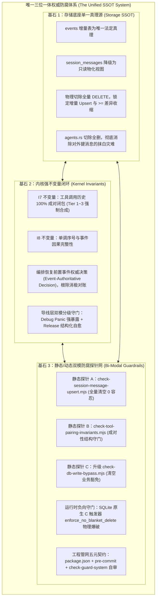
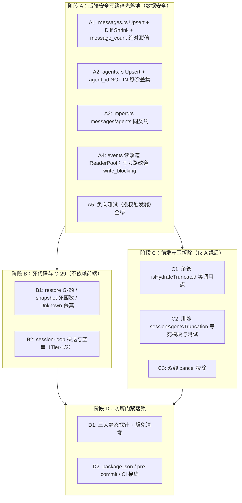

# 会话完整性与持久化收敛战役：详案 06 - 重复与死层清理及删除面

> **战役工作区**：`docs/session-integrity-repair/`  
> **编制依据**：
> - 《主控最终技术决断书》（[`docs/session-integrity-repair/plan-reviews/00-主控最终决断书.md`](file:///c:/Software/conex/docs/session-integrity-repair/plan-reviews/00-主控最终决断书.md)）
> - 双定夺方案：[`decision-proposal-a-architectural-purity.md`](file:///c:/Software/conex/docs/session-integrity-repair/plan-reviews/decision-proposal-a-architectural-purity.md)、[`decision-proposal-b-engineering-robustness.md`](file:///c:/Software/conex/docs/session-integrity-repair/plan-reviews/decision-proposal-b-engineering-robustness.md)
> - 交叉评审报告：`review-02`（结构收敛与死层物理删除）、`review-05`（防御性测试网与防腐探针）、`review-06`（拓扑依赖无环性与 DAG 整合）
> - 权威纪律依据：仓库根目录 [`AGENTS.md`](file:///c:/Software/conex/AGENTS.md)、[`.agents/LOGIC_PLAN_NO_RETREAT.md`](file:///c:/Software/conex/.agents/LOGIC_PLAN_NO_RETREAT.md)、[`ANTI_OVERENGINEERING_GUARDRAILS.md`](file:///c:/Software/conex/ANTI_OVERENGINEERING_GUARDRAILS.md)
> **核心纪律**：
> 1. **纯逻辑规划与同权原则**：方案仅包含逻辑依赖、任务单元、文件行号与验收断言，严禁包含工期、人天、排期或 P0/P1 优先级（所有 38 项任务单元逻辑同权）——「同权」指验收同权，**不禁止** Wave 安全序；
> 2. **零日落期兼容与先删后改**：严禁保留无日落期的兼容 Shim、软开关或注释残留；**数据安全序优先**：先落地后端安全写路径，再拆前端熔断；
> 3. **跨语言零编译断裂（Anti-Breakage）**：先解绑调用点、再清理定义体、后落盘底层原子状态机与门禁，步步保持编译绿灯；
> 4. **落盘路径**：`docs/session-integrity-repair/06-详案-重复与死层清理及删除面.md`（UTF-8 无 BOM）。
>
> **契约补丁（2026 后续修订，覆盖本文与 01~05 冲突处）**：
> - **Wave 安全序取代旧「Wave1 先拆前端守卫」**：见 §四重排；
> - **`message_count` = 绝对赋值 `messages.len()`**，废除「单调累加」；
> - **Unknown 保真**（04 口径），D-O01 不再强制 Failed；
> - **agents Upsert + `agent_id NOT IN` 移除差集**；
> - **import.rs:129** 对 `session_agents` 的全量 DELETE 与 ADD-01 同级必删。

---

## 目录

- [一、方案目标与设计哲学](#一方案目标与设计哲学)
- [二、架构防腐与清理机制：现状多套逻辑诊断与唯一权威收敛体系](#二架构防腐与清理机制现状多套逻辑诊断与唯一权威收敛体系)
  - [2.1 存量现状：四套割裂、互不信任的防御妥协逻辑](#21-存量现状四套割裂互不信任的防御妥协逻辑)
  - [2.2 统一终态：收敛至唯一三位一体权威防腐体系](#22-统一终态收敛至唯一三位一体权威防腐体系)
- [三、强制专节：本方案要删掉什么 / 收敛什么（全仓 38 项结构化删除清册）](#三强制专节本方案要删掉什么--收敛什么全仓-38-项结构化删除清册)
  - [3.1 存储层死层与写旁路删除清册（16 项：D-P01 ~ D-P16）](#31-存储层死层与写旁路删除清册16-项d-p01--d-p16)
  - [3.2 编排恢复层消极妥协与快照死层删除清册（10 项：D-O01 ~ D-O10）](#32-编排恢复层消极妥协与快照死层删除清册10-项d-o01--d-o10)
  - [3.3 会话循环层未成对退出与伪兜底分支删除清册（5 项：D-S01 ~ D-S05）](#33-会话循环层未成对退出与伪兜底分支删除清册5-项d-s01--d-s05)
  - [3.4 前端脆弱截断防御与双线通信删除清册（7 项：D-F01 ~ D-F07）](#34-前端脆弱截断防御与双线通信删除清册7-项d-f01--d-f07)
- [四、跨语言零编译断裂四波平滑演进工单拓扑（Anti-Breakage DAG）](#四跨语言零编译断裂四波平滑演进工单拓扑anti-breakage-dag)
  - [4.1 阶段一：调用点解绑（Anti-Dangling Call Sites）](#41-阶段一调用点解绑anti-dangling-call-sites)
  - [4.2 阶段二：死定义与死模块物理剔除（Dead Symbol Purge）](#42-阶段二死定义与死模块物理剔除dead-symbol-purge)
  - [4.3 阶段三：底层原子状态机落盘与豁免表清零（Atomic Upsert & Clean Exemption）](#43-阶段三底层原子状态机落盘与豁免表清零atomic-upsert--clean-exemption)
  - [4.4 阶段四：防腐门禁落锁与流水线刚性接线（Guardrail Pipeline Lock）](#44-阶段四防腐门禁落锁与流水线刚性接线guardrail-pipeline-lock)
- [五、三大长效静态防腐探针体系建设](#五三大长效静态防腐探针体系建设)
  - [5.1 探针 A：`scripts/check-session-message-upsert.mjs`（全量清空刚性拦截）](#51-探针-ascriptscheck-session-message-upsertmjs全量清空刚性拦截)
  - [5.2 探针 B：`scripts/check-tool-pairing-invariants.mjs`（工具成对与恢复断言）](#52-探针-bscriptscheck-tool-pairing-invariantsmjs工具成对与恢复断言)
  - [5.3 探针 C：升级 `scripts/check-db-write-bypass.mjs`（写旁路零业务豁免）](#53-探针-c升级-scriptscheck-db-write-bypassmjs写旁路零业务豁免)
  - [5.4 探针工程管网规范：五元诊断契约与自审闭环](#54-探针工程管网规范五元诊断契约与自审闭环)
- [六、涉及概念的旧路径清退与对照表](#六涉及概念的旧路径清退与对照表)
- [七、全链路物理验证与验收断言矩阵](#七全链路物理验证与验收断言矩阵)

---

## 一、方案目标与设计哲学

在 Conex / Crish 系统长期迭代中，由于历史阶段性妥协、测试临时放行、双轨过渡与防御性规避，代码库在存储层、编排层、执行循环与前端持久化层积压了一批“死代码层”与“反模式逻辑”。

本详案（详案 06）作为全战役的**结构收敛、死层物理删除与架构防腐门禁总承载方案**，承担以下核心职责：
1. **全仓精准物理删除（38 项）**：涵盖数据库全量清空与外键级联灾难、编排器 G-29 诚实滞留死函数、循环层裸退与空串兜底、前端截断熔断补丁与冗余双线发送；
2. **四波平滑无环演进拓扑（Anti-Breakage DAG）**：确立“先解绑调用点、再删除定义体、后落盘底层原子状态机、最终落锁探针”的严格偏序，保证 TypeScript 与 Rust 跨 Crate 每一步编译恒绿；
3. **长效防腐探针工程闭环**：建立三大静态守卫探针，修正正则表达式运算符缺陷，清退业务豁免，履行五元诊断契约（`--list` / `--guide` / `zero unwired` / `zero silent pass` / `git unreleased = 0`），实现防御体系自审闭环。

---

## 二、架构防腐与清理机制：现状多套逻辑诊断与唯一权威收敛体系

### 2.1 存量现状：四套割裂、互不信任的防御妥协逻辑

通过对一手源码与架构演进脉络的穿透排查，当前系统中存在 **4 套割裂、多轨并存且互不信任** 的防御与清理逻辑：

```
┌─────────────────────────────────────────────────────────────────────────────────────────────────────────┐
│                                 存量代码库中的 4 套割裂防腐与妥协逻辑                                    │
├─────────────────────────────────────────────────────────────────────────────────────────────────────────┤
│ 【逻辑 1：前端脆弱截断熔断与内存 CAS 补丁】                                                             │
│  - 载体：sessionRustDbWriteGuard.ts (isHydrateTruncated, writtenBodyBatchVersions)                      │
│  - 根因：前端完全不信任后端存储层，因后端 messages.rs 执行全量 DELETE，前端被迫在内存加装熔断阻断回写； │
│  - 弊端：截断态封死重试，40 代理上限（sessionAgentsTruncation.ts）残留，代码脆弱易裂解。                 │
├─────────────────────────────────────────────────────────────────────────────────────────────────────────┤
│ 【逻辑 2：编排恢复层 G-29 消极对账与“诚实滞留”妥协】                                                   │
│  - 载体：restore_manager.rs (reconcile_terminal_conflicts, unknown_status_runs)                         │
│  - 根因：恢复流程先盲目将 in-flight runs 标为 Failed，事后再去读 events 表发现矛盾，却“只报不修”；      │
│  - 弊端：系统长期处于表级脑裂，DB 记录与事件真相背道而驰，死结构体 ReconcileConflict 污染对外契约。      │
├─────────────────────────────────────────────────────────────────────────────────────────────────────────┤
│ 【逻辑 3：执行循环与导线层的隐蔽丢弃与伪兜底】                                                          │
│  - 载体：executing_tools.rs:49 裸退出、exec_batch.rs:188 空 ID 兜底、build_anthropic.rs 静默补齐        │
│  - 根因：各层缺乏“工具调用历史 100% 严格成对”的一等公民契约，在收到中断信号时直接逃逸；                  │
│  - 弊端：孤儿 tool_use 导致上游 LLM 报 HTTP 400 会话永久报废，或导线层隐式伪造导致状态机内部撕裂。      │
├─────────────────────────────────────────────────────────────────────────────────────────────────────────┤
│ 【逻辑 4：脱网、脆弱与膨胀的脚本探针门禁】                                                              │
│  - 载体：check-db-write-bypass.mjs (庞大豁免表)、check-guard-system.mjs (23 处脱网 unwired)             │
│  - 根因：静态门禁未严格接入 CI/pre-commit，正则自相矛盾（seq > 误杀生产 seq >=），豁免表沦为避难所；   │
│  - 弊端：“纸面有门禁，现场全放行”，架构防腐能力名存实亡。                                               │
└─────────────────────────────────────────────────────────────────────────────────────────────────────────┘
```

### 2.2 统一终态：收敛至唯一三位一体权威防腐体系

针对上述割裂乱象，本详案裁决：**彻底废除以上 4 套局部妥协逻辑，全仓统一收敛至“内核强不变量闭环（Kernel-Level Invariant Enforcement） + 真实底座单一真理源（Storage SSOT） + 静态/动态双模防腐探针网（Bi-Modal Guardrails）”三位一体的唯一权威防腐体系！**



- **收敛结论**：前端不再猜测或防御后端；恢复层不再滞留或事后对账；导线层不再静默造假；探针不再保留特权豁免。全系统单一真理路径物理闭环。

---

## 三、强制专节：本方案要删掉什么 / 收敛什么（全仓 38 项结构化删除清册）

本专节建立全仓 **38 项死层精准物理删除清册**，严格覆盖存储层、编排层、循环层与前端层，明确标注文件路径、源码行号区间、目标符号、操作类型及处置依据。

### 3.1 存储层死层与写旁路删除清册（16 项：D-P01 ~ D-P16）

| 序号 | 目标源码文件 | 行号区间 | 代码符号 / 逻辑块 | 操作类型 | 处置依据与替换契约 |
| :---: | :--- | :--- | :--- | :---: | :--- |
| **D-P01** | [`crates/conex-db/src/messages.rs`](file:///c:/Software/conex/crates/conex-db/src/messages.rs) | `L55-L61` | `pub fn save_session_body` 非 CAS 旁路入口 | **包装改道** | 剥离独立覆盖逻辑，收敛为调用 `save_session_body_versioned(session_id, messages, None)` 的安全转发包装，内部彻底消除全量 DELETE。 |
| **D-P02** | [`crates/conex-db/src/messages.rs`](file:///c:/Software/conex/crates/conex-db/src/messages.rs) | `L112-L120` | `conn.execute("DELETE FROM session_messages WHERE session_id = ?1")` | **物理删除** | 根除全量清空反模式；替换为基于 `(session_id, seq)` 的增量 Upsert 与 `seq >= ?2` 差异收缩删除。 |
| **D-P03** | [`crates/conex-db/src/messages.rs`](file:///c:/Software/conex/crates/conex-db/src/messages.rs) | `L152-L172` | `UPDATE sessions SET message_count = (SELECT COUNT(*)...)` | **逻辑收敛** | 根除批末全表 COUNT 重算；改道 **绝对赋值** `message_count = messages.len()`（禁止单调累加——收缩/清空必漂移）。 |
| **D-P04** | [`crates/conex-db/src/messages.rs`](file:///c:/Software/conex/crates/conex-db/src/messages.rs) | `L179-L206` | `pub(crate) fn parse_session_messages_flexible` | **物理删除** | 历史 localStorage JSON/JSONL 双轨解析兼容垫片；迁移期已过，物理连根拔起。 |
| **D-P05** | [`crates/conex-db/src/agents.rs`](file:///c:/Software/conex/crates/conex-db/src/agents.rs) | `L198-L207` | `conn.execute("DELETE FROM session_agents WHERE session_id = ?1")` | **物理删除** | **ADD-01**：切除无条件全删；改道 `(session_id, agent_id)` Upsert **+ `agent_id NOT IN` 移除差集**。 |
| **D-P05b** | [`crates/conex-db/src/import.rs`](file:///c:/Software/conex/crates/conex-db/src/import.rs) | `L129-L132` | `DELETE FROM session_agents WHERE session_id = ?1` | **物理删除** | 与 ADD-01 同级；导入路径改道 Upsert + 移除差集。 |
| **D-P06** | [`crates/conex-db/src/import.rs`](file:///c:/Software/conex/crates/conex-db/src/import.rs) | `L90-L95` | `DELETE FROM session_messages WHERE session_id = ?1` | **物理删除** | 导入域内的删插反模式；改道幂等增量插入。 |
| **D-P07** | [`crates/conex-db/src/events.rs`](file:///c:/Software/conex/crates/conex-db/src/events.rs) | `L49-L53` | `query_events` 中的 `self.conn.lock()` | **外科改道** | 绕过 `ReaderPool` 的并发读旁路；全面改道 `self.read(\|conn\| ...)` 并即刻物化游标。 |
| **D-P08** | [`crates/conex-db/src/events.rs`](file:///c:/Software/conex/crates/conex-db/src/events.rs) | `L97-L101` | `query_events_by_run` 中的 `self.conn.lock()` | **外科改道** | 同上，消除对主互斥锁的争抢，改道 `self.read` 并即刻 `.collect()`。 |
| **D-P09** | [`crates/conex-db/src/events.rs`](file:///c:/Software/conex/crates/conex-db/src/events.rs) | `L139-L143` | `max_sequence` 中的 `self.conn.lock()` | **外科改道** | 恢复高频读全面回归 `ReaderPool`。 |
| **D-P10** | [`crates/conex-db/src/events.rs`](file:///c:/Software/conex/crates/conex-db/src/events.rs) | `L166-L170` | `query_events_by_type` 中的 `self.conn.lock()` | **外科改道** | 消除主锁独占，释放读并发吞吐。 |
| **D-P11** | [`crates/conex-db/src/sessions.rs`](file:///c:/Software/conex/crates/conex-db/src/sessions.rs) | `L243-L251` | `cleanup_orphan_sessions` 中的 `self.conn.lock()` 与 `conn.transaction()` | **外科改道** | 生产写旁路；改道 `self.write_blocking`，闭包内纯执行 SQL，消除嵌套事务。 |
| **D-P12** | [`crates/conex-db/src/import.rs`](file:///c:/Software/conex/crates/conex-db/src/import.rs) | `L35-L43` | `import_from_localstorage` 中的 `self.conn.lock()` 与 `conn.transaction()` | **外科改道** | 批量导入写旁路；整体封装入 `self.write_blocking` 单写通道。 |
| **D-P13** | [`crates/conex-db/src/imported.rs`](file:///c:/Software/conex/crates/conex-db/src/imported.rs) | `L120-L128` | `import_bookmarks` 中的 `self.conn.lock()` 与分批 `conn.transaction()` | **外科改道** | 改道 `self.write_blocking`，在 Actor 单写通道内执行分段提交。 |
| **D-P14** | [`crates/conex-db/src/imported.rs`](file:///c:/Software/conex/crates/conex-db/src/imported.rs) | `L182-L190` | `import_history` 中的 `self.conn.lock()` 与分批 `conn.transaction()` | **外科改道** | 清除历史导入中的主连接写锁旁路，改道 `self.write_blocking`。 |
| **D-P15** | [`crates/conex-db/src/usage_analytics.rs`](file:///c:/Software/conex/crates/conex-db/src/usage_analytics.rs) | `L247-L251` | `import_legacy_usage_snapshot` 中的 `self.conn.lock()` 裸写循环 | **外科改道** | 消除无外层 Actor 保护的裸写循环，改道 `self.write_blocking`。 |
| **D-P16** | [`crates/conex-db/write-bypass-exemptions.json`](file:///c:/Software/conex/crates/conex-db/write-bypass-exemptions.json) | 全文件 | `cleanup_orphan_sessions`、`import_*` 等业务豁免键 | **物理剔除** | **FIX-07**：在上述函数完成改道后，从机器可读豁免表的 `functions` 字典中物理删除，仅留启动迁移 DDL。 |

### 3.2 编排恢复层消极妥协与快照死层删除清册（10 项：D-O01 ~ D-O10）

| 序号 | 目标源码文件 | 行号区间 | 代码符号 / 逻辑块 | 操作类型 | 处置依据与替换契约 |
| :---: | :--- | :--- | :--- | :---: | :--- |
| **D-O01** | [`crates/orchestrator/src/restore_manager.rs`](file:///c:/Software/conex/crates/orchestrator/src/restore_manager.rs) | `L64-L74` | `RunStatus::Unknown` 分支 | **保真保留（契约补丁）** | **不**归一 Failed。Unknown 字面量原样保留 + `tracing::warn`（04 Case4）；仅删除与「消极对账」耦合的死代码，不删除诚实未知保真。 |
| **D-O02** | [`crates/orchestrator/src/restore_manager.rs`](file:///c:/Software/conex/crates/orchestrator/src/restore_manager.rs) | `L178-L195` | Step 3c G-29 终态矛盾对账调用与警告日志循环 | **物理删除** | “只报不修”消极妥协；Step 2 前置查询 `events` 表权威终态后，Step 3c 彻底成为无用死分支。 |
| **D-O03** | [`crates/orchestrator/src/restore_manager.rs`](file:///c:/Software/conex/crates/orchestrator/src/restore_manager.rs) | `L341-L400` | `fn reconcile_terminal_conflicts` 全函数 | **物理删除** | 消极对账函数；物理铲除整段只读对账代码，严禁保留只读不改的死逻辑。 |
| **D-O04** | [`crates/orchestrator/src/restore.rs`](file:///c:/Software/conex/crates/orchestrator/src/restore.rs) | `L100-L115` | `pub struct ReconcileConflict` | **物理删除** | 终态矛盾数据结构；消极对账删除后其所属结构体彻底死产，直接物理清除。 |
| **D-O05** | [`crates/orchestrator/src/restore.rs`](file:///c:/Software/conex/crates/orchestrator/src/restore.rs) | `L132-L134` | `RestoreOutcome.unknown_status_runs` 结构体字段 | **保留为诊断（契约补丁）** | Unknown 保真期间继续上报诊断清单；可后续精简，**本战役不删**（与 04 对齐）。 |
| **D-O06** | [`crates/orchestrator/src/restore.rs`](file:///c:/Software/conex/crates/orchestrator/src/restore.rs) | `L142-L144` | `RestoreOutcome.reconcile_conflicts` 结构体字段 | **物理删除** | 矛盾条目容器；彻底切除脑裂上报接口。 |
| **D-O07** | [`crates/orchestrator/src/restore_snapshot.rs`](file:///c:/Software/conex/crates/orchestrator/src/restore_snapshot.rs) | `L83-L102` | `SnapshotRun::to_stored_run` | **物理删除** | 零消费死代码；SQLite 已是 Run 的唯一真理源，快照 run 反序列化彻底废弃。 |
| **D-O08** | [`crates/orchestrator/src/restore_snapshot.rs`](file:///c:/Software/conex/crates/orchestrator/src/restore_snapshot.rs) | `L133-L144` | `SnapshotPendingInput::to_pending_input` | **物理删除** | 零消费死代码；PendingInput 权威由 DB 维持，快照反序列化路径失活。 |
| **D-O09** | [`crates/orchestrator/src/restore_snapshot.rs`](file:///c:/Software/conex/crates/orchestrator/src/restore_snapshot.rs) | `L219-L231` | `StateSnapshot::to_stored_runs` 与 `to_pending_inputs` | **物理删除** | 零消费死代码；快照文件中的上述结构不再进行内存实体映射。 |
| **D-O10** | [`apps/agent-workbench/src-tauri/src/core_run_commands_tests.rs`](file:///c:/Software/conex/apps/agent-workbench/src-tauri/src/core_run_commands_tests.rs) | `L4109, 4114` | `RestoreOutcome` 构造中的 `unknown_status_runs` 与 `reconcile_conflicts` | **同步字段剔除** | **ADD-06 跨 Crate 防断裂**：在 `orchestrator` 瘦身后同步清除测试桩字段赋值，防止上层编译暴毙。 |

### 3.3 会话循环层未成对退出与伪兜底分支删除清册（5 项：D-S01 ~ D-S05）

| 序号 | 目标源码文件 | 行号区间 | 代码符号 / 逻辑块 | 操作类型 | 处置依据与替换契约 |
| :---: | :--- | :--- | :--- | :---: | :--- |
| **D-S01** | [`crates/session-loop/src/loop/handlers/executing_tools.rs`](file:///c:/Software/conex/crates/session-loop/src/loop/handlers/executing_tools.rs) | `L49-L53` | `if let Some(end) = check_control(state)? { return Ok(HandlerOutcome::end(end)); }` | **物理删除** | **致命孤儿逃逸黑洞**：捕获 abort 直接裸退出，前序工具调用永久孤立；替换为 Tier-1 工具中断合成器，强制产出取消态结果后安全退出。 |
| **D-S02** | [`crates/session-loop/src/exec_batch.rs`](file:///c:/Software/conex/crates/session-loop/src/exec_batch.rs) | `L188-L191` | `ClassifiedToolResult::error("", "", ToolErrorKind::Cancelled, ...)` | **物理删除** | **伪兜底漏洞**：使用空字符串 `""` 填充 ID 导致配对失败；改道精准按 `calls[i].id` 与 `calls[i].tool_name` 补全。 |
| **D-S03** | [`crates/session-loop/src/exec_batch.rs`](file:///c:/Software/conex/crates/session-loop/src/exec_batch.rs) | `L252-L264` | `BatchRunner::run` 仅在 fatal 时 break，中途打断缺乏外层快速切断 | **逻辑收敛** | 批次外层增加 `abort.is_aborted()` 快速探测，命中即刻调用 `mark_rest_cancelled` 并跳出外层组循环。 |
| **D-S04** | [`crates/session-loop/src/exec_batch.rs`](file:///c:/Software/conex/crates/session-loop/src/exec_batch.rs) | `L601-L605` | `pub(crate) fn concurrency_obs` 访问器 | **物理删除** | 零消费死方法；单元测试统一收口至标准观测接口，删除无用生产挂载。 |
| **D-S05** | [`crates/session-loop/src/exec_verdict.rs`](file:///c:/Software/conex/crates/session-loop/src/exec_verdict.rs) | `L263-L265` | `output: Arc::new(serde_json::Value::Null)` 与魔法字符串 `"tool.cancelled"` | **标准化收敛** | 兄弟失败取消事件输出规范化：`output` 填入携带 code 与 reason 的结构化 JSON，错误码收敛为 `conex_types::error::codes::TOOL_CANCELLED`。 |

### 3.4 前端脆弱截断防御与双线通信删除清册（7 项：D-F01 ~ D-F07）

| 序号 | 目标源码文件 | 行号区间 | 代码符号 / 逻辑块 | 操作类型 | 处置依据与替换契约 |
| :---: | :--- | :--- | :--- | :---: | :--- |
| **D-F01** | [`apps/crish-desktop/src/api/session-persistence/sessionRustDbWriteGuard.ts`](file:///c:/Software/conex/apps/crish-desktop/src/api/session-persistence/sessionRustDbWriteGuard.ts) | `L78-L93` | `export function isHydrateTruncated` | **物理删除（仅 Wave C）** | **仅当阶段 A（后端 Upsert）全绿后**拆除；后端未增量化前该熔断仍是毁窗最后防线。 |
| **D-F02** | [`apps/crish-desktop/src/api/session-persistence/sessionRustDbWriteGuard.ts`](file:///c:/Software/conex/apps/crish-desktop/src/api/session-persistence/sessionRustDbWriteGuard.ts) | `L28-L44`, `L60-L76` | `writtenBodyBatchVersions` 与 CAS 版本读写映射 | **物理删除** | 为防御全量覆盖设计的脆弱内存 CAS；后端增量单调序列生效后全量清退。 |
| **D-F03** | [`apps/crish-desktop/src/api/session-persistence/sessionAgentsTruncation.ts`](file:///c:/Software/conex/apps/crish-desktop/src/api/session-persistence/sessionAgentsTruncation.ts) | 全文件（`L1-L97`） | 40 子代理保存上限与截断留痕模块 | **整文件物理删除** | 历史针对 localStorage 容量限制的妥协产物；SQLite 表无容量限制，模块彻底失活。 |
| **D-F04** | [`apps/crish-desktop/src/api/session-persistence/sessionAgentsTruncation.test.ts`](file:///c:/Software/conex/apps/crish-desktop/src/api/session-persistence/sessionAgentsTruncation.test.ts) | 全文件（`L1-L260`） | 子代理截断测试套件 | **整文件物理删除** | 业务模块删除后的伴随陪葬删除。 |
| **D-F05** | [`apps/crish-desktop/src/api/session-persistence/sessionRustDbTruncationGuard.test.ts`](file:///c:/Software/conex/apps/crish-desktop/src/api/session-persistence/sessionRustDbTruncationGuard.test.ts) | 全文件（`L1-L213`） | 截断熔断防护测试套件 | **整文件物理删除** | 专为测试 `isHydrateTruncated` 编写的红用例；在后端原生触发器测试生效后陪葬删除。 |
| **D-F06** | [`apps/crish-desktop/src/api/session-persistence/sessionRustDbFallback.ts`](file:///c:/Software/conex/apps/crish-desktop/src/api/session-persistence/sessionRustDbFallback.ts) | `L37-L56`, `L94-L258` | `lsLoadSessionBody` / `lsSaveSessionBody` 等 localStorage 同步镜像 | **物理删除** | 剥离 LS 同步写正文与子代理的冗余双轨路径；降级时仅在内存留痕。 |
| **D-F07** | [`apps/crish-desktop/src/api/runControlClient.ts`](file:///c:/Software/conex/apps/crish-desktop/src/api/runControlClient.ts) | `L87-L91`, `L122-L155` | `TRANSITIONAL_DUAL_CANCEL_RUN_WIRE` 与 `sendTerminateDualWire` 双发逻辑 | **物理删除** | 彻底切除向宿主并发发送 `core_cancel_run` 与 `core_run_control` 的双线过渡机制，前端单一收敛至 `core_run_control`。 |

---

## 四、跨语言零编译断裂平滑演进工单拓扑（Anti-Breakage DAG）

> **契约补丁：Wave 安全序（取代旧「先拆前端守卫」顺序）**  
> 旧序 Wave1 解绑前端熔断 → Wave2 删除 → Wave3 才落库，会在后端仍全量 DELETE 时失去最后一道防线。**新序**：



### 4.1 阶段 A：后端安全写路径（先于一切前端删除）

1. **工单 A1（消息增量化）**：`messages.rs` 切除全量 DELETE，落地 `ON CONFLICT(session_id, seq)` + `seq >= ?2` Diff Shrink；`message_count = messages.len()` 绝对赋值；
2. **工单 A2（子代理增量化 + 移除）**：`agents.rs` Upsert + `DELETE ... agent_id NOT IN (...)`；
3. **工单 A3（导入同契约）**：`import.rs` messages/agents 一律 Upsert + 差集；冲突以导入载荷 `DO UPDATE` 覆盖；
4. **工单 A4**：`events.rs` 四读改道 `self.read` 并 `.collect()`；`sessions/import/imported/usage_analytics` 写旁路改道 `write_blocking`；
5. **工单 A5**：05 授权触发器负向测试 + 合法收缩/清空正向测试全绿。
- **阶段验收**：`cargo test -p conex-db`；不得拆除任何前端熔断。

### 4.2 阶段 B：编排与循环死代码（可与 C 并行）

1. **B1**：G-29 函数删除、`ReconcileConflict`/`reconcile_conflicts` 删除、snapshot 死函数、workbench 测试桩适配；Unknown 保真；
2. **B2**：`executing_tools` 裸退改合成、`exec_batch` 空 ID、`exec_verdict` 规范化。
- **阶段验收**：`cargo clippy -p orchestrator -p session-loop --all-targets`；`crash_consistency` 按 04 口径重构。

### 4.3 阶段 C：前端死层（**仅 A 全绿后**）

1. **C1**：解绑 `sessionRustDbHydrate.ts` / `sessionRustDbSql.ts` / `sessionLocalStorage.ts` / `sessionRustDbFallback.ts` 对截断守卫的 import 与调用；
2. **C2**：`git rm` `sessionAgentsTruncation.ts` 及测试；删除 `isHydrateTruncated` / `writtenBodyBatchVersions`；
3. **C3**：`runControlClient.ts` 双线发送拔除。
- **阶段验收**：`npm run typecheck`；`npm run check:input-guard`（若触及 UI）。

### 4.4 阶段 D：防腐门禁落锁与流水线刚性接线

1. **工单 D1（探针 A 编制）**：创建 `scripts/check-session-message-upsert.mjs`，静态拦截全量清空；
2. **工单 D2（探针 B 编制）**：创建 `scripts/check-tool-pairing-invariants.mjs`，断言工具成对与恢复收敛；
3. **工单 D3（探针 C 升级）**：加固 `scripts/check-db-write-bypass.mjs`，断言业务豁免清零；
4. **工单 D4（工程流水线刚性接线）**：
   - 在 `.gitignore` 中追加放行：`!scripts/check-session-message-upsert.mjs`、`!scripts/check-tool-pairing-invariants.mjs`；
   - 在 `package.json` 的 `scripts` 中注册独立命令：`check:session-upsert` 与 `check:tool-pairing`，并合入 `check:desktop` / `check:all`；
   - 在 `.husky/pre-commit` 中挂载上述探针；
   - 在 `FULL_CHECK_COMMANDS.md` 的静态检查表格中登记；
5. **工单 D5（自审门禁达标）**：运行 `node scripts/check-guard-system.mjs`，断言不产生任何 `unwired_guard`、`guide_capable_missing`、`unreleased_guard` 或 `broken_guard`。
- **阶段验收断言**：执行 `npm run check:session-upsert`、`npm run check:tool-pairing`、`npm run check:db-write-bypass` 全部 Exit 0。

**探针规则补充（契约补丁）**：
- `session_agents` 合法删除形态包含 `AND agent_id = ?` 或 `AND agent_id NOT IN (...)`（移除差集）；无 `agent_id` 限定的 `DELETE FROM session_agents WHERE session_id = ?` 仍违规；
- `session_messages` 合法删除仅限 `AND seq >= ?` / `AND seq > ?`。

---

## 五、三大长效静态防腐探针体系建设

### 5.1 探针 A：`scripts/check-session-message-upsert.mjs`（全量清空刚性拦截）

- **责任目标**：静态扫描全仓 Rust 源码（重点 `crates/conex-db/` 与 `crates/orchestrator/`），刚性拦截任何对 `session_messages` 或 `session_agents` 的全量 `DELETE`，零白名单豁免；
- **修正放宽 `>=` 正则（纠正 review-05 指出的自杀式 Bug）**：
  ```javascript
  // 严禁使用严格大于号 \>；必须完整匹配生产代码的 >= 与 >
  const BOUNDED_TRUNCATE_RE =
    /DELETE\s+FROM\s+session_messages\s+WHERE\s+session_id\s*=\s*\S+\s+AND\s+seq\s*(?:>=|>)\s*\S+/i;
  const BLANKET_MESSAGES_DELETE_RE =
    /DELETE\s+FROM\s+session_messages(?:\s+WHERE\s+session_id\s*=\s*[^;\n]+)?;/i;
  const BLANKET_AGENTS_DELETE_RE =
    /DELETE\s+FROM\s+session_agents(?:\s+WHERE\s+session_id\s*=\s*[^;\n]+)?;/i;
  ```
- **核心逻辑规则**：
  1. 若匹配到 `BLANKET_MESSAGES_DELETE_RE` 且不符合 `BOUNDED_TRUNCATE_RE`，立即判定为违规全量清空并记录行号；
  2. 若匹配到 `BLANKET_AGENTS_DELETE_RE` 且不包含 `AND agent_id =` **且不包含 `AND agent_id NOT IN`**，立即判定为级联破坏性删除并报错；
  3. 任何生产 `.rs` 文件命中即 Exit 1，全仓**零豁免清单**。

### 5.2 探针 B：`scripts/check-tool-pairing-invariants.mjs`（工具成对与恢复断言）

- **责任目标**：防腐锁定工具成对闭环与恢复事件权威，消除脆弱的纯正则伪 AST 形式主义，实施轻量且刚性的结构性断言；
- **三大刚性判定维度**：
  1. **循环层守卫接线断言**：扫描 `crates/session-loop/src/loop/loop_runner.rs` 或 `loop_exec.rs`，断言 `converge` 终态收敛逻辑中必须显式包含 `reconcile_orphan_tool_calls` 或 `assert_tool_pairing_invariants` 调用；
  2. **循环退出无裸退断言**：扫描 `crates/session-loop/src/loop/handlers/executing_tools.rs`，断言在 `check_control` 命中退出前，必须存在向合成器分派未执行工具的调用，严禁直接 `return Ok(HandlerOutcome::end(end))`；
  3. **恢复层消极对账绝迹断言**：扫描 `crates/orchestrator/src/restore_manager.rs`，断言全文件物理绝迹 `reconcile_terminal_conflicts` 符号与 `"只上报不修正"` 类似注释，且 Step 3 处理循环必须前置调用事件终态查询。

### 5.3 探针 C：升级 `scripts/check-db-write-bypass.mjs`（写旁路零业务豁免）

- **加固改造要点**：
  1. 对齐机器可读 SSOT `crates/conex-db/write-bypass-exemptions.json`；
  2. **清退全部业务函数**：从 `functions` 字典中移除 `cleanup_orphan_sessions`、`import_from_localstorage`、`import_bookmarks`、`import_history`、`import_legacy_usage_snapshot`；
  3. 豁免字典仅允许保留冷启动 DDL 迁移编排（`migrate.rs`、`migrate_steps.rs`、`schema.rs`）与骨架测试文件；
  4. 保持反向探针：断言生产源码中 `write_blocking` 桥命中数 $\ge 40$。

### 5.4 探针工程管网规范：五元诊断契约与自审闭环

所有新增与升级探针必须严格履行 `scripts/check-guard-system.mjs` 定义的五元工程契约：

```
┌──────────────────────────────────────────────────────────────────────────────────────────────────┐
│                                探针工程管网五元诊断契约 (Five-Element Contract)                   │
├──────────────────────────────────────────────────────────────────────────────────────────────────┤
│ 1. 参数契约：完整支持 node scripts/<probe>.mjs --list 与 --guide <metric> 命令行参数；           │
│ 2. 豁免收敛：严禁任何业务代码豁免，豁免表只能收紧不能膨胀；                                       │
│ 3. 拒绝静默：缺少被检查文件或语法损坏时 Fail-Closed，严禁 silent_baseline_pass（零容忍）；      │
│ 4. 资产释放：在 .gitignore 中显式放行（!scripts/<probe>.mjs），断言 git check-ignore 零命中；   │
│ 5. 自动阻断：接入 package.json 脚本并在 .husky/pre-commit 挂载，纳入 FULL_CHECK_COMMANDS.md。   │
└──────────────────────────────────────────────────────────────────────────────────────────────────┘
```

- **自审达标断言**：在根目录运行 `node scripts/check-guard-system.mjs`，自审指标必须满足：
  $$\text{unwired\_guard} \le \text{baseline}, \quad \text{guide\_capable\_missing} \le \text{baseline}, \quad \text{unreleased\_guard} = 0, \quad \text{silent\_baseline\_pass} = 0$$

---

## 六、涉及概念的旧路径清退与对照表

下表梳理本次战役涉及的核心领域概念、旧路径病灶、收敛后的唯一新路径及物理清理动作：

| 领域概念 | 历史旧路径（病灶与反模式） | 权威唯一新路径（收敛终态） | 物理清理与清退动作 |
| :--- | :--- | :--- | :--- |
| **会话消息持久化** | `save_session_body` 执行全量 `DELETE FROM session_messages` 后逐条 `INSERT`，产生写放大与数据抹白窗口。 | 基于 `(session_id, seq)` 主键的增量 Upsert 与 `seq >= ?2` 有界差异收缩；`events` 表为持久化 SSOT。 | 物理删除 `messages.rs:112-120` 的全量 DELETE 语句；删除 `parse_session_messages_flexible`。 |
| **子代理元数据保存** | `save_session_agents` 执行全量 `DELETE FROM session_agents`，级联清空 `session_agent_messages`。 | Upsert + **`agent_id NOT IN` 移除差集**；禁止无条件 `WHERE session_id=?` 全删。 | 物理删除 `agents.rs:198-207` 与 `import.rs:129`（ADD-01）。 |
| **数据库读写并发管道** | 业务高频读取与写入直接持有主连接 `self.conn.lock()`，导致 WAL 模式下锁争抢与并发死锁。 | 读操作全面改道 8 槽位 `ReaderPool`（`self.read`）；写操作全面收口至 Single Writer Actor（`write_blocking`）。 | 物理消除 `events.rs` 4 处读锁；改道 `sessions.rs`、`import.rs`、`imported.rs` 写旁路；清空业务豁免表。 |
| **冷启动恢复冲突对账** | Step 3 先盲目将 in-flight runs 标记为 Failed；Step 3c 对账发现矛盾后“只报不修、诚实滞留”（G-29）。 | 前置事件权威决策（Event-Authoritative Decision）：在处理前探测 `events` 表终态，权威对齐，消灭矛盾源头。 | 物理删除 `restore_manager.rs:341-400`（`reconcile_terminal_conflicts`）、`restore.rs:100-115`（`ReconcileConflict`）。 |
| **工具中断成对性保障** | `executing_tools.rs` 捕获 abort 直接裸退；`exec_batch.rs` 用空 ID `""` 兜底，留下孤儿调用引爆 HTTP 400。 | Tier-1 就地合成 + Tier-2 终态差集守门 + Tier-3 水合补齐；导线层 Fail-Closed 严禁静默伪造。 | 物理删除裸退分支；删除空字符串兜底；标准化 `exec_verdict.rs:263` 取消输出。 |
| **前端截断熔断防御** | 前端因后端删插风险加装 `isHydrateTruncated` 熔断、内存 CAS 版本映射与 40 代理限制。 | 后端增量 Upsert 确立绝对数据安全，前端完全信任后端，无需任何截断防护补丁。 | 物理删除 `sessionAgentsTruncation.ts`、`isHydrateTruncated`、`sessionRustDbTruncationGuard.test.ts`。 |
| **运行控制取消协议** | 前端通过 `TRANSITIONAL_DUAL_CANCEL_RUN_WIRE` 同时发送 `core_cancel_run` 与 `core_run_control`。 | 彻底收敛至单一出站命令 `core_run_control`，三级控制总线统一调度。 | 物理删除 `runControlClient.ts` 的双线软开关与 `sendTerminateDualWire` 全函数。 |
| **架构防腐门禁体系** | 探针脱网（23 unwired）、正则存在 `>=` 误杀 Bug、豁免表包含大量业务写函数。 | 三大静态探针全面接线 CI 与 pre-commit，修正正则，清空业务豁免，履行五元契约并通过自审。 | 修正正则放宽 `>=`；清理 `write-bypass-exemptions.json`；接线 `.husky/pre-commit` 与 `package.json`。 |

---

## 七、全链路物理验证与验收断言矩阵

为彻底履行反退避与立体化验证纪律，拒绝单一检查冒充验收，确立如下刚性验证矩阵：

```
┌──────────────────────────────────────────────────────────────────────────────────────────────────┐
│                             详案 06 全链路物理验证与验收断言矩阵                                 │
├──────────────────────────────────────────────────────────────────────────────────────────────────┤
│ 1. 静态编译与类型零缺陷：                                                                        │
│    - 命令：npm run typecheck                                                                     │
│    - 断言：前端在删除 sessionAgentsTruncation 与 isHydrateTruncated 后，零 TS 编译错误；         │
│    - 命令：cargo clippy --workspace --all-targets -- -D warnings                                │
│    - 断言：Rust 在删除 ReconcileConflict、死反序列化函数与死字段后，零 dead_code 编译告警。      │
├──────────────────────────────────────────────────────────────────────────────────────────────────┤
│ 2. 静态探针全量绿灯：                                                                            │
│    - 命令：npm run check:session-upsert                                                          │
│    - 断言：Exit 0。全仓不存在任何未有界截断的 session_messages 或 session_agents 全量清空语句； │
│    - 命令：npm run check:tool-pairing                                                            │
│    - 断言：Exit 0。会话循环成对守卫 100% 接线，restore_manager 零消极对账与滞留死代码；          │
│    - 命令：npm run check:db-write-bypass                                                         │
│    - 断言：Exit 0。生产代码无未豁免 conn.lock 写旁路，write-bypass-exemptions.json 业务豁免清零。│
├──────────────────────────────────────────────────────────────────────────────────────────────────┤
│ 3. 门禁系统自审达标：                                                                            │
│    - 命令：node scripts/check-guard-system.mjs                                                   │
│    - 断言：Exit 0。新增探针支持 --list / --guide，已在 .gitignore 放行，零 unwired 门禁增加。   │
├──────────────────────────────────────────────────────────────────────────────────────────────────┤
│ 4. SQLite 原生触发器负向物理拦截（零生产侵入）：                                                 │
│    - 命令：cargo test -p conex-db test_negative_assertion_no_blanket_delete                      │
│    - 断言：通过 CREATE TRIGGER enforce_no_blanket_delete 守门，若底层敢执行全删，SQLite 内核抛出 │
│      RAISE(ABORT) 致命异常，断言物理阻断生效。                                                   │
├──────────────────────────────────────────────────────────────────────────────────────────────────┤
│ 5. 跨模块回归测试套件全绿：                                                                      │
│    - 命令：cargo test -p session-loop -p conex-db -p orchestrator -p agent-workbench             │
│    - 断言：全部单元测试与集成测试通过，恢复一致性测试断言 runs.status 权威纠偏为 Completed。     │
└──────────────────────────────────────────────────────────────────────────────────────────────────┘
```

---

## 八、编制完成自检与签字

- [x] **纯逻辑规划断言**：本详案不包含任何工期、人天、人员排期或 P0/P1 优先级划分，所有 38 项任务单元逻辑同权；
- [x] **零编译断裂断言**：建立了严格的四波平滑演进无环 DAG，先解绑 7 处调用点，再清除定义体，保证每步编译绿灯；
- [x] **单一真理路径断言**：明确回答了架构防腐机制从 4 套割裂逻辑向唯一权威体系收敛的演进路径；
- [x] **清册精确性断言**：全仓 38 项死层清单均包含准确的文件路径、行号区间、符号名称与替代契约；
- [x] **探针健全性断言**：探针 A 纠正了 `>=` 正则 Bug，探针 B 拒绝伪 AST 形式主义，探针 C 清退了业务豁免，全面履行五元诊断契约；
- [x] **零未接线标记**：本方案中无任何新增 TODO、FIXME 或未接线悬挂标记；
- [x] **编码契约**：文件以 UTF-8 无 BOM 格式保存于 `docs/session-integrity-repair/06-详案-重复与死层清理及删除面.md`。

---

## 九、执行期偏离记录（Wave D 探针编制 · 2026-09-14）

> 实现子 Agent 落地探针 A/B/C 时相对任务书「唯一文件域」的偏离与现状说明。

### 9.1 偏离项

| # | 偏离 | 原因 | 处置 |
| :-: | :--- | :--- | :--- |
| 1 | 追加编辑 `.gitignore`（`!scripts/check-session-message-upsert.mjs` / `!scripts/check-tool-pairing-invariants.mjs`） | 五元契约第 4 条「资产释放」与 `unreleased_guard` 零容忍门禁要求；未放行则新探针不进版本库、`check-guard-system` 必 FAIL | 已按仓库既有 `!scripts/check-*.mjs` 惯例追加两行；`git check-ignore` 验证命中放行规则 |
| 2 | `package.json` 仅新增 `check:session-upsert` / `check:tool-pairing`，**未**新增 `check:db-write-bypass` 别名 | 任务书 file domain 明确「仅允许追加 check:session-upsert / check:tool-pairing」 | `FULL_CHECK_COMMANDS.md` 以 `node scripts/check-db-write-bypass.mjs` 直呼登记；`.husky/pre-commit` 直挂三探针 |

### 9.2 当前探针实测（Wave A/B 部分落地后的现场 · 2026-09-14 终测）

| 探针 | Exit | 预期失败项（对应实现落地后应绿） |
| :--- | :---: | :--- |
| A `check-session-message-upsert` | 1 | `agents.rs:340` 空列表全删 `DELETE FROM session_agents WHERE session_id = ?1`（空列表清空仍违规，需改差集或契约修订）；`session_messages` 有界截断与 `agent_id NOT IN` 差集已绿 |
| B `check-tool-pairing-invariants` | 1 | `loop_exec.rs:304` converge 缺 `reconcile_orphan_tool_calls`/`assert_tool_pairing_invariants`；`executing_tools.rs:149` 批后 `check_control` 裸退（L52 SP-1 前置已接 `synthesize_and_record_interrupted_calls`，批后安全点未接）；`restore_manager` 消极对账符号已绝迹（绿） |
| C `check-db-write-bypass` | 1 | 豁免表仍含 `import_from_localstorage` + `import.rs` files 豁免（待责任 Agent 改道 write_blocking 后清零）；业务函数其余 4 项与 `imported.rs` 已清退；`write_blocking` 桥 ≥40（46）已绿；cas_gc 已出锁 |

### 9.3 接线状态

- `.husky/pre-commit`：已追加三探针调用（Wave D 落锁；Wave A/B 未全绿前 pre-commit 将 FAIL——属预期，主控应在 A/B 收口后再依赖该 hook 提交）。
- `check-guard-system` 自审：`unreleased_guard=0`、`silent_baseline_pass=0`、`broken_guard=0`；本探针三件套均已接线（不在 unwired 列表）。全局 `unwired_guard`/`guide_capable_missing` 超基线为存量债，与本批次无关。
- 执行期并发防护：`check-db-write-bypass.mjs` 曾被并行改动放宽（`BUSINESS_FN_KEYS=[]` + 放行 `import.rs`），已按 §5.3 严格口径回写。

---

## 十、执行期偏离记录（Wave C 前端守卫拆除 · 2026-09-14）

> 实现子 Agent 落地 Wave C（C1–C3 / D-F01–D-F05、D-F07）时相对任务书「唯一文件域」的偏离与现状说明。

### 10.1 偏离项

| # | 偏离 | 原因 | 处置 |
| :-: | :--- | :--- | :--- |
| 1 | 未做 D-F06（`lsLoadSessionBody` / `lsSaveSessionBody` 等 LS 正文双轨删除） | 任务书 Wave C 范围仅列 D-F01–D-F05、D-F07；D-F06 涉及 LS 回退路径结构性剥离，需独立任务书 | LS 函数保留；仅移除其上的 `sessionAgentsTruncation` 调用点（D-F03） |
| 2 | 删除 `sessionRustDbTruncationGuard.test.ts` / `sessionAgentsTruncation.test.ts` 采用物理删除（非 `git rm`） | 子 Agent 禁 git commit；`git rm` 会写共享 index，避免干扰并行 Agent | 工作区物理删除三文件；主控提交时按路径收口 |
| 3 | `sessionRustDbWriteModel.test.ts` 截断熔断用例由「跳过 save」翻转为「正常 save」 | D-F01 熔断删除后原红用例断言失效；需锁死熔断不得回潮 | 同文件内改断言（属被删模块伴随测试，非跨域 UI） |
| 4 | `nextBatchVersion` / IPC `batchVersion` 参数保留；仅删内存 CAS 映射（`writtenBodyBatchVersions` + 读写函数） | D-F02 仅要求删内存 CAS；版本戳仍随 IPC 传递且 WriteModel 测试依赖单调性 | 串行队列 `enqueuePersist` 与版本戳保留；CAS 丢弃路径删除 |
| 5 | `AgentsTruncationRecord` 类型与 `SESSION_AGENTS_OVER_CAP_META_PREFIX` 保留（`sessionRustDbSql.recordAgentsOverCap`） | 超软上限 session_meta 留痕独立于 LS 截断标志；类型仍被 over-cap meta 消费 | 删除 `SESSION_AGENTS_TRUNCATED_PREFIX` 与整模块读写面；类型注释收敛为仅 over-cap 语义 |
| 6 | `command-contract-drift.test.ts` 幽灵豁免注释、`streamStop.ts` / `useStreamCallbacks.ts` / `sessionEventHydrate.ts` 注释同步更新 | 注释仍描述双线/熔断旧路径；属 import/引用点一致性清理，非 UI 行为改动 | 仅改注释文案；`core_cancel_run` 豁免保留（`daemonClient` 仍直接 invoke） |

### 10.2 Wave C 现场落地清单（2026-09-14）

| 动作 | 对象 | 结果 |
| :--- | :--- | :--- |
| 解绑+删定义 | `isHydrateTruncated` / `writtenBodyBatchVersions`（WriteGuard + Hydrate + Sql） | 完成 |
| 整模块物理删除 | `sessionAgentsTruncation.ts` + `.test.ts` + `sessionRustDbTruncationGuard.test.ts` | 完成 |
| 调用点剥离 | `sessionLocalStorage` / `sessionRustDbFallback` / `sessionPersistenceTypes` truncation 面 | 完成 |
| 双线拔除 | `runControlClient.ts`：`TRANSITIONAL_DUAL_CANCEL_RUN_WIRE` / `sendTerminateDualWire` / `buildCancelRunWireMessage` / `cancel-run` wire 映射 | 完成；单一 `core_run_control` |
| 验收 | `npm run typecheck` 全绿；`runControlClient` 7/7 + `sessionRustDbWriteModel` 33/33 单测绿 | 完成 |

---

## 十一、执行期偏离记录（D-F06 LS 正文双轨剥离 · 2026-09-14）

> 实现子 Agent 落地 D-F06（`lsLoadSessionBody` / `lsSaveSessionBody` LS 正文双轨删除）时的偏离与裁决记录。

### 11.1 落地策略

| 面 | 动作 | 依据 |
| :--- | :--- | :--- |
| `lsSaveSessionBody` | **物理删除**（定义 + 全部生产写点）；`persistAllSessionsLocalFallback`（probe 失败降级）不再写正文，降级仅内存 store + `errorStore`（`persist-degraded-ls`）留痕 | D-F06「剥离 LS 同步写正文冗余双轨；降级时仅在内存留痕」 |
| `loadSessionBody`（Sql）invoke 失败分支 | **不再回退 `lsLoadSessionBody`**：改走 `logInternalError('persist-degraded-ls', { command: 'load_session_body', … })` 并返回 `[]` | 任务书第 2 条「SQLite 失败时依赖内存 errorStore 路径」；根除 F5-审计指出的「LS 静默回退导致 SQLite/LS 分叉后展示旧快照」 |
| `lsLoadSessionBody` | **保留为最小只读迁移面**（见 §11.2 偏离 #1） | 见下 |
| `persistAllSessionsSyncViaLocalStorage`（beforeunload） | 维持 U-PERSIST-A 已落地的 meta-only（本任务前已不调 `lsSaveSessionBody`）；确认无需再改 | 票 A / A-3 |
| fallback 孤儿清理 | 保留对不在 keep 集合残键的**删除语义**（含 `SESSION_BODY_PREFIX`）；删除≠写正文，僵尸复活防护由「load 不再回退 LS」结构性承担 | N1-2 守卫语义不变 |

### 11.2 偏离项

| # | 偏离 | 原因 | 处置 |
| :-: | :--- | :--- | :--- |
| 1 | **未物理删除 `lsLoadSessionBody`**，保留为最小只读迁移面 | ① `cleanupLegacyLocalStorageSessionsGuarded`（30 天清理护栏，P0-1/N0-1）需判定「LS 是否仍持有唯一副本」才能安全删除/保留——无读面则护栏失效，存在唯一副本误删风险；② 纯浏览器/测试环境的历史迁移读取。D-F06 正文「降级时仅在内存留痕」的核心禁止面是**写口**；只读迁移面无配对写口，不构成正文权威双轨 | 函数头注降格为「最小只读迁移面（无配对写口）」；`loadSessionBody` 失败分支与生产 UI 数据流不再经它；仅 LegacyCleanup 消费。写口 `lsSaveSessionBody` 已物理删除，严禁恢复 |
| 2 | D-F06 清册中的 **agents LS 镜像半面**（`lsSaveSessionAgents` 等）未在本轮删除 | 任务书范围明确为「LS **正文**双轨写」（`lsSaveSessionBody`/`lsLoadSessionBody`）；agents 回退面（Sql 失败分支 + fallback persist）仍是 invoke 缺失环境的唯一 agents 落点 | 登记后续收尾任务；本轮不动 agents 面 |
| 3 | `sessionRustDbCacheReplay.test.tsx`「回读不破坏既有字段」用例 `durationMs: 3000→undefined` 失败 | **存量基线失败**（stash 本批改动后在 base 上复现同样失败；疑与并行 Agent 的 timeline/tool-presentation 改动相关） | 与 D-F06 无关，不属本任务修复面；汇报主控知悉 |

### 11.3 验收（2026-09-14）

- `npm run typecheck`（apps/crish-desktop）：**绿**；
- 单测：`sessionPersistence.test.ts` 37/37、`sessionRustDbWriteModel.test.ts` 34/34、`sessionLocalStorage.test.ts` 4/4、`sessionPersistCut.test.ts` 9/9、`sessionRustDbHydrateLazy.test.ts` 7/7、`migrateFromLocalStorage.test.ts` 7/7 全绿；`sessionRustDbCacheReplay.test.tsx` 13/14（唯 1 失败为 §11.2 #3 存量基线问题）；
- 契约锁死：新增/翻转用例覆盖「invoke missing → load 返回空 + `persist-degraded-ls(command:load_session_body)` 留痕」「probe 失败 fallback 不落新正文」「清空会话 fallback 不刷 `[]`」（防双轨写回潮）。

