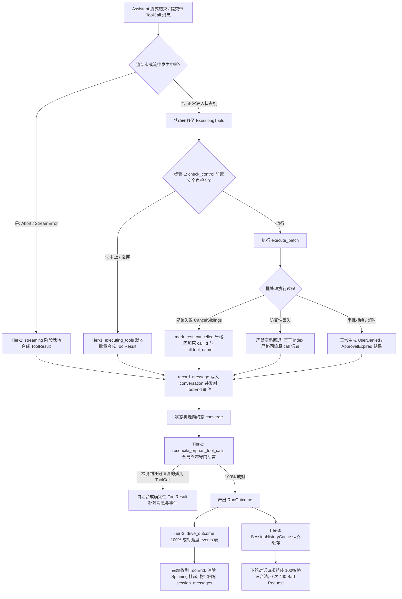

# 独立方案 01：工具中断合成与孤儿成对性保证

> **状态**：方案已冻结（独立方案编制阶段）  
> **权威源码依据**：`crates/session-loop/`、`crates/conex-types/`、`crates/agent-provider/`、`crates/orchestrator/`、`crates/conex-db/`  
> **对齐铁律**：零工期/同权纯逻辑、一手代码研读、禁止平行冗余、架构净收敛  
> **落盘位置**：`docs/session-integrity-repair/independent-plans/plan-01-interrupt-synthesis.md`

---

## 目录

- [一、全景源码物证链与根因拓扑](#一全景源码物证链与根因拓扑)
  - [1.1 孤儿工具调用导致上游协议 400 Bad Request 的物证链](#11-孤儿工具调用导致上游协议-400-bad-request-的物证链)
  - [1.2 核心执行器与循环状态机中的丢弃断面全景定位](#12-核心执行器与循环状态机中的丢弃断面全景定位)
  - [1.3 状态机、事件流与存储视图的割裂断面分析](#13-状态机事件流与存储视图的割裂断面分析)
- [二、设计目标与核心不变量契约](#二设计目标与核心不变量契约)
  - [2.1 核心不变量：工具调用历史 100% 严格成对](#21-核心不变量工具调用历史-100-严格成对)
  - [2.2 规范错误码与契约类型扩展](#22-规范错误码与契约类型扩展)
- [三、纯逻辑执行拓扑与闭环架构方案](#三纯逻辑执行拓扑与闭环架构方案)
  - [3.1 第一道防线：执行阶段的主动就地确定性合成（Tier-1）](#31-第一道防线执行阶段的主动就地确定性合成tier-1)
  - [3.2 第二道防线：状态机终态收敛全局闭合兜底（Tier-2）](#32-第二道防线状态机终态收敛全局闭合兜底tier-2)
  - [3.3 第三道防线：事件落盘、缓存回流与历史水合自愈（Tier-3）](#33-第三道防线事件落盘缓存回流与历史水合自愈tier-3)
- [四、本方案要删掉什么 / 收敛什么（架构净收敛清单）](#四本方案要删掉什么--收敛什么架构净收敛清单)
- [五、立体化测试与穷举验证拓扑](#五立体化测试与穷举验证拓扑)
  - [5.1 纯逻辑与状态转移测试用例矩阵](#51-纯逻辑与状态转移测试用例矩阵)
  - [5.2 跨轮次历史回放与上游协议构建反回归验证](#52-跨轮次历史回放与上游协议构建反回归验证)
  - [5.3 生产环境现场断言与不变量门禁](#53-生产环境现场断言与不变量门禁)

---

## 一、全景源码物证链与根因拓扑

### 1.1 孤儿工具调用导致上游协议 400 Bad Request 的物证链

无论对于 Anthropic Messages API、OpenAI Chat Completions API 还是 DeepSeek 等兼容协议，大语言模型对多轮对话中「工具调用（Tool Call）」与「工具结果（Tool Result）」的存在性与交替顺序有着刚性约束。当上一轮对话以 Assistant 发起工具调用结束，但该工具调用未获得对应的 Tool 结果时，直接拼接下一轮 User 消息发起请求，上游网关会立即判定为协议违规并返回 `HTTP 400 Bad Request`。

#### 物证 1：Anthropic 协议构造层的刚性成对与交替校验
在 `crates/agent-provider/src/request/build_anthropic.rs` 中：
- 行 354–361：`assistant_anthropic_content` 将带有 `ToolCall` 的 `AgentMessage` 块序列化为包含 `tool_use` 的内容块：
  ```rust
  // build_anthropic.rs:514-522
  AgentMessageBlock::ToolCall(call) => {
      Some(json!({
          "type": "tool_use",
          "id": sanitize_tool_call_id(&call.id),
          "name": call.tool_name,
          "input": call.input,
      }))
  }
  ```
- 行 368–373 及行 466–502：`AgentMessageRole::Tool` 消息被序列化为携带 `tool_result` 块的 User 消息（Anthropic 官方协议中 `tool_result` 必须包裹在 `user` 角色内），且 `tool_use_id` 必须严格指向前置 `tool_use` 的 `id`。
- 行 388–407：`push_alternating` 实施严格的角色交替约束。如果 Assistant 消息后紧跟新的 User 消息，且缺少对应的 `tool_result`，Anthropic 官方 API 会在服务端校验阶段直接阻断，返回错误响应：
  ```json
  {
    "type": "error",
    "error": {
      "type": "invalid_request_error",
      "message": "messages.N.content: Each tool_use block in an assistant message must have a corresponding tool_result block in the following user message."
    }
  }
  ```

#### 物证 2：OpenAI / 通用 Chat Completions 协议序列化
在 `crates/agent-provider/src/request/messages.rs` 中：
- 行 298–328：Assistant 消息中的 `AgentMessageBlock::ToolCall` 被提取并序列化为 `assistant.tool_calls` 数组（每个对象包含 `id`、`type: "function"`、`function: {name, arguments}`）。
- 行 281–295：`AgentMessageRole::Tool` 消息被序列化为 `role: "tool"` 的消息，携带 `tool_call_id`。
- OpenAI 规范明确规定：一旦 Assistant 消息给出了 `tool_calls`，其后紧随的消息必须是对每一个 `tool_call_id` 进行响应的 `tool` 消息；若直接出现 `user` 消息或缺少响应，OpenAI 服务端立即返回 `400 Bad Request`:
  `Invalid parameter: messages with role 'tool' must follow messages with role 'assistant' and 'tool_calls'.`

#### 物证 3：错误分类器将 400 归类为不可重试的致命异常
在 `crates/agent-provider/src/error.rs` 中：
- 行 234–242：
  ```rust
  if matches!(status, Some(400) | Some(422)) {
      if detect_context_length_exceeded(&lower) {
          return ProviderError::ContextLength { status };
      }
      return ProviderError::InvalidRequest {
          status,
          message: message.to_owned(),
      };
  }
  ```
- `ProviderError::InvalidRequest` 的错误码为 `codes::PROVIDER_SCHEMA`（`provider.schema`），且 `retryable` 为 `false`。
- 结论：**一旦会话历史中沉淀了一个孤儿工具调用，该会话就陷入了不可逆的逻辑死亡**。此后用户的每一次后续输入，都会因历史中存在孤立未成对的 `ToolCall` 而触发上游 400 阻断，会话彻底崩溃。

---

### 1.2 核心执行器与循环状态机中的丢弃断面全景定位

通过深入排查 `crates/session-loop/` 执行器集群，我们定位出 5 个导致工具调用被直接遗弃（Orphaned）的核心物理断面：

#### 断面 1：`executing_tools.rs` 前置 SafePoint 检查命中强停 / 取消立即退出
- **源码坐标**：`crates/session-loop/src/loop/handlers/executing_tools.rs:49-53`
  ```rust
  // 1. abort / 控制意图检查（L3 强停可立即中断）
  if let Some(end) = check_control(state)? {
      return Ok(HandlerOutcome::end(end));
  }
  ```
- **根因物证**：
  在进入 `handleExecutingTools` 时，前序 `Streaming` 状态已经将模型产出的 Assistant 消息（包含若干 `AgentMessageBlock::ToolCall`）提交至 `state.conversation`。
  如果用户在工具分发前触发了取消（或控制总线存在 L3 ForceCancel / L2 CooperativeStop），`check_control(state)?` 立即返回 `Some(end)`，函数在第 51 行直接以 `HandlerOutcome::end(end)` 退出！
  此时：
  - 后续的 `last_assistant_with_tool_calls` 未被消费；
  - `executor.execute_batch(...)` 从未被调用；
  - 没有任何 `ToolEvent` 发射；
  - 没有任何 `ToolResult` 消息写入 `state.conversation`。
  这一批 `ToolCall` 彻底沦为不可见孤儿。

#### 断面 2：`streaming.rs` 流式输出包含工具调用但在流末尾发生中止
- **源码坐标**：`crates/session-loop/src/loop/handlers/streaming.rs:269-280`
  ```rust
  commit_message_with_deltas(state, message);

  if aborted || consumed.stop_reason() == Some(ConsumeStopReason::Aborted) {
      return streaming_aborted(state);
  }

  // 6. 安全点（stream 结束且消息已落盘，不丢本轮输出，01 §2.4 步骤 6）
  if let Some(end) = check_control(state)? {
      return Ok(HandlerOutcome::end(end));
  }
  ```
- **根因物证**：
  在 LLM 流式返回阶段，模型产出了工具调用，`commit_message_with_deltas` 将携带 `ToolCall` 的完整 Assistant 消息存入了 `state.conversation`。
  但紧随其后，若流由于客户端取消或超时标记了 `aborted`，或者在步骤 6 的 `check_control(state)?` 命中了取消意图，执行流直接调用 `streaming_aborted` 或返回 `HandlerOutcome::end(end)`。
  状态机直接走向终态（TurnComplete -> Done），根本不再触发 `E::HasToolCalls`，也永不进入 `ExecutingTools` 状态！已经提交落盘的 `ToolCall` 被完全遗忘在会话历史尾部。

#### 断面 3：`exec_batch.rs` 防御性兜底抹除 `call_id` 与 `tool_name`
- **源码坐标**：`crates/session-loop/src/exec_batch.rs:184-192`
  ```rust
  debug_assert!(results.iter().all(Option::is_some));
  let results = results
      .into_iter()
      .map(|r| {
          r.unwrap_or_else(|| {
              ClassifiedToolResult::error("", "", ToolErrorKind::Cancelled, "cancelled", 0)
          })
      })
      .collect();
  ```
- **根因物证**：
  当批量调度中存在未覆盖的执行分支（或在并发竞速下某项未填充）时，此处的防御性回退竟然合成了 `id` 为空串 `""`、`tool_name` 为空串 `""` 的伪造结果！
  随后在 `executing_tools.rs:153-168` 中构造 `AgentMessage` 时，`tool_call_id` 被填充为空串：
  ```rust
  AgentMessageBlock::ToolResult {
      tool_call_id: result.id.clone(), // 变成了 "" !
      tool_name: result.tool_name.clone(),
      ...
  }
  ```
  上游模型只认原 Assistant 消息中下发的真值 ID（如 `toolu_01...` 或 `call_abc...`），空串 ID 根本无法抵消原工具调用，原工具调用仍然是孤儿。

#### 断面 4：`exec_verdict.rs` 与 `exec_single.rs` 中的未类型化魔法错误码
- **源码坐标**：
  - `crates/session-loop/src/exec_verdict.rs:263-264`：
    ```rust
    error_code: Some("tool.cancelled".to_string()),
    error_message: Some("cancelled: sibling failure".to_string()),
    ```
  - `crates/session-loop/src/exec_single.rs:96-97`：
    ```rust
    error_code: Some("tool.cancelled".to_string()),
    error_message: Some("aborted".to_string()),
    ```
- **根因物证**：
  硬编码散落的魔法字符串 `"tool.cancelled"` 与 `crates/conex-types/src/error.rs` 中的正式码表脱节。更严重的是，它没有对「分派前强行中止（Aborted Before Dispatch）」与「执行中兄弟失败取消（Cancelled Sibling）」进行精确分类定义，上层可观测性与前端卡片无法识别具体原因。

#### 断面 5：`loop_exec.rs` 终态收敛路径缺乏孤儿工具闭合兜底机制
- **源码坐标**：`crates/session-loop/src/loop/loop_exec.rs:304-351`（`AgentSessionLoop::converge`）
  ```rust
  async fn converge(&mut self, decision: EndDecision) -> RunOutcome {
      handlers::emit_missing_turn_end(&mut self.state);
      ...
      RunOutcome {
          reason,
          error,
          diagnostic,
          messages: std::mem::take(&mut self.state.conversation),
          events: std::mem::take(&mut self.state.events),
          ...
      }
  }
  ```
- **根因物证**：
  在既有架构中，EV-08 实现了 `emit_missing_turn_end`，用于在各种异常终止路径上单点补发闭合孤儿 `turn-start`，保证了 `TurnStart`/`TurnEnd` 成对。
  **然而对于工具调用，`converge` 函数完全不设防**！
  只要状态机因任何内部错误（如 `dispatch_once` 抛出 `LoopError`、`apply_recovery` 判定为 `Fatal` 或 `Abort`）收敛，`state.conversation` 中未闭合的工具调用就会被原封不动地 `mem::take` 移交出去，最终污染磁盘与缓存。

---

### 1.3 状态机、事件流与存储视图的割裂断面分析

一个工具调用的生命周期跨越了三个并行的物理世界：
1. **内存状态机与历史上下文**：`LoopState.conversation`（`Vec<Arc<AgentMessage>>`）；
2. **事件流（Event Stream）**：`LoopState.events` -> `drive_outcome` -> SQLite `events` 表；
3. **物化视图（Materialized View）**：前端 Store 状态 -> SQLite `session_messages` 表（通过 `save_session_body`）。

当上述丢弃断面发生时，这三个世界发生了严重的割裂：
- **状态机层面**：`state.conversation` 中留存着带有 `AgentMessageBlock::ToolCall` 的 Assistant 消息，但由于执行被提前中断，没有任何 `AgentMessageRole::Tool` 消息被推入队列。
- **事件流层面**：前端和外部观察者只收到了 `message-end`，但没有任何对应的 `tool-start`（或只有 `tool-start` 没有 `tool-end`）。前端 UI 的卡片状态将永久卡在「执行中（Executing）」或「等待审批（Pending）」，永远无法转为完成态。
- **物化视图层面**：下一轮启动时，如果走引擎缓存水合（`run_history.rs:372` `cached_history_to_conversation`），内存中的孤儿调用直接进入对话；如果走冷启动前端水合（`hydrate.rs:39` `hydrate_history`），老数据中的 `tool_calls_json` 存在但没有对应的 `tool_call_results_json`。两条路径最终都将孤儿调用送入上游 API 请求组装层，导致后续所有交互被 400 阻断。

---

## 二、设计目标与核心不变量契约

### 2.1 核心不变量：工具调用历史 100% 严格成对

为了从根源上杜绝任何场景下的 400 异常，系统必须刚性建立如下两条数学级系统不变量：

1. **结构不变量（Structural Invariant）**：
   在会话的任意时刻，对任何一条 `AgentMessageRole::Assistant` 消息中所包含的每一个 `AgentMessageBlock::ToolCall { id, tool_name, .. }`，会话历史中**必须存在且仅存在**一个紧随其后的有效响应块 `AgentMessageBlock::ToolResult { tool_call_id, tool_name, .. }`，满足：
   $$\forall c \in \text{Assistant.ToolCalls},\ \exists! r \in \text{ToolResults}\ \text{s.t.}\ r.\text{tool\_call\_id} = c.\text{id}$$
2. **事件不变量（Event Invariant）**：
   对每一个在前端时间线上呈现的工具执行单元，必须具备严格闭合的事件包络：
   $$\text{ToolBatchStart} \longrightarrow \text{ToolStart}(c.\text{id}) \longrightarrow [\text{ApprovalRequested}] \longrightarrow \text{ToolEnd}(c.\text{id}) \longrightarrow \text{ToolBatchEnd}$$
   无论执行是成功、失败、被拒绝、超时、兄弟失败取消还是分派前中止，`ToolEnd` 的发射率必须恒为 $100\%$。

---

### 2.2 规范错误码与契约类型扩展

杜绝一切代码中散落的裸字符串 `"tool.cancelled"`。在 `crates/conex-types/src/error.rs` 中正式登记契约码，建立结构化语义体系：

```rust
// crates/conex-types/src/error.rs -> pub mod codes
pub mod codes {
    // ── tool 域（扩展 2 码，纳入正式注册表）──
    
    /// 工具在正式分派执行前被中止（前置 Abort / SafePoint 强停 / Stream 截断收场）
    pub const TOOL_ABORTED_BEFORE_DISPATCH: &str = "tool.aborted_before_dispatch";

    /// 工具已就绪但被级联取消（兄弟工具致命失败触发 CancelSiblings，或审批期间被取消）
    pub const TOOL_CANCELLED: &str = "tool.cancelled";
}
```

在 `CRISH_ERROR_REGISTRY` 注册表中注册这两项元数据：
- `TOOL_ABORTED_BEFORE_DISPATCH`：分类为 `CrishErrorCategory::Protocol`，`retryable: false`，`is_public: true`，`action: "action.tool.retry"`。
- `TOOL_CANCELLED`：分类为 `CrishErrorCategory::Protocol`，`retryable: false`，`is_public: true`，`action: "action.tool.retry"`。

在 `crates/session-loop/src/tool_events.rs` 中扩展 `ToolErrorKind`：
```rust
pub enum ToolErrorKind {
    NotFound,
    InvalidInput,
    ExecutionFailed,
    Timeout,
    UserDenied,
    ApprovalExpired,
    ApprovalRequired,
    SoftDeny,
    Cancelled,
    /// 新增：分派前强行中止
    AbortedBeforeDispatch,
}
```
其 `is_never_fatal` 恒返回 `true`，`error_code` 返回 `codes::TOOL_ABORTED_BEFORE_DISPATCH`。

---

## 三、纯逻辑执行拓扑与闭环架构方案

本方案拒绝在零散业务点打修补补丁，设计为**三级纵深防御体系（Three-Tier Defense Architecture）**，在执行层、状态机层与存储重放层全方位消除孤儿漏洞。



---

### 3.1 第一道防线：执行阶段的主动就地确定性合成（Tier-1）

#### 机制 1.1：`executing_tools.rs` 前置安全点取消的主动就地合成
修改 `crates/session-loop/src/loop/handlers/executing_tools.rs`：
在步骤 1 发现 `check_control(state)?` 命中 `Some(end)` 时，**绝对禁止直接返回**！
必须先行提取待执行的工具调用，执行一次确定性的原地合成批次：
```rust
// 伪代码执行逻辑（替代原 executing_tools.rs:49-53）
pub(crate) async fn handle(...) -> Result<HandlerOutcome, LoopError> {
    // 1. abort / 控制意图检查（L3 强停可立即中断）
    if let Some(end) = check_control(state)? {
        // 【核心改造】：前置中断主动就地合成
        if let Some(assistant) = last_assistant_with_tool_calls(state) {
            let orphan_calls = extract_unanswered_tool_calls(state, assistant);
            if !orphan_calls.is_empty() {
                synthesize_and_record_aborted_batch(
                    state,
                    &orphan_calls,
                    codes::TOOL_ABORTED_BEFORE_DISPATCH,
                    "aborted before dispatch",
                );
            }
        }
        return Ok(HandlerOutcome::end(end));
    }
    ...
```

#### 机制 1.2：`streaming.rs` 流式中止主动就地合成
在 `crates/session-loop/src/loop/handlers/streaming.rs` 中：
当流输出含有 `tool_calls` 且流因 `aborted` 中断或在步骤 6 `check_control` 命中中断时，在调用 `streaming_aborted(state)` 之前，同步调用合成器：
为已提交到 `conversation` 的 Assistant 消息中所携带的全部 `tool_calls`，就地构建并写入 `AgentMessageRole::Tool` 消息，同时发射完整的 `ToolBatchStart` -> `ToolStart` -> `ToolEnd` -> `ToolBatchEnd` 事件序列。

#### 机制 1.3：`exec_batch.rs` 防御性回退的真值保持与修复
彻底删除 `exec_batch.rs:188-191` 中的空串合成逻辑：
```rust
// 彻底修复 exec_batch.rs 中的回退逻辑
let results = results
    .into_iter()
    .enumerate()
    .map(|(i, r)| {
        r.unwrap_or_else(|| {
            let call = &calls[i];
            ClassifiedToolResult::error(
                &call.id,
                &call.tool_name,
                ToolErrorKind::Cancelled,
                "cancelled: execution missed",
                0,
            )
        })
    })
    .collect();
```
彻底保证无论执行器内部发生任何意外，合成结果的 `id` 必须恒等于 `calls[i].id`，`tool_name` 必须恒等于 `calls[i].tool_name`。

---

### 3.2 第二道防线：状态机终态收敛全局闭合兜底（Tier-2）

无论未来增加何种状态机转移路径、异常恢复策略（RecoveryHook）或插件中断，状态机生命周期的绝对瓶颈点在于 `AgentSessionLoop::converge`。

#### 机制 2.1：在 `loop_exec.rs` 中注入全局闭合守门员 `reconcile_orphan_tool_calls`
在 `crates/session-loop/src/loop/loop_exec.rs:304-315` 中：
```rust
async fn converge(&mut self, decision: EndDecision) -> RunOutcome {
    // 1. EV-08: 孤儿 turn-start 闭合兜底
    handlers::emit_missing_turn_end(&mut self.state);
    
    // 2. 【核心新增】：孤儿 ToolCall 100% 严格成对全局闭合兜底
    handlers::reconcile_orphan_tool_calls(&mut self.state, &decision);
    
    let reason = decision.reason;
    let error = decision.error.clone();
    ...
```

#### 机制 2.2：`reconcile_orphan_tool_calls` 算法规格
在 `crates/session-loop/src/loop/handlers/mod.rs`（或专用模块）中实现纯函数式扫描算法：
1. **收集集合**：
   - 遍历 `state.conversation` 中的全部消息；
   - 收集所有属于 `Assistant` 消息的 `ToolCallBlock.id`，建立映射 `Map<CallId, ToolCallBlock>`；
   - 收集所有属于 `Tool` 消息（或历史同体块）的 `ToolResult.tool_call_id`，建立集合 `Set<AnsweredId>`。
2. **孤儿检测**：
   - 判定差集：`Orphans = AssistantCallIds \ AnsweredIds`。
   - 若 `Orphans.is_empty()`，算法为零开销 `O(N)` 幂等返回。
3. **确定性补齐合成**：
   - 对每一个未被回答的 `orphan_call`：
     - 构建一个标准的 `AgentMessageRole::Tool` 消息：
       ```rust
       AgentMessage {
           id: format!("tool-result-{}", orphan.id),
           role: AgentMessageRole::Tool,
           created_at: conex_shared::time::now_iso_utc(),
           blocks: vec![AgentMessageBlock::ToolResult {
               tool_call_id: orphan.id.clone(),
               tool_name: orphan.tool_name.clone(),
               output: ToolOutput {
                   text: Some(format!("tool execution aborted: {}", decision.reason.as_str())),
                   json: Some(serde_json::json!({
                       "code": codes::TOOL_ABORTED_BEFORE_DISPATCH,
                       "reason": decision.reason.as_str(),
                   })),
                   artifacts: None,
               },
               is_error: true,
           }],
           metadata: None,
           client_message_id: None,
           content: None,
       }
       ```
     - 推入 `state.conversation`。
     - 若 `state.events` 中缺失该调用的 `ToolStart`，补发 `AgentEvent::ToolStart`。
     - 补发 `AgentEvent::ToolEnd`，标明 `is_error: true`，`error_code: Some(codes::TOOL_ABORTED_BEFORE_DISPATCH)`。
4. **数学级保证**：通过在 `converge` 处的截断式把关，没有任何一条包含未成对 `ToolCall` 的对话可以离开 `session-loop` 引擎。

---

### 3.3 第三道防线：事件落盘、缓存回流与历史水合自愈（Tier-3）

#### 机制 3.1：保证持久化事件表 `events` 的对齐落盘
在 `crates/orchestrator/src/events.rs:463-503` 的 `drive_outcome` 中：
由于 `outcome.events` 已经由 Tier-1 和 Tier-2 注入了确定性的 `ToolStart` 与 `ToolEnd`，`queue.push` 会以严格单调递增的序列号将所有工具结束事件写入 SQLite 的 `events` 表中。
前端桌面监听的 WebSocket / IPC 通道收到合法的 `tool-end` 事件后，UI 层的加载骨架屏（Spinning）立即收敛为中断错误红标，杜绝界面无限悬挂。

#### 机制 3.2：保证跨轮次缓存 `SessionHistoryCache` 保真成对
在 `apps/agent-workbench/src-tauri/src/run/run_idle.rs:1338-1340` 中：
```rust
state
    .session_history
    .store(&session_id, to_history_messages(&outcome));
```
由于 `outcome.messages` 已经经过 `reconcile_orphan_tool_calls` 处理，历史缓存中的消息序列天然具备 `100%` 的成对性。在下一轮调用 `cached_history_to_conversation`（`run_history.rs:372`）时，读取出的所有 `ToolCallBlock` 均有紧随其后的 `ToolResult`，上游序列化直接通过。

#### 机制 3.3：历史水合映射器 `hydrate.rs` 宽容自愈
为了防御历史上由旧版本引擎写入磁盘的存量脏数据，在 `crates/session-loop/src/hydrate.rs` 的 `hydrate_history` 中增加自愈逻辑：
在完成 `hydrate_one` 并执行 `truncate_to_last_user` 后，对水合出的 `Vec<Arc<AgentMessage>>` 执行历史孤儿配对补齐检查：
如果发现存量历史中存在未闭合的 `ToolCall`，原地生成合成 `ToolResult` 消息注入水合列表，确保即便加载历史崩溃数据，也不会向上游模型发出非法的单边请求。

---

## 四、本方案要删掉什么 / 收敛什么（架构净收敛清单）

本方案坚决贯彻架构净收敛原则，精确列出废弃代码、行号及删除依据，杜绝并行冗余分支：

| 序号 | 废弃代码文件路径 | 精确行号范围 | 废弃函数 / 代码块 | 删除 / 收敛依据与替代方案 |
|:---|:---|:---|:---|:---|
| 1 | `crates/session-loop/src/loop/handlers/executing_tools.rs` | 49–53 | `if let Some(end) = check_control(state)? { return Ok(HandlerOutcome::end(end)); }` | **直接删除盲目返回**。替换为前置中断就地合成逻辑 `synthesize_and_record_aborted_batch`，杜绝未分发直接丢弃工具调用。 |
| 2 | `crates/session-loop/src/exec_batch.rs` | 188–191 | `r.unwrap_or_else(\|\| ClassifiedToolResult::error("", "", ToolErrorKind::Cancelled, "cancelled", 0))` | **彻底删除空串伪造结果代码**。替换为基于索引 `calls[i]` 的真值 `id` 与 `tool_name` 确定性回填。 |
| 3 | `crates/session-loop/src/exec_verdict.rs` | 263–264 | `error_code: Some("tool.cancelled".to_string())` | **删除魔法字符串**。统一收敛使用 `conex_types::error::codes::TOOL_CANCELLED` 常量。 |
| 4 | `crates/session-loop/src/exec_single.rs` | 96–97 | `error_code: Some("tool.cancelled".to_string())` | **删除魔法字符串**。统一收敛使用 `conex_types::error::codes::TOOL_ABORTED_BEFORE_DISPATCH` 常量。 |
| 5 | `crates/session-loop/src/loop/handlers/streaming.rs` | 271–275 | `if aborted \|\| consumed.stop_reason() ... { return streaming_aborted(state); }` 后的直接退出 | **收敛盲退逻辑**。在退出前若检测到 `consumed.response` 包含 `tool_calls`，必须将工具调用就地闭合，或统一收敛由 `converge` 闭合。 |

---

## 五、立体化测试与穷举验证拓扑

### 5.1 纯逻辑与状态转移测试用例矩阵

在 `crates/session-loop/src/loop/handlers/executing_tools_tests.rs` 及相关测试套件中新增如下专项测试用例：

1. **`test_executing_tools_pre_abort_synthesizes_all_calls`**：
   - 预置条件：在 `LoopState` 对话尾部构造一条携带 3 个工具调用的 Assistant 消息（`["call_1", "call_2", "call_3"]`）。
   - 触发动作：在调用 `handle` 之前触发 `state.abort_signal.abort()`。
   - 断言：
     - 函数返回 `HandlerOutcome::end` 且原因等于 `Aborted`；
     - `state.conversation` 增加了 3 条 `Tool` 消息，其 `tool_call_id` 严格分别对应 `call_1`、`call_2`、`call_3`；
     - 每条消息的 `is_error` 为 `true`，错误码等于 `codes::TOOL_ABORTED_BEFORE_DISPATCH`；
     - `state.events` 中包含 3 对完整的 `ToolStart` 与 `ToolEnd` 事件。

2. **`test_batch_runner_empty_fallback_never_emits_empty_ids`**：
   - 预置条件：构造包含 4 个工具调用的批次。
   - 触发动作：故意模拟某项执行返回 `None` 触发批次尾部兜底。
   - 断言：
     - 所有返回的 `ClassifiedToolResult` 的 `id` 必须非空且严格等于入参对应调用的 `id`；
     - 杜绝任何 `id == ""` 的污染。

3. **`test_converge_reconciles_unpaired_tool_calls_on_fatal_error`**：
   - 预置条件：构造状态机在 `ExecutingTools` 发生底层转移错误（`LoopError`），直接触发 `converge(EndDecision::error(...))`。
   - 断言：
     - `RunOutcome.messages` 中的所有工具调用均被 100% 配对；
     - 孤儿调用被自动合成补全，无遗留单边调用。

---

### 5.2 跨轮次历史回放与上游协议构建反回归验证

在 `crates/agent-provider/` 请求构建测试中验证端到端防 400 效果：

1. **`test_interrupted_turn_followed_by_user_prompt_passes_anthropic_wire`**：
   - 场景：第 1 轮产出工具调用并在执行前被中断（经本方案合成 ToolResult）；第 2 轮用户提交新文本 `"继续"`。
   - 组装：将整段历史送入 `build_anthropic_request_body`。
   - 断言：
     - 产出的 `messages` 数组中，前序 Assistant 的每一个 `tool_use` 块之后紧跟一条含有匹配 `tool_use_id` 的 `tool_result` 块；
     - 不会生成连贯两个未成对的 `tool_use`，彻底避免上游 400 报错。

2. **`test_interrupted_turn_followed_by_user_prompt_passes_openai_wire`**：
   - 场景：同上，将历史送入 `build_chat_completions_request_body`。
   - 断言：
     - 产出的 `messages` 数组中，带有 `tool_calls` 的 Assistant 消息后，严格紧跟对应数量的 `role: "tool"` 消息；
     - 严格符合 OpenAI 规范。

---

### 5.3 生产环境现场断言与不变量门禁

在运行时关键节点注入调试态断言（Debug Assertions，零 Release 开销）：
```rust
// 在 loop_exec.rs converge 收尾处
debug_assert!(
    verify_all_tool_calls_paired(&self.state.conversation),
    "CRITICAL INVARIANT VIOLATION: converge() 退出时检测到未闭合的孤儿工具调用！"
);
```
此断言在 CI 及自动化回归阶段作为刚性红线拦截门禁，一旦有任何代码分支破坏了成对性，立即在测试阶段爆炸报错，杜绝任何缺陷逃逸至生产环境。
