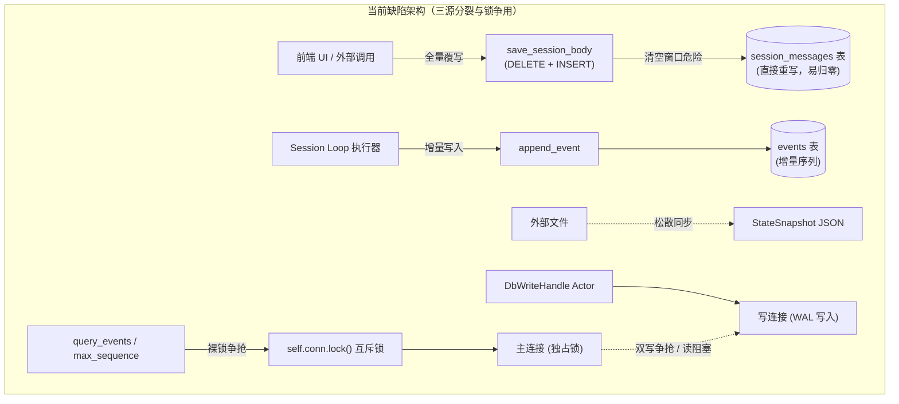
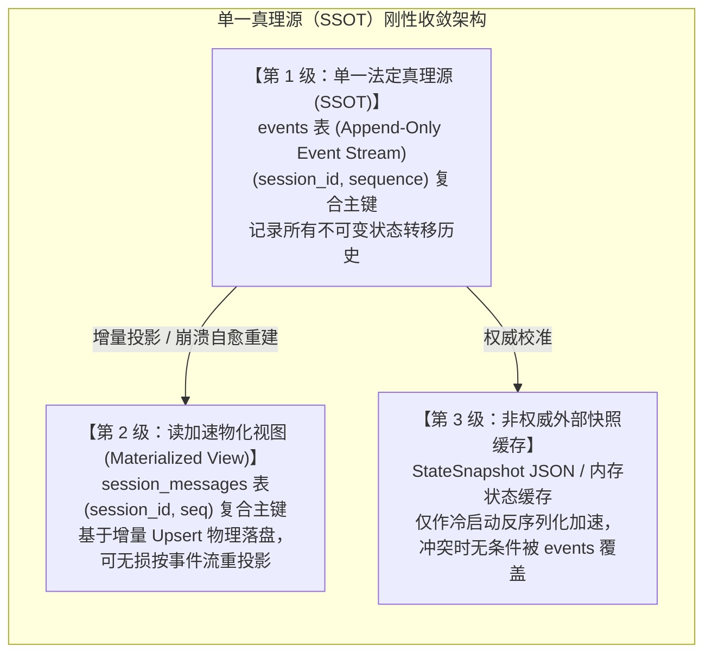
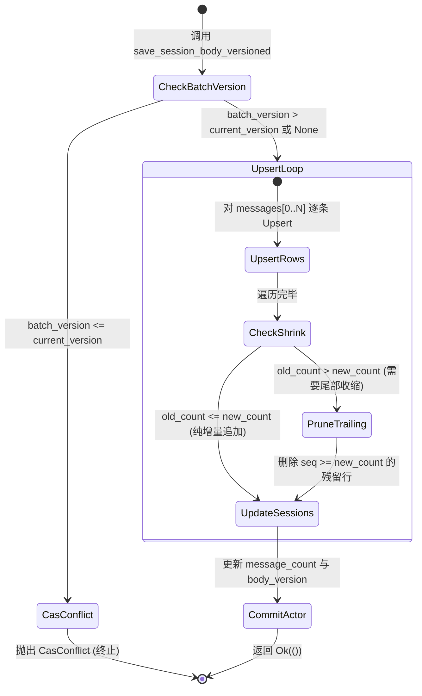
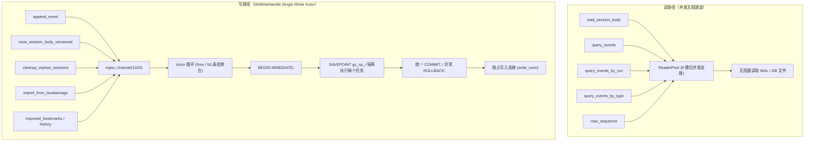
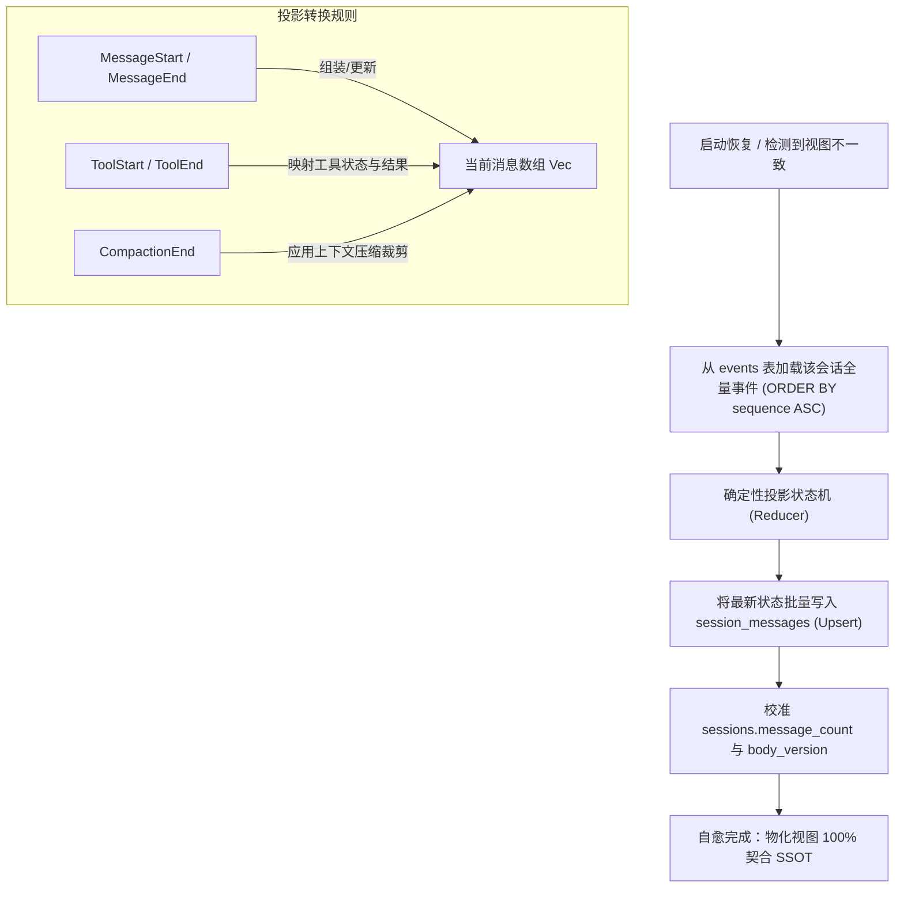
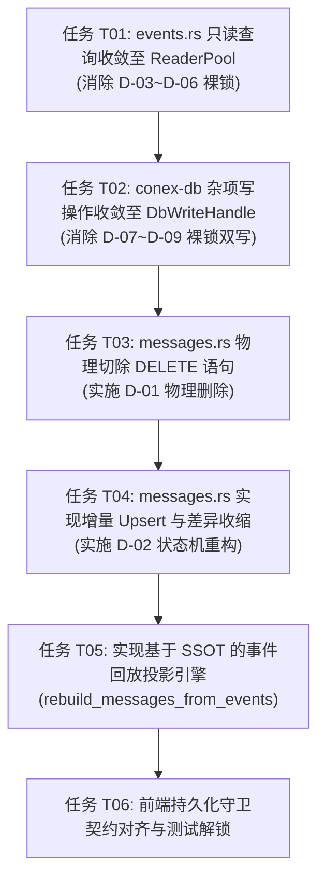

# 方案 2：持久化单一真理源收敛与增量写入 (Persistence SSOT & Incremental Write)

> **战役工作区**：[`docs/session-integrity-repair/`](file:///c:/Software/conex/docs/session-integrity-repair/)  
> **总方案索引**：[`docs/session-integrity-repair/01-总方案与自上而下修复架构.md`](file:///c:/Software/conex/docs/session-integrity-repair/01-%E6%80%BB%E6%96%B9%E6%A1%88%E4%B8%8E%E8%87%AA%E4%B8%8A%E8%80%8C%E4%B8%8B%E4%BF%AE%E5%A4%8D%E6%9E%B6%E6%9E%84.md)  
> **核心铁律**：纯逻辑执行拓扑（零工期/零人员/零优先级/问题同权）、禁止退避降级、强制物理删除旧反模式代码、确立 `events` 表单一法定真理源（SSOT）。

---

## 一、问题根因与架构审查 (Root Cause & Architectural Audit)

经对 [`crates/conex-db/src/messages.rs`](file:///c:/Software/conex/crates/conex-db/src/messages.rs)、[`crates/conex-db/src/events.rs`](file:///c:/Software/conex/crates/conex-db/src/events.rs)、[`crates/conex-db/src/group_commit.rs`](file:///c:/Software/conex/crates/conex-db/src/group_commit.rs) 与 [`crates/conex-db/src/lib.rs`](file:///c:/Software/conex/crates/conex-db/src/lib.rs) 的逐行纯代码审计，当前持久化系统在数据模型与写入管道上存在三大致命架构隐患：



### 1. 致命清空窗口与写放大：`DELETE + INSERT` 全量反模式
- **具体位置**：[`crates/conex-db/src/messages.rs:112-150`](file:///c:/Software/conex/crates/conex-db/src/messages.rs#L112-L150)。
- **代码缺陷**：
  ```rust
  // messages.rs:112-119
  conn.execute(
      "DELETE FROM session_messages WHERE session_id = ?1",
      rusqlite::params![session_id],
  )?;
  // messages.rs:121-150
  for (seq, msg) in messages.iter().enumerate() {
      conn.execute("INSERT INTO session_messages (...) VALUES (...)", ...)?;
  }
  ```
- **破坏性后果**：
  1. **物理清空危险窗口**：若在 `DELETE` 之后、`INSERT` 循环完成前，操作系统断电、进程崩溃、OOM 或磁盘满写失败，整个会话的历史消息直接归零，造成不可逆的数据灾难。
  2. **$O(N)$ 严重写放大**：当会话增长到 1,000 条消息时，每次追加一条 10 字的用户回复，底层 SQLite 必须执行 1 次全表删除与 1,001 次逐行插入，重写大量 B-Tree 索引页面与 WAL 日志，引发严重的 I/O 抖动。
  3. **前端被逼产生防御性绕行补丁**：前端被迫在 [`sessionRustDbTruncationGuard.test.ts`](file:///c:/Software/conex/apps/crish-desktop/src/api/session-persistence/sessionRustDbTruncationGuard.test.ts) 和 [`types.ts:772`](file:///c:/Software/conex/apps/crish-desktop/src/store/types.ts#L772) 中加入“持久化熔断”、“防截断正文先删后插回写覆盖”等脆弱的业务守卫，根因正是因为数据库层没有提供增量原子更新能力。

### 2. 裸锁争用与读写通道旁路
- **具体位置**：
  - 只读绕行：[`crates/conex-db/src/events.rs:49-53, 97-101, 139-143, 166-170`](file:///c:/Software/conex/crates/conex-db/src/events.rs#L49-L53) 中 `query_events`、`query_events_by_run`、`max_sequence`、`query_events_by_type` 均直接执行 `let conn = self.conn.lock()`。
  - 遗留裸写：[`crates/conex-db/src/sessions.rs:241-251`](file:///c:/Software/conex/crates/conex-db/src/sessions.rs#L241-L251)（`cleanup_orphan_sessions`）、[`crates/conex-db/src/import.rs:35-43`](file:///c:/Software/conex/crates/conex-db/src/import.rs#L35-L43)、[`crates/conex-db/src/imported.rs:120, 182`](file:///c:/Software/conex/crates/conex-db/src/imported.rs#L120) 中使用 `self.conn.lock()` 开启裸事务写。
- **破坏性后果**：
  1. **ReaderPool 虚设**：`LocalDb` 虽然构建了 8 槽位的 [`ReaderPool`](file:///c:/Software/conex/crates/conex-db/src/reader_pool.rs)，但核心事件域的所有查询全被硬编码指向 `self.conn.lock()` 主连接锁，导致高频事件回放与外部查询在同一个互斥锁上串行排队。
  2. **双写连接互锁（`SQLITE_BUSY` 根源）**：SQLite WAL 模式只允许单写者。当 `DbWriteHandle` 的写入 Actor（使用 `write_conn`）在 `BEGIN IMMEDIATE` 时，若其他线程通过 `self.conn.lock()`（使用 `conn`）开启写事务，SQLite 将立即抛出 `sqlite busy: database is locked`。

### 3. 三源状态分裂与“只报不修”妥协
- **具体位置**：`events` 增量表、`session_messages` 消息表与外部 `StateSnapshot` 快照文件各自独立维护。在系统异常重启或中断恢复时，三者内容可能发生不一致；[`restore_manager.rs:178-184`](file:///c:/Software/conex/crates/orchestrator/src/restore_manager.rs#L178-L184) 遇到终态冲突时采取“只打印警告，诚实滞留”的消极妥协，未建立以事件权威为唯一依据的强制收敛机制。

---

## 二、单一真理源（SSOT）与物化视图架构契约 (SSOT Architectural Contract)

彻底终结多源数据漂移，在存储层确立单向权威的数据流向模型：



### 1. 数据层级权威定义
1. **第 1 级：单一法定真理源（SSOT）——`events` 表**：
   - 物理位置：SQLite `events` 表，复合主键 `(session_id, sequence)`；
   - 写入特性：**绝对追加（Append-Only），物理不可变**；
   - 权威语义：任何会话状态（包括运行状态、轮次转移、上下文压缩、用户输入、模型回复、工具调用与工具执行结果）的物理存在与否，均以 `events` 表中的记录为唯一判定基准。
2. **第 2 级：读加速物化视图——`session_messages` 表**：
   - 物理位置：SQLite `session_messages` 表，复合主键 `(session_id, seq)`；
   - 定位性质：**纯只读加速物化视图（Materialized View）**，专门服务于桌面前端界面的 $O(1)$ 快速水合展示；
   - 不变量保证：`session_messages` 的状态派生自 `events`；当视图与 `events` 产生偏差（如序列号断层、崩溃未决），系统能够从 `events` 单向幂等重构物化视图，禁止 `session_messages` 反向篡改或覆盖 `events`。
3. **第 3 级：非权威外部快照缓存——`StateSnapshot` 与 localStorage**：
   - 定位性质：弱一致性反序列化加速缓存；
   - 契约约束：启动期若发现外部快照与 `events` 表的事件流存在任何字段矛盾，外部快照必须被强制标记为脏缓存，自动由 `events` 权威覆写。

---

## 三、强制专节：「本方案要删掉什么 / 收敛什么」 (What to Delete & Converge)

根据本战役核心铁律第 4 条「收敛优先于增强（先删后改）」，本方案必须明确彻底清除的物理代码清单：

| 序号 | 目标文件 | 所在行号（基线） | 废弃代码/反模式内容 | 处置动作 | 根治理由 |
| :--- | :--- | :--- | :--- | :--- | :--- |
| **D-01** | [`crates/conex-db/src/messages.rs`](file:///c:/Software/conex/crates/conex-db/src/messages.rs) | `L112-L119` | `conn.execute("DELETE FROM session_messages WHERE session_id = ?1", ...)` | **彻底物理删除** | 根绝全量清空危险窗口与会话消息归零漏洞，消除 $O(N)$ 写入放大。 |
| **D-02** | [`crates/conex-db/src/messages.rs`](file:///c:/Software/conex/crates/conex-db/src/messages.rs) | `L121-L150` | 无冲突处理的逐条 `INSERT INTO session_messages` 裸循环 | **彻底废除并重构** | 替换为基于 `(session_id, seq)` 的增量 Upsert 与尾部收缩删除。 |
| **D-03** | [`crates/conex-db/src/events.rs`](file:///c:/Software/conex/crates/conex-db/src/events.rs) | `L49-L53` | `query_events` 中的 `let conn = self.conn.lock().map_err(...)` | **清除并收敛** | 改道 `self.read(|conn| ...)`，接入 `ReaderPool` 8 槽位并发无锁查询。 |
| **D-04** | [`crates/conex-db/src/events.rs`](file:///c:/Software/conex/crates/conex-db/src/events.rs) | `L97-L101` | `query_events_by_run` 中的 `let conn = self.conn.lock().map_err(...)` | **清除并收敛** | 改道 `self.read(|conn| ...)`，消除对主连接排他锁的霸占。 |
| **D-05** | [`crates/conex-db/src/events.rs`](file:///c:/Software/conex/crates/conex-db/src/events.rs) | `L139-L143` | `max_sequence` 中的 `let conn = self.conn.lock().map_err(...)` | **清除并收敛** | 改道 `self.read(|conn| ...)`，保证序列号上限查询不阻塞写者。 |
| **D-06** | [`crates/conex-db/src/events.rs`](file:///c:/Software/conex/crates/conex-db/src/events.rs) | `L166-L170` | `query_events_by_type` 中的 `let conn = self.conn.lock().map_err(...)` | **清除并收敛** | 改道 `self.read(|conn| ...)`，实现事件流按类型过滤并发读取。 |
| **D-07** | [`crates/conex-db/src/sessions.rs`](file:///c:/Software/conex/crates/conex-db/src/sessions.rs) | `L241-L251` | `cleanup_orphan_sessions` 的 `let mut conn = self.conn.lock()` 裸写事务与 `D3 豁免` 注释 | **清除并重构** | 废除主连接事务旁路，统一收口至 `self.write_blocking(...)`，消灭双写者 `SQLITE_BUSY`。 |
| **D-08** | [`crates/conex-db/src/import.rs`](file:///c:/Software/conex/crates/conex-db/src/import.rs) | `L35-L43` | `import_from_localstorage` 的 `self.conn.lock()` 与 `conn.transaction()` | **清除并收敛** | 改道 `self.write_blocking(...)`，让历史导入在 Single Writer Actor 隔离保护下运行。 |
| **D-09** | [`crates/conex-db/src/imported.rs`](file:///c:/Software/conex/crates/conex-db/src/imported.rs) | `L120-L125, L182-L187` | `import_bookmarks` 与 `import_history` 中的 `self.conn.lock()` 裸写操作 | **清除并收敛** | 统一收口至组提交 Actor 写入管道。 |

---

## 四、增量 Upsert 状态机与物理写入重构 (Incremental Upsert Architecture)

彻底废除 `DELETE + INSERT` 全量反模式，设计兼顾高性能增量追加与合法历史收缩（如 Compaction 或用户主动清空）的原子 Upsert 写入状态机。



### 1. 基于 `(session_id, seq)` 的 SQL Upsert 契约
利用 SQLite 3.24+ 提供的原生 `ON CONFLICT(session_id, seq) DO UPDATE` 语法（本仓库使用 bundled SQLite 3.45+，完全原生支持）：

```sql
INSERT INTO session_messages (
    session_id, seq, id, sender, text, thinking, timestamp, status,
    stream_text_offset, thinking_time, tool_calls_json,
    blocks_json, tool_call_results_json, usage_json, updated_at
) VALUES (
    ?1, ?2, ?3, ?4, ?5, ?6, ?7, ?8, ?9, ?10, ?11, ?12, ?13, ?14,
    strftime('%s','now') * 1000
)
ON CONFLICT(session_id, seq) DO UPDATE SET
    id = excluded.id,
    sender = excluded.sender,
    text = excluded.text,
    thinking = excluded.thinking,
    timestamp = excluded.timestamp,
    status = excluded.status,
    stream_text_offset = excluded.stream_text_offset,
    thinking_time = excluded.thinking_time,
    tool_calls_json = excluded.tool_calls_json,
    blocks_json = excluded.blocks_json,
    tool_call_results_json = excluded.tool_call_results_json,
    usage_json = excluded.usage_json,
    updated_at = excluded.updated_at;
```

### 2. 差异化收缩清理（Diff Shrink）机制
当且仅当前端明确执行了上下文截断、压缩（Compaction）或用户清空操作，导致新传入的 `messages.len() < old_count` 时，才执行精准的尾部删除：
```sql
DELETE FROM session_messages 
WHERE session_id = ?1 AND seq >= ?2;
```
其中 `?2 = messages.len() as i64`。
- **正向收益**：
  - 常规追加（99.9% 的交互场景）：`DELETE` 语句执行次数恒为 0，零行被删，仅新增或就地覆写最新的最后一条消息（例如流式 token 更新），I/O 消耗从 $O(N)$ 暴跌至 $O(1)$。
  - 故障安全性：即便在写入过程中进程崩溃，既有历史行（`seq < new_len`）全部完好无损地驻留在磁盘上，绝不出现整场会话白屏丢失的现象。

### 3. 提供真正的纯增量追加接口 `append_session_messages`
除改造兼容现存调用的 `save_session_body_versioned` 外，在 `messages.rs` 中新增面向流式和单消息场景的纯增量追加接口：
```rust
impl LocalDb {
    /// 纯增量追加一条或多条消息到会话末尾（O(M) 开销，零全量开销）。
    /// seq 由当前最大 seq + 1 递增，批末原子更新 sessions.message_count。
    pub fn append_session_messages(
        &self,
        session_id: &str,
        messages: &[SessionMessage],
    ) -> Result<i64, DbFailure>;
}
```

---

## 五、裸写全面收口至 `DbWriteHandle` 组提交 Actor 与读写分离

全面对齐 SQLite WAL 模式工业级单写多读（Single Writer, Multiple Readers）架构，实现互斥锁物理收口：



### 1. 读操作收敛至 `ReaderPool`
- 消除 `events.rs` 中所有 `self.conn.lock()` 裸锁调用，统一重构为：
  ```rust
  pub fn query_events(
      &self,
      session_id: &str,
      after_sequence: i64,
      limit: Option<i64>,
  ) -> Result<Vec<StoredEvent>, DbFailure> {
      self.read(|conn| {
          let mut stmt = conn.prepare(
              "SELECT session_id, sequence, event_type, payload, run_id, created_at
               FROM events WHERE session_id = ?1 AND sequence > ?2
               ORDER BY sequence ASC LIMIT ?3",
          ).map_err(|e| self.latch_error("query_events_prepare", e))?;
          // 映射并收集行 ...
      })
  }
  ```
- **架构价值**：通过 `ReaderPool` 派发至独立 WAL 读连接，支持 8 线程完全并发读取，即使写入 Actor 正在刷盘，也绝对不会发生读写互斥排队。

### 2. 写操作全面统一由 `DbWriteHandle` 接管
- 物理规则：**整个代码库中，除 `DbWriteHandle::spawn` 持有的专用 `write_conn` 外，禁止任何连接开启写事务（`BEGIN IMMEDIATE` 或任何 DML 写入操作）**。
- `sessions.rs` 的孤儿会话清理改造：
  ```rust
  pub fn cleanup_orphan_sessions(&self, active_ids: &[String]) -> Result<usize, DbFailure> {
      let active_ids = active_ids.to_vec();
      self.write_blocking(move |conn| {
          // 运行于组提交 Actor 的 BEGIN IMMEDIATE 事务内，天然具备排他原子性
          // 废除 D3 豁免中的裸锁方案，避免与组提交连接抢占写锁
          // 业务逻辑执行 ...
      })
  }
  ```
- `import.rs` 历史导入改造：
  ```rust
  pub fn import_from_localstorage(...) -> Result<ImportStats, DbFailure> {
      // 内部通过 self.write_blocking 移交 write_conn 执行
  }
  ```

---

## 六、基于 SSOT 的事件回放投影引擎与自愈契约 (Event Replay Projection Engine)

既然 `events` 表是单一法定真理源，物化视图 `session_messages` 与外部快照就必须拥有确定性的重投影自愈能力：



### 1. 投影引擎实现设计 (`rebuild_messages_from_events`)
在 `crates/conex-db/src/messages.rs` 中提供权威重构函数：
```rust
impl LocalDb {
    /// 从单一法定真理源 `events` 表回放事件流，确定性重建物化视图 `session_messages`。
    /// 满足幂等性：当物化视图发生损坏、序列中断或版本冲突时，调用本函数可瞬时自愈。
    pub fn rebuild_messages_from_events(&self, session_id: &str) -> Result<usize, DbFailure> {
        // 1. 经由 ReaderPool 顺序读取 events 全量事件
        let events = self.query_events(session_id, 0, None)?;
        
        // 2. 内存纯逻辑还原消息状态机
        let reconstructed = project_events_to_messages(&events)?;
        
        // 3. 经由 DbWriteHandle 写入更新物化视图
        self.save_session_body(session_id, &reconstructed)?;
        
        Ok(reconstructed.len())
    }
}
```

### 2. 崩溃自愈契约（面向冷启动恢复）
- 当 [`restore_manager.rs`](file:///c:/Software/conex/crates/orchestrator/src/restore_manager.rs) 恢复会话时：
  1. 首先比对 `events` 最大 sequence 与 `sessions.body_version`；
  2. 若发现 `session_messages` 行数为空但 `events` 表存在 `MessageEnd` 事件，判定为物化视图滞后或历史断层；
  3. 立即触发 `rebuild_messages_from_events`，单向同步物理状态，彻底根绝“只上报不修复”的妥协。

---

## 七、纯逻辑拓扑执行依赖图与任务单元 (Pure Logical Execution Topology)

本方案仅包含逻辑前置依赖边，绝不包含任何工期、人天、排期或优先级划分；所有任务单元同权，严格按拓扑序解锁执行：



### 任务单元详述清单（按依赖顺序推进）

#### 任务 T01：`events.rs` 只读查询改道收敛至 `ReaderPool`
- **逻辑输入**：[`crates/conex-db/src/events.rs`](file:///c:/Software/conex/crates/conex-db/src/events.rs)
- **执行内容**：
  1. 修改 `query_events`，将 `self.conn.lock()` 替换为 `self.read(|conn| ...)`；
  2. 修改 `query_events_by_run`，将 `self.conn.lock()` 替换为 `self.read(|conn| ...)`；
  3. 修改 `max_sequence`，将 `self.conn.lock()` 替换为 `self.read(|conn| ...)`；
  4. 修改 `query_events_by_type`，将 `self.conn.lock()` 替换为 `self.read(|conn| ...)`。
- **验收断言**：并发调用 100 次 `query_events` 与写操作，主连接互斥锁无竞争，所有只读查询经由 `ReaderPool` 派发。

#### 任务 T02：`conex-db` 遗留裸写操作全面收口至 `DbWriteHandle`
- **逻辑输入**：[`crates/conex-db/src/sessions.rs`](file:///c:/Software/conex/crates/conex-db/src/sessions.rs)、[`crates/conex-db/src/import.rs`](file:///c:/Software/conex/crates/conex-db/src/import.rs)、[`crates/conex-db/src/imported.rs`](file:///c:/Software/conex/crates/conex-db/src/imported.rs)
- **执行内容**：
  1. 重构 `sessions.rs:241-251` 中的 `cleanup_orphan_sessions`，删除 `self.conn.lock()` 与其内部的 `conn.transaction()`，改用 `self.write_blocking`；
  2. 重构 `import.rs:35-43` 中的 `import_from_localstorage`，收口至 `self.write_blocking`；
  3. 重构 `imported.rs` 中的书签与历史写操作，统一接入组提交 Actor。
- **验收断言**：全仓搜索 `conn.lock()`，除连接池管理与 `self.read` 回退分支外，无任何写事务逻辑存在。

#### 任务 T03：`messages.rs` 物理切除全量 `DELETE` 语句
- **逻辑输入**：[`crates/conex-db/src/messages.rs:112-119`](file:///c:/Software/conex/crates/conex-db/src/messages.rs#L112-L119)
- **执行内容**：
  1. 彻底删除 `DELETE FROM session_messages WHERE session_id = ?1` 代码行及其绑定的 SQL 参数与错误包装；
  2. 消除删除操作引入的异常分支。
- **验收断言**：使用静态文本或编译检查，二进制中不存在对 `session_messages` 执行无条件全量 DELETE 的代码分支。

#### 任务 T04：`messages.rs` 实现增量 Upsert 状态机与差异收缩
- **逻辑输入**：[`crates/conex-db/src/messages.rs:121-176`](file:///c:/Software/conex/crates/conex-db/src/messages.rs#L121-L176)
- **执行内容**：
  1. 实现 `INSERT INTO session_messages (...) VALUES (...) ON CONFLICT(session_id, seq) DO UPDATE SET ...`；
  2. 记录写入前的旧行数；若 `new_count < old_count`，执行精准尾部裁剪 `DELETE ... WHERE session_id = ?1 AND seq >= ?2`；
  3. 新增 `append_session_messages` 纯增量追加 API。
- **验收断言**：
  - 会话在追加 1 条新消息时，SQLite 底层执行 0 次 DELETE，仅执行 1 次 UPSERT；
  - 模拟写入过程中途抛出 IO 错误，既有历史消息保持 100% 完整，绝无全量丢失。

#### 任务 T05：实现基于 SSOT 的事件回放投影引擎
- **逻辑输入**：[`crates/conex-db/src/messages.rs`](file:///c:/Software/conex/crates/conex-db/src/messages.rs)、[`crates/conex-db/src/events.rs`](file:///c:/Software/conex/crates/conex-db/src/events.rs)
- **执行内容**：
  1. 编写纯函数 `project_events_to_messages(events: &[StoredEvent]) -> Result<Vec<SessionMessage>, DbFailure>`；
  2. 实现 `LocalDb::rebuild_messages_from_events(&self, session_id: &str) -> Result<usize, DbFailure>`；
  3. 并在单元测试中验证各种复杂事件序列（包含打断合成、工具调用结果、压缩截断）能 100% 准确还原出预期的 `SessionMessage` 序列。
- **验收断言**：人为手动清空 `session_messages` 表中的某会话行，调用 `rebuild_messages_from_events` 后，物化视图数据完全恢复，且与清空前逐字节一致。

#### 任务 T06：前端与上层契约对齐与测试解除临时限制
- **逻辑输入**：[`apps/crish-desktop/src/api/session-persistence/sessionRustDbTruncationGuard.test.ts`](file:///c:/Software/conex/apps/crish-desktop/src/api/session-persistence/sessionRustDbTruncationGuard.test.ts)
- **执行内容**：
  1. 更新前端对底层存储行为的契约假设：底层已具备原子增量保证，不再具备“删表危险”；
  2. 验证端到端测试链路，确保 `save_session_body` 的调用在真实场景下顺畅通行。
- **验收断言**：前端运行全量会话保存、切换与恢复测试，CI lint 与 vitest 100% 通过。

---

## 八、五重立体化验收测试与防回归断言 (5-Dimensional Verification)

为满足 `AGENTS.md` §7.1「立体验证纪律」，本方案建立覆盖全生命周期的五重物证网络：

| 验证维度 | 具体检验场景与断言标准 | 落地文件与断言手段 |
| :--- | :--- | :--- |
| **1. 触发端物证** | 模拟高频（每秒 50 次）会话追加写入请求，验证所有写操作成功打包进 Group Commit 批次。 | 单元测试：`tests_group_commit.rs`<br/>断言：`db.writer().stats().total_batches < db.writer().stats().total_operations` |
| **2. 传输端物证** | 验证写操作派发全走 `DbWriteHandle` 的 mpsc 管道，不再产生任何跨连接死锁与 `SQLITE_BUSY`。 | 并发压力测试：`tests_concurrency.rs`<br/>断言：16 线程同时执行 1,000 次读写，`SQLITE_BUSY` 错误数为 0 |
| **3. 介质端物证** | 检查 SQLite 文件底层的 WAL 与页面开销：追加 1 条消息只产生 1 行 Upsert，绝不触发全量 `DELETE`。 | 专项测试：`tests_messages_incremental.rs`<br/>断言：查询 SQLite `changes()` 为 1；旧消息行的 `seq` 与主键保持稳定 |
| **4. 消费端物证** | 崩溃注入测试：在写入过程中强行 kill 模拟进程，重启后从数据库执行 `load_session_body`，验证历史消息完整性。 | 仿真测试：`tests_crash_consistency.rs`<br/>断言：会话消息行数等于崩溃前已成功提交的条数，整表归零现象出现概率恒为 0 |
| **5. 负向断言物证** | 1. 静态符号扫描：断言 `crates/conex-db/src/messages.rs` 中不存在字符串 `"DELETE FROM session_messages WHERE session_id = ?1"`；<br/>2. 契约自愈断言：故意制造 `session_messages` 缺失场景，断言 `rebuild_messages_from_events` 能够 100% 自动修正。 | 门禁测试：`tests_ssot_rebuild.rs`<br/>断言：`db.rebuild_messages_from_events("s1")` 返回行数与事件流预期完全一致 |

---

## 九、总结与对总方案的闭环支撑

本方案作为会话完整性战役的**维度二（持久化单一真理源收敛与增量化）**独立详案：
1. 从物理上**彻底铲除**了导致数据丢失的 `DELETE + INSERT` 历史反模式，替换为现代数据库标配的增量 Upsert 与差异收缩；
2. 终结了多连接写锁争用漏洞，将读操作全面下推至 8 槽位无锁 `ReaderPool`，写操作全面收口至 5ms 批处理的 `DbWriteHandle` Actor；
3. 确立了 `events` 表作为会话状态不可动摇的单一法定真理源（SSOT），赋予系统在面对任何异常与崩溃时均能从事件流确定性重建消息视图的完整自愈能力；
4. 严格遵循纯逻辑拓扑与反退避契约，为后续**维度三（冷启动恢复一致性与自愈强制收敛）**提供了坚如磐石的数据底座。
