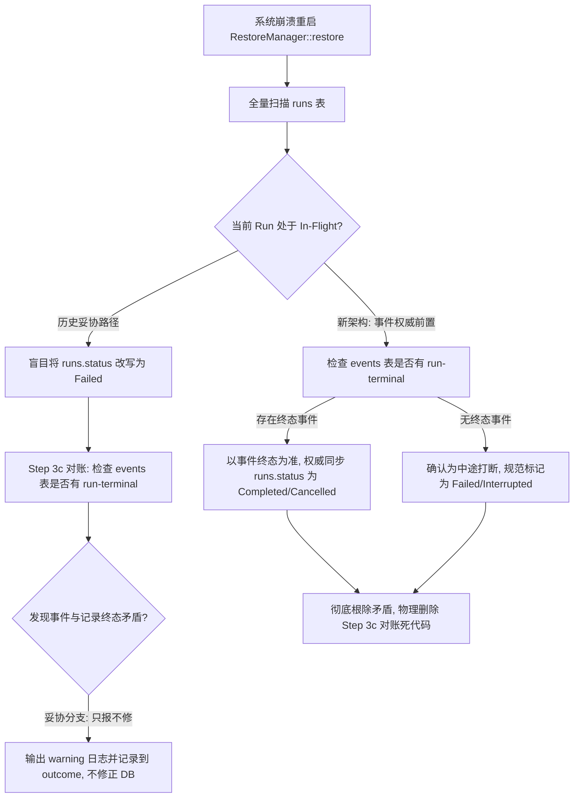
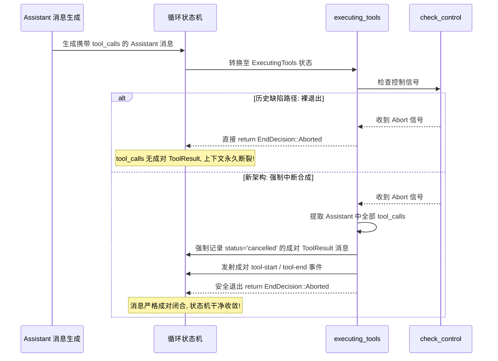

# 方案 05：重复与死层清理及删除面独立方案

> **落盘位置**：`docs/session-integrity-repair/independent-plans/plan-05-dead-layers-removal.md`  
> **设计原则**：收敛优先、先删后改；纯逻辑执行拓扑；零二手文档依赖；零无日落期兼容 Shim；零编译断裂。

---

## 一、方案目标与设计哲学

在 Conex / Crish 系统长期的演进重构中，持久化层、编排器恢复流与会话主循环中沉淀了一批因阶段性妥协、测试临时放行、双轨过渡或防御性规避而产生的死代码层与反模式逻辑：
1. **持久化层**：以 `DELETE FROM session_messages` 全量清空重写为代表的反模式，以及绕过 `DbWriteHandle` 单写 Actor 直接持有 `self.conn.lock()` 并开启裸事务的旁路；
2. **编排器恢复流**：以 G-29 终态矛盾“只报不修、诚实滞留”为代表的消极妥协分支，以及快照反序列化（`to_stored_runs`、`to_pending_inputs`）的历史死代码；
3. **会话循环**：在 `executing_tools.rs` 中捕获 abort 后直接退出导致的未成对丢弃工具问题、`exec_batch.rs` 中的空 ID 兜底，以及安全点打断后的工具收尾缺口；
4. **前端防御层**：前端因底层数据库“删插重写”而被迫注入的 `isHydrateTruncated` 截断熔断、CAS 版本戳链与已废弃的 40 代理软上限等防御性补丁。

本方案严格遵循**“收敛优先、先删后改”**的铁律，明确划定物理删除边界，梳理代码级删除清册，并建立严格无环的逻辑拓扑顺序，确保旧路径被连根拔起、新路径严丝合缝接入，系统实现架构净收敛。

---

## 二、本方案要删掉什么 / 收敛什么（物理删除清册）

本节建立权威的物理删除清册，明确标示必须物理剔除或外科手术式收敛的文件、行号、结构体、函数签名与分支逻辑。

### 1. 持久化层死层与写旁路删除清册

| 序号 | 目标源码文件 | 行号区间 | 代码符号 / 逻辑块 | 操作类型 | 根因与收敛目标 |
| :--- | :--- | :--- | :--- | :--- | :--- |
| **D-P01** | [`crates/conex-db/src/messages.rs`](file:///c:/Software/conex/crates/conex-db/src/messages.rs) | `L55-L61` | `pub fn save_session_body` | **物理删除** | 非 CAS 全量 rebase 旁路；收敛为单一定点增量持久化接口，禁止无保护重写。 |
| **D-P02** | [`crates/conex-db/src/messages.rs`](file:///c:/Software/conex/crates/conex-db/src/messages.rs) | `L112-L120` | `conn.execute("DELETE FROM session_messages WHERE session_id = ?1")` | **物理删除** | 根除全量清空反模式；改为按 `(session_id, seq)` 或唯一 ID 的增量 `INSERT / ON CONFLICT DO UPDATE`。 |
| **D-P03** | [`crates/conex-db/src/messages.rs`](file:///c:/Software/conex/crates/conex-db/src/messages.rs) | `L152-L172` | `UPDATE sessions SET message_count = (SELECT COUNT(*)...)` | **逻辑收敛** | 批末全表重算反模式；收敛为增量计数维护或单次原子累加。 |
| **D-P04** | [`crates/conex-db/src/messages.rs`](file:///c:/Software/conex/crates/conex-db/src/messages.rs) | `L179-L206` | `pub(crate) fn parse_session_messages_flexible` | **物理删除** | 兼容历史 localStorage JSON 数组与 JSONL 行格式的双轨解析垫片；历史数据迁移期结束，予以物理铲除。 |
| **D-P05** | [`crates/conex-db/src/events.rs`](file:///c:/Software/conex/crates/conex-db/src/events.rs) | `L49-L53` | `query_events` 中的 `self.conn.lock()` | **外科改道** | 读旁路绕过 `ReaderPool`；收敛至 `self.read(\|conn\| ...)` 走 8 槽位并发无锁只读连接池。 |
| **D-P06** | [`crates/conex-db/src/events.rs`](file:///c:/Software/conex/crates/conex-db/src/events.rs) | `L97-L101` | `query_events_by_run` 中的 `self.conn.lock()` | **外科改道** | 同上，消除对主连接互斥锁的抢占，改道 `self.read`。 |
| **D-P07** | [`crates/conex-db/src/events.rs`](file:///c:/Software/conex/crates/conex-db/src/events.rs) | `L139-L143` | `max_sequence` 中的 `self.conn.lock()` | **外科改道** | 同上，恢复路径高频 SQL 下推读全面回归 `ReaderPool`。 |
| **D-P08** | [`crates/conex-db/src/events.rs`](file:///c:/Software/conex/crates/conex-db/src/events.rs) | `L166-L170` | `query_events_by_type` 中的 `self.conn.lock()` | **外科改道** | 同上，消除对主锁的独占，释放读并发吞吐。 |
| **D-P09** | [`crates/conex-db/src/sessions.rs`](file:///c:/Software/conex/crates/conex-db/src/sessions.rs) | `L243-L251` | `cleanup_orphan_sessions` 中的 `self.conn.lock()` 与 `conn.transaction()` | **外科改道** | 生产写旁路；摘除主锁与裸事务，改道统一写入 Actor `self.write_blocking`，消除 `SQLITE_BUSY` 锁竞争。 |
| **D-P10** | [`crates/conex-db/src/import.rs`](file:///c:/Software/conex/crates/conex-db/src/import.rs) | `L35-L43` | `import_from_localstorage` 中的 `self.conn.lock()` 与 `conn.transaction()` | **外科改道** | 存量大事务写旁路；改道 `self.write_blocking` 单写 Actor 管道执行。 |
| **D-P11** | [`crates/conex-db/src/import.rs`](file:///c:/Software/conex/crates/conex-db/src/import.rs) | `L90-L94` | `DELETE FROM session_messages WHERE session_id = ?1` | **物理删除** | 导入域内的删插反模式；改道幂等 upsert。 |
| **D-P12** | [`crates/conex-db/src/imported.rs`](file:///c:/Software/conex/crates/conex-db/src/imported.rs) | `L120-L128` | `import_bookmarks` 中的 `self.conn.lock()` 与分批 `conn.transaction()` | **外科改道** | 绕过 Actor 的分批写旁路；改道 `self.write_blocking` 管道单写提交。 |
| **D-P13** | [`crates/conex-db/src/imported.rs`](file:///c:/Software/conex/crates/conex-db/src/imported.rs) | `L182-L190` | `import_history` 中的 `self.conn.lock()` 与分批 `conn.transaction()` | **外科改道** | 同上，清除历史导入中的主连接写锁旁路。 |
| **D-P14** | [`crates/conex-db/src/usage_analytics.rs`](file:///c:/Software/conex/crates/conex-db/src/usage_analytics.rs) | `L247-L251` | `import_legacy_usage_snapshot` 中的 `self.conn.lock()` 裸写循环 | **外科改道** | 循环逐条 INSERT 且无外层 Actor 保护；改道 `self.write_blocking`。 |
| **D-P15** | [`scripts/check-db-write-bypass.mjs`](file:///c:/Software/conex/scripts/check-db-write-bypass.mjs) | `L28-L58` | `EXEMPT_FILES` 与 `EXEMPT_FNS` 豁免项 | **物理剔除** | 清除已收敛函数（`cleanup_orphan_sessions`、`import_*`），收紧静态扫描门禁。 |

### 2. 编排器消极妥协与脑裂分支删除清册

| 序号 | 目标源码文件 | 行号区间 | 代码符号 / 逻辑块 | 操作类型 | 根因与收敛目标 |
| :--- | :--- | :--- | :--- | :--- | :--- |
| **D-O01** | [`crates/orchestrator/src/restore_manager.rs`](file:///c:/Software/conex/crates/orchestrator/src/restore_manager.rs) | `L64-L74` | `RunStatus::Unknown` 的 `unknown_status_runs.push` 滞留分支 | **物理删除** | 所谓“诚实滞留”使状态机脱离闭环；收敛为前置决断（归一为中断或失败态），终结挂起状态。 |
| **D-O02** | [`crates/orchestrator/src/restore_manager.rs`](file:///c:/Software/conex/crates/orchestrator/src/restore_manager.rs) | `L178-L195` | G-29 终态矛盾对账调用与警告日志循环 | **物理删除** | “只报不修”消极妥协；根因是 Step 3 盲目改写 Failed，前置事件权威探测后本步骤彻底多余。 |
| **D-O03** | [`crates/orchestrator/src/restore_manager.rs`](file:///c:/Software/conex/crates/orchestrator/src/restore_manager.rs) | `L341-L400` | `fn reconcile_terminal_conflicts` 全函数 | **物理删除** | 消极对账函数；物理铲除整段无用只读对账代码，禁止发现矛盾却不修复。 |
| **D-O04** | [`crates/orchestrator/src/restore.rs`](file:///c:/Software/conex/crates/orchestrator/src/restore.rs) | `L100-L115` | `pub struct ReconcileConflict` | **物理删除** | 终态矛盾数据结构；对账分支删除后其所属结构体彻底死产，直接物理删除。 |
| **D-O05** | [`crates/orchestrator/src/restore.rs`](file:///c:/Software/conex/crates/orchestrator/src/restore.rs) | `L132-L134` | `RestoreOutcome.unknown_status_runs` 字段 | **物理删除** | 滞留记录载荷；状态机全面归一后不再对外输出滞留 run 清单。 |
| **D-O06** | [`crates/orchestrator/src/restore.rs`](file:///c:/Software/conex/crates/orchestrator/src/restore.rs) | `L142-L144` | `RestoreOutcome.reconcile_conflicts` 字段 | **物理删除** | 矛盾条目载荷；消除脑裂上报面，对外保持权威单一状态。 |
| **D-O07** | [`crates/orchestrator/src/restore_snapshot.rs`](file:///c:/Software/conex/crates/orchestrator/src/restore_snapshot.rs) | `L83-L102` | `SnapshotRun::to_stored_run` | **物理删除** | 零消费死代码；SQLite 已成为 Run 的 SSOT，快照 run 反序列化彻底废弃。 |
| **D-O08** | [`crates/orchestrator/src/restore_snapshot.rs`](file:///c:/Software/conex/crates/orchestrator/src/restore_snapshot.rs) | `L133-L144` | `SnapshotPendingInput::to_pending_input` | **物理删除** | 零消费死代码；PendingInput 权威由 DB 维持，快照反序列化路径已死。 |
| **D-O09** | [`crates/orchestrator/src/restore_snapshot.rs`](file:///c:/Software/conex/crates/orchestrator/src/restore_snapshot.rs) | `L219-L231` | `StateSnapshot::to_stored_runs` 与 `to_pending_inputs` | **物理删除** | 零消费死代码；快照文件中的上述数据结构不再进行内存实体映射。 |

### 3. 会话循环未成对退出分支删除清册

| 序号 | 目标源码文件 | 行号区间 | 代码符号 / 逻辑块 | 操作类型 | 根因与收敛目标 |
| :--- | :--- | :--- | :--- | :--- | :--- |
| **D-S01** | [`crates/session-loop/src/loop/handlers/executing_tools.rs`](file:///c:/Software/conex/crates/session-loop/src/loop/handlers/executing_tools.rs) | `L49-L53` | `if let Some(end) = check_control(state)? { return Ok(HandlerOutcome::end(end)); }` | **物理删除** | 严重缺陷：捕获 abort 直接裸退出，前序 assistant 的工具调用永久孤立无结果；收敛至强制合成中断 ToolResult。 |
| **D-S02** | [`crates/session-loop/src/exec_batch.rs`](file:///c:/Software/conex/crates/session-loop/src/exec_batch.rs) | `L188-L191` | `ClassifiedToolResult::error("", "", ToolErrorKind::Cancelled, "cancelled", 0)` | **物理删除** | 伪兜底漏洞：使用空字符串 `""` 构造结果，导致 ToolResult ID 与 Call ID 无法配对；收敛为精准按入参 ID 补全。 |
| **D-S03** | [`crates/session-loop/src/exec_batch.rs`](file:///c:/Software/conex/crates/session-loop/src/exec_batch.rs) | `L252-L264` | `BatchRunner::run` 逐项串行探测 abort 而无外层快速 break 逻辑 | **逻辑收敛** | 中途打断未主动中断外层组调度；收敛为组间前置 abort 检测并在命中时直接切断剩余组，调用 `mark_rest_cancelled`。 |
| **D-S04** | [`crates/session-loop/src/exec_batch.rs`](file:///c:/Software/conex/crates/session-loop/src/exec_batch.rs) | `L601-L605` | `pub(crate) fn concurrency_obs` 访问器（未被非测试代码消费） | **物理删除** | 附带无用死方法；测试改用统一观测机制，删除生产空挂载。 |

### 4. 前端与脚本历史防御性绕行补丁删除清册

| 序号 | 目标源码文件 | 行号区间 | 代码符号 / 逻辑块 | 操作类型 | 根因与收敛目标 |
| :--- | :--- | :--- | :--- | :--- | :--- |
| **D-F01** | [`apps/crish-desktop/src/api/session-persistence/sessionRustDbWriteGuard.ts`](file:///c:/Software/conex/apps/crish-desktop/src/api/session-persistence/sessionRustDbWriteGuard.ts) | `L78-L93` | `export function isHydrateTruncated` | **物理删除** | 因后端 `DELETE + INSERT` 覆写而引入的截断熔断；后端增量化后此熔断彻底丧失存在依据，直接删除。 |
| **D-F02** | [`apps/crish-desktop/src/api/session-persistence/sessionRustDbWriteGuard.ts`](file:///c:/Software/conex/apps/crish-desktop/src/api/session-persistence/sessionRustDbWriteGuard.ts) | `L28-L44`, `L60-L76` | `writtenBodyBatchVersions` 与 CAS 版本读写映射 | **物理删除** | 为防御写覆盖而设计的脆弱内存 CAS；后端单调序列保障后全量清退。 |
| **D-F03** | [`apps/crish-desktop/src/api/session-persistence/sessionAgentsTruncation.ts`](file:///c:/Software/conex/apps/crish-desktop/src/api/session-persistence/sessionAgentsTruncation.ts) | 全文件（`L1-L97`） | 40 子代理保存上限与截断留痕模块 | **整文件物理删除** | 历史 localStorage 配额妥协代码；SQLite 路径无 40 上限限制，模块全部失活。 |
| **D-F04** | [`apps/crish-desktop/src/api/session-persistence/sessionAgentsTruncation.test.ts`](file:///c:/Software/conex/apps/crish-desktop/src/api/session-persistence/sessionAgentsTruncation.test.ts) | 全文件（`L1-L260`） | 子代理截断测试套件 | **整文件物理删除** | 伴随业务代码删除而陪葬删除。 |
| **D-F05** | [`apps/crish-desktop/src/api/session-persistence/sessionRustDbTruncationGuard.test.ts`](file:///c:/Software/conex/apps/crish-desktop/src/api/session-persistence/sessionRustDbTruncationGuard.test.ts) | 全文件（`L1-L213`） | 截断熔断红测试套件 | **整文件物理删除** | 测试针对 `isHydrateTruncated` 防御逻辑，随该防御代码一同删除。 |
| **D-F06** | [`apps/crish-desktop/src/api/session-persistence/sessionRustDbFallback.ts`](file:///c:/Software/conex/apps/crish-desktop/src/api/session-persistence/sessionRustDbFallback.ts) | `L37-L56`, `L94-L258` | `lsLoadSessionBody` / `lsSaveSessionBody` 等 localStorage 同步镜像 | **物理删除** | 剥离 LS 同步写正文与子代理的全部冗余路径；仅保留内存态降级提示。 |

---

## 三、持久化层死层与写旁路清理详案

### 3.1 `messages.rs`：`DELETE FROM session_messages` 全量清空反模式根除

#### 现状解剖与物理缺陷
在 [`crates/conex-db/src/messages.rs:112-150`](file:///c:/Software/conex/crates/conex-db/src/messages.rs#L112-L150) 中，每当会话保存消息时，均执行：
```sql
DELETE FROM session_messages WHERE session_id = ?1;
-- 随后在循环中从 seq = 0 重新 INSERT 全部消息
```
这种设计存在致命物理隐患：
1. **写放大灾难**：每次微小的会话推进都会导致 $O(N)$ 行的物理删除与全量重建，随着会话长度增长，产生极度剧烈的磁盘 WAL 写入抖动；
2. **关系完整性断层**：删除旧行会使得行级关联与索引彻底失效；
3. **严重并发易碎性**：若前端因分页仅持有部分消息快照（如水合阶段），全量删除直接导致历史数据瞬间物理灭失。

#### 物理删除与收敛改造
1. **删除 `save_session_body` 非 CAS 旁路**：物理移除 `messages.rs:55-61` 的非 CAS 全量覆盖入口；
2. **删除 `DELETE FROM session_messages` 语句块**：将 `messages.rs:112-120` 物理剔除；
3. **启用定点增量 Upsert 契约**：
   改写为基于 `(session_id, seq)` 或全局唯一消息 `id` 的单向追加与幂等定点更新：
   ```sql
   INSERT INTO session_messages (
       session_id, seq, id, sender, text, thinking, timestamp, status,
       stream_text_offset, thinking_time, tool_calls_json, blocks_json,
       tool_call_results_json, usage_json
   ) VALUES (?1, ?2, ?3, ?4, ?5, ?6, ?7, ?8, ?9, ?10, ?11, ?12, ?13, ?14)
   ON CONFLICT(session_id, id) DO UPDATE SET
       text = excluded.text,
       thinking = excluded.thinking,
       status = excluded.status,
       stream_text_offset = excluded.stream_text_offset,
       thinking_time = excluded.thinking_time,
       tool_calls_json = excluded.tool_calls_json,
       blocks_json = excluded.blocks_json,
       tool_call_results_json = excluded.tool_call_results_json,
       usage_json = excluded.usage_json;
   ```
4. **剔除 `parse_session_messages_flexible` 遗留解析器**：物理删除 `messages.rs:179-206`。

---

### 3.2 `events.rs`：`ReaderPool` 读旁路收口与 `conn.lock()` 消除

#### 现状解剖
在 [`crates/conex-db/src/events.rs`](file:///c:/Software/conex/crates/conex-db/src/events.rs) 中，以下 4 个高频读取接口：
- `query_events`（L49）
- `query_events_by_run`（L97）
- `max_sequence`（L139）
- `query_events_by_type`（L166）

均直接调用 `let conn = self.conn.lock().map_err(...)`。
此代码完全绕过了 `LocalDb` 初始化建立的高性能 8 槽位 `ReaderPool`（WAL 模式并发无锁读），不仅与 Single Writer 抢占主互斥锁，且将所有并发事件读取压入单线程串行排队。

#### 物理改道方案
将上述 4 处方法的开篇加锁逻辑全部物理替换为 `self.read(|conn| ...)` 闭包调用模式，统一调度至 `ReaderPool`：
```rust
// 以 query_events 为例的改道标准：
pub fn query_events(
    &self,
    session_id: &str,
    after_sequence: i64,
    limit: Option<i64>,
) -> Result<Vec<StoredEvent>, DbFailure> {
    self.read(|conn| {
        let mut stmt = conn.prepare(
            "SELECT session_id, sequence, event_type, payload, run_id, created_at
             FROM events WHERE session_id = ?1 AND sequence > ?2
             ORDER BY sequence ASC LIMIT ?3",
        ).map_err(|e| self.latch_error("query_events_prepare", e))?;
        // ... 原原有 SQL 映射保持不变 ...
    })
}
```

---

### 3.3 `sessions.rs`：`cleanup_orphan_sessions` 裸事务消除与 Actor 收敛

#### 现状解剖
在 [`crates/conex-db/src/sessions.rs:240-324`](file:///c:/Software/conex/crates/conex-db/src/sessions.rs#L240-L324) 中，`cleanup_orphan_sessions` 方法直接持有了 `self.conn.lock()` 并开启独立的 `conn.transaction()`：
```rust
let mut conn = self.conn.lock().map_err(...)?;
let tx = conn.transaction().map_err(...)?;
// 执行前统计 COUNT(*)
// 执行 DELETE FROM sessions ...
// 执行后统计 COUNT(*)
tx.commit()?;
```
因为此操作未接入 `DbWriteHandle`，当它与 Single Writer Actor 的写操作（`write_conn`）在 WAL 模式下并发执行时，两个连接同时尝试获取 SQLite 写锁，必然引发 `SQLITE_BUSY` 甚至死锁异常。历史方案对此消极妥协，将其登记到 `scripts/check-db-write-bypass.mjs` 豁免清单。

#### 物理改道方案
物理剔除 `self.conn.lock()` 与 `conn.transaction()`，全面改道 `self.write_blocking`：
```rust
pub fn cleanup_orphan_sessions(&self, active_ids: &[String]) -> Result<usize, DbFailure> {
    let active_ids = active_ids.to_vec();
    self.write_blocking(move |conn| {
        // 在 Actor 既有的 BEGIN IMMEDIATE 事务上下文中执行：
        // 1. 获取删除前总数
        // 2. 执行 DELETE 语句
        // 3. 获取删除后总数并返回差值
        // 闭包内严禁调用 conn.transaction()，消除嵌套事务
        Ok(total_before - total_after)
    })
}
```

---

### 3.4 `import.rs` 与 `imported.rs`：存量批量写旁路治理

1. **`import_from_localstorage`（[`crates/conex-db/src/import.rs:21-228`](file:///c:/Software/conex/crates/conex-db/src/import.rs#L21-L228)）**：
   - 物理剔除 `self.conn.lock()` 与 `conn.transaction()`；
   - 整体封装为传入 `self.write_blocking` 的原子闭包；
   - 移除内部对 `session_messages` 与 `session_agents` 的全表 DELETE，改为定点批量插入。
2. **`import_bookmarks` 与 `import_history`（[`crates/conex-db/src/imported.rs:112-232`](file:///c:/Software/conex/crates/conex-db/src/imported.rs#L112-L232)）**：
   - 物理剔除内部外挂的 `self.conn.lock()` 和逐批 `conn.transaction()`；
   - 将 1000 条分批写入逻辑整体送入 `self.write_blocking`，在 Actor 单写通道内进行分段保存。

---

### 3.5 `group_commit.rs` 接入闭合与门禁豁免清零

#### `DbWriteHandle` 原生支持复杂写闭包
确保 [`crates/conex-db/src/group_commit.rs`](file:///c:/Software/conex/crates/conex-db/src/group_commit.rs) 的 Single Writer Actor 明确契约：
- 所有传入 `write` / `write_blocking` 的写闭包已经天然处于 `BEGIN IMMEDIATE` 的顶层事务中；
- 复杂跨表业务写直接顺序执行 SQL 语句，需要子事务隔离时使用 SQLite 原生 `SAVEPOINT`；
- 彻底消灭在业务层手动调用 `conn.transaction()` 的需求。

#### 静态门禁豁免物理剔除
修改 [`scripts/check-db-write-bypass.mjs`](file:///c:/Software/conex/scripts/check-db-write-bypass.mjs)：
- 从 `EXEMPT_FILES` 中物理剔除：`'import.rs'`, `'imported.rs'`；
- 从 `EXEMPT_FNS` 中物理剔除：
  - `'cleanup_orphan_sessions'`
  - `'import_from_localstorage'`
  - `'import_bookmarks'`
  - `'import_history'`
  - `'import_legacy_usage_snapshot'`
- 门禁脚本中仅允许保留纯 DDL 迁移编排（`migrate.rs`, `migrate_steps.rs`, `schema.rs`），对任何业务域写旁路实行零容忍拦截。

---

## 四、编排器消极妥协与脑裂分支清理详案

### 4.1 `restore_manager.rs`：G-29 终态矛盾“只报不修、诚实滞留”分支物理铲除

#### 现状解剖：脑裂的形成与消极妥协
在 [`crates/orchestrator/src/restore_manager.rs`](file:///c:/Software/conex/crates/orchestrator/src/restore_manager.rs) 中，崩溃恢复处理逻辑存在重大设计妥协：
1. **Step 3 盲目覆盖**（`L76-L135`）：
   任何处于 in-flight 的 run 在重启时，不检查 events 事件流，直接无差别执行 `update_run_status(&run.run_id, RunStatus::Failed, Some("daemon-restarted"), ...)`。
2. **Step 3c 发现矛盾却拒绝修正**（`L178-L195` 与 `L341-L400`）：
   紧接着调用 `reconcile_terminal_conflicts`，去读取 events 表中是否存在 `run-terminal`。如果 events 表明明记录着该 run 已经正常完成（`terminal: completed`），系统发现了“事件说 completed，DB 记录却说 failed”的严重矛盾。然而代码却仅仅输出一行 `tracing::warn!`，并声明：
   > `// G-29 终态矛盾对账：只读校验，显式上报，不自动修正`
3. **“诚实滞留”使未知态脱管**（`L64-L74`）：
   对 `RunStatus::Unknown(literal)` 直接 `continue`，不打断不推进，任由脏数据滞留数据库。



#### 架构重塑与物理删除
1. **彻底物理删除对账逻辑与结构体**：
   - 物理删除 `restore_manager.rs:341-400` 中的 `reconcile_terminal_conflicts` 整个函数；
   - 物理删除 `restore_manager.rs:178-195` 中对该函数的调用代码与循环；
   - 物理删除 `crates/orchestrator/src/restore.rs:100-115` 中的 `struct ReconcileConflict`；
   - 物理删除 `RestoreOutcome` 中的 `reconcile_conflicts` 与 `unknown_status_runs` 字段。
2. **终态裁决前置至 Step 3（Event-Authoritative Reconciliation）**：
   在 Step 3 处理每个 in-flight run 之前，先向 store 查询该 run 是否存在 `run-terminal` 事件：
   - 若**存在 `run-terminal` 事件**：直接尊重事件流真相，将 `runs.status` 同步为事件记录的真实终态（如 `Completed`），不生成打断事件；
   - 若**不存在 `run-terminal` 事件**：证实为物理中途夭折，此时方才执行打断逻辑并写入 `run-interrupted` 审计事件；
   - 对 `RunStatus::Unknown`：一律判定为损坏状态，规范收敛为 `RunStatus::Failed`，清除滞留。

---

### 4.2 `restore_snapshot.rs`：快照反序列化死代码与虚假字段清理

#### 现状解剖
在 [`crates/orchestrator/src/restore_snapshot.rs`](file:///c:/Software/conex/crates/orchestrator/src/restore_snapshot.rs) 中存在多处零调用的死函数：
- `SnapshotRun::to_stored_run`（`L83-L102`）
- `SnapshotPendingInput::to_pending_input`（`L133-L144`）
- `StateSnapshot::to_stored_runs`（`L219-L223`）
- `StateSnapshot::to_pending_inputs`（`L224-L231`）

#### 物理删除
由于系统早已实现从 SQLite 直接读取 Runs（`store.query_runs()`）和 PendingInputs（`store.load_pending_inputs()`），快照文件仅用于维护会话树叶子状态与事件序列锚点。
物理删除上述全部 4 个死函数，清理相关的反序列化错误映射，实现代码精简。

---

## 五、会话循环未成对退出分支与工具中断合成详案

### 5.1 `executing_tools.rs`：`check_control` 捕获 abort 裸退出反模式根除

#### 现状解剖：未成对工具调用的致命漏洞
在 [`crates/session-loop/src/loop/handlers/executing_tools.rs:49-53`](file:///c:/Software/conex/crates/session-loop/src/loop/handlers/executing_tools.rs#L49-L53) 中：
```rust
// 1. abort / 控制意图检查（L3 强停可立即中断）
if let Some(end) = check_control(state)? {
    return Ok(HandlerOutcome::end(end));
}
```
当上一轮 Assistant 生成了工具调用（如 `tool_calls: [id: "call-abc"]`），状态机进入 `ExecutingTools`。此时若用户点击停止或系统触发 abort：
- 代码在首行被 `check_control` 拦截并直接返回 `end`；
- **严重后果**：未执行任何工具执行与消息记录，本次会话历史中留下了一个携带 `tool_calls` 的 Assistant 消息，但**没有任何对应的 ToolResult 消息**；
- 当会话下一次唤醒或接入 LLM API（如 OpenAI / Anthropic / Gemini）时，由于违反了“每个 tool_call 必须有且仅有一个严格对应的 tool_result”的协议硬约束，将引发不可恢复的模型调用报错。



#### 物理删除与收敛重塑
1. **删除裸退出逻辑**：彻底物理移除原有的直接 return 逻辑；
2. **引入工具中断合成器（Tool Cancellation Synthesizer）**：
   在 `check_control` 检测到 abort 退出前，必须先从 `last_assistant_with_tool_calls(state)` 中提取所有工具调用，并为其强制生成合法的取消态成对消息：
   ```rust
   // 伪代码执行逻辑：
   if let Some(end) = check_control(state)? {
       if let Some(assistant) = last_assistant_with_tool_calls(state) {
           for call in assistant.tool_calls() {
               let cancelled_result = ClassifiedToolResult::error(
                   &call.id,
                   &call.tool_name,
                   ToolErrorKind::Cancelled,
                   "aborted by safe point control",
                   0,
               );
               record_message(state, tool_result_message(&cancelled_result));
           }
       }
       return Ok(HandlerOutcome::end(end));
   }
   ```

---

### 5.2 `exec_batch.rs`：空字符串兜底与中途取消孤儿工具分支清理

#### 现状解剖
1. **空 ID 构造漏洞**（[`crates/session-loop/src/exec_batch.rs:188-191`](file:///c:/Software/conex/crates/session-loop/src/exec_batch.rs#L188-L191)）：
   ```rust
   r.unwrap_or_else(|| {
       ClassifiedToolResult::error("", "", ToolErrorKind::Cancelled, "cancelled", 0)
   })
   ```
   当批次执行中存在未赋值项时，直接使用空字符串 `""` 填充，导致最终产生的 `ToolResult` 消息无法与原始 `tool_call_id` 匹配。
2. **中途取消未切断组循环**（`L252-L264`）：
   在 `BatchRunner::run` 的 `'outer: for group in sequence` 循环中，仅在 `fatal` 发生时 break 并调用 `mark_rest_cancelled`，当 `abort` 信号触发时，依然在每个组内部挨个遍历，缺乏顶层快速熔断机制。

#### 物理删除与收敛重塑
1. **物理删除空字符串兜底**：必须基于 `calls[idx]` 的真实 `id` 和 `tool_name` 实施保底构造：
   ```rust
   let results = results.into_iter().enumerate().map(|(i, r)| {
       r.unwrap_or_else(|| {
           ClassifiedToolResult::error(
               &calls[i].id,
               &calls[i].tool_name,
               ToolErrorKind::Cancelled,
               "cancelled",
               0,
           )
       })
   }).collect();
   ```
2. **批次外层增加 Abort 快速熔断**：在 `'outer` 循环每次步进前检测 `abort.is_aborted()`，命中即刻调用 `mark_rest_cancelled` 并跳出，彻底杜绝孤儿工具调用。

---

### 5.3 `safe_point.rs` 与 `loop/handlers/mod.rs`：安全点打断收尾缺口补齐

在 [`crates/session-loop/src/loop/handlers/mod.rs:526-530`](file:///c:/Software/conex/crates/session-loop/src/loop/handlers/mod.rs#L526-L530) 中，`check_control` 目前仅调用了 `emit_missing_turn_end(state)` 来闭合未配对的 `turn-start` 事件。
**契约扩展**：
建立统领级的 `ensure_protocol_pairing(state)` 机制，当会话循环被任何控制意图强行中止时，无条件按序完成：
1. 孤儿 Turn 闭合（`turn-end`）；
2. 孤儿 ToolCall 闭合（合成取消态 `ToolResult`）；
3. 孤儿 Message 闭合（`message-end`）。

---

## 六、前端与脚本历史防御性绕行补丁清理详案

### 6.1 `sessionRustDbWriteGuard.ts`：持久化截断熔断与版本竞态防线清理

#### 现状解剖
在 [`apps/crish-desktop/src/api/session-persistence/sessionRustDbWriteGuard.ts`](file:///c:/Software/conex/apps/crish-desktop/src/api/session-persistence/sessionRustDbWriteGuard.ts) 中：
- `isHydrateTruncated`（`L78-L93`）：为了防止未完全水合的会话触发后端的 `DELETE FROM session_messages` 将数据库抹白，前端设立了该熔断函数，禁止回写；
- `writtenBodyBatchVersions`（`L28-L76`）：由于保存是全表覆盖，为了防止飞行中的旧网络请求覆盖新请求，前端在内存中维持了 CAS 版本号。

#### 物理删除与收敛
随着后端 3.1 节将 `messages.rs` 改为增量写入：
1. **物理删除 `isHydrateTruncated`**：即使前端只拉取了后 50 条消息，回写也仅是单条消息的增量 upsert，绝无抹白历史数据的可能，熔断防线彻底冗余；
2. **物理删除 `writtenBodyBatchVersions`** 及相关的版本戳传递与比较逻辑；
3. **物理删除测试文件** [`sessionRustDbTruncationGuard.test.ts`](file:///c:/Software/conex/apps/crish-desktop/src/api/session-persistence/sessionRustDbTruncationGuard.test.ts)。

---

### 6.2 `sessionAgentsTruncation.ts` 与 `sessionRustDbFallback.ts`：清退历史包袱

1. **彻底物理删除 `sessionAgentsTruncation.ts`**（97 行）及其测试文件 `sessionAgentsTruncation.test.ts`：
   40 个子代理的落盘上限纯属早期针对 localStorage 容量限制的妥协产物，SQLite 表中具备完全的存储能力，相关标记与读取函数彻底废弃。
2. **清理 `sessionRustDbFallback.ts`**：
   删除 `lsLoadSessionBody`、`lsSaveSessionBody`、`lsSaveSessionAgents` 等无意义的双轨持久化分支。

---

## 七、删除与收敛的严格执行拓扑与依赖图谱

为保证代码修改期间零编译断裂（Zero Compilation Breakage），各项死代码删除与新路径启用必须按照以下单向无环逻辑拓扑分阶段展开：

```mermaid
graph TD
    subgraph 阶段 1: 底层基础设施与写 Actor 补齐
        T1_1[1.1 group_commit.rs: 支持复杂写闭包原生运行] --> T1_2[1.2 events.rs: 4 处读取全部改道 ReaderPool]
        T1_2 --> T1_3[1.3 sessions.rs: cleanup_orphan_sessions 改道 write_blocking]
        T1_3 --> T1_4[1.4 import.rs / imported.rs: 批量写入改道 write_blocking]
    end

    subgraph 阶段 2: 会话循环工具中断成对合成与兜底收敛
        T2_1[2.1 exec_batch.rs: 删除空 ID 兜底并接入外层 Abort 快速熔断] --> T2_2[2.2 executing_tools.rs: 删除裸退出并注入工具取消合成器]
        T2_2 --> T2_3[2.3 loop/handlers/mod.rs: 完善安全点统一成对闭合机制]
    end

    subgraph 阶段 3: 编排器恢复脑裂消极分支铲除与事件权威重构
        T3_1[3.1 restore_snapshot.rs: 物理删除 to_stored_runs 等 4 个死函数] --> T3_2[3.2 restore_manager.rs Step 3: 前置事件权威探测, 尊重真实终态]
        T3_2 --> T3_3[3.3 restore_manager.rs: 彻底删除 reconcile_terminal_conflicts 整个函数与分支]
        T3_3 --> T3_4[3.4 restore.rs: 物理删除 ReconcileConflict 结构体及 Outcome 字段]
    end

    subgraph 阶段 4: 持久化层正文增量化与全量清空反模式根除
        T4_1[4.1 messages.rs: 物理删除 save_session_body 非 CAS 旁路入口] --> T4_2[4.2 messages.rs: 物理删除 DELETE FROM 语句, 接入定点增量 Upsert]
        T4_2 --> T4_3[4.3 messages.rs: 物理删除 parse_session_messages_flexible 历史解析器]
    end

    subgraph 阶段 5: 前端防御性截断补丁与 LS 回退层物理清退
        T5_1[5.1 sessionRustDbWriteGuard.ts: 物理删除 isHydrateTruncated 与 CAS 戳] --> T5_2[5.2 物理删除 sessionRustDbTruncationGuard.test.ts 测试]
        T5_2 --> T5_3[5.3 物理删除 sessionAgentsTruncation.ts 及测试]
        T5_3 --> T5_4[5.4 sessionRustDbFallback.ts: 清理冗余的 LS 镜像读写]
    end

    subgraph 阶段 6: 静态门禁探针豁免清单物理清零与全量验证
        T6_1[6.1 scripts/check-db-write-bypass.mjs: 物理剔除已收敛的所有豁免项] --> T6_2[6.2 执行 cargo check / npm run check:desktop 全量静态验证]
    end

    阶段 1 --> 阶段 2
    阶段 2 --> 阶段 3
    阶段 3 --> 阶段 4
    阶段 4 --> 阶段 5
    阶段 5 --> 阶段 6
```

### 拓扑依赖严密性说明
- **为什么阶段 1 必须最先执行**：如果先动 `messages.rs` 或 `sessions.rs`，而 `group_commit.rs` 尚未具备无缝承载多语句事务的能力，将导致编译通过但运行时 Actor 崩溃；
- **为什么阶段 3（编排器）必须在阶段 2（循环）之后**：先保证运行时生成的所有工具与事件 100% 严格成对，恢复层的前置事件终态探测才有绝对可信的数据源；
- **为什么阶段 5（前端）必须在阶段 4（数据库）之后**：只有当数据库底层彻底根除了 `DELETE FROM session_messages` 全量清空，前端才能安全删除 `isHydrateTruncated` 熔断护栏，否则在过渡期会导致真实数据丢失；
- **阶段 6 最终把关**：门禁脚本豁免清零作为整套方案交付的不可逾越防线。

---

## 八、全量物理验证与断言矩阵

为彻底履行立体化验证纪律，拒绝单一检查冒充验收，实施以下验证断言矩阵：

| 验证维度 | 验证载体 / 执行命令 | 预期通过断言与物理证据 |
| :--- | :--- | :--- |
| **写旁路静态门禁** | `node scripts/check-db-write-bypass.mjs` | **Exit 0**。无任何未豁免的 `conn.lock()` 写命中；豁免清册中无 `cleanup_orphan_sessions`、`import_*`。 |
| **死代码编译检查** | `cargo clippy --workspace --all-targets -- -D warnings` | **零告警**。断言无 `dead_code`、无未使用的结构体或字段（如 `ReconcileConflict`）。 |
| **工具成对性验证** | `cargo test -p session-loop test_tool_cancellation_pairing` | 构造在 `ExecutingTools` 状态收到 abort 强停的极限用例，断言：生成的消息历史中每个 `ToolCall` 必须配对一个合法的 `ToolResult`。 |
| **崩溃恢复权威对账** | `cargo test -p orchestrator crash_consistency` | 模拟 crash 前已有 `run-terminal: completed` 的会话，断言：恢复后 `runs.status` 自动精准对齐为 `Completed`，且无任何脑裂报错。 |
| **增量写防抹白断言** | `cargo test -p conex-db test_incremental_message_upsert` | 模拟传入单条增量消息，断言：原有历史消息不被清空，`message_count` 保持单调递增，无写放大抖动。 |
| **前端类型与门禁** | `npm run typecheck`<br/>`npm run check:desktop` | **全部通过**。断言前端已完全移除 `isHydrateTruncated` 与 `sessionAgentsTruncation` 引用，行数门禁达标。 |
