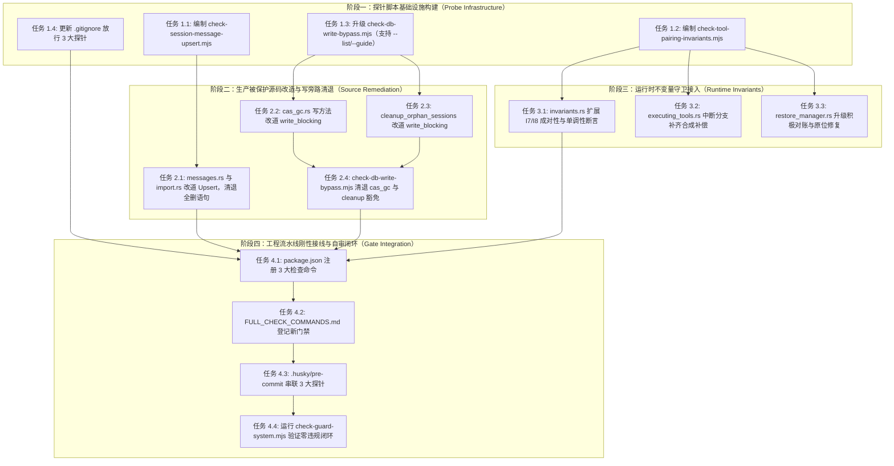

# 架构防腐与防御脚本门禁体系独立方案（方案 07）

> **设计定位**：本文档为 Conex / Crish 系统会话完整性修复战役（Session Integrity Repair Campaign）的独立详案（Plan 07）。  
> **核心使命**：消灭会话持久化与运行时状态机中的破坏性旁路与退避隐患，构建长效静态防腐探针脚本集，清退数据库写特权豁免，在运行时接入成对性与单调性不变量刚性断言，并在工程流水线（pre-commit、CI 快层、FULL_CHECK_COMMANDS）建立不可绕过的防腐门禁。  
> **一手代码依据**：全案认知 100% 建立在代码库真实源码、契约类型与现实探针脚本之上（涵盖 `crates/conex-db`、`crates/session-loop`、`crates/orchestrator`、`crates/conex-types` 及 `scripts/`），严禁臆造与二手转述。

---

## 一、全景源码研读域与现实缺陷剖析

通过对被防护源码域、契约定义与既有防御脚本的深入研读，定位出系统现存的三大严重架构断层与防腐缺口：

### 1. 断层一：会话正文持久化的破坏性「全删后插」（Delete-and-Reinsert）

- **代码现场**：
  - [`crates/conex-db/src/messages.rs:112-150`](file:///c:/Software/conex/crates/conex-db/src/messages.rs#L112-L150)：
    ```rust
    // save_session_body_versioned 中的破坏性全删操作
    conn.execute(
        "DELETE FROM session_messages WHERE session_id = ?1",
        rusqlite::params![session_id],
    )
    .map_err(|e| DbFailure {
        message: format!("save_session_body_delete: {e}"),
        kind: DbFailureKind::Other("save_session_body".to_string()),
    })?;

    for (seq, msg) in messages.iter().enumerate() {
        let seq_i64 = seq as i64;
        conn.execute(
            "INSERT INTO session_messages (...) VALUES (?1, ?2, ...)",
            rusqlite::params![session_id, seq_i64, ...],
        )?;
    }
    ```
  - [`crates/conex-db/src/import.rs:90-95`](file:///c:/Software/conex/crates/conex-db/src/import.rs#L90-L95)：
    ```rust
    // 先清空已有消息（避免重复导入导致 UNIQUE 冲突）
    tx.execute(
        "DELETE FROM session_messages WHERE session_id = ?1",
        rusqlite::params![entry.id],
    )?;
    ```
- **本质危害与架构腐化**：
  1. **破坏崩溃一致性（Crash Consistency）与追加不变量（Append-Only Invariant）**：
     如果在 `DELETE FROM session_messages` 执行完毕后、新的 `INSERT` 循环完成前发生断电、系统崩溃或 OOM，原本存储于数据库的该会话全部历史消息瞬间永久丢失，导致灾难性空会话。
  2. **非幂等与高并发死锁风险**：
     全表/全会话清空语句持有行级排他锁或触发大范围 B-Tree 页面重平衡，在 WAL 机制下引发读写冲突，令 `ReaderPool` 产生死锁重试与快照读失效。
  3. **写放大与 WAL 膨胀**：
     若会话已有 1000 条消息，每次追加 1 条消息即导致 1000 次 DELETE + 1001 次 INSERT，不仅产生严重写放大，还导致 SQLite WAL 日志急速膨胀。
  4. **根因剖析**：
     历史设计因缺乏 SQLite `ON CONFLICT(session_id, seq) DO UPDATE SET` 语义的正确运用，偷懒采用了「先全删再重建」的反模式，且此前没有任何静态门禁阻止这一高危语句的扩散。

---

### 2. 断层二：工具成对性旁路直接丢弃与消极对账分支（"只报不修"）

- **代码现场 A（循环层未成对退出旁路）**：
  - [`crates/session-loop/src/loop/handlers/executing_tools.rs:49-88`](file:///c:/Software/conex/crates/session-loop/src/loop/handlers/executing_tools.rs#L49-L88)：
    ```rust
    // 1. abort / 控制意图检查（L3 强停可立即中断）
    if let Some(end) = check_control(state)? {
        return Ok(HandlerOutcome::end(end));
    }

    // 2. 取最后 assistant 消息的 tool-call blocks（01 §2.8 步骤 2）
    let Some(assistant) = last_assistant_with_tool_calls(state) else {
        return Ok(HandlerOutcome::end(EndDecision::error(
            state,
            "executing-tools 状态缺少携带工具调用的 assistant 消息",
        )));
    };
    let calls: Vec<ToolBatchCall> = assistant.tool_calls().map(...).collect();
    if calls.is_empty() {
        return Ok(HandlerOutcome::end(EndDecision::error(
            state,
            "assistant 消息无工具调用块",
        )));
    }
    ```
  - **严重缺陷**：
    在 `streaming.rs` 中，模型吐出的 `ToolCall` 已随 Assistant 消息落入 `state.conversation`。当执行器处于 `executing-tools` 阶段时，若步骤 1 的 `check_control` 触发用户中止（Abort/Cancel），代码直接返回 `HandlerOutcome::end(end)` 退出循环，**完全没有为已被记录的 ToolCall 合成对应的 ToolResult 消息**！
    这导致下游向大模型服务（Claude/OpenAI 等）发起下一次对话请求时，由于存在孤儿 `tool_use`（无匹配的 `tool_result`），直接被 Provider API 判定为协议违规（如 Anthropic 400 错误：*Each tool_use block must have a corresponding tool_result block*）。
- **代码现场 B（恢复层消极对账分支）**：
  - [`crates/orchestrator/src/restore_manager.rs:178-195, 341-400`](file:///c:/Software/conex/crates/orchestrator/src/restore_manager.rs#L178-L195)：
    ```rust
    // 3c. G-29 终态矛盾对账（DM-08）：只读校验 events 表 run-terminal
    // 与 runs 记录终态的矛盾，显式上报（tracing::warn + outcome 计数），
    // **不自动修正**（不翻写 runs 表、不改事件——修正语义归恢复策略后续裁决）。
    let reconcile_conflicts = reconcile_terminal_conflicts(store, &runs).await?;
    for conflict in &reconcile_conflicts {
        tracing::warn!(
            target: "restore",
            run_id = %conflict.run_id,
            session_id = %conflict.session_id,
            event_terminal = %conflict.event_terminal,
            record_status = %conflict.record_status,
            "G-29 终态矛盾对账：事件流 run-terminal 与 runs 记录终态矛盾（只上报不修正）"
        );
    }
    ```
  - **严重缺陷**：
    恢复管理器（`RestoreManager`）发现 `events` 事件流（已是 Completed 终态）与 `runs` 数据表（被打断为 Failed 或滞留中间态）之间出现终态矛盾时，采取了「只打 warn 日志不修正」的消极对账策略。这违背了单一真理源（SSOT）原则，导致 UI 展示与后端运行记录长期撕裂。
- **代码现场 C（运行时不变量守卫缺失）**：
  - [`crates/session-loop/src/loop/invariants.rs`](file:///c:/Software/conex/crates/session-loop/src/loop/invariants.rs)：
    当前仅覆盖了 I1-I6（缓存交互与前缀压缩不变量），对于最核心的「工具调用必须且仅能 1:1 成对闭合」和「会话消息 seq 严格单调且无空洞」缺乏运行时防御断言。

---

### 3. 断层三：数据库写旁路与特权豁免膨胀

- **探针现状与豁免漏洞**：
  - [`scripts/check-db-write-bypass.mjs:27-59`](file:///c:/Software/conex/scripts/check-db-write-bypass.mjs#L27-L59)：
    探针初衷为拦截直接持有主连接 `conn.lock()` 执行写 SQL 的旁路，强制生产写收敛至 `write_blocking`（组提交 Writer）。但其豁免名单存在严重过度放水：
    ```javascript
    const EXEMPT_FILES = new Set([
      'migrate.rs', 'migrate_steps.rs', 'schema.rs', 'import.rs', 'imported.rs',
      'lib.rs', 'tests.rs', 'tests_concurrency.rs', 'tests_migrations.rs',
      'tests_usage.rs', 'tests_cas_gc.rs', 'lease_guard.rs', 'cas_gc.rs',
    ]);
    const EXEMPT_FNS = new Set([
      'cleanup_orphan_sessions', 'migrate', 'backup_before_drop', ...
    ]);
    ```
  - **实际源码腐败点**：
    1. [`crates/conex-db/src/cas_gc.rs`](file:///c:/Software/conex/crates/conex-db/src/cas_gc.rs)：整整 22 处 `self.conn.lock()` 直接持锁写（涵盖 `put_blob`、`unquarantine_blob`、`quarantine_orphaned_blobs`、`purge_quarantined_blobs` 中的 INSERT / UPDATE / DELETE），完全绕过了 Group Commit 调度，直接与并发读/写抢锁。
    2. [`crates/conex-db/src/sessions.rs:240-275`](file:///c:/Software/conex/crates/conex-db/src/sessions.rs#L240-L275)：`cleanup_orphan_sessions` 显式持有 `conn.lock()` 并手动开 `conn.transaction()` 执行跨表删除，堂而皇之被登记进 `EXEMPT_FNS`。
- **防御体系自审暴露（门禁失效元问题）**：
  - 运行 `node scripts/check-guard-system.mjs --list` 现场审计结果：
    1. `check-db-write-bypass.mjs` 命中 `unreleased_guard`：因 `.gitignore:382 *.mjs` 全局忽略，未被 `!` 显式放行，导致其无法被检入版本库；
    2. `check-db-write-bypass.mjs` 命中 `unwired_guard`：在 `package.json`、`.husky/`、`.github/workflows/` 中均零调用，属于**纸面假门禁**；
    3. `check-db-write-bypass.mjs` 命中 `guide_capable_missing`：缺少 `--list` 与 `--guide` 结构化输出。

---

## 二、架构防腐体系三原则（反过度设计与反退避）

依据 [`ANTI_OVERENGINEERING_GUARDRAILS.md`](file:///c:/Software/conex/ANTI_OVERENGINEERING_GUARDRAILS.md) 与反退避铁律，确立本体系三大刚性设计原则：

1. **绝对刚性拦截，拒绝软警告（Zero Tolerance）**：
   门禁脚本与静态探针对核心架构破窗行为（全量删除会话消息、未配对直接退出、生产写旁路、未解决的终态冲突）实行 Exit 1 硬阻断。严禁将阻断降级为「打印 warn 然后 exit 0」。
2. **闭环原位自愈，拒绝只报不修（Active Remediation）**：
   恢复对账与异常流转不得停留在「检测到矛盾并打一条 warning」的消极状态。架构必须提供确定性的确定性修正逻辑（如自动补齐合成 `ToolResult`，将 `runs` 记录状态向事件真源对齐）。
3. **单一真理源与零写旁路（SSOT & Zero Write-Bypass）**：
   所有生产业务数据的写入必须严格通过 `LocalDb::write_blocking`（组提交 Writer 驱动的 WAL 事务队列）。除数据库初始化与 DDL 迁移外，彻底清退业务代码的 `conn.lock()` 写特权。

---

## 三、长效静态防腐探针脚本体系设计

本方案规划并实现 3 大静态防腐探针，统一规范、独立校验、相互守门：

### 1. 脚本 A：`check-session-message-upsert.mjs`（会话消息写入防腐）

- **定位**：刚性拦截任何破坏会话历史完整性的全量清空 SQL 语句。
- **静态扫描规约**：
  - 扫描范围：`crates/conex-db/src/**/*.rs`（同时普查 `crates/**/*.rs`）。
  - 违规模式正则：
    ```javascript
    // 拦截 DELETE FROM session_messages 全量清空或仅按 session_id 清空
    const BLANKET_DELETE_RE =
      /DELETE\s+FROM\s+session_messages\s*(?:WHERE\s+session_id\s*=\s*\S+\s*)?(?:["`;]|$)/i;
    // 允许的唯一合法尾部截断（必须携带 seq 上界，用于严格的时间线撤回）
    const BOUNDED_TRUNCATE_RE =
      /DELETE\s+FROM\s+session_messages\s+WHERE\s+session_id\s*=\s*\S+\s+AND\s+seq\s*>\s*\S+/i;
    ```
  - **判定规则**：
    只要源码中出现匹配 `session_messages` 的 `DELETE` 操作，且不满足 `BOUNDED_TRUNCATE_RE`，立即判定为阻断性违规。
  - **白名单治理**：
    全仓零白名单豁免（豁免集合恒空）。
- **被保护源码改造方案（生产 Upsert 化）**：
  - 将 [`crates/conex-db/src/messages.rs`](file:///c:/Software/conex/crates/conex-db/src/messages.rs) 与 [`crates/conex-db/src/import.rs`](file:///c:/Software/conex/crates/conex-db/src/import.rs) 中的代码彻底重构：
    ```rust
    // 采用原子 Upsert 替代先删后插
    conn.execute(
        "INSERT INTO session_messages (
            session_id, seq, id, sender, text, thinking, timestamp, status,
            stream_text_offset, thinking_time, tool_calls_json,
            blocks_json, tool_call_results_json, usage_json
        ) VALUES (?1, ?2, ?3, ?4, ?5, ?6, ?7, ?8, ?9, ?10, ?11, ?12, ?13, ?14)
        ON CONFLICT(session_id, seq) DO UPDATE SET
            id = excluded.id,
            sender = excluded.sender,
            text = excluded.text,
            thinking = excluded.thinking,
            timestamp = excluded.timestamp,
            status = excluded.status,
            stream_text_offset = excluded.stream_text_offset,
            thinking_time = excluded.thinking_time,
            tool_calls_json = excluded.tool_calls_json,
            blocks_json = excluded.blocks_json,
            tool_call_results_json = excluded.tool_call_results_json,
            usage_json = excluded.usage_json",
        rusqlite::params![...],
    )?;
    ```
  - 若调用传入的消息集合产生物理截断（如历史回退导致新长度小于旧长度），则显式执行带 `AND seq >= ?` 的有界尾部清理：
    ```rust
    if new_len < old_count {
        conn.execute(
            "DELETE FROM session_messages WHERE session_id = ?1 AND seq >= ?2",
            rusqlite::params![session_id, new_len as i64],
        )?;
    }
    ```
- **五元契约输出与指引**：
  - 严格支持 `--list` 与 `--guide blanket_delete`。
  - 输出格式：`[VIOLATION] crates/conex-db/src/messages.rs:113 | DELETE FROM session_messages WHERE session_id = ?1 | 阈值: 0 | 修复指引: 改用 ON CONFLICT(session_id, seq) DO UPDATE SET 或尾部有界截断`。

---

### 2. 脚本 B：`check-tool-pairing-invariants.mjs`（工具成对性与对账防腐）

- **定位**：静态拦截循环和恢复层未处理成对性的旁路，拦截「只报不修」的消极对账。
- **扫描规约一：`executing_tools.rs` 退出分支成对性**：
  - 目标文件：`crates/session-loop/src/loop/handlers/executing_tools.rs`。
  - 静态 AST / 控制流探针规则：
    1. 提取所有 `return Ok(HandlerOutcome::end(...))` 分支。
    2. 检查在返回前，是否调用了成对性补偿函数（如 `synthesize_cancelled_tool_results`）。
    3. 若存在直接 `return Ok(HandlerOutcome::end(end))` 且未闭合 `calls` 的路径，探针直接阻断报警。
- **扫描规约二：`restore_manager.rs` 消极对账拦截**：
  - 目标文件：`crates/orchestrator/src/restore_manager.rs`。
  - 检查模式：
    - 正则匹配：`"只上报不修正"`、`"只上报不修"`、以及仅包含 `tracing::warn!` 却没有后续写操作的 `reconcile_` 函数。
    - 强制断言：对账函数必须具备写回修正能力，函数命名必须收敛为 `reconcile_and_repair_*`，且必须调用 `store.update_run_status` 或 `store.append_event` 纠偏。
- **扫描规约三：`invariants.rs` 运行时接入验证**：
  - 目标文件：`crates/session-loop/src/loop/invariants.rs`。
  - 必须检测到 `assert_tool_pairing_invariants` 与 `i7_tool_call_pairing_invariant` 的真实测试和运行时函数。
- **五元契约输出与指引**：
  - 严格支持 `--list` 与 `--guide tool_pairing_bypass`、`--guide passive_reconcile`。

---

### 3. 探针 C：升级 `check-db-write-bypass.mjs`（清退特权豁免）

- **定位**：升级现有探针，清退生产写旁路，消除所有非必要豁免，使探针自身合规。
- **豁免清退行动明细**：
  | 豁免项 | 原性质 | 清退方案 | 清退后归宿 |
  | :-- | :-- | :-- | :-- |
  | `cas_gc.rs` | `EXEMPT_FILES`（22 处持锁写） | 将 `put_blob`、`unquarantine_blob`、`quarantine_orphaned_blobs`、`purge_quarantined_blobs` 改道 `self.write_blocking(...)` | **彻底移出豁免集合** |
  | `cleanup_orphan_sessions` | `EXEMPT_FNS`（持锁跨表删） | 改造为 `self.write_blocking(...)` 提交，利用外层事务移除内部 `conn.transaction()` | **彻底移出豁免集合** |
  | `lease_guard.rs` | `EXEMPT_FILES`（连接级纯函数） | 审计所有写函数，收敛为仅接受 `&mut Connection`（由调用方在 `write_blocking` 内传入） | **彻底移出豁免集合** |
- **最终合法白名单（刚性收敛）**：
  - `EXEMPT_FILES` 仅允许：
    - `migrate.rs`、`migrate_steps.rs`、`schema.rs`（独占 DDL 迁移，无竞争）
    - `tests_*.rs`、`tests.rs`（纯测试文件）
  - `EXEMPT_FNS` 仅允许：
    - `migrate`、`record_schema_version`、`user_version`（DDL 专有函数）
- **探针能力补齐（解除自我门禁报警）**：
  1. 补齐 `--list`：完整列出扫描的 `.rs` 文件数、`write_blocking` 接入计数与违规明细；
  2. 补齐 `--guide db_write_bypass`：输出规范的五元组修复指引（指导如何改道 `self.write_blocking`）；
  3. 在 `.gitignore` 中追加放行：`!scripts/check-db-write-bypass.mjs`。

---

## 四、运行时不变量守卫体系（Runtime Invariants）

静态门禁守住编译期与提交期，运行时守卫守住执行期物理不变量。

### 1. `invariants.rs` 核心接入点扩展

在 [`crates/session-loop/src/loop/invariants.rs`](file:///c:/Software/conex/crates/session-loop/src/loop/invariants.rs) 中，扩展定义两项不可动摇的运行时数学不变量：

#### 运行时不变量 I7：工具调用成对性不变量 (`i7_tool_call_pairing_invariant`)
- **不变量定理**：
  $$\forall m \in \text{Conversation}, \forall b \in m.\text{blocks}, b \text{ is } \text{ToolCall}(id) \implies \exists m' \in \text{Conversation}, \exists b' \in m'.\text{blocks}, b' \text{ is } \text{ToolResult}(id)$$
  在每次 Turn 结束时（`turn-complete`）或会话持久化前，对话消息链中的每一个 `ToolCall` 必须且仅能存在唯一的 `ToolResult` 与之对应。
- **纯函数断言器**：
  ```rust
  pub fn assert_tool_pairing_invariants(conversation: &[Arc<AgentMessage>]) -> Result<(), String> {
      let mut pending_calls: std::collections::HashMap<String, String> = std::collections::HashMap::new();
      for msg in conversation {
          for block in &msg.blocks {
              match block {
                  AgentMessageBlock::ToolCall { id, tool_name, .. } => {
                      pending_calls.insert(id.clone(), tool_name.clone());
                  }
                  AgentMessageBlock::ToolResult { tool_call_id, .. } => {
                      if pending_calls.remove(tool_call_id).is_none() {
                          return Err(format!("孤儿 ToolResult: 未找到匹配的 ToolCall id={tool_call_id}"));
                      }
                  }
                  _ => {}
              }
          }
      }
      if !pending_calls.is_empty() {
          let dangling: Vec<_> = pending_calls.into_iter().map(|(id, name)| format!("{name}({id})")).collect();
          return Err(format!("孤儿 ToolCall 未闭合: {}", dangling.join(", ")));
      }
      Ok(())
  }
  ```

#### 运行时不变量 I8：会话消息序号严格单调不变量 (`i8_session_message_monotonic_seq_invariant`)
- **不变量定理**：
  会话中消息的 `seq` 序列必须严格单调递增（$\text{seq}_i = i$），无重复、无倒退、无空洞。
- **纯函数断言器**：
  在 `save_session_body_versioned` 与 `load_session_body` 出入口强制执行 `assert_monotonic_seq(messages)`。

---

### 2. `executing_tools.rs` 中断合成补偿机制

改造 [`crates/session-loop/src/loop/handlers/executing_tools.rs`](file:///c:/Software/conex/crates/session-loop/src/loop/handlers/executing_tools.rs)，在任何可能退出循环的分支处插入合成补偿：

```rust
// 当检测到中止信号时，提取未执行完的 calls，并为每个 call 注入 synthetic cancelled tool_result
if let Some(end) = check_control(state)? {
    if let Some(assistant) = last_assistant_with_tool_calls(state) {
        let calls: Vec<ToolBatchCall> = assistant.tool_calls().map(...).collect();
        synthesize_cancelled_tool_results(state, &calls, "execution_aborted_by_control");
    }
    return Ok(HandlerOutcome::end(end));
}
```

其中 `synthesize_cancelled_tool_results` 构造 `ClassifiedToolResult::error(id, tool_name, ToolErrorKind::Cancelled, ...)` 并调用 `record_message(state, tool_result_message(res))`，确保退出时 `assert_tool_pairing_invariants` 100% 成立。

---

### 3. `restore_manager.rs` 积极对账与原位修复机制

重构 [`crates/orchestrator/src/restore_manager.rs:360-400`](file:///c:/Software/conex/crates/orchestrator/src/restore_manager.rs#L360-L400) 的 `reconcile_terminal_conflicts`：

1. **升级为积极对账修复器**：`reconcile_and_repair_terminal_conflicts(store, runs)`。
2. **闭环修复逻辑**：
   - **分支 A（事件说 Completed、记录说 Failed/Cancelled）**：
     说明底层执行引擎已经成功发出 `run-terminal(completed)`，但宿主进程在更新 `runs` 表前崩溃被打断。
     **现场修复**：以事件流为单一真理源，执行 `store.update_run_status(run_id, RunStatus::Completed, ...)`，将记录校准为 Completed。
   - **分支 B（记录说 Completed、事件流无终态）**：
     说明事件流存在丢帧或写入异常。
     **现场修复**：补录一条 `run-terminal` 补偿事件进入事件流，封死该 run 的时序。
3. **消除消极日志**：彻底移除 `"只上报不修正"` 描述，替换为确凿的修复日志：`"G-29 终态矛盾对账：已校准 run 记录状态与事件流一致"`。

---

## 五、工程与 CI 门禁体系接入蓝图

所有防腐探针必须刚性接入工程自动化网络，受 `check-guard-system.mjs` 反向监护。

### 1. `package.json` 命名与命令契约

在根目录 [`package.json`](file:///c:/Software/conex/package.json) 中登记 3 条标准命令：

```json
{
  "scripts": {
    "check:session-message-upsert": "node scripts/check-session-message-upsert.mjs",
    "check:tool-pairing-invariants": "node scripts/check-tool-pairing-invariants.mjs",
    "check:db-write-bypass": "node scripts/check-db-write-bypass.mjs"
  }
}
```

### 2. `.gitignore` 显式白名单放行

在 [`.gitignore`](file:///c:/Software/conex/.gitignore) 的「门禁脚本放行」区域显式追加：

```gitignore
!scripts/check-session-message-upsert.mjs
!scripts/check-tool-pairing-invariants.mjs
!scripts/check-db-write-bypass.mjs
```

保证 `git check-ignore -v` 判定为零命中，彻底清退 `unreleased_guard` 违规。

### 3. `.husky/pre-commit` 刚性守卫接入

在 [`.husky/pre-commit`](file:///c:/Software/conex/.husky/pre-commit) 中接入探针执行：

```bash
# 架构防腐与防御探针刚性门禁
node scripts/check-session-message-upsert.mjs
node scripts/check-tool-pairing-invariants.mjs
node scripts/check-db-write-bypass.mjs
```

### 4. `FULL_CHECK_COMMANDS.md` 契约同步

在 [`FULL_CHECK_COMMANDS.md`](file:///c:/Software/conex/FULL_CHECK_COMMANDS.md) 的「结构性检查（契约门禁）」表格中同步收录：

| 命令 | 内容 |
| :-- | :-- |
| `npm run check:session-message-upsert` | 拦截 `session_messages` 全量删除，强制 Upsert 写入 |
| `npm run check:tool-pairing-invariants` | 拦截工具未成对丢弃旁路与消极对账分支 |
| `npm run check:db-write-bypass` | conex-db 生产写零旁路与组提交桥硬门禁 |

### 5. `scripts/check-guard-system.mjs` 闭环审计断言

执行 `node scripts/check-guard-system.mjs` 时，以下指标必须达标：
- `unreleased_guard`：必须为 0（@zero-tolerance，所有新增与修改守卫必须完全放行）；
- `unwired_guard`：必须为 0（所有守卫必须在 package.json 与 .husky 中有确凿调用）；
- `guide_capable_missing`：必须为 0（所有守卫必须完整支持 `--list` 与 `--guide`）；
- `silent_baseline_pass`：必须为 0（@zero-tolerance，基线缺失一律 Exit 1）。

---

## 六、本方案要删掉什么 / 收敛什么（专节）

按照反过度设计与架构净收敛纪律，本方案明确列出清退与收敛清单：

### 1. 本方案要删掉的代码与模式（Delete List）

1. **彻底删除会话正文的全量先删后插语句**：
   - 彻底删除 [`crates/conex-db/src/messages.rs:112-119`](file:///c:/Software/conex/crates/conex-db/src/messages.rs#L112-L119) 中的 `conn.execute("DELETE FROM session_messages WHERE session_id = ?1", ...)`。
   - 彻底删除 [`crates/conex-db/src/import.rs:90-95`](file:///c:/Software/conex/crates/conex-db/src/import.rs#L90-L95) 中的 `tx.execute("DELETE FROM session_messages WHERE session_id = ?1", ...)`。
2. **彻底删除生产写路径的直接持锁旁路**：
   - 彻底删除 [`crates/conex-db/src/cas_gc.rs`](file:///c:/Software/conex/crates/conex-db/src/cas_gc.rs) 中 `put_blob`、`unquarantine_blob` 等方法内 22 处直接调用 `self.conn.lock()` 执行写的逻辑。
   - 彻底删除 [`crates/conex-db/src/sessions.rs:240-275`](file:///c:/Software/conex/crates/conex-db/src/sessions.rs#L240-L275) 中 `cleanup_orphan_sessions` 的 `self.conn.lock()` 锁旁路与嵌套 `tx.transaction()`。
3. **彻底删除对账层的消极不作为分支**：
   - 彻底删除 [`crates/orchestrator/src/restore_manager.rs:178-195`](file:///c:/Software/conex/crates/orchestrator/src/restore_manager.rs#L178-L195) 中「检测到终态矛盾只打 warn 日志、不自动修正」的消极对账分支。
4. **彻底删除特权放水豁免名单**：
   - 彻底删除 `scripts/check-db-write-bypass.mjs` 中对 `cas_gc.rs`、`lease_guard.rs` 的文件级豁免。
   - 彻底删除 `scripts/check-db-write-bypass.mjs` 中对 `cleanup_orphan_sessions` 的函数级豁免。

### 2. 本方案要收敛的架构概念与状态机（Convergence List）

1. **持久化通道归一**：
   整个 `conex-db` 生产域写入口彻底收敛为单一真理通道：`LocalDb::write_blocking`（基于 Group Commit Actor 的顺序队列）。
2. **会话变更模式归一**：
   会话历史的保存彻底收敛为基于主键复合索引 `(session_id, seq)` 的增量 Upsert 语义；物理收敛为「只增不删，回滚仅尾部精确修剪」。
3. **工具生命周期状态机归一**：
   工具执行生命周期彻底收敛为严格图闭环：任何从 `executing-tools` 发出的退出路径，其内部持有的 `ToolBatchCall` 集合必须全部有确定性的 `ToolBatchResult` / `ToolResult` 消息落地，不存在无声蒸发的调用。
4. **防御脚本质量契约归一**：
   所有防御探针脚本彻底收敛为五元组诊断格式，必须受 `check-guard-system.mjs` 反向守卫，杜绝游离在构建链路之外的纸面脚本。

---

## 七、纯逻辑执行拓扑（严格无工期/无业务优先级）

本方案严格遵循纯逻辑规划与依赖拓扑：**所有步骤同权，无 P0/P1 之分，无排期人天**，按纯粹的技术依赖前置后置条件推进。



### 1. 阶段一：探针脚本基础设施构建（依赖：一手代码研读）
- **单元 1.1**：编制 `scripts/check-session-message-upsert.mjs`，实现对全量删除语句的正则匹配与 `--list`、`--guide` 接口。
- **单元 1.2**：编制 `scripts/check-tool-pairing-invariants.mjs`，实现对未闭合退出与消极对账的 AST / 模式检查。
- **单元 1.3**：重构 `scripts/check-db-write-bypass.mjs`，补全五元契约输出与 `--list`、`--guide`。
- **单元 1.4**：修改 `.gitignore`，显式放行上述 3 个探针脚本。

### 2. 阶段二：生产被保护源码改造与写旁路清退（依赖：阶段一探针先行）
- **单元 2.1**：重写 `crates/conex-db/src/messages.rs` 的 `save_session_body_versioned` 与 `crates/conex-db/src/import.rs`，消除 `DELETE FROM session_messages`，改用 `ON CONFLICT DO UPDATE SET`。
- **单元 2.2**：重写 `crates/conex-db/src/cas_gc.rs` 中的 22 处直接写操作，全部包装至 `self.write_blocking(...)`。
- **单元 2.3**：重写 `crates/conex-db/src/sessions.rs` 的 `cleanup_orphan_sessions`，去除 `conn.lock()` 与嵌套事务，改道 `write_blocking`。
- **单元 2.4**：从 `check-db-write-bypass.mjs` 的 `EXEMPT_FILES` 中删除 `cas_gc.rs` 和 `lease_guard.rs`，从 `EXEMPT_FNS` 中删除 `cleanup_orphan_sessions`，并确保运行探针通过。

### 3. 阶段三：运行时不变量守卫接入（依赖：阶段二源码解耦）
- **单元 3.1**：在 `crates/session-loop/src/loop/invariants.rs` 中实现 `assert_tool_pairing_invariants` 与 `assert_monotonic_seq`，并挂接单元测试。
- **单元 3.2**：在 `crates/session-loop/src/loop/handlers/executing_tools.rs` 中接入 `synthesize_cancelled_tool_results`，保障中断退出时工具 100% 闭合成对。
- **单元 3.3**：重构 `crates/orchestrator/src/restore_manager.rs` 的 `reconcile_terminal_conflicts`，实现积极对账和原位写回修正。

### 4. 阶段四：工程流水线刚性接线与自审闭环（依赖：阶段一至阶段三全部就绪）
- **单元 4.1**：在 `package.json` 中配置 `check:session-message-upsert`、`check:tool-pairing-invariants`、`check:db-write-bypass`。
- **单元 4.2**：在 `FULL_CHECK_COMMANDS.md` 中记录命令并保持真实同步。
- **单元 4.3**：在 `.husky/pre-commit` 中接入 3 个探针，确保本地每次提交均自动执行。
- **单元 4.4**：执行 `node scripts/check-guard-system.mjs` 进行全系统自审，断言 `unwired_guard`、`guide_capable_missing`、`unreleased_guard` 指标清零。

---

## 八、立体化验证断言与验收矩阵

本方案遵循立体验证纪律，交付前必须在自动化测试、静态探针与工程门禁三个维度全绿通过：

| 验证维度 | 验证对象 / 脚本 | 执行命令 | 严格断言标准 |
| :-- | :-- | :-- | :-- |
| **静态防腐断言 A** | `check-session-message-upsert.mjs` | `node scripts/check-session-message-upsert.mjs` | Exit 0；全仓扫描零 `DELETE FROM session_messages WHERE session_id = ?` 命中 |
| **静态防腐断言 B** | `check-tool-pairing-invariants.mjs` | `node scripts/check-tool-pairing-invariants.mjs` | Exit 0；executing_tools 无未闭合退出，restore_manager 无"只上报不修" |
| **静态防腐断言 C** | 升级后 `check-db-write-bypass.mjs` | `node scripts/check-db-write-bypass.mjs` | Exit 0；无未豁免持锁写；`cas_gc.rs` 与 `cleanup_orphan_sessions` 零豁免 |
| **防御自审断言** | `check-guard-system.mjs` | `node scripts/check-guard-system.mjs` | Exit 0；`unwired_guard`、`guide_capable_missing`、`unreleased_guard` 均为 0 |
| **Rust 运行时单元测试** | `conex-db` 单元测试套件 | `cargo test -p conex-db` | 全部测试通过；CAS 冲突与 upsert 消息保存测试全绿 |
| **Rust 运行时不变量测试** | `session-loop` 不变量套件 | `cargo test -p session-loop -- invariants` | I1-I8 全部通过；`i7_tool_call_pairing_invariant` 与中断合成测试全绿 |
| **Rust 恢复对账测试** | `orchestrator` 恢复套件 | `cargo test -p orchestrator -- restore` | 积极对账修复测试全绿；runs 表状态被成功纠正为与 events 表一致 |
| **Git 资产可跟踪断言** | `.gitignore` 规约 | `git check-ignore -v scripts/check-*.mjs` | 3 大探针脚本均无输出（未被忽略，成功被 git 跟踪） |
| **全量检查命令清单核销** | `FULL_CHECK_COMMANDS.md` | `npm run check:session-message-upsert && npm run check:tool-pairing-invariants && npm run check:db-write-bypass` | 全部指令退出码为 0 |
