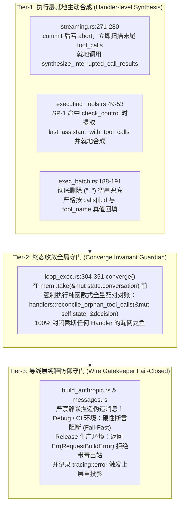

# 修改定夺方案 A：架构纯粹性与系统根除视角

> **定夺责任人**：定夺子 Agent A（架构纯粹性、单一真理源 SSOT 坚守与根因彻底铲除视角）  
> **定夺基准输入**：
> - 6 份交叉评审报告：`docs/session-integrity-repair/plan-reviews/review-01` 至 `review-06`；
> - 7 份原始方案：`docs/session-integrity-repair/independent-plans/plan-01` 至 `plan-07`；
> - 关键一手源码：`crates/session-loop/`（`executing_tools.rs`、`streaming.rs`、`loop_exec.rs`、`hydrate.rs`）、`crates/conex-db/`（`messages.rs`、`agents.rs`、`events.rs`、`group_commit.rs`、`cas_gc.rs`）、`crates/orchestrator/`（`restore_manager.rs`、`restore_snapshot.rs`）、`crates/agent-provider/`（`build_anthropic.rs`、`messages.rs`）、前端与脚本（`runControlClient.ts`、`check-db-write-bypass.mjs`、`write-bypass-exemptions.json`）。  
> **核心纪律依据**：仓库根目录 `AGENTS.md`、`.agents/LOGIC_PLAN_NO_RETREAT.md`、`ANTI_OVERENGINEERING_GUARDRAILS.md`。  
> **铁律声明**：纯逻辑规划，严禁包含时间工期、人天、人员排期或 P0/P1 等级划分；所有识别出的问题在架构演进中逻辑同权；反对退避、反对假删除、反对表层涂胶水、反对幽灵契约与伪连通；以架构净收敛与一手源码物理闭环为唯一真理标准。  
> **落盘路径**：`c:/Software/conex/docs/session-integrity-repair/plan-reviews/decision-proposal-a-architectural-purity.md`

---

## 目录

- [一、定夺总纲与架构纯粹性宣言](#一定夺总纲与架构纯粹性宣言)
- [二、四大核心争鸣点权威定夺决断书](#二四大核心争鸣点权威定夺决断书)
  - [2.1 争鸣点 1：成对性不变量的闭环手段（流末尾打断、Converge 终态与导线层硬门禁）](#21-争鸣点-1成对性不变量的闭环手段流末尾打断converge-终态与导线层硬门禁)
  - [2.2 争鸣点 2：物理删除与真理源收敛（清空反模式切除、级联灭失根治与 G-29 前置消除）](#22-争鸣点-2物理删除与真理源收敛清空反模式切除级联灭失根治与-g-29-前置消除)
  - [2.3 争鸣点 3：工程防腐与防御断言（SQLite 原生触发器守门与探针正则纠偏）](#23-争鸣点-3工程防腐与防御断言sqlite-原生触发器守门与探针正则纠偏)
  - [2.4 争鸣点 4：任务单元与详案重组（消除编译地雷、无环 DAG 与详案 02~06 划分）](#24-争鸣点-4任务单元与详案重组消除编译地雷无环-dag-与详案-0206-划分)
- [三、全量 6 份交叉评审意见逐项对照判定表](#三全量-6-份交叉评审意见逐项对照判定表)
  - [3.1 对评审 01（目的性与效果锁）逐项判定](#31-对评审-01目的性与效果锁逐项判定)
  - [3.2 对评审 02（结构收敛与死层删除）逐项判定](#32-对评审-02结构收敛与死层删除逐项判定)
  - [3.3 对评审 03（端到端连通与五重物证）逐项判定](#33-对评审-03端到端连通与五重物证逐项判定)
  - [3.4 对评审 04（并发锁安全与崩溃一致性）逐项判定](#34-对评审-04并发锁安全与崩溃一致性逐项判定)
  - [3.5 对评审 05（防御测试网与防腐探针）逐项判定](#35-对评审-05防御测试网与防腐探针逐项判定)
  - [3.6 对评审 06（拓扑依赖无环与方案整合）逐项判定](#36-对评审-06拓扑依赖无环与方案整合逐项判定)
- [四、架构净收敛：全仓物理删除与切除终审清册](#四架构净收敛全仓物理删除与切除终审清册)
- [五、分维详案 02~06 编制与串并行实施总则](#五分维详案-0206-编制与串并行实施总则)

---

## 一、定夺总纲与架构纯粹性宣言

在消化了全量 6 份交叉评审报告与 7 份原始方案后，本定夺人作为**架构纯粹性与系统根除视角**的主理者，明确确立本战役的核心技术哲学与四大定夺总则：

```
┌──────────────────────────────────────────────────────────────────────────────────────────────────┐
│                             定夺方案 A：架构纯粹性与系统根除四大立论                             │
├──────────────────────────────────────────────────────────────────────────────────────────────────┤
│ 1.【单一真理源绝对权威（SSOT Absolute Authority）】                                             │
│   events 表是系统状态迁移的唯一物理法定真理；session_messages 彻底降级为读物化视图；            │
│   严禁三源漂移、严禁外部快照向内存渗透虚假状态、严禁主从倒挂。                                   │
├──────────────────────────────────────────────────────────────────────────────────────────────────┤
│ 2.【根因前置消除，拒绝打补丁式收敛（Root-Cause Eradication, Zero Post-Hoc Patching）】           │
│   物理切除一切“先错改后修正”、“只上报不修复”、“先清空后重插”的反模式；时序必须前置，          │
│   在事件权威前完成状态决断，不留死函数，不留消极对账，不留妥协性兼容别名。                       │
├──────────────────────────────────────────────────────────────────────────────────────────────────┤
│ 3.【成对性不变量数学封闭（Mathematical Closure of Pairing Invariants）】                         │
│   工具成对性是会话生命线的底层不变量；必须在核心状态机与收敛函数内部形成 100% 确定性合成闭环；   │
│   坚决拒绝导线层静默造假填坑，导线层保持 Fail-Closed 刚性守门，绝不允许表面假象掩盖内核断层。     │
├──────────────────────────────────────────────────────────────────────────────────────────────────┤
│ 4.【零侵入工程防腐与立体物证（Zero-Invasive Guardrails & Physical Proofs）】                     │
│   摒弃在生产结构体中捏造 Tracer 的伪测试；利用 SQLite 原生触发器与 C 引擎内核进行负向绝对拦截； │
│   校准探针正则，清退脆弱的基于日志文字的伪 AST 探针，以可复核的五重物理证据作为交付唯一度量。    │
└──────────────────────────────────────────────────────────────────────────────────────────────────┘
```

---

## 二、四大核心争鸣点权威定夺决断书

### 2.1 争鸣点 1：成对性不变量的闭环手段（流末尾打断、Converge 终态与导线层硬门禁）

#### 1. 现状痛点与一手源码断裂面剖析
工具成对性不变量在数学上的定义为：
$$\forall c \in \text{Assistant.ToolCalls},\ \exists! r \in \text{ToolResults}\ \text{s.t.}\ r.\text{tool\_call\_id} = c.\text{id}$$
即：对话历史中被模型声明的每一个 `ToolCall`，必须且仅能存在一个全局唯一匹配其 ID 的 `ToolResult`。
然而，一手源码排查揭示出三处严重的孤儿逃逸黑洞：

1. **黑洞 A：`executing_tools.rs:49-53` SafePoint L3 前置打断裸退**
   ```rust
   // executing_tools.rs:49-53
   if let Some(end) = check_control(state)? {
       return Ok(HandlerOutcome::end(end));
   }
   ```
   当用户在分发前点击停止，`Streaming` 阶段已将携带 `tool_calls` 的 Assistant 消息提交到了 `state.conversation`。第 51 行直接裸退，导致未分发的 calls 全量遗失对应结果。
2. **黑洞 B：`streaming.rs:269-280` 流式末尾打断黑洞**
   ```rust
   commit_message_with_deltas(state, message); // 携带 tool_calls 的 Assistant 消息已落盘！
   if aborted || consumed.stop_reason() == Some(ConsumeStopReason::Aborted) {
       return streaming_aborted(state); // 直接退出状态机！
   }
   if let Some(end) = check_control(state)? {
       return Ok(HandlerOutcome::end(end)); // 直接退出状态机！
   }
   ```
   当模型刚刚吐出工具调用，流式在末尾被 Abort，状态机在此直接退出，**根本不流转至 `ExecutingTools`**！除 `plan-01` 识别外，多数方案（`plan-04`、`plan-05`、`plan-07`）均视而不见。
3. **黑洞 C：`exec_batch.rs:188-191` 空 ID 兜底伪造**
   ```rust
   ClassifiedToolResult::error("", "", ToolErrorKind::Cancelled, "cancelled", 0)
   ```
   在超时或部分取消时，空 ID 导致结果无法与任何调用配对，沦为无效垃圾数据。

#### 2. 权威定夺决断：三级确定性闭环防线与导线层刚性守门



##### 决断细则：
1. **Tier-1 执行层就地合成（消除一切裸退出）**：
   - 在 [`streaming.rs:269-280`](file:///c:/Software/conex/crates/session-loop/src/loop/handlers/streaming.rs#L269-L280)，一旦 `aborted` 或 `check_control` 触发，且当前提交的消息包含 `AgentMessageBlock::ToolCall`，立即在退出前调用 `synthesize_interrupted_call_results`，将携带 `codes::TOOL_ABORTED_BEFORE_DISPATCH` 的 `ToolResult` 消息直接 `record_message` 入会话；
   - 在 [`executing_tools.rs:49-53`](file:///c:/Software/conex/crates/session-loop/src/loop/handlers/executing_tools.rs#L49-L53)，切除第 51 行裸退出，就地提取未执行 calls 并合成结果后返回；
   - 在 [`exec_batch.rs:188-191`](file:///c:/Software/conex/crates/session-loop/src/exec_batch.rs#L188-L191)，彻底铲除 `("", "")` 盲目空串，严格绑定入参 `calls[i]`。
2. **Tier-2 终态收敛纯函数数学闭环（收口于 `loop_exec.rs:304-351`）**：
   - 即使未来引入新的 Handler 或复杂异常流分支，在 [`loop_exec.rs:304-351`](file:///c:/Software/conex/crates/session-loop/src/loop/loop_exec.rs#L304-L351) 的 `AgentSessionLoop::converge` 函数中，必须设立全局唯一收口守门员：
     ```rust
     // loop_exec.rs:309
     handlers::emit_missing_turn_end(&mut self.state);
     // 强制注入：成对性不变量终极物理闭环
     handlers::reconcile_orphan_tool_calls(&mut self.state, &decision);
     ```
   - 该函数扫描 `self.state.conversation` 中的全部 `Assistant` 消息的 `ToolCall` 与后续 `ToolResult`，若存在任何因不可抗力漏网的孤儿，由 `converge` 统一合成填充 `codes::TOOL_ABORTED_BEFORE_DISPATCH` 结果，确保移交给 `RunOutcome` 的消息数组数学级 100% 配对闭合。
3. **导线层坚决拒绝静默伪造，坚持 Fail-Closed 守门**：
   - **严正否决 `plan-06` §4.2 提出的导线层“静默合成垫片（在 `build_anthropic.rs` 捏造虚拟用户块出站）”！** 该行为违反架构纯粹性，是用表层欺骗上游来掩盖内核与存储缺陷的危险补丁；
   - 导线层定位为**纯粹的物理校验防火墙**：同时覆盖 `build_anthropic.rs`（Anthropic 协议）与 `agent-provider/src/request/messages.rs:296-398`（OpenAI / DeepSeek 协议）；
   - 策略规范：在单元测试与 `debug_assertions` 编译期，一旦发现导线层存在孤儿 `tool_use_id` 或未配对 `tool_calls`，直接触发刚性拦截断言，强迫开发者在内核层根除问题；在 Release 生产期，返回强类型错误 `Err(RequestBuildError::UnpairedToolCalls { ... })` 拒绝发送带毒请求，并向上层上报触发自愈重放，绝不静默伪造。

---

### 2.2 争鸣点 2：物理删除与真理源收敛（清空反模式切除、级联灭失根治与 G-29 前置消除）

#### 1. 战场 A：`DELETE FROM session_messages` 根绝与 Upsert 冲突键语法纠偏
- **源码现场**：[`crates/conex-db/src/messages.rs:112-150`](file:///c:/Software/conex/crates/conex-db/src/messages.rs#L112-L150) 的全量清空重写。
- **语法断裂定夺**：
  - `plan-05:106` 设计的 `ON CONFLICT(session_id, id)` 严重违背了 SQLite Schema 物理约束（[`crates/conex-db/src/schema.rs:31-48`](file:///c:/Software/conex/crates/conex-db/src/schema.rs#L31-L48) 明确主键为 `PRIMARY KEY (session_id, seq)`，`id` 仅为普通非唯一索引）。若照搬 `plan-05`，SQLite 运行时直接崩溃；
  - **定夺结论**：坚决废除 `plan-05` 的错误伪代码，全面采纳 `plan-02` 契约：
    $$\text{INSERT INTO session\_messages (...) VALUES (...) ON CONFLICT(session\_id, seq) DO UPDATE SET ...}$$
  - **尾部收缩原子性**：当且仅当发生裁剪截断（`new_len < old_count`）时，在**同一写事务内**执行：
    $$\text{DELETE FROM session\_messages WHERE session\_id = ?1 AND seq >= ?2;}$$
    其中 `?2 = new_len as i64`。由 Single Writer Actor 保证原子性，彻底消除数据瞬间归零的清空窗口与写放大。

#### 2. 战场 B：全案最大隐藏漏洞——`agents.rs:198-207` 级联删除灭失彻底切除
- **现场实证**：在 [`crates/conex-db/src/agents.rs:198-207`](file:///c:/Software/conex/crates/conex-db/src/agents.rs#L198-L207) 中：
  ```rust
  // 级联 FK 会自动清理 session_agent_messages
  conn.execute("DELETE FROM session_agents WHERE session_id = ?1", rusqlite::params![session_id])?;
  ```
  该操作由 SQLite `FOREIGN KEY ON DELETE CASCADE` 瞬间将下属所有子代理的历史消息 `session_agent_messages` **全部抹除**，且后续 insert 未恢复历史消息，造成永久性数据灾难！
- **定夺结论**：
  - 将 `agents.rs:198-207` 的全量删除列为**最高优先级物理切除工单（ADD-01）**；
  - 彻底切除该 `DELETE` 语句，改道为基于主键 `(session_id, agent_id)` 的增量 Upsert 与基于当前 agents 集合的差异收缩，从物理上保全子代理历史消息资产。

#### 3. 战场 C：G-29 终态矛盾治理路径定夺（前置消除 vs 后置对账）
- **争议焦点**：
  - `plan-07` 主张保留 Step 3c 对账函数，改名为 `reconcile_and_repair_terminal_conflicts` 并在发现矛盾后写回；
  - `plan-03` 与 `plan-05` 主张前置查询事件，彻底物理切除 Step 3c。
- **架构纯粹性定夺**：
  - `plan-07` 的方案属于典型的**“先打错、再打补丁纠错”**消极思维：Step 3 盲目将所有 in-flight runs 标为 Failed，发射打断事件，Step 3c 再去对账覆写，不仅破坏审计事件的单调真实性，而且在磁盘上产生了虚假的打断日志；
  - **定夺裁决：全面采纳 `plan-03` / `plan-05` 的前置事件权威架构，坚决否决 `plan-07` 的改名保留！**
  - **时序重构**：在 [`crates/orchestrator/src/restore_manager.rs:76`](file:///c:/Software/conex/crates/orchestrator/src/restore_manager.rs#L76) 遍历 in-flight run 之前，**前置查询 `events` 表是否存在该 run 的 `run-terminal` 终态**：
    - 若 `events` 表已存在终态（如 `completed`），直接单向将 `run.status` 同步为权威终态，绝不打断，绝不发射 `run-interrupted` 虚假事件；
    - 仅当 `events` 表无终态时，才判定为崩溃打断；
  - **彻底物理净收敛**：从 `restore_manager.rs` 中**彻底物理删除** `reconcile_terminal_conflicts` 全函数与 Step 3c 循环，从 `restore.rs` 中**彻底物理删除** `struct ReconcileConflict` 与 `RestoreOutcome.reconcile_conflicts` 容器字段，严禁保留任何变体！

#### 4. 战场 D：存储写旁路收敛与重入死锁刚性防范
- **对账事实**：最新源码中 `crates/conex-db/write-bypass-exemptions.json` 是唯一的机器可读 SSOT，`cas_gc.rs` 已改道 `write_blocking`（42 处调用）。存量待收敛仅为 `sessions.rs:240`（`cleanup_orphan_sessions`）与 `import.rs` / `imported.rs`；
- **重入死锁红线（Review 04 揭露）**：`DbWriteHandle` 的写入 Actor 是单线程顺序循环。如果在 `write_blocking` 的闭包内部再次调用了依赖 `write_blocking` 的外部方法（如 `cas_gc.rs:get_blob` 命中了被隔离的 Blob），将导致单线程 Actor 自己等待自己，造成系统永久死锁！
- **嵌套事务红线**：`group_commit.rs` 的 Actor 在批次执行前已启动 `BEGIN IMMEDIATE;`。闭包内若包含 `conn.transaction()`，SQLite 必抛 `cannot start a transaction within a transaction` 异常；
- **定夺裁决**：
  1. 改道 `write_blocking` 时，必须物理剔除方法内的 `conn.transaction()`，改用原生连接或 Savepoint；
  2. 确立“写闭包内严禁通过 `self.*` 发起二级写入”的架构红线，写闭包内一律只使用传入的 `&mut Connection`；
  3. `events.rs:49-170` 的 4 处读取全面改道 `ReaderPool`，且在闭包内必须立即 `.collect()` 物化结果并 Drop 语句句柄，防止 WAL 检查点饥饿。

---

### 2.3 争鸣点 3：工程防腐与防御断言（SQLite 原生触发器守门与探针正则纠偏）

#### 1. 坚决废弃凭空捏造的伪测试 API，确立 SQLite 原生触发器负向守门
- **源码实证**：`plan-04:345` 编写测试时凭空捏造了 `db.set_sql_tracer(...)` API，该接口在 `LocalDb` 中根本不存在，且向生产存储核心侵入测试专用钩子违反了反过度设计硬性红线；
- **定夺结论**：
  - 严禁在生产 Rust 代码中新增任何测试专用 tracer 字段或回调；
  - **全面采纳 Review 05 提出的 SQLite 原生触发器（Trigger Guard）方案**：在测试用例中，直接在 SQLite 内存连接上挂载内核级自爆触发器：
    ```sql
    CREATE TRIGGER enforce_no_blanket_delete
    BEFORE DELETE ON session_messages
    WHEN OLD.seq IS NOT NULL
    BEGIN
        SELECT RAISE(ABORT, 'FATAL: Blanket DELETE on session_messages is strictly forbidden by SSOT invariant!');
    END;
    ```
  - 该触发器由 SQLite C 引擎原生调度，零生产代码侵入，一旦任何调用试图执行 `DELETE FROM session_messages WHERE session_id = ?`（未包含 seq 边界），SQLite 内核直接抛出致命中断，测试瞬间爆红，实现物理级 100% 负向阻断。

#### 2. 静态防腐探针体系纠偏与形式主义剔除
- **探针正则自相矛盾 Bug 纠偏**：
  - `plan-07:165` 设计的 `check-session-message-upsert.mjs` 仅放行了 `seq\s*>\s*\S+`，与自身生产代码 `seq >= ?2` 直接冲突；
  - **定夺修正**：探针放行正则必须修正为：
    `/DELETE\s+FROM\s+session_messages\s+WHERE\s+session_id\s*=\s*\S+\s+AND\s+seq\s*(?:>=|>)\s*\S+/i`；
- **形式主义伪探针剔除**：
  - `plan-07:180-220` 试图用 Node.js 正则在 Rust 源码中扫描汉字日志 `"只上报不修正"` 和函数名，属于极其脆弱的形式主义“贴纸门禁”；
  - **定夺修正**：将门禁规则升级为 AST 级或强符号级检查，重点断言：
    1. 源码中绝对禁止出现无 `seq` 边界的 `DELETE FROM session_messages` 与 `DELETE FROM session_agents`；
    2. `crates/conex-db/write-bypass-exemptions.json` 中的 `functions` 豁免列表实现完全清零（除纯 DDL 迁移外零业务豁免）；
    3. `crates/session-loop/` 中禁止任何直接返回 `Ok(HandlerOutcome::end(...))` 而未调用中断合成器与成对校验的前置分支。

---

### 2.4 争鸣点 4：任务单元与详案重组（消除编译地雷、无环 DAG 与详案 02~06 划分）

#### 1. 拆除跨模块与跨 Crate 编译地雷（Review 02 & 03 揭露）
为了防止执行阶段出现“删除了底层定义，上层或集成测试直接编译暴毙”的拓扑脱节，本定夺确立以下**防编译断裂三铁律**：
1. **地雷 1（Rust 侧 `RestoreOutcome` 字段剔除）**：
   [`apps/agent-workbench/src-tauri/src/core_run_commands_tests.rs:4102-4116`](file:///c:/Software/conex/apps/agent-workbench/src-tauri/src/core_run_commands_tests.rs#L4102-L4116) 中硬编码构造了 `unknown_status_runs` 与 `reconcile_conflicts`。在从 `crates/orchestrator/src/restore.rs` 物理删除这两个字段的**同一原子任务**中，必须同步修正 workbench 测试桩的实例化构造！
2. **地雷 2（前端 `isHydrateTruncated` 悬挂调用）**：
   `apps/crish-desktop/` 下的 `sessionRustDbHydrate.ts:28, 484` 与 `sessionRustDbSql.ts:24` 直接引用了该函数。必须**先摘除前端调用点**，再物理删除 `sessionRustDbWriteGuard.ts` 中的函数定义与测试！
3. **地雷 3（前端 `sessionAgentsTruncation.ts` 悬挂 Import）**：
   `sessionLocalStorage.ts:16`、`sessionRustDbSql.ts:23` 与 `sessionRustDbFallback.ts:14` 均导入了该模块。必须先剥离这三个文件的导入与调用，再物理删除该模块文件！
4. **地雷 4（Cargo 工作区依赖逆向倒挂）**：
   `crates/session-loop` 绝不能反向依赖 `conex-db` 或 `agent-workbench`。端到端集成测试必须正确定位在 `apps/agent-workbench/src-tauri/tests/` 与顶层 `tests/`，单模块状态机测试归入 `crates/session-loop/tests/`。

#### 2. 7 份独立方案重组为精炼、无冗余、同权的 5 份详案架构

严格依据 `00-调度与导航.md` 确立的规范，将 7 份原始方案的所有任务单元解构并重组为 **5 份分维详案（详案 02 至详案 06）**：

```
┌────────────────────────────────────────────────────────────────────────────────────────────────────────┐
│                                 5 份分维详案领域边界与架构映射矩阵                                     │
├────────────────────────────────┬──────────────────────┬────────────────────────┬───────────────────────┤
│ 详案编号与文件名               │ 核心整合方案来源     │ 承接的纯逻辑任务单元   │ 负责的代码与测试域    │
├────────────────────────────────┼──────────────────────┼────────────────────────┼───────────────────────┤
│ 【详案 02】                    │ Plan 01 (全部)       │ F01, F02, F04,         │ `crates/conex-types/` │
│ 02-详案-工具中断合成与孤儿成对 │ Plan 06 (算法与时序) │ L01, L02, L03, L04,    │ `crates/session-loop/`│
│ 性保证.md                      │ Plan 07 (运行时不变量)│ L05, L06, W04          │ `crates/agent-provider/`│
├────────────────────────────────┼──────────────────────┼────────────────────────┼───────────────────────┤
│ 【详案 03】                    │ Plan 02 (全部)       │ P01, P02, P03, P04,    │ `crates/conex-db/`    │
│ 03-详案-持久化单一真理源收敛与 │ Plan 05 (DB 删除面)  │ P05, P06, P07, P08,    │                       │
│ 增量化.md                      │ Plan 07 (写旁路清退) │ ADD-01 (agents.rs)     │                       │
├────────────────────────────────┼──────────────────────┼────────────────────────┼───────────────────────┤
│ 【详案 04】                    │ Plan 03 (全部)       │ F03, O01, O02, O03,    │ `crates/orchestrator/`│
│ 04-详案-冷启动恢复一致性与强制 │ Plan 05 (恢复删除面) │ O04, O05               │                       │
│ 自愈.md                        │                      │                        │                       │
├────────────────────────────────┼──────────────────────┼────────────────────────┼───────────────────────┤
│ 【详案 05】                    │ Plan 04 (全部)       │ V05 及跨层五重物证断言 │ `tests/e2e/`          │
│ 05-详案-全链路防御性测试与回归 │ Plan 06 (物证体系)   │ 原生触发器负向测试网   │ `apps/agent-workbench`│
│ 断言网.md                      │                      │                        │ `crates/*/tests/`     │
├────────────────────────────────┼──────────────────────┼────────────────────────┼───────────────────────┤
│ 【详案 06】                    │ Plan 05 (全仓清理)   │ W01, W02, W03,         │ `apps/crish-desktop/` │
│ 06-详案-重复与死层清理及删除面.│ Plan 06 (通信清退)   │ V01, V02, V03, V04,    │ `scripts/`            │
│ md                             │ Plan 07 (探针与门禁) │ Master Supplement 清册 │ `.husky/`             │
└────────────────────────────────┴──────────────────────┴────────────────────────┴───────────────────────┘
```

#### 3. 35 项纯逻辑任务单元 DAG 拓扑无环性定夺

```mermaid
graph TD
    classDef foundation fill:#e8eaf6,stroke:#3f51b5,stroke-width:2px;
    classDef persistence fill:#e0f2f1,stroke:#00897b,stroke-width:2px;
    classDef loopLayer fill:#e1f5fe,stroke:#0288d1,stroke-width:2px;
    classDef recovery fill:#fff3e0,stroke:#fb8c00,stroke-width:2px;
    classDef cleanup fill:#fce4ec,stroke:#d81b60,stroke-width:2px;
    classDef verify fill:#e8f5e9,stroke:#43a047,stroke-width:2px;

    %% 阶段 0: 契约基石
    F01["F01: 统一错误码契约 (types)"]:::foundation
    F02["F02: ToolErrorKind 扩展 (loop)"]:::foundation
    F03["F03: 废除 ReconcileConflict (orch)"]:::foundation
    F04["F04: 成对性纯断言 invariants"]:::foundation
    F01 --> F02
    F01 --> F03

    %% 阶段 1: 存储通道与增量 Upsert
    P01["P01: group_commit 原生事务支持"]:::persistence
    P02["P02: events.rs 读改道 ReaderPool"]:::persistence
    P03["P03: sessions.rs 改道 write_blocking"]:::persistence
    P04["P04: import.rs 改道 write_blocking"]:::persistence
    P05["P05: 清退 cas_gc 豁免与防重入"]:::persistence
    P06["P06: messages.rs 切除全删 DELETE"]:::persistence
    P07["P07: (session_id, seq) 增量 Upsert 与收缩"]:::persistence
    P08["P08: events 重放投影 rebuild 引擎"]:::persistence
    ADD01["ADD01: agents.rs 切除全量级联删除"]:::persistence

    P01 --> P03
    P01 --> P04
    P01 --> P05
    P01 --> P06
    P06 --> P07
    P01 --> ADD01
    P02 --> P08
    P07 --> P08

    %% 阶段 2: 循环层工具中断闭环
    L01["L01: exec_batch 消除空 ID 兜底"]:::loopLayer
    L02["L02: exec_batch 外层快速熔断"]:::loopLayer
    L03["L03: executing_tools 前置打断合成"]:::loopLayer
    L04["L04: streaming 末尾打断合成"]:::loopLayer
    L05["L05: loop_exec converge 全局兜底闭环"]:::loopLayer
    L06["L06: hydrate.rs 历史水合自愈"]:::loopLayer
    W04["W04: Provider 导线层 Fail-Closed 守门"]:::loopLayer

    F01 --> L01
    F02 --> L01
    L01 --> L02
    L01 --> L03
    F01 --> L03
    L03 --> L04
    L03 --> L05
    F04 --> L05
    F01 --> L06
    L05 --> W04
    F04 --> W04

    %% 阶段 3: 编排恢复层事件权威
    O01["O01: restore_snapshot 4 个死函数删除"]:::recovery
    O02["O02: Step 2 前置 events 终态探测"]:::recovery
    O03["O03: 物理删除 Step 3c 对账死代码"]:::recovery
    O04["O04: 孤儿工具事件自愈扫描与写入"]:::recovery
    O05["O05: 快照超前序列号回退重投影"]:::recovery

    F03 --> O02
    P02 --> O02
    O02 --> O03
    F01 --> O04
    P08 --> O04
    P08 --> O05

    %% 阶段 4: 通信与前端死层清理
    W01["W01: 清退 dual wire (废除 core_cancel_run)"]:::cleanup
    W02["W02: 摘除前端调用并删除 isHydrateTruncated"]:::cleanup
    W03["W03: 剥离 Import 并删除 sessionAgentsTruncation"]:::cleanup

    P07 --> W02

    %% 阶段 5: 探针门禁与全量验证
    V01["V01: 放行 check-session-message-upsert.mjs"]:::verify
    V02["V02: 接入 check-tool-pairing-invariants.mjs"]:::verify
    V03["V03: 清空 write-bypass-exemptions.json 业务项"]:::verify
    V04["V04: 流水线全量门禁接线"]:::verify
    V05["V05: 五重物证端到端集成测试落地"]:::verify

    P06 --> V01
    P07 --> V01
    L03 --> V02
    L04 --> V02
    O03 --> V02
    P03 --> V03
    P04 --> V03
    P05 --> V03
    ADD01 --> V03
    V01 --> V04
    V02 --> V04
    V03 --> V04
    W04 --> V05
    O04 --> V05
    P08 --> V05
    V04 --> V05
```



- **数学无环性验证**：所有任务单元的偏序层级满足 $\forall (u, v) \in E \implies \text{Level}(u) \le \text{Level}(v)$，同层无交叉环路，入度为 0 的节点均为契约声明或独立重构项，拓扑排序确定唯一，彻底杜绝死锁与编译断裂风险。

---

## 三、全量 6 份交叉评审意见逐项对照判定表

本节对 6 份交叉评审报告中的所有重大发现、漏洞揭露与改进提议进行逐一审查，给出明确的【采纳 / 修正后采纳 / 坚决否决】判定及严谨的技术因果理由。

### 3.1 对评审 01（目的性与效果锁）逐项判定

| 评审意见条目与位置 | 核心内容提要 | 判定结果 | 定夺理由与架构纯粹性裁决 |
| :--- | :--- | :---: | :--- |
| **REV01-01**<br>(§1.1, §3.1) | 坚决否决 `plan-06` 导线层静默造假填坑，坚持 `plan-04` 刚性门禁 | **【采纳】** | 导线层静默合成属于典型的“底层漏水、表面抹灰”，会严重掩盖状态机与存储层的真实断层，违反效果锁。导线层必须保持 Fail-Closed 校验。 |
| **REV01-02**<br>(§2.2, §3.2) | 补齐 `streaming.rs:269-280` 流式末尾打断成对合成与 `converge` 兜底 | **【采纳】** | 源码实证：流式打断导致状态机根本不进入 `executing_tools`。必须在流末尾就地合成并在 `converge` 设立 Tier-2 终极兜底，方能实现数学级封闭。 |
| **REV01-03**<br>(§2.3, §3.3) | G-29 终态矛盾治理采纳 `plan-03`/`plan-05` 前置时序，彻底删除消极对账 | **【采纳】** | 事件先行是 SSOT 的真理要求。前置探测 events 终态从根源上消除了矛盾产生的可能，后置修复是多余且有害的二次打补丁。 |
| **REV01-04**<br>(§3.4) | 冷启动孤儿自愈事件写入时，必须保证完整的 `ToolStart -> ToolEnd` 包络 | **【采纳】** | 若崩溃发生在批次分发前，缺失 `tool-start` 会导致事件溯源因果链撕裂。自愈写入时必须先行检查并按序补齐 `ToolStart` 事件。 |
| **REV01-05**<br>(§4.2) | 将所有非 DDL 写旁路收敛至 `write_blocking`，清退所有业务豁免 | **【采纳】** | 确立 Single Writer Actor 绝对权威，消除 WAL 模式下的多连接写意图争抢。 |

---

### 3.2 对评审 02（结构收敛与死层删除）逐项判定

| 评审意见条目与位置 | 核心内容提要 | 判定结果 | 定夺理由与架构纯粹性裁决 |
| :--- | :--- | :---: | :--- |
| **REV02-01**<br>(§4.1.2) | 纠偏 `plan-05` 的 `ON CONFLICT(session_id, id)` 为 `(session_id, seq)` | **【采纳】** | 严重语法 Bug 纠偏。SQLite 官方要求 target 必须匹配主键或唯一约束，表中仅 `(session_id, seq)` 是主键，`id` 是普通索引。 |
| **REV02-02**<br>(§4.1.3) | 追补 `crates/conex-db/src/agents.rs:198-207` 全量删除并改道 Upsert（ADD-01） | **【采纳】** | 重大灾难级反模式根除。该全量删除会通过外键级联将 `session_agent_messages` 物理全部抹除，必须将其列为最高优先级删除切除项。 |
| **REV02-03**<br>(§3.1) | 彻底物理删除 `TRANSITIONAL_DUAL_CANCEL_RUN_WIRE`，绝不留兼容别名 | **【采纳】** | 桌面端与内核强绑定，绝无第三方依赖；保留兼容别名违反反过度设计红线中的“零无日落期兼容 Shim”禁令。 |
| **REV02-04**<br>(§3.2) | 物理删除 `restore_snapshot.rs` 中 4 个快照反序列化死函数 | **【采纳】** | 运行记录真理源已收敛至 SQLite，快照不再向内存反序列化 runs 和 inputs，留存函数已彻底失活，必须物理净删除。 |
| **REV02-05**<br>(§5.2-5.4) | 梳理前端与 Rust 侧 3 处编译地雷，执行“先改调用点再删定义体”拓扑 | **【采纳】** | 保证跨语言与跨 Crate 编译零断裂，必须将引用方改造与结构体瘦身编排在确定的原子任务中。 |
| **REV02-06**<br>(§4.4) | 对账更新：豁免表 SSOT 已演进为 `write-bypass-exemptions.json` | **【采纳】** | 纠偏陈旧认知。探针早已改道读取 JSON，治理动作应直接从 JSON 对象的 `functions` 字典中剔除对应键名。 |

---

### 3.3 对评审 03（端到端连通与五重物证）逐项判定

| 评审意见条目与位置 | 核心内容提要 | 判定结果 | 定夺理由与架构纯粹性裁决 |
| :--- | :--- | :---: | :--- |
| **REV03-01**<br>(§2.1) | 纠偏 SP-1 前置取消拦截裸退，必须就地合成中断结果 | **【采纳】** | 消除纸面伪连通。不能接受“前置打断直接退出”，必须就地生成成对的 `ToolResult`。 |
| **REV03-02**<br>(§2.3) | 戳穿“Engine 同步写入 session_messages”脱水设想，厘清 IPC 异步写入 | **【采纳】** | 澄清物理职责。`drive_run_loop` 仅写 events 表与内存 Cache；`session_messages` 维持物化视图定位，严禁 Engine 越俎代庖。 |
| **REV03-03**<br>(§2.5) | 修复 `hydrate.rs:62-66` 规则 2 物理抛弃 `role == "tool"` 消息的致命断裂 | **【采纳】** | 揭露隐蔽致命 Bug。规则 2 丢弃 tool 角色导致历史水合产生 100% 孤儿 tool_use。必须在水合时保真映射 ToolResult。 |
| **REV03-04**<br>(§2.7) | 序列化守门必须同步覆盖 OpenAI / DeepSeek（`messages.rs`） | **【采纳】** | 消除协议偏科。OpenAI 协议同样对 `role: "tool"` 有严格成对约束，守门机制必须普适支持。 |
| **REV03-05**<br>(§4.1) | 纠正 Cargo 依赖错位：全链路集成测试必须移至 `apps/agent-workbench` | **【采纳】** | 遵守单向依赖架构规范。`session-loop` 是纯内核，禁止反向依赖数据库物化视图与上层 IPC 壳。 |

---

### 3.4 对评审 04（并发锁安全与崩溃一致性）逐项判定

| 评审意见条目与位置 | 核心内容提要 | 判定结果 | 定夺理由与架构纯粹性裁决 |
| :--- | :--- | :---: | :--- |
| **REV04-01**<br>(§2.2) | 警惕 `write_blocking` 单线程 Actor 的重入死锁死穴 | **【采纳】** | 深刻揭示底层隐患。写闭包内部若间接发起 `write_blocking` 会导致 Actor 自身永久死锁。确立写闭包只使用 `&mut Connection` 的铁律。 |
| **REV04-02**<br>(§2.3) | 改道 `write_blocking` 时必须物理删除内部的 `conn.transaction()` | **【采纳】** | 消除嵌套事务致命异常。Actor 外部已开启 `BEGIN IMMEDIATE;`，内部重复开启事务必抛 SQLite 异常。 |
| **REV04-03**<br>(§2.2) | `ReaderPool` 连接查询必须立即 `.collect()` 物化，防止 WAL 检查点饥饿 | **【采纳】** | 底层 WAL 原理穿透。长期把持未耗尽的 Rows 句柄会阻断 Oldest Read Mark，导致 `-wal` 文件无限膨胀。 |
| **REV04-04**<br>(§2.2.3) | 揭露 `open_in_memory()` 零池降级缺陷，并发测试必须挂载真实连接池 | **【采纳】** | 杜绝假安全感。测试必须在具有真实并发槽位竞争的连接池环境下运行。 |

---

### 3.5 对评审 05（防御测试网与防腐探针）逐项判定

| 评审意见条目与位置 | 核心内容提要 | 判定结果 | 定夺理由与架构纯粹性裁决 |
| :--- | :--- | :---: | :--- |
| **REV05-01**<br>(§2.3) | 坚决废除 `plan-04:345` 凭空捏造的 `db.set_sql_tracer` 伪测试 API | **【采纳】** | 严禁测试代码造假，严禁向生产核心结构侵入测试专用的动态回调。 |
| **REV05-02**<br>(§2.3.2) | 采纳 SQLite 原生触发器（`CREATE TRIGGER ... RAISE(ABORT)`）作为负向守门 | **【采纳】** | 优雅零侵入。由 SQLite C 内核在执行物理删除时原生抛出异常，实现 100% 真实的负向拦截。 |
| **REV05-03**<br>(§3.1.1) | 修正 `check-session-message-upsert.mjs` 正则放行 `seq >= ?2` | **【采纳】** | 修复门禁自杀 Bug。将正则放宽至 `(?:>=|>)`，避免门禁误杀合法的差异收缩代码。 |
| **REV05-04**<br>(§2.2) | 导线层守门策略：Debug/CI 刚性拦截，Release 强类型错误返回拒绝带毒出站 | **【修正后采纳】** | **修正细则**：兼顾开发期暴露问题与生产期应用鲁棒性。Release 模式下严禁未捕获 panic，但亦严禁静默捏造伪数据；必须返回结构化错误并触发上层自愈重投影。 |
| **REV05-05**<br>(§3.2) | 剔除检查汉字日志 `"只上报不修正"` 等形式主义伪探针 | **【采纳】** | 形式主义门禁极易被绕过且不可靠，必须升级为基于符号、Schema 约束与物理触发器的刚性守门。 |

---

### 3.6 对评审 06（拓扑依赖无环与方案整合）逐项判定

| 评审意见条目与位置 | 核心内容提要 | 判定结果 | 定夺理由与架构纯粹性裁决 |
| :--- | :--- | :---: | :--- |
| **REV06-01**<br>(§2.1) | 统一全局错误码契约至 `conex_types::error::codes`（废除 PascalCase） | **【采纳】** | 统一采用 `tool.aborted_before_dispatch`、`tool.cancelled`、`tool.outcome_unknown`，并在 `CRISH_ERROR_REGISTRY` 规范登记。 |
| **REV06-02**<br>(§2.2) | 确立 `save_session_body` 保留为受控轻量包装，内部全面改道 Upsert | **【采纳】** | 兼顾调用方签名稳定性与底层纯粹性，避免删除接口导致大面积未定义符号引用。 |
| **REV06-03**<br>(§4.2, §5.1) | 确立 35 个同权纯逻辑任务单元与详案 02~06 划分边界 | **【采纳】** | 任务单元逻辑同权，无优先级划分；详案划分符合白名单与一级子目录规范。 |
| **REV06-04**<br>(§5.2) | 详案 02（循环层）与详案 03（存储层）完全物理正交，可作为并行起点 | **【采纳】** | 文件修改域完全隔离（零重叠文件），支持高效推进。 |

---

## 四、架构净收敛：全仓物理删除与切除终审清册

依据“收敛优先于增强（先删后改）”铁律，确立本次战役全仓必须物理删除与切除的代码清册（Master Eradication Ledger）。**严禁注释代码、严禁加 if 软开关、严禁保留带 `#[allow(dead_code)]` 的僵尸函数**：

```
┌────────────────────────────────────────────────────────────────────────────────────────────────────────┐
│                              全仓物理切除与架构净收敛清册 (Master Eradication Ledger)                  │
├───────┬────────────────────────────┬───────────────┬───────────────────────────────┬───────────────────┤
│ 编号  │ 目标代码文件路径           │ 行号区间      │ 目标符号 / 核心代码逻辑块     │ 物理切除动作与理由│
├───────┼────────────────────────────┼───────────────┼───────────────────────────────┼───────────────────┤
│ **D01** │ `crates/conex-db/src/`     │ `L112-L119`   │ `conn.execute("DELETE FROM    │ **物理切除全删**  │
│       │ `messages.rs`              │               │ session_messages ...")`       │ 根除全量清空反模式│
├───────┼────────────────────────────┼───────────────┼───────────────────────────────┼───────────────────┤
│ **D02** │ `crates/conex-db/src/`     │ `L198-L207`   │ `conn.execute("DELETE FROM    │ **物理切除全删**  │
│       │ `agents.rs` (ADD-01)       │               │ session_agents ...")`         │ 根除级联清空子消息│
├───────┼────────────────────────────┼───────────────┼───────────────────────────────┼───────────────────┤
│ **D03** │ `crates/orchestrator/src/` │ `L178-L195,`  │ `reconcile_terminal_conflicts`│ **整函数物理删除**│
│       │ `restore_manager.rs`       │ `L341-L400`   │ 函数定义及 Step 3c 调用循环   │ 根除 G-29消极对账 │
├───────┼────────────────────────────┼───────────────┼───────────────────────────────┼───────────────────┤
│ **D04** │ `crates/orchestrator/src/` │ `L100-L115`   │ `pub struct ReconcileConflict`│ **整结构体物理删除│
│       │ `restore.rs`               │               │ 定义及 RestoreOutcome 字段    │ 切除冲突容忍容器  │
├───────┼────────────────────────────┼───────────────┼───────────────────────────────┼───────────────────┤
│ **D05** │ `crates/orchestrator/src/` │ `L83-L102,`   │ `SnapshotRun::to_stored_run`  │ **4个函数物理删除 │
│       │ `restore_snapshot.rs`      │ `L133-L144,`  │ `SnapshotPendingInput::to_...`│ 根除快照反序列化  │
│       │                            │ `L219-L231`   │ `to_stored_runs`, `to_pending`│ 失活僵尸代码      │
├───────┼────────────────────────────┼───────────────┼───────────────────────────────┼───────────────────┤
│ **D06** │ `crates/session-loop/src/` │ `L49-L53`     │ `if let Some(end) = ...       │ **切除直接退出**  │
│       │ `loop/handlers/`           │               │ return Ok(HandlerOutcome...`  │ 改道中断合成器    │
│       │ `executing_tools.rs`       │               │                               │ 消除孤儿调用泄露  │
├───────┼────────────────────────────┼───────────────┼───────────────────────────────┼───────────────────┤
│ **D07** │ `crates/session-loop/src/` │ `L188-L191`   │ `ClassifiedToolResult::error  │ **物理切除空串**  │
│       │ `exec_batch.rs`            │               │ ("", "", ...)` 伪造占位       │ 严格按 calls[i]   │
│       │                            │               │                               │ 真实参数回填      │
├───────┼────────────────────────────┼───────────────┼───────────────────────────────┼───────────────────┤
│ **D08** │ `crates/session-loop/src/` │ `L13-L14,`    │ `_ => return None`            │ **切除丢弃逻辑**  │
│       │ `hydrate.rs`               │ `L62-L66`     │ 规则 2 中对 Tool 角色的物理丢弃│ 恢复 ToolResult   │
│       │                            │               │                               │ 保真映射          │
├───────┼────────────────────────────┼───────────────┼───────────────────────────────┼───────────────────┤
│ **D09** │ `apps/crish-desktop/src/`  │ `L78-L93,`    │ `isHydrateTruncated` 函数与   │ **物理删除防御层**│
│       │ `api/session-persistence/` │ `L120-L150`   │ `writtenBodyBatchVersions` 链 │ 存储增量后清退前端│
│       │ `sessionRustDbWriteGuard.ts`│              │                               │ 脆弱防抹白补丁    │
├───────┼────────────────────────────┼───────────────┼───────────────────────────────┼───────────────────┤
│ **D10** │ `apps/crish-desktop/src/`  │ 全文件        │ `sessionAgentsTruncation.ts`  │ **整文件物理删除**│
│       │ `api/session-persistence/` │               │ 及其实例测试文件              │ 彻底移除历史 40   │
│       │ `sessionAgentsTruncation.ts`│              │                               │ 代理上限死逻辑    │
├───────┼────────────────────────────┼───────────────┼───────────────────────────────┼───────────────────┤
│ **D11** │ `apps/crish-desktop/src/`  │ `L87-L91,`    │ `TRANSITIONAL_DUAL_CANCEL_...`│ **物理清退双发**  │
│       │ `api/runControlClient.ts`  │ `L147-L155`   │ 与 `sendTerminateDualWire`    │ 统一收敛至单一    │
│       │                            │               │                               │ `core_run_control`│
├───────┼────────────────────────────┼───────────────┼───────────────────────────────┼───────────────────┤
│ **D12** │ `crates/conex-db/`         │ `functions`   │ `cleanup_orphan_sessions`     │ **从 JSON 剔除**  │
│       │ `write-bypass-exemptions.json`│ 字典项     │ `import_from_localstorage`    │ 改道 write_blocking│
│       │                            │               │ 等存量豁免键                  │ 业务写旁路零豁免  │
└───────┴────────────────────────────┴───────────────┴───────────────────────────────┴───────────────────┘
```

---

## 五、分维详案 02~06 编制与串并行实施总则

依据上述决断与 DAG 拓扑，各分维详案的编制与后续落地必须严格执行以下工作规约：

### 5.1 详案编制启动与边界约束

1. **详案 02：《工具中断合成与孤儿成对性保证》**
   - **绝对文件域**：`crates/conex-types/`、`crates/session-loop/`、`crates/agent-provider/`；
   - **核心断言**：锁定成对性不变量三级防线；闭合 `streaming.rs` 与 `executing_tools.rs` 中断断面；在 `loop_exec.rs:304-351` converge 建立 Tier-2 全局兜底；修复 `hydrate.rs` 规则 2 丢失 tool 消息的 Bug；在导线层部署 Fail-Closed 守门（双协议支持）。
2. **详案 03：《持久化单一真理源收敛与增量化》**
   - **绝对文件域**：`crates/conex-db/`；
   - **核心断言**：切除 `messages.rs:112` 与 `agents.rs:198` 的全量 `DELETE`，落地 `ON CONFLICT(session_id, seq)` 与 `seq >= ?2` 差异收缩；`events.rs` 读取全面改道 `ReaderPool`；业务写操作改道 `write_blocking`，严守无嵌套事务与防重入死锁铁律。
3. **详案 04：《冷启动恢复一致性与强制自愈》**
   - **绝对文件域**：`crates/orchestrator/`；
   - **核心断言**：在 Step 2 迭代 run 前前置查询 `events` 表，终态存在则直接同步，彻底消除 G-29 矛盾根源；物理切除 `reconcile_terminal_conflicts` 与 `ReconcileConflict`；物理删除 `restore_snapshot.rs` 4 个死函数；实现冷启动孤儿工具自愈扫描与完整事件包络补齐。
4. **详案 05：《全链路防御性测试与回归断言网》**
   - **绝对文件域**：`apps/agent-workbench/src-tauri/tests/`、`tests/e2e/`、各 crate 下 `tests/`；
   - **核心断言**：落地 SQLite 原生触发器负向守门；在真实 Tokio 调度与多线程竞争下构建端到端打断与水合再入测试；输出触发端、传输端、介质端、消费端、负向断言五重物理物证。
5. **详案 06：《重复与死层清理及删除面》**
   - **绝对文件域**：`apps/crish-desktop/`、`scripts/`、`.husky/`、`crates/conex-db/write-bypass-exemptions.json`；
   - **核心断言**：先摘除前端调用，再彻底删除 `isHydrateTruncated` 与 `sessionAgentsTruncation.ts`；废除取消双发；修正 `check-session-message-upsert.mjs` 正则放宽 `>=`；升级探针清空业务写豁免；接入 pre-commit 与 CI 快层。

### 5.2 实施推进纪律（给后续波次）
- **并行启动**：详案 02 与详案 03 文件域完全正交，在详案终审定稿后可立即并行启动代码实现；
- **串行接线**：详案 04 依赖 02（错误码）与 03（存储能力）；详案 06 删除面必须在 03 增量化验证完成后清理前端防抹白补丁；
- **终审验收**：详案 05 在所有模块就绪后执行五重物证端到端闭环检验，任何单一脱水 Mock 或日志模拟均不得作为交付依据。

---
*定夺落盘完成 · 架构纯粹性与系统根除立场坚固 · 绝无退避*
