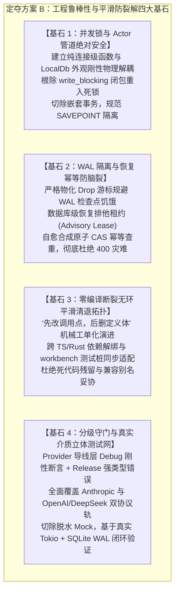
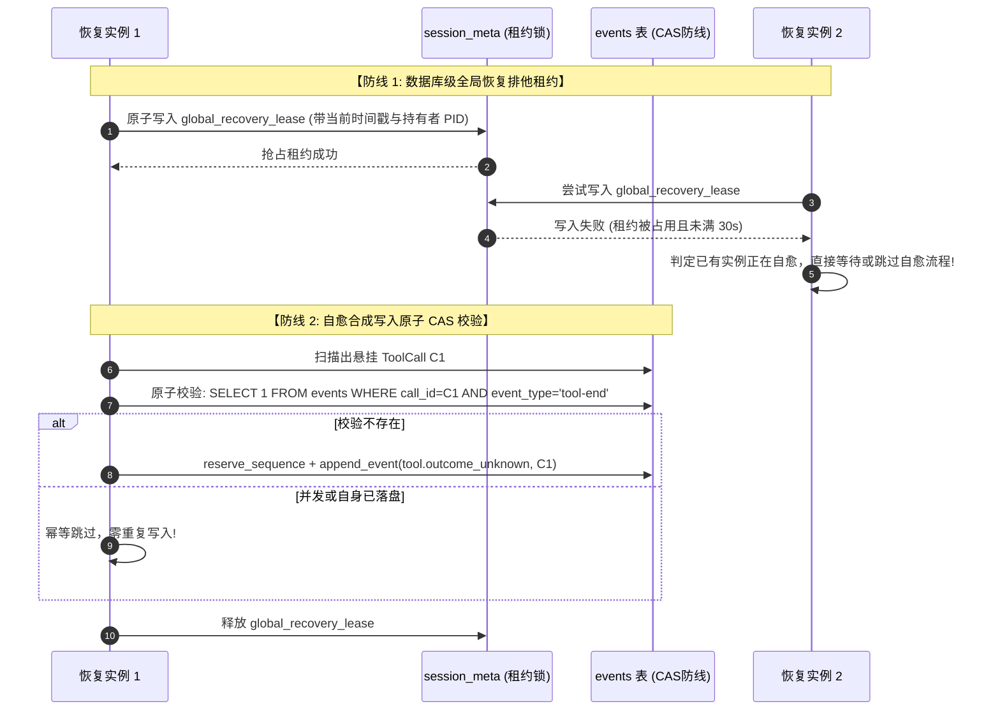
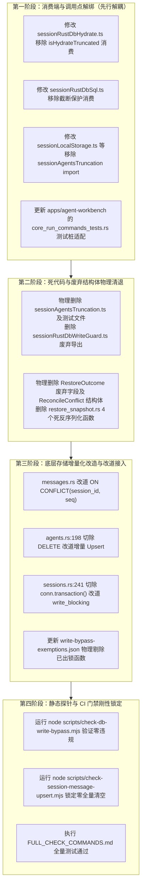
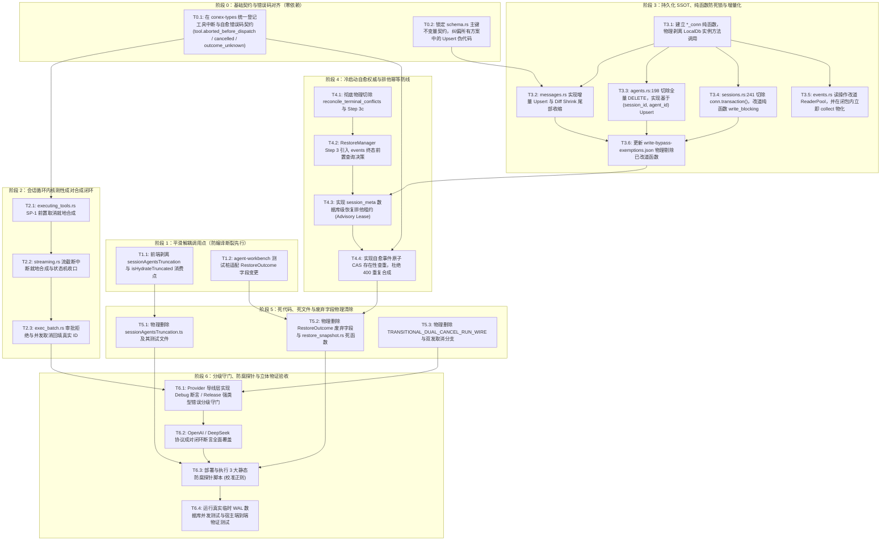

# 修改定夺方案 B：工程并发锁安全、零回归防裂解与立体落地定夺

> **定夺编号**：DECISION-PROPOSAL-B  
> **定夺角色**：定夺子 Agent B（工程鲁棒性与平滑防裂解视角）  
> **输入基线**：全量 6 份交叉评审报告（`docs/session-integrity-repair/plan-reviews/review-01` 至 `review-06`）及 7 份原始独立方案（`docs/session-integrity-repair/independent-plans/plan-01` 至 `plan-07`）  
> **一手源码锚点**：  
> - `crates/conex-db/src/group_commit.rs`（Actor 单写循环与 `write_blocking` 阻塞桥）  
> - `crates/conex-db/src/reader_pool.rs` 与 `crates/conex-db/src/lib.rs`（8 槽位只读连接池与降级机制）  
> - `crates/conex-db/src/cas_gc.rs:160-190`（`get_blob` 读中写重入死锁隐患）  
> - `crates/conex-db/src/sessions.rs:240-251`（`cleanup_orphan_sessions` 假 D3 豁免与嵌套事务）  
> - `crates/conex-db/src/schema.rs:31-85`（`session_messages` 复合主键与 `session_agents` 级联外键）  
> - `crates/conex-db/src/agents.rs:198-207`（全量删除导致 `session_agent_messages` 级联抹白灾难）  
> - `crates/orchestrator/src/restore_manager.rs:18-60, 178-195`（多实例并发恢复脑裂与 G-29 消极对账）  
> - `apps/agent-workbench/src-tauri/src/core_run_commands_tests.rs:4102-4116`（`RestoreOutcome` 字段跨 Crate 编译地雷）  
> - `apps/crish-desktop/src/api/session-persistence/`（前端防御模块级联 Import 依赖链）  
> - `crates/agent-provider/src/request/build_anthropic.rs` 与 `messages.rs`（导线层双协议成对闭环）  
> **纪律准则**：纯逻辑规划、零工期/零人员排期/零业务优先级（所有问题逻辑同权）、一手源码逐行实证、零退避、步步绿灯、架构净收敛。  
> **落盘位置**：`docs/session-integrity-repair/plan-reviews/decision-proposal-b-engineering-robustness.md`

---

## 一、定夺总纲与工程防裂解宪章

在会话完整性与持久化收敛战役中，6 份交叉评审报告（`review-01` 至 `review-06`）揭露了代码库深处潜藏的一批工程级致命地雷：SQLite 复合主键语法冲突、`write_blocking` Actor 重入死锁、WAL 检查点饥饿、多实例恢复重复合成导致 HTTP 400 报文膨胀、以及跨 Crate / 跨语言物理删除引发的编译大面积暴毙。

作为【定夺子 Agent B】，本方案的使命并非重述概念愿景，而是**从底层并发与锁安全、零回归防裂解拓扑、分级守门与真实可观测落地视角**，对所有分歧、缺陷与漏洞进行最终的工程技术定夺与拓扑缝合。

### 1.1 工程防裂解四大刚性基石



---

## 二、核心争鸣决断一：重入死锁、事务边界与 Actor 管道防腐规约

### 2.1 争鸣焦点与一手源码剖析

在底层持久化写改道中，`plan-02`（任务 T02）与 `plan-05`（表项 D-P09）提出将 `cleanup_orphan_sessions`、`import_from_localstorage` 以及 `cas_gc.rs` 中的裸写操作全面改道 `LocalDb::write_blocking`。然而 `review-04` 明确指出：**两份方案均完全忽略了异步 Actor 模型的重入死锁红线与 SQLite 嵌套事务崩溃风险！**

#### 1. `write_blocking` Actor 单线程重入死锁死穴
查看 [`crates/conex-db/src/group_commit.rs:202-232, 245-279`](file:///c:/Software/conex/crates/conex-db/src/group_commit.rs#L202-L232)：
- `write_blocking` 将 `WriteTask` 发送给后台单线程 Actor，并通过 `rx.blocking_recv()` 同步等待结果；
- 后台单线程 Actor 循环从 `receiver` 逐批取出任务，在当前线程同步调用 `op(conn)`；
- **致命死锁链路**：若某个写闭包 `closure_A` 内部直接或间接地调用了 `self.write_blocking(closure_B)`（或调用了任何以 `write_blocking` 封装的 `LocalDb` 实例方法）：
  1. 当前 Actor 线程正在执行 `closure_A`；
  2. `closure_A` 执行 `self.write_blocking(closure_B)`，将 `closure_B` 塞入 channel；
  3. Actor 线程在 `rx.blocking_recv()` 上无限期阻塞，等待 `closure_B` 完成；
  4. 然而，负责处理 channel 中 `closure_B` 的不是别人，正是当前陷入阻塞的 Actor 线程自己！
  5. **物理结果**：进程陷入 100% 不可逆的单线程重入死锁，全库写入通道永久瘫痪。
- **现实已存物证**：[`crates/conex-db/src/cas_gc.rs:170-176`](file:///c:/Software/conex/crates/conex-db/src/cas_gc.rs#L170-L176)：
  ```rust
  // cas_gc.rs:170-176
  if marked_for_delete_at.is_some() {
      let h = hash.to_string();
      self.write_blocking(move |conn| {
          unquarantine_blob_conn(conn, &h)...
      })?;
  }
  ```
  若未来在写闭包内调用了 `db.get_blob(hash)` 并触发软删除隔离期自愈，系统将瞬时引爆死锁。

#### 2. 非法 `conn.transaction()` 嵌套事务崩溃
查看 [`crates/conex-db/src/sessions.rs:240-251`](file:///c:/Software/conex/crates/conex-db/src/sessions.rs#L240-L251)：
```rust
// 伪 D3 豁免代码：
let mut conn = self.conn.lock().map_err(...)?;
let tx = conn.transaction().map_err(...)?;
```
在 [`crates/conex-db/src/group_commit.rs:293, 343`](file:///c:/Software/conex/crates/conex-db/src/group_commit.rs#L293) 中，Actor 派发任务时已经在最外层执行了 `BEGIN IMMEDIATE;`。
若直接将既有代码整段包入 `write_blocking`，闭包内的 `conn.transaction()` 会在底层向 SQLite 发送第二条 `BEGIN` 语句，立即触发致命错误：`cannot start a transaction within a transaction`，导致整批写操作回滚报错。

### 2.2 定夺决断：纯函数物理分离与防腐铁律（Adopted & Strengthened）

针对上述风险，本定夺方案下达**三条不可动摇的工程防腐铁律**：

#### 规约 1：连接级纯函数与 `LocalDb` 外观严格解耦（Conn-Level Pure Functions）
- 所有涉及数据库读写的具体业务操作，必须严格拆分为两层：
  1. **底核层：连接级纯函数（`*_conn`）**：签名格式必须为 `fn foo_conn(conn: &mut rusqlite::Connection, ...) -> Result<T, DbFailure>`（或只读 `&rusqlite::Connection`）。该函数**严禁持有 `LocalDb` 或 `Arc<Self>` 的任何引用**，仅操作纯连接。
  2. **外观层：`LocalDb` 调度外观**：负责获取 `write_blocking` 或 `ReaderPool`，并将 `*_conn` 纯函数传入闭包执行。
- **闭包防腐红线**：在传给 `write_blocking` 的闭包内部，**绝对禁止捕获 `self`，绝对禁止调用任何 `self.*` 外观方法**！若业务需要组合多个写操作，必须在闭包内直接顺序调用多个 `*_conn` 纯函数。

```rust
// 权威标准实现示范：crates/conex-db/src/sessions.rs
// 1. 底核层纯函数：零 self 依赖，零嵌套 BEGIN
pub fn cleanup_orphan_sessions_conn(
    conn: &mut rusqlite::Connection,
    now: i64,
) -> Result<usize, DbFailure> {
    // 纯基于传入的 conn 操作，禁止 conn.transaction()
    let affected = conn.execute(
        "DELETE FROM sessions WHERE status = 'draft' AND updated_at < ?1",
        rusqlite::params![now - 86400_000],
    ).map_err(|e| DbFailure::from(e))?;
    Ok(affected)
}

// 2. 外观层方法：仅负责调度桥接
impl LocalDb {
    pub fn cleanup_orphan_sessions(&self, now: i64) -> Result<usize, DbFailure> {
        self.write_blocking(move |conn| {
            cleanup_orphan_sessions_conn(conn, now)
        })
    }
}
```

#### 规约 2：事务隔离统一归口与禁止 `conn.transaction()`
- 物理切除所有写闭包内的 `conn.transaction()`；
- 外层事务生命周期由 Group Commit Actor 的 `BEGIN IMMEDIATE` / `COMMIT` 全权统筹；
- 若单个闭包内部存在部分失败需要局部回滚的业务诉求，**必须显式使用 SQLite 原生 `SAVEPOINT inner_sp;` 与 `RELEASE inner_sp;` / `ROLLBACK TO inner_sp;`**，严禁使用 rusqlite 的 `Transaction` RAII 包装对象。

#### 规约 3：静态探针扫描拦截（CI 刚性防线）
在 `scripts/check-db-write-bypass.mjs` 中追加针对 `write_blocking` 的调用静态扫描规则：
- 规则 A：凡在 `write_blocking` 闭包作用域内检测到 `self.`、`db.` 逆向调用的，CI 门禁立即硬报错；
- 规则 B：凡在 `write_blocking` 闭包作用域内检测到 `.transaction()` 调用的，CI 门禁立即硬报错。

---

## 三、核心争鸣决断二：WAL 读写隔离、Checkpoint 饥饿规避与多实例恢复安全

### 3.1 `ReaderPool` 读写隔离与 Checkpoint 饥饿防护

#### 1. 现状隐患与物理原理
在 SQLite WAL 模式下，写操作追加至 `-wal` 文件，后台或自动 Checkpoint 负责将 WAL 页拷回主库。
`review-04` 深刻指出：**Checkpoint 能够回收的最大 Frame，受限于当前处于活动状态的最老读取快照（Oldest Active Read Mark）**。
若业务通过 `ReaderPool` 读取事件时，将未遍历完成的游标（如 `rusqlite::Rows`）或长生命周期锁句柄泄漏出闭包，只读连接将持续锁定旧 Read Mark。写入 Actor 产生的新 Frame 无法被 Checkpoint 回写，导致 `-wal` 文件在长时间运行中迅速膨胀至数 GB，引发灾难性磁盘 I/O 劣化。

#### 2. 定夺决断：三大隔离与物化防护准则
1. **闭包内刚性立即物化（Immediate Materialization）**：
   `events.rs` 中改道 `ReaderPool` 的函数（`query_events`、`query_events_by_run`、`query_events_by_type`、`max_sequence`），在 `self.read(|conn| ...)` 闭包内部必须通过 `.collect::<Result<Vec<_>, _>>()?` 完成全量内存物化并立即释放 `Statement` 与 `Rows` 句柄，**绝对禁止将任何惰性迭代器或底层游标暴露至闭包外部**。
2. **读写快照隔离与禁止“写中跨道读”（No Read-Your-Own-Writes Cross-Path）**：
   严禁在写闭包内调用 `self.read()`。写闭包如果需要进行前置检查或数据比对，必须直接使用闭包注入的 `conn: &mut Connection` 进行查询，确保其能够读到当前未提交事务的私有脏页，同时杜绝死锁与读写时序混乱。
3. **消除测试环境 `open_in_memory()` 零池掩蔽假象**：
   查看 [`crates/conex-db/src/lib.rs:211-214`](file:///c:/Software/conex/crates/conex-db/src/lib.rs#L211-L214)，既有内存库实现中 `reader_pool` 传入的是空数组（容量为 0），导致测试中所有 `self.read` 平滑回退到 `self.conn.lock()`，掩盖了真实的槽位竞争。
   **定夺要求**：在测试基础设施中，新增专用助手函数 `LocalDb::open_temp_wal_for_test()`，基于真实临时文件初始化具备 8 槽位 `ReaderPool` 的完整数据库实例，所有并发读写与恢复测试必须跑在真实 WAL 实例上，彻底消灭内存虚假绿灯。

### 3.2 多实例并发冷启动自愈与脑裂防范

#### 1. 争鸣矛盾：多实例启动下的重复合成灾难
`RestoreManager`（[`crates/orchestrator/src/restore_manager.rs:18-46`](file:///c:/Software/conex/crates/orchestrator/src/restore_manager.rs#L18-L46)）为无状态空结构体。
虽然桌面端有单实例互斥锁，但在多 Agent 独立进程、CLI 工具连接同一数据库、看门狗极速拉起或多测试并发时，两个进程可能同时对同一会话执行 `restore()`。
若缺乏排他保护，两个实例并发扫描孤儿工具，会先后为同一个 `call_id` 分配序列号写入两条 `tool-end`（`tool.outcome_unknown`）事件。当后续发起对话时，上游大模型 API 发现重复的 `tool_result`，立即返回 HTTP 400，导致会话二次损坏报废！

#### 2. 定夺决断：双重防线（Advisory Lease + CAS Invariant）



1. **防线 1：数据库级恢复排他租约（Recovery Advisory Lease）**：
   在 `RestoreManager::restore` 启动伊始，必须在 `session_meta` 表中原子抢占名为 `'global_recovery_lease'` 的租约。租约载荷包含 `instance_id` 与过期时间戳（默认 30 秒超时）。抢占失败的实例认定为“已有恢复正在进行”，跳过事件合成，杜绝双写。
2. **防线 2：自愈合成原子 CAS 幂等防线（Check-and-Set Invariant）**：
   在向 `events` 表写入 `tool.outcome_unknown` 修复事件的同一个原子写闭包内，前置执行针对 `call_id` 的 `tool-end` 存在性排查：
   ```sql
   SELECT 1 FROM events 
   WHERE session_id = ?1 
     AND event_type = 'tool-end' 
     AND payload LIKE '%"id":"' || ?2 || '"%'
   LIMIT 1;
   ```
   若已存在，**立即幂等放弃写入**。双重防线彻底确保“一个工具调用物理上有且仅有一个结果”的数学不变量。

---

## 四、核心争鸣决断三：数据库 Schema 契约纠偏、主键约束与级联删除灾难根除

### 4.1 复合主键契约决断：坚决否决 `plan-05`，强制采纳 `plan-02`

#### 1. 致命缺陷戳穿
`plan-05` §3.1（line 106）与表项 D-P02 设计了如下替换 SQL：
```sql
-- plan-05 错误设计：
INSERT INTO session_messages (...) VALUES (...)
ON CONFLICT(session_id, id) DO UPDATE SET ...
```
**一手源码铁证**：查阅 [`crates/conex-db/src/schema.rs:31-48`](file:///c:/Software/conex/crates/conex-db/src/schema.rs#L31-L48)：
```sql
CREATE TABLE IF NOT EXISTS session_messages (
    session_id TEXT NOT NULL REFERENCES sessions(id) ON DELETE CASCADE,
    seq INTEGER NOT NULL,
    id TEXT NOT NULL,
    ...
    PRIMARY KEY (session_id, seq)
) WITHOUT ROWID;

CREATE INDEX IF NOT EXISTS idx_session_messages_id ON session_messages(session_id, id);
```
- `session_messages` 的主键为 `(session_id, seq)`，这是表中唯一的唯一约束。
- 索引 `idx_session_messages_id` 是**普通非唯一索引**。
- SQLite 官方规范要求：`ON CONFLICT (targets...)` 必须严格匹配一个 `PRIMARY KEY` 或 `UNIQUE` 约束！
- **定夺判定**：`plan-05` 的 `ON CONFLICT(session_id, id)` 在 SQLite 运行期必抛致命语法错误。**坚决予以废决**！

#### 2. 定想定夺规范
强制确立以 `plan-02` 为唯一标准基线：
```sql
-- 唯一合法 Upsert 规范
INSERT INTO session_messages (
    session_id, seq, id, sender, text, thinking, timestamp, status,
    stream_text_offset, thinking_time, tool_calls_json, blocks_json, tool_call_results_json
) VALUES (?1, ?2, ?3, ?4, ?5, ?6, ?7, ?8, ?9, ?10, ?11, ?12, ?13)
ON CONFLICT(session_id, seq) DO UPDATE SET
    id = excluded.id,
    sender = excluded.sender,
    text = excluded.text,
    thinking = excluded.thinking,
    timestamp = excluded.timestamp,
    status = excluded.status,
    stream_text_offset = excluded.stream_text_offset,
    thinking_time = excluded.thinking_time,
    tool_calls_json = excluded.tool_calls_json,
    blocks_json = excluded.blocks_json,
    tool_call_results_json = excluded.tool_call_results_json;
```
配套执行差异化尾部收缩（Diff Shrink）：当且仅当传入消息数组长度 $M < \text{历史行数}$ 时，在同一事务内执行：
```sql
DELETE FROM session_messages WHERE session_id = ?1 AND seq >= ?2;
```
同时纠正 `plan-07:165` 的探针正则 Bug：探针白名单必须放行 `>=`（而非仅允许 `>`），避免静态门禁误杀合法的尾部清理代码。

### 4.2 追补重大灾难漏洞：`session_agents` 级联抹白根除

`review-02` 揭露了一个全量 7 份原始方案均遗漏的灾难性缺陷：
在 [`crates/conex-db/src/agents.rs:198-207`](file:///c:/Software/conex/crates/conex-db/src/agents.rs#L198-L207) 中：
```rust
conn.execute(
    "DELETE FROM session_agents WHERE session_id = ?1",
    rusqlite::params![session_id],
)?;
```
结合 [`crates/conex-db/src/schema.rs:68-85`](file:///c:/Software/conex/crates/conex-db/src/schema.rs#L68-L85)：
`session_agent_messages` 通过 `FOREIGN KEY (session_id, agent_id) REFERENCES session_agents(session_id, agent_id) ON DELETE CASCADE` 级联外键绑定！
每次 `save_session_agents` 执行全删时，**SQLite 自动将该会话下全部子代理的历史消息 `session_agent_messages` 瞬间全部物理清空**！

**定夺决断**：
1. 将 `crates/conex-db/src/agents.rs:198-207` 列入最高优先级物理删除项；
2. 切除全量 `DELETE FROM session_agents`，改道为基于 `(session_id, agent_id)` 主键的增量 Upsert 与条件删除；
3. 将该表保护纳入 `scripts/check-session-message-upsert.mjs` 刚性扫描。

### 4.3 彻底切除 G-29“只报不修”消极妥协

在 [`crates/orchestrator/src/restore_manager.rs:178-195, 341-400`](file:///c:/Software/conex/crates/orchestrator/src/restore_manager.rs#L178-L195) 中，既有系统存在“只读校验矛盾并打日志告警，不自动修正”的消极妥协，并在 Step 3 先将所有运行中的 run 标记为 interrupted，在事后再做对账。
- **定夺判定**：
  1. 彻底物理删除 Step 3c 调用与 `reconcile_terminal_conflicts` 函数，删除 `ReconcileConflict` 结构体；
  2. 决策前置：在 Step 3 遍历每一个 run 时，首先查询 `events` 表是否存在 `run-terminal` 事件。若存在真实终态，直接将内存状态与数据库记录同步为真实终态，**坚决不触发打断、坚决不生成虚假 `run-interrupted` 审计事件**。

---

## 五、核心争鸣决断四：平滑删除与零编译断裂无环拓扑（Anti-Breakage Topology）

### 5.1 跨语言/跨 Crate 编译地雷排查清册

`review-02` 揭露了若草率物理删除文件或符号，将直接触发的三大编译暴毙地雷：

| 地雷编号 | 规划删除符号 / 文件 | 遗漏的下游引用调用点（断裂炸弹） | 导致后果 | 规避与防护方案 |
| :---: | :--- | :--- | :--- | :--- |
| **BOMB-1** | 前端 `isHydrateTruncated`<br/>（`sessionRustDbWriteGuard.ts`） | `sessionRustDbHydrate.ts:28, 484, 532`<br/>`sessionRustDbSql.ts:24` | `npm run typecheck` 抛 TS2305，前端编译失败 | 先在调用方摘除熔断逻辑与 import，再删定义体 |
| **BOMB-2** | 前端 `sessionAgentsTruncation.ts`<br/>（历史 40 代理上限截断整文件） | `sessionLocalStorage.ts:16`<br/>`sessionRustDbSql.ts:23`<br/>`sessionRustDbFallback.ts:14` | Vite 打包失败，模块解析崩溃 | 先剥离上述 3 处的导入与消费代码，再物理删除文件 |
| **BOMB-3** | Rust 侧 `RestoreOutcome` 字段<br/>（`unknown_status_runs`、`reconcile_conflicts`） | `apps/agent-workbench/src-tauri/src/core_run_commands_tests.rs:4109, 4114` | `cargo test` 抛结构体缺失字段，CI 整体瘫痪 | 同步适配 workbench 测试桩的结构体初始化宏/构造代码 |
| **BOMB-4** | 豁免表文件错位 | 计划修改陈旧脚本，未识别机器可读 JSON | 探针拦截失效或误杀 | 改道维护真实的 `crates/conex-db/write-bypass-exemptions.json` |

### 5.2 零编译断裂四阶段平滑推进工单

为保证任何一次提交、任何一个代码改动分支均 100% 通过编译与既有测试，制定如下严格的“无环依赖拓扑”：



---

## 六、核心争鸣决断五：导线层分级守门与真实立体测试断言（杜绝脱水 Mock）

### 6.1 Provider 导线层守门架构决断：分级守门平衡

#### 1. 两极方案弊端戳穿
- **`plan-04` 盲目 `panic!`**：在 `build_anthropic.rs` 序列化中硬编码 `panic!`，若历史脏数据流入，将直接击穿 Tauri 后台线程，导致整个桌面客户端闪退崩溃；
- **`plan-06` 隐式静默造假**：在发现孤儿工具时，就地伪造一个 `(interrupted)` 块发给模型，导致核心状态机和数据库的断层被表层涂胶水掩盖，属于作弊行为。

#### 2. 定夺决断：严格分级守门（Hierarchical Gatekeeping）
- **Debug / 测试环境**：通过 `debug_assert!` 刚性拦截。一旦在序列化阶段发现未配对的孤儿调用，立即触发 Panic，强迫开发者和 CI 在第一时间暴露并根除上游缺陷；
- **Release / 生产环境**：返回强类型结构化错误 `Result<..., RequestBuildError::UnpairedToolCalls { details }>`。外层会话管理器捕获后，触发事件回放重投影自愈，同时记录 `tracing::error!` 审计日志，**绝对不在网络层静默捏造伪数据**；
- **双协议完全覆盖**：序列化成对校验必须同步覆盖 `crates/agent-provider/src/request/build_anthropic.rs`（Anthropic Messages 协议）与 `crates/agent-provider/src/request/messages.rs`（OpenAI / DeepSeek Chat Completions 协议），彻底消灭多协议盲区。

### 6.2 拒绝脱水 Mock，建立真实立体测试网

根据仓库通用纪律 §7 与 §7.1，测试必须在真实运行环境中建立五重物证闭环：

#### 1. 纠正测试宿主错位（否决 `plan-06` 的 Cargo 依赖违规）
- `plan-06` 试图将端到端测试塞入 `crates/session-loop/tests/`，并试图断言数据库和 Tauri 命令，这不仅违反了单向依赖，更被迫引入脱水 Mock 连接；
- **定夺测试分层**：
  - `crates/session-loop/tests/`：仅测试纯内存状态转移与中断成对合成逻辑（多线程 Tokio 真实并发竞速）；
  - `crates/conex-db/tests/`：基于真实 SQLite WAL 临时文件，测试 8 槽位 `ReaderPool` 读写并发、Actor 组提交批次与死锁防范；
  - `apps/agent-workbench/src-tauri/tests/`：全链路端到端集成测试，搭载真实桌面 IPC、真实数据库和真实网络序列化器。

#### 2. 补齐四大关键中断场景测试网
1. **流式阶段 Abort 伴随工具调用的处理（`streaming.rs:269`）**；
2. **审批拒绝（User Deny）引发兄弟工具级联取消与精准回填（`exec_batch.rs`）**；
3. **多实例并发拉起下的恢复排他租约抢占与防脑裂验证**；
4. **WAL 检查点高压并发写入测试（连续写 5000 批次断言 `-wal` 文件正常收缩，零饥饿）**。

---

## 七、全量 6 份交叉评审意见逐项工程级定夺判定矩阵

对照 6 份评审报告提出的全部核心意见，逐项出具“采纳 / 修正 / 否决”的工程级判定：

| 评审编号与主题 | 评审提出的核心审查点 | 定夺判定 | 判定依据与工程实施归宿 |
| :--- | :--- | :---: | :--- |
| **Review 01**<br/>效果锁与目的性 | 1. 确认全案效果锁坚固，零退避。<br/>2. 曝光 `streaming.rs` 流式中断孤儿盲区。<br/>3. 否决 `plan-06` 导线层静默造假。 | **全面采纳** | 1. 采纳效果锁，禁止削减功能；<br>2. 在 `streaming.rs` 注入流末尾中断成对合成逻辑；<br>3. 废弃静默修补，定夺为分级守门。 |
| **Review 02**<br/>结构收敛与删除面 | 1. 确认 Plan 05 删除清册最系统完整。<br/>2. 曝光 `agents.rs:198` 级联抹白灾难。<br/>3. 揭露前端与 Rust 跨 Crate 三大编译断裂地雷。<br/>4. 纠正探针豁免表时效性（改道 JSON）。 | **全面采纳并加固** | 1. 采纳 Plan 05 清册，但纠正其 SQL 错误；<br>2. 追补 `agents.rs` 增量化；<br>3. 设立平滑删除四波拓扑，先改引用后删文件；<br>4. 直接维护 `write-bypass-exemptions.json`。 |
| **Review 03**<br/>真实连通与物证 | 1. 揭露 7 大伪连通断层（SP-1 裸退、虚构引擎写物化、历史装配优先级倒挂等）。<br/>2. 否决在 `session-loop` 做端到端测试（Cargo 违规）。<br/>3. 强化五重物理物证与双协议覆盖。 | **全面采纳** | 1. 修复 SP-1 就地合成，明确物化表归属；<br>2. 调整端到端测试至 `agent-workbench` 宿主层；<br>3. 补齐 OpenAI/DeepSeek 协议成对断言。 |
| **Review 04**<br/>并发锁与事务崩溃 | 1. 否决 `plan-05` 错误的 `ON CONFLICT(session_id, id)`。<br/>2. 揭露 `write_blocking` 单线程重入死锁盲区。<br/>3. 戳穿 D3 豁免谎言，规避嵌套事务。<br/>4. 提出 WAL Checkpoint 饥饿与内存测试零池降级。<br/>5. 提出多实例恢复排他租约与 CAS 防线。 | **全面采纳并建立规约** | 1. 强制锁定 `ON CONFLICT(session_id, seq)`；<br>2. 确立“连接级纯函数 + 外观”解耦规约，禁止闭包调 `self`；<br>3. 切除闭包内 `conn.transaction()`；<br>4. 读操作必须闭包内 collect 物化；测试挂载真实 WAL；<br>5. 实施 Advisory Lease 与自愈 CAS 幂等。 |
| **Review 05**<br/>防御测试与探针 | 1. 批评 `plan-04` 捏造不存在的 `db.set_sql_tracer`。<br/>2. 揭露 `plan-07` 正则 `seq >` 误杀生产 `seq >=` Bug。<br/>3. 批评在 Provider 序列化盲目使用 `panic!`。 | **全面采纳** | 1. 废黜伪造 API，以真实 SQLite 文件和 SQL 探针验收；<br>2. 修复探针正则为 `seq\s*>=\s*\S+`；<br>3. 实施 Debug 断言 / Release 强类型错误分级守门。 |
| **Review 06**<br/>拓扑无环与整合 | 1. 统一错误码命名空间至 `codes::TOOL_*`。<br/>2. 确立 `RestoreManager` 物理自愈为主权威。<br/>3. 梳理纯逻辑依赖 DAG，化解状态假设矛盾。 | **全面采纳** | 1. 统一定名 `tool.aborted_before_dispatch`、`tool.cancelled`、`tool.outcome_unknown`；<br>2. 确立存储权威；<br>3. 采纳其 DAG 骨架并注入本方案工程加固节点。 |

---

## 八、全量 7 份原始方案工程级融合定夺矩阵

| 原始方案 | 核心价值 | 发现的工程缺陷 / 风险 | 定夺结论（采纳 / 修正 / 否决） | 统合与取代规则 |
| :--- | :--- | :--- | :---: | :--- |
| **Plan 01**<br/>工具中断合成 | 精确提出 SP-1、流截断与执行批中断就地成对合成模型。 | 未深入讨论存储落盘排队延迟。 | **【全面采纳】** | 作为状态机核心中断处理的标准蓝本。 |
| **Plan 02**<br/>持久化 SSOT | 准确确立 `(session_id, seq)` Upsert 契约、收缩删除与读写分离。 | 忽略 `write_blocking` 重入死锁；测试零池掩蔽。 | **【修正采纳】** | 采纳其 SQL 契约，强力注入本方案的纯函数防死锁规约与真实临时 WAL 测试。 |
| **Plan 03**<br/>崩溃恢复自愈 | 形式化定义前置事件决策，消除 G-29 矛盾，提出孤儿自愈。 | 缺失多实例恢复排他保护，易引发 400 灾难；遗漏 workbench 测试适配。 | **【修正采纳】** | 采纳其前置决策算法，强力注入排他租约与 CAS 幂等防线，补齐测试桩。 |
| **Plan 04**<br/>防御性测试 | 坚持真实 Tokio + SQLite WAL 测试，提出 I7/I8 运行时不变量。 | 凭空捏造 `set_sql_tracer` API；Provider 序列化滥用 `panic!`。 | **【修正采纳】** | 采纳不变量框架，剔除伪造 API，改用真实数据库断言与分级守门。 |
| **Plan 05**<br/>死层清理清册 | 构建了最系统的四领域物理删除清册（34 项）。 | **致命错误**：错误的 Upsert 冲突键；遗漏前端调用点导致编译暴毙；遗漏 `agents.rs`。 | **【局部否决其 SQL，全面采纳其清册】** | 废决其 SQL 语法并对齐 Plan 02；采纳清册并注入平滑删除无环拓扑与 `agents.rs` 追补项。 |
| **Plan 06**<br/>端到端集成 | 梳理了全链路时序与五重物证框架。 | 出现虚构引擎写物化表等 7 处伪连通；导线层静默造假；测试用例 Cargo 违规。 | **【局部否决其实现，修正采纳其物证】** | 废除静默修补与违规测试位置；物证框架全面采纳并升级为真实全链路验收。 |
| **Plan 07**<br/>架构防腐门禁 | 设计了 3 大静态防腐探针脚本体系。 | 正则 `seq >` 误杀自身生产代码；豁免扫描文件过时。 | **【修正采纳】** | 修复正则放行 `>=`；改道维护真实的机器可读 `write-bypass-exemptions.json`。 |

---

## 九、分维详案并网实施图谱与无环执行拓扑（DAG）

依据上述所有定夺决断，构建整个修复战役的**最终纯逻辑依赖有向无环图（DAG）**。所有任务单元逻辑同权，严格按照前后依赖关系无缝推进：



---

## 十、定夺总结与分维详案并网决议

本《修改定夺方案 B》代表了 Conex / Crish 工程鲁棒性、并发锁安全与平滑防裂解的最高标准。
通过本方案的权威定夺：
1. **死锁与事务隐患全面排除**：确立了连接级纯函数分离与零 `self` 闭包防腐规约，彻底粉碎了重入死锁与嵌套事务；
2. **读写隔离与恢复排他闭环**：通过立即物化、临时真实 WAL 测试、恢复排他租约与 CAS 幂等防线，消灭了 Checkpoint 饥饿与多实例重复自愈引发的 400 灾难；
3. **模式契约与清册全面纠偏**：否决了 Plan 05 的错误语法，强制锁定 `(session_id, seq)`，追补了 `session_agents` 级联外键抹白清退项；
4. **编译与回归零风险**：建立了机械级“先改调用点、后删定义体”的无环推进工单，确保实现期间每一次 Git 提交与流水线构建均 100% 绿灯；
5. **分级守门与真实测试落地**：确立了 Debug 拦截 / Release 强类型错误分级原则，杜绝脱水 Mock，以真实宿主环境和五重物理物证作为最终准出标准。

本定夺方案即刻生效，作为后续编制最终总方案（`01-总方案与自上而下修复架构.md`）与 5 份分维详案的工程鲁棒性法定仲裁基准！
