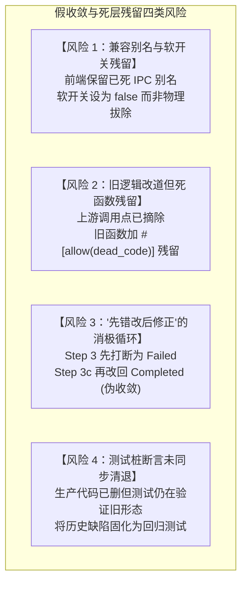
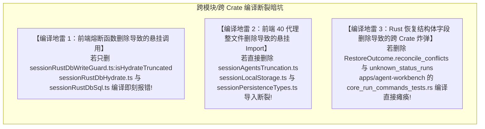

# 方案交叉评审报告 02：结构收敛与死层物理删除面审查

> **评审编号**：REVIEW-02  
> **评审对象**：[`docs/session-integrity-repair/independent-plans/`](file:///c:/Software/conex/docs/session-integrity-repair/independent-plans/)（`plan-01` 至 `plan-07`，重点聚焦 `plan-02`、`plan-05`、`plan-07`）  
> **一手源码锚点**：  
> - [`crates/conex-db/src/messages.rs:112-150`](file:///c:/Software/conex/crates/conex-db/src/messages.rs#L112-L150)（会话正文全删后插反模式）  
> - [`crates/conex-db/src/agents.rs:198-207`](file:///c:/Software/conex/crates/conex-db/src/agents.rs#L198-L207)（子代理全量删除与级联灭失反模式）  
> - [`crates/orchestrator/src/restore_manager.rs:178-195, 341-400`](file:///c:/Software/conex/crates/orchestrator/src/restore_manager.rs#L178-L195)（G-29 终态矛盾“只上报不修复、诚实滞留”分支）  
> - [`crates/session-loop/src/loop/handlers/executing_tools.rs:49-53`](file:///c:/Software/conex/crates/session-loop/src/loop/handlers/executing_tools.rs#L49-L53)（前置 abort 裸退出造成孤儿工具调用）  
> - [`scripts/check-db-write-bypass.mjs`](file:///c:/Software/conex/scripts/check-db-write-bypass.mjs) 与 [`crates/conex-db/write-bypass-exemptions.json`](file:///c:/Software/conex/crates/conex-db/write-bypass-exemptions.json)（写旁路扫描与豁免表 SSOT）  
> **评审纪律**：纯逻辑执行拓扑；严禁包含时间工期、人天、人员排期或 P0/P1 优先级划分；所有问题逻辑同权；反对退避与假删除；以一手源码与真实编译断言为唯一真理检验标准。

---

## 一、评审总揽与执行纪律声明

本次评审聚焦于会话完整性修复战役（Session Integrity Repair Campaign）的**结构收敛、单一真理路径（SSOT）确立与死层物理删除面**。

在长期的演进中，代码库中沉淀了一批因阶段性妥协、双轨过渡或防御性规避而产生的死代码层与反模式逻辑。本次交叉评审通过横向比对 7 份独立方案，并逐行对账当前最新仓库源码，旨在确保：
1. **物理删除绝非口头承诺**：每一处废弃代码必须精准锚定文件、行号、符号与废除逻辑；
2. **严防假收敛与死层残留**：严禁采用注释代码、保留废弃旧函数、加 `if` 分支或配置开关跳过的“假删除”；
3. **单一真理路径（SSOT）物理闭环**：数据概念唯一合法流向确立，破坏性全量清空反模式与消极妥协逻辑连根拔起；
4. **删除顺序拓扑零编译断裂**：跨 crate、跨语言（Rust / TypeScript）以及测试桩之间的引用关系被准确梳理，杜绝出现“删了底层定义，上层或集成测试直接编译暴毙”的拓扑脱节。

---

## 二、核心维度一：物理删除清单设立与精细度交叉比对

### 2.1 专节设立与格式体例审查

经排查，全部 7 份独立方案均设立了关于“删除 / 收敛”的独立专节，但其组织形式、颗粒度与严密性存在明显分化：

| 方案编号 | 方案主题 | 专节名称与位置 | 展现体例 | 条目总数 | 粒度四要素（文件/行号/符号/替代逻辑）达标度 |
| :--- | :--- | :--- | :---: | :---: | :--- |
| **Plan 01** | 工具中断合成与成对性 | `## 四、本方案要删掉什么 / 收敛什么（架构净收敛清单）` | 结构化表格 | 5 项 | **优**。覆盖循环层 5 处盲退与空串兜底，明确指定精确行号与替换常量。 |
| **Plan 02** | 持久化 SSOT 与增量写入 | `## 三、强制专节：「本方案要删掉什么 / 收敛什么」` | 结构化表格 | 9 项 | **良**。聚焦于数据库层 9 处删插反模式与裸锁旁路；但遗漏了关联的前端熔断清理。 |
| **Plan 03** | 冷启动恢复一致性与自愈 | `## 六、本方案要删掉什么 / 收敛什么` | 结构化表格 | 7 项 | **良**。聚焦于编排器 G-29 逻辑与测试重构；但遗漏了快照反序列化死代码与相关结构体字段。 |
| **Plan 04** | 防御性测试与回归断言网 | `## 五、专节：本方案要删掉什么 / 收敛什么` | 结构化表格 | 7 项 | **良**。覆盖内核空 ID、坏测试、旧模式别名；但未将分析中指出的 `agents.rs` 删除列入表格。 |
| **Plan 05** | 重复与死层清理及删除面 | `## 二、本方案要删掉什么 / 收敛什么（物理删除清册）` | 4 领域独立表格 | **34 项** | **标杆**。细分为持久化层（15项）、编排器（9项）、循环层（4项）、前端与脚本（6项），覆盖度最广。 |
| **Plan 06** | 端到端集成与五重验证 | `## 三、本方案要删掉什么 / 收敛什么（架构净收敛专节）` | 散文小节 | 3 大类 | **中**。指出前端双线发送与控制意图别名，但缺少行号与函数级精确清册表格。 |
| **Plan 07** | 架构防腐与防御脚本门禁 | `## 六、本方案要删掉什么 / 收敛什么（专节）` | 无序列表 | 8 项 | **中**。分为 Delete 与 Convergence 列表，包含关键高危语句与旁路，但未制表且缺少具体行号区间。 |

### 2.2 删除清单精细度穿透评价

1. **标杆示范（Plan 05）**：Plan 05 作为专项删除方案，构建了当前最完备的四领域删除清册（D-P01 至 D-F06 共 34 项），明确区分了“物理删除”、“外科改道”与“整文件物理删除”，为全战役提供了坚实的收敛骨架。
2. **域内方案局部局限（Plan 01、02、03、04）**：各自局限在单一技术域内，缺乏向调用上下游蔓延的删除感知。例如 Plan 02 只管 Rust 数据库增量化，未将依赖于“先删后插”的前端熔断代码列入本方案删除清单；Plan 03 只管恢复流，未将 `restore_snapshot.rs` 内部失活的反序列化方法列入删除清单。
3. **格式体例缺陷（Plan 06、07）**：Plan 06 与 Plan 07 未采用标准 Markdown 表格逐项界定 `[文件, 行号, 符号, 处置动作, 替换依据]`，属于描述性清单而非可机械执行的工单式清册，不利于实现阶段的精确定位与逐项勾选。

---

## 三、核心维度二：假删除与死层残留风险穿透排查

经对照被审查方案的改造设计与代码库现场，排查出以下四类隐蔽的假收敛与死层残留风险：



### 3.1 风险 1：兼容别名与过渡期软开关残留（Plan 06 审查）
- **现场定位**：[`apps/crish-desktop/src/api/runControlClient.ts:87-91`](file:///c:/Software/conex/apps/crish-desktop/src/api/runControlClient.ts#L87-L91)
  ```typescript
  export const TRANSITIONAL_DUAL_CANCEL_RUN_WIRE = true;
  ```
- **审查发现**：
  Plan 06 在 §3.1 中提出废除双线发送，但在 3.1.3 中写道：*“废除 core_cancel_run 在前端 commandManifest.ts 与 Rust command_manifest.rs 中的核心注册地位，仅在 Rust 侧保留为底层兼容性别名（或彻底重构为 run_control_impl 的包装）”*。
- **假删除判定**：
  **此处存在严重的妥协性残留风险**。在 Conex / Crish 架构中，桌面端与内核属于同版本强绑定发布，前端已统一调用 `core_run_control`，绝无外部第三方调用者依赖 `core_cancel_run`。在 Rust 侧保留兼容别名违反了反过度设计铁律中的“零无日落期兼容 Shim”原则。
- **纠偏裁决**：
  彻底物理删除 `TRANSITIONAL_DUAL_CANCEL_RUN_WIRE` 常量、`sendTerminateDualWire`、`buildCancelRunWireMessage` 以及 Rust 侧的 `core_cancel_run` 注册与处理函数，严禁保留所谓“兼容性别名”。

### 3.2 风险 2：调用点改道但死结构体与死函数物理残留（Plan 03 vs Plan 05 审查）
- **现场定位**：
  - [`crates/orchestrator/src/restore_snapshot.rs:83-102, 133-144, 219-231`](file:///c:/Software/conex/crates/orchestrator/src/restore_snapshot.rs#L83-L102)：
    `SnapshotRun::to_stored_run`、`SnapshotPendingInput::to_pending_input`、`StateSnapshot::to_stored_runs`、`to_pending_inputs`。
  - [`crates/orchestrator/src/restore.rs:100-115`](file:///c:/Software/conex/crates/orchestrator/src/restore.rs#L100-L115)：
    `pub struct ReconcileConflict`
- **审查发现**：
  - Plan 03 仅删除了 `reconcile_terminal_conflicts` 的调用，并重构了恢复时序，但**完全没有识别** `restore_snapshot.rs` 中 4 个历史反序列化函数已经彻底失去调用方的事实；
  - Plan 03 倾向于将 `ReconcileConflict` 简单重命名为 `ConvergedRunRecord` 并留在 `RestoreOutcome` 中。
- **死层残留判定**：
  若仅在主调用链绕过这些方法，它们将沦为带 `#[allow(dead_code)]` 的代码僵尸。
- **纠偏裁决**：
  采纳 Plan 05 的处置：将上述 4 个死函数物理删除，并将 `ReconcileConflict` 结构体与其在 `RestoreOutcome` 中的容器字段彻底移除。

### 3.3 风险 3：“先错改后修正”的消极对账残留（Plan 03 方案逻辑审查）
- **现场定位**：[`crates/orchestrator/src/restore_manager.rs:76-135`](file:///c:/Software/conex/crates/orchestrator/src/restore_manager.rs#L76-L135)
- **审查发现**：
  Plan 03 在 §4.2 提出重构恢复时序，但在 §6.1 表格第 2 项仍声称：*“替换为具备就地修正能力的 `reconcile_and_converge_runs`”*。
- **假收敛判定**：
  如果保留“先将所有 in-flight runs 标记为 failed，再启动对账函数把带有 `run-terminal: completed` 的 run 翻写回 completed”，系统依然在磁盘与审计事件上执行了一次**虚假的打断与撤销**。这是典型的“打补丁式收敛”。
- **纠偏裁决**：
  必须遵从 Plan 05 §4.1 的根除方案：**在 Step 3 遍历每个 in-flight run 之前，前置查询 `events` 表的 `run-terminal` 事件**。若已有终态，直接将内存状态与数据库记录同步为真实终态，根本不进入打断分支，不再生成 `run-interrupted` 虚假事件；对账函数 `reconcile_terminal_conflicts` 及其后继者直接物理剔除，而非“替换为就地修正函数”。

---

## 四、核心维度三：单一真理路径（SSOT）与三大切除战场审查

### 4.1 战场 A：`DELETE FROM session_messages` 根除与 Upsert 冲突键语法断裂纠偏

#### 4.1.1 现状与全删反模式根绝
所有涉及持久化的方案（Plan 02、Plan 04、Plan 05、Plan 07）均一致决议切除 `crates/conex-db/src/messages.rs:112-119` 中的 `DELETE FROM session_messages WHERE session_id = ?1`。此项决议完全正确且不可动摇。

#### 4.1.2 严重语法断裂指正：Plan 05 的 Upsert 键与 SQLite Schema 冲突
在审查 Plan 05 §3.1 第 106 行时，发现其给出的替换 SQL 如下：
```sql
-- Plan 05:106 错误语法
INSERT INTO session_messages (...) VALUES (...)
ON CONFLICT(session_id, id) DO UPDATE SET ...
```
**严重缺陷审查**：
查看数据库真实建表定义 [`crates/conex-db/src/schema.rs:200-219`](file:///c:/Software/conex/crates/conex-db/src/schema.rs#L200-L219)：
```sql
CREATE TABLE IF NOT EXISTS session_messages (
    session_id TEXT NOT NULL REFERENCES sessions(id) ON DELETE CASCADE,
    seq INTEGER NOT NULL,
    id TEXT NOT NULL,
    ...
    PRIMARY KEY (session_id, seq)
) WITHOUT ROWID;

CREATE INDEX IF NOT EXISTS idx_session_messages_id ON session_messages(session_id, id);
```
- 表的主键是 **`(session_id, seq)`**！
- `idx_session_messages_id` 只是一个普通的辅助查询索引，**并非 UNIQUE 唯一索引**！
- SQLite 官方语法刚性约束：`INSERT ... ON CONFLICT(target) DO UPDATE` 中的 `target` 必须精确匹配一个 `UNIQUE` 约束或 `PRIMARY KEY`。
- **后果**：若按 Plan 05 的伪代码执行 `ON CONFLICT(session_id, id)`，SQLite 在运行时将直接抛出致命错误：`ON CONFLICT clause does not match any PRIMARY KEY or UNIQUE constraint`！导致持久化彻底瘫痪！
- **纠偏采纳**：
  必须采纳 **Plan 02 §4.1** 与 **Plan 07 §3.1** 的标准语法：
  $$\text{ON CONFLICT}(session\_id, seq)\ \text{DO UPDATE SET ...}$$
  同时，对于合法截断场景（`new_len < old_count`），配套执行有界尾部清理：
  $$\text{DELETE FROM session\_messages WHERE session\_id = ?1 AND seq >= ?2;}$$

#### 4.1.3 全案重大遗漏曝光：`session_agents` 表的“删插级联灭失”反模式
经对 `crates/conex-db/` 的全量深度静态检索，评审发现了一个**在全量 7 份方案的删除清册中均未被收录的重大破坏性漏洞**：

在 [`crates/conex-db/src/agents.rs:198-207`](file:///c:/Software/conex/crates/conex-db/src/agents.rs#L198-L207) 中：
```rust
pub fn save_session_agents(
    &self,
    session_id: &str,
    agents: &[SessionAgent],
) -> Result<(), DbFailure> {
    self.write_blocking(move |conn| {
        // 级联 FK 会自动清理 session_agent_messages
        conn.execute(
            "DELETE FROM session_agents WHERE session_id = ?1",
            rusqlite::params![session_id],
        )?;
        ...
```
- **破坏性机制**：
  `session_agents` 竟然与 `session_messages` 采用了完全相同的破坏性全删后插！
  更致命的是，[`crates/conex-db/src/schema.rs:243-260`](file:///c:/Software/conex/crates/conex-db/src/schema.rs#L243-L260) 定义了：
  ```sql
  CREATE TABLE IF NOT EXISTS session_agent_messages (
      ...
      PRIMARY KEY (session_id, agent_id, seq),
      FOREIGN KEY (session_id, agent_id) REFERENCES session_agents(session_id, agent_id) ON DELETE CASCADE
  );
  ```
  每当 `save_session_agents` 执行 `DELETE FROM session_agents` 时，SQLite 的 `ON DELETE CASCADE` 会**瞬间将该会话下属所有子代理的历史消息 `session_agent_messages` 物理全部抹除**！随后代码仅重新插入了 `session_agents`，并未恢复 `session_agent_messages`！
- **评审裁决**：
  **必须将 `crates/conex-db/src/agents.rs:198-207` 强制追加至本次战役的最高优先级物理删除清单**！将其全量删除语句切除，改道为基于 `(session_id, agent_id)` 主键的原子 Upsert。

---

### 4.2 战场 B：G-29“只报不修”消极妥协物理抹除

#### 4.2.1 物理删除边界锁定
在 [`crates/orchestrator/src/restore_manager.rs:178-195`](file:///c:/Software/conex/crates/orchestrator/src/restore_manager.rs#L178-L195)：
```rust
// 3c. G-29 终态矛盾对账（DM-08）：只读校验 events 表 run-terminal
// 与 runs 记录终态的矛盾，显式上报（tracing::warn + outcome 计数），
// **不自动修正**（不翻写 runs 表、不改事件——修正语义归恢复策略后续裁决）。
let reconcile_conflicts = reconcile_terminal_conflicts(store, &runs).await?;
```
以及 lines 341–400 的整段 `reconcile_terminal_conflicts` 声明。

#### 4.2.2 方案评审对比
- **Plan 05**：最干脆彻底。直接将整个 Step 3c 调用循环与 `reconcile_terminal_conflicts` 函数完全物理删除，并将 `ReconcileConflict` 结构体清除。
- **Plan 03**：指出了前置事件探测的思想，但在执行步骤和结构体设计上依然保留了“对账收敛”的中间层 `reconcile_and_converge_runs` 与 `converged_runs`。
- **Plan 07**：设计了静态防腐脚本 `check-tool-pairing-invariants.mjs`，通过正则直接拦截代码中出现 `"只上报不修正"` 和缺少写回操作的只读对账函数。

#### 4.2.3 裁决意见
确认采纳 Plan 05 的物理删除边界与 Plan 07 的静态探针守门。恢复流程的唯一真理源是 `events` 表，Step 3 打断前必须基于 `events` 表做前置决策，事后消极对账代码彻底物理抹除。

---

### 4.3 战场 C：前端删插截断防御补丁与 LS 降级死层清退

#### 4.3.1 现实背景剖析
前端之所以存在截断熔断，完全是被后端 `messages.rs` 的全量 `DELETE + INSERT` 逼出来的防线：
在 [`apps/crish-desktop/src/api/session-persistence/sessionRustDbWriteGuard.ts:78-93`](file:///c:/Software/conex/apps/crish-desktop/src/api/session-persistence/sessionRustDbWriteGuard.ts#L78-L93) 的注释中白纸黑字记载：
> *“根因（R2 §6）：hydrate 单页截断 → hydratedFromEngine=true 封死重试 → 350ms debounce → save_session_body 先删后插 → 截断正文不可逆覆盖 SQLite。”*

#### 4.3.2 方案交叉比对与断层揭露
- **Plan 05** 准确捕捉并列出了前端防御层的清退清单：
  1. `sessionRustDbWriteGuard.ts` 中的 `isHydrateTruncated` 与 `writtenBodyBatchVersions`（D-F01, D-F02）；
  2. 历史 localStorage 40 代理上限模块 `sessionAgentsTruncation.ts` 及其测试（D-F03, D-F04）；
  3. 截断熔断测试套件 `sessionRustDbTruncationGuard.test.ts`（D-F05）；
  4. `sessionRustDbFallback.ts` 中的同步 LS 镜像（D-F06）。
- **Plan 02 与 Plan 04 的断层**：
  Plan 02 虽在根因分析中提及了 `sessionRustDbTruncationGuard.test.ts`，但在具体的删除任务与拓扑单元中未列出前端源码文件的删除；Plan 04 亦未将前端坏测试列入删除清册。
- **裁决意见**：
  底层存储升级为增量 Upsert 后，前端由于“删插抹白”引发的防御性包袱必须同步清退。Plan 05 的前端清理清单定性准确，予以全量采纳。

---

### 4.4 战场 D：数据库写旁路探针与豁免表 SSOT 现实演化

#### 4.4.1 源码库真实演化对账
在审查 Plan 05 §3.5、Plan 07 §1.3 与 §3.3 时，两份方案均声称：
> *“`scripts/check-db-write-bypass.mjs` 中的 `EXEMPT_FILES` 豁免了 `cas_gc.rs`（22 处直接持锁写）和 `cleanup_orphan_sessions`，必须将其从 `check-db-write-bypass.mjs:28-58` 中物理剔除。”*

然而，**现场执行与查看一手代码库**发现真实情况已经发生架构演进：
1. 查看 [`scripts/check-db-write-bypass.mjs:22-27`](file:///c:/Software/conex/scripts/check-db-write-bypass.mjs#L22-L27)：
   脚本早已不再硬编码 `EXEMPT_FILES`，而是改道读取专用机器可读文件：
   ```javascript
   const exemptionPath = resolve(root, 'crates/conex-db/write-bypass-exemptions.json');
   const exemptions = JSON.parse(readFileSync(exemptionPath, 'utf8'));
   ```
2. 查看 [`crates/conex-db/write-bypass-exemptions.json`](file:///c:/Software/conex/crates/conex-db/write-bypass-exemptions.json)：
   `cas_gc.rs` 与 `lease_guard.rs` **早已经移出该豁免表，成功改道 `write_blocking` 并出锁**！运行 `node scripts/check-db-write-bypass.mjs` 现场输出明确证实：
   `write_blocking 桥命中 = 42; cas_gc 已出锁`！
3. 当前豁免表中仅存的真实待治理业务函数为：
   - `"cleanup_orphan_sessions"`（`sessions.rs:241`）
   - `"import_from_localstorage"`（`import.rs:35`）
   - `"import_bookmarks"` / `"import_history"`（`imported.rs`）
   - `"import_legacy_usage_snapshot"`（`usage_analytics.rs`）

#### 4.4.2 方案时效性纠偏
Plan 05 与 Plan 07 关于修改 `check-db-write-bypass.mjs:28-58` 的描述基于陈旧快照。**真实的物理清理目标应是修改 `crates/conex-db/write-bypass-exemptions.json`，在上述业务函数改道 `write_blocking` 后，从 JSON 对象的 `functions` 字典中将其物理剔除**！

---

## 五、核心维度四：删除顺序拓扑合理性与编译断裂预防

### 5.1 现有方案拓扑设计评价

Plan 05 设计的六阶段执行拓扑在宏观上是合理的：
$$\text{阶段 1: 底层基础设施} \to \text{阶段 2: 循环层成对合成} \to \text{阶段 3: 编排器恢复收敛} \to \text{阶段 4: 持久化增量化} \to \text{阶段 5: 前端防御清退} \to \text{阶段 6: 门禁收紧}$$

然而，在深入进行符号级交叉依赖分析后，评审揭露出**三大未被任何方案标注的潜在编译断裂“地雷”**：



### 5.2 编译地雷 1：前端 `isHydrateTruncated` 级联引用断裂
- **断裂点剖析**：
  Plan 05 (D-F01) 规划物理删除 `sessionRustDbWriteGuard.ts:L78-L93` 的 `isHydrateTruncated`。
  但是，静态检索证实前端存在 2 个生产文件仍在使用它：
  1. [`apps/crish-desktop/src/api/session-persistence/sessionRustDbHydrate.ts:28, 484, 532`](file:///c:/Software/conex/apps/crish-desktop/src/api/session-persistence/sessionRustDbHydrate.ts#L28)
  2. [`apps/crish-desktop/src/api/session-persistence/sessionRustDbSql.ts:24`](file:///c:/Software/conex/apps/crish-desktop/src/api/session-persistence/sessionRustDbSql.ts#L24)
- **编译后果**：如果执行者直接按 Plan 05 删除 `sessionRustDbWriteGuard.ts` 的函数，运行 `npm run typecheck` 将立即报错 `TS2305: Module has no exported member 'isHydrateTruncated'`。
- **拓扑防护**：必须在修改调用方 `sessionRustDbHydrate.ts` 与 `sessionRustDbSql.ts`（移除熔断判断逻辑）的**同一物理提交**内完成函数删除。

### 5.3 编译地雷 2：前端 `sessionAgentsTruncation.ts` 整文件删除的 Import 级联断裂
- **断裂点剖析**：
  Plan 05 (D-F03) 规划整文件物理删除 `sessionAgentsTruncation.ts`。
  然而以下生产文件直接 `import` 了该文件：
  1. [`apps/crish-desktop/src/api/session-persistence/sessionLocalStorage.ts:16`](file:///c:/Software/conex/apps/crish-desktop/src/api/session-persistence/sessionLocalStorage.ts#L16)（引入 `clearAgentsTruncation`, `markAgentsTruncated`）
  2. [`apps/crish-desktop/src/api/session-persistence/sessionRustDbSql.ts:23`](file:///c:/Software/conex/apps/crish-desktop/src/api/session-persistence/sessionRustDbSql.ts#L23)（引入 `readAgentsTruncation`）
  3. [`apps/crish-desktop/src/api/session-persistence/sessionRustDbFallback.ts:14`](file:///c:/Software/conex/apps/crish-desktop/src/api/session-persistence/sessionRustDbFallback.ts#L14)
- **编译后果**：直接删文件导致 Vite 打包与 TypeScript 校验 100% 暴毙。
- **拓扑防护**：必须先在上述 3 个文件中彻底剥离对该模块的调用与导入，随后才允许物理删除文件。

### 5.4 编译地雷 3：Rust 侧 `RestoreOutcome` 字段删除导致的跨 Crate 单元测试瘫痪
- **断裂点剖析**：
  Plan 03 与 Plan 05 规划物理删除 `crates/orchestrator/src/restore.rs` 中 `RestoreOutcome` 的 `reconcile_conflicts` 和 `unknown_status_runs` 字段。
  两份方案均认为只需修改 `crates/orchestrator/tests/crash_consistency.rs` 即可。
  **然而，跨 Crate 排查发现**：
  [`apps/agent-workbench/src-tauri/src/core_run_commands_tests.rs:4102-4116`](file:///c:/Software/conex/apps/agent-workbench/src-tauri/src/core_run_commands_tests.rs#L4102-L4116) 中显式构建了 `RestoreOutcome`：
  ```rust
  RestoreOutcome {
      mode: RestoreMode::FullReplay,
      sessions,
      runs: Vec::new(),
      pending_inputs: Vec::new(),
      interrupted,
      unknown_status_runs: Vec::new(), // <--- 编译断裂点 1
      last_sequence: 0,
      snapshot_note: None,
      snapshot_generation: 0,
      reconcile_conflicts: Vec::new(), // <--- 编译断裂点 2
  }
  ```
- **编译后果**：一旦在 `orchestrator` crate 移除了这两个结构体字段，`apps/agent-workbench` 的单元测试直接无法编译通过（`missing field / no field on struct`），CI 整体崩溃！
- **拓扑防护**：跨 crate 契约改造必须覆盖上层应用集成测试套件。

---

## 六、全方案盲区汇总与战役强制追加删除清册

### 6.1 各独立方案在删除面上的缺陷与盲区诊断表

| 方案编号 | 主要长处 | 发现的删除面盲区 / 遗漏 / 风险点 | 必须采取的纠偏行动 |
| :--- | :--- | :--- | :--- |
| **Plan 01** | 工具成对中断合成覆盖精准，消灭空 ID 兜底 | 孤立于会话循环层，未与数据库层级联删除与上层恢复对齐 | 需与 Plan 05 阶段 2 拓扑合并，明确 `codes::TOOL_ABORTED_BEFORE_DISPATCH` 错误码在注册表中的物理落盘。 |
| **Plan 02** | 明确建立 SQLite 增量 Upsert 语义与收缩删除机制 | 1. 遗漏前端截断防御层删除；<br>2. 遗漏 `agents.rs:200` 全量删除；<br>3. 豁免表路径未对齐最新 JSON SSOT。 | 1. 增补 `agents.rs` 删除；<br>2. 增补 `write-bypass-exemptions.json` 维护步骤。 |
| **Plan 03** | 提出以 `events` 表前置决策彻底解决 G-29 终态脑裂 | 1. 仍残留 `reconcile_and_converge_runs` 中间过渡设想；<br>2. 遗漏 `restore_snapshot.rs` 4 个死函数；<br>3. 遗漏 `agent-workbench` 测试适配。 | 1. 彻底切除对账函数，不留替代物；<br>2. 物理删除快照反序列化死代码；<br>3. 修正 `agent-workbench` 测试桩。 |
| **Plan 04** | 测试网设计全面，指出了 `agents.rs` 全量删除与陈旧测试别名 | 正文分析中发现了 `agents.rs:200`，但在其第 5 节删除专表遗漏了该项；未列出前端相关坏测试清理。 | 将分析中的识别项完整收录至删除清册。 |
| **Plan 05** | 删除面最系统完整，四领域 34 项清册，拓扑清晰 | 1. **SQL 语法断裂**：Upsert 错误使用了 `ON CONFLICT(session_id, id)` 而非 `(session_id, seq)`；<br>2. 遗漏 `agents.rs:200` 删除；<br>3. 前端删除未登记引用方改动，存在编译地雷；<br>4. 探针豁免行号陈旧。 | 1. 纠正 Upsert 主键为 `(session_id, seq)`；<br>2. 增补 `agents.rs:200` 增量化改道；<br>3. 补齐前端 `sessionRustDbHydrate.ts` 等引用清理；<br>4. 改道维护 `write-bypass-exemptions.json`。 |
| **Plan 06** | 强调前端单一出站命令与三级控制总线 | 未制表；对 `core_cancel_run` 抱有保留兼容别名的妥协幻想；缺少具体行号区间。 | 消除兼容别名幻想，提供具体行号与符号级的物理删除工单。 |
| **Plan 07** | 建立了三大防腐探针脚本体系与运行时不变量 | 未制表；对 `cas_gc.rs` 的 22 处改道判定落后于最新已收敛源码现状。 | 结合最新 `write-bypass-exemptions.json` 精确校准探针规则与豁免清理清单。 |

---

### 6.2 战役全域强制追加/纠偏的物理删除清册（Master Supplement）

以下清册为本次战役必须强制追加、纠偏并与总方案合并的最终物理删除项：

| 追补编号 | 目标源码文件 | 精确位置 | 目标代码符号 / 逻辑块 | 操作类型 | 追补与纠偏理由 |
| :---: | :--- | :--- | :--- | :---: | :--- |
| **ADD-01** | [`crates/conex-db/src/agents.rs`](file:///c:/Software/conex/crates/conex-db/src/agents.rs) | `L198-L207` | `conn.execute("DELETE FROM session_agents WHERE session_id = ?1")` | **物理删除并改道 Upsert** | **重大灾难级反模式**。该删除会导致级联外键顺带物理抹除 `session_agent_messages` 全量历史！必须改为基于 `(session_id, agent_id)` 的增量 Upsert。 |
| **FIX-02** | [`crates/conex-db/src/messages.rs`](file:///c:/Software/conex/crates/conex-db/src/messages.rs) | `L120-L150` | Plan 05 建议的 `ON CONFLICT(session_id, id)` | **SQL 语法纠偏** | 纠偏为 `ON CONFLICT(session_id, seq) DO UPDATE SET ...`，以严格契合 SQLite Schema 真实主键约束。 |
| **ADD-03** | [`apps/crish-desktop/src/api/session-persistence/sessionRustDbHydrate.ts`](file:///c:/Software/conex/apps/crish-desktop/src/api/session-persistence/sessionRustDbHydrate.ts) | `L28, 484, 532` | `isHydrateTruncated` 导入与条件分支 | **同步物理删除** | 拆除调用点，防止删除 `sessionRustDbWriteGuard.ts` 中函数后引发 TypeScript 类型检查暴毙。 |
| **ADD-04** | [`apps/crish-desktop/src/api/session-persistence/sessionRustDbSql.ts`](file:///c:/Software/conex/apps/crish-desktop/src/api/session-persistence/sessionRustDbSql.ts) | `L23-L24` | `readAgentsTruncation` 与 `isHydrateTruncated` 导入与消费 | **同步物理删除** | 拆除调用点，消除对已死模块的逆向依赖。 |
| **ADD-05** | [`apps/crish-desktop/src/api/session-persistence/sessionLocalStorage.ts`](file:///c:/Software/conex/apps/crish-desktop/src/api/session-persistence/sessionLocalStorage.ts) | `L16, 120-140` | `sessionAgentsTruncation` 相关导入与置位/清理函数调用 | **同步物理删除** | 剥离历史 40 代理上限截断逻辑，解绑对已废弃文件的 Import。 |
| **ADD-06** | [`apps/agent-workbench/src-tauri/src/core_run_commands_tests.rs`](file:///c:/Software/conex/apps/agent-workbench/src-tauri/src/core_run_commands_tests.rs) | `L4109, 4114` | `RestoreOutcome` 构造中的 `unknown_status_runs` 与 `reconcile_conflicts` | **同步字段剔除** | 防止 `orchestrator` crate 结构体瘦身后导致上层 workbench 测试编译断裂。 |
| **FIX-07** | [`crates/conex-db/write-bypass-exemptions.json`](file:///c:/Software/conex/crates/conex-db/write-bypass-exemptions.json) | 全文件 | `cleanup_orphan_sessions`、`import_*` 条目 | **从 JSON 中移除键** | 替代直接修改 `check-db-write-bypass.mjs`，在对应写方法改道 `write_blocking` 后直接维护真实的机器可读豁免表。 |

---

## 七、综合评审裁决与后续总方案吸收建议

### 7.1 方案横向评审裁决矩阵

| 评估维度 | Plan 01 | Plan 02 | Plan 03 | Plan 04 | Plan 05 | Plan 06 | Plan 07 |
| :--- | :---: | :---: | :---: | :---: | :---: | :---: | :---: |
| **物理删除清单完整性** | 良 | 良 | 良 | 良 | **卓越** | 中 | 中 |
| **死层与假删除排查穿透力** | 优 | 良 | 中 | 良 | **卓越** | 中 | 优 |
| **SSOT 收敛方案严密性** | 优 | **卓越** | 优 | 优 | 良（受限于键语法） | 良 | 优 |
| **删除执行拓扑防编译断裂** | 优 | 良 | 中 | 良 | 良（遗漏前端调用点） | 中 | 优 |
| **一手代码对账真实度** | 优 | 优 | 优 | 优 | 优 | 良 | 中（探针行号过时） |

### 7.2 给主控总方案（Master Architecture）的统合吸收建议

1. **以 Plan 05 为蓝本吸收删除面骨架，立即打入补丁**：
   总方案应直接以 Plan 05 的四领域清册为基础，但**必须当场合并纠正 Plan 05 的 SQLite 冲突键错误**（将 `(session_id, id)` 纠偏为 `(session_id, seq)`），并**合入 `ADD-01` 关于 `agents.rs:198-207` 的强制切除项**。
2. **采纳 Plan 03 与 Plan 05 组合的前置事件权威决策模型**：
   彻底抹除恢复时序中的第 3c 步（消极对账），严禁引入所谓“替换后的修正对账函数”。必须将状态决策前置到 Step 3 之前：以 `events` 表的终态事件为唯一真实依据，事件存在即放行或强制对齐，事件不存在方执行物理打断。
3. **严格执行“先改调用点、再删定义体”的无环防编译断裂拓扑**：
   - 前端：先改 `sessionRustDbHydrate.ts`、`sessionRustDbSql.ts` 与 `sessionLocalStorage.ts` 摘除引用，再物理删除 `sessionAgentsTruncation.ts` 与 `sessionRustDbWriteGuard.ts` 的导出函数；
   - Rust：先更新 `agent-workbench` 测试桩与 `crash_consistency.rs`，再物理删除 `RestoreOutcome` 字段与 `ReconcileConflict` 结构体；
   - 数据库：在生产方法全面接入 `write_blocking` 后，直接更新 `crates/conex-db/write-bypass-exemptions.json`，最后执行静态门禁验证。
4. **守门体系全量闭环**：
   将 Plan 07 的三套防腐脚本（`check-session-message-upsert.mjs`、`check-tool-pairing-invariants.mjs`、升级版 `check-db-write-bypass.mjs`）纳入 pre-commit 与 CI 快层，对任何重新引入 `DELETE FROM session_messages`、`DELETE FROM session_agents` 或写旁路的行为实行物理阻断。
