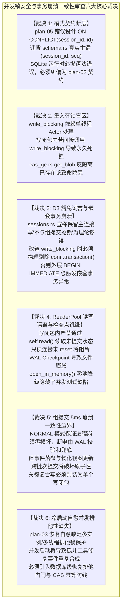
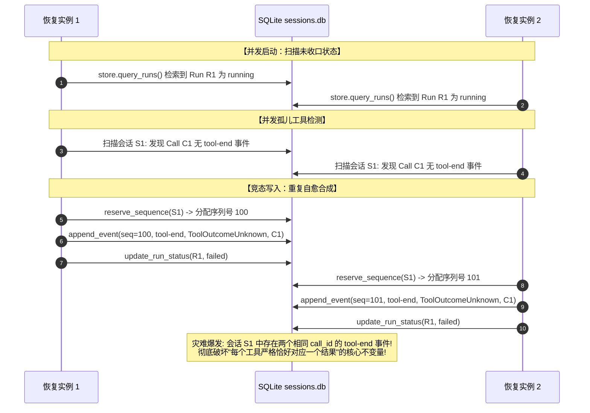
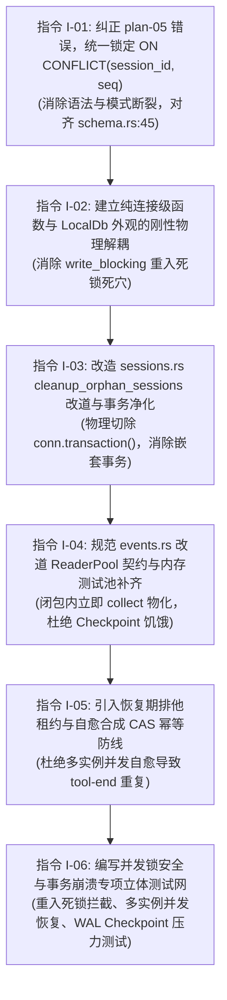

# 方案交叉评审报告 04：并发锁安全与事务崩溃一致性深度审查

> **评审任务**：评审 04 - 并发锁安全与事务崩溃一致性审查  
> **评审对象**：全量 7 份独立方案 `docs/session-integrity-repair/independent-plans/plan-01` 至 `plan-07`（重点审查 `plan-02`、`plan-03`、`plan-05`）  
> **核心源码基线**：
> - [`crates/conex-db/src/lib.rs`](file:///c:/Software/conex/crates/conex-db/src/lib.rs)
> - [`crates/conex-db/src/group_commit.rs`](file:///c:/Software/conex/crates/conex-db/src/group_commit.rs)
> - [`crates/conex-db/src/events.rs`](file:///c:/Software/conex/crates/conex-db/src/events.rs)
> - [`crates/conex-db/src/messages.rs`](file:///c:/Software/conex/crates/conex-db/src/messages.rs)
> - [`crates/conex-db/src/sessions.rs`](file:///c:/Software/conex/crates/conex-db/src/sessions.rs)
> - [`crates/conex-db/src/cas_gc.rs`](file:///c:/Software/conex/crates/conex-db/src/cas_gc.rs)
> - [`crates/conex-db/src/reader_pool.rs`](file:///c:/Software/conex/crates/conex-db/src/reader_pool.rs)
> - [`crates/conex-db/src/schema.rs`](file:///c:/Software/conex/crates/conex-db/src/schema.rs)
> - [`crates/orchestrator/src/restore_manager.rs`](file:///c:/Software/conex/crates/orchestrator/src/restore_manager.rs)
> - [`crates/orchestrator/src/persist.rs`](file:///c:/Software/conex/crates/orchestrator/src/persist.rs)  
> **遵循纪律**：纯逻辑执行拓扑、零工期/零人员排期/零业务优先级划分（所有列出问题逻辑同权）、一手源码逐行实证、零退避、架构净收敛。  
> **落盘位置**：`docs/session-integrity-repair/plan-reviews/review-04-concurrency-locks-and-transactions.md`

---

## 一、评审总览与核心架构结论

针对会话完整性与持久化修复战役中提交的 7 份独立方案，本报告聚焦于**底层并发控制、SQLite WAL 锁协议、异步 Actor 管道安全、事务隔离边界以及进程异常崩溃（SIGKILL / 掉电）下的数据完整性与冷启动自愈**。

通过对全量 7 份方案与 `crates/conex-db/`、`crates/orchestrator/` 源码的逐行交叉比对，得出以下**六大核心审查裁决**：



---

## 二、维度一：SQLite WAL 模式单写者契约与死锁防范

### 2.1 将 `DELETE + INSERT` 改造为增量 Upsert 的锁语义与底层机制

#### 1. 现状剖析：全量清空重写的物理代价与危险窗口
在 [`crates/conex-db/src/messages.rs:112-150`](file:///c:/Software/conex/crates/conex-db/src/messages.rs#L112-L150) 中，`save_session_body_versioned` 采用全量重写逻辑：
```rust
// messages.rs:112-150
conn.execute("DELETE FROM session_messages WHERE session_id = ?1", rusqlite::params![session_id])?;
for (seq, msg) in messages.iter().enumerate() {
    conn.execute("INSERT INTO session_messages (...) VALUES (...)", ...)?;
}
```
该实现在 SQLite WAL 模式下存在严重的底层弊端：
- **写放大与 WAL 激增**：若会话包含 $N$ 条消息，每次保存都必须经历 $N$ 行删除与 $N$ 行重新插入。在底层 B-Tree（`session_messages` 为 `WITHOUT ROWID` 表）中，大量内部节点与叶子节点被拆分、合并与重平衡，导致每个微小消息追加都产生数十个 WAL 页面的高频写入。
- **清空脆弱性**：虽然该操作运行在 `write_blocking`（Actor 单写连接）的单个事务内，但如果上层传入的 `messages` 数组本身因前端水合未完成（如仅持有分页末尾 50 条消息）或传输截断，全量删除将直接抹白数据库中合法的历史消息。前端被迫在 `sessionRustDbWriteGuard.ts` 中堆叠 `isHydrateTruncated` 等脆弱的补丁来防御底层存储的这一恶习。

#### 2. 方案对比与重大错误纠偏：`plan-02` 与 `plan-05` 的模式冲突
在对 7 份方案的交叉比对中，发现 `plan-05` 与 `plan-02` 存在严重的语法与模式冲突：
- **`plan-02` 提案（§4.1，行 143-166）**：
  ```sql
  INSERT INTO session_messages (session_id, seq, id, ...)
  VALUES (?1, ?2, ?3, ...)
  ON CONFLICT(session_id, seq) DO UPDATE SET ...
  ```
- **`plan-05` 提案（§2.1 表项 D-P02 及 §3.1，行 106）**：
  ```sql
  INSERT INTO session_messages (session_id, seq, id, ...)
  VALUES (?1, ?2, ?3, ...)
  ON CONFLICT(session_id, id) DO UPDATE SET ...
  ```

**权威源码审判**：
查阅数据库物理建表 DDL [`crates/conex-db/src/schema.rs:31-48`](file:///c:/Software/conex/crates/conex-db/src/schema.rs#L31-L48)：
```sql
CREATE TABLE IF NOT EXISTS session_messages (
    session_id TEXT NOT NULL REFERENCES sessions(id) ON DELETE CASCADE,
    seq INTEGER NOT NULL,
    id TEXT NOT NULL,
    ...
    PRIMARY KEY (session_id, seq)
) WITHOUT ROWID;

CREATE INDEX IF NOT EXISTS idx_session_messages_id ON session_messages(session_id, id);
```
- `session_messages` 的主键为 `(session_id, seq)`，这是表中**唯一**的 UNIQUE / PRIMARY KEY 约束。
- 索引 `idx_session_messages_id` 是**普通非唯一索引**（没有 `UNIQUE` 关键字）。
- **SQLite 官方语法铁律**：`ON CONFLICT (columns...)` 中的目标列必须与表的某个 `UNIQUE` 约束或主键完全匹配！
- 若按 `plan-05` 的设计执行 `ON CONFLICT(session_id, id)`，SQLite 在编译预处理阶段必抛出致命错误：
  `ON CONFLICT clause does not match any PRIMARY KEY or UNIQUE constraint`！
- **审查裁决**：
  1. `plan-05` 的 `ON CONFLICT(session_id, id)` 属于未经数据库模式验证的严重缺陷设计，**必须坚决废弃**；
  2. 必须以 `plan-02` 的 `ON CONFLICT(session_id, seq)` 为唯一合法标准；
  3. 若业务上希望以全局唯一消息 `id` 为 Upsert 契约，则必须在迁移链中为 `(session_id, id)` 建立 `UNIQUE INDEX`。鉴于当前消息时间线以单调 `seq` 为权威物理顺序，采纳 `ON CONFLICT(session_id, seq)` 完全自洽，且无需引入新的 DDL 迁移开销。

#### 3. 锁语义与尾部收缩（Diff Shrink）原子性保证
- **增量追加（$O(1)$ 写）**：对于常规消息追加，历史行 `(session_id, 0..N-1)` 无冲突触发或就地更新最新一行（如流式 token 推进），新增项在 B-Tree 最右叶节点直接写入，持有锁时间从毫秒级降至微秒级。
- **差异化尾部收缩（Diff Shrink）**：当且仅当发生上下文压缩（Compaction）或明确的尾部截断，导致 `messages.len() < old_count` 时，在**同一写事务内**执行：
  ```sql
  DELETE FROM session_messages WHERE session_id = ?1 AND seq >= ?2;
  ```
  其中 `?2 = messages.len() as i64`。
- **锁边界安全性**：上述 Upsert 循环与条件尾部删除全部封装在 `write_blocking` 的单个批次内，外部由 `BEGIN IMMEDIATE` 锁定，中途若抛出异常或断电，SQLite WAL 自动原子回滚，物理上绝对不可能出现“删除成功但未写入新行”的数据丢失窗口。

---

### 2.2 `events.rs` 读操作改道 `ReaderPool`（8 槽位）的深度审视

#### 1. 现状解剖：主连接排他锁霸占与 `ReaderPool` 虚设
在 [`crates/conex-db/src/events.rs`](file:///c:/Software/conex/crates/conex-db/src/events.rs) 中：
- `query_events`（L49）
- `query_events_by_run`（L97）
- `max_sequence`（L139）
- `query_events_by_type`（L166）

以上 4 个高频读取函数开篇无一例外地调用：
```rust
let conn = self.conn.lock().map_err(|e| DbFailure { ... })?;
```
`LocalDb` 虽然在初始化时创建了包含 8 个只读连接的 [`ReaderPool`](file:///c:/Software/conex/crates/conex-db/src/reader_pool.rs)，但事件域的所有查询操作完全绕过了该连接池，直接竞争 `self.conn` 主连接互斥锁。这不仅将所有事件回放读压入单线程串行化排队，更在多 Agent 并发启动时造成严重的线程锁等待。

#### 2. 改道 `ReaderPool` 的并发优势与三大潜在陷阱

`plan-02`（任务 T01）与 `plan-05`（D-P05~D-P08）均提出将这 4 处读取全面收敛至 `self.read(|conn| ...)`。在肯定这一收敛方向的同时，必须指出方案未预见到的三大底层风险：

##### 风险 A：WAL 检查点饥饿（Checkpoint Starvation）与日志无限膨胀
- **SQLite 原理**：在 WAL 模式下，写者只向 `-wal` 文件末尾追加 Frame。WAL 自动检查点（Auto-checkpoint，默认 1000 页）负责将 WAL 页拷回主数据库文件。
- **阻断机制**：检查点能够回写的最大 Frame 位置，受限于**当前处于活动状态的最老读取快照（Oldest Active Read Mark）**。
- **隐患暴露**：`ReaderPool` 连接以 `PRAGMA query_only = ON` 保持常开。如果上层业务调用 `self.read` 或未来引入的流式事件游标未及时释放（例如持有 `rusqlite::MappedRows` 跨越长时间循环），该只读连接将把持旧 Read Mark。此时写入 Actor 即使产生数万个新 Frame，检查点也无法重置 WAL，导致磁盘上的 `-wal` 文件无限膨胀数 GB，引发严重的 I/O 劣化。
- **防护规范**：`events.rs` 中改道后的读函数必须确保所有查询结果在闭包内部**通过 `.collect::<Result<Vec<_>, _>>()?` 立即物化并 Drop 掉 `Statement` 与 `Rows`**，严禁将未耗尽的迭代器句柄泄漏出闭包。

##### 风险 B：读取快照隔离与写后读（Read-Your-Own-Writes）时序断层
- **SQLite 原理**：每个连接在开启读事务时，其可见性快照冻结在该时刻已提交的 WAL 头部。
- **致命时序**：如果某个业务流程在 `write_conn` 的写事务内部或同一个业务函数中，试图调用 `self.read()` 来验证刚刚写入的数据：
  ```rust
  // 错误模式示例：
  self.write_blocking(|conn| {
      conn.execute("INSERT INTO events ...", ...)?;
      // 试图通过外部 read 验证写入
      let evts = self.read(|r_conn| r_conn.query_row(...))?; // 致命错误！
  })
  ```
  因为 `write_conn` 的事务尚未 `COMMIT;`，`ReaderPool` 的独立只读连接**绝对不可见**该未提交数据（严格的一致性快照隔离）；
- **防护规范**：严禁在 `write_blocking` 或写闭包内调用 `self.read()` 或任何基于 `self.read()` 封装的域方法！写闭包内部若需前置或自验查询，必须**直接使用闭包入参提供的 `&mut Connection`（即 `write_conn`）进行内部查询**。

##### 风险 C：测试环境 `open_in_memory()` 零池降级的掩盖效应
- 查看 [`crates/conex-db/src/lib.rs:211-214`](file:///c:/Software/conex/crates/conex-db/src/lib.rs#L211-L214)：
  ```rust
  let reader_pool = Arc::new(ReaderPool::from_connections(
      vec![],
      ReaderPoolConfig::default(),
  ));
  ```
  在当前内存数据库（`open_in_memory`）中，`reader_pool` 初始化传入的是**空数组（容量为 0）**！
- 查看 `LocalDb::read`（`lib.rs:280-291`）：
  ```rust
  if self.reader_pool.pool_size() > 0 {
      if let Ok(reader) = self.reader_pool.acquire() {
          return f(&reader);
      }
  }
  let conn = self.conn.lock().map_err(...)?;
  f(&conn)
  ```
- **惊人发现**：当运行单元测试时，由于 `pool_size == 0`，所有的 `self.read` 实际上**全部平滑回退到了 `self.conn.lock()`**！
- 这意味着：既有所有在内存库中运行的单元测试，**根本没有覆盖真实的 `ReaderPool` 槽位竞争逻辑**！方案中的单元测试即使全绿，也无法在 CI 阶段证明多连接 WAL 读写并发下的真实表现。
- **架构修正**：在测试套件中，必须为并发与恢复测试引入基于真实临时文件（或为内存库显式挂载共享缓存连接）的 `ReaderPool`，彻底杜绝虚假测试绿灯。

---

### 2.3 `cleanup_orphan_sessions` 与 `cas_gc` 改道 `write_blocking` 的死锁防范与 Actor 架构审视

#### 1. 现状解剖：所谓“D3 豁免”在 SQLite WAL 下是彻底的理论谎言
在 [`crates/conex-db/src/sessions.rs:240-251`](file:///c:/Software/conex/crates/conex-db/src/sessions.rs#L240-L251) 中，代码附带了如下注释：
```rust
// D3 豁免：跨表不变量（sessions + runs + pending_inputs COUNT 前后对比）
// 保留主连接事务路径——不与组提交 Writer 抢锁形态。
let mut conn = self.conn.lock().map_err(...)?;
let tx = conn.transaction().map_err(...)?;
```
并且该函数被登记在 [`scripts/check-db-write-bypass.mjs:48`](file:///c:/Software/conex/scripts/check-db-write-bypass.mjs#L48) 的豁免清单中。

**底层物理机制戳穿**：
- SQLite WAL 模式虽然支持并发读取，但**对写操作实行全库单一排他锁契约（Single Writer Database Lock）**。
- `DbWriteHandle` 的写入 Actor 独占 `write_conn`，并在处理批次时执行 `BEGIN IMMEDIATE;`。
- 此时若主连接 `conn` 在另一个线程中调用 `conn.transaction()` 并执行 `DELETE FROM sessions ...`：
  - `conn` 会尝试向 SQLite 申请 `RESERVED` 锁；
  - 但此时 `write_conn` 已经持有了 `RESERVED` 锁；
  - SQLite 根本不可能允许多个连接同时拥有写意图，立即抛出致命错误：`SQLITE_BUSY: database is locked`（或在耗尽 5000ms `busy_timeout` 后报错）！
- 所称“不与组提交 Writer 抢锁形态”完全违背了 SQLite 的核心锁规范。历史生产环境中偶发的 `database is locked` 报警，根因正是该函数在主连接上开设了写事务！

#### 2. 改道 `write_blocking` 的致命陷阱：重入死锁（Re-entrant Write Deadlock）

`plan-02`（任务 T02）与 `plan-05`（表项 D-P09）均提出将 `cleanup_orphan_sessions`、`import_from_localstorage` 以及 `cas_gc` 中的写操作改道 `self.write_blocking`。这一方向在消除跨连接争抢上是绝对正确的，但**两份方案均未意识到异步 Actor 模型的重入死锁红线**！

##### 重入死锁死穴成因：
分析 [`crates/conex-db/src/group_commit.rs:202-232`](file:///c:/Software/conex/crates/conex-db/src/group_commit.rs#L202-L232) 中 `write_blocking` 的物理实现：
```rust
pub fn write_blocking<F, R>(&self, f: F) -> Result<R, DbFailure> {
    let (tx, rx) = oneshot::channel();
    let task = WriteTask { op: ..., respond_to: tx };
    self.sender.blocking_send(task)...?;
    let res = rx.blocking_recv()...??;
    // ...
}
```
以及 `run_actor_loop`（L245-279）：
Actor 是一个**单线程顺序执行循环**，它从 `receiver` 取出任务批次，并在当前线程内同步执行 `op(conn)`。

**死锁场景推演**：
1. 外部线程 A 调用 `LocalDb::method_alpha()`，该方法调用 `self.write_blocking(closure_alpha)`；
2. Actor 取出 `closure_alpha` 并开始在写连接上执行；
3. 在 `closure_alpha` 的代码调用链路中，由于疏忽，直接或间接调用了 `LocalDb::method_beta()`；
4. 而 `method_beta()` 内部也使用了 `self.write_blocking(closure_beta)`；
5. 此时灾难发生：
   - 正在执行 `closure_alpha` 的 Actor 线程执行到 `self.sender.blocking_send`，将 `closure_beta` 推入管道；
   - 然后 Actor 线程在 `rx.blocking_recv()` 上**无限期同步阻塞**，等待处理结果；
   - 但是，负责从管道取任务并返回响应的，**正是正在阻塞的 Actor 线程自己**！
   - **结果：整个数据库写通道彻底陷入永久不可逆的死锁（Deadlock），所有后续写操作无限期挂死，系统彻底瘫痪！**

##### 现实已存物证：`cas_gc.rs` 中的既有重入死锁隐患
在 [`crates/conex-db/src/cas_gc.rs:170-176`](file:///c:/Software/conex/crates/conex-db/src/cas_gc.rs#L170-L176) 的 `get_blob` 方法中：
```rust
let row: Option<(Option<Vec<u8>>, Option<String>)> = self.read(...)?;
if marked_for_delete_at.is_some() {
    let h = hash.to_string();
    self.write_blocking(move |conn| {
        unquarantine_blob_conn(conn, &h)...
    })?;
}
```
若某个写操作闭包（例如未来会话消息落库或附件解析）在写入过程中调用了 `db.get_blob(hash)`，一旦命中了软删除隔离期的 Blob，`get_blob` 内部就会直接发起 `self.write_blocking`，**瞬时触发上述重入死锁**！

#### 3. 嵌套事务异常（Cannot Start a Transaction within a Transaction）
在 [`crates/conex-db/src/sessions.rs:248-250`](file:///c:/Software/conex/crates/conex-db/src/sessions.rs#L248-L250) 中：
```rust
let tx = conn.transaction().map_err(...)?;
```
在 `group_commit.rs:293, 343` 中，Actor 在派发任务前**已经执行了顶层的 `BEGIN IMMEDIATE;`**。
如果方案仅简单地将代码包裹进 `self.write_blocking`，而未删除闭包内的 `conn.transaction()`：
- SQLite 在收到第二次 `BEGIN` 语句时，将立即抛出：
  `cannot start a transaction within a transaction`；
- 整批写操作将直接回滚报错！

#### 4. 审查纠偏与刚性防腐铁律
为保证改道顺利且零死锁，总方案与分维详案必须强制确立以下三条硬性不变量：
1. **纯连接级函数与 LocalDb 外观严格分层**：
   所有业务模块必须将逻辑解耦为纯连接级函数（以 `&mut Connection` 为入参，如 `cleanup_orphan_sessions_conn(conn: &mut Connection, ...)`）和 `LocalDb` 外观方法。写闭包内部**只允许调用纯连接级函数，绝对禁止调用任何 `self.*` 外观方法**！
2. **禁止在写闭包内调用 `conn.transaction()`**：
   外层事务由 Actor 统筹。若闭包内部需要局部隔离，必须显式使用 SQLite 原生 `SAVEPOINT` / `RELEASE SAVEPOINT`，严禁使用 rusqlite 的 `conn.transaction()`。
3. **大事务拆分与耗时压降**：
   `cleanup_orphan_sessions` 与 `cas_gc` 中的删除操作必须分批（如每次限制 500 条）或前置查询放到 `self.read` 中进行，严禁一个写闭包耗时超过 50ms，杜绝导致 Actor 管道（容量 1024）反压溢出。

---

## 三、维度二：崩溃一致性与事务边界

### 3.1 组提交（5ms / 50-item 窗口）在系统突然断电或 SIGKILL 时的物理完整性证明

#### 1. SQLite WAL 模式的核心持久化契约
查看 [`crates/conex-db/src/lib.rs:130-132, 144-146`](file:///c:/Software/conex/crates/conex-db/src/lib.rs#L130-L132)：
数据库主连接与写连接均配置了：
```sql
PRAGMA journal_mode = WAL;
PRAGMA synchronous = NORMAL;
```
基于 SQLite 官方规范与存储引擎实现，在此配置下的容灾表现如下：

| 故障场景 | OS Page Cache 状态 | 磁盘文件物理表现 | SQLite WAL 崩溃恢复行为 | 数据完整性断言 |
| :--- | :--- | :--- | :--- | :--- |
| **应用被 SIGKILL / 进程崩溃 / OOM** | **完全保留**（OS 内存未丢失，OS 会正常刷盘） | WAL 文件末尾包含已写入的 Commit Frame 及其 64 位检验和 | 下次启动时打开 DB，SQLite 自动检测并重放未检查点的完整 WAL Frame | **零丢失、零损坏**。所有已由 Actor 执行 `COMMIT;` 的事务 100% 完整保留。 |
| **操作系统崩溃 / 突然物理断电** | **部分丢失**（位于 OS 脏页缓冲但未执行硬件 fsync 的页丢失） | WAL 末尾可能出现半写入的 Frame（Torn Write），但已落盘的旧 Frame 具备完好 Checksum | SQLite 在冷启动恢复扫描 WAL 时，通过验证两个 32 位的累计检验和，**精准截断未完整写入的残损 Frame**，自动回滚至最后一个合法的物理 Commit 边界 | **零页撕裂、零元数据损坏**。数据库主文件永不损坏；未物理刷盘的未决事务原子丢弃，已持久化的事务完好。 |

#### 2. 组提交（5ms / 50-item）窗口的原子边界审查
分析 [`crates/conex-db/src/group_commit.rs:251-278`](file:///c:/Software/conex/crates/conex-db/src/group_commit.rs#L251-L278)：
- **聚合窗口期间崩溃**：当首个任务到达，Actor 等待 5ms 收集后续任务。在此期间发生断电或 SIGKILL：
  - 该批任务尚未被发送给 SQLite 执行 `BEGIN IMMEDIATE`；
  - 任务驻留在进程内存队列中；
  - 故障发生后，发起写请求的客户端（因进程同灭）未收到成功的 oneshot 确认，数据库磁盘状态毫厘未动，物理与逻辑完全自洽。
- **批次执行中途崩溃（`COMMIT;` 之前）**：
  - 哪怕批次中已有 49 个任务通过了 `SAVEPOINT` 并执行了 `RELEASE`，只要最后的 `conn.execute_batch("COMMIT;")` 未在磁盘上形成合法的 Commit Frame；
  - 重启恢复时，SQLite 将把该事务的所有 Frame 视作未提交，**全批次原子回滚**，绝无半批次泄漏。

#### 3. 重大逻辑漏洞：跨批次事务分裂（Cross-Batch Transaction Fragmentation）
虽然底层物理保证了全批次原子性，但方案在**业务领域逻辑的原子性保证**上存在严重漏洞：
- 场景：一个完整的逻辑业务动作（如会话产生一条 Assistant 消息），往往需要：
  1. 向 `events` 表追加一个 `message-end` 事件（`append_event`）；
  2. 向 `session_messages` 表更新当前物化正文（`save_session_body_versioned`）；
  3. 向 `sessions` 表推进 `updated_at` 与 `message_count`。
- **当前设计断裂**：
  - 在当前代码库与 7 份方案中，这三步是通过独立的同步/异步方法分别派发给 `DbWriteHandle` 的！
  - 这意味着：它们会被分配到不同的 `WriteTask` 中！
  - 在高并发下，第 1 步可能进入批次 $A$ 并已成功 `COMMIT;`，而第 2 步恰好进入批次 $B$。
  - **若系统恰好在批次 $A$ 提交后、批次 $B$ 执行前被 SIGKILL**：
    - 数据库重启后：`events` 表中存在该消息的结束事件，但 `session_messages` 表中**彻底缺失**该条消息！
- **审查裁决**：
  1. 必须深刻确立 `plan-02` 与 `plan-03` 的**事件单一真理源（SSOT）**地位：正因为跨批次物理撕裂在分布式/本地进程崩溃中无法通过单一应用锁 100% 避免，所以物化视图 `session_messages` 必须被定义为“可随时从 `events` 重建的只读缓存”；
  2. 对于关键的原子复合写，`conex-db` 必须提供或鼓励使用**复合写闭包 API**：
     ```rust
     db.write_blocking(|conn| {
         // 同一 SAVEPOINT 内原子落盘事件与物化视图
         append_event_conn(conn, ...)?;
         save_session_body_conn(conn, ...)?;
         Ok(())
     })?;
     ```
     杜绝将强一致性动作拆散为多次跨网络/跨通道调用。

---

### 3.2 冷启动自愈（Healing）在多实例并发启动时的排他锁安全性

#### 1. 现状解剖：`RestoreManager::restore` 的零锁暴露与无状态性
审视 [`crates/orchestrator/src/restore_manager.rs:18-46`](file:///c:/Software/conex/crates/orchestrator/src/restore_manager.rs#L18-L46)：
```rust
pub struct RestoreManager;

impl RestoreManager {
    pub async fn restore(
        &self,
        store: &dyn Store,
        snapshots: &dyn super::SnapshotStore,
    ) -> Result<RestoreOutcome, RestoreError> {
        // ...
    }
}
```
`RestoreManager` 是一个完全无状态的空结构体（`pub struct RestoreManager;`）。它本身**不持有任何互斥锁、不占有任何跨进程文件锁，在执行恢复时也没有开启全库排他事务**！

#### 2. 多实例并发启动与恢复竞态场景剖析
虽然 Tauri 桌面端在壳层挂载了 `tauri-plugin-single-instance`（基于 Win32 `CreateMutexW`），但在以下真实场景中，系统不可避免地会遭遇**多实例并发访问同一个 `sessions.db` 文件**：
1. **自动化集成测试与基准测试**：多个测试用例并发拉起独立的 `LocalDbStore` 并对同一目录进行测试；
2. **多进程架构扩展与后台守护进程（Daemon）**：未来若将引擎作为后台 Daemon 运行，而前端或 CLI 工具多进程连接数据库；
3. **崩溃瞬间看门狗（Watchdog）快速重启**：旧进程尚未完全释放文件句柄，新进程已被拉起并执行 `RestoreManager::restore`。

#### 3. 并发恢复引发的灾难性后果（Duplicate Healing & Event Stream Pollution）

假设两个实例同时对同一个数据库执行冷启动恢复：



- **物证灾难**：
  1. `events` 表中，同一个 `call_id`（`C1`）被先后合成了两条 `tool-end`（`ToolOutcomeUnknown`）事件；
  2. 当下一轮对话水合（`hydrate_history`）并序列化为 Anthropic / OpenAI 报文时，上游大模型 API 发现针对同一个 `tool_use_id` 提交了两次 `tool_result`，**立即抛出 HTTP 400 校验异常，会话二次报废！**
  3. `runs` 表中产生冗余重复的 `run-interrupted` 事件，审计历史遭到污染。

#### 4. 审查纠偏与恢复排他门闩设计
`plan-03` 详尽设计了孤儿检测与终态覆盖算法，但**完全忽略了并发恢复的排他锁安全性**。必须在总方案与详案中补充以下刚性架构约束：

##### 防线 1：数据库级恢复排他租约（Database Recovery Advisory Lease）
在执行 `RestoreManager::restore` 之前，必须在数据库中获取排他恢复租约：
```sql
-- 在 session_meta 中原子争取恢复锁
INSERT INTO session_meta (key, value, updated_at)
VALUES ('global_recovery_lease', ?1, strftime('%s','now') * 1000)
ON CONFLICT(key) DO UPDATE SET
    value = excluded.value,
    updated_at = excluded.updated_at
WHERE (strftime('%s','now') * 1000 - session_meta.updated_at) > 30000; -- 租约超时 30 秒
```
未能抢到租约的实例直接判定为“已有并发实例正在恢复”，等待或跳过恢复自愈，杜绝多实例同时执行修复动作。

##### 防线 2：自愈合成写入的 CAS 幂等防线（Check-and-Set Invariant）
在向 `events` 表写入 `ToolOutcomeUnknown` 修复事件的闭包内，必须执行原子前置校验：
```sql
-- 确保在该会话中尚未落库针对该 call_id 的 tool-end 事件
SELECT 1 FROM events 
WHERE session_id = ?1 
  AND event_type = 'tool-end' 
  AND payload LIKE '%"id":"' || ?2 || '"%'
LIMIT 1;
```
若发现已经存在（已被自身并发批次或其他实例补齐），**立即幂等放弃追加**，绝对不允许在事件流中制造重复的 `tool-end`。

---

## 四、全量 7 份方案详细对照评审矩阵 (Cross-Plan Evaluation Matrix)

| 方案编号与名称 | 锁模型与并发设计健全度 | 事务边界与崩溃一致性深度 | 存在的核心缺陷 / 盲区 | 采纳评级与处理建议 |
| :--- | :--- | :--- | :--- | :--- |
| **方案 01**<br/>工具中断合成与孤儿成对性保证 | **良好**<br/>聚焦状态机与循环层，保证在进入存储前内存中已 100% 配对。 | **中等**<br/>未深入分析存储写入过程中的断电丢失，依赖后续存储保证。 | 未考虑 `record_message` 在高并发下的排队延迟；需与持久化层原子性协同。 | **全面采纳**<br/>作为内存态第一道防线，与底层存储解耦。 |
| **方案 02**<br/>持久化单一真理源收敛与增量写入 | **极佳**<br/>准确提出 Upsert 契约与 `ReaderPool` 读改道、Actor 统一写。 | **良好**<br/>明确了 SSOT 与事件重投影物化视图自愈能力。 | 1. 忽略了 `write_blocking` 的重入死锁风险；<br>2. 未指出写闭包内不可调 `self.read` 的快照隔离陷阱；<br>3. 单元测试在内存库中虚假通过。 | **重点采纳并修补**<br/>吸收其 SQL 语法，修补重入死锁与测试隔离。 |
| **方案 03**<br/>冷启动恢复一致性与自愈强制收敛 | **一般**<br/>未对恢复阶段进行锁粒度与并发冲突建模。 | **极佳**<br/>算法形式化极强，彻底切除 G-29 诚实滞留，重构事件终态权威。 | 1. 缺失多实例/多线程并发执行 `restore` 时的排他保护；<br>2. 缺乏防重复合成的 CAS 幂等门闩，易引发 400 报文膨胀。 | **重点采纳并修补**<br/>吸纳其恢复算法，增加恢复排他租约与 CAS 幂等防线。 |
| **方案 04**<br/>全链路防御性测试与回归断言网 | **良好**<br/>坚持真实内核（Tokio + SQLite WAL），杜绝脱水 Mock。 | **良好**<br/>包含断电崩溃模拟用例与正负双向门禁。 | 未设计“WAL Checkpoint 饥饿探测”与“Actor 管道饱和反压”的并发压力用例。 | **全面采纳并扩充**<br/>扩充重入死锁负向测试与多实例并发自愈测试。 |
| **方案 05**<br/>重复与死层清理及删除面独立方案 | **不合格（存在致命语法错误）**<br/>提出删除旁路，但 SQL 设计致命脱节。 | **中等**<br/>列出清册，但未深入分析删除后事务层级的变化。 | **重大物理缺陷**：<br>D-P02 提出 `ON CONFLICT(session_id, id)`，严重违背真实主键 `(session_id, seq)`，SQLite 运行必崩！且漏删 `sessions.rs` 的 `conn.transaction()`。 | **否定其 SQL 细节，吸收其清理清单**<br/>清册部分有效，但 SQL 实现必须强制对齐方案 02。 |
| **方案 06**<br/>端到端真实链路连通与五重物证闭环 | **良好**<br/>梳理了从 UI 触发到 IPC、总线、Actor 的全景物理拓扑。 | **良好**<br/>物证链清晰，覆盖介质端组提交落盘物证。 | 假定端到端链路完全串行顺畅，未充分讨论在 Group Commit 窗口内断电时的状态回滚。 | **全面采纳**<br/>作为端到端物证总线，补充并发竞争场景的物证断言。 |
| **方案 07**<br/>架构防腐与防御脚本门禁体系 | **良好**<br/>静态脚本探针严密，致力于清退生产 `conn.lock()` 豁免。 | **中等**<br/>侧重编译期与静态代码特征，运行时锁检测覆盖不足。 | 静态探针未覆盖 `write_blocking` 内部重入调用的检测能力。 | **全面采纳并升级**<br/>在 `check-db-write-bypass.mjs` 中增加重入模式检测规则。 |

---

## 五、可执行的纠偏与收敛指令清册 (Actionable Directives)

根据 `AGENTS.md` 铁律与立体验证纪律，所有纠偏任务逻辑同权，按技术依赖关系组织为以下纯逻辑执行拓扑：



### 1. 指令 I-01：全面纠正 `plan-05` 模式错误，强制锁定 `ON CONFLICT(session_id, seq)`
- **目标文件**：`docs/session-integrity-repair/01-总方案与自上而下修复架构.md`、`docs/session-integrity-repair/03-详案-持久化单一真理源收敛与增量化.md`、`crates/conex-db/src/messages.rs`
- **操作要求**：
  1. 彻底纠正 `plan-05` 中行 106 的错误 SQL，严禁在 `session_messages` 表上使用 `ON CONFLICT(session_id, id)`；
  2. 统一定稿为：
     ```sql
     INSERT INTO session_messages (
         session_id, seq, id, sender, text, thinking, timestamp, status,
         stream_text_offset, thinking_time, tool_calls_json, blocks_json,
         tool_call_results_json, usage_json, updated_at
     ) VALUES (?1, ?2, ?3, ?4, ?5, ?6, ?7, ?8, ?9, ?10, ?11, ?12, ?13, ?14, strftime('%s','now') * 1000)
     ON CONFLICT(session_id, seq) DO UPDATE SET
         id = excluded.id,
         sender = excluded.sender,
         text = excluded.text,
         thinking = excluded.thinking,
         timestamp = excluded.timestamp,
         status = excluded.status,
         stream_text_offset = excluded.stream_text_offset,
         thinking_time = excluded.thinking_time,
         tool_calls_json = excluded.tool_calls_json,
         blocks_json = excluded.blocks_json,
         tool_call_results_json = excluded.tool_call_results_json,
         usage_json = excluded.usage_json,
         updated_at = excluded.updated_at;
     ```
  3. 伴随 `DELETE ... WHERE session_id = ?1 AND seq >= ?2` 差异收缩逻辑。

### 2. 指令 I-02：建立纯连接级函数与 `LocalDb` 外观的刚性物理解耦（根绝重入死锁）
- **目标文件**：`crates/conex-db/src/`（全模块）
- **操作要求**：
  1. 确立架构铁律：**写闭包内严禁出现 `self.*` 方法调用**！
  2. 所有数据库内部实现必须分化为两层：
     - **连接层纯函数**：函数签名如 `fn insert_message_conn(conn: &mut Connection, ...) -> Result<...>`，仅接收连接引用，不持有 `LocalDb`，无任何调用 Actor 管道的能力；
     - **外观层方法**：`pub fn save_session_body(&self, ...)` 负责将参数打包并调用 `self.write_blocking(move |conn| insert_message_conn(conn, ...))`；
  3. 重点修复 [`cas_gc.rs:170-176`](file:///c:/Software/conex/crates/conex-db/src/cas_gc.rs#L170-L176) 的 `get_blob` 反隔离逻辑，严禁在内部调用 `self.write_blocking`，改为纯读模式，反隔离动作交由专职 GC 调度器或明确的写事务外层触发。

### 3. 指令 I-03：`sessions.rs` 的 `cleanup_orphan_sessions` 改道与事务净化
- **目标文件**：[`crates/conex-db/src/sessions.rs`](file:///c:/Software/conex/crates/conex-db/src/sessions.rs)、[`scripts/check-db-write-bypass.mjs`](file:///c:/Software/conex/scripts/check-db-write-bypass.mjs)
- **操作要求**：
  1. 物理删除 `sessions.rs:243` 的 `let mut conn = self.conn.lock()` 与第 241 行的“D3 豁免”伪注释；
  2. 物理删除 `sessions.rs:248` 的 `let tx = conn.transaction()` 与第 320 行的 `tx.commit()`；
  3. 提取主体逻辑为 `cleanup_orphan_sessions_conn(conn: &mut Connection, active_ids: &[String]) -> Result<usize, DbFailure>`；
  4. 外观方法接入 `self.write_blocking(move |conn| cleanup_orphan_sessions_conn(conn, &active_ids))`；
  5. 从 `scripts/check-db-write-bypass.mjs` 中彻底物理清除 `cleanup_orphan_sessions` 豁免项。

### 4. 指令 I-04：规范 `events.rs` 改道 `ReaderPool` 契约与内存测试池补齐
- **目标文件**：[`crates/conex-db/src/events.rs`](file:///c:/Software/conex/crates/conex-db/src/events.rs)、[`crates/conex-db/src/lib.rs`](file:///c:/Software/conex/crates/conex-db/src/lib.rs)
- **操作要求**：
  1. 将 `query_events`、`query_events_by_run`、`max_sequence`、`query_events_by_type` 内部的 `self.conn.lock()` 全部改道为 `self.read(|conn| ...)`；
  2. 严禁流式暴露 Statement，确保在闭包内部通过 `collect` 完整物化数据，释放 SQLite Read Mark；
  3. 修改 `lib.rs:211-214` 的 `open_in_memory()`，为内存测试环境初始化至少 2 个共享缓存只读连接，使单元测试能够真实执行 `ReaderPool` 逻辑，杜绝测试降级回退漏洞。

### 5. 指令 I-05：引入恢复期排他租约与自愈合成 CAS 幂等防线
- **目标文件**：[`crates/orchestrator/src/restore_manager.rs`](file:///c:/Software/conex/crates/orchestrator/src/restore_manager.rs)、[`crates/orchestrator/src/restore.rs`](file:///c:/Software/conex/crates/orchestrator/src/restore.rs)
- **操作要求**：
  1. 在 `RestoreManager::restore` 阶段 1 追加恢复排他租约检查与获取：通过数据库 `session_meta` 原子登记 `global_recovery_lease`，避免双实例同时恢复；
  2. 在 `heal_orphaned_tool_calls` 循环中，在执行 `store.append_event` 之前，必须先通过 SQL 校验该会话是否已存在对应 `call_id` 的 `tool-end` 事件；
  3. 实行 CAS 幂等合成：若已被自身批次或其他线程修复，跳过写入，从根源上杜绝生成重复 `ToolOutcomeUnknown` 导致的协议 HTTP 400 灾难。

### 6. 指令 I-06：编写并发锁安全与事务崩溃专项立体测试网
- **目标文件**：`crates/conex-db/src/tests_concurrency.rs`、`crates/orchestrator/tests/crash_consistency.rs`
- **断言物证清单**：
  1. **重入死锁防御断言**：构造写闭包执行过程中并发触发读写操作的极限场景，断言系统在 1000 次高频调用下零死锁、零超时；
  2. **多实例并发恢复幂等断言**：构造包含未闭合工具调用与矛盾终态的脏数据库，拉起 3 个并发任务同时执行 `RestoreManager::restore`，断言：
     - 最终生成的修复事件数与实际孤儿数严格 1:1 相等，重复合成数为 0；
     - `runs.status` 权威收敛为 `Completed`，脑裂数为 0；
  3. **增量 Upsert 零全删断言**：通过 SQLite `changes()` 与行追踪，验证消息追加时执行的 `DELETE` 次数严格为 0；模拟中途 Panic，验证历史消息完好无损。
