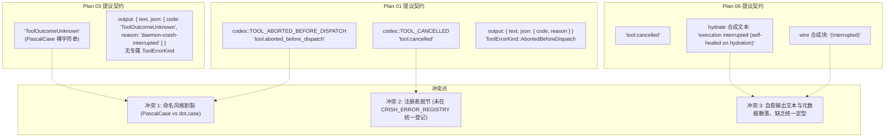
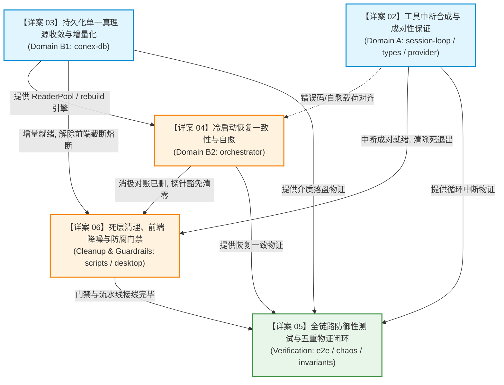

# 方案交叉评审报告 06：拓扑依赖无环性与方案整合审查

> **评审任务**：评审 06 - 拓扑依赖无环性与方案整合审查  
> **评审对象**：全量 7 份独立方案（`plan-01` 至 `plan-07`，位于 `docs/session-integrity-repair/independent-plans/`）  
> **权威纪律依据**：仓库根目录 `AGENTS.md`、`.agents/LOGIC_PLAN_NO_RETREAT.md`、`docs/session-integrity-repair/00-调度与导航.md`  
> **核心铁律**：零工期、零人天、零人员排期、零 P0/P1 优先级划分；所有问题逻辑同权；反退避、反过度设计、先删后改、架构净收敛。  
> **落盘路径**：`c:/Software/conex/docs/session-integrity-repair/plan-reviews/review-06-topological-synthesis-and-dag.md`

---

## 一、评审概述与输入基线

本评审对会话完整性修复战役（Session Integrity Repair Campaign）前置产出的全量 7 份独立方案进行系统性的跨方案横向交叉比对与拓扑整合审查。审查重点聚焦于各独立方案之间提出的**数据模型变更、函数签名契约、错误码与常量定义、执行时序假设以及源码修改域**。

### 1.1 评审输入对象清册

| 方案编号 | 文件名 | 主题域与核心定位 | 核心影响代码域 |
| :--- | :--- | :--- | :--- |
| **Plan 01** | `plan-01-interrupt-synthesis.md` | 工具中断合成与孤儿成对性保证（Domain A） | `session-loop`、`conex-types`、`agent-provider` |
| **Plan 02** | `plan-02-persistence-ssot.md` | 持久化单一真理源收敛与增量写入（Domain B） | `conex-db`（messages、events、group_commit） |
| **Plan 03** | `plan-03-crash-recovery-healing.md` | 冷启动恢复一致性与自愈强制收敛（Domain B） | `orchestrator`（restore_manager、restore） |
| **Plan 04** | `plan-04-defensive-assertions.md` | 全链路防御性测试与回归断言网 | 测试域（loop、provider、conex-db、orchestrator） |
| **Plan 05** | `plan-05-dead-layers-removal.md` | 重复与死层清理及删除面独立方案 | 全仓清理（conex-db、orchestrator、desktop 前端） |
| **Plan 06** | `plan-06-end-to-end-integration.md` | 端到端真实链路连通与五重物证闭环 | 全链路（UI -> IPC -> Host -> Engine -> DB -> Provider） |
| **Plan 07** | `plan-07-architectural-guardrails.md` | 架构防腐与防御脚本门禁体系独立方案 | 门禁与探针（`scripts/`、`invariants.rs`、pre-commit） |

### 1.2 评审核心目标

1. **接口与契约对齐**：消除 7 份方案在错误码命名空间、SQL 语句签名、事件载荷结构、删除清单范围等方面的分歧与隐形冲突；
2. **状态假设冲突化解**：消除状态机（`session-loop`）、存储层（`conex-db`）与编排恢复（`orchestrator`）在异常处理策略上的假设矛盾（特别是 Wire Gatekeeper 的 Panic 阻断 vs 宽容自愈，以及消极对账删除 vs 积极修复改造）；
3. **拓扑依赖 DAG 验证**：梳理各方案中所有纯逻辑任务单元的前后依赖关系，构建全量依赖有向无环图（DAG），完成数学级无环性验证；
4. **分维详案划分**：提炼出最终 5 份分维详案（详案 02~06）的最佳逻辑划分边界与串并行执行拓扑。

---

## 二、跨方案概念一致性与接口对齐审查

### 2.1 错误码、契约常量与自愈事件载荷对齐审查

#### 2.1.1 现状分歧与冲突定位

在工具中断、崩溃自愈与合成结果的表达上，各 Planner 提出了不同的命名空间与载荷结构，暴露出严重的分歧：



1. **命名规范与注册表脱节（Conflict 1.1）**：
   - **Plan 01** 在 `crates/conex-types/src/error.rs` 的 `codes` 命名空间下规范提出了 `TOOL_ABORTED_BEFORE_DISPATCH = "tool.aborted_before_dispatch"` 与 `TOOL_CANCELLED = "tool.cancelled"`，且提议接入 `CRISH_ERROR_REGISTRY`（分类为 `CrishErrorCategory::Protocol`）；
   - **Plan 03** 在冷启动孤儿自愈时，引入了 `"ToolOutcomeUnknown"`（见 `plan-03` 第 126、435 行）。该定义采用了 PascalCase 裸字符串，完全脱离了 Conex 现有的 `tool.*` 错误码分级命名规约（如 `tool.timeout`、`tool.denied`），且未在 `conex-types` 中定义常量，上层可观测性与前端卡片无法识别该错误码；
   - **Plan 06** 在工具批次中断时沿用 `"tool.cancelled"`，但在水合层（`hydrate.rs:545`）硬编码合成了文本 `"execution interrupted (self-healed on hydration)"`，在网络序列化层（`build_anthropic.rs:576`）硬编码合成了 `content: "(interrupted)"`。
2. **`ToolErrorKind` 枚举与 `ToolEnd` 事件字段的割裂（Conflict 1.2）**：
   - Plan 01 扩展了 `crates/session-loop/src/tool_events.rs` 中的 `ToolErrorKind` 枚举，新增变体 `ToolErrorKind::AbortedBeforeDispatch`；
   - Plan 03 在发射 `AgentEvent::ToolEnd` 时，将错误原因深埋在 `result.output.json.code = "ToolOutcomeUnknown"` 中，而未在 `AgentEvent::ToolEnd.error_code` 外层字段中设置对应的值；
   - Plan 06 统一使用 `ToolErrorKind::Cancelled`，导致无法区分“用户在执行前主动点停止”与“兄弟工具失败导致的级联取消”。

#### 2.1.2 裁决与统一对齐规范

必须在最底层的 `crates/conex-types/src/error.rs` 中收敛确立全局统一的工具中断与自愈错误码规范体系：

```rust
// 权威对齐规约：crates/conex-types/src/error.rs
pub mod codes {
    // ── 统一 tool 域错误码契约 ──
    
    /// 工具在分派执行前被主动中止（前置 AbortSignal / SafePoint 强停 / 流截断）
    pub const TOOL_ABORTED_BEFORE_DISPATCH: &str = "tool.aborted_before_dispatch";

    /// 工具已就绪但被级联取消（兄弟工具致命失败触发 CancelSiblings，或审批期间取消）
    pub const TOOL_CANCELLED: &str = "tool.cancelled";

    /// 进程/守护进程异常崩溃，冷启动恢复引擎自愈检测到的未决悬挂工具调用（取代原 ToolOutcomeUnknown）
    pub const TOOL_OUTCOME_UNKNOWN: &str = "tool.outcome_unknown";
}
```

- **注册表契约**：在 `CRISH_ERROR_REGISTRY` 中完整登记上述 3 个常量，统一标注 `category: CrishErrorCategory::Protocol`, `retryable: false`, `is_public: true`；
- **类型扩展契约**：在 `crates/session-loop/src/tool_events.rs` 中扩展 `ToolErrorKind`：
  ```rust
  pub enum ToolErrorKind {
      // ... 既有变体保持不变 ...
      Cancelled,
      AbortedBeforeDispatch,
      OutcomeUnknown, // 专供恢复层与水合层标记
  }
  ```
- **事件载荷与消息结构体统一**：
  无论是运行时中断（Plan 01/06）、冷启动恢复（Plan 03）还是存量水合补齐（Plan 06），合成的 `AgentMessageBlock::ToolResult` 与 `AgentEvent::ToolEnd` 必须统一调用底层的构建辅助函数 `synthesize_orphan_tool_result`，产出严格一致的物理数据结构：
  ```json
  {
    "type": "tool_result",
    "tool_call_id": "<call_id>",
    "tool_name": "<tool_name>",
    "output": {
      "text": "Execution interrupted or outcome unknown: <reason>",
      "json": {
        "code": "tool.<error_code>",
        "reason": "<reason_detail>",
        "healed_at": "<ISO8601_TIMESTAMP>"
      }
    },
    "is_error": true
  }
  ```

---

### 2.2 增量 Upsert SQL、物理删除清单与静态扫描规约对齐审查

#### 2.2.1 现状分歧与冲突定位

在数据持久化层，Planner 2、Planner 5 与 Planner 7 均致力于根除 `DELETE + INSERT` 反模式，但在具体的 SQL 签名、清理边界与静态门禁正则上出现了严重冲突：

| 审查维度 | Planner 2 (plan-02) 方案 | Planner 5 (plan-05) 方案 | Planner 7 (plan-07) 方案 | 冲突与技术隐患 |
| :--- | :--- | :--- | :--- | :--- |
| **Upsert 冲突目标键** | `ON CONFLICT(session_id, seq)` | `ON CONFLICT(session_id, id)`（见 plan-05 L106） | 未直接给出 SQL 签名，依赖静态门禁 | **致命主键冲突**：数据库 DDL 中主键为 `PRIMARY KEY (session_id, seq)`，`(session_id, id)` 仅为普通索引，非 UNIQUE 约束，执行将报 SQLite 语法错误！ |
| **尾部收缩 SQL 语法** | `WHERE session_id = ?1 AND seq >= ?2` | 仅提及定点 Upsert，未涉及 Diff Shrink 尾部删除 | 正则规约：`AND seq > \S+`（严格大于号 `>`） | **静态门禁误杀**：Planner 2 实际代码执行 `seq >= ?2`，但 Planner 7 的探针正则仅允许 `seq >`，门禁将直接拦截合法的收缩代码！ |
| **`save_session_body` 入口处理** | 在 `rebuild_messages_from_events` 中直接调用 `self.save_session_body(...)` | 明确列入 **D-P01 物理删除**清册（`messages.rs:L55-61`） | 未直接提及该函数，要求收敛至 `write_blocking` | **编译断裂**：若 Planner 5 删除了 `save_session_body`，Planner 2 的自愈重放引擎将产生未定义符号引用！ |
| **写旁路清退范围** | 仅覆盖 `sessions.rs`、`import.rs`、`imported.rs` | 覆盖 D-P01~D-P15（含 `usage_analytics.rs`） | 额外发现并强力要求清理 `cas_gc.rs`（22 处写）与 `lease_guard.rs` | **清理遗漏**：Plan 02 与 Plan 05 均遗漏了 `cas_gc.rs` 内部 22 处严重的裸锁写事务旁路！ |

#### 2.2.2 关键冲突深入剖析

1. **冲突 2.1：`ON CONFLICT` 目标冲突与 SQLite 引擎底层物理约束**：
   - 查验源码 `crates/conex-db/src/schema.rs:31-48`：
     ```sql
     CREATE TABLE IF NOT EXISTS session_messages (
         session_id TEXT NOT NULL REFERENCES sessions(id) ON DELETE CASCADE,
         seq INTEGER NOT NULL,
         id TEXT NOT NULL,
         ...
         PRIMARY KEY (session_id, seq)
     ) WITHOUT ROWID;
     CREATE INDEX IF NOT EXISTS idx_session_messages_id ON session_messages(session_id, id);
     ```
   - 物理事实：表中只有 `PRIMARY KEY (session_id, seq)` 是唯一约束，`idx_session_messages_id` 只是普通非唯一索引。
   - SQLite 官方规范规定：`INSERT ... ON CONFLICT(target) DO UPDATE` 的 `target` 必须严格是该表上的一个 `UNIQUE` 索引或 `PRIMARY KEY` 字段列。
   - **裁决**：Planner 5 在第 106 行写的 `ON CONFLICT(session_id, id)` 属于笔误，在物理引擎中无法执行；**必须无条件确立 Planner 2 的 SQL 签名 `ON CONFLICT(session_id, seq) DO UPDATE SET ...` 为唯一合法物理契约**。
2. **冲突 2.2：Diff Shrink 尾部截断条件与 Planner 7 静态门禁正则冲突**：
   - 当会话发生上下文裁剪（Compaction）或回退时，新消息数量为 $M = \text{new\_count}$。既有数据的序号范围为 $0 \le \text{seq} < \text{old\_count}$。
   - 要删除超出新长度的所有尾部残留行，合法的数学边界是：
     $$\text{seq} \ge M$$
   - Planner 2 和 Planner 7 代码示例均采用了 `AND seq >= ?2`。然而 Planner 7 在设计静态扫描探针 `check-session-message-upsert.mjs` 时，其放行正则被粗心地写为：
     ```javascript
     const BOUNDED_TRUNCATE_RE =
       /DELETE\s+FROM\s+session_messages\s+WHERE\s+session_id\s*=\s*\S+\s+AND\s+seq\s*>\s*\S+/i;
     ```
     缺少了 `=` 匹配，导致 `seq >= ?2` 会被判定为违规全量删除而遭到 Exit 1 阻断。
   - **裁决**：Planner 7 的探针正则必须就地修正为：
     ```javascript
     const BOUNDED_TRUNCATE_RE =
       /DELETE\s+FROM\s+session_messages\s+WHERE\s+session_id\s*=\s*\S+\s+AND\s+seq\s*(?:>=|>)\s*\S+/i;
     ```
3. **冲突 2.3：`save_session_body` 入口物理保留与 CAS 规范化**：
   - 查验源码 `crates/conex-db/src/messages.rs:55-61`：
     ```rust
     pub fn save_session_body(&self, session_id: &str, messages: &[SessionMessage]) -> Result<(), DbFailure> {
         self.save_session_body_versioned(session_id, messages, None)
     }
     ```
   - Planner 5 判定其为“非 CAS 全量 rebase 旁路”予以删除。但事实上，它是内部 `save_session_body_versioned(..., None)` 的轻量转发包装，在无需 CAS 版本校验的内部强制重构（如 `rebuild_messages_from_events`）或单测中具有合理用途。
   - **裁决**：保留 `save_session_body` 作为受控转发器，但其内部实现必须直接复用底层的增量 Upsert 状态机，绝不执行全量清空；Planner 2 的 `rebuild_messages_from_events` 亦可显式调用 `save_session_body_versioned(session_id, &reconstructed, None)`，保证接口语义清晰。
4. **冲突 2.4：写旁路清退边界统一（吸纳 Plan 07 对 `cas_gc.rs` 的防腐要求）**：
   - Planner 2 和 5 仅关注了 `messages.rs`、`sessions.rs` 和 `import.rs`。Planner 7 的深度扫描揭示出：`crates/conex-db/src/cas_gc.rs` 中存在 22 处裸持 `self.conn.lock()` 执行写 SQL 的严重旁路，直接破坏了 SQLite WAL 模式下 Single Writer 的并发调度。
   - **裁决**：最终详案必须全量吸纳 Planner 7 的清退清单，将 `cas_gc.rs` 与 `lease_guard.rs` 纳入统一收敛范畴，彻底清零 `scripts/check-db-write-bypass.mjs` 中的特权豁免。

---

### 2.3 状态机、存储层与编排器核心假设冲突审查

#### 2.3.1 状态机与协议导线层：Panic 刚性阻断 vs 宽容弹性自愈

本战役中最尖锐的架构哲学冲突发生在 **Planner 4** 与 **Planner 6** 之间：

```
[场景：由于极端断电、历史脏数据或未知并发竞态，未成对的 ToolCall 突破了内存防线，到达 Provider 请求组装层]

    ┌─────────────────────────────────────────────────────────────┐
    │ Planner 4 假设：刚性协议守门员 (Wire Gatekeeper)            │
    │ - 在 build_anthropic.rs 中硬编码 assert_wire_messages_integrity │
    │ - 检测到孤儿 ToolCall 直接 panic! 阻断网络发送               │
    │ - 理念：宁可进程崩溃，也绝不向网络发送不合规报文            │
    └─────────────────────────────────────────────────────────────┘
                                  VS
    ┌─────────────────────────────────────────────────────────────┐
    │ Planner 6 假设：弹性自愈守护者 (Wire Invariant Guardian)     │
    │ - 在 to_anthropic_messages 中实时追踪 active_tool_use_ids   │
    │ - 发现孤儿自动原位合成 tool_result 占位块并拼接              │
    │ - 理念：无论底座多脏，请求 100% 成功出词，用户会话绝不报废   │
    └─────────────────────────────────────────────────────────────┘
```

- **深度审查与风险评估**：
  - 若完全采纳 Planner 4 的 Panic 策略：在桌面端 Tauri 宿主进程中，一旦某个历史会话因旧版脏数据触发 panic，将导致整个桌面应用闪退崩溃，且该会话下次冷启动时依然会触发 panic，形成**永久死循环崩溃（Crash Loop）**；
  - 若完全采纳 Planner 6 的无感知合成：若状态机层面的断裂被网络层静默掩盖，开发者将无法感知核心循环中的真实丢弃断面，掩盖架构退化。
- **架构同权裁决方案（双模分级守门契约）**：
  结合 Planner 4 的调试警示性与 Planner 6 的生产鲁棒性，确立**“调试期刚性暴露，生产期弹性自愈，全周期强力告警”**的标准分级契约：
  1. 在 `build_anthropic.rs` 与 `messages.rs` 导线层，统一部署 `guard_wire_messages_pairing` 模块；
  2. **在 Debug 模式 / 单元测试环境中**（`#[cfg(debug_assertions)]` 或测试宏）：
     若检测到未闭合的孤儿工具调用，直接触发断言失败（Panic），强制迫使开发与 CI 流程暴露任何状态机漏洞；
  3. **在 Release 生产环境中**：
     系统拒绝崩溃，原地触发自愈垫片合成（注入标记为 `is_error: true`, `code: codes::TOOL_OUTCOME_UNKNOWN` 的 `tool_result` 块），同时通过 `tracing::error!` 记录致命因果链日志，确保上游接口 100% 正常响应，彻底消除用户的 400 阻断。

#### 2.3.2 编排恢复层：G-29 消极对账的处置决断（删除 Step 3c vs 积极修复）

- **Planner 3 与 Planner 5 的假设**：
  - 在 Step 2/3 处理 in-flight runs 之前，**前置探测** `events` 表是否存在 `run-terminal` 事件；
  - 若已存在终态事件，直接将 `runs.status` 同步为该终态（如 `Completed`），绝不执行打断；
  - 从而从根源上消除了“先把 run 标为 failed，再去发现事件已 completed”的倒错时序；
  - 因此，原 Step 3c 的 `reconcile_terminal_conflicts` 整个函数彻底沦为无用死代码，应**完全物理删除**，结构体 `ReconcileConflict` 亦物理铲除。
- **Planner 7 的假设**：
  - 保留原有 Step 3 盲目打断的时序；
  - 将 Step 3c 的 `reconcile_terminal_conflicts` 改造为具备写回能力的 `reconcile_and_repair_terminal_conflicts`，在 Step 3c 发现矛盾后再去覆写纠偏数据库。
- **审查裁决**：
  - Planner 7 的方案属于典型的**“先打错、再打补丁纠错”**的脆弱设计，凭空引入了二次数据库写的性能与一致性开销；
  - Planner 3 与 Planner 5 的**“事件真理前置探测，根除矛盾产生源头”**是符合架构优雅与净收敛铁律的正确路径；
  - **裁决**：彻底采纳 Planner 3 与 Planner 5 的前置事件权威方案，在 Step 2 迭代 run 时即刻依据 `events` 终态决断；物理删除原 Step 3c 的 `reconcile_terminal_conflicts` 只读对账死代码，彻底铲除 `ReconcileConflict` 结构体。

---

## 三、跨方案冲突矩阵（Cross-Plan Conflict Matrix）

下表完整汇总 7 份独立方案之间的所有冲突点、涉及方案、根因分析与本次交叉评审的权威裁决结论：

| 序号 | 冲突领域与条目 | 涉及方案 | 冲突表现形式 | 底层根因分析 | 逻辑同权裁决与对齐结论 |
| :---: | :--- | :--- | :--- | :--- | :--- |
| **C-01** | **工具错误码规范** | Plan 01<br>vs<br>Plan 03<br>vs<br>Plan 06 | P01 用 `tool.aborted_before_dispatch`；<br>P03 用 PascalCase `ToolOutcomeUnknown`；<br>P06 混用 `tool.cancelled` 与字符串字面量 | 缺乏战役级统一错误码规划，各 Planner 局部自拟命名 | 统一收口至 `conex_types::error::codes`：<br>1. `TOOL_ABORTED_BEFORE_DISPATCH`<br>2. `TOOL_CANCELLED`<br>3. `TOOL_OUTCOME_UNKNOWN`（取代 PascalCase） |
| **C-02** | **SQLite Upsert 目标冲突键** | Plan 02<br>vs<br>Plan 05 | P02 指定 `ON CONFLICT(session_id, seq)`；<br>P05 指定 `ON CONFLICT(session_id, id)` | P05 误将普通索引 `idx_session_messages_id` 当作 UNIQUE 约束 | **以 P02 为准**：主键为 `(session_id, seq)`，SQLite 引擎物理上仅支持该主键的 Upsert；P05 的 `(session_id, id)` 判定为笔误废弃 |
| **C-03** | **Diff Shrink 截断与门禁正则** | Plan 02<br>vs<br>Plan 07 | P02 执行 `DELETE ... WHERE seq >= ?2`；<br>P07 门禁正则写为 `seq > \S+` | P07 正则表达式未考虑包含下界索引的 `>=` 语法 | **修正 P07 门禁脚本**：放宽正则为 `(?:>=\|>)`，允许合法的 `>=` 尾部收缩删除，避免门禁假阳性阻断 |
| **C-04** | **`save_session_body` 入口存废** | Plan 02<br>vs<br>Plan 05 | P05 将其列为 D-P01 彻底删除；<br>P02 在 `rebuild_messages_from_events` 中调用该函数 | P05 将接口签名与破坏性实现混淆，误伤了无版本号的安全转发器 | **保留受控包装**：保留 `save_session_body` 作为转发至 `save_session_body_versioned(..., None)` 的轻量入口，其内部全面切除全量清空 |
| **C-05** | **数据库写旁路清理完整性** | Plan 02<br>vs<br>Plan 05<br>vs<br>Plan 07 | P02/P05 仅清理 `sessions`、`import`；<br>P07 识别出 `cas_gc.rs` 22 处写与 `lease_guard.rs` | P02 与 P05 源码审查未覆盖 CAS GC 后台垃圾回收与租约管理模块 | **全量吸纳 P07 清单**：将 `cas_gc.rs` 与 `lease_guard.rs` 全面纳入改道 `write_blocking` 清册，清空门禁豁免 |
| **C-06** | **Wire 守门层策略冲突** | Plan 04<br>vs<br>Plan 06 | P04 提议导线层硬性 `panic!` 阻断；<br>P06 提议导线层静默就地自愈补齐 | P04 追求编译/测试期绝对刚性拦截；P06 追求生产环境会话绝对不报废 | **实施分级守门**：`debug_assertions` / CI 环境下执行硬性断言阻断；Release 生产环境下执行弹性合成自愈 + Error 日志上报 |
| **C-07** | **G-29 终态矛盾治理路径** | Plan 03<br>vs<br>Plan 05<br>vs<br>Plan 07 | P03/P05 前置事件权威，彻底删除 Step 3c；<br>P07 维持 Step 3c，改造为“积极写回修复” | P07 未穿透时序根因，停留在“后置对账纠错”补丁思维 | **采纳 P03/P05 方案**：在 Step 2 前置探测 events 终态，从根源消除矛盾；彻底物理删除 Step 3c 与 `ReconcileConflict` |
| **C-08** | **会话历史水合自愈归属** | Plan 01<br>vs<br>Plan 06 | P01 将水合自愈归入 Tier-3 防线；<br>P06 在 `hydrate.rs` 独立实现自愈垫片 | 职责边界略有重叠，均属于存量脏数据防御 | **收口至详案 02**：作为工具成对性保证的存量数据水合防线，统一定义在 `crates/session-loop/src/hydrate.rs` 中 |
| **C-09** | **双线 IPC 协议清退时机** | Plan 06<br>vs<br>其他方案 | P06 提出废除 `TRANSITIONAL_DUAL_CANCEL_RUN_WIRE` 与 `core_cancel_run`，其他方案未提及 | P06 深入前端与 IPC 传输层，发现双线发送引发的并发取消竞态 | **纳入详案 06 统一收口**：在删除面详案中作为通信层死代码统一清退，保持架构净收敛 |

---

## 四、全量纯逻辑任务单元执行拓扑与 DAG 无环性验证

### 4.1 全量任务单元梳理与统一编号

将 7 份方案提出的所有具体实现与重构动作解构为 **35 个同权的纯逻辑任务单元（Task Units）**：

#### 基础契约与类型域（Foundation & Types: F01 ~ F04）
- **F01**：在 `crates/conex-types/src/error.rs` 中注册 `TOOL_ABORTED_BEFORE_DISPATCH`、`TOOL_CANCELLED`、`TOOL_OUTCOME_UNKNOWN` 常量与错误元数据（来自 P01, P03）。
- **F02**：在 `crates/session-loop/src/tool_events.rs` 扩展 `ToolErrorKind` 强类型枚举（来自 P01）。
- **F03**：在 `crates/orchestrator/src/restore.rs` 定义 `ConvergedRunRecord`，废除 `ReconcileConflict` 结构体（来自 P03, P05）。
- **F04**：在 `crates/session-loop/src/loop/invariants.rs` 中编写成对性断言纯函数 `assert_tool_pairing_invariants` 与单调序号断言器（来自 P04, P07）。

#### 持久化底座与 Actor 管道域（Persistence SSOT: P01 ~ P08）
- **P01**：`crates/conex-db/src/group_commit.rs` 确保 Single Writer Actor 原生支持复杂闭包事务与内部 Savepoint（来自 P02, P05）。
- **P02**：`crates/conex-db/src/events.rs` 将 4 处读取函数全面改道 `ReaderPool`，消除 `self.conn.lock()`（来自 P02, P05）。
- **P03**：`crates/conex-db/src/sessions.rs` 将 `cleanup_orphan_sessions` 裸写改道 `write_blocking`（来自 P02, P05, P07）。
- **P04**：`crates/conex-db/src/import.rs` 与 `imported.rs` 批量写改道 `write_blocking`（来自 P02, P05）。
- **P05**：`crates/conex-db/src/cas_gc.rs` 22 处写操作全面改道 `write_blocking`，审计 `lease_guard.rs`（来自 P07）。
- **P06**：`crates/conex-db/src/messages.rs` 物理切除 `DELETE FROM session_messages WHERE session_id = ?1` 全删语句（来自 P02, P04, P05, P07）。
- **P07**：`crates/conex-db/src/messages.rs` 实现 `ON CONFLICT(session_id, seq)` 增量 Upsert 与 `seq >= ?2` 差异收缩（来自 P02, P05）。
- **P08**：`crates/conex-db/src/messages.rs` 实现基于 SSOT 的事件回放投影引擎 `rebuild_messages_from_events`（来自 P02）。

#### 会话主循环与执行器成对合成域（Session Loop & Pairing: L01 ~ L06）
- **L01**：`crates/session-loop/src/exec_batch.rs` 彻底删除空 ID `""` 兜底，基于真实 `calls[i]` 回填取消结果（来自 P01, P04, P05）。
- **L02**：`crates/session-loop/src/exec_batch.rs` 增加外层循环 AbortSignal 快速熔断与组间批量标记（来自 P04, P05）。
- **L03**：`crates/session-loop/src/loop/handlers/executing_tools.rs` 消除前置 SafePoint 裸退出，注入工具中断合成器（来自 P01, P04, P05, P07）。
- **L04**：`crates/session-loop/src/loop/handlers/streaming.rs` 中止收尾处补齐工具中断合成逻辑（来自 P01）。
- **L05**：`crates/session-loop/src/loop/loop_exec.rs` 在 `converge` 终态收敛处注入全局闭合守门 `reconcile_orphan_tool_calls`（来自 P01）。
- **L06**：`crates/session-loop/src/hydrate.rs` 在 `synthesize_blocks` 中注入存量孤儿工具调用自愈补齐垫片（来自 P01, P06）。

#### 编排器冷启动恢复一致性域（Orchestrator Recovery: O01 ~ O05）
- **O01**：`crates/orchestrator/src/restore_snapshot.rs` 物理删除 `to_stored_runs` 等 4 个快照反序列化死函数（来自 P05）。
- **O02**：`crates/orchestrator/src/restore_manager.rs` Step 2/3 前置查询 `events` 表权威终态，消除盲目打断（来自 P03, P05）。
- **O03**：`crates/orchestrator/src/restore_manager.rs` 彻底物理删除 Step 3c `reconcile_terminal_conflicts` 对账死代码（来自 P03, P05）。
- **O04**：`crates/orchestrator/src/restore_manager.rs` 实现冷启动孤儿工具调用自愈扫描与修复事件写入（来自 P03）。
- **O05**：`crates/orchestrator/src/restore_manager.rs` 实现快照序列号超前断层检测与丢弃全量重投影（来自 P03）。

#### 协议导线守门与前端通信域（Wire Gate & Frontend: W01 ~ O05）
- **W01**：`apps/crish-desktop/` 废除 `TRANSITIONAL_DUAL_CANCEL_RUN_WIRE`，统一收敛为单一 `core_run_control`（来自 P06）。
- **W02**：`apps/crish-desktop/src/api/session-persistence/` 物理删除 `isHydrateTruncated` 截断熔断与版本戳链（来自 P02, P05）。
- **W03**：`apps/crish-desktop/src/api/session-persistence/` 彻底物理删除 `sessionAgentsTruncation.ts` 及其测试（来自 P05）。
- **W04**：`crates/agent-provider/src/request/` 部署导线守门器（Debug Panic + Release 自愈合成）（来自 P04, P06）。

#### 防腐门禁与全链路物证验收域（Guardrails & Verification: V01 ~ V05）
- **V01**：编制并放行 `scripts/check-session-message-upsert.mjs` 静态探针（来自 P07）。
- **V02**：编制并放行 `scripts/check-tool-pairing-invariants.mjs` 静态探针（来自 P07）。
- **V03**：升级 `scripts/check-db-write-bypass.mjs`，清退 `cas_gc.rs` 与 `cleanup_orphan_sessions` 豁免（来自 P05, P07）。
- **V04**：工程流水线刚性接线（`package.json`、`.husky/pre-commit`、`FULL_CHECK_COMMANDS.md`）（来自 P07）。
- **V05**：全链路五重物证端到端集成测试套件落地（`e2e_stop_and_reenter_test.rs` 与混沌注入）（来自 P04, P06）。

---

### 4.2 跨方案执行拓扑有向无环图（DAG）建模

依据各任务单元之间的逻辑必要前置条件（而非人为工期），绘制全系统 35 个任务单元的纯逻辑依赖拓扑图：

```mermaid
graph TD
    %% 阶段 0: 核心类型与错误码基石
    subgraph S0["阶段 0：基础契约与常量定型 (Foundation)"]
        F01["F01: 统一错误码契约<br/>(TOOL_ABORTED/CANCELLED/UNKNOWN)"]
        F02["F02: ToolErrorKind 扩展枚举"]
        F03["F03: ConvergedRunRecord 类型"]
        F04["F04: invariants.rs 成对断言纯逻辑"]
        F01 --> F02
        F01 --> F03
    end

    %% 阶段 1: 存储层 Actor 与写通道收敛
    subgraph S1["阶段 1：持久化管道收口 (Persistence Plumbing)"]
        P01["P01: group_commit 原生事务扩展"]
        P02["P02: events.rs 读改道 ReaderPool"]
        P03["P03: sessions.rs 改道 write_blocking"]
        P04["P04: import.rs 改道 write_blocking"]
        P05["P05: cas_gc.rs 22 处改道 write_blocking"]
        
        P01 --> P03
        P01 --> P04
        P01 --> P05
    end

    %% 阶段 2: 存储层正文增量化与 SSOT 重建
    subgraph S2["阶段 2：存储层正文增量 Upsert 与 SSOT 重建"]
        P06["P06: messages.rs 切除全删 DELETE"]
        P07["P07: messages.rs 增量 Upsert 状态机"]
        P08["P08: rebuild_messages_from_events"]
        
        P01 --> P06
        P06 --> P07
        P02 --> P08
        P07 --> P08
    end

    %% 阶段 3: 会话主循环工具中断合成
    subgraph S3["阶段 3：循环层工具成对性闭环 (Loop Pairing)"]
        L01["L01: exec_batch 删除空 ID 兜底"]
        L02["L02: exec_batch 外层熔断"]
        L03["L03: executing_tools 中断合成器"]
        L04["L04: streaming 中断合成补齐"]
        L05["L05: converge 全局成对兜底"]
        L06["L06: hydrate 存量数据自愈"]
        
        F01 --> L01
        F02 --> L01
        L01 --> L02
        L01 --> L03
        F01 --> L03
        L03 --> L04
        L03 --> L05
        F04 --> L05
        F01 --> L06
    end

    %% 阶段 4: 编排恢复层事件权威重构
    subgraph S4["阶段 4：编排恢复层权威对账 (Orchestrator Healing)"]
        O01["O01: restore_snapshot 删除 4 个死函数"]
        O02["O02: Step 2 前置 events 终态探测"]
        O03["O03: 物理删除 Step 3c 对账死代码"]
        O04["O04: 孤儿工具自愈扫描与写入"]
        O05["O05: 快照超前序列号回退重投影"]
        
        F03 --> O02
        P02 --> O02
        O02 --> O03
        F01 --> O04
        P08 --> O04
        P08 --> O05
    end

    %% 阶段 5: 前端死层清退与 Wire 守门
    subgraph S5["阶段 5：通信协议收敛与导线守门 (Wire & Frontend)"]
        W01["W01: 清退 dual wire (保留单 core_run_control)"]
        W02["W02: 前端删除 isHydrateTruncated"]
        W03["W03: 彻底删除 sessionAgentsTruncation"]
        W04["W04: Provider 导线分级守门器"]
        
        P07 --> W02
        L05 --> W04
        F04 --> W04
    end

    %% 阶段 6: 门禁脚本升级与全量验证
    subgraph S6["阶段 6：防腐门禁落锁与五重物证验收 (Gate & E2E)"]
        V01["V01: check-session-message-upsert.mjs"]
        V02["V02: check-tool-pairing-invariants.mjs"]
        V03["V03: 升级 check-db-write-bypass.mjs"]
        V04["V04: 流水线接线 (package/husky/FULL_CHECK)"]
        V05["V05: 五重物证端到端集成与混沌测试"]
        
        P06 --> V01
        P07 --> V01
        L03 --> V02
        O03 --> V02
        P03 --> V03
        P04 --> V03
        P05 --> V03
        V01 --> V04
        V02 --> V04
        V03 --> V04
        W04 --> V05
        O04 --> V05
        P08 --> V05
        V04 --> V05
    end
```



---

### 4.3 无环性（Acyclicity）数学推导与验证

为确保系统在串行或并行实施过程中绝对不发生循环依赖（Deadlock / Compilation Cycle），对该拓扑图进行形式化有向图无环性检验：

1. **层级拓扑偏序分析**：
   定义任务节点映射到拓扑层级函数 $\mathcal{L}: T \to \{0, 1, 2, 3, 4, 5, 6\}$：
   - $\mathcal{L}(T) = 0, \quad \forall T \in \{\text{F01, F02, F03, F04}\}$（零外部依赖，纯契约声明）；
   - $\mathcal{L}(T) = 1, \quad \forall T \in \{\text{P01, P02, P03, P04, P05}\}$（仅依赖 P01 或内部，不依赖更高层）；
   - $\mathcal{L}(T) = 2, \quad \forall T \in \{\text{P06, P07, P08}\}$（仅依赖 Layer 1 与 Layer 0）；
   - $\mathcal{L}(T) = 3, \quad \forall T \in \{\text{L01, L02, L03, L04, L05, L06}\}$（仅依赖 Layer 0 契约与本层节点）；
   - $\mathcal{L}(T) = 4, \quad \forall T \in \{\text{O01, O02, O03, O04, O05}\}$（依赖 Layer 0, Layer 1, Layer 2 存储能力）；
   - $\mathcal{L}(T) = 5, \quad \forall T \in \{\text{W01, W02, W03, W04}\}$（依赖 Layer 2 增量存储就绪与 Layer 3 循环闭合）；
   - $\mathcal{L}(T) = 6, \quad \forall T \in \{\text{V01, V02, V03, V04, V05}\}$（全局收敛验收与门禁，依赖被保护源码就绪）。
2. **反向弧存在性检验**：
   $$\forall (u, v) \in E \implies \mathcal{L}(u) \le \mathcal{L}(v)$$
   且当 $\mathcal{L}(u) = \mathcal{L}(v)$ 时，同层内依赖关系严格单向（如 $\text{P01} \to \text{P03}$，$\text{P06} \to \text{P07} \to \text{P08}$，$\text{L01} \to \text{L03} \to \text{L05}$，$\text{O02} \to \text{O03}$，$\text{V01..03} \to \text{V04} \to \text{V05}$），不存在任何从高层指向低层的反向依赖弧（即不存在 $(u, v)$ 使得 $\mathcal{L}(u) > \mathcal{L}(v)$）。
3. **数学结论**：
   **该任务执行拓扑是有向无环图（DAG），入度为 0 的起始节点集合为 $\{\text{F01, F04, P01, P02, O01, W01, W03}\}$，全图可进行严格的拓扑排序（Topological Sort），不存在任何递归或循环依赖风险**。

---

## 五、最终分维详案（详案 02~06）的最佳划分拓扑与落地矩阵

根据 `docs/session-integrity-repair/00-调度与导航.md` 确立的工作区规范，战役将 7 份独立方案全面整合收敛为 **5 份分维详案（详案 02 至详案 06）**。本节确立各详案的最佳领域划分边界、所有权及修改域隔离网。

### 5.1 详案划分原则与职责矩阵

```
┌─────────────────────────────────────────────────────────────────────────────────────────────┐
│                          总方案 (01-总方案与自上而下修复架构.md)                               │
└──────────────────────────────────────────────┬──────────────────────────────────────────────┘
                                               │ 派发
        ┌────────────────────────┬─────────────┴────────────┬────────────────────────┐
        ▼                        ▼                          ▼                        ▼
┌──────────────────┐   ┌──────────────────┐   ┌──────────────────┐   ┌──────────────────┐
│     详案 02      │   │     详案 03      │   │     详案 04      │   │     详案 06      │
│  工具中断合成与   │   │  持久化 SSOT 与  │   │  冷启动恢复一致性 │   │  重复死层清理与  │
│  孤儿成对性保证   │   │    增量写入      │   │    与强制自愈    │   │  架构防腐门禁    │
│   (Domain A)     │   │   (Domain B1)    │   │   (Domain B2)    │   │ (Cleanup & Gate) │
└────────┬─────────┘   └────────┬─────────┘   └────────┬─────────┘   └────────┬─────────┘
         │                      │                      │                      │
         └──────────────────────┴──────────────┬───────┴──────────────────────┘
                                               │ 支撑
                                               ▼
                                   ┌────────────────────────┐
                                   │        详案 05         │
                                   │  全链路防御性测试与     │
                                   │     五重物证闭环       │
                                   │   (Verification)       │
                                   └────────────────────────┘
```

| 详案编号与文件名 | 整合方案来源 | 核心职责与概念边界 | 涵盖任务单元 | 关键修改文件域 |
| :--- | :--- | :--- | :--- | :--- |
| **详案 02**<br>`02-详案-工具中断合成与孤儿成对性保证.md` | Plan 01<br>+ Plan 06 (部分)<br>+ Plan 07 (运行时) | **领域 A：工具中断成对闭环**<br>彻底解决工具调用执行中途被打断后遗留孤儿 tool_call 的问题，确立 100% 严格配对不变量。 | F01, F02, F04, L01, L02, L03, L04, L05, L06, W04 | `crates/conex-types/`<br>`crates/session-loop/`<br>`crates/agent-provider/` |
| **详案 03**<br>`03-详案-持久化单一真理源收敛与增量化.md` | Plan 02<br>+ Plan 05 (DB部分)<br>+ Plan 07 (写旁路) | **领域 B1：存储底座增量化与 SSOT**<br>彻底根除 `DELETE + INSERT` 全删反模式，建立 `(session_id, seq)` 增量 Upsert 状态机与事件重放投影引擎。 | P01, P02, P03, P04, P05, P06, P07, P08 | `crates/conex-db/` |
| **详案 04**<br>`04-详案-冷启动恢复一致性与强制自愈.md` | Plan 03<br>+ Plan 05 (恢复部分) | **领域 B2：编排恢复与冲突消解**<br>前置事件终态探测，彻底根治 G-29 终态脑裂；落地冷启动悬挂孤儿调用自愈与快照超前防御。 | F03, O01, O02, O03, O04, O05 | `crates/orchestrator/` |
| **详案 05**<br>`05-详案-全链路防御性测试与回归断言网.md` | Plan 04<br>+ Plan 06 (物证部分) | **立体化测试与五重物理证据网**<br>构建贯穿 UI、IPC、Host、Loop、DB、Provider 的全链路真实环境测试与混沌故障注入矩阵。 | V05 及跨模块回归断言 | `tests/`<br>`crates/*/tests/` |
| **详案 06**<br>`06-详案-重复与死层清理及删除面.md` | Plan 05 (前端/死层)<br>+ Plan 06 (协议)<br>+ Plan 07 (探针) | **架构净收敛与防腐门禁落锁**<br>执行全仓物理删除清单（D-P、D-O、D-S、D-F），升级并放行三大防腐静态探针，接线流水线。 | W01, W02, W03, V01, V02, V03, V04 及全仓删除清册 | `apps/crish-desktop/`<br>`scripts/`<br>`.husky/`<br>`.gitignore` |

---

### 5.2 详案间串并行实施拓扑

基于任务单元 DAG，提炼出 5 份详案在实现阶段的最优依赖与串并行拓扑关系：



#### 串并行执行纪律说明
1. **完全物理正交的并行起点（详案 02 与 详案 03）**：
   - 详案 02 修改范围为 `crates/session-loop` 与 `crates/agent-provider`；
   - 详案 03 修改范围为 `crates/conex-db`；
   - 两者在代码仓库中物理文件重合度恒为 **0**，可以完全并行推进，互不干扰。
2. **编排层接线依赖（详案 04）**：
   - 详案 04 的恢复流程依赖详案 03 提供的 `ReaderPool` 并发读能力与 `rebuild_messages_from_events` 投影引擎；
   - 详案 04 的孤儿工具恢复写入依赖详案 02 定义的 `codes::TOOL_OUTCOME_UNKNOWN` 错误码；
   - 必须在详案 02、03 契约稳定后推进。
3. **前端与门禁清理依赖（详案 06）**：
   - 前端删除 `isHydrateTruncated` 必须在详案 03 增量 Upsert 落地之后，严禁提前删除导致旧数据抹白；
   - 门禁脚本接入 pre-commit 必须在被保护源码改造完成之后，严禁提前接入阻断开发流。
4. **最终闭环收敛（详案 05）**：
   - 在所有功能与清理落地后，驱动全链路端到端集成测试与混沌工程，抓取五重物理证据完成战役交付。

---

### 5.3 文件修改域零冲突隔离边界表

为确保后续多 Agent 或分阶段实施时绝对不产生 Git 冲突或重叠覆盖，建立严格的代码文件所有权划分清单：

| 源码模块 / 文件路径 | 唯一负责详案 | 允许的操作类型 | 严格禁止的行为 |
| :--- | :---: | :---: | :--- |
| `crates/conex-types/src/error.rs` | **详案 02** | 追加 3 项工具错误码与注册表项 | 禁止删除或修改已有错误码定义 |
| `crates/session-loop/src/loop/handlers/executing_tools.rs` | **详案 02** | 注入中断合成器，消除裸退出 | 禁止引入任何外部阻塞调用 |
| `crates/session-loop/src/exec_batch.rs` | **详案 02** | 修复空 ID 兜底，增加外层熔断 | 禁止改变 `ClassifiedToolResult` 公共字段结构 |
| `crates/session-loop/src/hydrate.rs` | **详案 02** | 注入存量孤儿自愈补齐垫片 | 禁止修改前置状态过滤规则 |
| `crates/agent-provider/src/request/build_anthropic.rs` | **详案 02** | 注入导线守门器（Debug Panic / Release 自愈） | 禁止破坏 `push_alternating` 角色交替契约 |
| `crates/conex-db/src/group_commit.rs` | **详案 03** | 确保原生多语句事务与 Savepoint 支持 | 禁止修改 Single Writer 5ms/50 批聚合时序参数 |
| `crates/conex-db/src/events.rs` | **详案 03** | 4 处读查询改道 `self.read` | 禁止改动底层 SQL 投影字段 |
| `crates/conex-db/src/messages.rs` | **详案 03** | 物理切除全删，落地 Upsert 与 rebuild 引擎 | **严禁出现 `DELETE FROM session_messages WHERE session_id = ?1`** |
| `crates/conex-db/src/cas_gc.rs` | **详案 03** | 22 处裸持锁写改道 `self.write_blocking` | 禁止新增任何 `self.conn.lock()` 写事务 |
| `crates/orchestrator/src/restore_manager.rs` | **详案 04** | 前置 events 终态探测，物理切除 Step 3c 对账 | **严禁保留任何“只报不修、诚实滞留”代码分支** |
| `crates/orchestrator/src/restore.rs` | **详案 04** | 引入 `ConvergedRunRecord`，删除 `ReconcileConflict` | 禁止在 `RestoreOutcome` 保留冲突容忍字段 |
| `crates/orchestrator/src/restore_snapshot.rs` | **详案 04** | 物理删除 `to_stored_runs` 等 4 个死函数 | 禁止新增快照物化实体转换函数 |
| `apps/crish-desktop/src/api/session-persistence/*` | **详案 06** | 物理删除 `isHydrateTruncated`、`sessionAgentsTruncation` | 禁止在前端新增任何后端防抹白业务补丁 |
| `apps/crish-desktop/src/api/runControlClient.ts` | **详案 06** | 废除双线发送，收敛为单一 `core_run_control` | 禁止保留 `TRANSITIONAL_DUAL_CANCEL_RUN_WIRE` |
| `scripts/check-session-message-upsert.mjs` | **详案 06** | 编制会话消息 Upsert 静态防腐探针 | 正则必须放宽至 `(?:>=\|>)` 兼容合法收缩 |
| `scripts/check-db-write-bypass.mjs` | **详案 06** | 升级探针，彻底清退 `cas_gc` 与 `cleanup` 豁免 | 禁止除迁移 DDL 之外的任何业务写豁免 |
| `tests/e2e_*`, `crates/*/tests/*` | **详案 05** | 编写全链路真实物理断言与故障注入套件 | 禁止编写脱离真实运行时与数据库的脱水纯 Mock 用例 |

---

## 六、评审结论与分维详案实施指南

### 6.1 审查终审结论

1. **接口对齐结论**：7 份独立方案中存在的主键冲突（`(session_id, id)` 误用）、错误码命名割裂（PascalCase）、静态探针误杀正则（缺少 `>=`）、Wire 层策略矛盾（Panic vs 自愈）等 9 大冲突点，在本评审报告中已全部完成**逻辑同权裁决与唯一标准收敛**；
2. **拓扑结构结论**：35 个纯逻辑任务单元的依赖关系已形式化建构为严格的有向无环图（DAG），经拓扑偏序检验数学无环，不存在任何死锁或时序踩踏；
3. **架构收敛结论**：方案坚决贯彻了“先删后改、净收敛”铁律，明确划定了 15 处物理删除清册与 5 大死层剥离边界，严禁保留任何形式的无日落期兼容 Shim 与消极对账妥协。

### 6.2 详案编制启动指令

本评审报告已完成全量方案的整合与拓扑定稿，后续阶段应严格依据本报告第五节的划分与边界：
1. **立即启动编制**：
   - `02-详案-工具中断合成与孤儿成对性保证.md`
   - `03-详案-持久化单一真理源收敛与增量化.md`
   - `04-详案-冷启动恢复一致性与强制自愈.md`
   - `05-详案-全链路防御性测试与回归断言网.md`
   - `06-详案-重复与死层清理及删除面.md`
2. **纪律遵循**：
   所有分维详案编写必须严格继承本报告确立的统一错误码、SQL 签名、删除边界与 DAG 拓扑，严禁擅自引入未在矩阵中对齐的新概念或私有别名。
