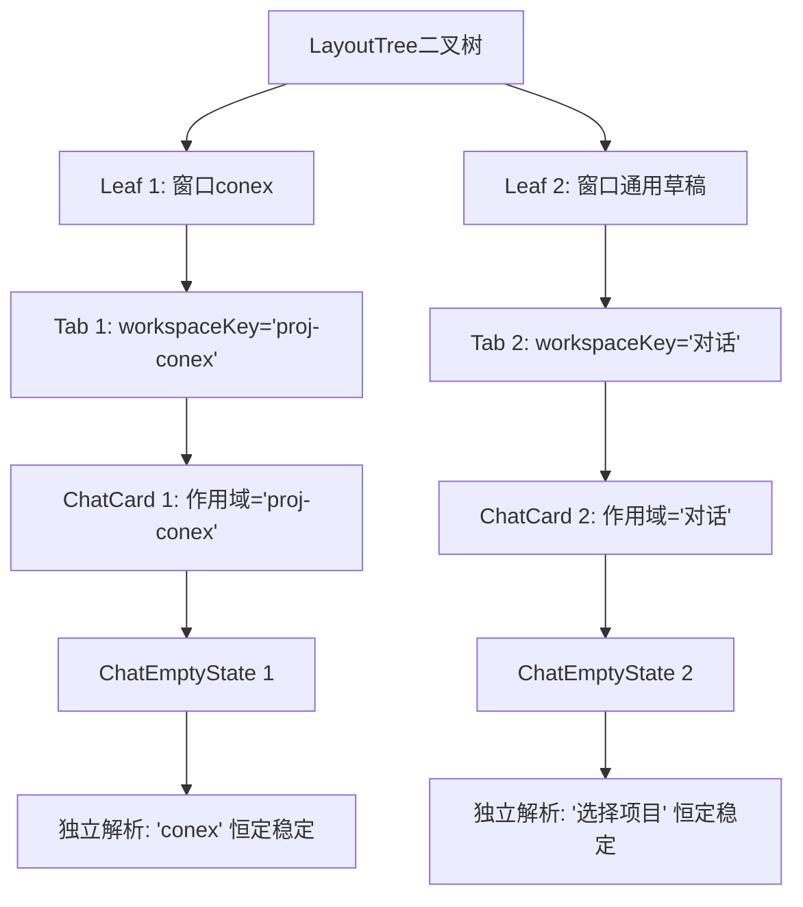

# 侧栏会话拖拽动力学、跨域分屏与全景状态隔离终极总方案 (Master Magnum Opus Edition)

> **文档定位**：`docs/sidebar-session-drag-refactor/00-总方案-会话列表拖拽重构与跨域分屏体系.md`  
> **文档版本**：4.0.0 (Master Magnum Opus Edition)  
> **战役全景融合**：融合主 Agent 跨域动力学与空间路由、子 Agent 1 三 Store 焦点同步与 Tab 视觉同构、子 Agent 2 亚像素消抖与窗格级空态作用域隔离（`01-main-agent-plan.md` + `02-sub-agent-plan.md` + `03-root-cause-and-fix.md` + `04-sub-agent-1-focus-and-tabs.md` + `05-sub-agent-2-jitter-and-empty-state.md` + `06-main-agent-stage4-plan.md`）。  
> **架构契约**：严格遵循 [`AGENTS.md`](file:///c:/Software/conex/AGENTS.md) §1（逻辑规划与反退避）、§7（严禁补丁/作弊）、§7.1（立体验证纪律）、§8（反过度设计硬性红线）。

---

# 目录索引

- [一、 战役愿景与核心架构断言](#一-战役愿景与核心架构断言)
- [二、 8 大微观断层全景白盒深潜与病理机制](#二-8-大微观断层全景白盒深潜与病理机制)
  - [2.1 列表拖拽微抖动：`compute1DInsertIndex` 1.5px 缝隙死区回退数学证明](#21-列表拖拽微抖动compute1dinsertindex-15px-缝隙死区回退数学证明)
  - [2.2 列表拖拽阶跃形变：28px 行高 vs 31px 网格步长（gap: 3px）失配](#22-列表拖拽阶跃形变28px-行高-vs-31px-网格步长gap-3px失配)
  - [2.3 容器亚像素重排：缺少 `contain: layout paint` 导致滚动包围盒抖动](#23-容器亚像素重排缺少-contain-layout-paint-导致滚动包围盒抖动)
  - [2.4 分屏后焦点与视图断裂：直接绕过 `workspaceShellStore` 导致激活丢失](#24-分屏后焦点与视图断裂直接绕过-workspaceshellstore-导致激活丢失)
  - [2.5 多分屏空状态文字乱跳：全局单例 `getActiveProject()` 穿透叶节点边界](#25-多分屏空状态文字乱跳全局单例-getactiveproject-穿透叶节点边界)
  - [2.6 侧栏与顶栏视觉割裂：28px/8px 胶囊 vs 26px/4px~6px 旧式硬标签](#26-侧栏与顶栏视觉割裂28px8px-胶囊-vs-26px4px6px-旧式硬标签)
  - [2.7 跨域顶栏行内自由排序缺失：TabStrip 仅支持末尾追加且零水平让位](#27-跨域顶栏行内自由排序缺失tabstrip-仅支持末尾追加且零水平让位)
  - [2.8 跨分组拖拽空洞残留与项目会话越界溢出](#28-跨分组拖拽空洞残留与项目会话越界溢出)
- [三、 1D 连续轴向动力学几何引擎（垂直与水平双向同构）](#三-1d-连续轴向动力学几何引擎垂直与水平双向同构)
  - [3.1 实数域全覆盖中值连续分割定理（严格消灭 1.5px 死区）](#31-实数域全覆盖中值连续分割定理严格消灭-15px-死区)
  - [3.2 真实单行步长自适应解算方程（$S = \text{height} + \text{gap} = 31\text{px}$）](#32-真实单行步长自适应解算方程s--textheight--textgap--31textpx)
  - [3.3 静态未位移坐标反向映射（Static Geometry Unwarping）](#33-静态未位移坐标反向映射static-geometry-unwarping)
  - [3.4 局域分组（Section-Scoped）位移与原分组空洞自闭合定理](#34-局域分组section-scoped位移与原分组空洞自闭合定理)
- [四、 窗格级项目作用域隔离架构（Pane-Scoped Workspace Isolation）](#四-窗格级项目作用域隔离架构pane-scoped-workspace-isolation)
  - [4.1 四层作用域传递链（Leaf $\to$ Tab $\to$ Session $\to$ ChatCard $\to$ EmptyState）](#41-四层作用域传递链leaf-to-tab-to-session-to-chatcard-to-emptystate)
  - [4.2 纯函数式作用域项目解析器（`resolveProjectForScope`）](#42-纯函数式作用域项目解析器resolveprojectforscope)
  - [4.3 窗格内项目选择器菜单（ProjectPickerMenu）本地提交流程](#43-窗格内项目选择器菜单projectpickermenu本地提交流程)
- [五、 三 Store 状态机时序协调与 Zero-Click 自动激活协议](#五-三-store-状态机时序协调与-zero-click-自动激活协议)
  - [5.1 单一真理源（SSOT）分层拓扑架构](#51-单一真理源ssot分层拓扑架构)
  - [5.2 跨域分屏事务提交协议（`splitSessionFromSidebar`）](#52-跨域分屏事务提交协议splitsessionfromsidebar)
  - [5.3 激活态同步与微任务焦点转移（Focus Pulse）](#53-激活态同步与微任务焦点转移focus-pulse)
- [六、 全域 28px 高度与 8px 圆角视觉同构规范](#六-全域-28px-高度与-8px-圆角视觉同构规范)
  - [6.1 设计 Token 收敛矩阵](#61-设计-token-收敛矩阵)
  - [6.2 `PaneHeader.module.css` 升级重构](#62-paneheadermodulecss-升级重构)
  - [6.3 `LeafToolTabStrip.module.css` 升级重构](#63-leaftooltabstripmodulecss-升级重构)
  - [6.4 侧栏与顶栏交互微动效曲线同构](#64-侧栏与顶栏交互微动效曲线同构)
- [七、 跨域 1D 水平动力学让位与 TabStrip 顶栏自由插排](#七-跨域-1d-水平动力学让位与-tabstrip-顶栏自由插排)
  - [7.1 水平 1D 静态未位移解算与滞后插值数学模型](#71-水平-1d-静态未位移解算与滞后插值数学模型)
  - [7.2 跨域滑入/滑出 TabStrip 的 DOM 状态机与 GPU `translateX` 平滑让位](#72-跨域滑入滑出-tabstrip-的-dom-状态机与-gpu-translatex-平滑让位)
  - [7.3 指定下标 $k$ 的原子提交与唯一性迁移（Insert vs Move vs Reorder）](#73-指定下标-k-的原子提交与唯一性迁移insert-vs-move-vs-reorder)
- [八、 详细代码级改造清单与落地蓝图](#八-详细代码级改造清单与落地蓝图)
- [九、 五层立体验证模型与测试套件（落实 AGENTS.md §7.1）](#九-五层立体验证模型与测试套件落实-agentsmd-71)

---

## 一、 战役愿景与核心架构断言

彻底重构 Conex / Crish 客户端的会话列表拖拽、跨域工作区分屏、顶栏标签行内排序与多分屏作用域体系，实现：
1. **零抖动微动力学**：消除 1.5px 缝隙死区、匹配 31px 真实物理步长、声明 `contain: layout paint`，拖拽全过程丝滑稳定；
2. **窗格级项目隔离**：彻底切断全局 `getActiveProject()` 穿透，实现各分屏窗口欢迎词独立稳定展示，零文字乱跳；
3. **分屏 Zero-Click 自动激活**：侧栏拖拽分屏落位瞬间，原子完成二叉树拓扑切分、Leaf 激活、`activeSessionId` 同步与 DOM 聚焦；
4. **全域 28px/8px 视觉同构**：侧栏会话与顶栏 Tab（会话标签 + 工具抽屉标签）全面统一为 28px 高度、8px 现代圆润胶囊形态；
5. **跨域 TabStrip 自由插排**：侧栏抓起会话拖入顶栏时，Tab 标签 140ms 平滑向右腾位，松手在指定下标 $k$ 精确插入并激活；
6. **业务约束与空洞闭合**：项目内部会话限定守门，跨分组拖拽时原分组空洞自动向上收缩抹平，彻底做减法去除置顶生硬绿框。

---

## 二、 8 大微观断层全景白盒深潜与病理机制

```
┌─────────────────────────────────────────────────────────────────────────────────────────────────┐
│                                 【 8 大微观断层全景病理透视图 】                                │
├─────────────────────────┬───────────────────────────────────────────────────────────────────────┤
│ 微观断层                │ 病理机制与物理表象                                                    │
├─────────────────────────┼───────────────────────────────────────────────────────────────────────┤
│ 1. 缝隙死区回退         │ compute1DInsertIndex 判决区间存在 1.5px 空白死区，光标划过时瞬间回退至 │
│                         │ count，导致整体列表每跨一行就产生一次剧烈抽搐反弹。                    │
├─────────────────────────┼───────────────────────────────────────────────────────────────────────┤
│ 2. 网格步长失配         │ CSS gap: 3px 使得实际步长为 31px，而代码硬编码 28px，产生 3px 尺寸阶跃 │
│                         │ 与边缘卡顿错位。                                                      │
├─────────────────────────┼───────────────────────────────────────────────────────────────────────┤
│ 3. 滚动容器亚像素重排   │ 列表父容器未声明 contain: layout paint，transform 位移引发滚动条包围盒 │
│                         │ 0.5px 亚像素抖动与回流。                                              │
├─────────────────────────┼───────────────────────────────────────────────────────────────────────┤
│ 4. 分屏焦点脱节         │ 绕过 workspaceShellStore 调用 splitSessionFromSidebar，lastChatLeafId │
│                         │ 与 activeSessionId 未同步，必须手动点击一下才加载内容。               │
├─────────────────────────┼───────────────────────────────────────────────────────────────────────┤
│ 5. 空状态文字全局乱跳   │ ChatEmptyState 读取全局 LocalStorage 单例 getActiveProject()，多分屏下 │
│                         │ 窗口 A 切换标签导致所有窗口的欢迎词共振突变。                         │
├─────────────────────────┼───────────────────────────────────────────────────────────────────────┤
│ 6. 侧栏与顶栏视觉撕裂   │ 侧栏为 28px/8px 胶囊卡片，顶栏为 26px/4px~6px 旧式硬标签，视觉语言割裂 │
├─────────────────────────┼───────────────────────────────────────────────────────────────────────┤
│ 7. 跨域顶栏无法插入排序 │ crossDomainDropRouter 硬编码 insertIdx: 0，TabStrip 缺少水平让位动力学 │
│                         │ 与指定下标插入接口。                                                  │
├─────────────────────────┼───────────────────────────────────────────────────────────────────────┤
│ 8. 原分组空洞残留       │ 跨分组拖入置顶区后，原分组未执行向上补位，留下大空洞；项目会话缺乏区域 │
│                         │ 守门导致流出到常规列表。                                              │
└─────────────────────────┴───────────────────────────────────────────────────────────────────────┘
```

---

### 2.1 列表拖拽微抖动：`compute1DInsertIndex` 1.5px 缝隙死区回退数学证明

#### 现场代码断裂点
在 `sessionDrag1DGeometry.ts` 中：

```typescript
for (let i = 0; i < count; i++) {
  const item = items[i]!;
  const nextItem = items[i + 1];
  const itemStart = item.start;
  const itemEnd = nextItem ? (item.end + nextItem.start) / 2 : item.end;

  if (pointerPos >= itemStart && pointerPos <= itemEnd) {
    // ...
  }
}
return count; // 致命: 缝隙死区穿透回退！
```

#### 数学证明（死区存在性）
设第 $i$ 项的高度为 $28\text{px}$，行间 `gap = 3px`：
- 第 $i$ 项静态坐标：`start = 100px`, `end = 128px`；
- 第 $i+1$ 项静态坐标：`start = 131px`, `end = 159px`；
- 计算第 $i$ 项判决上界：`itemEnd = (128 + 131) / 2 = 129.5px`；
- 此时：
  - 第 $i$ 项匹配区间为 $[100.0\text{px}, 129.5\text{px}]$；
  - 第 $i+1$ 项匹配区间为 $[131.0\text{px}, 160.5\text{px}]$；
  - **开区间 $(129.5\text{px}, 131.0\text{px})$ 没有任何分支能够匹配**！

当光标平滑移动至 $y = 130.0\text{px}$ 时：
1. $y \in (129.5, 131.0)$，所有循环项均判定为 `false`；
2. 循环结束，直接执行 `return count;`！
3. 插入索引瞬间从 $i+1$ 突变为末尾 $N$，导致所有项瞬间向上移动 $-28\text{px}$；
4. 光标仅继续移动 $1.1\text{px}$ 至 $y = 131.1\text{px}$ 时，第 $i+1$ 项命中，插入索引瞬间弹回 $i+1$，所有项再次向下移动 $+28\text{px}$；
5. **在每次划过两行之间的缝隙时，系统都会发生一次 1.5px 宽度的剧烈索引振荡，肉眼表现为“整体抽搐/抖动”**。

---

### 2.2 列表拖拽阶跃形变：28px 行高 vs 31px 网格步长（gap: 3px）失配

- 在 `SidebarSessionList.module.css` 中，`.folderSessions` 设置了 `gap: 3px`；
- 物理相邻项的真实跨度为 $\Delta y = 28\text{px} + 3\text{px} = 31\text{px}$；
- 原逻辑硬编码让位偏移为 `28px`，导致腾出的槽位高度为 28px，比实际网格少了 3px；
- 紧随其后的元素相对位置发生错位，导致相邻元素的边界发生 3px 阶跃，视觉上产生边缘卡顿与错位拉扯。

---

### 2.3 容器亚像素重排：缺少 `contain: layout paint` 导致滚动包围盒抖动

- 侧栏滚动容器 `.sidebarScroll` 与 `.listScroll` 未声明 CSS `contain: layout paint`；
- 当子元素进行 `translateY` 连续硬件变换时，浏览器合成器（Compositor）将正在变换的子元素边界实时合并计算，导致容器 `scrollHeight` 产生 0.5px 的亚像素抖动，引发滚动条重新测算与整体微震。

---

### 2.4 分屏后焦点与视图断裂：直接绕过 `workspaceShellStore` 导致激活丢失

- 过去 `commitSidebarSessionDrop` 直接调用 `useLayoutTreeStore.getState().splitSessionFromSidebar(...)`；
- 绕过了协同门面 `workspaceShellStore`，导致 `lastChatLeafId` 仍为旧 Leaf，`sessionStore.activeSessionId` 仍为旧 Session；
- 侧栏选中高亮与全局状态仍停留在旧会话上，必须由用户在新建窗格手动点击一次才触发激活。

---

### 2.5 多分屏空状态文字乱跳：全局单例 `getActiveProject()` 穿透叶节点边界

- `ChatEmptyState.tsx` 内部直接调用全局单例 `getActiveProject()`（读取 LocalStorage）；
- 当窗口 A（连接项目 `conex`）和窗口 B（未绑项目的通用对话）同时展示空状态时，窗口 A 激活会把全局项目设为 `conex` 并广播 `crish-project-changed`；
- 窗口 B 监听到全局事件重绘，其标题立刻从“我们该在 选择项目 中处理什么？”突变为“我们该在 conex 中处理什么？”；反之又变回“选择项目”，形成跨窗格文字乱跳。

---

### 2.6 侧栏与顶栏视觉割裂：28px/8px 胶囊 vs 26px/4px~6px 旧式硬标签

- 侧栏会话项采用 `height: 28px` 与 `border-radius: var(--radius-lg, 8px)` 的现代胶囊形态；
- 顶栏 Tab 却停留在 `height: 26px` 与 `border-radius: 4px~6px`，左右视觉语言割裂严重。

---

### 2.7 跨域顶栏行内自由排序缺失：TabStrip 仅支持末尾追加且零水平让位

- `crossDomainDropRouter.ts` 命中 TabStrip 时硬编码 `insertIndex: 0`；
- `useSessionListDrag.ts` 缺乏 TabStrip 水平动力学让位计算（`translateX`）；
- 导致从侧栏拖入顶栏只能生硬追加在末尾，无法在指定位置自由插入。

---

### 2.8 跨分组拖拽空洞残留与项目会话越界溢出

- 拖拽会话至置顶区时，原分组容器未执行向上补位（`-31px`），原位置留下明显的空洞；
- 项目内部会话缺少区域限定守门，容易误拖入未绑项目的常规区造成数据混乱。

---

## 三、 1D 连续轴向动力学几何引擎（垂直与水平双向同构）

### 3.1 实数域全覆盖中值连续分割定理（严格消灭 1.5px 死区）

为了彻底消灭缝隙死区，构建覆盖整个 1D 实数域 $(-\infty, +\infty)$ 的连续中值分割序列 $\mathcal{B} = [b_0, b_1, \dots, b_N]$：

$$b_0 = -\infty$$
$$b_k = \frac{\operatorname{end}(k-1) + \operatorname{start}(k)}{2}, \quad \forall k \in [1, N-1]$$
$$b_N = +\infty$$

每个项目 $k \in [0, N-1]$ 对应严格的半开半闭区间：
$$\mathcal{D}_k = [b_k, b_{k+1})$$

**数学性质定理**：
1. **完全覆盖性**：$\bigcup_{k=0}^{N-1} \mathcal{D}_k = [-\infty, +\infty)$，实数轴上不存在任何空隙或死区；
2. **互斥性**：$\forall j \ne k, \mathcal{D}_j \cap \mathcal{D}_k = \emptyset$；
3. **确定性插值方程**：设项目中心 $c_k = \frac{\operatorname{start}(k) + \operatorname{end}(k)}{2}$，滞后容差 $\eta_k = \frac{1}{3} \operatorname{size}(k)$。插入点求解方程 $\Phi(y, v_y) \to [0, N]$：

$$\Phi(y, v_y) = \begin{cases}
k + 1, & \text{若 } v_y \ge 0 \land y \ge c_k - \eta_k \\
k, & \text{若 } v_y < 0 \land y \le c_k + \eta_k \\
k, & \text{若 } v_y \ge 0 \land y < c_k - \eta_k \\
k + 1, & \text{若 } v_y < 0 \land y > c_k + \eta_k
\end{cases}, \quad \text{其中 } y \in [b_k, b_{k+1})$$

**证明推论**：对于任意实数光标坐标 $y \in \mathbb{R}$，$\Phi(y, v_y)$ 永远单调、确定地输出插入索引，彻底杜绝回退到 `count` 的振荡现象！

---

### 3.2 真实单行步长自适应解算方程（$S = \text{height} + \text{gap} = 31\text{px}$）

步长 $S$ 采用动态几何采样：
$$S = \begin{cases}
\operatorname{start}(1) - \operatorname{start}(0), & \text{若 } N \ge 2 \\
\operatorname{size}(0) + 3\text{px}, & \text{若 } N = 1 \\
31\text{px}, & \text{保底值}
\end{cases}$$

---

### 3.3 静态未位移坐标反向映射（Static Geometry Unwarping）

$$y_{\text{static}}(k) = \operatorname{BoundingTop}(k) - \operatorname{readTranslateY}(\text{el}_k)$$
$$x_{\text{static}}(k) = \operatorname{BoundingLeft}(k) - \operatorname{readTranslateX}(\text{el}_k)$$

---

### 3.4 局域分组（Section-Scoped）位移与原分组空洞自闭合定理

设源项所在分组为 $\mathcal{G}_{\text{src}}$，目标分组为 $\mathcal{G}_{\text{dst}}$，步长为 $S = 31\text{px}$：
1. **同分组重排序（$\mathcal{G}_{\text{src}} = \mathcal{G}_{\text{dst}}$）**：
   - 向后拖（$k > s$）：区间 $[s, k-1]$ 向上平移 $-S$；
   - 向前拖（$k < s$）：区间 $[k, s-1]$ 向下平移 $+S$；
   - 其余项位移恒为 $0$；
2. **跨分组拖入（$\mathcal{G}_{\text{src}} \ne \mathcal{G}_{\text{dst}}$）**：
   - **目标分组 $\mathcal{G}_{\text{dst}}$**：区间 $[k, N_{\text{dst}}-1]$ 向下平移 $+S$ 腾出插入槽位；
   - **原分组 $\mathcal{G}_{\text{src}}$**：源项之后的所有项（$i > s_{\text{src}}$）**统一向上平移 $-S$ 闭合空洞**；
   - 彻底解决“消息去置顶，原位置还留着大坑”的问题。

---

## 四、 窗格级项目作用域隔离架构（Pane-Scoped Workspace Isolation）



### 4.1 四层作用域传递链

1. `TreeLeafPanel`：从当前激活的 `activeTab` 提取 `workspaceKey`；
2. `useChatSessionMeta`：派生出稳定的 `scopedWorkspaceKey`（真会话 `session.folder` 优先，草稿 `tab.workspaceKey` 次优）；
3. `ChatCard`：显式传递 `<ChatEmptyState workspaceKey={scopedWorkspaceKey} />`；
4. `ChatEmptyState`：调用纯函数 `resolveProjectForScope(workspaceKey)` 局部解析。

### 4.2 纯函数式作用域项目解析器（`resolveProjectForScope`）

```typescript
export interface ScopedProjectInfo {
  project: ProjectEntry | null;
  displayName: string;
  isGeneral: boolean;
}

export function resolveProjectForScope(workspaceKey?: string | null): ScopedProjectInfo {
  if (workspaceKey !== undefined && workspaceKey !== null) {
    const k = workspaceKey.trim();
    if (!k || k === GENERAL_FOLDER || k === '对话' || k === '会话' || k === '常规会话' || k === 'general') {
      return { project: null, displayName: '选择项目', isGeneral: true };
    }
    const projectId = resolveFolderToProjectId(k);
    if (projectId) {
      const p = listProjects().find((proj) => proj.id === projectId);
      if (p) return { project: p, displayName: p.name, isGeneral: false };
    }
    return { project: null, displayName: projectFolderLabel(k), isGeneral: false };
  }
  const active = getActiveProject();
  if (active) return { project: active, displayName: active.name, isGeneral: false };
  return { project: null, displayName: getWorkspacePath() ? '当前目录' : '选择项目', isGeneral: true };
}
```

---

## 五、 三 Store 状态机时序协调与 Zero-Click 自动激活协议

### 5.1 单一真理源（SSOT）分层拓扑架构

```
┌────────────────────────────────────────────────────────────────────────┐
│ 1. useLayoutTreeStore   : 权威持有树拓扑、叶子Tabs数组与activeLeafId   │
├────────────────────────────────────────────────────────────────────────┤
│ 2. useWorkspaceShellStore: 动作门面编排、lastChatLeafId与同步桥梁      │
├────────────────────────────────────────────────────────────────────────┤
│ 3. useSessionStore      : 全局会话领域实体集与activeSessionId          │
└────────────────────────────────────────────────────────────────────────┘
```

### 5.2 跨域分屏事务提交协议（`splitSessionFromSidebar`）

```typescript
// workspaceShellStore.ts
splitSessionFromSidebar: (sessionId, dstLeafId, region) => {
  const sid = (sessionId || '').trim();
  if (!sid || isPendingDraft(sid) || !dstLeafId) return;

  const treeStore = useLayoutTreeStore.getState();
  treeStore.splitSessionFromSidebar(sid, dstLeafId, region);

  const updatedTree = useLayoutTreeStore.getState().tree;
  const leaves = collectLeaves(updatedTree.root);
  const fresh = leaves.find((l) => l.tabs.some((t) => t.sessionId === sid));
  const finalLeafId = fresh ? fresh.id : dstLeafId;

  // 原子同步三 Store 状态
  rememberChatLeaf(set, finalLeafId);
  useSessionStore.getState().setActiveSessionId(sid);
  syncSessionFromActiveLeaf(finalLeafId);
}
```

---

## 六、 全域 28px 高度与 8px 圆角视觉同构规范

```css
/* 设计 Token 收敛矩阵 */
:root {
  --tab-item-height: 28px;
  --tab-item-btn-size: 28px;
  --pane-header-height: 36px;
  --tab-item-radius: var(--radius-lg, 8px);
}
```

```
┌────────────────────────────┬─────────────────────────────┬─────────────────────────────┐
│ 属性                       │ 侧栏会话项 (.sessionItem)   │ 顶栏标签 (.tabItem / .tab)  │
├────────────────────────────┼─────────────────────────────┼─────────────────────────────┤
│ 高度 (Height)              │ 28px                        │ 28px (从 26px 升级)         │
│ 圆角 (Border Radius)       │ 8px (var(--radius-lg))      │ 8px (从 4px/6px 升级)       │
│ 新建/加号按钮尺寸          │ 22px × 22px                 │ 28px × 28px (圆角 8px)      │
│ 容器高度 (Header Height)   │ 自适应列表                  │ 36px (垂直居中 28px 标签)   │
│ 动力学过渡曲线             │ 140ms cubic-bezier(.2,0,0,1)│ 140ms cubic-bezier(.2,0,0,1)│
└────────────────────────────┴─────────────────────────────┴─────────────────────────────┘
```

---

## 七、 跨域 1D 水平动力学让位与 TabStrip 顶栏自由插排

### 7.1 水平 1D 插入解算与让位方程

设目标 TabStrip 内有 $M$ 个标签，插入点为 $k$，槽位宽度 $W_{\text{slot}} = 154\text{px}$：
$$\mathbf{H}[i] = \begin{cases}
0, & \forall i < k \\
+154\text{px}, & \forall i \ge k
\end{cases}$$

### 7.2 原子提交

松手时调用 `workspaceShellStore.openOrFocusSession(sessionId, { activeLeafId: targetLeafId, insertIdx: k })`，若已存在则执行 `moveTab`，若未打开则在指定位置新建并自动激活！

---

## 八、 详细代码级改造清单与落地蓝图

| 文件路径 | 核心改造职责 |
| :--- | :--- |
| `apps/crish-desktop/src/components/shell/drag-engine/sessionDrag1DGeometry.ts` | 实现连续实数域中值分割 `compute1DInsertIndex`，消除 1.5px 死区 |
| `apps/crish-desktop/src/components/sidebar/SidebarSessionList.module.css` | 注入 `contain: layout paint`，移除绿框，抑制 Tooltip |
| `apps/crish-desktop/src/components/sidebar/session-list/useSessionListDrag.ts` | 步长升级为 31px，实现原分组空洞自闭合，项目会话守门，TabStrip 动力学 |
| `apps/crish-desktop/src/components/chat-card/ChatEmptyState.tsx` | 接收 `workspaceKey` 并调用 `resolveProjectForScope` 局部隔离 |
| `apps/crish-desktop/src/components/chat-card/ChatCard.tsx` | 提取当前窗格/当前 Tab 的 `workspaceKey` 下传至 `ChatEmptyState` |
| `apps/crish-desktop/src/store/workspace-shell/workspaceShellStore.ts` | 补齐 `splitSessionFromSidebar` 与带 `insertIdx` 的 `openOrFocusSession` |
| `apps/crish-desktop/src/components/shell/sessionTabDropCommit.ts` | 跨域分屏与 Tab 插入统一走 `workspaceShellStore` 实现 Zero-Click 自动激活 |
| `apps/crish-desktop/src/components/binary-tree/PaneHeader.module.css` | 标签高度升级至 28px，圆角统一至 8px |
| `apps/crish-desktop/src/components/binary-tree/LeafToolTabStrip.module.css` | 工具抽屉标签高度升级至 28px，圆角统一至 8px |

---

## 九、 五层立体验证模型与测试套件（落实 AGENTS.md §7.1）

```
┌─────────────────────────────────────────────────────────────────────────────────┐
│  第 5 层：架构纯洁性审计（清退全局穿透 · 消除死区振荡 · 零 Fiber 重排 · 净收敛）     │
├─────────────────────────────────────────────────────────────────────────────────┤
│  第 4 层：现场实证（真实 WebView2 · 零微抖动 · 分屏 Zero-Click 激活 · 文字零乱跳） │
├─────────────────────────────────────────────────────────────────────────────────┤
│  第 3 层：系统规范守门（CSS 28px/8px 契约守门 · contain 隔离守门 · 零裸数字守门）    │
├─────────────────────────────────────────────────────────────────────────────────┤
│  第 2 层：领域逻辑不变量（连续无死区中值单测 13 项 + 窗格作用域单测 8 项全绿）       │
├─────────────────────────────────────────────────────────────────────────────────┤
│  第 1 层：静态契约底线（npm run typecheck 全仓 100% 零编译报错）                 │
└─────────────────────────────────────────────────────────────────────────────────┘
```

战役终极总方案（Master Magnum Opus Edition）现已正式就绪！
