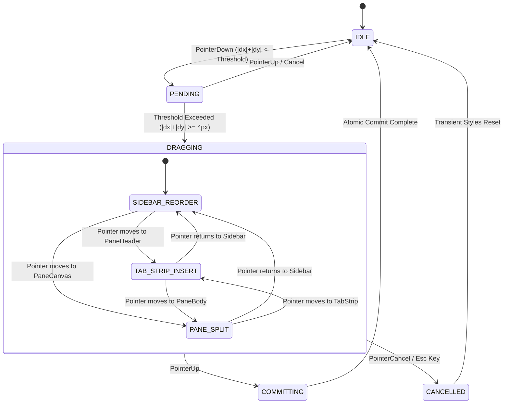
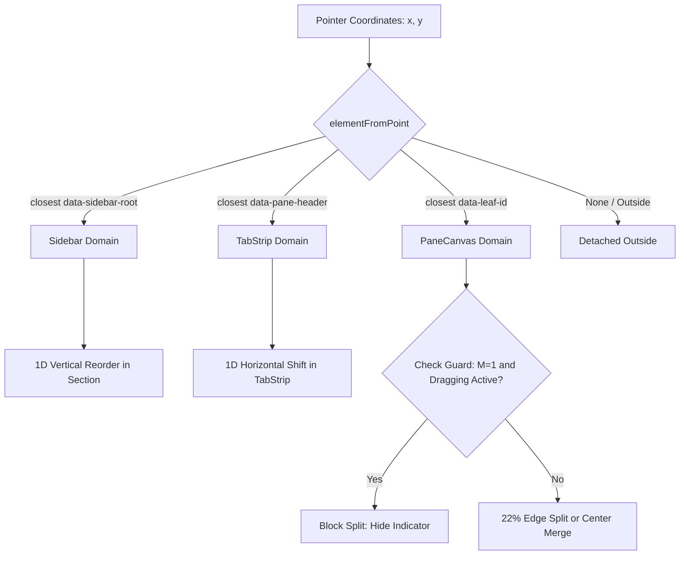
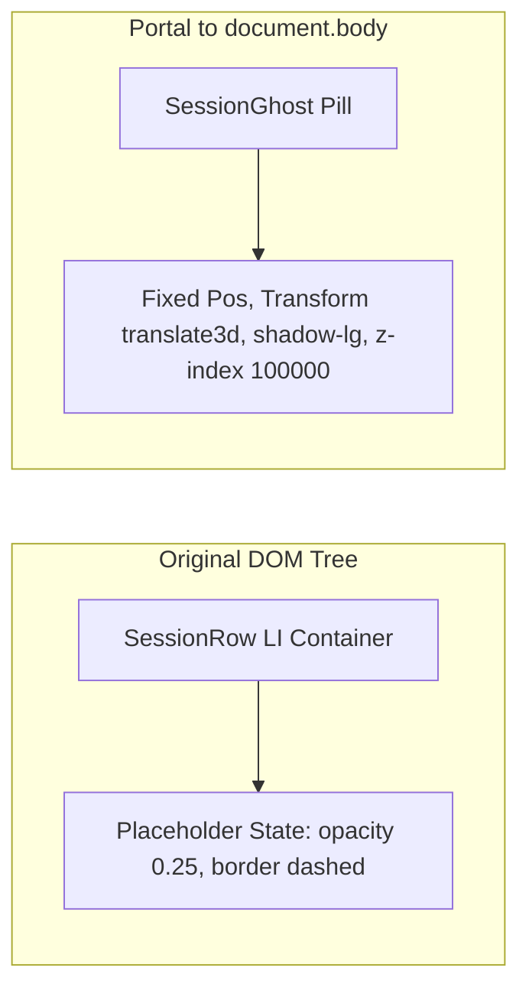
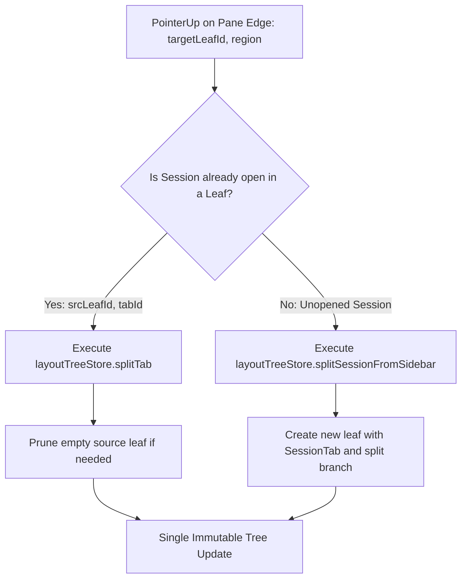

# 侧栏会话列表拖拽重构与跨域分屏统一体系架构方案

> **文档版本**：1.0.0
> **所属战役**：`sidebar-session-drag-refactor`
> **目标系统**：Conex / Crish 桌面客户端（`apps/crish-desktop`）
> **设计基准**：严格遵守 `AGENTS.md` §1（反退避）、§7（零补丁/零作弊）、§7.1（立体验证纪律）、§8（反过度设计）

---

## 目录

- [一、 方案概述与设计哲学](#一-方案概述与设计哲学)
  - [1.1 现状痛点穿透与根因分析](#11-现状痛点穿透与根因分析)
  - [1.2 核心架构原则](#12-核心架构原则)
- [二、 1D 轴向让位几何与数学模型推导](#二-1d-轴向让位几何与数学模型推导)
  - [2.1 1D 轴向同构数学定义](#21-1d-轴向同构数学定义)
  - [2.2 滞后容差插入判定公式](#22-滞后容差插入判定公式)
  - [2.3 1D 位移向量 $\mathbf{O}$ 显式闭环推导](#23-1d-位移向量-mathbfo-显式闭环推导)
  - [2.4 侧栏跨分组（置顶 / 项目 / 常规）连续性投影](#24-侧栏跨分组置顶--项目--常规连续性投影)
- [三、 跨域拖拽路由与互斥防护状态机](#三-跨域拖拽路由与互斥防护状态机)
  - [3.1 跨域拖拽生命周期与状态流转](#31-跨域拖拽生命周期与状态流转)
  - [3.2 互斥规则（Mutual Exclusion Guard）形式化定义](#32-互斥规则mutual-exclusion-guard形式化定义)
  - [3.3 跨域探测与防抖滞后区间](#33-跨域探测与防抖滞后区间)
- [四、 DOM 渲染管线与手感物理系统](#四-dom-渲染管线与手感物理系统)
  - [4.1 Ghost 脱壳与原项占位符隔离](#41-ghost-脱壳与原项占位符隔离)
  - [4.2 零 Store 污染与 rAF 单帧动力学管线](#42-零-store-污染与-raf-单帧动力学管线)
  - [4.3 硬件加速动画与 CSS 变量规范](#43-硬件加速动画与-css-变量规范)
  - [4.4 虚拟化滚动视口兼容与自适应释放](#44-虚拟化滚动视口兼容与自适应释放)
- [五、 落点原子提交与二叉树拓扑变换](#五-落点原子提交与二叉树拓扑变换)
  - [5.1 侧栏内重排序原子提交](#51-侧栏内重排序原子提交)
  - [5.2 顶栏 Tab 插入原子提交](#52-顶栏-tab-插入原子提交)
  - [5.3 叶面边缘分屏原子提交](#53-叶面边缘分屏原子提交)
  - [5.4 树拓扑不变量保障与 Pruning 闭环](#54-树拓扑不变量保障与-pruning-闭环)
- [六、 详细模块划分与代码实现蓝图](#六-详细模块划分与代码实现蓝图)
  - [6.1 文件结构与职责分布](#61-文件结构与职责分布)
  - [6.2 核心数据契约与 TypeScript 定义](#62-核心数据契约与-typescript-定义)
  - [6.3 关键模块实现详案与核心伪代码](#63-关键模块实现详案与核心伪代码)
- [七、 立体验证体系与全量测试方案](#七-立体验证体系与全量测试方案)
  - [7.1 纯数学与状态机单元测试矩阵](#71-纯数学与状态机单元测试矩阵)
  - [7.2 树操作与跨域提交拓扑测试](#72-树操作与跨域提交拓扑测试)
  - [7.3 DOM 交互与极限边界用例](#73-dom-交互与极限边界用例)
  - [7.4 物理现场与动效验收标准](#74-物理现场与动效验收标准)

---

## 一、 方案概述与设计哲学

### 1.1 现状痛点穿透与根因分析

通过对现有侧栏拖拽实现（`useSessionListDrag.ts`、`SessionRow.tsx`、`SidebarSessionList.module.css`）与顶栏拖拽（`SessionTabDragContext.tsx`、`sessionTabDragFeel.ts`）的深度代码审计，梳理出以下四个结构性断层：

1. **原项与 Ghost 重叠（DOM 样式断裂）**：
   - 根因：`SessionRow.tsx` 中向 `li` 添加了类名 `drag-ghost-hidden`，但在 `SidebarSessionList.module.css` 以及全局 CSS 中**根本未声明该类名**。
   - 表现：拖拽开始后，原列表项以 100% 不透明度原位驻留，而由 `buildGhostFromRow` 生成的悬浮 Ghost 直接叠加在原项上方，造成视觉上的严重重叠与重影。
2. **缺乏平滑 1D 位移让位动画，指示线生硬死板**：
   - 根因：侧栏拖拽仅通过 `dropBefore` / `dropAfter` 的内阴影（`box-shadow: inset 0 2px 0 0 ...`）提供静态指示线；且在拖拽过程中通过 `applyDragPreview` 修改 React 渲染数组，强制 React 重新渲染 DOM 节点。
   - 表现：列表项没有物理滑动动画，而是突兀跳变，与顶栏 Tab 流畅的 `translateX` 让位动画形成巨大体验割裂。
3. **拖拽过程中频繁触发 Store 写入（状态污染）**：
   - 根因：`useSessionListDrag.ts` 在 `applyPointer` 每一帧中直接调用 `onMoveSessionRealtime` 修改全局 `sessionStore`。
   - 表现：高频触发整个应用多组件级联重渲染，导致在长列表或高负荷下的严重掉帧与 GC 抖动。
4. **侧栏与右侧工作区分屏体系孤立（跨域割裂）**：
   - 根因：侧栏拖拽范围仅限制在侧栏内部（`resolveDropTarget` 仅探测侧栏内的置顶/项目/常规区域），完全未与二叉树工作区（`BinaryTreeWorkspace` / `LayoutTreeStore`）的落点系统打通。
   - 表现：用户无法像操作顶栏 Tab 一样，将侧栏中的会话直接拖入右侧工作区创建左右/上下分屏，亦无法拖入其它窗格的 TabStrip。

### 1.2 核心架构原则

为从根本上根除上述痛点，确立以下架构原则：

- **1D 轴向同构原则（Isomorphic 1D Model）**：顶栏 Tab（水平 X 轴）与侧栏会话（垂直 Y 轴）在数学模型上完全同构。共享底层的 1D 腾位/补位算法、滞后判定机制与动画插值。
- **跨域统一路由（Unified Cross-Domain Routing）**：侧栏会话拖起后，作为第一公民的 `SessionDragItem` 可在侧栏重排区（Sidebar）、顶栏标签区（TabStrip）、窗格叶面区（PaneSplit）之间无缝穿梭。
- **拖拽期零 Store 写入（Zero Store Pollution）**：拖拽全程仅依赖 rAF 驱动的瞬态 DOM Inline Style（`transform`）与浮层指示器；仅当 `pointerup` 松手时，执行单次原子提交。
- **严密互斥状态机（Mutual Exclusion Guard）**：单窗格且激活当前会话时，刚性拦截对自身的无意义分屏；其余场景（跨会话、多窗格）完全放行分屏与合并。
- **零补丁与架构净收敛（Zero Patching & SSOT）**：清退历史遗留的死代码（如失效的 `drag-ghost-hidden`、频繁重排的 `applyDragPreview` 数组操作），构建单一真理来源的拖拽动力学引擎。

---

## 二、 1D 轴向让位几何与数学模型推导

### 2.1 1D 轴向同构数学定义

设拖拽发生的目标容器中有 $N$ 个既有项（若源项来自该容器，则将其排除后剩余 $N$ 项），按顺序记为：
$$\mathcal{I} = [I_0, I_1, I_2, \dots, I_{N-1}]$$

在 1D 连续轴向坐标系中（水平模式取 $u = x$，垂直模式取 $u = y$），每个项目 $I_k$ 在视口中的静态几何跨度定义为闭区间：
$$\mathcal{S}_k = [u_{\min}(k), u_{\max}(k)], \quad \text{跨度} \ \Delta u(k) = u_{\max}(k) - u_{\min}(k)$$

设相邻两项之间的间隔为 $g$，单个槽位的标准移动步长定义为：
$$S = \overline{\Delta u} + g$$
- 水平 TabStrip：$S_x = \text{tabWidth} + g_x = 150\text{px} + 4\text{px} = 154\text{px}$
- 垂直 Sidebar：$S_y = \text{rowHeight} + g_y = 28\text{px} + 0\text{px} = 28\text{px}$

### 2.2 滞后容差插入判定公式

为了防止指针在项目临界边缘微小抖动时产生高频闪烁（Flickering），引入方向感知型滞后因子 $\eta = \frac{1}{3}$。

设当前指针坐标为 $u_p$，当前帧运动方向矢量为 $\Delta u_p$。目标插入下标 $k^* \in [0, N]$ 的求解函数 $\Phi(u_p, \Delta u_p, \mathcal{I})$ 定义为：

$$\Phi(u_p, \Delta u_p, \mathcal{I}) = \begin{cases}
0, & \text{若 } u_p < u_{\min}(0) \\
N, & \text{若 } u_p > u_{\max}(N-1) \\
\operatorname{HysteresisIndex}(k, u_p, \Delta u_p), & \text{若 } u_p \in \mathcal{S}_k
\end{cases}$$

其中单项内部的滞后判定方程为：
$$\operatorname{HysteresisIndex}(k, u_p, \Delta u_p) = \begin{cases}
k + 1, & \text{若 } \Delta u_p \ge 0 \ \land \ u_p \ge u_{\min}(k) + \eta \cdot \Delta u(k) \quad (\text{正向拖拽：深入超过 } 1/3 \text{ 后插}) \\
k, & \text{若 } \Delta u_p \ge 0 \ \land \ u_p < u_{\min}(k) + \eta \cdot \Delta u(k) \\
k, & \text{若 } \Delta u_p < 0 \ \land \ u_p \le u_{\max}(k) - \eta \cdot \Delta u(k) \quad (\text{反向拖拽：回退超过 } 1/3 \text{ 前插}) \\
k + 1, & \text{若 } \Delta u_p < 0 \ \land \ u_p > u_{\max}(k) - \eta \cdot \Delta u(k)
\end{cases}$$

### 2.3 1D 位移向量 $\mathbf{O}$ 显式闭环推导

设源项目在当前容器内的原始下标为 $k_{\text{src}}$（若源项来自外部容器，则 $k_{\text{src}} = \text{null}$）；由滞后公式求得的目标插入下标为 $k_{\text{dst}} \in [0, N]$。

位移向量 $\mathbf{O} = [O_0, O_1, \dots, O_{N-1}]^T \in \mathbb{R}^N$ 表示当前容器内各个 DOM 项需要应用的平移量（水平模式为 `translateX`，垂直模式为 `translateY`）。

#### 情况 A：同列表内部重排序（$k_{\text{src}} \ne \text{null}$）
此时原项在 DOM 中保留占位，其余 $N$ 项根据拖拽方向形成双向对称补偿：
$$\mathbf{O}[i] = \begin{cases}
-S, & \text{若 } k_{\text{dst}} > k_{\text{src}} \ \land \ k_{\text{src}} \le i < k_{\text{dst}} \quad (\text{正向拖拽：中间项目向前补位}) \\
+S, & \text{若 } k_{\text{dst}} < k_{\text{src}} \ \land \ k_{\text{dst}} \le i < k_{\text{src}} \quad (\text{反向拖拽：中间项目向后腾位}) \\
0, & \text{其它情况}
\end{cases}$$

#### 情况 B：跨列表 / 跨分区拖入（$k_{\text{src}} = \text{null}$）
此时目标列表中不存在源项的占位，必须向后腾出一个完整槽位：
$$\mathbf{O}[i] = \begin{cases}
+S, & \text{若 } i \ge k_{\text{dst}} \quad (\text{插入点及其后续所有项统一向后位移 } +S) \\
0, & \text{若 } i < k_{\text{dst}}
\end{cases}$$
- 特殊边界：当追加到列表末尾（$k_{\text{dst}} = N$）时，$\forall i \in [0, N-1], \mathbf{O}[i] = 0$。

```
同列表向下拖拽 (k_src=1, k_dst=4):
Item 0:  [  0 ] (不动)
Item 1:  [-28 ] (向上补位)
Item 2:  [-28 ] (向上补位)
Item 3:  [-28 ] (向上补位)
Item 4:  [  0 ] (不动)

跨列表拖入 (k_src=null, k_dst=2):
Item 0:  [  0 ] (不动)
Item 1:  [  0 ] (不动)
Item 2:  [+28 ] (向下腾位)
Item 3:  [+28 ] (向下腾位)
```

### 2.4 侧栏跨分组（置顶 / 项目 / 常规）连续性投影

侧栏由三个逻辑分区组成：$\mathcal{G}_{\text{pinned}}$（置顶区）、$\mathcal{G}_{\text{project}}^{(m)}$（各项目文件夹）、$\mathcal{G}_{\text{general}}$（常规会话区）。

当拖拽源 $S_{\text{drag}}$ 在不同分组间穿梭时：
1. **源分组离开态（Source Section Exit）**：
   - 源项所在行保持 `.is-dragging-source`（占位高度 28px，不折叠高程，内容虚化），源分组内其余项的位移恢复为 0。
2. **目标分组进入态（Target Section Enter）**：
   - 目标分组检测到 $S_{\text{drag}} \notin \mathcal{G}_{\text{target}}$，按 **情况 B** 计算 $\mathbf{O}_{\text{target}}$，在 $k_{\text{dst}}$ 处向下腾出 28px 空间。
3. **空分组自动感应展开**：
   - 若置顶区当前处于折叠或空状态，拖拽指针进入置顶命中区域（`[data-drop-zone="pinned"]`）时，立即激活展开态并动态腾位。

---

## 三、 跨域拖拽路由与互斥防护状态机

### 3.1 跨域拖拽生命周期与状态流转

拖拽系统采用分层状态机设计，将生命周期严格划分为 6 个阶段：



### 3.2 互斥规则（Mutual Exclusion Guard）形式化定义

#### 概念定义
- 设当前全局二叉树为 $\mathcal{T} = (\mathcal{V}, \mathcal{E})$。
- 活跃 Chat 叶集合为 $\mathcal{L} = \{ \ell \in \mathcal{V} \mid \operatorname{isLeaf}(\ell) \land \ell.\text{panelId} = \text{'chat'} \}$。
- 叶总数 $M = |\mathcal{L}|$。
- 拖拽源会话 ID 为 $S_{\text{drag}}$。
- 指针悬停的目标叶为 $\ell_{\text{target}}$，其活动会话为 $A(\ell_{\text{target}}) = \operatorname{activeSessionId}(\ell_{\text{target}})$。

#### 判定函数
定义分屏拦截谓词 $\Psi_{\text{guard}}(S_{\text{drag}}, \ell_{\text{target}}, \mathcal{T})$：
$$\Psi_{\text{guard}}(S_{\text{drag}}, \ell_{\text{target}}, \mathcal{T}) = \begin{cases}
\text{BLOCKED}, & \text{若 } M = 1 \ \land \ S_{\text{drag}} = A(\ell_{\text{target}}) \\
\text{ALLOWED}, & \text{其它情况}
\end{cases}$$

#### 状态机转移矩阵（真值表）

| 场景编号 | 全局叶数 $M$ | 拖拽会话 $S_{\text{drag}}$ 状态 | 悬停目标区域 | 守卫判定 $\Psi_{\text{guard}}$ | 视觉反馈（Feedback） | 松手动作（Commit Action） |
| :--- | :--- | :--- | :--- | :--- | :--- | :--- |
| **G-01** | $M = 1$ | 唯一叶当前激活会话（$S_{\text{drag}} = A$） | 叶面边缘（Left/Right/Top/Bottom） | **BLOCKED** | 分屏指示器隐藏；Ghost 呈 detached 半透明态，禁止分屏 | **NO-OP**（无意义自自分裂拦截） |
| **G-02** | $M = 1$ | 唯一叶当前激活会话（$S_{\text{drag}} = A$） | 叶面中心（Center） | **BLOCKED** | 指示器隐藏 | **NO-OP**（已处于激活状态） |
| **G-03** | $M = 1$ | 唯一叶当前激活会话（$S_{\text{drag}} = A$） | 顶栏 TabStrip | **BLOCKED** | 标签不腾位，指示器隐藏 | **NO-OP**（位置无需变更） |
| **G-04** | $M = 1$ | 未打开会话 或 非激活会话 | 叶面边缘（Left/Right/Top/Bottom） | **ALLOWED** | 高亮边缘半区指示器（22% 边缘，2px 内缩） | `splitSession`（创建新叶并打开会话） |
| **G-05** | $M = 1$ | 未打开会话 或 非激活会话 | 顶栏 TabStrip | **ALLOWED** | 目标 TabStrip 执行 1D 水平腾位 | `insertTab` / `openSession` 追加至顶栏 |
| **G-06** | $M = 1$ | 未打开会话 或 非激活会话 | 叶面中心（Center） | **ALLOWED** | 高亮全叶中心指示器 | `openSession` 聚焦并追加至该叶 |
| **G-07** | $M > 1$ | 任意会话（无论是已打开还是未打开） | 任意叶面边缘 | **ALLOWED** | 高亮目标叶边缘分屏指示器 | `splitTab`（若已开）或 `splitSession` |
| **G-08** | $M > 1$ | 任意会话 | 跨叶顶栏 TabStrip | **ALLOWED** | 跨叶 TabStrip 执行 1D 水平腾位 | `moveTab`（跨叶移动）或 `insertTab` |
| **G-09** | 任意 $M$ | 任意会话 | 侧栏内部（Pinned / General / Project） | **ALLOWED** | 侧栏执行 1D 垂直腾位与指示 | `commitSessionSidebarMove` |

### 3.3 跨域探测与防抖滞后区间

在 `pointermove` 过程中，通过单次 `document.elementFromPoint(x, y)` 穿透探测（Ghost 元素设置 `pointer-events: none`），判定当前命中域：



**防抖滞后区间（Hysteresis Buffer）**：
- 当处于 `TabStrip` 模式时，指针向下离开 TabStrip 的阈值增加 $12\text{px}$ 缓冲（即 $y \le \text{stripBottom} + 12\text{px}$ 依然保持 TabStrip 判定），防止用户在水平滑动选择插入点时轻微下偏误触发叶面 Top 分屏。

---

## 二叉树分屏指示器几何示意图

```
+-------------------------------------------------------------+
|  [Leaf Header: Tab 1] [Tab 2]                 [_] [口] [X]  |
+-------------------------------------------------------------+
|                                                             |
|  +-----------------------+       +-----------------------+  |
|  |                       |       |                       |  |
|  |     Split-Left        |       |     Split-Right       |  |
|  |    (Width: 50%)       |       |    (Width: 50%)       |  |
|  |                       |       |                       |  |
|  +-----------------------+       +-----------------------+  |
|                                                             |
|  +-------------------------------------------------------+  |
|  |                     Split-Top                         |  |
|  |                   (Height: 50%)                       |  |
|  +-------------------------------------------------------+  |
|  |                    Split-Bottom                       |  |
|  |                   (Height: 50%)                       |  |
|  +-------------------------------------------------------+  |
|                                                             |
|  +-------------------------------------------------------+  |
|  |                   Center (Merge/Focus)                |  |
|  |                   (Full Leaf Overlay)                 |  |
|  +-------------------------------------------------------+  |
+-------------------------------------------------------------+
```

---

## 四、 DOM 渲染管线与手感物理系统

### 4.1 Ghost 脱壳与原项占位符隔离

彻底根除原项与 Ghost 重叠的物理方案：



1. **原项占位符（Source Placeholder）**：
   - 拖拽启动瞬间，宿主组件为源 `li[data-session-id]` 赋予严格样式类 `.isDraggingSource`。
   - CSS 定义：
     ```css
     .sessionItemWrap.isDraggingSource {
       opacity: 0.25;
       pointer-events: none;
       background: var(--tint-hover, hsl(0 0% 0% / 0.04));
       border: 1px dashed var(--border-subtle, hsl(0 0% 0% / 0.15));
       border-radius: var(--radius-lg);
     }
     .sessionItemWrap.isDraggingSource > * {
       visibility: hidden; /* 隐藏内部文本与图标，保持纯净占位框 */
     }
     ```
2. **悬浮 Ghost 胶囊（Floating Ghost Pill）**：
   - 挂载至 `document.body` 根节点，完全脱离侧栏滚动容器与 overflow 裁剪。
   - 统一尺寸：高度 $26\text{px}$，最大宽度 $180\text{px}$，圆角 $6\text{px}$，深度投影（`0 8px 24px hsl(0 0% 0% / 0.14)`）。
   - 状态联动：
     - 在合法放置区（侧栏/TabStrip/叶面边缘）时：`opacity: 0.95`，完整高亮。
     - 游离或被 Guard 拦截时：添加 `.is-detached`，`opacity: 0.35`，阴影收敛。

### 4.2 零 Store 污染与 rAF 单帧动力学管线

拖拽循环严格遵守「单向只读计算 $\to$ 瞬态 DOM 修改」管线，杜绝任何中间状态写入 Store：

```typescript
// 动力学单帧管线伪代码
function onPointerMove(e: PointerEvent) {
  pendingPointer = { x: e.clientX, y: e.clientY, dx: e.clientX - startX, dy: e.clientY - startY };
  if (!rafId) {
    rafId = requestAnimationFrame(flushFrame);
  }
}

function flushFrame() {
  rafId = 0;
  if (!pendingPointer) return;
  const { x, y, dx, dy } = pendingPointer;

  // 1. 同步 Ghost 物理位置（GPU translate3d）
  ghostEl.style.transform = `translate3d(${x - grabOffsetX}px, ${y - grabOffsetY}px, 0)`;

  // 2. 跨域落点探测
  const hit = resolveCrossDomainDropTarget(x, y, dx, dy, dragContext);

  // 3. 状态路由与 1D DOM 位移驱动
  switch (hit.domain) {
    case 'sidebar':
      resetTabStripTransforms();
      hidePaneIndicator();
      applySidebar1DShift(hit.section, hit.insertIndex);
      break;
    case 'tab-strip':
      resetSidebarTransforms();
      hidePaneIndicator();
      applyTabStrip1DShift(hit.stripEl, hit.insertIndex);
      break;
    case 'pane-split':
      resetSidebarTransforms();
      resetTabStripTransforms();
      showPaneIndicator(hit.leafId, hit.region);
      break;
    default:
      resetAllTransforms();
      hidePaneIndicator();
      break;
  }
}
```

### 4.3 硬件加速动画与 CSS 变量规范

所有让位位移统一采用现代 CSS 变换与缓动函数：

- **过渡曲线**：`transition: transform 180ms cubic-bezier(.2, 0, 0, 1)`。
- **渲染特征**：启用 `will-change: transform`，强制提升为 GPU 合成层，避免重排（Reflow）。
- **色彩与阴影 Token**：
  - 指示条背景：`var(--tint-hover, hsl(0 0% 0% / 0.06))`
  - 强调边框：`var(--accent-primary, hsl(239 84% 67%))`
  - 阴影深度：`var(--shadow-lg)` 与 `var(--shadow-md)`

### 4.4 虚拟化滚动视口兼容与自适应释放

在长列表（会话数 $> 48$）场景下，侧栏启用了虚拟化窗口（`useWindowedList`）：
- **拖拽激活保护**：拖拽开始（`isDragging = true`）时，`shouldWindowSessionList` 自动将视口裁剪放宽为挂载可见全量项目，确保所有可见 DOM 节点均能接收 1D 位移变换与探测。
- **边缘自动滚动（Edge Auto-Scroll）**：当指针靠近侧栏顶部或底部 $\le 32\text{px}$ 区域时，以递增步长（$8\text{px} \sim 16\text{px}$）自动平滑滚动列表容器。

---

## 五、 落点原子提交与二叉树拓扑变换

### 5.1 侧栏内重排序原子提交

当用户在侧栏内部松手时，根据计算得到的 `(targetSessionId, targetFolder, isPinned)` 发起单次原子提交：

```typescript
export function commitSessionSidebarMove(
  sessionId: string,
  targetSessionId: string | null,
  targetFolder: string,
  isPinned: boolean
): void {
  const sessionStore = useSessionStore.getState();
  // 原子更新 sessions 数组排序、isPinned 标记及 folder 分组
  sessionStore.moveSessionRealtime(sessionId, targetSessionId, targetFolder, isPinned);
}
```

### 5.2 顶栏 Tab 插入原子提交

当用户将侧栏会话拖入右侧某一窗格的顶栏（`TabStrip`）松手时：
1. **若该会话已在某叶打开**：
   - 调用 `layoutTreeStore.moveTab(srcLeafId, tabId, dstLeafId, insertIndex)` 将其迁移并激活。
2. **若该会话尚未在任何叶打开**：
   - 调用 `layoutTreeStore.openSession(sessionId, { activeLeafId: dstLeafId, insertIdx: insertIndex })` 实例化为新 Tab 并插入指定位置。

### 5.3 叶面边缘分屏原子提交

当用户将侧栏会话拖入窗格边缘（Left/Right/Top/Bottom）松手时：



### 5.4 树拓扑不变量保障与 Pruning 闭环

树操作严格遵守二叉树布局不变量：
1. **严格二叉性（Strict Binary Invariant）**：树中任意 Branch 节点必须拥有且仅拥有严格两个子节点（`children: [LayoutNode, LayoutNode]`）。
2. **真会话唯一性（Unique Real Session Invariant）**：全局树中同一 `sessionId` 最多只能存在一个激活实例，严禁多叶重复实例化。
3. **空叶自动修剪（Auto Pruning）**：若跨叶迁移导致源叶的 `tabs` 变为空，`pruneEmptyLeaves` 自动将该叶修剪，并将其兄弟节点无缝上提替换父 Branch，保证不会残留无意义的空窗格。

---

## 六、 详细模块划分与代码实现蓝图

### 6.1 文件结构与职责分布

为实现高内聚、低耦合的架构收敛，文件改动清单规划如下：

```
apps/crish-desktop/src/
├── components/
│   ├── shell/
│   │   ├── drag-engine/                          # [NEW] 统一 1D 动力学与跨域拖拽引擎
│   │   │   ├── sessionDrag1DGeometry.ts          # 1D 轴向几何、滞后算法与位移向量推导
│   │   │   ├── sessionDrag1DGeometry.test.ts     # 1D 纯数学单元测试（穷举测试）
│   │   │   ├── sessionDragGuard.ts               # 互斥规则判定与状态机守卫
│   │   │   ├── sessionDragGuard.test.ts          # 互斥规则状态机真值测试
│   │   │   └── crossDomainDropRouter.ts          # 跨域落点探测器（Sidebar/TabStrip/Pane）
│   │   ├── SessionTabDragContext.tsx             # [REFACTOR] 接入统一动力学引擎
│   │   ├── sessionTabDragDom.ts                  # [REFACTOR] 共享 Ghost 与指示器 DOM 封装
│   │   ├── sessionTabDropCommit.ts               # [REFACTOR] 扩充侧栏会话跨域落点提交器
│   │   └── sessionTabDropCommit.test.ts          # 提交器拓扑变异测试
│   └── sidebar/
│       ├── SidebarSessionList.module.css         # [MODIFY] 补齐 .isDraggingSource、1D 位移动画
│       └── session-list/
│           ├── SessionRow.tsx                    # [MODIFY] 修复占位类名，接入统一拖拽起手
│           ├── useSessionListDrag.ts             # [REFACTOR] 彻底重写：接入跨域动力学引擎
│           ├── useSessionListDrag.test.ts        # [NEW] 侧栏拖拽全流程测试
│           └── useSessionGrouping.ts             # [MODIFY] 清除拖拽期 applyDragPreview 脏重排
└── store/
    └── layout-tree/
        ├── layoutTreeInsert.ts                   # [MODIFY] 增加 splitSessionFromSidebar 算子
        └── layoutTreeStore.ts                    # [MODIFY] 暴露 splitSessionFromSidebar 命令
```

### 6.2 核心数据契约与 TypeScript 定义

```typescript
// apps/crish-desktop/src/components/shell/drag-engine/sessionDrag1DGeometry.ts

export type AxisDirection = 'horizontal' | 'vertical';

export interface Axis1DItemRect {
  id: string;
  start: number; // left (X) or top (Y)
  end: number;   // right (X) or bottom (Y)
  size: number;  // width (X) or height (Y)
  el: HTMLElement;
}

export interface Compute1DOffsetsInput {
  itemCount: number;
  sourceIndex: number | null; // null 代表跨容器拖入
  insertIndex: number;        // 0 <= insertIndex <= itemCount
  shiftStep: number;          // 移动步长 S = size + gap
}

/**
 * 纯数学 1D 位移向量计算函数（X/Y 轴同构）
 */
export function compute1DShiftOffsets(input: Compute1DOffsetsInput): number[] {
  const { itemCount, sourceIndex, insertIndex, shiftStep } = input;
  const offsets = new Array<number>(itemCount).fill(0);
  if (itemCount <= 0 || !Number.isFinite(shiftStep) || shiftStep <= 0) return offsets;

  if (sourceIndex !== null) {
    // 情况 A：同容器内部重排（双向对称补偿）
    if (insertIndex > sourceIndex) {
      for (let i = sourceIndex; i < insertIndex && i < itemCount; i++) {
        offsets[i] = -shiftStep;
      }
    } else if (insertIndex < sourceIndex) {
      for (let i = insertIndex; i < sourceIndex && i < itemCount; i++) {
        offsets[i] = shiftStep;
      }
    }
  } else {
    // 情况 B：跨容器拖入（单向腾位）
    for (let i = insertIndex; i < itemCount; i++) {
      offsets[i] = shiftStep;
    }
  }

  return offsets;
}
```

```typescript
// apps/crish-desktop/src/components/shell/drag-engine/sessionDragGuard.ts

import type { LayoutTree } from '../../../store/layout-tree/types';
import { collectLeaves } from '../../../store/layout-tree/layoutTreeQuery';
import { activeSessionIdOf } from '../../../store/layout-tree/sessionTabModel';

export type PaneDropRegion = 'left' | 'right' | 'top' | 'bottom' | 'center';

export interface GuardEvaluationResult {
  allowed: boolean;
  reason?: 'SINGLE_LEAF_SELF_SPLIT_BLOCKED' | 'ALREADY_ACTIVE' | 'OK';
}

/**
 * 严密互斥规则判定器
 */
export function evaluateSplitGuard(
  tree: LayoutTree,
  draggedSessionId: string,
  targetLeafId: string,
  region: PaneDropRegion
): GuardEvaluationResult {
  const chatLeaves = collectLeaves(tree.root).filter((l) => l.panelId === 'chat');
  const leafCount = chatLeaves.length;

  if (leafCount === 1) {
    const singleLeaf = chatLeaves[0]!;
    const activeSid = activeSessionIdOf(singleLeaf);

    // 规则：当全局只有 1 个窗口，且拖拽的是当前打开的激活会话时，禁止分屏与自合并
    if (activeSid === draggedSessionId) {
      return {
        allowed: false,
        reason: 'SINGLE_LEAF_SELF_SPLIT_BLOCKED',
      };
    }
  }

  // 中心合并到自身已激活项
  if (region === 'center') {
    const targetLeaf = chatLeaves.find((l) => l.id === targetLeafId);
    if (targetLeaf && activeSessionIdOf(targetLeaf) === draggedSessionId) {
      return {
        allowed: false,
        reason: 'ALREADY_ACTIVE',
      };
    }
  }

  return { allowed: true, reason: 'OK' };
}
```

```typescript
// apps/crish-desktop/src/components/shell/drag-engine/crossDomainDropRouter.ts

export type CrossDomainTarget =
  | { domain: 'sidebar'; sectionKind: 'pinned' | 'general' | 'project'; folder: string; insertIndex: number; targetSessionId: string | null }
  | { domain: 'tab-strip'; targetLeafId: string; insertIndex: number }
  | { domain: 'pane-split'; targetLeafId: string; region: PaneDropRegion }
  | { domain: 'outside' };

export function resolveCrossDomainTarget(
  clientX: number,
  clientY: number,
  deltaX: number,
  deltaY: number,
  draggedSessionId: string,
  tree: LayoutTree
): CrossDomainTarget {
  const hitElements = document.elementsFromPoint(clientX, clientY);
  const targetNode = hitElements.find((el) => !el.classList.contains('sidebar-drag-ghost') && !el.classList.contains('tree-drag-card'));
  if (!targetNode) return { domain: 'outside' };

  // 1. 探测是否在 TabStrip
  const tabStrip = targetNode.closest('[data-pane-header="true"] [role="tablist"]') as HTMLElement | null;
  if (tabStrip) {
    const leafEl = tabStrip.closest('[data-leaf-id]');
    const targetLeafId = leafEl?.getAttribute('data-leaf-id') || '';
    if (targetLeafId) {
      const insertIndex = computeTabStripInsertIndex(tabStrip, clientX, deltaX);
      return { domain: 'tab-strip', targetLeafId, insertIndex };
    }
  }

  // 2. 探测是否在 PaneCanvas 分屏区
  const paneLeaf = targetNode.closest('[data-tree-canvas="true"] [data-leaf-id]') as HTMLElement | null;
  if (paneLeaf) {
    const targetLeafId = paneLeaf.getAttribute('data-leaf-id') || '';
    const rect = paneLeaf.getBoundingClientRect();
    const region = detectPaneDropRegion(clientX, clientY, rect);
    if (region && targetLeafId) {
      const guard = evaluateSplitGuard(tree, draggedSessionId, targetLeafId, region);
      if (guard.allowed) {
        return { domain: 'pane-split', targetLeafId, region };
      }
    }
  }

  // 3. 探测是否在 Sidebar
  const sidebarContainer = targetNode.closest('[data-sidebar-root="true"]') as HTMLElement | null;
  if (sidebarContainer) {
    return resolveSidebarTarget(targetNode, clientY, deltaY);
  }

  return { domain: 'outside' };
}
```

---

## 七、 立体验证体系与全量测试方案

遵循 `AGENTS.md` §7.1 立体验证纪律，构建覆盖数学纯函数、状态机穷举、拓扑变异与真实物理环境的四层验证矩阵。

### 7.1 纯数学与状态机单元测试矩阵

| 测试文件 | 测试套件 / 断言集 | 覆盖场景与极限边界 |
| :--- | :--- | :--- |
| `sessionDrag1DGeometry.test.ts` | `compute1DShiftOffsets` | • 同列表正向拖拽（首位插末位、中段连续位移）<br>• 同列表反向拖拽（末位插首位）<br>• 同列表原地悬停（偏移全为 0）<br>• 跨列表拖入首位/中间/末尾追加（严格单向腾位）<br>• 极限边界：空列表、负步长、NaN 防御 |
| `sessionDrag1DGeometry.test.ts` | `computeHysteresisInsertIndex` | • 1/3 滞后边界临界值计算<br>• 正向划动过 1/3 阈值前/后的返回值阶跃<br>• 反向划动回退 1/3 阈值前/后的返回值阶跃 |
| `sessionDragGuard.test.ts` | `evaluateSplitGuard` | • 单叶 + 拖拽激活会话 $\to$ 严格 BLOCKED<br>• 单叶 + 拖拽未激活会话 $\to$ 允许 Left/Right/Top/Bottom 分屏<br>• 多叶 + 任意会话 $\to$ 允许分屏与跨叶迁移<br>• 中心落点与已有会话重复性判定 |

### 7.2 树操作与跨域提交拓扑测试

| 测试文件 | 核心断言内容 | 预期不变量 |
| :--- | :--- | :--- |
| `sessionTabDropCommit.test.ts` | 侧栏未打开会话拖入叶面 Edge 分屏 | 成功生成新 Leaf，树结构变为 Branch，原 Leaf 与新 Leaf 并存，会话正确激活 |
| `sessionTabDropCommit.test.ts` | 侧栏未打开会话拖入顶栏 TabStrip | 目标 Leaf 的 `tabs` 数组追加新 `SessionTab`，不产生分屏 |
| `sessionTabDropCommit.test.ts` | 侧栏已打开会话拖入其它 Leaf 分屏 | 执行 `splitTab`，原 Leaf 若空则被自动 Prune，无内存泄漏与孤立节点 |
| `sessionTabDropCommit.test.ts` | 单叶自自分裂拦截断言 | 树结构与状态完全保持原样，版本号与引用保持不变 |

### 7.3 DOM 交互与极限边界用例

1. **Esc 逃逸与失焦防御**：
   - 拖拽中按下 `Escape` 键或窗口失焦（`pointercancel` / `blur`），所有已应用的 `transform` 瞬间复原，Ghost 节点从 DOM 安全卸载，Store 零变更。
2. **极速划动（High-Velocity Swipe）**：
   - 快速跨越侧栏与右侧工作区边缘，rAF 调度不会发生帧乱序，指示器几何位置与模式平滑过渡。
3. **Ghost 像素对齐与虚化断言**：
   - 验证原 `li` 节点在拖拽期间包含 `.isDraggingSource`，`opacity === 0.25`；Ghost 胶囊采用 `translate3d` 硬件加速位移。

### 7.4 物理现场与动效验收标准

- **60/120 FPS 满帧手感**：拖拽期间 Chrome DevTools Performance 面板监测零强制同步布局（Forced Reflow），无长任务（Long Tasks）。
- **无视觉撕裂**：指示条与 1D 让位位移过渡时长严格锁定为 180ms，采用 `cubic-bezier(.2, 0, 0, 1)`，无弹跳与生硬跳变。
- **门禁全绿**：
  - `npm run typecheck` 零类型报错
  - `npm test` 与 `vitest run` 全量自动化测试通过
  - 行数检查 `npm run check:line-counts` 无超标违规

---

## 八、 实施交付计划与分阶段推进

为确保修改干净透明，实施分为三个递进阶段：

1. **第一阶段：数学与路由基础层落地**
   - 建立 `apps/crish-desktop/src/components/shell/drag-engine/` 目录；
   - 编写 `sessionDrag1DGeometry.ts`、`sessionDragGuard.ts`、`crossDomainDropRouter.ts` 及其对应单元测试，实现 100% 测试覆盖。
2. **第二阶段：侧栏拖拽与样式系统重构**
   - 重构 `useSessionListDrag.ts`，接入动力学引擎，移除拖拽期实时 Store 写入；
   - 修复 `SidebarSessionList.module.css` 与 `SessionRow.tsx` 中的 Ghost 样式断裂问题，接入 1D 垂直平移让位动画。
3. **第三阶段：二叉树落点提交与跨域联调**
   - 增强 `layoutTreeInsert.ts` 与 `sessionTabDropCommit.ts`，支持侧栏会话直接分屏建叶；
   - 联调端到端拖拽分屏全流程，执行立体验证与门禁扫描。
