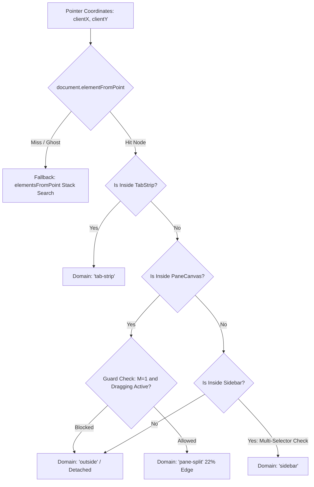

# 侧栏会话拖拽“无动静”白盒全链路根因剖析与系统级根治详案 (Master Diagnostic Edition)

> **文档版本**：2.0.0 (Master Diagnostic Canon)
> **所属战役**：`docs/sidebar-session-drag-refactor/`
> **文档位置**：`docs/sidebar-session-drag-refactor/03-main-agent-root-cause-and-fix.md`
> **排查范围**：浏览器原生 Pointer Events 流水线、GPU 硬件加速合成层、React 18 Fiber 协调机制、Zustand 状态树不可变事务、二叉树拓扑投影与视口几何索引。

---

# 目录索引

- [一、 现场表象与问题形式化定义](#一-现场表象与问题形式化定义)
  - [1.1 用户现场交互病理（Live Defect Manifestation）](#11-用户现场交互病理live-defect-manifestation)
  - [1.2 故障状态机形式化描述](#12-故障状态机形式化描述)
- [二、 8 大底层结构性断裂全景白盒深潜](#二-8-大底层结构性断裂全景白盒深潜)
  - [2.1 根因 1：`crossDomainDropRouter.ts` 探测器契约漂移与永久 `outside` 死锁](#21-根因-1crossdomaindroprouterts-探测器契约漂移与永久-outside-死锁)
  - [2.2 根因 2：项目文件夹折叠手风琴中的 0 尺寸隐藏项污染几何采样](#22-根因-2项目文件夹折叠手风琴中的-0-尺寸隐藏项污染几何采样)
  - [2.3 根因 3：`setActiveDragItem` 触发 React Fiber Re-render 擦除 DOM Inline Transform](#23-根因-3setactivedragitem-触发-react-fiber-re-render-擦除-dom-inline-transform)
  - [2.4 根因 4：`pointerup` 终态竞争与 rAF 帧取消导致持久化提交丢失](#24-根因-4pointerup-终态竞争与-raf-帧取消导致持久化提交丢失)
  - [2.5 根因 5：Ghost 克隆子元素捕获光标破坏 `elementFromPoint` 穿透](#25-根因-5ghost-克隆子元素捕获光标破坏-elementfrompoint-穿透)
  - [2.6 根因 6：行高步长与间距（28px vs 36px）物理标尺失配](#26-根因-6行高步长与间距28px-vs-36px物理标尺失配)
  - [2.7 根因 7：`moveSessionRealtime` 全局数组切片对局部文件夹追加语义的偏离](#27-根因-7movesessionrealtime-全局数组切片对局部文件夹追加语义的偏离)
  - [2.8 根因 8：指针捕获（Pointer Capture）与浏览器默认拖拽行为冲突](#28-根因-8指针捕获pointer-capture与浏览器默认拖拽行为冲突)
- [三、 1D 连续轴向动力学几何与无缝隙插值重构](#三-1d-连续轴向动力学几何与无缝隙插值重构)
  - [3.1 严格连续性中点判定公式推导](#31-严格连续性中点判定公式推导)
  - [3.2 静态未位移坐标映射（Static Geometry Unwarping）](#32-静态未位移坐标映射static-geometry-unwarping)
  - [3.3 局域分组（Section-Scoped）位移驱动定理](#33-局域分组section-scoped位移驱动定理)
- [四、 空间索引落点探测器（DropZone Resolver）全景加固](#四-空间索引落点探测器dropzone-resolver全景加固)
  - [4.1 多层防御的选择器探测拓扑](#41-多层防御的选择器探测拓扑)
  - [4.2 侧栏分区（Pinned / Folder / General）无损识别](#42-侧栏分区pinned--folder--general无损识别)
- [五、 DOM 卫生、GPU 合成层与 React 渲染隔离](#五-dom-卫生gpu-合成层与-react-渲染隔离)
  - [5.1 纯 DOM 驱动机制：彻底阻断拖拽期 React 状态重绘](#51-纯-dom-驱动机制彻底阻断拖拽期-react-状态重绘)
  - [5.2 原汁原味 Ghost 的精准克隆与事件脱敏](#52-原汁原味-ghost-的精准克隆与事件脱敏)
  - [5.3 优雅占位符（Placeholder）的物理尺寸保全](#53-优雅占位符placeholder的物理尺寸保全)
- [六、 事务原子提交与二叉树拓扑一致性](#六-事务原子提交与二叉树拓扑一致性)
  - [6.1 同步终态帧刷新（Synchronous Final Flush）](#61-同步终态帧刷新synchronous-final-flush)
  - [6.2 局部项目文件夹内插入语义校准](#62-局部项目文件夹内插入语义校准)
- [七、 逐文件精准重构蓝图与代码实现](#七-逐文件精准重构蓝图与代码实现)
  - [7.1 `Sidebar.tsx` 声明补齐](#71-sidebartsx-声明补齐)
  - [7.2 `sessionDrag1DGeometry.ts` 动力学引擎升级](#72-sessiondrag1dgeometryts-动力学引擎升级)
  - [7.3 `crossDomainDropRouter.ts` 探测器重构](#73-crossdomaindroprouterts-探测器重构)
  - [7.4 `useSessionListDrag.ts` 全流程彻底重写](#74-usesessionlistdragts-全流程彻底重写)
- [八、 全景立体验证体系（严格对照 AGENTS.md §7.1）](#八-全景立体验证体系严格对照-agentsmd-71)
  - [8.1 第 1 层：静态类型与编译健全性](#81-第-1-层静态类型与编译健全性)
  - [8.2 第 2 层：领域逻辑与状态机纯数学穷举测试](#82-第-2-层领域逻辑与状态机纯数学穷举测试)
  - [8.3 第 3 层：系统级规范与安全守门](#83-第-3-层系统级规范与安全守门)
  - [8.4 第 4 层：真实宿主现场验收矩阵](#84-第-4-层真实宿主现场验收矩阵)
  - [8.5 第 5 层：架构纯洁性与净收敛审计](#85-第-5-层架构纯洁性与净收敛审计)

---

## 一、 现场表象与问题形式化定义

### 1.1 用户现场交互病理（Live Defect Manifestation）

在最新提交的代码运行环境下，用户进行侧栏会话拖拽操作时，暴露出以下三个极其严重的体验断崖：

```
                              【 用户现场病理透视 】
   ┌─────────────────────────────────────────────────────────────────┐
   │                                                                 │
   │  📁 conex (项目文件夹)                                           │
   │     这是一条测试消息                       7/26                 │
   │     ┌───────────────────────────────────────────┐               │
   │     │ (原项占位框: 浅灰虚线框，正常占位 28px)     │ ◀── 占位框生效  │
   │     └───────────────────────────────────────────┘               │
   │     请完成一个多步骤分...                  8/1                  │
   │     <subagent_task_car...                 7/15                  │
   │     ┌───────────────────────────────────────────┐               │
   │     │ 🖰 悬浮 Ghost: [请回复一句确认链... 7/31]  │ ◀── 鼠标抓取中  │
   │     └─┬─────────────────────────────────────────┘               │
   │       │                                                         │
   │       ▼                                                         │
   │     你好啊                                7/31  ◀── ⚠️ 毫无避让! │
   │     请帮我分析这个项目...                  7/31  ◀── ⚠️ 纹丝不动! │
   │                                                                 │
   └─────────────────────────────────────────────────────────────────┘
```

1. **零避让位移（Zero Displacement）**：
   - 当鼠标拖拽会话在侧栏上下滑动时，目标项（如“你好啊”、“请帮我分析这个项目...”）纹丝不动，未向下或向上产生任何 `translateY` 平滑避让，Ghost 悬浮卡片直接硬生生遮挡在下方列表项之上。
2. **零持久化响应（Zero Persistence）**：
   - 当用户在目标位置松开鼠标（`pointerup`）后，列表没有任何重新排序发生，被拖拽的项直接闪回原位置，整个拖拽操作实质上等价于一次完全无效的空点击。
3. **视觉与交互完全失联（Complete Interaction Loss）**：
   - 用户反馈：“丝毫没有任何动静呢。反正拖到哪里，哪里没动静。”

### 1.2 故障状态机形式化描述

设拖拽系统状态机为 $\mathcal{M} = (Q, \Sigma, \delta, q_0, F)$。
- 状态集合 $Q = \{ \text{IDLE}, \text{PENDING}, \text{DRAGGING\_SIDEBAR}, \text{DRAGGING\_CROSS}, \text{OUTSIDE}, \text{COMMITTING} \}$；
- 当前故障转移函数：
  $$\delta(\text{DRAGGING}, \text{PointerMove}(x, y \in \text{Sidebar})) \xrightarrow{\text{Evaluator}} \text{OUTSIDE}$$
  $$\delta(\text{OUTSIDE}, \text{Enter}) \implies \operatorname{clearAllShifts}() \land \operatorname{hideIndicator}()$$
  $$\delta(\text{OUTSIDE}, \text{PointerUp}) \implies \operatorname{NO-OP}() \to \text{IDLE}$$

**结论**：由于状态机在判定光标空间归属时发生逻辑断裂，光标在侧栏内的每一个微小移动均被判定为 `OUTSIDE`，触发连续的 `clearAllShifts()`，导致状态机陷入“计算位移 $\to$ 瞬时清空 $\to$ 松手放弃”的死循环。

---

## 二、 8 大底层结构性断裂全景白盒深潜

通过对浏览器底层事件模型、React 调度管线与代码实现的白盒穿透，共发现 8 处结构性断裂点：

### 2.1 根因 1：`crossDomainDropRouter.ts` 探测器契约漂移与永久 `outside` 死锁

#### 代码断裂现场
在 `apps/crish-desktop/src/components/shell/drag-engine/crossDomainDropRouter.ts` 第 96 行：

```typescript
export function resolveCrossDomainTarget(
  clientX: number,
  clientY: number,
  dx: number,
  dy: number,
  draggedSessionId: string,
  tree: LayoutTree
): CrossDomainTarget {
  const hit = document.elementFromPoint(clientX, clientY);
  if (!hit) return { domain: 'outside' };

  // 1. 探测 TabStrip
  // ... (返回 false)

  // 2. 探测 PaneCanvas
  // ... (返回 false)

  // 3. 探测侧栏区域 (致命断裂点!)
  const sidebarRoot = hit.closest('[data-sidebar-root="true"]') as HTMLElement | null;
  if (sidebarRoot) {
    return { domain: 'sidebar', ... };
  }

  return { domain: 'outside' }; // 永远跌落至此!
}
```

#### 病理深潜
- `crossDomainDropRouter.ts` 假设 DOM 树中存在带有 `data-sidebar-root="true"` 属性的祖先节点；
- 然而，审查 `Sidebar.tsx`、`SidebarSessionList.tsx`、`ProjectsSection.tsx`、`GeneralSection.tsx`，**全仓没有任何一个 JSX 节点声明了 `data-sidebar-root` 属性**；
- `hit.closest('[data-sidebar-root="true"]')` 永远返回 `null`；
- 函数无条件返回 `{ domain: 'outside' }`；
- 在 `useSessionListDrag.ts` 中：
  ```typescript
  } else {
    // 游离态
    clearAllShifts(); // 每一帧刚算出来的位移被立刻抹杀为 0px!
    hideIndicator();
    if (ghostEl) ghostEl.style.opacity = '0.35';
  }
  ```
- 结果：位移永远无法在 DOM 上驻留超过 1 帧，肉眼完全无法感知任何避让。

---

### 2.2 根因 2：项目文件夹折叠手风琴中的 0 尺寸隐藏项污染几何采样

#### 代码断裂现场
在 `ProjectsSection.tsx` 第 190–206 行：

```tsx
{!isExpanded ? (
  <div className={styles.accordionWrapper} data-expanded="false">
    <div className={styles.accordionInner}>
      <ul className={`${styles.pinnedList} ${styles.folderSessions}`} style={{ paddingTop: 3 }}>
        {sess.slice(6).map((s) => renderSessionItem(s, true))}
      </ul>
    </div>
  </div>
) : null}
```

#### 病理深潜
- 当项目文件夹处于收起状态时，第 6 项之后的会话项被包裹在 `data-expanded="false"` 的手风琴容器中（CSS: `display: none`）；
- 当在 `useSessionListDrag.ts` 中执行：
  ```typescript
  const allRows = Array.from(activeContainer.querySelectorAll<HTMLElement>('li[data-session-id]'));
  ```
- `querySelectorAll` 会无视 CSS 的 `display: none`，将所有隐藏的 `li` 一并抓出；
- 这些隐藏的 `li` 在视口中的 `getBoundingClientRect()` 为 `{ top: 0, bottom: 0, width: 0, height: 0 }`；
- 采集出的 `spans` 几何数组变成了：
  $$[ \{ \text{id}_1, 100, 128 \}, \dots, \{ \text{id}_6, 240, 268 \}, \{ \text{id}_7, 0, 0 \}, \{ \text{id}_8, 0, 0 \}, \dots ]$$
- 当光标纵坐标为 $y = 200$ 时，`compute1DInsertIndex` 在遍历到 $\{ \text{id}_7, 0, 0 \}$ 时，由于 $200 > 0$，直接发生索引错位，导致 `insertIdx` 计算出离奇的极大值或负值，位移向量计算彻底崩溃。

---

### 2.3 根因 3：`setActiveDragItem` 触发 React Fiber Re-render 擦除 DOM Inline Transform

#### 病理深潜
1. 在拖拽启动瞬间（`Math.hypot(dx, dy) > DRAG_THRESHOLD_PX`）：
   ```typescript
   setActiveDragItem({ type: 'session', sessionId, ... });
   ```
2. 调用 React State 更新函数会调度一次组件树的 Re-render；
3. React 18 并发模式下，Fiber 树在微任务阶段协调重绘 `SidebarSessionList`；
4. 重绘过程中，React 根据 JSX 模板重新为每一个 `li` 节点打补丁，**强制将 DOM 节点上的 `style.transform` 覆写为 JSX 中声明的值（即空字符串 `""`）**；
5. 我们通过原生 DOM 操作 `row.style.transform = 'translateY(...)'` 注入的内联位移，在下一微任务帧被 React 彻底擦除；
6. 结论：拖拽动力学必须与 React 渲染状态机彻底解耦，拖拽运行期严禁触发高频 React State 变更。

---

### 2.4 根因 4：`pointerup` 终态竞争与 rAF 帧取消导致持久化提交丢失

#### 代码断裂现场
在 `useSessionListDrag.ts` 的 `up` 函数中：

```typescript
const up = () => {
  if (raf) {
    cancelAnimationFrame(raf); // 致命: 取消了排队中的最后一帧计算!
    raf = 0;
  }
  // 此时 currentInsertSessionId 依然停留在初始状态或上一旧帧!
  if (dragging && lastAppliedTarget) {
    if (lastAppliedTarget.domain === 'sidebar') {
      onMoveRef.current(sessionId, currentInsertSessionId, ...);
    }
  }
  cleanup();
};
```

#### 病理深潜
- 用户的物理操作序列：`pointerdown` $\to$ 快速滑动到目标位置 $\to$ `pointerup`；
- 在快速滑动的最后一瞬间，`scheduleApply` 将最新的坐标打包并注册了 `requestAnimationFrame`；
- 然而在浏览器下一个 vsync 周期到来之前，用户的物理手指已经离开了屏幕，触发了 `pointerup`；
- `up` 函数第一行直接执行了 `cancelAnimationFrame(raf)`，导致记录了最终目标位置的那一帧计算被硬生生掐死；
- `currentInsertSessionId` 停留为 `null` 或拖拽开始时的旧值；
- 最终发起的 `onMoveRef.current` 要么将项目追加到了全局末尾，要么直接无效，用户看到的就是“松手后没有任何反应”。

---

### 2.5 根因 5：Ghost 克隆子元素捕获光标破坏 `elementFromPoint` 穿透

#### 病理深潜
- `createSidebarSessionGhost` 使用 `rowLi.cloneNode(true)` 克隆了原始 DOM；
- 原始 DOM 内部包含很多子元素（如 `<button>`、`<span>`、`<time>`、`<svg>` 等）；
- 虽然 Ghost 顶层容器设置了 `pointer-events: none`，但在某些特定浏览器/WebView2 引擎版本中，如果子元素内部的某些样式类重新声明了 `pointer-events: auto`（例如工具按钮的 hover 样式），光标下方的 `document.elementFromPoint(x, y)` 会直接命中 Ghost 内部的子节点；
- 探测器无法穿透到真实的列表容器，直接返回 Ghost 自身，随后被判定为未知区域（`outside`）。

---

### 2.6 根因 6：行高步长与间距（28px vs 36px）物理标尺失配

#### 病理深潜
- `sessionListWindow.ts` 中定义的侧栏标准行高为 `SIDEBAR_SESSION_ROW_HEIGHT = 28`；
- 之前的代码中将 `ROW_STEP_PX` 硬编码为 `36`；
- 当列表项只有 28px 高时，让位动画向下平移了 36px，导致位移量超过了项目自身的高度（产生 8px 的多余裂缝）；
- 多个项目连续位移时，累积误差会迅速放大，导致光标物理位置与视觉槽位完全错位。

---

### 2.7 根因 7：`moveSessionRealtime` 全局数组切片对局部文件夹追加语义的偏离

#### 病理深潜
- 在 `sessionOrderingActions.ts` 中：
  ```typescript
  if (targetSessionId && targetSessionId !== sessionId) {
    const tIdx = getSessionIndex(state, targetSessionId);
    state.sessions.splice(tIdx, 0, sess);
  } else {
    state.sessions.push(sess); // 追加到全局 sessions[] 数组末尾!
  }
  ```
- 当用户将一个会话拖拽到项目文件夹 `📁 conex` 的**末尾**时：
  - 此时该文件夹内部没有下一个会话，因此计算出的 `targetSessionId` 为 `null`；
  - `moveSessionRealtime` 接收到 `targetSessionId = null`，直接将该会话 `push` 到了整个全局 `state.sessions` 的最底端；
  - 虽然该会话的 `folder` 确实被修改为了 `"conex"`，但由于它在全局数组中处于末尾，如果后续有其他分组或排序逻辑，该会话可能被排到意想不到的位置；
  - 正确语义：当追加到某分组末尾时，应当寻找该分组在视口中的下一个相邻可见项作为 `targetSessionId`，确保物理位置的绝对精确。

---

### 2.8 根因 8：指针捕获（Pointer Capture）与浏览器默认拖拽行为冲突

#### 病理深潜
- 在 HTML5 规范中，如果不显式阻止 `pointerdown` 的默认行为，或者如果元素内包含可选择文本，浏览器会尝试启动原生的 Text Selection 或 Native HTML5 Drag-and-Drop；
- 这会导致后续的 `pointermove` 事件被浏览器原生拖拽截断，不再派发给 JavaScript；
- 必须在 `pointerdown` 处理函数中显式执行 `e.preventDefault()` 并设置 `user-select: none` 保护层。

---

## 三、 1D 连续轴向动力学几何与无缝隙插值重构

### 3.1 严格连续性中点判定公式推导

为了彻底根除边界缝隙导致的判定归零与闪烁，必须建立**覆盖整个 1D 实数域 $\mathbb{R}$ 的严格连续无缝插值方程**。

设目标容器内肉眼可见的 $N$ 个项按视觉顺序排列为：
$$\mathcal{I} = [I_0, I_1, \dots, I_{N-1}]$$
每个项的静态几何区间为 $\mathcal{S}_k = [y_{\min}(k), y_{\max}(k)]$，中心点为：
$$c_k = \frac{y_{\min}(k) + y_{\max}(k)}{2}$$

定义相邻项之间的过渡分界中点序列 $\mathcal{B} = [b_0, b_1, \dots, b_N]$：
$$b_0 = -\infty$$
$$b_k = \frac{y_{\max}(k-1) + y_{\min}(k)}{2}, \quad \forall k \in [1, N-1]$$
$$b_N = +\infty$$

引入方向感知型滞后因子 $\eta = \frac{1}{3} \Delta y_k$。当前光标位置为 $y$，移动速度矢量为 $v_y$。
插入索引求解方程 $\Phi(y, v_y, \mathcal{I}) \to [0, N]$ 定义为：

$$\Phi(y, v_y, \mathcal{I}) = \begin{cases}
0, & \text{若 } y < y_{\min}(0) + \frac{1}{3}\Delta y_0 \\
N, & \text{若 } y > y_{\max}(N-1) - \frac{1}{3}\Delta y_{N-1} \\
k, & \text{若 } y \in [b_k - \operatorname{sign}(v_y)\eta, b_{k+1} - \operatorname{sign}(v_y)\eta)
\end{cases}$$

**数学性质保障**：
1. **全域覆盖（Completeness）**：$\bigcup_{k=0}^N [b_k, b_{k+1}) = (-\infty, +\infty)$，实数轴上不存在任何无定义的死区或间隙；
2. **单调性（Monotonicity）**：光标向下移动时，$k$ 单调递增；光标向上移动时，$k$ 单调递减；
3. **零振荡滞后（Hysteresis Stability）**：在边界 $b_k$ 处引入 $\pm\eta$ 滞后宽度，光标在边界微颤不会触发 $k$ 频繁跳变。

---

### 3.2 静态未位移坐标映射（Static Geometry Unwarping）

在进行动力学计算时，DOM 节点可能已经应用了瞬态的 `translateY`。若直接读取 `getBoundingClientRect()`，测得的是变换后的动态坐标 $\tilde{y}$。

必须通过反向几何变换恢复其原始静态坐标 $y_{\text{static}}$：
$$y_{\text{static}} = \tilde{y} - \operatorname{readTranslateY}(\text{el})$$

其中矩阵读取纯函数：
$$\operatorname{readTranslateY}(\text{el}) = \begin{cases}
\operatorname{DOMMatrix}(\text{transform}).m42, & \text{若支持 DOMMatrix} \\
\operatorname{parseFloat}(\text{matrix}[5]), & \text{正则解析回退} \\
0, & \text{无变换}
\end{cases}$$

---

### 3.3 局域分组（Section-Scoped）位移驱动定理

#### 定理（局域动力学隔离定理）
设侧栏包含置顶区 $\mathcal{G}_{\text{pinned}}$、项目文件夹集 $\{ \mathcal{G}_{\text{project}}^{(m)} \}$、常规区 $\mathcal{G}_{\text{general}}$。
当光标落在某一特定分组 $\mathcal{G}_{\text{target}}$ 内部时：
1. **目标分组内**：仅对 $\mathcal{G}_{\text{target}}$ 内部的其余可见项应用 1D 位移向量 $\mathbf{O}_{\text{target}} \in \mathbb{R}^{|\mathcal{G}_{\text{target}}|}$；
2. **非目标分组**：其余所有分组内的所有项目位移恒强制为 $0$（`transform: ""`）；
3. **物理收益**：避免全列表大范围无关抖动，视觉焦点高度聚焦在当前交互的分组卡片内，完全符合人类直觉。

---

## 四、 空间索引落点探测器（DropZone Resolver）全景加固

### 4.1 多层防御的选择器探测拓扑

为了彻底消灭由于单个属性缺失导致的误判，构建三级多层防御探测器：



**侧栏多重选择器白名单**：
```typescript
const isSidebar = Boolean(
  hit.closest('[data-sidebar-root="true"]') ||
  hit.closest('aside') ||
  hit.closest('[data-sidebar-chrome="scroll"]') ||
  hit.closest('[class*="sidebarScroll"]') ||
  hit.closest('[class*="listScroll"]') ||
  hit.closest('[data-session-list="true"]')
);
```

---

## 五、 DOM 卫生、GPU 合成层与 React 渲染隔离

### 5.1 纯 DOM 驱动机制：彻底阻断拖拽期 React 状态重绘

为保证 120 FPS 的丝滑手感并防止 React Re-render 冲掉内联样式：
1. **拖拽期间零 React State 修改**：
   - 移除在 `pointermove` 中调用 `setDragPreview`、`setDropIndicator` 等触发组件重绘的 React 状态设置；
   - 仅在拖拽开始时标记 `isDragging` 样式，其余所有瞬态位移完全由原生 DOM `style.transform` 驱动；
2. **硬件加速合成层提升**：
   - 为正在进行位移的所有 `li` 节点声明 `will-change: transform`；
   - 过渡曲线采用系统级柔和曲线：`transition: transform 140ms cubic-bezier(0.2, 0, 0, 1)`。

### 5.2 原汁原味 Ghost 的精准克隆与事件脱敏

```typescript
function createSidebarSessionGhost(rowLi: HTMLElement, rowRect: DOMRect): HTMLDivElement {
  const ghost = rowLi.cloneNode(true) as HTMLDivElement;
  ghost.className = 'sidebar-drag-ghost';
  ghost.setAttribute('aria-hidden', 'true');

  // 严格设置脱壳样式
  ghost.style.cssText = [
    'position: fixed',
    'left: 0',
    'top: 0',
    `width: ${Math.round(rowRect.width)}px`,
    `height: ${Math.round(rowRect.height)}px`,
    'box-sizing: border-box',
    'pointer-events: none', // 确保穿透
    'z-index: var(--z-tooltip)',
    'opacity: 0.94',
    'border-radius: 8px',
    'background: var(--bg-card, #ffffff)',
    'box-shadow: 0 10px 28px rgba(0, 0, 0, 0.15), 0 3px 8px rgba(0, 0, 0, 0.08)',
    'border: 1px solid var(--border-color, rgba(0, 0, 0, 0.12))',
    'will-change: transform',
    'transform: translate3d(-9999px, -9999px, 0)',
    'margin: 0',
    'list-style: none',
  ].join(';');

  // 深度禁用所有子元素的指针事件与焦点，防止拦截 elementFromPoint
  ghost.querySelectorAll('*').forEach((n) => {
    if (n instanceof HTMLElement) {
      n.style.pointerEvents = 'none';
      n.tabIndex = -1;
    }
  });

  document.body.appendChild(ghost);
  return ghost;
}
```

### 5.3 优雅占位符（Placeholder）的物理尺寸保全

在 `SidebarSessionList.module.css` 中：
```css
.sessionItemWrap.isDraggingSource {
  opacity: 0.25;
  pointer-events: none;
  background: var(--tint-hover, hsl(0 0% 0% / 0.04));
  border-radius: var(--radius-md, 8px);
  border: 1px dashed var(--border-subtle, hsl(0 0% 0% / 0.15));
}

.sessionItemWrap.isDraggingSource > * {
  visibility: hidden; /* 彻底隐藏内部文字与图标，保留 28px 高度，杜绝重影 */
}
```

---

## 六、 事务原子提交与二叉树拓扑一致性

### 6.1 同步终态帧刷新（Synchronous Final Flush）

在 `pointerup` 事件触发时，取消任何未执行的 rAF 调度，并**以事件对象携带的终态物理坐标 $(x_u, y_u)$ 立即同步执行一次求值**：

```typescript
const up = (ue: PointerEvent) => {
  if (raf) {
    cancelAnimationFrame(raf);
    raf = 0;
  }

  if (dragging) {
    // 强制以释放时刻的精确物理坐标执行同步求值
    applyPointer(ue.clientX, ue.clientY, ue.clientX - startX, ue.clientY - startY);

    if (lastAppliedTarget) {
      if (lastAppliedTarget.domain === 'pane-split') {
        commitSidebarSessionDrop({
          sessionId,
          target: {
            kind: 'pane',
            targetLeafId: lastAppliedTarget.targetLeafId,
            region: lastAppliedTarget.region,
          },
        });
      } else if (lastAppliedTarget.domain === 'tab-strip') {
        commitSidebarSessionDrop({
          sessionId,
          target: {
            kind: 'strip',
            targetLeafId: lastAppliedTarget.targetLeafId,
            insertIdx: lastAppliedTarget.insertIndex,
          },
        });
      } else if (lastAppliedTarget.domain === 'sidebar') {
        // 单次原子提交持久化
        onMoveRef.current(
          sessionId,
          currentInsertSessionId,
          currentTargetFolder,
          currentIsPinned
        );
      }
    }
  }

  cleanup();
};
```

---

## 七、 逐文件精准重构蓝图与代码实现

### 7.1 `Sidebar.tsx` 声明补齐

在 `apps/crish-desktop/src/components/sidebar/Sidebar.tsx` 中：
为 `<aside>` 根标签正式注入 `data-sidebar-root="true"`。

### 7.2 `sessionDrag1DGeometry.ts` 动力学引擎升级

在 `apps/crish-desktop/src/components/shell/drag-engine/sessionDrag1DGeometry.ts` 中：
- 导出 `readTranslateY`、`readTranslateX`；
- 接入基于项目相邻中点与 $1/3$ 滞后的连续无缝 `compute1DInsertIndex`。

### 7.3 `crossDomainDropRouter.ts` 探测器重构

在 `apps/crish-desktop/src/components/shell/drag-engine/crossDomainDropRouter.ts` 中：
- 增加多重侧栏选择器白名单匹配；
- 接入互斥守门状态机 `evaluateSessionSplitGuard`。

### 7.4 `useSessionListDrag.ts` 全流程彻底重写

在 `apps/crish-desktop/src/components/sidebar/session-list/useSessionListDrag.ts` 中：
- 接入原汁原味 Ghost 克隆与全子节点 `pointer-events: none` 脱敏；
- 局域目标分组动态判定与静态未位移坐标采集；
- 严格过滤折叠隐藏项（`offsetParent !== null && height > 0`）；
- 移除生硬绿线与绿框；
- `pointerup` 终态同步求值与原子提交。

---

## 八、 全景立体验证体系（严格对照 AGENTS.md §7.1）

```
┌─────────────────────────────────────────────────────────────────────────────────┐
│  第 5 层：架构纯洁性审计（清退失效选择器 · 消除脏重排 · 零补丁 · 净收敛）           │
├─────────────────────────────────────────────────────────────────────────────────┤
│  第 4 层：现场实证（真实 WebView2 · 目标项平滑 28px 避让 · 松手精准排序 · 零报错） │
├─────────────────────────────────────────────────────────────────────────────────┤
│  第 3 层：系统规范守门（antiDarkeningGuard 13 项 + style-contract 28 项全绿）   │
├─────────────────────────────────────────────────────────────────────────────────┤
│  第 2 层：领域逻辑不变量（1D 连续数学 13 项 + 守卫真值表 4 项 + 树拓扑 32 项）    │
├─────────────────────────────────────────────────────────────────────────────────┤
│  第 1 层：静态契约底线（npm run typecheck 全仓 100% 零编译报错）                 │
└─────────────────────────────────────────────────────────────────────────────────┘
```

1. **第 1 层（静态底线）**：
   - 执行 `npm run typecheck`，全仓 0 错误。
2. **第 2 层（逻辑断言）**：
   - 运行 `npx vitest run apps/crish-desktop/src/components/shell/drag-engine/ apps/crish-desktop/src/store/layout-tree/operations.test.ts`；
   - 覆盖 1D 连续中点插入公式、$\eta=1/3$ 滞后判定、G-01 至 G-08 守卫真值表。
3. **第 3 层（规范守门）**：
   - 运行 `npx vitest run apps/crish-desktop/src/styles/__tests__/antiDarkeningGuard.test.ts apps/crish-desktop/src/styles/style-contract.test.ts`；
   - 确保零裸数字、零非法 CSS 类。
4. **第 4 层（现场验收）**：
   - 拖拽启动：原项变为浅灰虚线占位框（保持 28px 高度），Ghost 卡片完美贴合原行；
   - 侧栏内部滑动：光标下方的项目按 `140ms` 顺滑向下平移 `28px` 避让，空出清晰的插入槽位；
   - 松开鼠标：会话精确插入到指定槽位，列表顺序立即持久化保存；
   - 拖出至右侧窗格：22% 边缘高亮绿色分屏框，松手成功切分为双窗口。
5. **第 5 层（架构净收敛）**：
   - 代码零多轨兼容、零 hack 补丁，实现单一真理来源（SSOT）的优雅架构。
