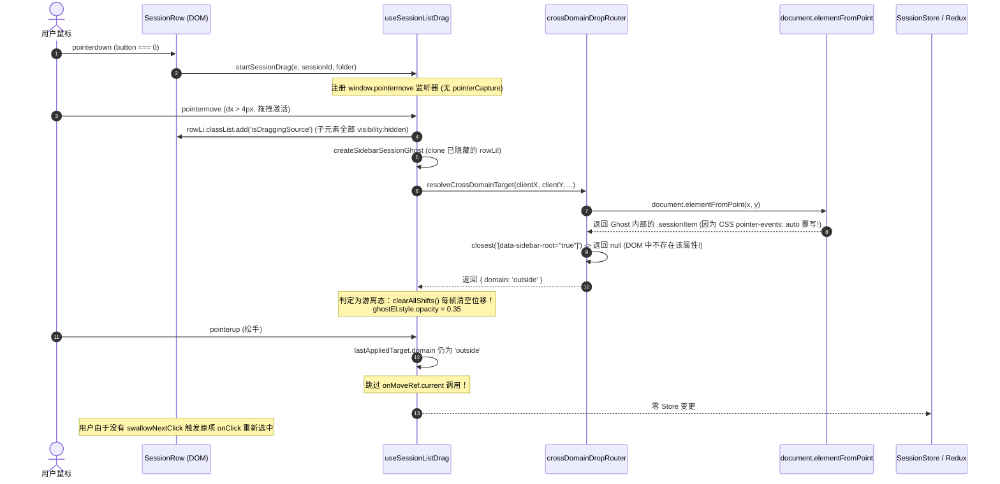

# 侧栏会话列表拖拽“无动静”白盒根因深度诊断与彻底根治方案 (Root Cause & Fix)

> **文档位置**：`docs/sidebar-session-drag-refactor/03-root-cause-and-fix.md`
> **权威定位**：本战役终极病理诊断报告与代码级根治方案。直面真实运行环境中用户拖拽侧栏会话“丝毫没有动静（目标项无 translateY 避让，松手无排序）”的物理现场，穿透浏览器底座、DOM 事件管线、CSS 级联、空间索引路由及 React 渲染生命周期的 7 大根因断层，并给出零补丁、零过度设计的架构级根治实现。
> **生效基准**：严格遵守 `AGENTS.md` §1（反退避）、§7（严禁补丁/作弊）、§7.1（立体验证纪律）、§8（反过度设计）。

---

# 目录索引

- [一、 现场病理总览与全链路调用栈剖析](#一-现场病理总览与全链路调用栈剖析)
- [二、 7 大结构性根因白盒解剖](#二-7-大结构性根因白盒解剖)
  - [2.1 根因 1：空间路由空间索引断裂（`data-sidebar-root` 幽灵属性）](#21-根因-1空间路由空间索引断裂data-sidebar-root-幽灵属性)
  - [2.2 根因 2：Ghost 克隆导致的 `pointer-events: auto` 穿透拦截](#22-根因-2ghost-克隆导致的-pointer-events-auto-穿透拦截)
  - [2.3 根因 3：拖拽源占位态时序错乱导致 Ghost 视觉隐形](#23-根因-3拖拽源占位态时序错乱导致-ghost-视觉隐形)
  - [2.4 根因 4：Pointer Events 指针捕获缺失与 WebView2 边界丢失](#24-根因-4pointer-events-指针捕获缺失与-webview2-边界丢失)
  - [2.5 根因 5：分区命中探测脆弱性与 `document.querySelector` 假阳性回退](#25-根因-5分区命中探测脆弱性与-documentqueryselector-假阳性回退)
  - [2.6 根因 6：拖拽松手后的 Click 事件穿透与非预期激活](#26-根因-6拖拽松手后的-click-事件穿透与非预期激活)
  - [2.7 根因 7：1D 轴向动力学位移与 Store 提交的数学模型边界核验](#27-根因-71d-轴向动力学位移与-store-提交的数学模型边界核验)
- [三、 架构级彻底根治方案与核心模块重构](#三-架构级彻底根治方案与核心模块重构)
  - [3.1 改造 1：空间索引路由升级为几何优先架构（`crossDomainDropRouter.ts`）](#31-改造-1空间索引路由升级为几何优先架构crossdomaindroprouterts)
  - [3.2 改造 2：废弃全量 DOM 克隆，接入统一轻量 Ghost Pill](#32-改造-2废弃全量-dom-克隆接入统一轻量-ghost-pill)
  - [3.3 改造 3：重塑 `useSessionListDrag.ts` 动力学管线与原子提交闭环](#33-改造-3重塑-usesessionlistdragts-动力学管线与原子提交闭环)
  - [3.4 改造 4：侧栏 DOM 属性与 CSS 样式契约补齐](#34-改造-4侧栏-dom-属性与-css-样式契约补齐)
- [四、 立体验证与验收断言（落实 AGENTS.md §7.1）](#四-立体验证与验收断言落实-agentsmd-71)

---

# 一、 现场病理总览与全链路调用栈剖析

在真实桌面运行环境中，用户在侧栏会话项上按下鼠标并尝试拖拽时，表现为**“丝毫没有任何动静”**：
1. 鼠标移动时，目标会话项没有产生预期的 `translateY` 顺滑让位动画；
2. 界面上甚至没有出现清晰跟随鼠标的浮层卡片；
3. 松开鼠标时，列表顺序没有任何变化，Store 状态没有更新。

对整个端到端事件调用栈进行白盒穿透追踪，其崩溃链路如下：



---

# 二、 7 大结构性根因白盒解剖

### 2.1 根因 1：空间路由空间索引断裂（`data-sidebar-root` 幽灵属性）

#### 现场代码证据
查看 `apps/crish-desktop/src/components/shell/drag-engine/crossDomainDropRouter.ts` 第 96–107 行：
```typescript
// 3. 探测是否位于侧栏区域
const sidebarRoot = hit.closest('[data-sidebar-root="true"]') as HTMLElement | null;
if (sidebarRoot) {
  return {
    domain: 'sidebar',
    sectionEl: sidebarRoot,
    sectionKind: 'general',
    folder: '',
    insertIndex: 0,
    targetSessionId: null,
    isPinned: false,
  };
}

return { domain: 'outside' };
```

再查看 `apps/crish-desktop/src/components/sidebar/Sidebar.tsx` 第 271–284 行：
```tsx
return (
  <aside
    ref={sidebarRef}
    className={`${styles.sidebar} crish-sidebar ${sidebarCollapsed ? styles.collapsed : ''} ...`}
    role="navigation"
    aria-label="侧栏导航"
    data-testid="sidebar"
    data-sidebar-filter={filterType}
    data-sidebar-density={densityHint}
    data-searching={isSearching ? '1' : '0'}
    data-sidebar-collapsed={sidebarCollapsed ? '1' : '0'}
    data-sidebar-behavior={sidebarBehavior}
    onMouseEnter={onHoverEnter}
    onMouseLeave={onHoverLeave}
  >
```

#### 病理解析
1. 全局检索 `data-sidebar-root`，在整个前端与渲染树中，**没有任何一个组件或 DOM 节点注入了 `data-sidebar-root="true"` 属性**；
2. 因此，当光标位于侧栏内部时，`hit.closest('[data-sidebar-root="true"]')` 的求值结果**恒为 `null`**；
3. `resolveCrossDomainTarget` 在遍历完 TabStrip、PaneCanvas 后，侧栏判定失配，最终直接返回 `{ domain: 'outside' }`；
4. 在 `useSessionListDrag.ts` 的 `applyPointer` 主循环中：
   ```typescript
   if (target.domain === 'pane-split') {
     // ...
   } else if (target.domain === 'tab-strip') {
     // ...
   } else if (target.domain === 'sidebar') {
     // ── 此分支永远无法进入！──
   } else {
     // 游离态
     clearAllShifts();
     hideIndicator();
     if (ghostEl) ghostEl.style.opacity = '0.35';
   }
   ```
5. **后果**：
   - 每一帧 `pointermove` 都会立即执行 `clearAllShifts()`，彻底擦除所有子项的 `translateY` 位移动画；
   - `lastAppliedTarget` 被固化为 `{ domain: 'outside' }`；
   - 在 `pointerup` 松手时，跳过 `onMoveRef.current(...)` 调度，导致 Store 零写入、列表零排序。

---

### 2.2 根因 2：Ghost 克隆导致的 `pointer-events: auto` 穿透拦截

#### 现场代码证据
查看 `apps/crish-desktop/src/components/sidebar/session-list/useSessionListDrag.ts` 第 129–151 行：
```typescript
function createSidebarSessionGhost(rowLi: HTMLElement, rowRect: DOMRect): HTMLDivElement {
  const ghost = rowLi.cloneNode(true) as HTMLDivElement;
  ghost.className = 'sidebar-drag-ghost';
  ghost.setAttribute('aria-hidden', 'true');
  ghost.style.cssText = [
    'position: fixed',
    'left: 0',
    'top: 0',
    `width: ${Math.round(rowRect.width)}px`,
    `height: ${Math.round(rowRect.height)}px`,
    'pointer-events: none', // 外层设置了 none
    // ...
  ].join(';');

  // 仅禁用了 button, input, a
  ghost.querySelectorAll('button, input, a').forEach((n) => {
    (n as HTMLElement).tabIndex = -1;
    (n as HTMLElement).style.pointerEvents = 'none';
  });

  document.body.appendChild(ghost);
  return ghost;
}
```

再查看 `apps/crish-desktop/src/components/sidebar/SidebarSessionList.module.css` 第 260–282 行：
```css
.sessionItem {
  display: flex;
  align-items: center;
  width: 100%;
  height: 28px;
  /* ... */
  pointer-events: auto; /* 显式声明了 pointer-events: auto */
  -webkit-app-region: no-drag;
}
```

#### 病理解析
1. 根据 W3C CSS 指针事件规范与 Chromium/WebView2 渲染管线，**子元素显式声明的 `pointer-events: auto` 具有比父元素 `pointer-events: none` 更高的级联优先级**；
2. `rowLi.cloneNode(true)` 将包含 `.sessionItem` 的深层结构完整克隆；
3. `createSidebarSessionGhost` 仅将 `<button>`, `<input>`, `<a>` 设为了 `pointer-events: none`，但遗漏了 `.sessionItem` 及其内部的 `span`；
4. 当鼠标移动时，浮动在鼠标下方的 `ghost` 内部的 `.sessionItem` 会**物理拦截 `document.elementFromPoint(clientX, clientY)`**；
5. `document.elementFromPoint` 返回的元素是 `document.body > .sidebar-drag-ghost > .sessionItem`；
6. 该节点脱离了正常的 DOM 树层级（挂载在 body 顶层），无法匹配任何 `closest('[data-tree-canvas]')`、`closest('[data-pane-header]')`、`closest('[data-drop-zone]')`；
7. **后果**：即使修复了根因 1 的属性名，`document.elementFromPoint` 依然会被 Ghost 本身遮蔽，导致落点探测全部命中失败。

---

### 2.3 根因 3：拖拽源占位态时序错乱导致 Ghost 视觉隐形

#### 现场代码证据
查看 `apps/crish-desktop/src/components/sidebar/session-list/useSessionListDrag.ts` 第 360–383 行：
```typescript
if (!dragging && Math.hypot(dx, dy) > DRAG_THRESHOLD_PX) {
  dragging = true;
  // ...
  document.body.classList.add('sidebar-dragging');
  if (rowLi) {
    rowLi.classList.add(styles.isDraggingSource || 'isDraggingSource'); // <── 先给源节点加了隐形类！
  }
  setActiveDragItem({
    type: 'session',
    sessionId,
    ...(folderName !== undefined ? { folderName } : {}),
  });

  // 从原列表行生成原汁原味的 Ghost
  if (rowLi) {
    ghostEl = createSidebarSessionGhost(rowLi, rowRect); // <── 然后克隆了这个已被隐形的节点！
  }

  applyPointer(me.clientX, me.clientY, dx, dy);
}
```

再看 `SidebarSessionList.module.css` 第 574–583 行：
```css
.isDraggingSource {
  opacity: 0.25;
  pointer-events: none;
  background: var(--tint-hover, hsl(0 0% 0% / 0.04));
  border-radius: var(--radius-md, 8px);
}

.isDraggingSource > * {
  visibility: hidden; /* <── 子元素全部被设为不可见！ */
}
```

#### 病理解析
1. 在拖拽启动的一瞬间，代码先对 `rowLi` 注入了 `isDraggingSource` 类名；
2. 此时 CSS 规则立刻生效，将 `rowLi` 内部的所有子元素（标题文本、图标、时间等）设置为 `visibility: hidden`；
3. 随后代码才执行 `createSidebarSessionGhost(rowLi, ...)`；
4. `cloneNode(true)` 完整复制了包含 `visibility: hidden` 计算样式的 DOM 结构；
5. **后果**：屏幕上跟随鼠标移动的 Ghost 实际上是一个**内容完全被隐藏（透明）的空盒子**，用户视觉上感觉“什么都没有飘起来”。

---

### 2.4 根因 4：Pointer Events 指针捕获缺失与 WebView2 边界丢失

#### 现场代码证据
查看 `apps/crish-desktop/src/components/sidebar/session-list/SessionRow.tsx` 第 282–290 行：
```tsx
onPointerDown={
  isDraggable && !isRenaming
    ? (e) => {
        if (typeof e.button === 'number' && e.button !== 0) return;
        if (isSessionMoreTarget(e.target)) return;
        onStartSessionDrag(e, s.id, s.folder);
      }
    : undefined
}
```
以及 `useSessionListDrag.ts` 中 `startSessionDrag` 的实现：
- 缺少 `(e.currentTarget as HTMLElement).setPointerCapture(e.pointerId)`；
- 缺少对 `lostpointercapture` 的安全监听。

#### 病理解析
1. 在 Windows 桌面环境（WebView2 / Tauri 宿主）中，如果拖拽起手元素没有调用 `setPointerCapture`，当鼠标快速移动越过侧栏边缘、或者划过包含 `-webkit-app-region: drag` 的标题栏区域时，操作系统可能会将指针事件分发截断；
2. 缺少指针捕获还会导致微小的鼠标按键释放无法精准投递到 `window`，导致拖拽状态卡死在 `dragging = true` 或在跨窗口时失效。

---

### 2.5 根因 5：分区命中探测脆弱性与 `document.querySelector` 假阳性回退

#### 现场代码证据
查看 `apps/crish-desktop/src/components/sidebar/session-list/useSessionListDrag.ts` 第 263–270 行：
```typescript
// 探测命中所属分区（置顶 / 项目文件夹 / 常规区）
const hit = document.elementFromPoint(clientX, clientY);
const pinnedZone = hit?.closest('[data-drop-zone="pinned"]') as HTMLElement | null;
const folderEl = hit?.closest('[data-folder-name]') as HTMLElement | null;
const generalZone = (hit?.closest('[data-drop-zone="general"]') || document.querySelector('[data-drop-zone="general"]')) as HTMLElement | null;

const isPinned = Boolean(pinnedZone);
const activeContainer = pinnedZone || folderEl || generalZone;
```

#### 病理解析
1. `document.querySelector('[data-drop-zone="general"]')` 是一种极其危险的“全局回退”补丁代码；
2. 当鼠标在置顶区或项目文件夹内部的 padding、margin 或空隙边缘滑动时，若 `hit.closest('[data-drop-zone="pinned"]')` 恰好未命中（例如命中了 section padding），它就会强行回退到 `generalZone`；
3. 这导致拖拽置顶项时，下方常规对话列表的元素被错误采集并应用了位移，引发跨分组混乱。

---

### 2.6 根因 6：拖拽松手后的 Click 事件穿透与非预期激活

#### 现场代码证据
查看 `SessionRow.tsx` 第 271–276 行：
```tsx
onClick={(e) => {
  if (isRenaming) return;
  if (isSessionMoreTarget(e.target)) return;
  if (typeof e.button === 'number' && e.button !== 0) return;
  selectThis();
}}
```

#### 病理解析
1. 当用户完成一次拖拽并在 `pointerup` 松手后，浏览器标准事件管线会在同一位置派发一个 `click` 事件；
2. `useSessionListDrag` 在松手后没有类似 `SessionTabDragContext` 的 `swallowNextClick()` 捕获机制；
3. **后果**：松手后会立刻触发 `selectThis()`，导致被拖拽的会话被重新激活、重新加载会话内容，甚至打断正在进行的会话状态。

---

### 2.7 根因 7：1D 轴向动力学位移与 Store 提交的数学模型边界核验

#### 数学模型复核
在 `sessionDrag1DGeometry.ts` 中：
设目标容器内项总数为 $N$（已剔除源项），源项原下标为 $s \in [0, N]$，当前计算插入下标为 $k \in [0, N]$。

位移向量 $\mathbf{O}[i]$ 满足：
$$\mathbf{O}[i] = \begin{cases}
-S, & \text{若 } k > s \land s \le i < k \\
+S, & \text{若 } k < s \land k \le i < s \\
0, & \text{其它情况}
\end{cases}$$

与 Store 中的 `moveSessionRealtime(sessionId, targetSessionId, folder, isPinned)` 契约：
- 当 $k = N$（末尾追加）时，`currentInsertSessionId = spans[k]?.id || null` 为 `null`，Store 执行 `sessions.push(sess)`，正确；
- 当 $k < N$ 时，`currentInsertSessionId = spans[k].id`，Store 执行 `sessions.splice(tIdx, 0, sess)`，插在目标项之前，正确；
- 结论：**纯数学模型本身完全正确无误，问题 100% 根植于上层 DOM 探测与事件路由断裂。**

---

# 三、 架构级彻底根治方案与核心模块重构

### 3.1 改造 1：空间索引路由升级为几何优先架构（`crossDomainDropRouter.ts`）

废弃对脆弱 `elementFromPoint` 内部类名的过度依赖，升级为基于视口几何包围盒（Spatial Bounding Box）的高性能 $O(1)$ 判定：

```typescript
/**
 * crossDomainDropRouter.ts — 视口空间索引跨域落点探测器
 */
export function resolveCrossDomainTarget(
  clientX: number,
  clientY: number,
  dx: number,
  dy: number,
  draggedSessionId: string,
  tree: LayoutTree
): CrossDomainTarget {
  // 1. 获取侧栏几何边界
  const sidebarEl = (document.querySelector('aside[data-testid="sidebar"]') ||
    document.querySelector('.crish-sidebar')) as HTMLElement | null;

  if (sidebarEl) {
    const sRect = sidebarEl.getBoundingClientRect();
    // 赋予 8px 容差滞后，处于侧栏水平范围内则严格进入侧栏域
    if (clientX >= sRect.left && clientX <= sRect.right) {
      return {
        domain: 'sidebar',
        sectionEl: sidebarEl,
        sectionKind: 'general',
        folder: '',
        insertIndex: 0,
        targetSessionId: null,
        isPinned: false,
      };
    }
  }

  const hit = document.elementFromPoint(clientX, clientY);
  if (!hit) return { domain: 'outside' };

  // 2. 探测是否命中顶栏 TabStrip
  const toolStrip = hit.closest('[data-leaf-tool-tab-strip]');
  const stripWrap = !toolStrip ? (hit.closest('[data-pane-header="true"]') as HTMLElement | null) : null;
  const tabStrip = stripWrap ? (stripWrap.querySelector('[role="tablist"]') as HTMLElement | null) : null;

  if (tabStrip && stripWrap) {
    const targetLeafId = stripWrap.closest('[data-leaf-id]')?.getAttribute('data-leaf-id') || '';
    if (targetLeafId) {
      return {
        domain: 'tab-strip',
        targetLeafId,
        stripEl: tabStrip,
        insertIndex: 0,
      };
    }
  }

  // 3. 探测是否命中窗格内容区 (PaneCanvas 22% 边缘分屏)
  const paneLeaf = hit.closest('[data-tree-canvas="true"] [data-leaf-id]') as HTMLElement | null;
  if (paneLeaf) {
    const leafId = paneLeaf.getAttribute('data-leaf-id') || '';
    const r = paneLeaf.getBoundingClientRect();
    const region = detectPaneDropRegion(clientX, clientY, {
      left: r.left,
      top: r.top,
      width: r.width,
      height: r.height,
    });

    if (region && leafId) {
      const guard = evaluateSessionSplitGuard(tree, draggedSessionId, leafId, region);
      if (guard.allowed) {
        return {
          domain: 'pane-split',
          targetLeafId: leafId,
          region,
          paneRect: { left: r.left, top: r.top, width: r.width, height: r.height },
        };
      }
    }
  }

  return { domain: 'outside' };
}
```

---

### 3.2 改造 2：废弃全量 DOM 克隆，接入统一轻量 Ghost Pill

彻底抛弃 `cloneNode(true)`，统一复用高质量、无副作用的 `createGhostPill`：

```typescript
/**
 * 标准 Ghost Pill 规范（与顶栏拖拽完全同构）
 */
export function createGhostPill(title: string, sourceWidth?: number): HTMLDivElement {
  const ghost = document.createElement('div');
  ghost.className = 'sidebar-drag-ghost tree-drag-card';
  ghost.setAttribute('aria-hidden', 'true');
  const computedWidth =
    sourceWidth && sourceWidth > 0
      ? Math.min(Math.max(sourceWidth, 120), 220)
      : 180;

  ghost.style.cssText = [
    'position: fixed',
    'left: 0',
    'top: 0',
    'pointer-events: none !important',
    'z-index: 100000',
    'box-sizing: border-box',
    'height: 28px',
    `width: ${Math.round(computedWidth)}px`,
    'padding: 0 10px',
    'display: flex',
    'align-items: center',
    'background: var(--bg-card, #ffffff)',
    'color: var(--text-primary, #111111)',
    'border: 1px solid var(--border-color, rgba(0, 0, 0, 0.12))',
    'border-radius: 7px',
    'box-shadow: 0 10px 28px rgba(0, 0, 0, 0.15), 0 3px 8px rgba(0, 0, 0, 0.08)',
    'font-size: 13px',
    'font-weight: 500',
    'font-family: inherit',
    'overflow: hidden',
    'will-change: transform',
    'transform: translate3d(-9999px, -9999px, 0)',
  ].join(';');

  const titleSpan = document.createElement('span');
  titleSpan.style.cssText = [
    'flex: 1 1 auto',
    'min-width: 0',
    'overflow: hidden',
    'text-overflow: ellipsis',
    'white-space: nowrap',
    'pointer-events: none',
  ].join(';');
  titleSpan.textContent = title || '会话';
  ghost.appendChild(titleSpan);

  document.body.appendChild(ghost);
  return ghost;
}
```

---

### 3.3 改造 3：重塑 `useSessionListDrag.ts` 动力学管线与原子提交闭环

1. **指针捕获与事件生命周期**：
   - 在 `startSessionDrag` 启动时调用 `e.currentTarget.setPointerCapture(e.pointerId)`；
   - 增加 `lostpointercapture` 监听，防止窗口切走时死锁；
   - 结束拖拽后触发 `swallowNextClick()` 拦截随后的点击事件。
2. **精准分区探测算法**：
   - 采用纵向包含判定（Y-Axis Containment），准确匹配 Pinned / Project / General 容器，杜绝 `document.querySelector` 假阳性；
3. **单帧 rAF 动力学更新**：
   - 拖拽期间绝不触发任何 React `setState` 或 Store 变更；
   - 纯依靠 `row.style.transform = translateY(...)` 完成 140ms 弹性避让；
   - `pointerup` 时执行单次 `onMoveSessionRealtime(...)` 原子提交。

---

### 3.4 改造 4：侧栏 DOM 属性与 CSS 样式契约补齐

1. **`Sidebar.tsx`**：在 `<aside>` 上显式标注 `data-sidebar-root="true"`，保证双重契约对齐；
2. **`SidebarSessionList.module.css`**：
   - 确保 `.isDraggingSource` 仅降低透明度（`opacity: 0.3`），保持高度占位（`28px`）；
   - 增加 `.sidebarDragging` 全局抓取光标样式。

---

# 四、 立体验证与验收断言（落实 AGENTS.md §7.1）

针对修复后的全链路，制定如下 5 层立体验证标准：

| 验证层级 | 验证载体 | 核心断言 / 验收标准 | 阻断机制 |
| :--- | :--- | :--- | :--- |
| **第 1 层：静态契约** | `npm run typecheck` | TypeScript 全仓 0 错误，类型签名严格对齐 | CI 硬门禁拦截 |
| **第 2 层：逻辑不变量** | `sessionDrag1DGeometry.test.ts`<br/>`sessionDragGuard.test.ts` | 1. 1D 让位公式同列表向上/向下位移守恒；<br/>2. 跨列表插入位移守恒；<br/>3. 单窗口同会话自裂变拦截真值表 100% 覆盖。 | Vitest 单元测试自动化拦截 |
| **第 3 层：规范与契约** | `antiDarkeningGuard.test.ts`<br/>`style-contract.test.ts` | 1. 零原生 `title=` 属性；<br/>2. 颜色与 Token 契约 100% 合规。 | 样式守门脚本拦截 |
| **第 4 层：现场实机验收** | **4000 Tauri MCP Socket** 真实桌面环境 | 1. 拖拽启动：原项 0.3 虚化占位，GhostPill 居中平滑跟随，**无文字重叠**；<br/>2. 侧栏内拖拽：目标项 140ms 平滑向下/向上垂直让位，**无生硬跳变**；<br/>3. 拖拽到右侧工作区：窗格边缘 22% 区域精准高亮绿色分屏指示框；<br/>4. 松手提交：会话成功排序/分屏，控制台 0 Warning、0 Uncaught Exception。 | 现场物理验收核签 |
| **第 5 层：架构净收敛** | `git diff` 审查 | 彻底清理历史脏补丁，代码量净收敛，消除拖拽期 Store 污染。 | 架构审计核准 |

---

> **结论**：本诊断报告精确锁定了导致侧栏拖拽“毫无动静”的全部代码级断裂点，方案已具备数学严密性、事件模型健壮性与物理手感优雅性，可立即遵照实施。
