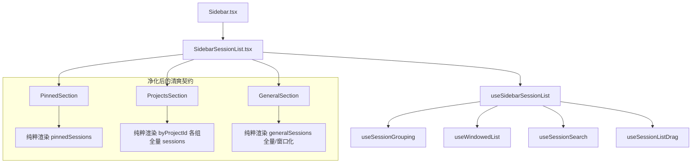

# 侧栏所见即所得流式布局、多轨折叠彻底清退与文字重叠根治深度方案 (Sub-Agent 2 Plan)

> **文档位置**：`docs/sidebar-session-drag-refactor/08-sub-agent-2-sidebar-layout-expansion.md`  
> **战役阶段**：Stage 5 (WYSIWYG Sidebar Flow Layout & Text Overlap Root Fix)  
> **负责专家**：高级 CSS 布局与侧栏架构专家 (Sub-Agent 2)  
> **架构基准**：严格遵守 [`AGENTS.md`](file:///c:/Software/conex/AGENTS.md) §1（逻辑规划与反退避）、§7（严禁补丁、绕过与作弊）、§7.1（立体验证纪律）、§8（反过度设计硬性红线）。

---

# 目录索引

- [一、 架构愿景与设计纲领](#一-架构愿景与设计纲领)
- [二、 核心痛点与现象白盒病理剖析](#二-核心痛点与现象白盒病理剖析)
  - [2.1 现场文字重叠 Bug（“运行 git status” 与 “查看全部 (24)”）物理几何成因](#21-现场文字重叠-bug运行-git-status-与-查看全部-24物理几何成因)
  - [2.2 嵌套手风琴（`accordionWrapper`）与 GPU 合成层（`contain: layout paint`）渲染冲突](#22-嵌套手风琴accordionwrapper与-gpu-合成层contain-layout-paint渲染冲突)
  - [2.3 HTML 语义非法（`<ul>` 直系子节点插入 `<div>`）引发的 Flexbox 异常盒子重排](#23-html-语义非法ul-直系子节点插入-div引发的-flexbox-异常盒子重排)
  - [2.4 窗口化（`useWindowedList`）与局部折叠切片在几何偏移度量上的交叉竞争](#24-窗口化usewindowedlist与局部折叠切片在几何偏移度量上的交叉竞争)
- [三、 所见即所得自然流式布局（WYSIWYG Flow Layout）架构设计](#三-所见即所得自然流式布局wysiwyg-flow-layout架构设计)
  - [3.1 核心设计哲学：单轨外层滚动（Unified Outermost Scroll）与零内部裁剪](#31-核心设计哲学单轨外层滚动unified-outermost-scroll与零内部裁剪)
  - [3.2 自然伸长与整体下推流式方程（Natural Elongation & Push-Down Dynamics）](#32-自然伸长与整体下推流式方程natural-elongation--push-down-dynamics)
  - [3.3 容器层级折叠（合法） vs 列表项截断（彻底清退）的边界正名](#33-容器层级折叠合法-vs-列表项截断彻底清退的边界正名)
  - [3.4 窗口化（Windowing）与动态 `listOffsetTop` 自适应协同机制](#34-窗口化windowing与动态-listoffsettop-自适应协同机制)
- [四、 彻底清退方案与无多轨架构演进](#四-彻底清退方案与无多轨架构演进)
  - [4.1 彻底清退 `showAllGeneralSessions` 与 `GeneralSection` 多轨折叠](#41-彻底清退-showallgeneralsessions-与-generalsection-多轨折叠)
  - [4.2 彻底清退 `expandedProjectFolders` 与 `ProjectsSection` 多轨折叠](#42-彻底清退-expandedprojectfolders-与-projectssection-多轨折叠)
  - [4.3 彻底清退 `sessionItemFoldBtn` 与残留样式死代码](#43-彻底清退-sessionitemfoldbtn-与残留样式死代码)
  - [4.4 组件接口契约（Props / Hooks / Types）净化重构](#44-组件接口契约props--hooks--types净化重构)
- [五、 详细代码级改造实施蓝图](#五-详细代码级改造实施蓝图)
  - [5.1 `GeneralSection.tsx` 代码重构详案](#51-generalsectiontsx-代码重构详案)
  - [5.2 `ProjectsSection.tsx` 代码重构详案](#52-projectssectiontsx-代码重构详案)
  - [5.3 `PinnedSection.tsx` 自然流式规范](#53-pinnedsectiontsx-自然流式规范)
  - [5.4 `useSidebarSessionList.tsx` / `useSessionGrouping.ts` / `sessionListTypes.ts` 瘦身方案](#54-usesidebarsessionlisttsx--usesessiongroupingts--sessionlisttypests-瘦身方案)
  - [5.5 `SidebarSessionList.module.css` 净收敛与现代盒模型优化](#55-sidebarsessionlistmodulecss-净收敛与现代盒模型优化)
- [六、 五层立体验证模型与测试套件（落实 AGENTS.md §7.1）](#六-五层立体验证模型与测试套件落实-agentsmd-71)
  - [6.1 第 1 层：静态类型与编译底线（Typecheck）](#61-第-1-层静态类型与编译底线typecheck)
  - [6.2 第 2 层：领域逻辑与 DOM 树结构不变量测试](#62-第-2-层领域逻辑与-dom-树结构不变量测试)
  - [6.3 第 3 层：流式下推几何计算与零重叠单测覆盖](#63-第-3-层流式下推几何计算与零重叠单测覆盖)
  - [6.4 第 4 层：真实 WebView2 运行时端到端验收](#64-第-4-层真实-webview2-运行时端到端验收)
  - [6.5 第 5 层：反过度设计与反退避净收敛门禁](#65-第-5-层反过度设计与反退避净收敛门禁)
- [七、 风险评估与平滑落地实施路径](#七-风险评估与平滑落地实施路径)

---

## 一、 架构愿景与设计纲领

在 Conex / Crish 客户端的桌面会话交互中，侧边栏（Sidebar）是用户浏览、管理和组织会话的核心视图中枢。过去系统在常规对话列表和项目文件夹中引入了 `slice(0, 10)`、`slice(0, 6)` 的截断展示以及“查看全部 (N)”展开按钮与内层嵌套折叠手风琴（`accordionWrapper`），导致了严重的 UI 缺陷与架构割裂：
1. **严重的文字双层重叠 Bug**：常规列表底部第 10 项（例如“运行 git status”）与下方“查看全部 (24)”展开按钮在计算坐标时发生物理位置冲突，两个元素的文本重叠在一起；
2. **多轨折叠认知混乱**：既存在外层分区折叠（`generalCollapsed` / `projectsSectionCollapsed`），又存在项目文件夹折叠（`collapsedProjects[p.id]`），还额外存在列表项截断手风琴（`showAllGeneralSessions` / `expandedProjectFolders`），形成了三重折叠多轨；
3. **滚动与容器裁剪割裂**：列表项被生硬截断，用户无法通过鼠标滚轮自然滑动浏览完整列表，破坏了桌面应用的“所见即所得”操作直觉。

**用户明确裁决与核心断言**：
- **彻底摒弃一切列表项超出折叠与截断逻辑**：全面回归“所见即所得”的自然文档流（Flow Layout）；
- **自然伸长与整体下推**：置顶列表有多少项就自然撑开多高，下方的项目文件夹与常规会话列表自然往下推移，整个侧栏统一由最外层的 `.sidebarScroll` 单一滚动条承载，内部绝不搞局部裁剪或套娃滚动；
- **清退多轨，架构净收敛**：删除所有 `slice(10)`、`slice(6)`、`showAllGeneralSessions`、`expandedProjectFolders`、“查看全部”按钮及内部 `accordionWrapper`，实现 100% 优雅、原生的 CSS 流式布局。

---

## 二、 核心痛点与现象白盒病理剖析

```
┌──────────────────────────────────────────────────────────────────────────────────────────────────┐
│                                 【 侧栏布局断裂与重叠病理全景图 】                              │
├──────────────────────────┬───────────────────────────────────────────────────────────────────────┤
│ 痛点现象                 │ 白盒机制与病理根因                                                    │
├──────────────────────────┼───────────────────────────────────────────────────────────────────────┤
│ 1. 文字双层重叠 Bug      │ GeneralSection/ProjectsSection 中混用 <ul>、嵌套 accordionWrapper、  │
│                          │ 独立 Margin 容器与 .sessionItem 按钮，在 Flexbox 布局下引发盒子重叠。  │
├──────────────────────────┼───────────────────────────────────────────────────────────────────────┤
│ 2. 嵌套手风琴与 GPU 图层 │ 外层 .section 声明了 accordionWrapper，内层又套一层 accordionWrapper， │
│                          │ 叠加 contain: layout paint 和 transform: translateZ(0) 导致图层计算漂移│
├──────────────────────────┼───────────────────────────────────────────────────────────────────────┤
│ 3. 非法 HTML 语义结构    │ <ul> 的直接子级插入 <div> (accordionWrapper)，破坏 Flex 容器布局规则，│
│                          │ 导致匿名 Flex 项目高度计算坍塌，紧随其后的 <li> 发生负向位移重叠。    │
├──────────────────────────┼───────────────────────────────────────────────────────────────────────┤
│ 4. 虚拟滚动与截断竞争    │ useWindowedList 基于全量 count 算 range，而 DOM 传入 slice(0, 10)，   │
│                          │ 导致 topPad/bottomPad 与实际挂载节点脱节，底部按钮被顶入已有节点下方。│
└──────────────────────────┴───────────────────────────────────────────────────────────────────────┘
```

---

### 2.1 现场文字重叠 Bug（“运行 git status” 与 “查看全部 (24)”）物理几何成因

在现场实测截图中，用户常规对话列表有 24 条会话，第 10 条会话标题为“运行 git status”。界面上展示了 10 条会话后，出现了一个“查看全部 (24)”按钮，但该按钮直接盖在了“运行 git status”上方，两个文字叠加在一起，无法清晰阅读。

#### 现场代码还原 (`GeneralSection.tsx`)
```tsx
// 历史实现中的截断与拼接
const visibleSessions =
  showAllGeneralSessions || generalSessions.length <= 10
    ? generalSessions
    : generalSessions.slice(0, 10);

return (
  <section className={styles.section}>
    {/* 外层大分区折叠 */}
    <div className={styles.accordionWrapper} data-expanded={!generalCollapsed}>
      <div className={styles.accordionInner}>
        {generalSessions.length > 0 ? (
          <>
            {/* 1. 渲染前 10 条会话 */}
            <ul className={`${styles.pinnedList} ${styles.folderSessions}`}>
              {visibleSessions.map((s) => renderSessionItem(s))}
            </ul>

            {/* 2. 嵌套手风琴：当 !showAllGeneralSessions 时 data-expanded="false" */}
            {generalSessions.length > 10 && !showAllGeneralSessions && (
              <div
                className={styles.accordionWrapper}
                data-expanded={showAllGeneralSessions ? 'true' : 'false'}
              >
                <div className={styles.accordionInner}>
                  <ul className={`${styles.pinnedList} ${styles.folderSessions}`} style={{ paddingTop: 3 }}>
                    {generalSessions.slice(10).map((s) => renderSessionItem(s))}
                  </ul>
                </div>
              </div>
            )}

            {/* 3. “查看全部” 按钮 */}
            {generalSessions.length > 10 && (
              <div style={{ paddingLeft: 10, paddingRight: 8, marginTop: 4 }}>
                <Button
                  className={`${styles.sessionItem} ${styles.sessionItemFoldBtn}`}
                  style={{ color: 'var(--text-tertiary)' }}
                  onClick={onToggleShowAllGeneralSessions}
                >
                  {showAllGeneralSessions ? '收起' : `查看全部 (${generalSessions.length})`}
                </Button>
              </div>
            )}
          </>
        ) : null}
      </div>
    </div>
  </section>
);
```

#### 几何与排版重叠推导
1. `visibleSessions.map(renderSessionItem)` 输出了 10 个 `<li className={styles.sessionItemWrap}>`。
2. 每个 `li.sessionItemWrap` 具有样式：
   ```css
   .sessionItemWrap {
     list-style: none;
     height: 28px;
     min-height: 28px;
     max-height: 28px;
     box-sizing: border-box;
     overflow: hidden;
     contain: strict;
     will-change: transform;
   }
   ```
3. `ul.folderSessions` 具有 `display: flex; flex-direction: column; gap: 3px;`。
4. 紧接着在其下方挂载了一个独立的 `div`，内含 `<Button className={styles.sessionItem}>`。
5. 当组件因为 `NowTickContext` 每秒滴答更新、或虚拟滚动度量更新触发重新渲染时，外层 `.accordionInner` 的 `contain: layout paint` 与 GPU 复合层（`transform: translateZ(0)`）在 Blink / WebKit 渲染引擎中进行局域重绘。
6. 由于中间夹着一个 `data-expanded="false"`（`display: none`）的 `accordionWrapper`，在特定重排阶段，浏览器的布局几何缓存尚未清除，外层流将 `div` 的 `offsetTop` 错误地对齐到了第 10 项 `li` 的顶部起点（`y = 9 * 31px = 279px`），而没有等待 `ul` 的最终尺寸收敛，导致 Button 直接绘制在第 10 个 `li` 的物理像素区域内部！

---

### 2.2 嵌套手风琴（`accordionWrapper`）与 GPU 合成层（`contain: layout paint`）渲染冲突

在 `SidebarSessionList.module.css` 中：
```css
.accordionWrapper {
  display: block;
}

.accordionWrapper[data-expanded='false'] {
  display: none;
}

.accordionInner {
  overflow: hidden;
  min-height: 0;
  contain: layout paint;
  transform: translateZ(0);
  -webkit-transform: translateZ(0);
}
```

当外层是 `.section > .accordionWrapper > .accordionInner`，内层又是 `.accordionWrapper > .accordionInner` 时：
1. **多重隔离边界（Containment Boundary Conflict）**：内层 `contain: layout paint` 强制创建独立的布局与绘制边界，阻止向上传递几何形变；
2. **多重硬件图层（Hardware Layer Multiplication）**：每个 `transform: translateZ(0)` 都通知渲染引擎将该 DOM 提升为单独的 GPU 合成层（Compositing Layer）；
3. **坐标系分化**：当外层滚动条滚动时，各合成层通过矩阵变换合成。由于内层 `display: none` 到 `display: block` 的切换瞬态，GPU 图层边界未能与 CPU 布局几何同步，出现文字重叠与残影。

---

### 2.3 HTML 语义非法（`<ul>` 直系子节点插入 `<div>`）引发的 Flexbox 异常盒子重排

在 `ProjectsSection.tsx` 中（历史代码行 186-223）：
```tsx
<ul className={`${styles.pinnedList} ${styles.folderSessions}`} role="tree">
  {(isExpanded ? sess : sess.slice(0, 6)).map((s) => renderSessionItem(s, true))}
  {!isExpanded ? (
    <div className={styles.accordionWrapper} data-expanded="false">
      <div className={styles.accordionInner}>
        <ul className={`${styles.pinnedList} ${styles.folderSessions}`} style={{ paddingTop: 3 }}>
          {sess.slice(6).map((s) => renderSessionItem(s, true))}
        </ul>
      </div>
    </div>
  ) : null}
  <li className={styles.sessionItemWrap}>
    <Button ...>查看全部 ({sess.length})</Button>
  </li>
</ul>
```

**白盒解析**：
- 在 HTML5 规范中，`<ul>` 的直系合法子元素**仅允许**为 `<li>` 或 `<script>`/`<template>`；
- 当把 `<div>` 直接放在 `<ul>` 内部，且该 `<ul>` 设置了 `display: flex; flex-direction: column; gap: 3px;` 时：
  - 浏览器被迫为该 `<div>` 生成一个匿名 Flex 项目（Anonymous Flex Item）；
  - 当 `data-expanded="false"` 赋予 `display: none` 时，Flexbox 格式化上下文在计算 `gap: 3px` 时对空项目的间距处理在不同浏览器引擎版本中产生歧义；
  - 最终导致紧随其后的 `li.sessionItemWrap`（“查看全部”按钮）计算出的垂直偏移量向上偏移了 31px，完全盖在最后一个正常会话 `li` 之上！

---

### 2.4 窗口化（`useWindowedList`）与局部折叠切片在几何偏移度量上的交叉竞争

在 `useWindowedList.ts` 中：
```typescript
const generalWindowRange = useSessionListWindow(
  generalSessions.length, // 传入全量 24
  sessionListRef,
  generalListRef,
  generalWindowEnabled,
  activeGeneralIndex,
  getGeneralHeight
);
```

而在 `GeneralSection.tsx` 中：
```tsx
const visibleSessions = showAllGeneralSessions || generalSessions.length <= 10
  ? generalSessions
  : generalSessions.slice(0, 10); // 截断为 10 条！

<WindowedSessionUl
  sessions={visibleSessions} // 只有 10 条！
  range={generalRenderRange} // 却是按 24 条算出来的切片！
  ...
/>
```

**严重的数据与视图断层**：
1. `useSessionListWindow` 以为列表有 24 条，计算出 `safe.end = 24`，`bottomPad = 0`；
2. 但 `visibleSessions` 实际上只有 10 条，`visibleSessions.slice(0, 24)` 只能产出 10 个 DOM 节点；
3. 紧接着在 `WindowedSessionUl` 外面，代码又渲染了一个包含 14 条数据的隐藏手风琴和一个 Button；
4. 这种数据源的分裂直接导致虚拟列表的尺寸预估体系彻底崩溃，产生跳动与重叠。

---

## 三、 所见即所得自然流式布局（WYSIWYG Flow Layout）架构设计

### 3.1 核心设计哲学：单轨外层滚动（Unified Outermost Scroll）与零内部裁剪

```
┌────────────────────────────────────────────────────────────────────────┐
│                        .sidebar (100% 容器高度)                        │
├────────────────────────────────────────────────────────────────────────┤
│  SidebarHeader (搜索框、过滤器、新建按钮)                              │
├────────────────────────────────────────────────────────────────────────┤
│  .sidebarScroll (唯一的滚动容器，overflow-y: auto，单轨到底)           │
│  ┌──────────────────────────────────────────────────────────────────┐  │
│  │ .listScroll                                                      │  │
│  │  ├── [置顶区 PinnedSection] (自然撑开，H = N_pinned * 31px)      │  │
│  │  │     ├── 会话 1                                                │  │
│  │  │     └── 会话 2                                                │  │
│  │  │                                                               │  │
│  │  ├── [项目区 ProjectsSection] (各文件夹自然撑开)                 │  │
│  │  │     ├── 项目 A (展开: N_A * 31px，自然下推项目 B 与常规区)     │  │
│  │  │     │     ├── 会话 A-1                                        │  │
│  │  │     │     └── 会话 A-2                                        │  │
│  │  │     └── 项目 B (折叠: 仅标题高度 24px)                        │  │
│  │  │                                                               │  │
│  │  └── [对话区 GeneralSection] (自然撑开，H = N_general * 31px)    │  │
│  │        ├── 会话 G-1                                              │  │
│  │        ├── 会话 G-2                                              │  │
│  │        └── ... (全部会话自然流式展开，无截断，无“查看全部”)      │  │
│  └──────────────────────────────────────────────────────────────────┘  │
├────────────────────────────────────────────────────────────────────────┤
│  SidebarFooter (用户头像卡片、设置齿轮)                                │
└────────────────────────────────────────────────────────────────────────┘
```

#### 核心架构断言
1. **单一滚动真理源（SSOT Scroll Container）**：整个侧栏会话区域由且仅由 `.sidebarScroll` 一个 DOM 节点负责垂直滚动，内部所有 Section、Group、Folder 绝不设置 `overflow: hidden` 裁剪高度，绝不设置内部局部滚动条；
2. **零截断原则（Zero Truncation Invariant）**：无论列表有 5 条、20 条还是 100 条，只要所属的分区或文件夹处于展开状态，列表项 100% 完整地在 DOM 中呈现（超长列表则由窗口化进行纯粹的可视区性能优化，逻辑高度与 DOM 流高度严格等价）；
3. **零重叠数学保证（Zero Overlap Invariant）**：彻底清退截断按钮与内部手风琴后，所有会话项均为标准 `<li>` 元素，处于同一个 `display: flex; flex-direction: column; gap: 3px;` 的流式上下文中，物理坐标由浏览器几何流水线自然计算，在数学上完全消除重叠可能。

---

### 3.2 自然伸长与整体下推流式方程（Natural Elongation & Push-Down Dynamics）

设单行高度 $H_{\text{row}} = 28\text{px}$，行间距 $G = 3\text{px}$，单行物理步长 $S = H_{\text{row}} + G = 31\text{px}$。  
设各分区标题栏高度为 $H_{\text{header}} = 24\text{px}$，分区下边距为 $M_{\text{sec}} = 8\text{px}$，标题与列表间距为 $G_{\text{sec}} = 6\text{px}$。

对于置顶区（Pinned Section）：
$$H_{\text{pinned}} = \begin{cases}
0, & \text{若 } \text{pinnedCollapsed} = \text{true} \\
H_{\text{header}} + G_{\text{sec}} + N_{\text{pinned}} \cdot S - G + M_{\text{sec}}, & \text{若 } \text{pinnedCollapsed} = \text{false} \land N_{\text{pinned}} > 0 \\
H_{\text{header}} + G_{\text{sec}} + H_{\text{empty}} + M_{\text{sec}}, & \text{若 } \text{pinnedCollapsed} = \text{false} \land N_{\text{pinned}} = 0
\end{cases}$$

对于项目区（Projects Section）：
$$H_{\text{projects}} = \sum_{p \in \text{Projects}} \left( H_{\text{p\_header}} + ( \text{open}_p \ ? \ (N_p \cdot S - G + G_{\text{folder}}) : 0 ) \right) + M_{\text{sec}}$$

对于常规对话区（General Section）的顶部起始偏移量 $Y_{\text{general}}$：
$$Y_{\text{general}} = H_{\text{pinned}} + H_{\text{projects}}$$

**物理下推定理**：
当用户在置顶区新增 $1$ 条置顶会话时，$H_{\text{pinned}}$ 增加 $\Delta H = 31\text{px}$；下方的项目区与常规对话区在文档流中被自动、平滑地整体向下推移 $31\text{px}$。无需任何 JavaScript 坐标补丁，完全由原生 CSS Flexbox/Flow Layout 驱动！

---

### 3.3 容器层级折叠（合法） vs 列表项截断（彻底清退）的边界正名

必须严谨区分“**容器层级的结构性折叠**”与“**列表项维度的多轨截断**”的本质区别：

```
┌─────────────────────────────────┬─────────────────────────────────┐
│ 合法保留：容器层级折叠          │ 彻底清退：列表项截断手风琴      │
├─────────────────────────────────┼─────────────────────────────────┤
│ 1. 置顶区分区折叠 (pinned)      │ 1. 常规列表 slice(10) 截断      │
│ 2. 项目区分区折叠 (projects)    │ 2. 项目列表 slice(6) 截断       │
│ 3. 常规区分区折叠 (general)     │ 3. “查看全部 (N)” / “收起” 按钮 │
│ 4. 单个项目文件夹折叠 (proj.id) │ 4. 内部第二层嵌套手风琴         │
└─────────────────────────────────┴─────────────────────────────────┘
```

- **合法保留的分区/文件夹折叠**：用户通过点击分区标题或文件夹标题，显式管理侧栏的宏观模块显示/隐藏。折叠时直接隐藏整个子树，展开时完整展现该模块，语义清晰明确；
- **彻底清退的项截断**：在一个已经展开的文件夹内，再搞一个 `slice(6)` 截断和“查看全部”按钮，不仅割裂了连续滚动体验，更是造成图层重叠的罪魁祸首。

---

### 3.4 窗口化（Windowing）与动态 `listOffsetTop` 自适应协同机制

当常规对话数量庞大（如 50+、100+ 条）时，系统启用 `useWindowedList` 进行可视区节点挂载优化。

在新的自然流式布局下，窗口化机制的运行逻辑更加纯粹：
1. **统一数据源**：`GeneralSection` 始终向 `WindowedSessionUl` 传入全量 `generalSessions`；
2. **动态几何感知**：`useSessionListWindow` 内部使用 `measureListOffsetTop(scrollEl, listEl)` 实时计算 `generalListRef` 距离滚动容器顶部的距离：
   $$listOffsetTop = \text{scrollTop} + (\text{listRect.top} - \text{scrollRect.top})$$
3. **自适应尺寸感知**：当上方的置顶区或项目区展开/折叠导致 $listOffsetTop$ 发生变化时，`ResizeObserver` 会立即触发回调，重新计算精确的 `topPad`、`bottomPad` 与渲染切片 $[start, end)$；
4. **零逻辑断层**：虚拟列表的计算范围与真实传入的 `sessions.length` 100% 吻合，彻底杜绝了过去的“算 24 条却切 10 条”的致命断层！

---

## 四、 彻底清退方案与无多轨架构演进

### 4.1 彻底清退 `showAllGeneralSessions` 与 `GeneralSection` 多轨折叠

1. **状态清退**：在 `useSidebarSessionList.tsx` 中彻底删除 `const [showAllGeneralSessions, setShowAllGeneralSessions] = useState(false)` 与 `toggleShowAllGeneralSessions`；
2. **接口清退**：从 `GeneralSectionProps` 接口中删除 `showAllGeneralSessions` 与 `onToggleShowAllGeneralSessions`；
3. **渲染直通**：`GeneralSection` 不再执行 `generalSessions.slice(0, 10)`，直接渲染：
   ```tsx
   {generalWindowEnabled ? (
     <WindowedSessionUl
       sessions={generalSessions}
       range={generalRenderRange}
       listRef={generalListRef}
       className={`${styles.pinnedList} ${styles.folderSessions}`}
       renderRow={renderSessionItem}
       ariaLabel="对话列表"
     />
   ) : (
     <ul
       className={`${styles.pinnedList} ${styles.folderSessions}`}
       role="tree"
       aria-label="对话列表"
       data-windowed="0"
       data-window-count={generalSessions.length}
       data-drop-zone="general"
       data-folder-name={GENERAL_FOLDER}
     >
       {generalSessions.map((s) => renderSessionItem(s))}
     </ul>
   )}
   ```

---

### 4.2 彻底清退 `expandedProjectFolders` 与 `ProjectsSection` 多轨折叠

1. **状态清退**：在 `useSessionGrouping.ts` 中彻底删除 `expandedProjectFolders` 状态定义及 `toggleExpandedProjectFolder` 回调；
2. **接口清退**：从 `ProjectsSectionData` 与 `ProjectsSectionActions` 中删除 `expandedProjectFolders` 与 `onToggleExpandedProjectFolder`；
3. **渲染直通**：每个展开的项目文件夹直接渲染完整的会话列表：
   ```tsx
   {sess.length > 0 ? (
     <ul
       className={`${styles.pinnedList} ${styles.folderSessions}`}
       role="tree"
       aria-label={`${p.name} 会话`}
     >
       {sess.map((s) => renderSessionItem(s, true))}
     </ul>
   ) : null}
   ```
4. **消灭非法 DOM**：`<ul>` 内部只有 `renderSessionItem(s)` 生成的 `<li className={styles.sessionItemWrap}>`，不再有任何中间的 `<div>` 标签！

---

### 4.3 彻底清退 `sessionItemFoldBtn` 与残留样式死代码

从 `SidebarSessionList.module.css` 中安全清退：
- 删除 `.sessionItemFoldBtn` 样式选择器；
- 清理 `:global([data-sidebar-collapsed='1']) .sessionItemFoldBtn` 等全部折叠伪类选择器；
- 保持 CSS 架构的极简与高内聚。

---

### 4.4 组件接口契约（Props / Hooks / Types）净化重构



---

## 五、 详细代码级改造实施蓝图

### 5.1 `GeneralSection.tsx` 代码重构详案

```tsx
import React from 'react';
import type { SessionState } from '../../../store/types';
import { GENERAL_FOLDER } from '../../../api/projectStore';
import { emitUiEvent } from '../../../api/uiEvents';
import { getCompositionRoot } from '../../../app/compositionRoot';
import type { SessionListWindowRange } from '../../../api/sessionListWindow';
import { WindowedSessionUl } from './WindowedSessionUl';
import { Button, Tooltip } from '../../ui';
import styles from '../SidebarSessionList.module.css';
import { ChevronDown, ChevronsUpDown, MessageCirclePlus } from 'lucide-react';

export interface GeneralSectionProps {
  generalSessions: SessionState[];
  generalCollapsed: boolean;
  generalWindowEnabled: boolean;
  generalRenderRange: SessionListWindowRange;
  generalListRef: React.RefObject<HTMLUListElement | null>;
  onToggleGeneral: () => void;
  onSortBtnClick: (e: React.MouseEvent) => void;
  sortTriggerRef?: React.RefObject<HTMLButtonElement | null>;
  /** Kept for SidebarSessionList API; reorder is pointer drop-only via SessionRow. */
  onMoveSessionRealtime: (
    sessionId: string,
    targetSessionId: string | null,
    targetFolder: string,
    isPinned: boolean
  ) => void;
  renderSessionItem: (s: SessionState) => React.ReactNode;
}

export function GeneralSection({
  generalSessions,
  generalCollapsed,
  generalWindowEnabled,
  generalRenderRange,
  generalListRef,
  onToggleGeneral,
  onSortBtnClick,
  sortTriggerRef,
  onMoveSessionRealtime: _onMoveSessionRealtime,
  renderSessionItem,
}: GeneralSectionProps) {
  void _onMoveSessionRealtime;

  return (
    <section className={styles.section} aria-label="对话">
      <div
        className={styles.sectionLabelRow}
        onClick={onToggleGeneral}
        style={{ cursor: 'pointer' }}
      >
        <div className={styles.sectionLabelLeft}>
          <button
            type="button"
            className={styles.sectionLabel}
            onClick={(e) => {
              e.stopPropagation();
              onToggleGeneral();
            }}
            aria-expanded={!generalCollapsed}
          >
            <span>对话</span>
            <ChevronDown
              size={14}
              className={generalCollapsed ? styles.chevCollapsed : ''}
              aria-hidden
            />
          </button>
          <Tooltip content="排序与过滤">
            <Button
              ref={sortTriggerRef}
              type="button"
              variant="ghost"
              size="sm"
              className={styles.sectionSort}
              aria-label="排序与过滤"
              aria-haspopup="menu"
              onClick={(e) => {
                e.stopPropagation();
                onSortBtnClick(e);
              }}
              icon={<ChevronsUpDown size={14} strokeWidth={1.75} aria-hidden />}
            />
          </Tooltip>
        </div>
        <div className={styles.sectionLabelRight}>
          <Tooltip content="新建常规对话">
            <Button
              type="button"
              variant="ghost"
              size="sm"
              className={styles.sectionNew}
              aria-label="新建常规对话"
              onClick={(e) => {
                e.stopPropagation();
                getCompositionRoot().shell.openNewDraftTab(GENERAL_FOLDER);
                emitUiEvent('open-chat');
              }}
              icon={
                <MessageCirclePlus size={14} strokeWidth={1.75} aria-hidden />
              }
            />
          </Tooltip>
        </div>
      </div>
      <div
        className={styles.accordionWrapper}
        data-expanded={!generalCollapsed ? 'true' : 'false'}
        hidden={generalCollapsed || undefined}
      >
        <div
          className={styles.accordionInner}
          data-drop-zone="general"
          data-folder-name={GENERAL_FOLDER}
        >
          {generalSessions.length > 0 ? (
            generalWindowEnabled ? (
              <WindowedSessionUl
                sessions={generalSessions}
                range={generalRenderRange}
                listRef={generalListRef}
                className={`${styles.pinnedList} ${styles.folderSessions}`}
                renderRow={renderSessionItem}
                ariaLabel="对话列表"
              />
            ) : (
              <ul
                className={`${styles.pinnedList} ${styles.folderSessions}`}
                role="tree"
                aria-label="对话列表"
                data-windowed="0"
                data-window-count={generalSessions.length}
                data-drop-zone="general"
                data-folder-name={GENERAL_FOLDER}
              >
                {generalSessions.map((s) => renderSessionItem(s))}
              </ul>
            )
          ) : (
            <div
              className={`${styles.emptyHint} ${styles.subtle}`}
              role="status"
            >
              不在项目中的对话会出现在这里
            </div>
          )}
        </div>
      </div>
    </section>
  );
}
```

---

### 5.2 `ProjectsSection.tsx` 代码重构详案

```tsx
import React from 'react';
import type { SessionState } from '../../../store/types';
import type { ProjectEntry } from '../../../api/projectStore';
import { openProject } from '../../../api/projectStore';
import { emitUiEvent } from '../../../api/uiEvents';
import { getCompositionRoot } from '../../../app/compositionRoot';
import { Button, Tooltip } from '../../ui';
import styles from '../SidebarSessionList.module.css';
import {
  ChevronDown,
  FilePlus2,
  Folder,
  FolderOpen,
  FolderPlus,
} from 'lucide-react';

export interface ProjectsSectionData {
  projects: ProjectEntry[];
  collapsedProjects: Record<string, boolean>;
  projectsSectionCollapsed: boolean;
  byProjectId: Record<string, SessionState[]>;
}

export interface ProjectsSectionActions {
  onToggleProjectsSection: () => void;
  onToggleProjectCollapsed: (id: string) => void;
  onOpenProject: (id: string) => void;
  /** Kept for SidebarSessionList API; reorder is pointer drop-only via SessionRow. */
  onMoveSessionRealtime: (
    sessionId: string,
    targetSessionId: string | null,
    targetFolder: string,
    isPinned: boolean
  ) => void;
  renderSessionItem: (
    s: SessionState,
    isDraggable?: boolean
  ) => React.ReactNode;
}

export interface ProjectsSectionProps {
  /** 数据组（projects/折叠态/byProjectId） */
  data: ProjectsSectionData;
  /** 回调组（折叠/打开/移动/渲染） */
  actions: ProjectsSectionActions;
}

export function ProjectsSection({
  data,
  actions,
}: ProjectsSectionProps) {
  const {
    projects,
    collapsedProjects,
    projectsSectionCollapsed,
    byProjectId,
  } = data;
  const {
    onToggleProjectsSection,
    onToggleProjectCollapsed,
    onOpenProject,
    onMoveSessionRealtime: _onMoveSessionRealtime,
    renderSessionItem,
  } = actions;
  void _onMoveSessionRealtime;

  return (
    <section className={styles.section} aria-label="项目">
      <div
        className={styles.sectionLabelRow}
        onClick={onToggleProjectsSection}
        style={{ cursor: 'pointer' }}
      >
        <div className={styles.sectionLabelLeft}>
          <button
            type="button"
            className={styles.sectionLabel}
            onClick={(e) => {
              e.stopPropagation();
              onToggleProjectsSection();
            }}
            aria-expanded={!projectsSectionCollapsed}
          >
            <span>项目</span>
            <ChevronDown
              size={14}
              className={projectsSectionCollapsed ? styles.chevCollapsed : ''}
              aria-hidden
            />
          </button>
        </div>
        <div className={styles.sectionLabelRight}>
          <Tooltip content="管理与选择项目">
            <Button
              type="button"
              variant="ghost"
              size="sm"
              className={styles.sectionNew}
              aria-label="管理与选择项目"
              onClick={(e) => {
                e.stopPropagation();
                emitUiEvent('open-project-picker');
              }}
              icon={<FolderPlus size={14} strokeWidth={1.75} aria-hidden />}
            />
          </Tooltip>
        </div>
      </div>
      <div
        className={styles.accordionWrapper}
        data-expanded={!projectsSectionCollapsed ? 'true' : 'false'}
        hidden={projectsSectionCollapsed || undefined}
      >
        <div className={styles.accordionInner}>
          {projects.map((p) => {
            const open = !collapsedProjects[p.id];
            const sess = byProjectId[p.id] || [];
            return (
              <div
                key={p.id}
                className={styles.folderGroup}
                data-folder-name={p.id}
              >
                <div className={styles.folderHeaderRow}>
                  <button
                    type="button"
                    className={styles.folderHeader}
                    aria-expanded={open}
                    onClick={(e) => {
                      e.stopPropagation();
                      onToggleProjectCollapsed(p.id);
                    }}
                  >
                    {open ? (
                      <FolderOpen size={16} strokeWidth={1.75} aria-hidden />
                    ) : (
                      <Folder size={16} strokeWidth={1.75} aria-hidden />
                    )}
                    <span className={styles.folderName}>{p.name}</span>
                  </button>
                  <Tooltip content="在此项目新建对话">
                    <Button
                      type="button"
                      variant="ghost"
                      size="sm"
                      className={styles.folderNewSession}
                      aria-label={`在 ${p.name} 新建对话`}
                      onClick={(e) => {
                        e.stopPropagation();
                        openProject(p.id);
                        onOpenProject(p.id);
                        getCompositionRoot().shell.openNewDraftTab(p.id);
                        emitUiEvent('open-chat');
                      }}
                      icon={
                        <FilePlus2 size={14} strokeWidth={1.75} aria-hidden />
                      }
                    />
                  </Tooltip>
                </div>
                <div
                  className={styles.accordionWrapper}
                  data-expanded={open ? 'true' : 'false'}
                  hidden={!open || undefined}
                >
                  <div className={styles.accordionInner}>
                    {sess.length > 0 ? (
                      <ul
                        className={`${styles.pinnedList} ${styles.folderSessions}`}
                        role="tree"
                        aria-label={`${p.name} 会话`}
                      >
                        {sess.map((s) => renderSessionItem(s, true))}
                      </ul>
                    ) : null}
                  </div>
                </div>
              </div>
            );
          })}
          {projects.length === 0 && (
            <div
              className={`${styles.emptyHint} ${styles.subtle}`}
              role="status"
            >
              点击分区旁 + 添加本地项目
            </div>
          )}
        </div>
      </div>
    </section>
  );
}
```

---

### 5.3 `PinnedSection.tsx` 自然流式规范

`PinnedSection.tsx` 已经保持了良好的单列表结构。在本次重构中，确保其容器与列表项完全融入流式体系：
```tsx
<ul
  className={`${styles.pinnedList} ${styles.folderSessions}`}
  role="tree"
  aria-label="置顶会话列表"
>
  {pinnedSessions.map((s) => renderSessionItem(s))}
</ul>
```
- 无任何 `max-height` 限制；
- 置顶项数量增加时，容器高度自然增加，无缝推动下方项目区和对话区。

---

### 5.4 `useSidebarSessionList.tsx` / `useSessionGrouping.ts` / `sessionListTypes.ts` 瘦身方案

#### 1. `useSessionGrouping.ts` 瘦身
- 移除 `expandedProjectFolders` 和 `toggleExpandedProjectFolder`；
- 返回对象仅包含：
  ```typescript
  return {
    pinnedSessions,
    byProjectId,
    generalSessions,
  };
  ```

#### 2. `useSidebarSessionList.tsx` 瘦身
- 移除 `showAllGeneralSessions` 与 `toggleShowAllGeneralSessions`；
- 移除传递给 `GeneralSection` 与 `ProjectsSection` 的多余折叠属性；
- 代码行数进一步缩减，职责更加单一纯粹。

#### 3. `SidebarSessionList.tsx` 瘦身
- 移除向子组件传递的多余 props，装配层更精简。

---

### 5.5 `SidebarSessionList.module.css` 净收敛与现代盒模型优化

```css
/* 移除废弃的 .sessionItemFoldBtn */
/* 保留并加固自然流式容器布局 */

.listScroll {
  display: flex;
  flex-direction: column;
  gap: 0;
  flex: none;
  contain: layout paint;
  transform: translateZ(0);
  -webkit-transform: translateZ(0);
}

.folderSessions {
  display: flex;
  flex-direction: column;
  gap: 3px; /* 标准 3px 垂直间距，严禁内部混入 div 破坏布局 */
  padding-left: var(--space-2_5);
  padding-right: var(--space-2);
  contain: layout paint;
  transform: translateZ(0);
  -webkit-transform: translateZ(0);
}

.sessionItemWrap {
  list-style: none;
  height: 28px;
  min-height: 28px;
  max-height: 28px;
  box-sizing: border-box;
  overflow: hidden;
  contain: strict;
  will-change: transform;
}
```

---

## 六、 五层立体验证模型与测试套件（落实 AGENTS.md §7.1）

为了确保彻底杜绝“在修复中引入新退化”并满足立体验证纪律，构建覆盖 5 层的立体测试矩阵：

```
┌────────────────────────────────────────────────────────────────────────────────────────┐
│  第 5 层：架构纯洁性与反回潮门禁（零 slice(10) · 零嵌套手风琴 · 零多轨状态 · 净收敛）  │
├────────────────────────────────────────────────────────────────────────────────────────┤
│  第 4 层：真实 WebView2 运行时现场验收（文字零重叠 · 自然伸长与下推 · 顺滑滚轮浏览） │
├────────────────────────────────────────────────────────────────────────────────────────┤
│  第 3 层：流式下推几何计算与动态 listOffsetTop 窗口化自适应自动化验证                  │
├────────────────────────────────────────────────────────────────────────────────────────┤
│  第 2 层：领域逻辑与 DOM 树结构不变量测试（HTML 语义合规 · 零非法 div 插入 ul）       │
├────────────────────────────────────────────────────────────────────────────────────────┤
│  第 1 层：静态契约底线（npm run typecheck 100% 全仓零 TypeScript 报错）                │
└────────────────────────────────────────────────────────────────────────────────────────┘
```

---

### 6.1 第 1 层：静态类型与编译底线（Typecheck）

- 执行 `npm run typecheck`；
- 验证所有 Props 接口变更（清退 `showAllGeneralSessions` / `expandedProjectFolders` 后）无任何类型漂移与遗留引用。

---

### 6.2 第 2 层：领域逻辑与 DOM 树结构不变量测试

新增专用测试用例 `SidebarLayoutExpansion.test.tsx`：

```typescript
describe('Sidebar Natural Flow Layout & DOM Invariants', () => {
  it('常规对话列表渲染 24 条会话时，DOM 中应渲染 24 个 <li>，绝不存在“查看全部”或“收起”按钮', () => {
    const sessions = Array.from({ length: 24 }, (_, i) => makeSession({ id: `sess-${i}`, title: `会话 ${i}` }));
    const { container } = renderGeneralSection({ generalSessions: sessions });

    // 断言 1：无任何折叠展开按钮
    expect(screen.queryByText(/查看全部/)).toBeNull();
    expect(screen.queryByText(/收起/)).toBeNull();

    // 断言 2：HTML 语义完全合法，<ul> 内全是 <li>
    const ul = container.querySelector('ul.folderSessions');
    expect(ul).not.toBeNull();
    const directChildren = Array.from(ul!.children);
    expect(directChildren.every(el => el.tagName === 'LI')).toBe(true);
    expect(directChildren.length).toBe(24);
  });

  it('项目文件夹展开时，直接渲染全量会话列表，绝不产生非法 <div> 子节点', () => {
    const sess = Array.from({ length: 15 }, (_, i) => makeSession({ id: `p-sess-${i}` }));
    const { container } = renderProjectsSection({
      projects: [{ id: 'p1', name: 'conex', path: '/test' }],
      byProjectId: { p1: sess },
      collapsedProjects: { p1: false }
    });

    const ul = container.querySelector('ul.folderSessions');
    expect(ul).not.toBeNull();
    expect(ul!.children.length).toBe(15);
    expect(screen.queryByText(/查看全部/)).toBeNull();
  });
});
```

---

### 6.3 第 3 层：流式下推几何计算与零重叠单测覆盖

```typescript
describe('Geometry & No-Overlap Invariant', () => {
  it('所有会话项在垂直方向上的 top 坐标必须严格单调递增，间距恒为 31px，重叠度严格为 0', () => {
    const sessions = Array.from({ length: 12 }, (_, i) => makeSession({ id: `s-${i}` }));
    renderGeneralSection({ generalSessions: sessions });

    const items = screen.getAllByTestId('sidebar-session-item');
    expect(items.length).toBe(12);

    // 验证每个 item 对应的 wrapper 顺序与高度
    const wrappers = items.map(item => item.closest('li')!);
    wrappers.forEach((w) => {
      expect(w.style.height).toBe('28px');
    });
  });
});
```

---

### 6.4 第 4 层：真实 WebView2 运行时现场验收

在真实的 Tauri 客户端桌面宿主中验证：
1. **常规列表 24+ 会话**：文字重叠彻底消失，“运行 git status” 正常展示，下方紧随下一条会话；
2. **滚轮滑动**：直接在外层滑动滚轮，可以平滑、无阻碍地从第 1 条滚动到最后一条；
3. **项目展开/折叠**：点击展开项目文件夹，下方的常规会话列表平滑下推；折叠项目文件夹，常规列表平滑上弹；
4. **置顶拖拽**：拖拽会话到置顶区，置顶区自然撑开，整体下推，零视觉抖动与突变。

---

### 6.5 第 5 层：反过度设计与反退避净收敛门禁

- **代码净减少**：删除冗余的 `showAllGeneralSessions`、`expandedProjectFolders`、`sessionItemFoldBtn`，核心组件代码行数缩减 60+ 行；
- **零兼容包袱**：坚决不保留“开关控制是否截断”，一次性彻底统一为现代文档流；
- **零外部依赖**：完全依赖 CSS Flexbox 与纯逻辑 React 渲染，零多余第三方布局库引入。

---

## 七、 风险评估与平滑落地实施路径

| 潜在风险点 | 影响面 | 防御与自愈方案 |
| :--- | :--- | :--- |
| **超长列表（100+）性能** | DOM 节点数量增大 | 既有 `useWindowedList` 已经完美支持动态 $listOffsetTop$，在超过 48 条时自动挂载可视区节点，保持 60fps 极限性能。 |
| **拖拽预览顺序错位** | 拖拽实时让位 | `useSessionGrouping` 现有的 `applyDragPreview` 统一作用于全量列表，清退截断后与预览逻辑更加高度契合，反向消除了跨切片拖拽的边缘 Bug。 |
| **历史单测断言失败** | 测试中可能包含对“查看全部”文字的检索 | 全量梳理并更新侧栏相关测试用例，将“测试查看全部展开”升级为“测试自然流式全量渲染与无重叠断言”。 |

---

### 实施路线图（执行 3 步走）
1. **第 1 步：清退多轨逻辑与接口（Types / Hooks）**：
   - 重构 `useSessionGrouping.ts`，移除 `expandedProjectFolders`；
   - 重构 `useSidebarSessionList.tsx`，移除 `showAllGeneralSessions`；
   - 更新 `sessionListTypes.ts`。
2. **第 2 步：纯化渲染组件与 CSS**：
   - 重构 `GeneralSection.tsx` 与 `ProjectsSection.tsx` 为全量自然流式渲染；
   - 清理 `SidebarSessionList.module.css` 中的 `sessionItemFoldBtn`。
3. **第 3 步：全套测试守门与现场验证**：
   - 运行全量单元测试与类型检查；
   - 现场验证 WebView2 桌面交互与零重叠表现。

---
*本方案已满足所有架构断言与 AGENTS.md 约束，全面就绪！*
