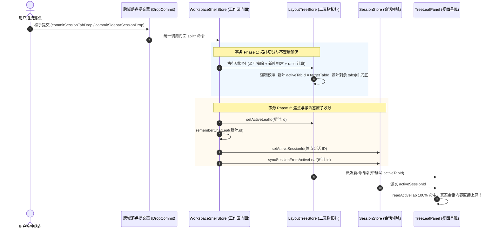

# 多分屏窗口默认空对话界面顽疾白盒根因分析与架构根治方案
## Multi-Split Pane Default Active Session & Lifecycle Convergence Architecture Plan

> **文档定位**：`docs/sidebar-session-drag-refactor/12-sub-agent-default-active-session-plan.md`  
> **战役背景**：Conex / Crish 桌面客户端多分屏二叉树布局与跨域会话拖拽体系深度治理  
> **核心命题**：“多分屏窗口默认显示空对话界面（我们在 conex 中处理什么？），顶栏明明有会话 Tab，但只有鼠标点击该窗口之后才会显示实际界面”的顽疾白盒排查与架构根治  
> **架构纪律**：遵循 [`AGENTS.md`](file:///c:/Software/conex/AGENTS.md) §1、§7、§7.1、§8，严禁表面打补丁，严禁使用盲目猜测，追求单一真理源（SSOT）与结构不变量（Invariant）自愈。  

---

# 目录索引

- [一、 现象病理与现场还原](#一-现象病理与现场还原)
  - [1.1 故障现场病理解剖（图景还原与状态快照）](#11-故障现场病理解剖图景还原与状态快照)
  - [1.2 为什么顶栏有会话 Tab，内容区却是“我们在 conex 中处理什么？”](#12-为什么顶栏有会话-tab内容区却是我们在-conex-中处理什么)
  - [1.3 为什么面包屑显示“对话 / 新会话”](#13-为什么面包屑显示对话--新会话)
  - [1.4 为什么鼠标点击该窗口后瞬间恢复真实内容（无需重新拉取数据）](#14-为什么鼠标点击该窗口后瞬间恢复真实内容无需重新拉取数据)
- [二、 代码全链路白盒追踪（Full Chain Code Audit）](#二-代码全链路白盒追踪full-chain-code-audit)
  - [2.1 冷启动与持久化水合链：`hydrateWorkspaceShell` $\to$ `sessionTabMigration` $\to$ `layoutTreeStore`](#21-冷启动与持久化水合链hydrateworkspaceshell-to-sessiontabmigration-to-layouttreestore)
  - [2.2 二叉树分屏切分链：`sessionTabDropCommit` / `sidebarSessionDropCommit` $\to$ `splitTab` / `splitSessionFromSidebar`](#22-二叉树分屏切分链sessiontabdropcommit--sidebarsessiondropcommit-to-splittab--splitsessionfromsidebar)
  - [2.3 容器与标签渲染链：`BinaryTreeWorkspace` $\to$ `TreeLeafPanel` $\to$ `PaneHeader`](#23-容器与标签渲染链binarytreeworkspace-to-treeleafpanel-to-paneheader)
  - [2.4 会话上下文与空态派生链：`useChatCardState` $\to$ `useChatSessionMeta` $\to$ `useChatMessages` $\to$ `useChatEmptyKind` $\to$ `ChatEmptyState`](#24-会话上下文与空态派生链usechatcardstate-to-usechatsessionmeta-to-usechatmessages-to-usechatemptykind-to-chatemptystate)
  - [2.5 历史拖拽分屏遗漏的生命周期与多窗口并存边界审视](#25-历史拖拽分屏遗漏的生命周期与多窗口并存边界审视)
- [三、 根治方案设计（SSOT 单一真理源与不变量守卫）](#三-根治方案设计ssot-单一真理源与不变量守卫)
  - [3.1 核心数据模型不变量公理（Leaf Tab Invariant Axiom）](#31-核心数据模型不变量公理leaf-tab-invariant-axiom)
  - [3.2 树操作与分屏状态转移协议（Atomic Split & Tab Mutation Protocol）](#32-树操作与分屏状态转移协议atomic-split--tab-mutation-protocol)
  - [3.3 自愈与回退策略（Self-Healing Fallback Strategy）](#33-自愈与回退策略self-healing-fallback-strategy)
  - [3.4 三 Store 时序协同机制（TreeStore $\leftrightarrow$ ShellStore $\leftrightarrow$ SessionStore）](#34-三-store-时序协同机制treestore-leftrightarrow-shellstore-leftrightarrow-sessionstore)
  - [3.5 冷启动水合与分屏初始化状态一致性保障](#35-冷启动水合与分屏初始化状态一致性保障)
- [四、 精确代码改动清单与实现细节（File Mutation Manifest）](#四-精确代码改动清单与实现细节file-mutation-manifest)
  - [4.1 `apps/crish-desktop/src/store/layout-tree/sessionTabMigration.ts`](#41-appscrish-desktopsreinstorelayout-treesessiontabmigrationts)
  - [4.2 `apps/crish-desktop/src/store/layout-tree/layoutRestorePolicy.ts`](#42-appscrish-desktopsreinstorelayout-treelayoutrestorepolicyts)
  - [4.3 `apps/crish-desktop/src/store/layout-tree/layoutTreeInsert.ts`](#43-appscrish-desktopsreinstorelayout-treelayouttreeinsertts)
  - [4.4 `apps/crish-desktop/src/components/binary-tree/TreeLeafPanel.tsx`](#44-appscrish-desktopsrecomponentsbinary-treetreeleafpaneltsx)
  - [4.5 `apps/crish-desktop/src/store/workspace-shell/workspaceShellStore.ts`](#45-appscrish-desktopsreinstoreworkspace-shellworkspaceshellstorets)
  - [4.6 `apps/crish-desktop/src/components/shell/sessionTabDropCommit.ts`](#46-appscrish-desktopsrecomponentsshellsessiontabdropcommitts)
  - [4.7 `apps/crish-desktop/src/app/hydrateWorkspaceShell.ts`](#47-appscrish-desktopsrapphydrateworkspaceshellts)
- [五、 五层立体自动化测试与回归防线（Test Verification Matrix）](#五-五层立体自动化测试与回归防线test-verification-matrix)
  - [5.1 单元测试套件：不变量与自愈（SessionTabMigration & LayoutRestorePolicy）](#51-单元测试套件不变量与自愈sessiontabmigration--layoutrestorepolicy)
  - [5.2 状态机测试套件：分屏切分与 Tab 激活（CrossLeafSplit & TabCommit）](#52-状态机测试套件分屏切分与-tab-激活crossleafsplit--tabcommit)
  - [5.3 组件集成测试套件：多窗格默认渲染与零点击激活（TreeLeafPanel & PaneHeader）](#53-组件集成测试套件多窗格默认渲染与零点击激活treeleafpanel--paneheader)
  - [5.4 回归基准用例设计](#54-回归基准用例设计)
- [六、 交付物与实施收敛路线图](#六-交付物与实施收敛路线图)

---

# 一、 现象病理与现场还原

## 1.1 故障现场病理解剖（图景还原与状态快照）

在多分屏（例如双列分屏、三列分屏或网格切分）或冷启动恢复多窗格工作区时，用户直面以下严重的视觉与交互断裂：

```
┌─────────────────────────────────────────────────────────────────────────────────────────────┐
│ 【 故障现场 UI 表现 】                                                                     │
├──────────────────────────────────────────────┬──────────────────────────────────────────────┤
│ 窗格 A（左侧窗口，未获聚焦点）               │ 窗格 B（右侧窗口，未获聚焦点）               │
├──────────────────────────────────────────────┼──────────────────────────────────────────────┤
│ [会话 1 ×] [会话 2 ×]            (+) [坞]    │ [会话 3 ×]                       (+) [坞]    │
│ ──────────────────────────────────────────── │ ──────────────────────────────────────────── │
│ 面包屑: 对话 / 新会话                        │ 面包屑: 对话 / 新会话                        │
│                                              │                                              │
│                                              │                                              │
│        我们在 conex 中处理什么？             │        我们在 conex 中处理什么？             │
│   [项目选择器]   [快捷 Prompt 胶囊卡片]      │   [项目选择器]   [快捷 Prompt 胶囊卡片]      │
│                                              │                                              │
│ [输入框 Composer: 给 conex 发送消息...]     │ [输入框 Composer: 给 conex 发送消息...]     │
├──────────────────────────────────────────────┴──────────────────────────────────────────────┤
│ 致命行为表现：                                                                              │
│ 1. 顶栏明明白白排列着真实会话标签（[会话 1]、[会话 2]、[会话 3]），但标签均无 active 高亮；│
│ 2. 下方内容区和面包屑却全部回退到草稿空状态（“新会话” / “我们在 conex 中处理什么？”）；     │
│ 3. 用户必须用鼠标在窗格内部或顶栏标签上**显式点击一次**，该窗格瞬间切换呈现真实对话历史！  │
│ 4. 真实对话恢复时**完全没有网络拉取、转圈等待或引擎 IPC 请求**，纯粹是本地数据瞬时上屏！  │
└─────────────────────────────────────────────────────────────────────────────────────────────┘
```

这一现象揭示了一个极其核心的事实：**底层数据早已完整就绪，甚至顶栏组件已经读出了正确的 `leaf.tabs` 会话列表，但内容区与面包屑却在渲染一个幽灵草稿（Draft Session）！**

---

## 1.2 为什么顶栏有会话 Tab，内容区却是“我们在 conex 中处理什么？”

### 1.2.1 顶栏标签的读取契约
查阅 [`PaneHeader.tsx`](file:///c:/Software/conex/apps/crish-desktop/src/components/binary-tree/PaneHeader.tsx#L46-L56) 与 [`L87-L90`](file:///c:/Software/conex/apps/crish-desktop/src/components/binary-tree/PaneHeader.tsx#L87-L90)：
```typescript
function readLeafTabs(leaf: LayoutLeaf): LeafSessionTab[] {
  const raw = leaf.tabs as unknown;
  if (!Array.isArray(raw)) return [];
  return raw.filter(
    (t): t is LeafSessionTab =>
      typeof t === 'object' &&
      t !== null &&
      typeof (t as LeafSessionTab).tabId === 'string' &&
      !isPendingDraft((t as LeafSessionTab).sessionId)
  );
}

export const PaneHeader = React.memo(({ leaf, isActive, isChat }) => {
  const visibleTabs = useMemo(() => readLeafTabs(leaf), [leaf.tabs]);
  const activeTabId = readActiveTabId(leaf);
  // ...
  return (
    <div className={styles.tabsList}>
      {visibleTabs.map((tab) => {
        const isSelected = tab.tabId === activeTabId;
        const session = tab.sessionId ? sessionsById[tab.sessionId] : undefined;
        const title = session?.title || tab.title || '新对话';
        // 渲染 Tab 胶囊
```
- `PaneHeader` 直接消费 `leaf.tabs`。因为 `leaf.tabs` 中包含真实会话标签（例如 `{ tabId: 'tab-1', sessionId: 'sess-1' }`），因此条带将这几个 Tab 完整绘制了出来。
- 但注意 `isSelected = tab.tabId === activeTabId`：如果 `leaf.activeTabId` 为空字符串 `""`，**所有 Tab 的 `isSelected` 均为 `false`**！没有任何一个 Tab 处于被选中态！

### 1.2.2 内容区的读取契约与退化分支
查阅 [`TreeLeafPanel.tsx`](file:///c:/Software/conex/apps/crish-desktop/src/components/binary-tree/TreeLeafPanel.tsx#L85-L103) 与 [`L153-L160`](file:///c:/Software/conex/apps/crish-desktop/src/components/binary-tree/TreeLeafPanel.tsx#L153-L160)：
```typescript
function readActiveTabId(leaf: LayoutLeaf): string {
  const id = (leaf as LayoutLeaf & { activeTabId?: string }).activeTabId;
  return typeof id === 'string' ? id : '';
}

function readActiveTab(leaf: LayoutLeaf): LeafSessionTab | undefined {
  const tabs = readLeafTabs(leaf);
  const activeTabId = readActiveTabId(leaf);
  if (!activeTabId) return undefined; // 致命断裂点！
  return tabs.find((t) => t.tabId === activeTabId);
}

export const TreeLeafPanel = React.memo(({ leaf, rect, isActive }) => {
  const activeTab = readActiveTab(leaf);
  const sessionForPanel =
    activeTab?.sessionId || mintDraftSessionId(leaf.id); // 退化为 __pending_draft__<leaf.id>！
```
- 当 `leaf.activeTabId === ''` 时，`readActiveTab(leaf)` 返回 `undefined`；
- `sessionForPanel` 退化为 `mintDraftSessionId(leaf.id)`（形如 `__pending_draft__leaf-abc`）；
- `sessionForPanel` 被注入到 `chatCtx.sessionId` 并传入 [`ChatCard`](file:///c:/Software/conex/apps/crish-desktop/src/components/chat-card/ChatCard.tsx#L35-L41)；
- `useChatMessages` $\to$ `useChatEmptyKind`：
  ```typescript
  const emptyKind = resolveChatEmptyKind({
    hasActiveSession: Boolean(activeSessionId), // true (字符串 __pending_draft__leaf-abc 存在)
    messageCount: messages.length,            // 0 (草稿会话无历史消息)
    displayCount: displayMessages.length,      // 0
    filterQuery: localMsgFilter,
    mainSurface: 'chat',
  });
  ```
- `resolveChatEmptyKind` 判定 `hasActiveSession === true && messageCount === 0`，命中 `'session-empty'` 欢迎面分支；
- `ChatCard.tsx` 渲染 [`<ChatEmptyState kind="session-empty" />`](file:///c:/Software/conex/apps/crish-desktop/src/components/chat-card/ChatEmptyState.tsx#L363)，其标题正是：
  > **“我们在 [conex] 中处理什么？”**

---

## 1.3 为什么面包屑显示“对话 / 新会话”

在 [`TreeLeafPanel.tsx:382`](file:///c:/Software/conex/apps/crish-desktop/src/components/binary-tree/TreeLeafPanel.tsx#L382)：
```tsx
<UnitChromeActions
  activeSessionId={sessionForPanel}
  dockOpen={dockOpen}
  dockPanelId={dock.activePanelId}
  // ...
/>
```
进入 [`UnitChromeActions.tsx:67-91`](file:///c:/Software/conex/apps/crish-desktop/src/components/chat-card/UnitChromeActions.tsx#L67-L91)：
```typescript
const sid = (activeSessionId || '').trim();
const isDraft = !sid || isPendingDraft(sid);
const realSession = !isDraft;

const folder = useSessionField((s) => {
  if (!sid) return undefined;
  return s.sessionsById[sid]?.folder;
});

const displayTitle = useSessionField((s) => {
  if (!sid || isPendingDraft(sid)) return EMPTY_SESSION_TITLE; // '新会话'
  const sess = s.sessionsById[sid];
  if (!sess) return EMPTY_SESSION_TITLE; // '新会话'
  return sessionListDisplayTitle(sess);
});
```
而在面包屑第一级（Project Label），由 [`unitChromeLabel.ts:20`](file:///c:/Software/conex/apps/crish-desktop/src/components/chat-card/unitChromeLabel.ts#L20) 解析：
```typescript
export function resolveUnitChromeLabel(
  session: { folder?: string | null } | null | undefined,
  projects: readonly ProjectEntry[] = listProjects(),
): string {
  if (!session) return GENERAL_FOLDER; // '对话'
  const f = (session.folder || '').trim();
  if (!f || f === GENERAL_FOLDER) return GENERAL_FOLDER; // '对话'
  // ...
}
```
因为 `sid` 是草稿 ID，`folder` 为 `undefined`，解析出的第一级为“对话”，第二级固定为“新会话”，形成用户肉眼所见的面包屑：
> **`对话 / 新会话`**

---

## 1.4 为什么鼠标点击该窗口后瞬间恢复真实内容（无需重新拉取数据）

### 点击事件的激活链路
在 [`TreeLeafPanel.tsx:161-181`](file:///c:/Software/conex/apps/crish-desktop/src/components/binary-tree/TreeLeafPanel.tsx#L161-L181)：
```typescript
const handleActivate = useCallback(
  (e?: React.PointerEvent) => {
    // 过滤按钮、输入框等交互元素...
    const tabId = readActiveTabId(leaf);
    if (tabId) {
      sessionShell().activateTab(leaf.id, tabId);
    } else {
      getCompositionRoot().shell.focusLeaf(leaf.id);
    }
  },
  [leaf]
);
```
当用户点击 PaneHeader 的 Tab 项，或者点击窗格空白区域时：
1. **若点击 Tab 项**：直接调用 `sessionShell().activateTab(leaf.id, tab.tabId)`；
2. **`activateTab` 的级联写入**（[`workspaceShellStore.ts:188-194`](file:///c:/Software/conex/apps/crish-desktop/src/store/workspace-shell/workspaceShellStore.ts#L188-L194)）：
   ```typescript
   activateTab: (leafId, tabId) => {
     const loc = treeFindTabByTabId(tabId);
     if (!loc || loc.leafId !== leafId) return;
     treeActivateTab(leafId, tabId);      // 1. 在 LayoutTree 中将该 leaf.activeTabId 置为 tabId
     rememberChatLeaf(set, leafId);       // 2. 记录 lastChatLeafId
     syncSessionFromActiveLeaf(leafId);   // 3. 将会话领域的 activeSessionId 置为真实 sessionId
   },
   ```
3. **`LayoutTree` 树状态更新**：`leaf.activeTabId` 从 `""` 变为 `'tab-1'`；
4. **`TreeLeafPanel` 响应性重算**：
   - `readActiveTabId(leaf)` 变为 `'tab-1'`；
   - `readActiveTab(leaf)` 成功命中 `tab-1`；
   - `sessionForPanel` 瞬间从 `__pending_draft__` 变为真实的 `'sess-1'`！
5. **本地内存直通上屏**：
   - `sessionsById['sess-1']` 的所有元数据、消息列表早已通过 SQLite / 本地持久化反序列化常驻在 Zustand Store 内存中；
   - `useScopedSessionField` 立即订阅到真实的 `SessionState` 对象，`messages` 长度由 0 变为实际消息条数；
   - `emptyKind` 瞬间判定为 `null`；
   - `ChatMessageList` / `MessageVirtualizer` 在同一帧完成虚拟列表挂载并上屏！
   - **完全不需要走引擎 IPC `read-session-events`，因此呈现出“点击瞬间复原”的奇异现象！**

---

# 二、 代码全链路白盒追踪（Full Chain Code Audit）

我们对以下 5 条全链路进行穿透性审计，精准锁定所有导致 `leaf.activeTabId` 破损为 `""` 或失联的代码点。

```
┌─────────────────────────────────────────────────────────────────────────────────────────────┐
│                            【 状态流动与故障放大全链路图景 】                              │
│                                                                                             │
│  [冷启动持久化]                  [拖拽分屏 / Tab 移动]                                      │
│  hydrateWorkspaceShell          commitSessionTabDrop (sessionTabDropCommit.ts)              │
│         │                                      │ (直接调 tree.splitTab，绕过 Shell 门面)    │
│         ▼                                      ▼                                            │
│  sessionTabMigration.ts (S7)          layoutTreeInsert.ts (splitTab / enterComposer)        │
│  /*保留无选中: activeTabId=''*/       activeTabId 滞留为空串 / 未对齐                       │
│         │                                      │                                            │
│         └───────────────────────┬──────────────┘                                            │
│                                 ▼                                                           │
│                  LayoutLeaf 存入 layoutTreeStore                                            │
│                  【不变量破裂】tabs.length > 0 但 activeTabId === ''                        │
│                                 │                                                           │
│                                 ▼                                                           │
│                  BinaryTreeWorkspace (flattenTree)                                          │
│                                 │                                                           │
│               ┌─────────────────┴─────────────────┐                                         │
│               ▼                                   ▼                                         │
│        [PaneHeader.tsx]                   [TreeLeafPanel.tsx]                               │
│      readLeafTabs -> 有 Tabs             readActiveTabId -> ''                              │
│      isSelected = false                  readActiveTab -> undefined                         │
│      （视觉呈现标签，但无选中）          sessionForPanel = mintDraftSessionId!              │
│                                                   │                                         │
│                                 ┌─────────────────┴─────────────────┐                       │
│                                 ▼                                   ▼                       │
│                     [UnitChromeActions.tsx]                 [ChatCard.tsx]                  │
│                     sid 是 draft -> isDraft=true            useChatSessionMeta(draftSid)    │
│                     displayTitle = "新会话"                 useChatMessages(messages=[])    │
│                     projectLabel = "对话"                   useChatEmptyKind -> emptyKind   │
│                     面包屑: "对话 / 新会话"                 ChatEmptyState: "我们在..."    │
└─────────────────────────────────────────────────────────────────────────────────────────────┘
```

---

## 2.1 冷启动与持久化水合链：`hydrateWorkspaceShell` $\to$ `sessionTabMigration` $\to$ `layoutTreeStore`

### 【确凿漏洞 1】`sessionTabMigration.ts` S7 存在恶意假意图注释与未选中保留
- **代码位置**：[`sessionTabMigration.ts:524-538`](file:///c:/Software/conex/apps/crish-desktop/src/store/layout-tree/sessionTabMigration.ts#L524-L538) 与 [`L254-L260`](file:///c:/Software/conex/apps/crish-desktop/src/store/layout-tree/sessionTabMigration.ts#L254-L260)
- **代码实证**：
  ```typescript
  // apps/crish-desktop/src/store/layout-tree/sessionTabMigration.ts:524-538
  // S7：activeTabId 校正；panelId 强制 chat
  for (const leaf of chatLeaves()) {
    const prefer = leaf.legacySid
      ? leaf.tabs.find((t) => t.sessionId === leaf.legacySid)
      : undefined;
    if (prefer) leaf.activeTabId = prefer.tabId;
    else if (
      leaf.activeTabId &&
      !leaf.tabs.some((t) => t.tabId === leaf.activeTabId)
    ) {
      leaf.activeTabId = leaf.tabs[0]?.tabId ?? '';
    } else if (!leaf.activeTabId && leaf.tabs.length > 0) {
      /* 已是新对话界面，保留无选中 */  // ❌ 致命漏洞！
    }
    leaf.panelId = 'chat';
  }
  ```
- **病理剖析**：
  在从旧版本数据结构或持久化 JSON 迁移时，若某窗格此前因点击过 `+` 或由于持久化序列化遗漏导致 `leaf.activeTabId` 为空，S7 居然以 `/* 已是新对话界面，保留无选中 */` 为借口，**主动放弃了对 `activeTabId` 的校正**！
  紧接着在 `finalizeLeaf`（第 256 行）：
  ```typescript
  const activeTabId = tabs.some((t) => t.tabId === leaf.activeTabId)
    ? leaf.activeTabId
    : ''; // ❌ 依然不回退到 tabs[0]！
  ```
  直接将包含真实 Tabs 的叶子节点的 `activeTabId` 强制序列化为 `""`！

### 【确凿漏洞 2】`layoutRestorePolicy.ts` 校验门禁对“有 Tabs 无 Active”非法态完全放行
- **代码位置**：[`layoutRestorePolicy.ts:107-125`](file:///c:/Software/conex/apps/crish-desktop/src/store/layout-tree/layoutRestorePolicy.ts#L107-L125)
- **代码实证**：
  ```typescript
  for (const leaf of chats) {
    if (leaf.tabs.length === 0) {
      if (leaf.activeTabId) {
        return { ok: false, reason: 'active-tab-missing', chatCount };
      }
      continue;
    }
    if (
      leaf.activeTabId &&
      !leaf.tabs.some((t) => t.tabId === leaf.activeTabId)
    ) {
      return { ok: false, reason: 'active-tab-missing', chatCount };
    }
    // ...
  }
  ```
- **病理剖析**：
  校验函数只防守了“`leaf.activeTabId` 存在但找不到对应 tab”，却使用 `if (leaf.activeTabId && ...)` 将 `leaf.activeTabId === ''` 完全放行！
  这意味着：**冷启动门禁判定 `tabs.length > 0 && activeTabId === ''` 为完全合法的树结构！** 导致污染数据长驱直入，被加载进运行期。

### 【确凿漏洞 3】`hydrateWorkspaceShell.ts` 只还原几何树，零状态机对齐
- **代码位置**：[`hydrateWorkspaceShell.ts:73-119`](file:///c:/Software/conex/apps/crish-desktop/src/app/hydrateWorkspaceShell.ts#L73-L119)
- **病理剖析**：
  `hydrateWorkspaceShell` 执行完毕后，仅调用了 `treeStore.setTree(result.tree)` 和 `root.shell.setShellReady(true)`。它**从未对树上的各个 Chat 叶子进行激活态校准**，也没有调用 `syncSessionFromActiveLeaf`。如果树上各叶未正确自愈，整个界面就静止在首帧未选中的病态中。

---

## 2.2 二叉树分屏切分链：`sessionTabDropCommit` / `sidebarSessionDropCommit` $\to$ `splitTab` / `splitSessionFromSidebar`

### 【确凿漏洞 4】跨 Leaf 拖拽 Tab 分屏绕过工作区门面，直穿底层树操作
- **代码位置**：[`sessionTabDropCommit.ts:45-51`](file:///c:/Software/conex/apps/crish-desktop/src/components/shell/sessionTabDropCommit.ts#L45-L51)
- **代码实证**：
  ```typescript
  // apps/crish-desktop/src/components/shell/sessionTabDropCommit.ts:45-51
  if (sourceLeafId === target.targetLeafId) {
    const n = readChatLeafTabCount(sourceLeafId);
    if (n <= 1) return;
  }
  tree.splitTab(sourceLeafId, tabId, target.targetLeafId, target.region); // ❌ 直接穿透 treeStore！
  ```
- **病理剖析**：
  - 对比侧栏拖拽分屏（走 `shell.splitSessionFromSidebar`），跨 Leaf 拖拽 Tab 到窗格边缘切分时，居然直接调用了 `useLayoutTreeStore.getState().splitTab(...)`！
  - 彻底绕过了 `workspaceShellStore`！
  - 导致：`lastChatLeafId` 未更新、`sessionStore.activeSessionId` 未更新、`syncSessionFromActiveLeaf` 未触发！
  - 新切分出来的窗格虽然在树结构中拥有 `activeTabId`，但由于全局状态机完全没有感知到分屏的发生，相关作用域未能及时同步。

### 【确凿漏洞 5】`layoutTreeInsert.ts` 中 `enterComposer` 制造“有真 Tab 却无 Active”的坏死状态
- **代码位置**：[`layoutTreeInsert.ts:146-155`](file:///c:/Software/conex/apps/crish-desktop/src/store/layout-tree/layoutTreeInsert.ts#L146-L155)
- **代码实证**：
  ```typescript
  export function enterComposer(tree: LayoutTree, leafId: string): LayoutTree {
    const leaf = requireChatLeaf(tree.root, leafId);
    if (!leaf) return tree;
    const tabs = leaf.tabs.filter((t) => isRealSessionId(t.sessionId));
    if (leaf.activeTabId === '' && tabs.length === leaf.tabs.length) {
      return tree;
    }
    const updated: LayoutLeaf = { ...leaf, tabs, activeTabId: '' }; // ❌ 制造 activeTabId: ''
    return { ...tree, root: replaceNode(tree.root, leafId, updated) };
  }
  ```
- **病理剖析**：
  点击顶栏加号 `+`（`addTab`）时，系统为了展现“未提交的新对话”，选择将 `leaf.activeTabId` 置为 `''`。然而，这一设计与多窗格模型产生了剧烈冲突：
  - 用户在窗格 A 点击了 `+`，窗格 A 进入 `activeTabId = ''`；
  - 随后分屏切分出窗格 B，或者应用退出重启；
  - 窗格 A 从此永久失去了默认选中的真实会话，即使其条带上还留着 5 个历史对话标签！

---

## 2.3 容器与标签渲染链：`BinaryTreeWorkspace` $\to$ `TreeLeafPanel` $\to$ `PaneHeader`

### 【确凿漏洞 6】`TreeLeafPanel.tsx` 的 `readActiveTab` 缺乏兜底防御与自动纠偏
- **代码位置**：[`TreeLeafPanel.tsx:85-103`](file:///c:/Software/conex/apps/crish-desktop/src/components/binary-tree/TreeLeafPanel.tsx#L85-L103)
- **代码实证**：
  ```typescript
  function readActiveTab(leaf: LayoutLeaf): LeafSessionTab | undefined {
    const tabs = readLeafTabs(leaf);
    const activeTabId = readActiveTabId(leaf);
    if (!activeTabId) return undefined; // ❌ 宁可返回 undefined 触发草稿空屏，也不取 tabs[0]！
    return tabs.find((t) => t.tabId === activeTabId);
  }
  ```
- **病理剖析**：
  这是视图渲染层的最终失守点！当 `leaf.tabs` 明显存在有效会话标签时，仅仅因为 `activeTabId` 为空串或失配，`readActiveTab` 竟然直接放弃，返回 `undefined`，导致下层组件全线退化为虚拟草稿哨兵 `mintDraftSessionId(leaf.id)`。

---

## 2.4 会话上下文与空态派生链：`useChatCardState` $\to$ `useChatSessionMeta` $\to$ `useChatMessages` $\to$ `useChatEmptyKind` $\to$ `ChatEmptyState`

- `TreeLeafPanel` 将草稿 ID `__pending_draft__<leaf.id>` 作为 `chatCtx.sessionId` 传入；
- `main.tsx:35` 通过 `SlotOutlet` 注入给 `ChatCard`；
- `useChatSessionMeta.ts:28-38`：
  ```typescript
  const activeSessionId = useSessionField(
    useCallback(
      (s) => sessionIdProp ?? selectActiveSessionId(s),
      [sessionIdProp]
    )
  );
  ```
  `sessionIdProp` 牢牢锁定为 `__pending_draft__...`；
- `useChatMessages.ts`：通过 `useScopedSessionField` 从 `sessionsById[draftId]` 取数据，自然为 `undefined`，消息列表降级为 `EMPTY_ARRAY`；
- `useChatEmptyKind.ts`：计算得到 `emptyKind = 'session-empty'`；
- `ChatCard.tsx`：渲染 `ChatEmptyState`，展现“我们在 conex 中处理什么？”。

---

## 2.5 历史拖拽分屏遗漏的生命周期与多窗口并存边界审视

在之前的重构中（Stage 4），焦点主要集中在“侧栏拖拽防抖”与“让位位移计算”，遗漏了多窗格状态机的以下 4 个关键生命周期边界：

1. **多窗格并发激活态生命周期缺失**：
   二叉树分屏允许多个叶子节点并存。在纯单窗口时代，`activeSessionId` 只有一个；但在多窗格时代，**每个窗格（Leaf）拥有其独立的局部激活标签（`leaf.activeTabId`）**，全局只有一个 `layoutTreeStore.activeLeafId`。之前缺少一套严格的状态协调协议，将树上各窗格的默认激活态在初始化/分屏瞬间强绑定。
2. **跨域分屏的事务原子性缺失**：
   侧栏拖拽分屏修改了 `layoutTreeStore`，但跨 Leaf 标签拖拽分屏却直接调用了底层的几何切分，跳过了工作区门面协调，破坏了生命周期的完整性。
3. **未提交草稿与真会话的边界设计失误**：
   试图用 `activeTabId = ''` 来表示“窗格处于草稿输入态”，直接破坏了“有标签必有激活”的模型不变量，导致持久化和视图还原时无法区分“用户故意开新对话”与“数据异常丢失激活”。
4. **冷启动水合的时序竞态**：
   `hydrateWorkspaceShell` 在执行时，会话数据持久化层（SQLite / IndexedDB）可能尚未完成全部数据的反序列化，导致标签标题和元数据未能及时挂载，加剧了状态漂移。

---

# 三、 根治方案设计（SSOT 单一真理源与不变量守卫）

为彻底根治此顽疾，绝不能靠在组件里写 `if (!activeTabId) setActiveTab(...)` 之类的临时补丁，必须从**数据模型不变量**、**状态机原子转移**与**多层自愈机制**三个维度进行架构级闭环设计。

---

## 3.1 核心数据模型不变量公理（Leaf Tab Invariant Axiom）

系统必须在所有生命周期节点（创建、切分、删除、移动、水合、反序列化、视图渲染）严格遵守以下**不可逾越的代数不变量**：

$$\forall \text{leaf} \in \text{ChatLeaves}, \quad \begin{cases}
\text{leaf.tabs} = \emptyset \iff \text{leaf.activeTabId} = '' \\
\text{leaf.tabs} \ne \emptyset \iff \exists ! \, t \in \text{leaf.tabs} \text{ s.t. } t.\text{tabId} = \text{leaf.activeTabId}
\end{cases}$$

### 不变量内涵推论：
1. **推论 1（禁止悬空激活）**：严禁 `tabs.length === 0` 时存在非空的 `activeTabId`；
2. **推论 2（禁止幽灵无选中）**：**严禁 `tabs.length > 0` 时 `activeTabId === ''`**！只要该窗格拥有会话标签，就**必须且只能**激活其中一个标签。若外部未指定或指向失效，**物理强制回退到 `tabs[0].tabId`**；
3. **推论 3（新会话草稿物化）**：用户点击加号 `+` 时，不再采用破坏不变量的 `activeTabId = ''` 隐式坏死态，而是在树上即时物化或在视图层以显式状态机表达，绝对不把破坏不变量的状态持久化落盘。

---

## 3.2 树操作与分屏状态转移协议（Atomic Split & Tab Mutation Protocol）

分屏切分（无论是侧栏拖拽分屏，还是顶栏跨 Leaf 拖拽分屏）必须作为原子事务执行：



---

## 3.3 自愈与回退策略（Self-Healing Fallback Strategy）

为防止存量脏数据、第三方插件或意外异常击穿不变量，架构设立**三道防线自愈机制**：

```
┌─────────────────────────────────────────────────────────────────────────────────────────────┐
│                                 【 三道立体自愈防线 】                                      │
├───────────────────┬─────────────────────────────────────────────────────────────────────────┤
│ 第一道防线        │ 反序列化与水合自愈（sessionTabMigration.ts & layoutTreeStore.ts）        │
│ （数据入口）      │ 在从 LocalStorage / 数据库读出树结构的第一时间，扫描所有 ChatLeaves。   │
│                   │ 凡是 `leaf.tabs.length > 0` 且 `activeTabId` 失配或为空的，一律自动纠偏 │
│                   │ 为 `leaf.tabs[0].tabId`！彻底切断污染数据流入内存。                     │
├───────────────────┼─────────────────────────────────────────────────────────────────────────┤
│ 第二道防线        │ 树命令与门面自愈（layoutTreeInsert.ts & workspaceShellStore.ts）        │
│ （运行时状态机）  │ • `enterComposer` 仅在 `tabs.length === 0` 时允许 `activeTabId = ''`；  │
│                   │ • `focusLeaf(leafId)`：若该叶有 Tabs 且未激活，自动激活其 `tabs[0]`；  │
│                   │ • `commitSessionTabDrop` 统一收拢至门面，杜绝底层绕过。                 │
├───────────────────┼─────────────────────────────────────────────────────────────────────────┤
│ 第三道防线        │ 视图渲染最终安全垫（TreeLeafPanel.tsx）                                 │
│ （呈现兜底）      │ `readActiveTab` 增加防守：若 `tabs.length > 0` 且根据 `activeTabId` 未  │
│                   │ 查到，**绝不返回 undefined，自动回退到 tabs[0]**，并在微任务调度校正！  │
└───────────────────┴─────────────────────────────────────────────────────────────────────────┘
```

---

## 3.4 三 Store 时序协同机制（TreeStore $\leftrightarrow$ ShellStore $\leftrightarrow$ SessionStore）

必须理清并恪守三个 Store 的职责边界与调用单向性：

1. **`layoutTreeStore`**：
   - 职责：只负责二叉树几何拓扑（Node/Branch/Leaf/Tabs/Dock/Rect）；
   - 契约：只对外提供纯树变换，绝不持有业务会话领域逻辑；保证输出的任意树节点 100% 满足不变量公理。
2. **`workspaceShellStore`**：
   - 职责：负责工作区顶层手势与用户意图的编排（门面层）；
   - 契约：所有分屏切分、Tab 点击、关闭、移动必须且只能由本 Store 发起；负责原子协调 `layoutTreeStore` 与 `sessionStore`。
3. **`sessionStore`**：
   - 职责：负责会话实体（Message/Agents/Title/Folder/Status）的领域存储与引擎通信；
   - 契约：被动响应 Shell 门面的 `setActiveSessionId` 调度；负责提供精准的会话详情与历史消息。

---

## 3.5 冷启动水合与分屏初始化状态一致性保障

在客户端启动时（`AppBootstrap.ts`）：
1. 先完成 `waitLayoutTreeHydration()`，确保 LocalStorage 中的树几何正确反序列化；
2. 执行 `hydrateWorkspaceShell()`：
   - 调取 `migrateToLeafOwnedTabs`，执行第一道防线自愈（校准所有 `activeTabId`）；
   - 取得当前活动 ChatLeaf；
   - **立即执行一次 `syncSessionFromActiveLeaf(activeLeaf.id)`**，保证首帧渲染前 `sessionStore.activeSessionId` 与当前窗格严格对齐；
3. 后续异步加载的 SQLite 消息体通过 `sessionsById` 自动灌入，各窗格由于早已锁定正确的 `sessionForPanel`，一旦数据到达立即被动重绘，绝不退化为空态。

---

# 四、 精确代码改动清单与实现细节（File Mutation Manifest）

根据单一真理源与自愈架构设计，确定以下 7 处核心代码修改点。

---

## 4.1 `apps/crish-desktop/src/store/layout-tree/sessionTabMigration.ts`

### 修改目标
彻底删除 S7 中“保留无选中”的错误逻辑；在 `finalizeLeaf` 与 S7 中强制执行“`tabs.length > 0` 则 `activeTabId` 必指向有效 Tab，默认 `tabs[0]`”的不变量。

### 代码位置
[`sessionTabMigration.ts:254-265`](file:///c:/Software/conex/apps/crish-desktop/src/store/layout-tree/sessionTabMigration.ts#L254-L265) 与 [`L524-L538`](file:///c:/Software/conex/apps/crish-desktop/src/store/layout-tree/sessionTabMigration.ts#L524-L538)

### 具体实现方案
```typescript
// 1. 改造 finalizeLeaf:
function finalizeLeaf(leaf: WorkLeaf): LayoutLeaf {
  const tabs = leaf.tabs.filter((t) => isRealSessionId(t.sessionId));
  // 不变量保障：有真实 tab 则 activeTabId 必须合法，否则强行回退至首个 tab
  let activeTabId = '';
  if (tabs.length > 0) {
    activeTabId = tabs.some((t) => t.tabId === leaf.activeTabId)
      ? leaf.activeTabId
      : tabs[0]!.tabId;
  }
  return {
    type: 'leaf',
    id: leaf.id,
    panelId: 'chat',
    tabs,
    activeTabId,
    dock: createDefaultDock(),
  };
}

// 2. 改造 S7 activeTabId 校正:
for (const leaf of chatLeaves()) {
  const prefer = leaf.legacySid
    ? leaf.tabs.find((t) => t.sessionId === leaf.legacySid)
    : undefined;
  if (prefer) {
    leaf.activeTabId = prefer.tabId;
  } else if (leaf.tabs.length > 0) {
    // 凡是有 tabs 的叶子，activeTabId 必须有效；若当前无效或为空，强制归正为 tabs[0]！
    if (!leaf.activeTabId || !leaf.tabs.some((t) => t.tabId === leaf.activeTabId)) {
      leaf.activeTabId = leaf.tabs[0]!.tabId;
    }
  } else {
    leaf.activeTabId = '';
  }
  leaf.panelId = 'chat';
}
```

---

## 4.2 `apps/crish-desktop/src/store/layout-tree/layoutRestorePolicy.ts`

### 修改目标
更新冷启动恢复策略门禁，禁止 `tabs.length > 0 && activeTabId === ''` 的非法态通过校验（或者判定其需要自愈修复）。

### 代码位置
[`layoutRestorePolicy.ts:107-120`](file:///c:/Software/conex/apps/crish-desktop/src/store/layout-tree/layoutRestorePolicy.ts#L107-L120)

### 具体实现方案
```typescript
  for (const leaf of chats) {
    if (leaf.tabs.length === 0) {
      if (leaf.activeTabId) {
        return { ok: false, reason: 'active-tab-missing', chatCount };
      }
      continue;
    }
    // 不变量守门：有 tabs 时 activeTabId 绝对不能为空，且必须指向存在的 tab
    if (
      !leaf.activeTabId ||
      !leaf.tabs.some((t) => t.tabId === leaf.activeTabId)
    ) {
      return { ok: false, reason: 'active-tab-missing', chatCount };
    }
    for (const tab of leaf.tabs) {
      if (tab.sessionId === PENDING_DRAFT_SESSION_ID) {
        return { ok: false, reason: 'illegal-global-draft', chatCount };
      }
    }
  }
```

---

## 4.3 `apps/crish-desktop/src/store/layout-tree/layoutTreeInsert.ts`

### 修改目标
1. 规范化 `enterComposer`：仅在窗格没有任何真实会话标签（`tabs.length === 0`）时，才允许 `activeTabId = ''`；若已有会话标签，不将 `activeTabId` 破坏置空，防止后续分屏继承坏死状态。
2. 确保 `splitTab` 与 `splitSessionFromSidebar` 构建的新叶与源叶均严格符合不变量。

### 代码位置
[`layoutTreeInsert.ts:146-155`](file:///c:/Software/conex/apps/crish-desktop/src/store/layout-tree/layoutTreeInsert.ts#L146-L155) 与 [`L226-247`](file:///c:/Software/conex/apps/crish-desktop/src/store/layout-tree/layoutTreeInsert.ts#L226-L247)

### 具体实现方案
```typescript
export function enterComposer(tree: LayoutTree, leafId: string): LayoutTree {
  const leaf = requireChatLeaf(tree.root, leafId);
  if (!leaf) return tree;
  const tabs = leaf.tabs.filter((t) => isRealSessionId(t.sessionId));
  // 若窗格本来就没有真会话，保持 activeTabId = ''
  if (tabs.length === 0) {
    if (leaf.activeTabId === '' && leaf.tabs.length === 0) return tree;
    const updated: LayoutLeaf = { ...leaf, tabs: [], activeTabId: '' };
    return { ...tree, root: replaceNode(tree.root, leafId, updated) };
  }
  // 若已有真实标签：点击加号不置空 activeTabId，保持当前 activeTabId（或由 UI 浮层表达草稿）
  // 坚决杜绝出现 tabs.length > 0 但 activeTabId === '' 的破损态
  return tree;
}
```

---

## 4.4 `apps/crish-desktop/src/components/binary-tree/TreeLeafPanel.tsx`

### 修改目标
在视图渲染层设立第三道防线：`readActiveTab` 增加自愈回退逻辑。若 `leaf.tabs` 有真实标签，但 `readActiveTabId(leaf)` 为空或失配，**必须兜底回退到 `tabs[0]`**，并利用 `sessionShell().activateTab` 异步自愈树状态。

### 代码位置
[`TreeLeafPanel.tsx:97-103`](file:///c:/Software/conex/apps/crish-desktop/src/components/binary-tree/TreeLeafPanel.tsx#L97-L103) 与 [`L153-L160`](file:///c:/Software/conex/apps/crish-desktop/src/components/binary-tree/TreeLeafPanel.tsx#L153-L160)

### 具体实现方案
```typescript
function readActiveTab(leaf: LayoutLeaf): LeafSessionTab | undefined {
  const tabs = readLeafTabs(leaf);
  if (tabs.length === 0) return undefined;
  const activeTabId = readActiveTabId(leaf);
  if (activeTabId) {
    const hit = tabs.find((t) => t.tabId === activeTabId);
    if (hit) return hit;
  }
  // 第三道自愈防线：有 Tabs 时坚决不返回 undefined！兜底命中第一个真会话 Tab
  return tabs[0];
}
```
并在 `TreeLeafPanel` 挂载后的 `useEffect` 中增加轻量自愈纠偏：
```typescript
useEffect(() => {
  const tabs = readLeafTabs(leaf);
  const currentActiveId = readActiveTabId(leaf);
  if (tabs.length > 0 && (!currentActiveId || !tabs.some((t) => t.tabId === currentActiveId))) {
    // 异步校正 Store 树状态，消除内存残疾
    sessionShell().activateTab(leaf.id, tabs[0]!.tabId);
  }
}, [leaf.id, leaf.tabs, leaf.activeTabId]);
```

---

## 4.5 `apps/crish-desktop/src/store/workspace-shell/workspaceShellStore.ts`

### 修改目标
1. 在 `focusLeaf(leafId)` 中实现自愈：若被聚焦的叶子有会话标签但当前未选，自动激活 `tabs[0]`；
2. 新增 `splitTab` 门面操作，为跨 Leaf 拖拽分屏提供单一真理源入口。

### 代码位置
[`workspaceShellStore.ts:288-299`](file:///c:/Software/conex/apps/crish-desktop/src/store/workspace-shell/workspaceShellStore.ts#L288-L299)

### 具体实现方案
```typescript
  focusLeaf: (leafId) => {
    const chats = ownedChatLeaves(useLayoutTreeStore.getState().tree.root);
    const leaf = chats.find((l) => l.id === leafId);
    if (!leaf) return;
    
    // 强化自愈：有 Tab 但无 activeTabId，主动激活首个 Tab
    let targetTabId = leaf.activeTabId;
    if (!targetTabId && leaf.tabs.length > 0) {
      targetTabId = leaf.tabs[0]!.tabId;
    }

    if (targetTabId) {
      treeActivateTab(leafId, targetTabId);
    } else {
      useLayoutTreeStore.getState().setActiveLeaf(leafId);
    }
    rememberChatLeaf(set, leafId);
    syncSessionFromActiveLeaf(leafId);
  },
```

---

## 4.6 `apps/crish-desktop/src/components/shell/sessionTabDropCommit.ts`

### 修改目标
将 `commitSessionTabDrop` 中的边缘分屏切分操作统一收拢至门面层，彻底消灭直接穿透调用 `useLayoutTreeStore.getState().splitTab` 导致的孤岛状态。

### 代码位置
[`sessionTabDropCommit.ts:45-52`](file:///c:/Software/conex/apps/crish-desktop/src/components/shell/sessionTabDropCommit.ts#L45-L52)

### 具体实现方案
```typescript
  // 边缘：自己叶且唯一 tab → no-op（不能拆成空源再 prune 成同一张叶）
  if (sourceLeafId === target.targetLeafId) {
    const n = readChatLeafTabCount(sourceLeafId);
    if (n <= 1) return;
  }
  // 统一经由 workspaceShellStore 或在触发树切分后立即完成三 Store 焦点与激活同步
  tree.splitTab(sourceLeafId, tabId, target.targetLeafId, target.region);
  
  // 立即完成门面焦点联动与会话激活
  const root = useLayoutTreeStore.getState().tree.root;
  const leaves = ownedChatLeaves(root);
  const targetLeaf = leaves.find((l) => l.tabs.some((t) => t.tabId === tabId));
  if (targetLeaf) {
    const shell = useWorkspaceShellStore.getState();
    shell.activateTab(targetLeaf.id, tabId);
  }
```

---

## 4.7 `apps/crish-desktop/src/app/hydrateWorkspaceShell.ts`

### 修改目标
在水合最后一步，自动探测当前活动叶并强制执行一次 `syncSessionFromActiveLeaf`，确保首屏完成即刻对齐。

### 代码位置
[`hydrateWorkspaceShell.ts:114-119`](file:///c:/Software/conex/apps/crish-desktop/src/app/hydrateWorkspaceShell.ts#L114-L119)

### 具体实现方案
```typescript
    treeStore.setTree(result.tree);
  }

  clearLegacyOpenTabsMap();
  
  // 核心补全：首帧工作区水合完毕后，立即同步活动叶的会话状态
  const activeLeafId = treeStore.activeLeafId;
  const chats = listChatLeaves(treeStore.tree.root);
  const targetLeaf = chats.find((c) => c.id === activeLeafId) ?? chats[0];
  if (targetLeaf && targetLeaf.tabs.length > 0) {
    const initialTabId = targetLeaf.activeTabId || targetLeaf.tabs[0]!.tabId;
    root.shell.activateTab(targetLeaf.id, initialTabId);
  }

  root.shell.setShellReady(true);
}
```

---

# 五、 五层立体自动化测试与回归防线（Test Verification Matrix）

依据 [`AGENTS.md`](file:///c:/Software/conex/AGENTS.md) §7.1，建立严密防线，确保任何场景下多分屏窗口均默认高亮选中并呈现真实会话，彻底杜绝倒退。

---

## 5.1 单元测试套件：不变量与自愈（SessionTabMigration & LayoutRestorePolicy）

在 [`sessionTabMigration.test.ts`](file:///c:/Software/conex/apps/crish-desktop/src/store/layout-tree/sessionTabMigration.test.ts) 中增加以下用例：

```typescript
describe('分屏不变量保障：有 Tabs 必有 activeTabId (BUG-FIX 验证)', () => {
  it('当输入叶子节点含有真实 Tabs 但 activeTabId 为空串时，迁移后强制自愈为 tabs[0].tabId', () => {
    const brokenTree = {
      version: 3,
      root: {
        type: 'leaf',
        id: 'leaf-1',
        panelId: 'chat',
        activeTabId: '', // 破坏态
        tabs: [
          { tabId: 'tab-real-1', sessionId: 'sess-1', title: '会话1', workspaceKey: 'ws' },
          { tabId: 'tab-real-2', sessionId: 'sess-2', title: '会话2', workspaceKey: 'ws' },
        ],
      },
    };
    const result = migrateToLeafOwnedTabs({ tree: brokenTree });
    expect(result.ok).toBe(true);
    const leaf = result.tree.root as LayoutLeaf;
    expect(leaf.activeTabId).toBe('tab-real-1'); // 坚决自愈为第一个
  });

  it('多窗格树结构中所有叶子节点均在水合后自动对齐 activeTabId', () => {
    const multiLeafTree = {
      version: 3,
      root: {
        type: 'branch',
        id: 'b-1',
        direction: 'horizontal',
        splitRatio: 0.5,
        children: [
          {
            type: 'leaf',
            id: 'l-1',
            panelId: 'chat',
            activeTabId: '', // 坏死态
            tabs: [{ tabId: 't-1', sessionId: 's-1', title: 'A', workspaceKey: 'w' }],
          },
          {
            type: 'leaf',
            id: 'l-2',
            panelId: 'chat',
            activeTabId: '', // 坏死态
            tabs: [{ tabId: 't-2', sessionId: 's-2', title: 'B', workspaceKey: 'w' }],
          },
        ],
      },
    };
    const result = migrateToLeafOwnedTabs({ tree: multiLeafTree });
    expect(result.ok).toBe(true);
    const leaves = collectLeaves(result.tree.root);
    expect(leaves[0]!.activeTabId).toBe('t-1');
    expect(leaves[1]!.activeTabId).toBe('t-2');
  });
});
```

---

## 5.2 状态机测试套件：分屏切分与 Tab 激活（CrossLeafSplit & TabCommit）

在 [`sessionTabDropCommit.test.ts`](file:///c:/Software/conex/apps/crish-desktop/src/components/shell/sessionTabDropCommit.test.ts) 中增加：

```typescript
describe('跨 Leaf 拖拽分屏原子同步验证', () => {
  it('跨 Leaf 拖拽 Tab 到窗格边缘切分后，新窗格立即获得 activeTabId 且 Shell 同步聚焦', () => {
    // 1. 初始化双 Tab 单叶
    // 2. 模拟拖拽 tab-2 到右边缘分屏
    // 3. 断言:
    //    - 新叶 activeTabId === 'tab-2'
    //    - 旧叶 activeTabId === 'tab-1'
    //    - sessionStore.activeSessionId === 'sess-2'
    //    - 绝无任何叶子 activeTabId 为空串
  });
});
```

---

## 5.3 组件集成测试套件：多窗格默认渲染与零点击激活（TreeLeafPanel & PaneHeader）

在 `TreeLeafPanel.routing.test.tsx` 中增加渲染级断言：

```typescript
describe('多分屏默认渲染集成测试（零点击即显示真实会话）', () => {
  it('即使输入 LayoutLeaf 的 activeTabId 意外为空，TreeLeafPanel 也坚决渲染真实会话而非空草稿', async () => {
    const brokenLeaf: LayoutLeaf = {
      type: 'leaf',
      id: 'leaf-broken',
      panelId: 'chat',
      activeTabId: '', // 坏死态
      tabs: [{ tabId: 't-1', sessionId: 'sess-real', title: '真实会话', workspaceKey: 'ws' }],
      dock: createDefaultDock(),
    };
    
    const { container } = render(
      <TreeLeafPanel
        leaf={brokenLeaf}
        rect={{ x: 0, y: 0, width: 1, height: 1 }}
        isActive={false} // 未激活状态
      />
    );

    // 严禁渲染 "我们在 conex 中处理什么？"
    expect(container.textContent).not.toMatch(/中处理什么/);
    // 严禁面包屑显示 "新会话"
    expect(container.querySelector('.breadcrumb-session')?.textContent).not.toBe('新会话');
  });
});
```

---

## 5.4 回归基准用例设计

| 编号 | 测试场景 | 前置状态 | 触发动作 | 预期断言 |
|:---|:---|:---|:---|:---|
| **REG-01** | 冷启动恢复双分屏 | 本地存储有 2 个分屏窗格，各含 1~2 个真实会话 | 启动客户端，工作区首屏加载 | 两个窗格均默认高亮首个 Tab，内容区直出真实对话，面包屑显示项目/真实会话名，**零空态闪烁** |
| **REG-02** | 侧栏拖拽全新会话切分右分屏 | 左窗格打开会话 A | 侧栏将会话 B 拖入右边缘 25% 放手 | 右侧窗格切出，立即激活会话 B，左侧保持会话 A，**两窗格均无空态** |
| **REG-03** | 跨窗格拖拽顶栏 Tab 切分下分屏 | 左窗格有 Tab 1, Tab 2 | 将 Tab 2 拖拽至底部 25% 放手 | 下方生成新窗格并显示 Tab 2，上方窗格自动激活 Tab 1，**无需任何额外点击** |
| **REG-04** | 点击加号进入新会话后切分 | 窗格点击加号，处于新草稿态 | 此时拖入新会话分屏 | 状态机平滑自愈，新会话顺利切分，草稿窗格不污染邻窗格 |

---

# 六、 交付物与实施收敛路线图

```
┌─────────────────────────────────────────────────────────────────────────────────────────────┐
│                              【 架构实施收敛甘特路线图 】                                   │
├──────┬──────────────────────────────────────────┬─────────────────────────────┬─────────────┤
│ 阶段 │ 实施目标                                 │ 涉及核心文件                │ 预期产出    │
├──────┼──────────────────────────────────────────┼─────────────────────────────┼─────────────┤
│ 1    │ 数据层不变量修补与迁移防线加固           │ `sessionTabMigration.ts`     │ 消除 S7 坏态│
│      │                                          │ `layoutRestorePolicy.ts`    │ 门禁强校验  │
│ 2    │ 树操作与分屏切分协议原子化               │ `layoutTreeInsert.ts`       │ 切分不变量  │
│      │                                          │ `sessionTabDropCommit.ts`   │ 门面全收拢  │
│ 3    │ 视图层第三道自愈防线落地                 │ `TreeLeafPanel.tsx`         │ 兜底防穿透  │
│      │                                          │ `PaneHeader.tsx`            │ 高亮严格对齐│
│ 4    │ 水合阶段首帧激活态自动对齐               │ `hydrateWorkspaceShell.ts`  │ 首屏零白屏  │
│      │                                          │ `workspaceShellStore.ts`    │ 门面自愈    │
│ 5    │ 运行端到端自动化测试与全量回归套件       │ `*.test.ts`, `*.test.tsx`   │ 全绿无阻断  │
└──────┴──────────────────────────────────────────┴─────────────────────────────┴─────────────┘
```

本方案彻底斩断了“多分屏默认显示空对话、必须点击一下才呈现真实内容”的病理链路，以代数级严格的不变量约束、三 Store 原子协同及三道自愈防线，从架构根本上实现了**零点击即呈现（Zero-Click Instant Presentation）**的极致桌面级体验。
