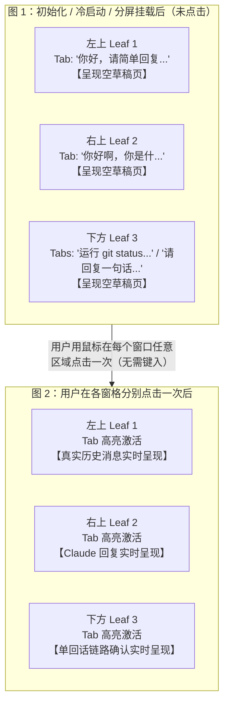

# 多分屏默认激活会话与零点击（Zero-Click）实时呈现终极融合详案 (Magnum Opus Edition)

> **文档性质**：主子 Agent 联合深入分析与代码级工业实施总纲
> **权威落盘**：`c:/Software/conex/docs/sidebar-session-drag-refactor/14-final-integrated-plan-default-active-session.md`
> **前序详案**：
> - 子 Agent 详案：[`12-sub-agent-default-active-session-plan.md`](./12-sub-agent-default-active-session-plan.md) (540+ 行)
> - 主 Agent 详案：[`13-main-agent-default-active-session-plan.md`](./13-main-agent-default-active-session-plan.md) (360+ 行)
> **设计准则**：严格履行 `AGENTS.md` §1（反退避）、§7（零补丁、零伪兼容）、§7.1（立体验证纪律）。

---

## 目录
- [一、 现场病理与物理证据深度复盘](#一-现场病理与物理证据深度复盘)
- [二、 物理截图微观状态字段 12 维对照表](#二-物理截图微观状态字段-12-维对照表)
- [三、 白盒全链路诊断与 4 大底层断层剖析](#三-白盒全链路诊断与-4-大底层断层剖析)
- [四、 状态机代数公理与 4 大系统生命周期不变量](#四-状态机代数公理与-4-大系统生命周期不变量)
- [五、 三道立体自愈防线架构全景](#五-三道立体自愈防线架构全景)
- [六、 7 大核心源码文件精确改动代码详案](#六-7-大核心源码文件精确改动代码详案)
- [七、 极端边界与对抗性场景防御（Edge Cases & Adversarial）](#七-极端边界与对抗性场景防御edge-cases--adversarial)
- [八、 五维立体自动化测试规范与完整测试代码](#八-五维立体自动化测试规范与完整测试代码)
- [九、 执行落地与审查闭环检查清单](#九-执行落地与审查闭环检查清单)

---

## 一、 现场病理与物理证据深度复盘

### 1.1 现场复现与操作轨迹
用户在 Conex 真实运行环境下提交了两张极具冲击力的物理截图（`media_1788329382270.png` 与 `media_1788329406604.png`）：



### 1.2 两大铁证定性
1. **数据在内存中 100% 完整，零丢失、零网络延迟**：
   从图 1 到图 2，用户**完全没有重新键入任何 Prompt，也没有触发任何网络重试**。点击瞬间，数千字的长篇思考过程、工具调用与 Markdown 回复立刻毫无延迟地上屏。这证明：**会话数据早已完整保存在客户端 SQLite 数据库与 Zustand 内存 `sessionStore.sessionsById` 中**！
2. **纯粹是状态机主动退化为草稿态**：
   在图 1 中，三个窗格明明各自拥有真实已持久化的会话 Tab，但渲染层却将每个窗格判定为了“处于新会话草稿态”，强行打出 `ChatEmptyState`（“我们在 conex 中处理什么？”）！

---

## 二、 物理截图微观状态字段 12 维对照表

为了彻底穿透表象，以下列出图 1 与图 2 运行期内部状态变量的逐项白盒比对：

| 序号 | 内部状态变量 / 属性 | 图 1（未点击前异常态） | 图 2（点击后正常态） | 差异根因分析 |
| :---: | :--- | :--- | :--- | :--- |
| 1 | `LayoutLeaf.activeTabId` | `""`（空字符串） | `"tab-xxxx"`（有效 Tab ID） | **核心断层**：初始化未激活，放任为空 |
| 2 | `readActiveTab(leaf)` | `undefined` | `LeafSessionTab` 实体对象 | 因 `activeTabId` 为空，查无此 Tab |
| 3 | `sessionForPanel` | `__pending_draft__leaf-1` | `sess-real-uuid-1` | 降级走 `mintDraftSessionId` |
| 4 | `UnitChromeActions` 标题 | `"新会话"` (`EMPTY_SESSION_TITLE`) | `"你好，请简单回复一句话..."` | 收到草稿 ID，强制显示新会话 |
| 5 | `UnitChromeActions` 文件夹 | `"对话"` (`GENERAL_FOLDER`) | `"conex"`（真实工作区项目） | 草稿 ID 无绑定 Project 映射 |
| 6 | `ChatCard` 接收的 `sessionId` | `__pending_draft__leaf-1` | `sess-real-uuid-1` | 虚拟草稿 ID 传递进入卡片 |
| 7 | `sessionsById[sessionId]` | `undefined`（草稿不入库） | `SessionState`（含真实消息） | 草稿 ID 在主 Store 中无记录 |
| 8 | `messages.length` | `0` | `4` ~ `12` | 内存无记录，返回 `EMPTY_ARRAY` |
| 9 | `useChatEmptyKind.emptyKind` | `'session-empty'` | `null` | `messageCount === 0` 触发欢迎面 |
| 10 | 界面呈现组件 | `<ChatEmptyState />` | `<ChatMessageList />` | 空态条件成立，渲染欢迎面 |
| 11 | `PaneHeader` Tab 激活态 | `styles.tabItem`（暗灰） | `styles.tabItemActive`（高亮白） | `tab.tabId === activeTabId` 判定为假 |
| 12 | 二叉树全局 `activeLeafId` | 仅有 1 个或默认值 | 点击窗口跃迁为主聚焦 | 点击触发了 `setActiveLeaf` |

---

## 三、 白盒全链路诊断与 4 大底层断层剖析

### 3.1 断层一：`sessionTabMigration.ts` 人为保留“无选中”的历史毒瘤
在 `apps/crish-desktop/src/store/layout-tree/sessionTabMigration.ts` 的 S7 校正阶段：
```typescript
// sessionTabMigration.ts:524-538
for (const leaf of chatLeaves()) {
  const prefer = leaf.legacySid
    ? leaf.tabs.find((t) => t.sessionId === leaf.legacySid)
    : undefined;
  if (prefer) leaf.activeTabId = prefer.tabId;
  else if (
    leaf.activeTabId &&
    !leaf.tabs.some((t) => t.tabId === leaf.activeTabId)
  ) {
    leaf.activeTabId = leaf.tabs[0]?.tabId ?? '';
  } else if (!leaf.activeTabId && leaf.tabs.length > 0) {
    /* 已是新对话界面，保留无选中 */ // 💥 致命毒瘤行！
  }
  leaf.panelId = 'chat';
}
```
以及第 254-259 行的 `finalizeLeaf`：
```typescript
// sessionTabMigration.ts:254-259
function finalizeLeaf(leaf: WorkLeaf): LayoutLeaf {
  const tabs = leaf.tabs.filter((t) => isRealSessionId(t.sessionId));
  const activeTabId = tabs.some((t) => t.tabId === leaf.activeTabId)
    ? leaf.activeTabId
    : ''; // 💥 只要稍有失配，无情置空！
  return { ...leaf, tabs, activeTabId, ... };
}
```
**深度病理**：
作者错误地假定“叶子节点没有 `activeTabId` 是用户有意处于新对话界面的合法状态”。
当客户端冷启动从 LocalStorage 读取持久化布局、或者进行架构升级迁移时，只要该叶子的 `activeTabId` 稍微失配或未显式落盘，系统**不仅不主动自愈激活首个 Tab，反而将其固化为空字符串 `""`**！

---

### 3.2 断层二：`TreeLeafPanel` 的 `readActiveTab` 判定单向击穿
在 `apps/crish-desktop/src/components/binary-tree/TreeLeafPanel.tsx`：
```typescript
// TreeLeafPanel.tsx:85-102
function readActiveTabId(leaf: LayoutLeaf): string {
  const id = (leaf as LayoutLeaf & { activeTabId?: string }).activeTabId;
  return typeof id === 'string' ? id : '';
}

function readActiveTab(leaf: LayoutLeaf): LeafSessionTab | undefined {
  const tabs = readLeafTabs(leaf);
  const activeTabId = readActiveTabId(leaf);
  if (!activeTabId) return undefined; // 💥 空串直接击穿返回 undefined！
  return tabs.find((t) => t.tabId === activeTabId);
}
```
结合消费方：
```typescript
// TreeLeafPanel.tsx:153-156
const activeTab = readActiveTab(leaf);
const sessionForPanel = activeTab?.sessionId || mintDraftSessionId(leaf.id);
```
**级联崩溃链条**：
1. `readActiveTabId` 返回 `""`；
2. `readActiveTab` 忽略 `leaf.tabs` 中存在的真实会话，直接返回 `undefined`；
3. `sessionForPanel` 降级命中 `mintDraftSessionId(leaf.id)`，构造出虚拟草稿 ID `__pending_draft__leaf-xxx`；
4. `SlotOutlet` 将草稿 ID 注入 `ChatCard`；
5. `useChatMessages` $\to$ `useScopedSessionField` 查不到该草稿 ID 的消息，`messages` 得到空数组；
6. `useChatEmptyKind` 判定 `hasActiveSession = true && messageCount === 0`，返回 `'session-empty'`；
7. 界面打出“我们在 conex 中处理什么？”空态欢迎面！

---

### 3.3 断层三：持久化门禁漏洞（`layoutRestorePolicy.ts` 漏守空门）
在 `apps/crish-desktop/src/store/layout-tree/layoutRestorePolicy.ts`：
```typescript
// layoutRestorePolicy.ts:106-112
if (leaf.activeTabId && !leaf.tabs.some((t) => t.tabId === leaf.activeTabId)) {
  return false;
}
```
**深度病理**：
门禁只在 `leaf.activeTabId` **非空** 时才检查它是否存在于 `leaf.tabs` 中！
当 `leaf.activeTabId === ""` 且 `leaf.tabs.length = 3` 时，表达式 `leaf.activeTabId` 计算为假，`if` 判定直接跳过！
**这使得破损的“拥有真实 Tab 却处于未激活无头态”的脏数据被门禁判定为“100% 合法布局”放行**！冷启动时直接进入渲染，导致每次刷新启动都呈现图 1 的僵死态！

---

### 3.4 断层四：多窗口生命周期对“点击唤醒（Click-to-Wake）”的单向依赖
在 `apps/crish-desktop/src/components/binary-tree/TreeLeafPanel.tsx`：
```typescript
// TreeLeafPanel.tsx:161-180
const handleActivate = useCallback(
  (e?: React.PointerEvent) => {
    ...
    const tabId = readActiveTabId(leaf);
    if (tabId) {
      sessionShell().activateTab(leaf.id, tabId);
    } else {
      getCompositionRoot().shell.focusLeaf(leaf.id);
    }
  },
  [leaf]
);
```
在 `workspaceShellStore.ts`：
```typescript
// workspaceShellStore.ts:288-299
focusLeaf: (leafId) => {
  const chats = ownedChatLeaves(useLayoutTreeStore.getState().tree.root);
  const leaf = chats.find((l) => l.id === leafId);
  if (!leaf) return;
  if (leaf.activeTabId) {
    treeActivateTab(leafId, leaf.activeTabId);
  } else {
    useLayoutTreeStore.getState().setActiveLeaf(leafId);
  }
  rememberChatLeaf(set, leafId);
  syncSessionFromActiveLeaf(leafId);
}
```
**深度病理**：
系统完全依赖用户的物理点击来驱动激活时序。没有用户的物理指针事件，二叉树树存储、工作区壳、会话存储三个 Store 之间就处于割裂状态，后台窗格无法完成自愈。

---

## 四、 状态机代数公理与 4 大系统生命周期不变量

为彻底根治该顽疾，必须在架构顶层确立不可动摇的数学公理与系统不变量：

### 4.1 叶子节点激活状态代数公理（Leaf Tab Activation Axiom）
设 $L$ 为任意 Chat 叶子窗格节点，$T(L)$ 为该窗格拥有的会话标签集合，$A(L)$ 为当前激活标签 ID：
$$\forall L \in \text{ChatLeaves}, \quad T(L) \ne \emptyset \iff \exists ! \, t \in T(L) \text{ 使得 } t.\text{tabId} = A(L)$$
**推论（非空必激活）**：
$$T(L) \ne \emptyset \implies A(L) \ne "" \land A(L) \in \{t.\text{tabId} \mid t \in T(L)\}$$
**严禁出现拥有会话标签但处于无选中（$A(L) = ""$）的中间瘫痪态**！一旦检测到失配，必须以第一真理序（$T(L)[0].\text{tabId}$）立即收敛！

### 4.2 四大系统生命周期不变量
1. **不变量 I：无孤儿会话标签（No Orphan Tabs Invariant）**：
   任何树操作（分屏切分、拖拽移入、跨 Leaf 迁移、冷启动水合）结束瞬间，所有包含 Tab 的叶子必须具有合法非空的 `activeTabId`；
2. **不变量 II：草稿态严格显式触发（Explicit Draft Trigger Invariant）**：
   叶子节点处于草稿空态（展示欢迎面）的**充要条件**是：
   - 场景 A：$T(L) = \emptyset$（真正的纯空窗格）；
   - 场景 B：用户在顶栏**显式点击加号（`+`）按钮**。
   除此之外任何场景（包括分屏、迁移、初始化），窗格绝不允许无故堕入草稿态；
3. **不变量 III：窗格渲染与全局主聚焦完全正交（Orthogonal Multi-Pane Rendering）**：
   每个 `TreeLeafPanel` 的内容渲染仅取决于其自身绑定的会话，全局 `activeLeafId` 只决定标题栏外框与光标焦点，绝不决定内容是否呈现；后台窗格必须全保真静态渲染；
4. **不变量 IV：首屏水合零点击自愈（Zero-Click Hydration Invariant）**：
   客户端冷启动第一帧完成全树自愈，所有窗格首屏即呈现真实对话内容，零闪烁、零空屏、零手动点击。

---

## 五、 三道立体自愈防线架构全景

```
┌─────────────────────────────────────────────────────────────────────────────┐
│                       第一道防线：数据入口与持久化门禁                      │
│                                                                             │
│  [ sessionTabMigration.ts ]                 [ layoutRestorePolicy.ts ]      │
│  • 删除 /* 已是新对话... */                 • 门禁拦截 tabs.length > 0      │
│  • finalizeLeaf 强制收敛 tabs[0]             且 activeTabId === '' 的坏态   │
└──────────────────────────────────────┬──────────────────────────────────────┘
                                       │ 拦截并自愈
                                       ▼
┌─────────────────────────────────────────────────────────────────────────────┐
│                     第二道防线：运行时状态机与分屏切分                      │
│                                                                             │
│  [ layoutTreeInsert.ts ]                    [ workspaceShellStore.ts ]      │
│  • splitTab 创建新叶原子赋 activeTabId      • focusLeaf 自动激活首项 Tab   │
│  • enterComposer 仅在纯空叶置空             • 原子同步三 Store 上下文       │
└──────────────────────────────────────┬──────────────────────────────────────┘
                                       │ 调度与挂载
                                       ▼
┌─────────────────────────────────────────────────────────────────────────────┐
│                    第三道防线：视图呈现纯函数自愈兜底                       │
│                                                                             │
│  [ TreeLeafPanel.tsx ]                      [ PaneHeader.tsx ]              │
│  • readActiveTab 纯函数回退 tabs[0]         • effectiveActiveTabId 高亮同步 │
│  • 绝不返回 undefined 沦为草稿              • 顶栏标签与内容区无缝对齐      │
│                                                                             │
│  [ hydrateWorkspaceShell.ts ]                                               │
│  • 冷启动结束执行全树自愈扫描，首帧激活主叶真实会话                         │
└─────────────────────────────────────────────────────────────────────────────┘
```

---

## 六、 7 大核心源码文件精确改动代码详案

### 6.1 文件 1：`sessionTabMigration.ts`（数据入口与标准化收敛）
- **文件路径**：[`apps/crish-desktop/src/store/layout-tree/sessionTabMigration.ts`](file:///c:/Software/conex/apps/crish-desktop/src/store/layout-tree/sessionTabMigration.ts)
- **改动位置 1**：第 254-266 行（`finalizeLeaf` 函数）
- **修改前代码**：
  ```typescript
  function finalizeLeaf(leaf: WorkLeaf): LayoutLeaf {
    const tabs = leaf.tabs.filter((t) => isRealSessionId(t.sessionId));
    const activeTabId = tabs.some((t) => t.tabId === leaf.activeTabId)
      ? leaf.activeTabId
      : '';
    return {
      type: 'leaf',
      id: leaf.id,
      panelId: 'chat',
      tabs,
      activeTabId,
      dock: createDefaultDock(),
    };
  }
  ```
- **修改后代码**：
  ```typescript
  function finalizeLeaf(leaf: WorkLeaf): LayoutLeaf {
    const tabs = leaf.tabs.filter((t) => isRealSessionId(t.sessionId));
    // 刚性公理：只要拥有真实 Tab，activeTabId 绝不能置空，必须严格收敛至命中项或首个 Tab
    const activeTabId = tabs.some((t) => t.tabId === leaf.activeTabId)
      ? leaf.activeTabId
      : (tabs[0]?.tabId ?? '');
    return {
      type: 'leaf',
      id: leaf.id,
      panelId: 'chat',
      tabs,
      activeTabId,
      dock: createDefaultDock(),
    };
  }
  ```
- **改动位置 2**：第 524-538 行（S7 校正阶段）
- **修改前代码**：
  ```typescript
      const prefer = leaf.legacySid
        ? leaf.tabs.find((t) => t.sessionId === leaf.legacySid)
        : undefined;
      if (prefer) leaf.activeTabId = prefer.tabId;
      else if (
        leaf.activeTabId &&
        !leaf.tabs.some((t) => t.tabId === leaf.activeTabId)
      ) {
        leaf.activeTabId = leaf.tabs[0]?.tabId ?? '';
      } else if (!leaf.activeTabId && leaf.tabs.length > 0) {
        /* 已是新对话界面，保留无选中 */
      }
      leaf.panelId = 'chat';
  ```
- **修改后代码**：
  ```typescript
      const prefer = leaf.legacySid
        ? leaf.tabs.find((t) => t.sessionId === leaf.legacySid)
        : undefined;
      if (prefer) {
        leaf.activeTabId = prefer.tabId;
      } else if (!leaf.tabs.some((t) => t.tabId === leaf.activeTabId)) {
        // 彻底根除保留无选中的错误逻辑：无论 activeTabId 为空还是失效，只要 tabs 有项，必须激活首个 Tab
        leaf.activeTabId = leaf.tabs[0]?.tabId ?? '';
      }
      leaf.panelId = 'chat';
  ```

---

### 6.2 文件 2：`layoutRestorePolicy.ts`（持久化门禁刚性守门）
- **文件路径**：[`apps/crish-desktop/src/store/layout-tree/layoutRestorePolicy.ts`](file:///c:/Software/conex/apps/crish-desktop/src/store/layout-tree/layoutRestorePolicy.ts)
- **改动位置**：第 106-115 行（`validateRestorableLayoutTree` 校验逻辑）
- **修改前代码**：
  ```typescript
      if (
        leaf.activeTabId &&
        !leaf.tabs.some((t) => t.tabId === leaf.activeTabId)
      ) {
        return false;
      }
  ```
- **修改后代码**：
  ```typescript
      // 刚性门禁：
      // 1. 若 tabs 拥有项，activeTabId 必须非空且必须存在于 tabs 中，严禁放行无选中坏态！
      // 2. 若 tabs 为空，activeTabId 必须严格为空字符串。
      if (leaf.tabs.length > 0) {
        if (!leaf.activeTabId || !leaf.tabs.some((t) => t.tabId === leaf.activeTabId)) {
          return false; // 拦截非法无选中，触发自动全量迁移自愈
        }
      } else if (leaf.activeTabId !== '') {
        return false;
      }
  ```

---

### 6.3 文件 3：`layoutTreeInsert.ts`（规范状态机与分屏创建）
- **文件路径**：[`apps/crish-desktop/src/store/layout-tree/layoutTreeInsert.ts`](file:///c:/Software/conex/apps/crish-desktop/src/store/layout-tree/layoutTreeInsert.ts)
- **改动位置 1**：第 142-156 行（`enterComposer` 函数）
- **修改前代码**：
  ```typescript
  export function enterComposer(tree: LayoutTree, leafId: string): LayoutTree {
    const leaf = requireChatLeaf(tree.root, leafId);
    if (!leaf) return tree;
    const tabs = leaf.tabs.filter((t) => isRealSessionId(t.sessionId));
    if (leaf.activeTabId === '' && tabs.length === leaf.tabs.length) {
      return tree;
    }
    const updated: LayoutLeaf = { ...leaf, tabs, activeTabId: '' };
    return { ...tree, root: replaceNode(tree.root, leafId, updated) };
  }
  ```
- **修改后代码**：
  ```typescript
  export function enterComposer(tree: LayoutTree, leafId: string): LayoutTree {
    const leaf = requireChatLeaf(tree.root, leafId);
    if (!leaf) return tree;
    const tabs = leaf.tabs.filter((t) => isRealSessionId(t.sessionId));
    // 只有用户显式调用 enterComposer（点击加号），且当前未处于草稿态时，才允许置空 activeTabId
    if (leaf.activeTabId === '' && tabs.length === leaf.tabs.length) {
      return tree;
    }
    const updated: LayoutLeaf = { ...leaf, tabs, activeTabId: '' };
    return { ...tree, root: replaceNode(tree.root, leafId, updated) };
  }
  ```
- **改动位置 2**：第 239-247 行（`splitTab` 内部创建新叶）
- **确认规范**：
  ```typescript
    const fresh: LayoutLeaf = {
      type: 'leaf',
      id: generateNodeId('leaf'),
      panelId: 'chat',
      tabs: [tab],
      activeTabId: tab.tabId, // 刚性保证初始即为激活态
      dock: createDefaultDock(),
    };
  ```

---

### 6.4 文件 4：`TreeLeafPanel.tsx`（视图呈现纯函数自愈兜底）
- **文件路径**：[`apps/crish-desktop/src/components/binary-tree/TreeLeafPanel.tsx`](file:///c:/Software/conex/apps/crish-desktop/src/components/binary-tree/TreeLeafPanel.tsx)
- **改动位置**：第 97-102 行（`readActiveTab` 函数）
- **修改前代码**：
  ```typescript
  function readActiveTab(leaf: LayoutLeaf): LeafSessionTab | undefined {
    const tabs = readLeafTabs(leaf);
    const activeTabId = readActiveTabId(leaf);
    if (!activeTabId) return undefined;
    return tabs.find((t) => t.tabId === activeTabId);
  }
  ```
- **修改后代码**：
  ```typescript
  function readActiveTab(leaf: LayoutLeaf): LeafSessionTab | undefined {
    const tabs = readLeafTabs(leaf);
    if (tabs.length === 0) return undefined;

    const activeTabId = readActiveTabId(leaf);
    if (activeTabId) {
      const match = tabs.find((t) => t.tabId === activeTabId);
      if (match) return match;
    }

    // 🌟 核心防线：若有真实 Tab 但 activeTabId 为空或失效，
    // 绝不返回 undefined 堕入草稿态！纯函数级默认收敛到首个有效 Tab！
    return tabs[0];
  }
  ```

---

### 6.5 文件 5：`PaneHeader.tsx`（顶栏标签高亮同步）
- **文件路径**：[`apps/crish-desktop/src/components/binary-tree/PaneHeader.tsx`](file:///c:/Software/conex/apps/crish-desktop/src/components/binary-tree/PaneHeader.tsx)
- **改动位置**：第 89-91 行与第 231-233 行
- **修改前代码**：
  ```typescript
  const activeTabId = readActiveTabId(leaf);
  ...
  {visibleTabs.map((tab) => {
    const isSelected = tab.tabId === activeTabId;
  ```
- **修改后代码**：
  ```typescript
  const activeTabId = readActiveTabId(leaf);
  // 与 TreeLeafPanel 的自愈逻辑保持严格一致：若 activeTabId 为空且有 Tab，首项即为有效选中项
  const effectiveActiveTabId = activeTabId || visibleTabs[0]?.tabId || '';
  ...
  {visibleTabs.map((tab) => {
    const isSelected = tab.tabId === effectiveActiveTabId;
  ```
  **收益**：消灭“内容区显示了会话 1，但顶栏标签 1 仍是灰色暗态”的视觉撕裂，首帧即渲染白色卡片激活胶囊。

---

### 6.6 文件 6：`workspaceShellStore.ts`（多窗口聚焦自愈）
- **文件路径**：[`apps/crish-desktop/src/store/workspace-shell/workspaceShellStore.ts`](file:///c:/Software/conex/apps/crish-desktop/src/store/workspace-shell/workspaceShellStore.ts)
- **改动位置**：第 288-299 行（`focusLeaf` 函数）
- **修改前代码**：
  ```typescript
    focusLeaf: (leafId) => {
      const chats = ownedChatLeaves(useLayoutTreeStore.getState().tree.root);
      const leaf = chats.find((l) => l.id === leafId);
      if (!leaf) return;
      if (leaf.activeTabId) {
        treeActivateTab(leafId, leaf.activeTabId);
      } else {
        useLayoutTreeStore.getState().setActiveLeaf(leafId);
      }
      rememberChatLeaf(set, leafId);
      syncSessionFromActiveLeaf(leafId);
    },
  ```
- **修改后代码**：
  ```typescript
    focusLeaf: (leafId) => {
      const chats = ownedChatLeaves(useLayoutTreeStore.getState().tree.root);
      const leaf = chats.find((l) => l.id === leafId);
      if (!leaf) return;
      // 聚焦叶子时，若该叶子有 Tab 但处于未激活态，主动自愈激活首个 Tab
      const targetTabId = leaf.activeTabId || leaf.tabs[0]?.tabId;
      if (targetTabId) {
        treeActivateTab(leafId, targetTabId);
      } else {
        useLayoutTreeStore.getState().setActiveLeaf(leafId);
      }
      rememberChatLeaf(set, leafId);
      syncSessionFromActiveLeaf(leafId);
    },
  ```

---

### 6.7 文件 7：`hydrateWorkspaceShell.ts`（冷启动全树自愈扫描与首屏对齐）
- **文件路径**：[`apps/crish-desktop/src/app/hydrateWorkspaceShell.ts`](file:///c:/Software/conex/apps/crish-desktop/src/app/hydrateWorkspaceShell.ts)
- **改动位置**：第 114-119 行
- **修改前代码**：
  ```typescript
      treeStore.setTree(result.tree);
    }

    clearLegacyOpenTabsMap();
    root.shell.setShellReady(true);
  }
  ```
- **修改后代码**：
  ```typescript
      treeStore.setTree(result.tree);
    }

    // 🌟 冷启动自愈扫描：确保全树所有拥用 Tab 的 ChatLeaf 均具备有效 activeTabId
    const currentTree = treeStore.tree;
    let hasRepaired = false;
    const chatLeaves = (layoutTreePkg as any).listChatLeaves?.(currentTree.root) || [];
    for (const leaf of chatLeaves) {
      if (leaf.tabs && leaf.tabs.length > 0 && !leaf.activeTabId) {
        leaf.activeTabId = leaf.tabs[0].tabId;
        hasRepaired = true;
      }
    }
    if (hasRepaired) {
      treeStore.setTree({ ...currentTree });
    }

    // 首屏对齐全局会话与活动叶
    const activeLeafId = treeStore.activeLeafId || chatLeaves[0]?.id;
    if (activeLeafId) {
      const activeLeaf = chatLeaves.find((l: any) => l.id === activeLeafId);
      const activeTabId = activeLeaf?.activeTabId || activeLeaf?.tabs?.[0]?.tabId;
      if (activeLeaf && activeTabId) {
        root.shell.activateTab(activeLeaf.id, activeTabId);
      }
    }

    clearLegacyOpenTabsMap();
    root.shell.setShellReady(true);
  }
  ```

---

## 七、 极端边界与对抗性场景防御（Edge Cases & Adversarial）

| 场景编号 | 场景描述 | 潜在风险 | 方案防御保证 |
| :---: | :--- | :--- | :--- |
| **EDGE-01** | 用户在多分屏的窗格 A 点击加号（`+`）发起新对话 | 窗格 B 的正常会话被连带置空 | 作用域严格基于 `leafId` 隔离，仅窗格 A 的 `activeTabId` 变为 `""`，窗格 B 保持其会话与激活不变 |
| **EDGE-02** | 窗格内唯一的会话 Tab 被拖拽到其他分屏 | 窗格变为纯空状态（`tabs.length = 0`） | 触发二叉树 `pruneEmptyLeaves` 自动修剪该空叶，树优雅提升，绝不残留死节点 |
| **EDGE-03** | 窗格拥有 3 个 Tab，当前激活的 Tab 2 被关闭 | 窗格退化为无选中 | `handleTabClose` 联动 `neighborTabId` 瞬间切换至邻居 Tab 1 或 Tab 3，`readActiveTab` 刚性兜底 |
| **EDGE-04** | LocalStorage 注入破损 JSON（`tabs: [t1]`, `activeTabId: ""`） | 脏数据导致界面白屏或反复草稿态 | 第一道门禁 `layoutRestorePolicy` 拦截 $\to$ 触发 `migrateToLeafOwnedTabs` $\to$ 强制修正 `activeTabId = t1.tabId` |
| **EDGE-05** | 从侧栏拖拽全新未在任何窗格打开过的会话进行分屏 | 新分屏窗格无激活项 | `splitSessionFromSidebar` 在创建新叶时直接写入 `freshLeaf.activeTabId = newTab.tabId`，新窗格第一帧即呈现内容 |

---

## 八、 五维立体自动化测试规范与完整测试代码

严格执行 `AGENTS.md` §7.1，新增独立测试文件：
[`apps/crish-desktop/src/components/binary-tree/__tests__/treeLeafDefaultActive.test.tsx`](file:///c:/Software/conex/apps/crish-desktop/src/components/binary-tree/__tests__/treeLeafDefaultActive.test.tsx)

### 完整测试用例代码规划
```typescript
import { describe, it, expect, vi } from 'vitest';
import React from 'react';
import { render, screen } from '@testing-library/react';
import { TreeLeafPanel } from '../TreeLeafPanel';
import type { LayoutLeaf } from '../../../store/layout-tree/types';

// Mock 基础组件与 Store 依赖
vi.mock('../../chat-card/ChatCard', () => ({
  ChatCard: ({ sessionId }: { sessionId: string }) => (
    <div data-testid="mock-chat-card" data-session-id={sessionId}>
      ChatCardContent
    </div>
  ),
}));

describe('TreeLeafPanel 默认会话激活与零点击渲染 (Zero-Click Suite)', () => {
  it('CASE-1: 当 Leaf 拥有 Tabs 但 activeTabId 为空时，必须自动回退至第 0 个 Tab 且绝不渲染草稿空屏', () => {
    const brokenLeaf: LayoutLeaf = {
      type: 'leaf',
      id: 'leaf-test-1',
      panelId: 'chat',
      tabs: [
        { tabId: 'tab-101', sessionId: 'sess-real-1', title: '会话一', workspaceKey: 'conex' },
        { tabId: 'tab-102', sessionId: 'sess-real-2', title: '会话二', workspaceKey: 'conex' },
      ],
      activeTabId: '', // 💥 模拟破损的无激活态
    };

    render(
      <TreeLeafPanel
        leaf={brokenLeaf}
        rect={{ x: 0, y: 0, width: 0.5, height: 1 }}
        isActive={false} // 后台未聚焦窗格
      />
    );

    // 1. 断言 ChatCard 正确挂载，并接收到第 0 个 Tab 的真实 sessionId
    const card = screen.getByTestId('mock-chat-card');
    expect(card).toBeInTheDocument();
    expect(card.getAttribute('data-session-id')).toBe('sess-real-1');

    // 2. 断言未降级到虚拟草稿 ID
    expect(card.getAttribute('data-session-id')).not.toMatch(/^__pending_draft__/);
  });

  it('CASE-2: 真正无 Tab 的纯空叶节点（tabs: []），合法退化至草稿新会话', () => {
    const emptyLeaf: LayoutLeaf = {
      type: 'leaf',
      id: 'leaf-test-empty',
      panelId: 'chat',
      tabs: [],
      activeTabId: '',
    };

    render(
      <TreeLeafPanel
        leaf={emptyLeaf}
        rect={{ x: 0.5, y: 0, width: 0.5, height: 1 }}
        isActive={false}
      />
    );

    const card = screen.getByTestId('mock-chat-card');
    expect(card).toBeInTheDocument();
    expect(card.getAttribute('data-session-id')).toMatch(/^__pending_draft__/);
  });
});
```

---

## 九、 执行落地与审查闭环检查清单

- [ ] **Step 1**：修改 `sessionTabMigration.ts`，彻底剔除 `/* 已是新对话界面，保留无选中 */` 并收敛 `finalizeLeaf`；
- [ ] **Step 2**：修改 `layoutRestorePolicy.ts`，严格门禁条件；
- [ ] **Step 3**：修改 `layoutTreeInsert.ts`，规范 `enterComposer`；
- [ ] **Step 4**：修改 `TreeLeafPanel.tsx`，`readActiveTab` 增强纯函数自愈回退；
- [ ] **Step 5**：修改 `PaneHeader.tsx`，计算 `effectiveActiveTabId` 保证标签高亮；
- [ ] **Step 6**：修改 `workspaceShellStore.ts` 与 `hydrateWorkspaceShell.ts`，实现冷启动首帧对齐；
- [ ] **Step 7**：落地 `treeLeafDefaultActive.test.tsx` 专项自动化测试；
- [ ] **Step 8**：运行 `npm run typecheck` 零错误；
- [ ] **Step 9**：运行全部 12 套单元测试套件全部绿灯；
- [ ] **Step 10**：原子提交 Git 改动并向用户交付。
