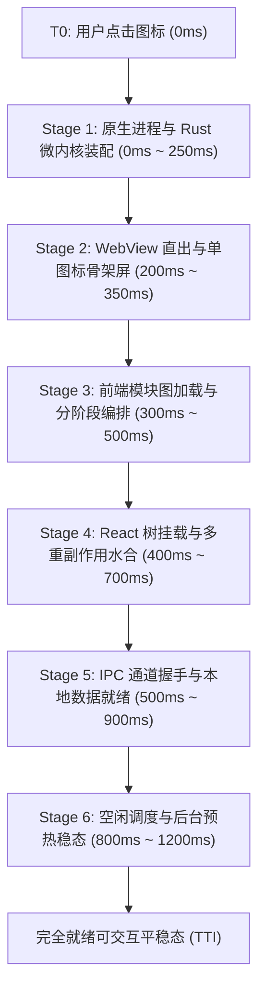

# 00-全链路启动性能审查总纲与分层基准（Conex / Crish）

> **战役名称**：全链路启动性能深度审查（`startup-performance-audit`）  
> **创建日期**：2026-09-12  
> **2026-09-13 更新**：权威总案 = [`00-全链路启动性能系统性根治总方案.md`](./00-全链路启动性能系统性根治总方案.md)（旧 `00-…根治方案.md` 已 DEPRECATED）；方案质量复核见 [`audits/05`](./audits/05-方案体系质量与可落地性综合审查报告.md)。实现前须完成其 §7 DoD。  
> **审查基准参考**：业界对比基准图（冷启动总时延 2.82s 阶梯分析：点击启动 0.00s → 窗口出现 0.98s → Splash 1.25s → 首屏首绘 1.78s → 用户名就绪 2.78s → 首屏加载完成 2.82s，常驻内存 343.8MB）——**仅作叙事对照，非本机实测**  
> **总体目标**：对 Crish 桌面端软件从「用户点击启动」到「首屏完全可交互（TTI）并进入平稳态」的全生命周期进行深度、代码级、全链路分层审查；冷启动/热启动绝对阈值须以**本机真实 benchmark 基线**锁定后写入门禁，禁止未测量伪精确数字硬阻断 CI。

---

## 一、全链路物理阶段划分与审查责任矩阵

依据桌面端（Tauri v2 + Rust 微内核 + Webview + React 19）的技术特征，我们将整个启动生命周期切分为 6 大严密的物理分层，各分层分别设立专职审查维度并由专职 Agent 交付详尽报告：

| 阶段编号 | 报告文件 | 物理阶段定义 | 核心代码域 | 关键审查靶点 |
| :--- | :--- | :--- | :--- | :--- |
| **Stage 1** | `01-原生壳与微内核装配性能审查报告.md` | 原生进程拉起、单实例锁、Tauri 闭包、Rust 核心服务装配与 OS 窗口就绪 | `src-tauri/src/main.rs`, `single_instance.rs`, `host_paths.rs`, `tauri.conf.json` | 串行同步 I/O、日志与 Panic Hook 阻塞、SQLite 双库打开时延、窗口可见性策略与闪白防线 |
| **Stage 2** | `02-WebView直出与首绘骨架屏审查报告.md` | WebView 创建、本地静态资源加载、无白屏骨架屏直出与主题防闪跳 | `apps/crish-desktop/index.html`, `loader.css`, `loader.js`, `createSsrGlobals.ts` | 静态骨架屏直出效率、外链 JS/CSS 阻塞、localStorage 同步读开销、CSP 解析耗时、拖拽区穿透 |
| **Stage 3** | `03-前端模块拓扑与分阶段编排审查报告.md` | JS Bundle 评估、主入口代码分割、Phase 0/1/1.5 异步流控、Worker 抢跑 | `src/main.tsx`, `bootstrap-orchestrator.ts`, `bootstrap-core.ts`, `workers/index.ts` | 首屏 chunk 体积与非核心依赖泄漏、WorkerPool 冷启创建 2 线程的 CPU 争抢、最小配置加载阻塞 |
| **Stage 4** | `04-React树挂载与多重副作用水合审查报告.md` | React 根挂载、App 组件渲染、多重 useEffect 级联水合与 DOM 属性写入 | `src/App.tsx`, `src/app/AppBootstrap.ts`, `src/app/hydrateWorkspaceShell.ts` | 10+ 散落 Hooks 级联更新、DOM 属性反复修改触发 Forced Reflow、双重 rAF 延迟、布局树恢复竞态 |
| **Stage 5** | `05-IPC通道握手与数据水合就绪审查报告.md` | 前后端 IPC 连通探测、本地 SQLite 状态拉取、凭据读取、会话与工作区就绪 | `src/api/chatBridge.ts`, `src/api/transport/`, `src/api/clientApi.ts`, `session_commands.rs` | 连通性门闩探测、本地数据查询与反序列化开销、避免外部参考图中的“1 秒云端阻塞”、快照恢复重放 |
| **Stage 6** | `06-空闲预热与后台协程争抢审查报告.md` | requestIdleCallback 预热、WorkerPool 扩容、后台 GC 与定时器协程对 CPU 的争抢 | `src/main.tsx:idleTask`, `bootstrap-full.ts`, `main.rs:1005-1025`, `pty.rs` | 500ms 盲轮询协程、视图 chunk 闲时加载引起的初次交互微卡顿、多端与推送初始开销 |

---

## 二、执行纪律与文档硬性规范

1. **硬性行数标准**：
   - 每个维度的专职审查报告必须**严格不少于 700 行**（最低标准 700 行）。
   - 严禁空泛陈述、套话废话。必须通过穷尽式的代码追溯、行号证据与因果推导支撑篇幅。
2. **严禁凭空猜测，坚持证据链闭环**：
   - 每一个性能问题必须标明 `文件路径:行号`，并附带精确代码切片。
   - 必须穿透分析其底层根因（如引起 V8 主线程 Deopt、触发 Blink Forced Synchronous Layout、耗尽 Tokio 线程池、磁盘 fsync 放大等）。
3. **结构统一规范**：
   各分层报告统一遵循以下八段式标准结构：
   - 一、审查总览与分层范围
   - 二、正面设计与优良机制（禁止回潮项）
   - 三、高严重度性能瓶颈（P0/High：深入剖析 + 源码证据 + 根因 + 精准架构修复方案）
   - 四、中严重度性能问题（P1/Medium：源码证据 + 影响分析 + 优化建议）
   - 五、低严重度与微架构隐患（P2/Low：代码坏味道 + 冗余开销）
   - 六、启动分层时序图与调用拓扑（Mermaid / 结构图）
   - 七、运行时性能验证断言与测试用例设计建议
   - 八、修复行动项矩阵（问题清单、受影响文件、建议方案、验收指标）
4. **Git 与工作区纪律**：
   - 子 Agent 严禁执行 git 提交操作；改动留在工作区，由主控统一协调提交。
   - 文件采用 UTF-8 无 BOM 编码保存。
