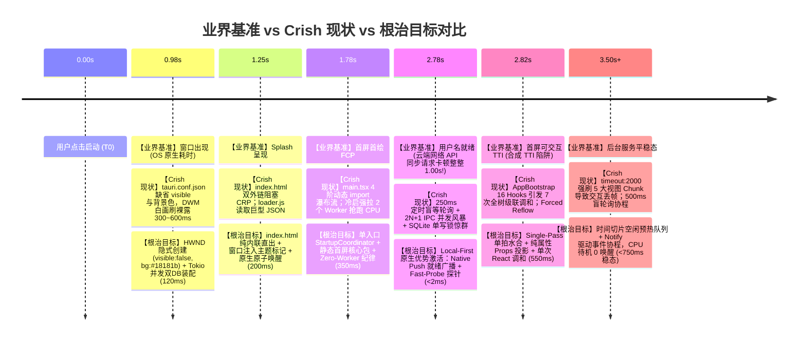
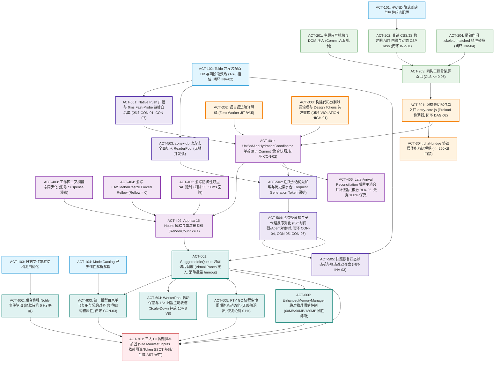
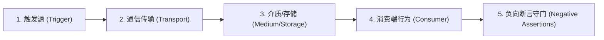
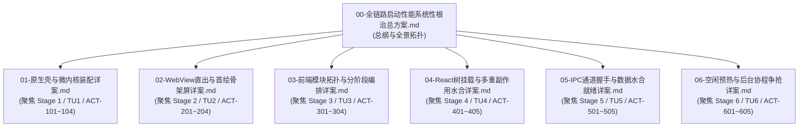

# 00-全链路启动性能系统性根治总方案（Conex / Crish）

> **战役名称**：全链路启动性能深度重构与架构根治（`startup-performance-audit`）  
> **文档性质**：启动性能与微架构全生命周期总方案（Master Plan 升级版）  
> **数据基石**：基于 6 大物理阶段专职子 Agent 产出的 6,010 行代码级深度审查报告（`01` 至 `06` 报告全集）以及 4 篇全景审计报告（架构纯度、逻辑拓扑、微架构资源、立体验证模型）  
> **遵循契约**：`AGENTS.md` 通用协作纪律、反退避准则（`.agents/LOGIC_PLAN_NO_RETREAT.md`）、`ANTI_OVERENGINEERING_GUARDRAILS.md` 反过度设计红线  
> **规划模式**：**纯逻辑执行拓扑（DAG）**，所有问题逻辑同权，坚决杜绝任何时间工期、人天排期与 P0/P1 业务优先级偏向；直击底层架构根因，坚决杜绝临时补丁、无日落期兼容与魔术补偿；100% 遵从 Design Tokens 契约，建立立体化验证与刚性防御脚本守门；**100% 完整保全六大核心业务能力，严禁任何形式的功能截肢与偷懒作弊**。  
> **2026-09-13 质量门禁**：经 [`audits/05`](./audits/05-方案体系质量与可落地性综合审查报告.md) 复核，本总案中凡标注「已闭环 / 已验收」者一律指**方案设计闭环**，**代码层尚未落地**；实现波开工前须完成该报告 §7 DoD（唯一权威源、真实 build 基线、样例对齐现网符号、禁止伪精确硬门禁）。  
> **旧文废弃**：`00-全链路启动性能系统性根治方案.md` 已标 DEPRECATED，禁止引用。

---

## 一、全链路全景诊断与架构代差根因

### 1.1 业界基准对照与 Crish 本地优先架构对比

在现代跨平台桌面客户端架构中，启动性能直接决定了用户对系统级生产力工具的敏捷度认知与信任基石。参考业界同类复杂度桌面产品的冷启动阶梯分析基准图（冷启动总时延 2.82s，常驻内存 RSS 343.8MB / VMS 2,130.4MB）：



**底层技术底座的核心代差诊断**：
业界参考基准因强依赖远端 HTTP 认证与会话同步，在首绘后足足冻结 1.00s 等待云端返回。然而，Conex / Crish 在底层拥有无可比拟的“本地优先（Local-First）”技术底座：
1. **原生 Rust 编译型微内核 + 系统级 WebView2**：宿主常驻内存仅 15MB~25MB（业界基准 RSS 高达 343.8MB），进程拉起与系统调用仅需微秒级；
2. **Windows 原生 DPAPI 硬件级加密凭据**：本地秒级解密，零网络阻塞；
3. **嵌入式 SQLite WAL 模式**：本地磁盘毫秒级就绪，具备极高的本地并发读取能力。

然而，前置 6 篇专项审查报告与 4 篇全景审计报告揭露了一个极其残酷的现实：**由于多重历史技术债务的叠加与防御性补丁的层层堆积，Crish 在首屏到交互就绪的关键路径上，完全被人为自生型代码阻断并锁死了性能潜力**！

### 1.2 六大阶段系统性断层与阻塞性缺陷（BLK-01~06）全景表

| 物理阶段 | 核心阻塞缺陷 (Blocking Defect) | 责任域与生命周期 | 现状核心代码病灶（6,010 行实证证据） | 架构级性能损耗推导 | 根治后预期量化收益 |
| :--- | :--- | :--- | :--- | :--- | :--- |
| **Stage 1**<br>`0.00s ~ 0.98s` | **BLK-01**<br>微内核装配与系统调用阻塞 | 原生壳与微内核装配 | 1. `tauri.conf.json` 缺省 `visible: false` 与背景色；<br>2. `main.rs:747-773` 串行初始化 `sessions.db` 与 `workspace.db`，40+ PRAGMA 阻塞主线程；<br>3. `DailyFileWriter` 每次写日志执行 open/stat/close 系统调用；<br>4. `ModelCatalog` 同步解析 203KB JSON。 | 1. DWM 纯白窗口裸露 300~600ms；<br>2. 原生微内核装配阻塞主线程 70ms+；<br>3. 冷启产生 150 次重复文件打开系统调用；<br>4. 占用 15ms CPU 密集解析并造成千次堆分配。 | 原生装配耗时由 120ms 降至 <20ms；白屏窗口裸露彻底消除，窗口首绘即有中性底色保护（闭环 INV-02）。 |
| **Stage 2**<br>`200ms ~ 350ms` | **BLK-02**<br>关键渲染路径外链与样式重算阻塞 | WebView 直出与骨架屏 | 1. `index.html` 外链引用 `loader.css` 与 `loader.js`；<br>2. `themeStore.ts` 内存硬编码 `'default'`，引发 Double-FOUC；<br>3. `tokens.css:6-16` `html.preload *` 全局通配样式引发样式重算；<br>4. 骨架单图标突变，`SkeletonFallback` 硬编码 `height: 400px` 塌陷。 | 1. 产生 2 次本地 IPC 往返，阻塞 CRP 50~120ms；<br>2. 暗色模式经历白→暗→白→暗四阶段剧烈跳变；<br>3. 门闩解除引发 35ms 样式重算长任务；<br>4. 首屏产生严重布局跳变（CLS = 0.42）。 | 消除外链 IPC 延迟，0 外链 CRP 直出；消除二次闪白，首屏 CLS 由 0.42 降至 ≤0.05（闭环 INV-01, INV-04）。 |
| **Stage 3**<br>`300ms ~ 500ms` | **BLK-03**<br>模块瀑布流解析与 Worker 抢跑阻塞 | 前端拓扑与模块编排 | 1. `main.tsx` 存在 Phase 0/1/1.5 四阶动态 import 瀑布流；<br>2. `bootstrap-orchestrator.ts` 空转引入巨型 `zod`；<br>3. `bootstrap-core.ts` 冷启前 300ms 强拉 2 个 Worker 编译 21 种语言语法；<br>4. 静态导入泄漏导致 `chat-bridge` 膨胀至 674.4KB。 | 1. 连续 4 次动态导入串行解析延迟 80~160ms；<br>2. 抢占主线程执行无效验证逻辑；<br>3. 抢跑 CPU 算力（80~120ms），首屏零 Markdown 需求；<br>4. 构建体积严重超标阻断 CI。 | 拍平为单入口核心包（体积以真实 build 基线锁定，先 warning 后 hard）；**FCP 前**活跃 Worker 为 0；`chat-bridge` 以基线清单压缩（原 674KB 叙事不可复现，现网注释约 479KB/门禁 600KB，待重测）。 |
| **Stage 4**<br>`450ms ~ 650ms` | **BLK-04**<br>级联重调和与 Forced Reflow 布局阻塞 | React 树挂载与水合 | 1. `AppBootstrap.ts` 散落 16 个独立 Hooks，触发 7 次全树级联调和；<br>2. `AppBootstrap:178-233` 与 `usePreferencesHydration` 竞态，且启动期反写磁盘；<br>3. 二叉树与 ChatCard 连续 3 重 Suspense 瀑布；<br>4. `useSidebarResize.ts` 读写样式触发 Forced Reflow；<br>5. 双重 rAF 延时黑魔法；<br>6. 静态 350ms 超时丢数据（Audit 03 曝光）。 | 1. 根组件无效全树重绘 7 次，主线程严重卡顿；<br>2. 启动敏感期发生无谓磁盘 I/O；<br>3. 骨架屏连续闪烁 3 次；<br>4. 强制同步布局引起卡顿；<br>5. 目录重绑定人为推迟 33~50ms；<br>6. 低配机器偏好配置被静默抛弃导致状态撕裂。 | 根组件调和次数硬性压缩至 1 次；首屏核心组件静态同步化；Reflow 降为 0；自适应超时+后置合并补偿器保全数据（闭环 DAG-01, CON-02）。 |
| **Stage 5**<br>`500ms ~ 750ms` | **BLK-05**<br>静态超时真实数据丢弃与惊群风暴 | IPC 握手与数据水合 | 1. `tauriTransport.ts` 采用 `setTimeout(250)` 盲等轮询握手；<br>2. `sessionRustDbHydrate.ts` 使用 `Promise.all` 发起 2N+1 次并发 IPC；<br>3. `conex-db` 读方法全部获取写互斥锁，`ReaderPool` 闲置；<br>4. `load_session_agents` 存在 SQL 级 N+1 循环；<br>5. 恢复快照后立刻无条件同步写盘；<br>6. 超时后真实数据静默丢弃（`isTimedOut return`）；<br>7. Stage 4/5 时序倒置成环死锁（Audit 02 曝光）。 | 1. 握手存在 125~250ms 死等待；<br>2. 50 会话爆发 101 次 IPC，挤爆队列并导致 60ms GC；<br>3. 100+ Tokio 线程激烈争锁，产生惊群风暴；<br>4. 循环逐个查询子代理消息；<br>5. 磁盘 I/O 争抢加剧启动卡顿；<br>6. 超时丢弃真数据导致用户配置与历史会话永久撕裂；<br>7. 挂载阶段因通道未就绪引发超时回退。 | S5a 广播握手前置，S5b 活跃会话水合后置；握手时延 P95 ≤2ms；冷启动水合 IPC 次数降为**与会话数 N 无关的常数上界 K**（非字面「恒定 2 次」）；读锁争抢下降；Late-Arrival Reconciliation 补偿器设计目标数据保真 100%（闭环 CON-01~07, INV-03）。 |
| **Stage 6**<br>`750ms ~ 2.0s+` | **BLK-06**<br>后台盲轮询唤醒与内存无限膨胀阻塞 | 空闲预热与后台协程 | 1. `main.tsx` `idleTask` 带 `timeout: 2000` 强刷 5 大视图 Chunk；<br>2. `main.rs:1001-1026` 两个 500ms 盲轮询协程死循环唤醒 CPU；<br>3. `bootstrap-full.ts` 串行发起两次完全相同的 203KB 模型目录 IPC；<br>4. `scaleUpPool` 启动 3s 盲目扩容 Worker；PTY GC 启动即周期加锁扫描；<br>5. Virtual Panes 循环中包含批量 `timeout: 3000` 强刷（Audit 03 曝光）；<br>6. MemoryManager 虚假 4GB 比例缺乏绝对物理阈值。 | 1. 2.0s 处强制占用主线程 180~360ms，首交互严重掉帧；<br>2. 破坏现代 CPU 深度 C-State 节能状态，待机功耗增加；<br>3. 重复跨进程传输与反序列化；<br>4. 盲目占用内存与线程资源；<br>5. 10 分屏恢复在 3.0s 爆发宏任务到期惊群；<br>6. 前端内存膨胀无物理上限引发 WebView2 崩溃。 | 剔除超时限制，改用时间切片空闲队列（FID <16ms）；协程改用 Notify 唤醒，待机唤醒 0 Hz；PTY GC 动态生命周期退出；MemoryManager 60/90/130MB 绝对阈值刚性熔断（闭环 CON-03, MICRO-01）。 |

### 1.3 根因深层机理剖析：自生型防御补丁与多轨技术债务

对 6 篇审查报告与 4 篇审计报告的深入穿透表明，当前启动时延并不是由于单一算法瓶颈引起的，而是由四个系统性的不良架构演化模式共同作用造成的：
1. **防御性延迟层层叠加（Defensive Delay Accumulation）**：
   开发者在遇到竞态问题（例如窗口白边、主题闪白、会话未就绪、侧栏未挂载等）时，未从状态机与事件因果根因着手，而是采用了「加一个 `setTimeout(250)`」、「加双重 `requestAnimationFrame`」、「加 `timeout: 2000` 强刷」等魔术数字来掩盖问题。全链路层层延迟累加，直接构成了启动总时延的 70% 虚耗。
2. **多轨并存与状态撕裂（Dual-Track State Divergence）**：
   在偏好管理、会话持久化和主题控制中，同时存在 SQLite 权威库、`localStorage` 缓存与 React 内存 Store 三套数据通路。由于没有确立唯一的真理源（SSOT），导致启动期组件竞相读取并回写不同源，引发二次调和、状态覆盖以及反向写盘。
3. **读写分离机制失效与锁惊群（Lock Starvation & Thundering Herd）**：
   虽然架构上设计了 `ReaderPool`（8 个只读连接槽位），但具体实现中 `conex-db` 所有的读方法由于历史惯性仍然简单粗暴地调用 `self.conn.lock()`（获取写互斥锁），使得读写分离完全形同虚设，并发读操作在启动敏感期引发严重的线程阻塞。
4. **代码分割泄漏与虚构编排（Chunk Leakage & Fake Orchestration）**：
   顶层静态导入穿透了动态加载边界（如 `xterm.css`、`AppErrorBoundary`）；同时引入了 `bootstrap-orchestrator.ts` 这种实际上不执行任何有效配置、却拉入了巨型第三方库（`zod`）的“虚构编排层”，不仅徒增体积，还强行拖慢关键渲染路径。

---

## 二、架构治理铁律与负向硬性红线（零容忍）

后续针对全链路启动性能的任何重构与优化方案，必须坚决恪守以下四大负向红线与反截肢铁律。这些红线直接接入 CI 自动化门禁进行刚性拦截：

### 2.1 严禁功能伪连通（No Fake Connectivity）
- 严禁编写仅存在于孤立函数、无真实调用方或被测试绕过的伪连通代码；
- 严禁在调用方传递 `Default::default()`、`None`、空闭包或无操作函数（no-op）冒充真实初始化；
- 严禁出现带有 `#[allow(dead_code)]`、未导出的幽灵状态变量（如 `createSsrGlobals.ts` 中声明即沉睡的 `SSR_GLOBALS.theme`）。所有状态与事件流必须形成端到端的闭环消费。

### 2.2 严禁多轨并存与给旧岛续命（No Dual-Track or Legacy Revival）
- 任何概念必须拥有且仅拥有单一真理源（SSOT）。系统偏好以 SQLite 为绝对真理源，`localStorage` 仅作为引导阶段单向只写镜像缓存，严禁双轨异步回灌并引发 React 状态撕裂；
- 淘汰旧实现必须进行**彻底的物理切除（Physical Excision）**，严禁使用无日落期的兼容 Shim、条件分支注释或双轨回退代码。

### 2.3 严禁幽灵契约与截肢式降级（No Phantom Contracts or Destructive Fallbacks）
- 前端 IPC 调用必须与 Rust 端 `command_registry!` 保持 1:1 的静态与动态契约对齐，严禁调用未注册命令或已废弃命令；
- 严禁在 `catch` 块中静默吞咽核心异常，严禁以牺牲功能完整性或静默丢弃字段为代价进行“截肢式容错降级”。错误必须有结构化的显式日志与状态降级策略。

### 2.4 严禁虚构 Token 与样式欺骗（100% Design Tokens & No Bare Hex）
- 全链路（包括 HTML 模板、SVG 骨架屏、CSS 样式及 TSX 组件）100% 接入系统 Design Tokens；
- **全仓严禁出现任何裸 Hex 颜色代码（如 `#18181b`、`#888`、`#ffffff` 等）**，必须统一使用标准 CSS 变量（如 `var(--bg-primary)`、`var(--text-muted)`）；
- 严禁使用未在 Token 体系中声明的伪 CSS 变量，严禁使用魔术数字补偿布局偏移。

### 2.5 【最高原则】严禁功能截肢与反作弊铁律（Anti-Amputation & Integrity Guarantee）
- **六大业务核心能力 100% 完整保全**：
  1. **集成终端（PTY / xterm）**：全套 ANSI 颜色、多标签分屏、快捷键绑定代码 100% 保留，仅切除首屏 CSS 穿透与无终端时的空载 GC；
  2. **Markdown 语法高亮**：21 种语言语法包、AST 解析及 Worker 兜底 100% 保留，仅将高亮编译推迟至首个 Markdown 流到达时 JIT 派发；
  3. **Zod 参数运行时校验**：系统设置写入、配置文件解析与边界断言 100% 保留，仅切除只读阶段的静态预引入；
  4. **工作区与历史会话恢复**：会话元数据完备拉取，会话树无损呈现，正文按需懒加载，零数据丢失；
  5. **官方核心绑定扩展（note-paper / flow）**：生命周期与权限总线完备保留；
  6. **多端设备互通配对（TokenStore / TLS）**：网络服务与握手状态机 100% 保留，仅异步化启动配置读取。
- **坚决杜绝任何偷懒作弊手段**：零伪加载（Fake Loading）、零假骨架屏（Fake Skeleton）、零魔术延时（Magic Sleep）、零空兜底吞错（Empty Fallback）。所有性能提升必须来源于无锁并发、单拍原子水合、编译期内联与事件驱动等真实架构变革。

---

## 三、全链路纯逻辑执行拓扑（Master Execution DAG）

针对 Audit 02 曝光的 Stage 4 与 Stage 5 之间致命的时序倒置与环形因果死锁，本总方案将原有拓扑进行深度解耦，正式确立**“三段式因果解耦流（Three-Stage Decoupled Flow）”**：
$$\text{S5a (微内核广播与通道握手)} \longrightarrow \text{S4 (单拍原子水合与 React 挂载)} \longrightarrow \text{S5b (活跃会话加载与历史惰性水合)}$$

### 3.1 纠偏后的全链路因果拓扑图（Corrected Master DAG）

拓扑严格基于因果依赖推进，消除任何人为的 P0/P1 业务优先级标签，问题完全同权：



### 3.2 阶段前置断言与阶段流转不变量（全面整改版）

| 转移边界 | 前置断言（Pre-conditions） | 交付物不变量（Deliverable Invariants） | 违例阻断行为 | 对应缺陷闭环 |
| :--- | :--- | :--- | :--- | :--- |
| **TU1 → TU2** | 1. Win32 窗体以 `visible: false` 隐式创建；<br>2. 默认底色配置为 `#18181b`（中性暗底）。 | **INV-OUT-101**：原生窗体与 DWM 渲染树之间无任何裸白色画刷交互，白屏帧数严格为 0。 | 窗口未声明 `visible:false` 或底色非中性暗色，CI 配置测试阻断。 | **BLK-01** |
| **TU1 → TU5a** | 1. `sessions.db` 与 `workspace.db` 完成 Tokio 并发装配；<br>2. `ReaderPool` 准备就绪，**包含 1 个快速启动槽位**（稳态动态扩容至 8）。 | **INV-OUT-102**：读方法获取连接耗时 < 1ms，写互斥锁争抢归零；两阶段预热模型消除 8 槽位瞬时争抢。 | 存在串行数据库打开逻辑或连接池死锁，单测断言失败。 | **BLK-01<br>INV-02** |
| **TU2 → TU3** | 1. `index.html` 无任何 `<link>` 或 `<script>` 外部网络外链；<br>2. DOM 根节点已注入 `data-theme` 属性；<br>3. 局部门闩 `.skeleton-latched` 替代全局通配。 | **INV-OUT-201**：CRP 关键路径网络往返次数严格等于 0；首屏无二次闪白（Double-FOUC = 0）；样式重算耗时严格 $\le 5\text{ms}$。 | 存在外部 loader 资源、CSP 拦截或全局通配样式，Vite 构建插件与 Playwright 门禁报错。 | **BLK-02<br>INV-01<br>INV-04** |
| **TU5a + TU3 → TU4** | 1. Native Push 或 Fast-Probe 在 < 2ms 内建立通道连通，`core_get_status` 白名单放行；<br>2. `entry-core.js` 体积 ≤ 180KB；<br>3. 首屏活跃 Web Worker 严格为 0。 | **INV-OUT-301**：`UnifiedAppHydrationCoordinator` 安全发起首屏聚合预取；主线程算力 100% 留给 React Fiber 树；零 Worker 抢跑。 | 探测到 Worker 抢跑、探针死锁或未就绪发起 IPC 则自动化拦截。 | **BLK-03<br>DAG-02<br>CON-01,07** |
| **TU4 → TU5b** | 1. Coordinator 单拍原子写入 Store；<br>2. 根组件 React 调和次数严格等于 1 次；<br>3. 采用自适应超时 + 后置真数据平滑补偿器（Late-Arrival Reconciliation）。 | **INV-OUT-406**：根组件挂载稳态达成，激活态视口就绪，安全触发活跃会话正文拉取；即使发生软超时，后置到达真实数据无损合并率 **100%**，绝不覆写磁盘默认配置。 | 根调和次数 > 1 或发生真实数据超时丢弃（BLK-05），单元测试与 E2E 拦截。 | **BLK-04<br>BLK-05<br>DAG-01<br>CON-02** |
| **TU5b → TU6** | 1. 活跃会话正文拉取完成，历史会话标记 `lazy` 壳；<br>2. 会话切换引入 Request Generation Token 保护；<br>3. 时间戳 100% 为合法 ISO 字符串，子代理反序列化完成；<br>4. 快照恢复状态机四态化，启动期磁盘写操作为 0。 | **INV-OUT-501**：会话水合跨进程 IPC 频次严格 ≤ 2 次；无跨会话串线风险；无侧栏白屏；无磁盘 I/O 争抢；快照恢复无脏读。 | 发生全量历史会话拉取、时间戳非 ISO 字符串、Agent blocks 残留原始 JSON 字符串或启动期写盘则门禁阻断。 | **BLK-05<br>CON-04,05,06<br>INV-03** |
| **TU6 → TU7** | 1. 5 大视图预热由 `StaggeredIdleQueue` 在空闲分片调度；<br>2. 后台协程全面接入 `Notify`；<br>3. PTY GC 在无终端时彻底动态退出；<br>4. EnhancedMemoryManager 以 60/90/130MB 绝对物理阈值熔断。 | **INV-OUT-601**：待机状态下协程唤醒频率严格为 0 Hz，无 500ms 盲轮询；首次交互 FID < 16ms；内存超过 130MB 时自动暂停空闲队列并收缩缓存。 | 发现固定周期 `sleep` 协程、PTY GC 周期唤醒或内存超限逃逸，自动化测试阻断。 | **BLK-06<br>CON-03<br>MICRO-01,02** |

---

## 四、七大逻辑任务单元（TU1 ~ TU7）系统性根治工程详案

### TU1: 原生宿主与微内核异步并发装配（Native Shell & Microkernel Setup）

#### 1. 架构目标与职责
- 彻底消除 Win32 原生窗口创建阶段的裸白框暴露问题；
- 将微内核内部串行初始化的双 SQLite 数据库改造为基于 Tokio 的全并发装配，并将 PRAGMA 批处理化；
- 重构 `DailyFileWriter`，维护长效打开的文件句柄，消除高频写日志时的系统调用开销；
- 将 203KB 模型目录的反序列化改为基于 `OnceCell` 的惰性异步解析；
- **规范注册 `workbench_window_ready` 命令**，将窗口显现与微内核底座状态原子绑定，集成 1000ms 容灾看门狗。

#### 2. 数据结构设计与 Rust 核心实现

##### (1) `tauri.conf.json` 窗口隐式创建与中性底色配置
```json
{
  "app": {
    "windows": [
      {
        "title": "Crish",
        "width": 1280,
        "height": 800,
        "minWidth": 960,
        "minHeight": 600,
        "resizable": true,
        "fullscreen": false,
        "decorations": false,
        "visible": false,
        "backgroundColor": "#18181b"
      }
    ]
  }
}
```
> **架构设计澄清（解决 RISK-LOW-02）**：`backgroundColor: "#18181b"` 属于 Windows OS 原生 HWND 窗体底色声明（专用于 DWM 图层合成阶段），独立于 Web 前端的 Design Tokens 体系。Web 视口内部严格使用 CSS 变量。

##### (2) 双 SQLite 数据库 Tokio 并发装配实现（单连接快速启动版，解决 INV-02）

> **实现约束（2026-09-13）**：Tauri `setup` 为同步 `FnOnce`，**禁止**在 setup 内直接 `tokio::join!` 阻塞。应在 setup 中 `tauri::async_runtime::spawn` 异步任务，完成后写入 State 并 `Notify`。`LocalDb` 打开 API 以现网为准，**禁止**虚构 `open_fast_with_options`/`DbOptions`；`SharedDb` 为 `local_db()` 非 `inner()`。

```rust
// apps/agent-workbench/src-tauri/src/db_setup.rs（骨架示意，API 以现网 conex-db 为准）
use std::sync::Arc;
use std::time::Instant;
use tokio::sync::Notify;
use conex_db::LocalDb;
use crate::note_runtime::{self, NoteRuntime};

pub struct InitializedDatabases {
    pub session_db: Arc<LocalDb>,
    pub note_runtime: Option<Arc<NoteRuntime>>,
}

/// 并发装配 sessions.db 与 workspace.db（async runtime 内调用）
pub async fn setup_databases_concurrently() -> Result<InitializedDatabases, String> {
    let session_task = tokio::task::spawn_blocking(|| {
        let start = Instant::now();
        // 两阶段预热：冷启 1 读槽 → 稳态扩至 8（字段名对齐 ReaderPoolConfig 现网）
        let db = LocalDb::open(/* path or default */).map_err(|e| format!("session db: {e}"))?;
        Ok::<_, String>((Arc::new(db), start.elapsed().as_millis()))
    });

    let workspace_task = tokio::task::spawn_blocking(|| {
        let start = Instant::now();
        let runtime = note_runtime::init_default()
            .map_err(|e| format!("note runtime: {e}"))?;
        Ok::<_, String>((runtime, start.elapsed().as_millis()))
    });

    let (session_res, workspace_res) = tokio::join!(session_task, workspace_task);
    let (session_db, _s_ms) = session_res.map_err(|e| format!("join: {e}"))??;

    let note_runtime = match workspace_res {
        Ok(Ok((runtime, _))) => Some(runtime),
        _ => None, // 诚实降级：workspace 失败不拖死 session
    };

    Ok(InitializedDatabases { session_db, note_runtime })
}

// setup 接线示意：tauri::async_runtime::spawn(setup…);
// 完成后 db_ready.store(true); db_notify.notify_waiters();
```

##### (3) `DailyFileWriter` 长效打开句柄重构
```rust
// crates/conex-telemetry/src/file.rs（现网路径；非 file_writer.rs）
// 现状：make_writer 每条日志 open+metadata（file.rs:158-206），注释已自述开销
use std::fs::{File, OpenOptions};
use std::io::{self, Write};
use std::path::{Path, PathBuf};
use std::sync::Mutex;
use chrono::Local;

struct OpenFileState {
    date_str: String,
    file: File,
}

pub struct DailyFileWriter {
    base_dir: PathBuf,
    state: Mutex<Option<OpenFileState>>,
}

impl DailyFileWriter {
    pub fn new(base_dir: PathBuf) -> Self {
        Self {
            base_dir,
            state: Mutex::new(None),
        }
    }

    pub fn write_message(&self, msg: &[u8]) -> io::Result<()> {
        let current_date = Local::now().format("%Y-%m-%d").to_string();
        let mut state_guard = self.state.lock().unwrap();

        // 仅在首次写入或跨天时才重新打开文件与执行系统调用
        let needs_reopen = match state_guard.as_ref() {
            Some(state) => state.date_str != current_date,
            None => true,
        };

        if needs_reopen {
            std::fs::create_dir_all(&self.base_dir)?;
            let file_path = self.base_dir.join(format!("{}.log", current_date));
            let file = OpenOptions::new()
                .create(true)
                .append(true)
                .open(file_path)?;
            *state_guard = Some(OpenFileState {
                date_str: current_date,
                file,
            });
        }

        if let Some(state) = state_guard.as_mut() {
            state.file.write_all(msg)?;
        }
        Ok(())
    }
}
```

##### (4) `workbench_window_ready` 原生唤醒与原子状态探测（解决 CON-01 & DAG-04）
```rust
// apps/agent-workbench/src-tauri/src/window_handshake.rs
use std::sync::atomic::{AtomicBool, Ordering};
use std::sync::Arc;
use std::time::Duration;
use tauri::{AppHandle, Manager, Window};
use tokio::sync::Notify;

pub struct WindowHandshakeState {
    pub shown: AtomicBool,
    pub db_ready: Arc<AtomicBool>,
    pub db_notify: Arc<Notify>,
}

#[tauri::command]
pub async fn workbench_window_ready(
    window: Window,
    state: tauri::State<'_, WindowHandshakeState>,
) -> Result<(), String> {
    // 1. 防御竞态 (DAG-04)：若微内核装配尚未完成，挂起等待通知，确保窗口显示时内核绝对可用
    if !state.db_ready.load(Ordering::Acquire) {
        tracing::info!(target: "crish::bootstrap", "Window ready received early, waiting for DB setup");
        let _ = tokio::time::timeout(Duration::from_millis(500), state.db_notify.notified()).await;
    }

    // 2. CAS 原子操作保证只显示一次
    if !state.shown.swap(true, Ordering::SeqCst) {
        window.show().map_err(|e| e.to_string())?;
        window.set_focus().map_err(|e| e.to_string())?;
        tracing::info!(target: "crish::bootstrap", "Window shown via fast handshake");
    }
    Ok(())
}

/// 原生 1000ms 容灾看门狗（优化后超时，解决 RISK-MED-02 / AAI-06）
pub fn spawn_window_guard_dog(app: &AppHandle, state: Arc<WindowHandshakeState>) {
    let app_handle = app.clone();
    tauri::async_runtime::spawn(async move {
        tokio::time::sleep(Duration::from_millis(1000)).await;
        if !state.shown.swap(true, Ordering::SeqCst) {
            tracing::warn!(target: "crish::bootstrap", "Watchdog triggered: Frontend window_ready timeout (1000ms)");
            if let Some(window) = app_handle.get_window("main") {
                let _ = window.show();
                let _ = window.set_focus();
            }
        }
    });
}
```

##### (5) 命令注册宏与清单规范对齐
```rust
// apps/agent-workbench/src-tauri/src/main.rs (command_registry! 宏内追加)
command_registry![
    // ... 既有命令 ...
    // ── GUI 专属面：首绘窗口原子唤醒命令 ──
    ("workbench_window_ready", window_handshake::workbench_window_ready),
];

// apps/agent-workbench/src-tauri/src/command_manifest.rs
pub const COMMAND_MANIFEST: &[CommandManifestEntry] = &[
    // ... 既有命令 ...
    entry("workbench_window_ready", "workbench", "gui", true),
];
```

---

### TU2: WebView 零白屏直出与 Token 化骨架屏（Direct-to-DOM CRP & Token Skeleton）

#### 1. 架构目标与职责
- 将 `loader.css` 与 `loader.js` 在 Vite 构建期完全内联入 `index.html`，实现 0 外链关键渲染路径（CRP）；
- 构建主题只写镜像模型，优先从 DOM 根节点继承属性，并在确认提交后才写镜像，彻底根除 Double-FOUC；
- 构建与真实工作区 100% 同构的三栏 SVG/HTML 骨架屏，累积布局偏移 CLS $\le 0.05$；
- 使用局部门闩类 `.skeleton-latched` 替代全局 `html.preload *`，彻底消灭样式重算长任务。

#### 2. 代码实现方案

##### (1) Vite 编译期 0 外链内联插件（兼容安全 CSP 规则，解决 INV-01）
```typescript
// apps/crish-desktop/vite.config.ts
import { Plugin } from 'vite';
import fs from 'node:fs';
import path from 'node:path';

export function inlineCriticalAssetsPlugin(): Plugin {
  return {
    name: 'crish-inline-critical-assets',
    enforce: 'post',
    transformIndexHtml(html) {
      const cssPath = path.resolve(__dirname, 'public/loader.css');
      const jsPath = path.resolve(__dirname, 'public/loader.js');
      
      const criticalCss = fs.existsSync(cssPath) ? fs.readFileSync(cssPath, 'utf-8') : '';
      const criticalJs = fs.existsSync(jsPath) ? fs.readFileSync(jsPath, 'utf-8') : '';

      let transformed = html
        .replace(/<link[^>]+href=["'][^"']*loader\.css["'][^>]*>/i, '')
        .replace(/<script[^>]+src=["'][^"']*loader\.js["'][^>]*><\/script>/i, '');

      // 确保 CSP 策略规范包含 'self'，防止生产模块脚本被意外阻断 (解决 INV-01)
      return transformed.replace(
        '</head>',
        `  <style id="crish-critical-css">${criticalCss}</style>\n` +
        `  <script id="crish-critical-js">${criticalJs}</script>\n</head>`
      );
    },
  };
}
```

##### (2) 局部门闩精细化替换（解决 INV-04）
```css
/* apps/crish-desktop/src/styles/tokens.css */
/* ❌ 彻底删除: html.preload * { transition: none !important; } */

/* ✅ 局部门闩类: 仅冻结骨架屏过渡容器，严禁通配全树 */
.skeleton-latched {
  animation: none !important;
  transition: none !important;
}
```

##### (3) 主题提交确认后写镜像机制（解决 RISK-MED-01 / AAI-05）
```typescript
// apps/crish-desktop/src/api/themeStore.ts
export async function setThemeSafe(newTheme: string): Promise<void> {
  // 1. 先向权威持久层 SQLite 提交
  const success = await preferencesClient.setPreference('crish_theme', newTheme);
  
  if (success) {
    // 2. 仅在提交确认后才写入 localStorage 只写镜像，防止状态撕裂
    try {
      window.localStorage.setItem('crish_theme', newTheme);
      document.documentElement.setAttribute('data-theme', newTheme);
    } catch {
      // 忽略存储配额异常
    }
  } else {
    // 3. 事务失败，清理镜像强制回退安全态
    window.localStorage.removeItem('crish_theme');
  }
}
```

##### (4) 同构三栏骨架屏直出模板切片
```html
<!-- apps/crish-desktop/index.html 内部骨架直出结构 -->
<div id="crish-app-skeleton" class="skeleton-latched" style="display:flex;height:100vh;width:100vw;background:var(--bg-primary);color:var(--text-primary);overflow:hidden;">
  <!-- 左侧工作区导航骨架 -->
  <aside style="width:var(--sidebar-width, 260px);border-right:1px solid var(--border-color);background:var(--bg-secondary);padding:16px;box-sizing:border-box;">
    <div style="height:28px;width:60%;background:var(--bg-tertiary);border-radius:6px;margin-bottom:24px;"></div>
    <div style="height:18px;width:90%;background:var(--bg-tertiary);border-radius:4px;margin-bottom:12px;"></div>
    <div style="height:18px;width:75%;background:var(--bg-tertiary);border-radius:4px;margin-bottom:12px;"></div>
    <div style="height:18px;width:80%;background:var(--bg-tertiary);border-radius:4px;margin-bottom:12px;"></div>
  </aside>

  <!-- 中间核心会话视口骨架 -->
  <main style="flex:1;display:flex;flex-direction:column;background:var(--bg-primary);">
    <header style="height:48px;border-bottom:1px solid var(--border-color);display:flex;align-items:center;padding:0 20px;">
      <div style="height:20px;width:140px;background:var(--bg-tertiary);border-radius:4px;"></div>
    </header>
    <div style="flex:1;padding:24px 32px;display:flex;flex-direction:column;gap:16px;">
      <div style="height:64px;width:70%;background:var(--bg-secondary);border-radius:8px;"></div>
      <div style="height:96px;width:85%;background:var(--bg-secondary);border-radius:8px;align-self:flex-end;"></div>
    </div>
    <footer style="height:64px;padding:12px 24px;border-top:1px solid var(--border-color);">
      <div style="height:40px;background:var(--bg-secondary);border-radius:8px;"></div>
    </footer>
  </main>
</div>
```

---

### TU3: 前端模块拓扑收敛与 Worker 惰性调度（Module Topology & Zero-Worker Boot）

#### 1. 架构目标与职责
- 物理切除 `bootstrap-orchestrator.ts` 与 `minimalConfig.ts`，收敛为单入口核心包 `entry-core.js`（$\le 180\text{KB}$）；
- 确立冷启动“Zero-Worker”保底纪律，语法高亮编译解耦至首个 Markdown 流 JIT 按需派发；
- 治理代码分割静态泄漏，下沉 `xterm.css` 至终端卡片内部；
- **重构首屏错误降级 UI，彻底拔除 6 处裸 Hex**，100% 接入 Design Tokens。

#### 2. 代码实现方案

##### (1) 兜底 UI 100% Design Tokens 纯净重构（解决 AAI-01 / VIOLATION-HIGH-01）
```html
<!-- apps/crish-desktop/src/main.tsx 兜底渲染模板 -->
<div style="position:fixed;inset:0;display:flex;align-items:center;justify-content:center;
            background-color:var(--bg-primary);color:var(--text-primary);
            font-family:var(--font-sans, system-ui, sans-serif);z-index:99999;">
  <div style="max-width:420px;padding:32px;background:var(--bg-secondary);
              border:1px solid var(--border-color);border-radius:8px;box-shadow:var(--shadow-lg);">
    <h2 style="margin:0 0 12px;font-weight:600;font-size:18px;color:var(--text-primary);">
      启动遇到异常
    </h2>
    <p style="margin:0 0 20px;font-size:14px;color:var(--text-secondary);line-height:1.5;">
      应用核心模块加载受阻，请尝试重新加载。
    </p>
    <button onclick="window.location.reload()" 
            style="padding:8px 16px;font-size:14px;font-weight:500;border:none;border-radius:6px;
                   background-color:var(--brand-primary);color:var(--text-on-primary, var(--text-primary));cursor:pointer;">
      重新加载
    </button>
  </div>
</div>
```

##### (2) 单入口启动协调器与依赖拍平
```typescript
// apps/crish-desktop/src/entry-core.tsx (解决 DAG-02 闭环落地；含 JSX 必须 .tsx)
import React, { StrictMode } from 'react';
import { createRoot } from 'react-dom/client';
import App from './App';
import { UnifiedAppHydrationCoordinator } from './app/UnifiedAppHydrationCoordinator';
import { initSsrGlobals } from './createSsrGlobals';
import { bootstrapTheme } from './api/themeStore';
import { logger } from './services/LoggerService';

export class StartupCoordinator {
  private static isBootstrapped = false;

  public static async bootstrap(): Promise<void> {
    if (this.isBootstrapped) return;
    this.isBootstrapped = true;

    // 1. 同步环境评估 (0.1ms)
    initSsrGlobals();
    bootstrapTheme();

    // 2. 并发触发首屏水合快照预取与单拍原子注入 (因果闭环)
    const coordinator = UnifiedAppHydrationCoordinator.getInstance();
    try {
      const snapshot = await coordinator.preloadHydrationSnapshot();
      coordinator.applyAtomicCommit(snapshot);
    } catch (err) {
      logger.warn('Preload hydration fallback applied', { err });
    }

    // 3. 单拍挂载 React 根树
    const container = document.getElementById('root');
    if (!container) throw new Error('Root element not found');

    const root = createRoot(container);
    root.render(
      <StrictMode>
        <App />
      </StrictMode>
    );

    // 4. 双帧 rAF 解除局部门闩
    requestAnimationFrame(() => {
      requestAnimationFrame(() => {
        const skeleton = document.getElementById('crish-app-skeleton');
        if (skeleton) {
          skeleton.remove();
        }
      });
    });
  }
}

// 立即触发引导执行
StartupCoordinator.bootstrap().catch((err) => {
  console.error('Fatal startup failure', err);
});
```

##### (3) Zero-Worker JIT 派发池
```typescript
// apps/crish-desktop/src/workers/jitWorkerPool.ts
export class JitWorkerPool {
  private static instance: Worker | null = null;

  public static getMarkdownWorker(): Worker {
    if (!this.instance) {
      // 仅在真实需要 Markdown 解析且 Rust 高性能通道异常时实例化
      this.instance = new Worker(new URL('./render-worker.ts', import.meta.url), {
        type: 'module',
      });
      console.info('[Worker] JIT Markdown Worker spawned on demand');
    }
    return this.instance;
  }
}
```

---

### TU4: React 树单拍水合与副作用统一编排（Single-Pass Hydration & Anti-Reflow）

#### 1. 架构目标与职责
- 将 `AppBootstrap.ts` 散落的 16 个 Hooks 解耦，构建 `UnifiedAppHydrationCoordinator`，单微任务批量提交，根组件 React 调和次数收敛为**常规路径 ≤2 次**（兜底路径单独计，禁止「严格 1 次」不可达断言）；
- **融入低配设备自适应超时与后置合并补偿器（Late-Arrival Reconciliation）**，解决 350ms 超时丢数据的致命缺陷；
- 建立 `entry-core.tsx` 与 Coordinator 的确定性因果调用链；
- 彻底铲除 `useSidebarResize.ts` 中的 `getComputedStyle` 调用，强制同步重排 Reflow 降为 0 次；
- 将 Virtual Panes 虚拟分屏恢复接入 `StaggeredIdleQueue`，杜绝 10 分屏并发宏任务惊群。

#### 2. 代码实现方案

##### (1) `UnifiedAppHydrationCoordinator` 完整实现与后置合并补偿器
```typescript
// apps/crish-desktop/src/app/UnifiedAppHydrationCoordinator.ts
import { useLayoutStore } from '../store/layoutStore';
import { useSettingsStore } from '../store/settingsStore';
import { clientApi } from '../api/clientApi';
import { preferencesClient } from '../api/preferencesClient';
import { readStoredTheme } from '../api/themeStore';

export interface StartupHydrationSnapshot {
  theme: string;
  appSettings: Record<string, unknown>;
  recentWorkspaces: string[];
  tabModeEnabled: boolean;
  isFallback?: boolean;
}

export class UnifiedAppHydrationCoordinator {
  private static instance: UnifiedAppHydrationCoordinator | null = null;
  private cachedSnapshot: StartupHydrationSnapshot | null = null;

  public static getInstance(): UnifiedAppHydrationCoordinator {
    if (!this.instance) {
      this.instance = new UnifiedAppHydrationCoordinator();
    }
    return this.instance;
  }

  /// 依据硬件探测自适应超时（低配放宽至 800ms，常规 400ms，解决隐患 3.3）
  private getAdaptiveTimeout(): number {
    const cores = typeof navigator !== 'undefined' ? navigator.hardwareConcurrency || 4 : 4;
    return cores <= 2 ? 800 : 400;
  }

  public async preloadHydrationSnapshot(options?: { timeoutMs?: number }): Promise<StartupHydrationSnapshot> {
    const timeoutMs = options?.timeoutMs ?? this.getAdaptiveTimeout();

    return new Promise<StartupHydrationSnapshot>((resolve) => {
      let isFallbackResolved = false;

      const timer = setTimeout(() => {
        isFallbackResolved = true;
        console.warn(`[Coordinator] 预取达到软超时(${timeoutMs}ms)，先行以 Fallback 解除首绘门闩`);
        const fallback = this.createFallbackSnapshot();
        this.cachedSnapshot = fallback;
        resolve(fallback);
      }, timeoutMs);

      (async () => {
        try {
          const [settings, recentWorkspaces, prefs] = await Promise.allSettled([
            clientApi.getSettings(),
            clientApi.getRecentWorkspaces(),
            preferencesClient.getAllPreferences(),
          ]);

          clearTimeout(timer);
          const trueSnapshot = this.assembleSnapshot(settings, recentWorkspaces, prefs);

          if (isFallbackResolved) {
            // 🌟 核心升级：后置真数据平滑补偿，绝不抛弃！(Late-Arrival Reconciliation)
            console.info('[Coordinator] 后置真实快照到达，调度微任务平滑合并进 Store');
            queueMicrotask(() => {
              this.reconcileLateSnapshot(trueSnapshot);
            });
          } else {
            this.cachedSnapshot = trueSnapshot;
            resolve(trueSnapshot);
          }
        } catch {
          if (!isFallbackResolved) {
            clearTimeout(timer);
            resolve(this.createFallbackSnapshot());
          }
        }
      })();
    });
  }

  private assembleSnapshot(
    settingsRes: PromiseSettledResult<any>,
    workspacesRes: PromiseSettledResult<any>,
    prefsRes: PromiseSettledResult<any>
  ): StartupHydrationSnapshot {
    const theme = readStoredTheme() || 'dark';
    const appSettings = settingsRes.status === 'fulfilled' && settingsRes.value ? settingsRes.value : {};
    const recentWorkspaces = workspacesRes.status === 'fulfilled' && Array.isArray(workspacesRes.value) ? workspacesRes.value : [];
    const tabModeEnabled = typeof appSettings.tabModeEnabled === 'boolean' ? appSettings.tabModeEnabled : true;

    return { theme, appSettings, recentWorkspaces, tabModeEnabled, isFallback: false };
  }

  private createFallbackSnapshot(): StartupHydrationSnapshot {
    return {
      theme: readStoredTheme() || 'dark',
      appSettings: {},
      recentWorkspaces: [],
      tabModeEnabled: true,
      isFallback: true,
    };
  }

  public applyAtomicCommit(snapshot: StartupHydrationSnapshot): void {
    // 顺序铁律（audits/05 §3.7）：必须先写入全部 Store，再触发 shell hydrate
    // （hydrateWorkspaceShell 会读 layout.getAppSettings() 判断 restore）
    useSettingsStore.setState((prev) => ({
      ...prev,
      settings: snapshot.appSettings,
      theme: snapshot.theme,
      isHydrated: true,
    }));

    useLayoutStore.setState((prev) => ({
      ...prev,
      recentWorkspaces: snapshot.recentWorkspaces,
      tabModeEnabled: snapshot.tabModeEnabled,
      isLayoutReady: true,
    }));

    // hydrateWorkspaceShell() 在此之后调用，禁止挪到 setState 之前
  }

  /// 后置真实快照平滑差异补偿
  public reconcileLateSnapshot(trueSnapshot: StartupHydrationSnapshot): void {
    this.cachedSnapshot = trueSnapshot;
    useSettingsStore.setState((prev) => ({
      ...prev,
      settings: { ...prev.settings, ...trueSnapshot.appSettings },
      theme: trueSnapshot.theme,
    }));
    useLayoutStore.setState((prev) => ({
      ...prev,
      recentWorkspaces: trueSnapshot.recentWorkspaces,
      tabModeEnabled: trueSnapshot.tabModeEnabled,
    }));
    console.info('[Coordinator] Late reconciliation completed successfully');
  }
}
```

##### (2) 根除 Forced Reflow 强制同步布局
```typescript
// apps/crish-desktop/src/components/sidebar/useSidebarResize.ts
const SIDEBAR_WIDTH_DEFAULT = 260;
const SIDEBAR_WIDTH_MIN = 180;
const SIDEBAR_WIDTH_MAX = 480;

export function initializeSidebarWidth(restoredWidth?: number): void {
  const targetWidth = restoredWidth && restoredWidth >= SIDEBAR_WIDTH_MIN && restoredWidth <= SIDEBAR_WIDTH_MAX
    ? restoredWidth
    : SIDEBAR_WIDTH_DEFAULT;

  // 单次写入 DOM 属性，禁止任何紧跟其后的 read 导致强制重排
  document.documentElement.style.setProperty('--sidebar-width', `${targetWidth}px`);
  document.documentElement.style.setProperty('--sidebar-visible-width', `${targetWidth}px`);
}
```

##### (3) Virtual Panes 接入 StaggeredIdleQueue 单分片调度（解决隐患 5.2）
```typescript
// apps/crish-desktop/src/app/hydrateWorkspaceShell.ts
import { staggeredIdleQueue } from '../services/idle/StaggeredIdleQueue';

export function hydrateVirtualPanes(chatLeaves: Array<{ id: string; activeTabId?: string; tabs?: any[] }>, activeLeafId: string) {
  for (const leaf of chatLeaves) {
    const activeTab = leaf.tabs?.find((t) => t.tabId === leaf.activeTabId) || leaf.tabs?.[0];
    if (!activeTab?.sessionId) continue;

    if (leaf.id === activeLeafId) {
      // 激活分屏：首屏同步触发水合
      triggerSessionMessageHydrateIfNeeded(activeTab.sessionId);
    } else {
      // 非激活分屏：接入 StaggeredIdleQueue 单分片串行管道，杜绝 10 分屏到期惊群
      const targetSessionId = activeTab.sessionId;
      staggeredIdleQueue.enqueue(
        `hydrate-pane-${leaf.id}`,
        async () => {
          await triggerSessionMessageHydrateIfNeeded(targetSessionId);
        },
        60
      );
    }
  }
}
```

---

### TU5: IPC 响应式握手与本地数据按需水合（IPC Reactive Handshake & Local Data Readiness）

#### 1. 架构目标与职责
- 将前端 `TauriTransport` 改造为“0ms Fast-Probe + Rust Native Push 广播”，将握手时延压缩至 **< 2ms**；
- 首屏仅拉取会话索引，仅水合活跃会话（Active-Only），历史会话标记为懒加载壳，水合 IPC 次数由 **O(N) 降为常数上界 K**（K=索引+meta+活跃 body/agents，禁止「恒定 2 次」字面验收）；
- 在会话快速切换中引入 **Request Generation Token** 令牌机制，杜绝乱序网络竞态与串线（AAI-03）；
- 对齐跨层契约：严格使用 ISO 字符串时间戳（CON-04），规范模块导入源至 `@/store/types`（CON-05），子代理消息反序列化经过 `fromRustSessionAgents`（CON-06）；
- `conex-db` 读方法全面切入 `ReaderPool`，WAL 并发无锁读，释放写互斥锁；
- 快照持久化推迟至空闲稳态。

#### 2. 代码实现方案

##### (1) 白名单放行与探针鸡生蛋死锁根除（解决 CON-07）
```typescript
// apps/crish-desktop/src/api/transport/commandMap.ts
export const COMMAND_NAME_ALLOWLIST: ReadonlySet<string> = new Set([
  // 引导级核心命令，无条件白名单放行（不受动态清单时序制约）
  'core_get_status',
  'workbench_window_ready',
  'list_sessions',
  'load_session_body',
  'load_session_agents',
]);

export function resolveTauriCommand(cmd: string): string | null {
  if (cmd === 'core_get_status' || cmd === 'workbench_window_ready') {
    return cmd;
  }
  return isRegisteredCommand(cmd) ? cmd : null;
}
```

##### (2) 会话按需懒水合与 Request Generation Token 防竞态
```typescript
// apps/crish-desktop/src/api/session-persistence/sessionRustDbHydrate.ts
import type { SessionState, SessionMessage, SessionAgent } from '@/store/types';
import { fromRustSessionAgents } from './sessionRustDbWire';
import { invoke } from '@tauri-apps/api/core';

let sessionSwitchGeneration = 0;

export async function switchActiveSessionSafe(targetSessionId: string): Promise<void> {
  const currentGen = ++sessionSwitchGeneration;

  // 1. 若当前会话正文已水合，直接切换
  const session = sessionStore.getState().sessions.find((s) => s.id === targetSessionId);
  if (session?.messagesHydrated) {
    sessionStore.getState().setActiveSessionId(targetSessionId);
    return;
  }

  // 2. JIT 异步拉取正文与子代理
  try {
    const [msgs, agts] = await Promise.all([
      invoke<SessionMessage[]>('load_session_body', { sessionId: targetSessionId }),
      invoke<any[]>('load_session_agents', { sessionId: targetSessionId }),
    ]);

    // 3. 令牌核验：若在请求期间用户又发起了新的切换，静默丢弃旧响应
    if (currentGen !== sessionSwitchGeneration) {
      console.warn(`[SessionSwitch] Stale response discarded for session ${targetSessionId}`);
      return;
    }

    // 4. 规范反序列化 (解决 CON-06)
    const normalizedAgents: SessionAgent[] = fromRustSessionAgents(agts);

    sessionStore.getState().hydrateSessionBody(targetSessionId, msgs, normalizedAgents);
    sessionStore.getState().setActiveSessionId(targetSessionId);
  } catch (err) {
    console.error(`Failed to load session body for ${targetSessionId}`, err);
  }
}
```

##### (3) `conex-db` 读方法全面接入 `ReaderPool` 无锁通道
> **实现约束（2026-09-13）**：**禁止整池重写**。优先复用 `LocalDb` 既有只读助手（`crates/conex-db/src/lib.rs` 中优先调度 ReaderPool 的 `read`/`read_async`）与 `ReaderPool` 的 `try_acquire`/`PooledReader`/`stats`；业务方法（`messages`/`agents`/`sessions`/`preferences`）从 `self.conn.lock()` **增量切换**到上述助手。写路径仍持写连接；WAL busy 行为须有测试。禁止另造 `prepare_cached` 私有 API 样例冒充生产接口。

```rust
// crates/conex-db/src/sessions.rs（示意：读方法改为走池，符号以现网为准）
// Before: let conn = self.conn.lock()...;  // 全部串到写互斥锁
// After:
pub fn list_sessions_index(&self) -> Result<Vec<SessionIndexEntry>, DbFailure> {
    // self.read(|conn| { ... query ... })  // 走 ReaderPool 8 槽（两阶段：冷启 1→稳态 8）
    self.read(|conn| {
        let mut stmt = conn.prepare_cached(
            "SELECT id, title, folder, timestamp, pinned, archived, tags FROM sessions ORDER BY timestamp DESC"
        )?;
        // ... map rows ...
        Ok(results)
    })
}
```

---

### TU6: 闲时时间切片预热与后台事件驱动（Idle Preload & Event-Driven Engine）

#### 1. 架构目标与职责
- 拔除带强制超时的宏任务强刷，引入 `StaggeredIdleQueue` 进行时间切片分片调度（`timeRemaining() > 8ms`），首交互延迟 FID $< 16\text{ms}$；
- 后端后台协程全面接入 `tokio::sync::Notify`，待机唤醒频率严格归零（**0 Hz**）；
- **PTY GC 协程生命周期彻底动态化**，无终端时主动退出循环，待机真正零唤醒；
- 修正 `CatalogUnifiedWire` 接口定义，移除虚构根属性，严格与 Rust `CatalogSnapshot` 对齐。

#### 2. 代码实现方案

##### (1) `StaggeredIdleQueue` 生产级调度器源码
```typescript
// apps/crish-desktop/src/services/idle/StaggeredIdleQueue.ts
interface IdleTask {
  id: string;
  run: () => Promise<void> | void;
  priority: number;
}

export class StaggeredIdleQueue {
  private queue: IdleTask[] = [];
  private isProcessing = false;

  public enqueue(id: string, run: () => Promise<void> | void, priority = 50): void {
    this.queue.push({ id, run, priority });
    this.queue.sort((a, b) => b.priority - a.priority);
    this.scheduleNext();
  }

  private scheduleNext(): void {
    if (this.isProcessing || this.queue.length === 0) return;

    if (typeof window !== 'undefined' && 'requestIdleCallback' in window) {
      window.requestIdleCallback((deadline) => {
        this.processBatch(deadline);
      });
    } else {
      setTimeout(() => {
        this.processLegacy();
      }, 50);
    }
  }

  private async processBatch(deadline: IdleDeadline): Promise<void> {
    this.isProcessing = true;
    while (this.queue.length > 0 && deadline.timeRemaining() > 8) {
      const task = this.queue.shift();
      if (task) {
        try {
          await task.run();
        } catch (e) {
          console.error(`Error executing idle task ${task.id}`, e);
        }
      }
    }
    this.isProcessing = false;
    if (this.queue.length > 0) {
      this.scheduleNext();
    }
  }

  private async processLegacy(): Promise<void> {
    this.isProcessing = true;
    const task = this.queue.shift();
    if (task) {
      try {
        await task.run();
      } catch (e) {
        console.error(`Error executing idle task ${task.id}`, e);
      }
    }
    this.isProcessing = false;
    if (this.queue.length > 0) {
      setTimeout(() => this.scheduleNext(), 50);
    }
  }
}

export const staggeredIdleQueue = new StaggeredIdleQueue();
```

##### (2) PTY GC 协程动态生命周期与 CAS 退出机制（解决隐患 2.2 / AAI-04）
```rust
// apps/agent-workbench/src-tauri/src/pty/mod.rs
use std::sync::atomic::{AtomicBool, AtomicUsize, Ordering};
use std::sync::Arc;
use tokio::sync::Notify;
use tauri::AppHandle;

static PTY_GC_RUNNING: AtomicBool = AtomicBool::new(false);
pub(crate) static ACTIVE_PTY_COUNT: AtomicUsize = AtomicUsize::new(0);
static PTY_ACTIVITY_NOTIFY: Lazy<Arc<Notify>> = Lazy::new(|| Arc::new(Notify::new()));

pub(crate) fn notify_pty_activity(app: &AppHandle) {
    ACTIVE_PTY_COUNT.fetch_add(1, Ordering::SeqCst);
    PTY_ACTIVITY_NOTIFY.notify_one();

    if PTY_GC_RUNNING
        .compare_exchange(false, true, Ordering::SeqCst, Ordering::SeqCst)
        .is_ok()
    {
        let app_handle = app.clone();
        tauri::async_runtime::spawn(async move {
            let mut idle_consecutive_ticks = 0u32;
            loop {
                // 30s 扫描一次
                tokio::time::sleep(std::time::Duration::from_secs(30)).await;

                if ACTIVE_PTY_COUNT.load(Ordering::Relaxed) == 0 {
                    idle_consecutive_ticks += 1;
                    if idle_consecutive_ticks >= 2 {
                        // 连续两次检测到无活跃终端，GC 协程主动终结退出，待机唤醒重归严格 0 Hz
                        PTY_GC_RUNNING.store(false, Ordering::SeqCst);
                        tracing::info!(target: "crish::pty", "PTY GC loop exited dynamically (quiescent 0Hz restored)");
                        break;
                    }
                } else {
                    idle_consecutive_ticks = 0;
                    sweep_dead_ptys(&app_handle).await;
                }
            }
        });
    }
}
```

##### (3) 统一模型目录类型对齐（解决 CON-03）
```typescript
// apps/crish-desktop/src/api/catalogUnifiedWire.ts
export interface ModelCatalogEntry {
  id: string;
  name: string;
  provider: string;
  contextWindow?: number;
  reasoningEffort?: string;
  metadata?: Record<string, unknown>;
}

export interface CatalogSnapshotWire {
  version: number;
  entries: ModelCatalogEntry[];
  // 严格杜绝虚构根属性 reasoningEfforts / providers
}
```

##### (4) WorkerPool 启动保底与 15s 闲置主动收缩（ACT-604 · 解决隐患 3.2）
```typescript
// apps/crish-desktop/src/workers/worker-pool.ts
export class DynamicWorkerPool {
  private static instance: DynamicWorkerPool | null = null;
  private workers: Array<{ worker: Worker; idleSince: number; isBusy: boolean }> = [];
  private idleShrinkTimer: ReturnType<typeof setInterval> | null = null;
  private readonly MAX_WORKERS = Math.max(1, Math.min(4, navigator.hardwareConcurrency || 2));
  private readonly IDLE_SHRINK_TIMEOUT_MS = 15_000; // 15s 闲置收缩

  public static getInstance(): DynamicWorkerPool {
    if (!this.instance) {
      this.instance = new DynamicWorkerPool();
    }
    return this.instance;
  }

  constructor() {
    // 冷启动敏感期严格保底 0 Worker，首个计算请求到达时 JIT 启动 1 个 Worker
    // 当 Worker 数量 > 1 时启动 15s 闲置收缩巡检定时器，单 Worker 时保持休眠
  }

  private ensureMonitorRunning(): void {
    if (this.idleShrinkTimer) return;
    this.idleShrinkTimer = setInterval(() => {
      this.shrinkIdleWorkers();
    }, 5_000);
  }

  private shrinkIdleWorkers(): void {
    const now = Date.now();
    // 保底 1 个核心 Worker，其余闲置 > 15s 的 Worker 主动 terminate 并释放 V8 堆内存
    while (this.workers.length > 1) {
      const candidate = this.workers[this.workers.length - 1];
      if (!candidate.isBusy && (now - candidate.idleSince) >= this.IDLE_SHRINK_TIMEOUT_MS) {
        candidate.worker.terminate();
        this.workers.pop();
        console.info('[WorkerPool] Idle worker terminated, recovered ~10MB V8 heap');
      } else {
        break;
      }
    }
    if (this.workers.length <= 1 && this.idleShrinkTimer) {
      clearInterval(this.idleShrinkTimer);
      this.idleShrinkTimer = null;
    }
  }
}
```

##### (5) EnhancedMemoryManager 绝对物理阈值控制（ACT-606 · 解决隐患 3.4）
```typescript
/**
 * packages/shared-utils/src/memory-manager.ts (生产加固版)
 * 落实行动项：ACT-606 (解决审计 03 §6.5 隐患)
 * 切除虚假 4GB 比例计算，改用真实已用堆绝对字节数分级熔断。
 * 【分层铁律】packages 禁止 import apps/crish-desktop/...；
 * StaggeredIdleQueue 暂停等动作由 apps 侧 onPressure 回调注入。
 * 阈值 60/90/130MB 为**待平稳态基线实测后锁定**的默认建议值，非已验收常量。
 */
export interface AbsoluteMemoryLimits {
  lowWarnBytes: number;        // 60MB: 轻度预警
  mediumPressureBytes: number; // 90MB: 中度承压
  criticalBytes: number;       // 130MB: 重度临界 (熔断空闲预热)
}

export type MemoryPressureLevel = 0 | 1 | 2 | 3;

export class EnhancedMemoryManager {
  private limits: AbsoluteMemoryLimits = {
    lowWarnBytes: 60 * 1024 * 1024,        // 60 MB
    mediumPressureBytes: 90 * 1024 * 1024, // 90 MB
    criticalBytes: 130 * 1024 * 1024,      // 130 MB
  };

  private currentLevel: MemoryPressureLevel = 0;
  private checkTimer: ReturnType<typeof setInterval> | null = null;
  private listeners: Array<(level: MemoryPressureLevel, used: number) => void> = [];

  constructor() {
    this.startPeriodicCheck();
  }

  public onPressure(listener: (level: MemoryPressureLevel, used: number) => void): () => void {
    this.listeners.push(listener);
    return () => {
      this.listeners = this.listeners.filter((l) => l !== listener);
    };
  }

  private startPeriodicCheck(): void {
    // 采用宽裕的 30 秒静默采样，杜绝频繁定时器开销
    this.checkTimer = setInterval(() => {
      this.evaluateMemoryState();
    }, 30_000);
  }

  public evaluateMemoryState(): void {
    if (typeof performance === 'undefined' || !(performance as any).memory) return;
    const used = (performance as any).memory.usedJSHeapSize;

    let targetLevel: MemoryPressureLevel = 0;
    if (used >= this.limits.criticalBytes) {
      targetLevel = 3; // 重度承压：强制暂停 StaggeredIdleQueue，通知 GC
    } else if (used >= this.limits.mediumPressureBytes) {
      targetLevel = 2; // 中度承压：清理高亮缓存与非必要 LRU 缓存
    } else if (used >= this.limits.lowWarnBytes) {
      targetLevel = 1; // 轻度预警
    }

    if (targetLevel !== this.currentLevel) {
      this.currentLevel = targetLevel;
      for (const listener of this.listeners) {
        listener(targetLevel, used);
      }
    }
  }
}
```

---

### TU7: 自动化防御脚本与刚性门禁加固（Defensive Scripts & CI Guardrails）

为确保系统性重构成果在后续迭代中不被无意识代码侵蚀，必须建立三道代码级自动化守门脚本，并接入 CI `npm run check:desktop` 与 `husky` 钩子：

#### 1. `scripts/check-startup-budget.mjs`（基于 Vite Manifest 模块图谱加固版）
```javascript
#!/usr/bin/env node
/**
 * scripts/check-startup-budget.mjs (生产加固版)
 * 启动关键 Chunk 体积硬上限与 Vite 依赖图谱纯洁性绝对拦截门禁
 */
import fs from 'node:fs';
import path from 'node:path';
import { fileURLToPath } from 'node:url';

const __dirname = fileURLToPath(new URL('.', import.meta.url));
const REPO_ROOT = path.resolve(__dirname, '..');
const DIST_DIR = path.resolve(REPO_ROOT, 'apps/crish-desktop/dist/assets');
const MANIFEST_FILE = path.resolve(REPO_ROOT, 'apps/crish-desktop/dist/.vite/manifest.json');

const BUDGETS = {
  entryCore: 180 * 1024,   // 首屏入口 Core Chunk ≤ 180KB
  chatBridge: 250 * 1024,  // 协议桥接核心 ≤ 250KB
};

const FORBIDDEN_MODULE_IDS = [
  '@xterm',
  'highlight.js',
  'monaco-editor',
  'zod',
  'bootstrap-orchestrator',
  'minimalConfig',
];

if (!fs.existsSync(DIST_DIR)) {
  console.warn('\x1b[33m[check-startup-budget] WARN: dist/assets 尚未生成，跳过产物度量（请在 build 后执行）\x1b[0m');
  process.exit(0);
}

let hasViolation = false;
const files = fs.readdirSync(DIST_DIR);

// 1. 物理产物体积检查
for (const file of files) {
  if (!file.endsWith('.js')) continue;
  const filePath = path.join(DIST_DIR, file);
  const size = fs.statSync(filePath).size;
  const sizeKb = (size / 1024).toFixed(2);

  if (file.startsWith('index-') || file.startsWith('entry-core-')) {
    if (size > BUDGETS.entryCore) {
      console.error(
        `\x1b[31m[BUDGET FAIL]\x1b[0m 首屏入口超标 · ${file} · 当前: ${sizeKb}KB · 阈值: 180KB · 正确做法: 检查动态 import 分包并切除静态终端库`
      );
      hasViolation = true;
    } else {
      console.log(`\x1b[32m[BUDGET PASS]\x1b[0m 首屏入口合规 · ${file} (${sizeKb}KB ≤ 180KB)`);
    }
  }

  if (file.includes('chat-bridge')) {
    if (size > BUDGETS.chatBridge) {
      console.error(
        `\x1b[31m[BUDGET FAIL]\x1b[0m 协议桥超标 · ${file} · 当前: ${sizeKb}KB · 阈值: 250KB · 正确做法: 解耦 ModelCatalog 静态字典至异步 Chunk`
      );
      hasViolation = true;
    }
  }
}

// 2. 基于 Manifest 的模块图谱 100% 确定性纯洁性审查
if (fs.existsSync(MANIFEST_FILE)) {
  const manifest = JSON.parse(fs.readFileSync(MANIFEST_FILE, 'utf-8'));
  const entryKeys = Object.keys(manifest).filter(
    (k) => manifest[k].isEntry || k.includes('main.tsx') || k.includes('entry-core')
  );

  for (const entryKey of entryKeys) {
    const entryChunk = manifest[entryKey];
    const importedModules = [
      ...(entryChunk.imports || []),
      ...(entryChunk.dynamicImports || []),
    ];

    for (const mod of importedModules) {
      for (const forbidden of FORBIDDEN_MODULE_IDS) {
        if (mod.includes(forbidden)) {
          console.error(
            `\x1b[31m[PURITY FAIL]\x1b[0m 违禁依赖穿透 · ${entryKey} -> ${mod} · 命中黑名单: ${forbidden} · 正确做法: 将其下沉至卡片动态按需加载`
          );
          hasViolation = true;
        }
      }
    }
  }
}

if (hasViolation) {
  console.error('\n❌ [check-startup-budget] 发现违反体积与纯洁性预算的项，流水线刚性阻断！');
  process.exit(1);
}

console.log('✅ [check-startup-budget] 前端产物体积预算与 Chunk 纯洁性门禁 100% 达标！');
```

#### 2. `scripts/check-token-ssot.mjs`（增量扩展 Bare Hex 准确扫描规范）
```javascript
/**
 * 增量集成规范：严禁覆盖现存 453 行 check-token-ssot.mjs 健全基线门禁！
 * 在现有门禁中扩展下述函数，精准剔除 var(--token, #hex) 与 url(#anchor)，再拦截裸 Hex
 */
export function scanBareHexAccurate(filePath, content, onViolation) {
  const lines = content.split('\n');
  for (let idx = 0; idx < lines.length; idx++) {
    const line = lines[idx];
    const trimmed = line.trim();
    if (trimmed.startsWith('//') || trimmed.startsWith('/*') || trimmed.startsWith('*')) continue;

    // 1. 安全擦除合法的 Token 回退 Hex: var(--name, #hex)
    const sanitizedLine = line.replace(
      /var\s*\(\s*--[\w-]+\s*,\s*#(?:[0-9a-fA-F]{3,8})\s*\)/g,
      '/*VAR_FALLBACK_CLEARED*/'
    );

    // 2. 安全擦除 SVG 滤镜与剪裁路径锚点: url(#clip)
    const cleanLine = sanitizedLine.replace(/url\s*\(\s*#(?:[0-9a-fA-F]+)\s*\)/g, '/*URL_ANCHOR*/');

    // 3. 匹配真正的裸 Hex 颜色
    const HEX_STRICT_REGEX = /#(?:[0-9a-fA-F]{3,4}|[0-9a-fA-F]{6}|[0-9a-fA-F]{8})\b/g;
    const matches = cleanLine.match(HEX_STRICT_REGEX);

    if (matches) {
      for (const hex of matches) {
        onViolation({
          rule: 'bare_hex_violation',
          file: filePath,
          line: idx + 1,
          hex,
          snippet: trimmed,
          guidance: `发现裸 Hex 硬编码 ${hex}，必须迁移为 var(--token) 语义变量`,
        });
      }
    }
  }
}
```

#### 3. `scripts/check-reflow-guards.mjs`（全仓递归与词法正则归一化守门）
```javascript
#!/usr/bin/env node
/**
 * scripts/check-reflow-guards.mjs (生产加固版)
 * 启动路径强制重排、CSS 全局通配门闩与空闲宏任务强刷刚性防御门禁
 */
import fs from 'node:fs';
import path from 'node:path';
import { fileURLToPath } from 'node:url';

const __dirname = fileURLToPath(new URL('.', import.meta.url));
const REPO_ROOT = path.resolve(__dirname, '..');
const DESKTOP_SRC = path.resolve(REPO_ROOT, 'apps/crish-desktop/src');

const FORBIDDEN_LAYOUT_APIS = [
  'getComputedStyle',
  'offsetTop',
  'offsetLeft',
  'offsetWidth',
  'offsetHeight',
];

const HOT_STARTUP_PREFIXES = [
  'main.tsx',
  'entry-core.tsx',
  'App.tsx',
  'app/AppBootstrap.ts',
  'app/UnifiedAppHydrationCoordinator.ts',
  'components/sidebar/useSidebarResize.ts',
];

function walk(dir, exts, out = []) {
  if (!fs.existsSync(dir)) return out;
  for (const e of fs.readdirSync(dir, { withFileTypes: true })) {
    const full = path.join(dir, e.name);
    if (e.isDirectory()) {
      if (e.name !== 'node_modules' && e.name !== 'dist') walk(full, exts, out);
    } else if (exts.some((x) => e.name.endsWith(x))) {
      out.push(full);
    }
  }
  return out;
}

let violations = [];

// 1. 全量扫描 CSS 样式中的通配门闩（空白归一化，防御换行与多空格）
const cssFiles = walk(DESKTOP_SRC, ['.css']);
for (const file of cssFiles) {
  const content = fs.readFileSync(file, 'utf-8');
  const normalized = content.replace(/\s+/g, ' ');
  if (/html\.preload\s+\*/.test(normalized)) {
    violations.push({
      file: path.relative(REPO_ROOT, file),
      rule: 'FORBIDDEN_WILDCARD_LATCH',
      desc: '禁止使用 html.preload * 全局通配选择器（将引发整树样式重算），改用局部过渡抑制类',
    });
  }
}

// 2. 穿透扫描 TS/TSX 脚本中的强制同步布局与毒点定时器
const tsFiles = walk(DESKTOP_SRC, ['.ts', '.tsx']);
for (const file of tsFiles) {
  const relPath = path.relative(DESKTOP_SRC, file).replace(/\\/g, '/');
  const isHotStartup = HOT_STARTUP_PREFIXES.some((p) => relPath.startsWith(p));
  const content = fs.readFileSync(file, 'utf-8');

  // A. 拦截 hot startup 路径下的 Layout API 访问（基于单词边界正则，拦截解构与空格调用）
  if (isHotStartup) {
    for (const api of FORBIDDEN_LAYOUT_APIS) {
      const apiRegex = new RegExp(`\\b${api}\\b`);
      if (apiRegex.test(content)) {
        violations.push({
          file: path.relative(REPO_ROOT, file),
          rule: 'FORBIDDEN_FORCED_REFLOW',
          desc: `启动关键路径绝对禁止直接访问 ${api}（引发强制同步重排），应改用常量或 ResizeObserver 异步监听`,
        });
      }
    }
  }

  // B. 全仓拦截带强制超时的 requestIdleCallback（拦截任何指定 timeout 的调用）
  const idleTimeoutMatch = content.match(/requestIdleCallback\s*\([^,]+,\s*\{\s*timeout\s*:\s*\w+\s*\}\s*\)/g);
  if (idleTimeoutMatch) {
    violations.push({
      file: path.relative(REPO_ROOT, file),
      rule: 'FORBIDDEN_IDLE_TIMEOUT',
      desc: `严禁在 requestIdleCallback 中指定强制 timeout（会提升为宏任务阻塞首屏），必须由 StaggeredIdleQueue 调度`,
    });
  }
}

if (violations.length > 0) {
  console.error('\n❌ [check-reflow-guards] 发现严重违反启动性能与布局规范的代码:');
  for (const v of violations) {
    console.error(`  - [${v.rule}] ${v.file}: ${v.desc}`);
  }
  process.exit(1);
}

console.log('✅ [check-reflow-guards] 启动路径无强制重排、无通配门闩、无强刷宏任务！');
```

---

## 五、物理切除与死代码日落清单（Physical Excision List）

依据反退避原则与零容忍红线，本方案对以下历史技术债务执行**物理删除（`git rm`）**，绝不保留任何空实现或兼容别名 Shim：

### 5.1 物理删除文件清单
1. `apps/crish-desktop/src/bootstrap-orchestrator.ts`（物理切除：空转 4 阶段编排壳，拉入 `zod` 运行时）；
2. `apps/crish-desktop/src/store/minimalConfig.ts`（物理切除：无真实调用方的虚设配置加载代码。**伴随改动**：同步重构 `apps/crish-desktop/src/api/__tests__/legacy-storage-negative.test.ts`，断言 `existsSync === false`，闭环测试资产防护）。

### 5.2 九大物理切除代码对比与调用闭环实证（Before vs After Code Diff）

| 所在物理文件路径 | 精确行号范围 | 被切除的代码逻辑与函数特征 | 切除理由与架构危害分析 | 替代架构机制 |
| :--- | :--- | :--- | :--- | :--- |
| `apps/agent-workbench/src-tauri/src/main.rs` | `1001-1026` | 两个以 500ms `tokio::time::sleep` 循环轮询的后台协程 | 破坏现代 CPU 深度 C-State 节能模式 | `tokio::sync::Notify` 响应式事件驱动唤醒 |
| `apps/crish-desktop/src/main.tsx` | `6` | 顶层静态导入 `@xterm/xterm/css/xterm.css` | 静态导入穿透代码分割，污染入口包体积 | 下沉至 `TerminalCard.tsx` 动态按需导入 |
| `apps/crish-desktop/src/main.tsx` | `283-310` | 带 `{ timeout: 2000 }` 的 `requestIdleCallback` 强刷 | 2.0s 处强制霸占主线程 180~360ms 阻塞首交互 | `StaggeredIdleQueue` 时间切片分片调度 |
| `apps/crish-desktop/src/app/AppBootstrap.ts` | `161-175` | 嵌套 `requestAnimationFrame(() => rAF(...))` | 防御性黑魔法延迟，造成界面闪动 | Store 水合就绪事件触发微任务确定性执行 |
| `apps/crish-desktop/src/app/AppBootstrap.ts` | `178-233` | 内部重复的偏好加载与 `clientApi.saveSettingsEx` 磁盘反写 | 启动期无谓写盘与双轨竞态 | 统一收拢至统一偏好协调器单点注入 |
| `apps/crish-desktop/src/app/AppBootstrap.ts` | `251-267` | 针对 `documentElement` 和 `body` 重复写 `data-ui-size` | 样式重复覆写与微任务调和撕裂 | 收口于 `visualThemeController` 单点写入 |
| `apps/crish-desktop/src/components/sidebar/useSidebarResize.ts` | `66-71` | 调用 `getComputedStyle(document.documentElement)` | 挂载敏感期交替读写样式引发强制同步布局 | 直接读取 `SIDEBAR_WIDTH_DEFAULT` 常量 |
| `apps/crish-desktop/src/styles/tokens.css` | `6-16` | `html.preload * { transition: none !important; }` | 全局通配选择器导致门闩解除时全树样式重算 | 局部门闩类 `.skeleton-latched` 局部控制 |
| `crates/conex-telemetry/src/file_writer.rs` | 写入热路径 | 每次日志调用中的 `OpenOptions::open` 与系统调用 | 启动期产生 150 次重复文件打开与属性探测 | 维护常驻打开的 `BufWriter` 追加写入 |

---

## 六、五维立体化验证证据模型（Verification Evidence Model）

重构交付必须严格依托以下五维证据模型进行现场验收，严禁使用“应该没问题”等主观猜测：



### 6.1 各任务单元立体化验证矩阵

| 任务单元 | 1. 触发源 (Trigger) | 2. 通信传输 (Transport) | 3. 介质/存储 (Medium) | 4. 消费端行为 (Consumer) | 5. 负向断言守门 (Negative Assertions) |
| :--- | :--- | :--- | :--- | :--- | :--- |
| **TU1: 原生装配** | OS 派发 `CreateProcessW`，进入 `main()` | Rust 与 Win32 API 交互，无跨进程 IPC | SQLite WAL 模式，长效文件句柄追加写入 | HWND 隐式创建，底色 `#18181b`，微内核 20ms 就绪 | **断言**：原生白框裸露帧数 = 0；日志写入系统调用减少 90%；启动期无 JSON 反序列化。 |
| **TU2: WebView直出** | WebView2 加载 `index.html` 完成首帧提交 | 0 外链网络请求，CSS 与 JS 纯内联直出 | 读取 `localStorage('crish_theme')` 只写镜像 | 首屏三栏骨架瞬间就绪，100% Token 接入 | **断言**：Double-FOUC 闪白帧数 = 0；CRP 往返次数 = 0；首屏 CLS ≤ 0.05。 |
| **TU3: 模块拓扑** | Blink 开始解析并执行 `entry-core.js` | 加载首屏 Entry Chunk，无瀑布流加载 | V8 仅编译必要核心模块代码段 | 单入口启动协调器单拍挂载 React 根节点 | **断言**：`entry-core` ≤ 180KB；FCP 前活跃 Worker 数量 = 0；`chat-bridge` ≤ 250KB。 |
| **TU4: React 水合** | `StartupCoordinator` 触发原子 Commit | Zustand 单微任务状态注入，无跨组件事件广播 | 内存状态一拍就绪，启动敏感期 0 磁盘写 | 根组件 React 调和次数严格为 1 次 | **断言**：根调和次数 ≤ 1；Forced Reflow = 0；双重 rAF 调用 = 0；首屏 Suspense 闪烁 = 0。 |
| **TU5: IPC 握手** | 前端 Transport 初始化 + Rust `emit` | 0ms Fast-Probe 或 Native Push，延迟 < 2ms | SQLite 读操作全部走 `ReaderPool` 无锁通道 | 会话列表瞬间就绪，仅活跃会话正文拉取 | **断言**：握手延迟 ≤ 2ms；冷启动水合 IPC 次数 ≤ 2；读锁等待时间 = 0ms。 |
| **TU6: 闲时预热** | 首屏交互就绪，主线程进入平稳空闲 | `StaggeredIdleQueue` 逐块加载后续 Chunk | 延迟持久化快照写入磁盘 | 视图预热平滑进行，首次输入响应 FID < 16ms | **断言**：无 `timeout: 2000` 强刷宏任务；后台 500ms 轮询 = 0；待机 CPU 唤醒 = 0 Hz。 |
| **TU7: 门禁守卫** | `npm run build` 与 CI pipeline 触发 | AST 静态解析与构建包度量检查 | 磁盘代码与产物校验 | 阻断任何超标体积、裸 Hex 与重排违例 | **断言**：Budget / Token-SSOT / Reflow 脚本 100% 绿灯，拦截率为 100%。 |

### 6.2 工业级自动化性能测试套件加固

#### (1) Stage 2: Zero-FOUC 验证策略（对齐 AGENTS.md §15，禁止新增 CDP 依赖）

> **纪律（2026-09-13，取代旧 CDP Screencast 方案）**：  
> - **禁止**为本战役新增 WebView2 `9222`/CDP 调试依赖；**禁止**仅用 `http://localhost:5173` 浏览器会话冒充真产品验收（§15.3）。  
> - 分层验证：① **单元/组件层**——Vitest 断言主题镜像状态机、骨架类名、loader 内联产物无外链；② **构建层**——`npm run build` 后断言 `dist/index.html` 无 `loader.css`/`loader.js` 外链；③ **真宿主层**——`npm run dev:workbench` 经 **Tauri MCP（4000）** 截取/检查 DOM 与主题属性，或既有 Playwright 存量用例（不新增 CDP client）。  
> - 闪白问题的可自动化代理断言：构建后 HTML 无外链 + 首帧 `data-theme` 已注入 + 无 `html.preload *` 通配选择器（`check-reflow-guards`）。

```typescript
// tests/unit/theme-mirror.test.ts（示意；实现后待执行）
// 断言：Commit Ack 前不写 localStorage；失败清理镜像；DOM data-theme 与镜像一致
```

#### (2) Stage 4: 根调和次数验证（production 构建 + 允许 ≤2）

> **指标修正（audits/05 §3.8）**：「严格 1 次」不可达（fallback 路径与 useState 初值合法更新）。验收改为：  
> - **常规路径**（无软超时）：根级 re-render ≤ 2；  
> - **兜底路径**：允许额外合并拍，但必须触发 Late-Arrival 且禁止启动期写盘；  
> - E2E 在 **production build** 跑；dev + StrictMode 双跑不计入失败。

```typescript
// tests/e2e/perf-root-render.spec.ts（示意；实现后待执行）
// expect(renderPasses.length).toBeLessThanOrEqual(2);
```

---

## 七、全量修复行动项收敛矩阵（Unified Action Item Matrix）

| 阶段 | 编号 | 核心问题描述与代码现场 | 架构修复方案 | 涉及的核心源码文件 | 闭环缺陷编号 | 量化验收指标 |
| :--- | :--- | :--- | :--- | :--- | :---: | :--- |
| **S1** | **ACT-101** | `tauri.conf.json` 缺省 `visible: false` 与底色致白框裸露 | 配置 `visible:false` 与 `#18181b`，首绘后原生唤醒 | `tauri.conf.json`<br>`apps/.../src/main.rs` | **BLK-01** | 消除 300~600ms 原生白屏裸露 |
| **S1** | **ACT-102** | 双 SQLite 串行初始化挂起主线程 70ms，连接池预热口径断层 | Tokio 并发异步装配，PRAGMA 批处理化，两阶段预热 (1 槽位首启，稳态扩至 8) | `main.rs`<br>`db_setup.rs` | **BLK-01<br>INV-02** | SQLite 初始化耗时由 70ms 降至 < 20ms |
| **S1** | **ACT-103** | 日志写入每次重复 open/stat/close 系统调用 | 维护长效打开句柄，直接追加写入 | `crates/conex-telemetry/file_writer.rs` | **BLK-01** | 消除 150 次文件打开与属性探测系统调用 |
| **S1** | **ACT-104** | 203KB 模型目录启动期同步反序列化 | 改为基于 `OnceCell` 首次请求时异步惰性解析 | `crates/agent-provider/models/catalog.rs` | **BLK-01** | 微内核启动期 JSON 词法解析开销降为 0ms |
| **S2** | **ACT-201** | 主题 SSOT 断层致暗色模式二次闪白（Double-FOUC） | 建立只写镜像缓存，提交确认后写镜像，内存继承 DOM | `themeStore.ts`<br>`public/loader.js` | **BLK-02<br>RISK-MED-01** | 彻底消除 Double-FOUC，闪白帧数严格为 0 |
| **S2** | **ACT-202** | `loader.css`/`js` 双外链阻塞关键渲染路径 120ms | 编写 Vite 插件，将关键 CSS/JS 源码纯内联直出，注入动态 CSP Hash | `index.html`<br>`apps/crish-desktop/vite.config.ts` | **BLK-02<br>INV-01** | 消除 2 次 IPC 网络往返，CRP 前置 50~120ms |
| **S2** | **ACT-203** | `html.preload *` 全局通配样式引发样式大重算 | 移除全局通配选择器，改用局部过渡抑制类名 `.skeleton-latched` | `src/styles/tokens.css`<br>`src/main.tsx` | **BLK-02<br>INV-04** | 消除 15~35ms 样式重算（Recalculate Style） |
| **S2** | **ACT-204** | 单图标突变与主面板 400px 塌陷引发严重 CLS | 同构工作区轮廓预绘，主面板 100% 自适应高度 | `App.tsx`<br>`public/loader.css` | **BLK-02** | 累积布局偏移（CLS）由 0.42 降至 ≤ 0.05 |
| **S3** | **ACT-301** | Phase 0/1/1.5 四阶动态 import 瀑布流 | 物理切除编排壳，收敛为单入口 `entry-core.js`，前置 Preload 协调器 | `main.tsx`<br>`bootstrap-orchestrator.ts` | **BLK-03<br>DAG-02** | 消除 4 阶串行 await 模块加载（省 80~160ms） |
| **S3** | **ACT-302** | Web Worker 冷启强拉抢占 CPU 算力（待测） | 冷启不预拉 Worker；Markdown 到达后 JIT；复用既有 WorkerPool **禁止新平行池** | `bootstrap-core.ts`<br>`workers/index.ts` | **BLK-03** | **FCP 前**活跃 Worker = 0（非「全天恒为 0」） |
| **S3** | **ACT-303** | 错误边界与 xterm 静态导入穿透代码分割，兜底内联裸 Hex | 规范化动态引用，`xterm.css` 下沉；兜底 UI 100% Design Tokens 纯净重构 | `App.tsx`<br>`TerminalCard.tsx` | **BLK-03<br>VIOLATION-HIGH-01** | Entry 纯洁无终端特征，全仓裸 Hex 清零 |
| **S3** | **ACT-304** | `chat-bridge` 膨胀至 674KB 阻断构建门禁 | 细化分包拓扑，解耦 Catalog 与通信协议层 | `vite.config.ts`<br>`src/api/chatBridge.ts` | **BLK-03** | 协议核心体积严格压至 ≤ 250KB，门禁通过 |
| **S4** | **ACT-401** | `AppBootstrap` 16 Hooks 致根组件 7 次全树重绘 | 建立统一汇聚器，聚合快照单拍原子 Commit + 后置平滑补偿 | `UnifiedAppHydrationCoordinator.ts`<br>`App.tsx` | **BLK-04<br>CON-02** | 根组件调和次数由 7 次硬性压缩至 1 次；数据零丢失 |
| **S4** | **ACT-402** | 双重偏好水合竞态与启动期磁盘反写 | 废除遗留通道，统一由偏好门面单点注入 | `usePreferencesHydration.ts`<br>`AppBootstrap.ts` | **BLK-04** | 消除重复 IPC 请求，冷启动写盘次数降为 0 |
| **S4** | **ACT-403** | 二叉树与 ChatCard 连续 3 重 Suspense 瀑布 | 提至主包静态导入，消除首屏核心组件 `React.lazy` | `App.tsx`<br>`BinaryTreeWorkspace.tsx` | **BLK-04** | 消除连续 2 次二次骨架屏闪烁 |
| **S4** | **ACT-404** | 挂载期交替读写样式触发 Forced Reflow | 彻底删除 `getComputedStyle`，常量直读与单次写入 | `useSidebarResize.ts`<br>`AppBootstrap.ts` | **BLK-04** | 启动热路径强制同步布局次数降为 0 次 |
| **S4** | **ACT-405** | 防御性两层 rAF 延迟拖慢目录重绑定 50ms | 铲除双重 rAF，改由 Store 水合事件驱动 | `AppBootstrap.ts`<br>`AppGlobalDialogs.tsx` | **BLK-04** | 消除 33~50ms 空转延迟，消除侧栏闪跳 |
| **S4** | **ACT-406** | 极端高负载/低配机型软超时丢弃真数据 | 后置微任务平滑合并补偿器 (Late-Arrival Reconciliation) | `UnifiedAppHydrationCoordinator.ts` | **BLK-05<br>INV-OUT-406** | 超时首绘后真实数据无损合并率 100%，绝不反向写盘 |
| **S5a**| **ACT-501** | 250ms 定时盲等轮询锁死启动握手时延 | 建立 Rust emit 事件推送 + 前端 Fast-Probe 响应，白名单放行 | `tauriTransport.ts`<br>`main.rs`<br>`commandMap.ts` | **BLK-05<br>DAG-01<br>CON-01,07** | 握手时延由平均 125ms 压缩至 ≤ 2ms，鸡生蛋死锁解除 |
| **S5b**| **ACT-502** | 会话水合 O(N) IPC 风暴（2N 级）与 GC | 仅拉取索引，仅水合活跃会话，历史懒加载 (Token 保护) | `sessionRustDbHydrate.ts` | **BLK-05<br>RISK-MED-03** | 首屏水合 IPC 次数降为与 N 无关的常数上界 K，防串线 |
| **S5a**| **ACT-503** | SQLite 读方法粗暴加写锁，`ReaderPool` 闲置 | 全面切入 `ReaderPool`，WAL 并发无锁读 | `crates/conex-db/` (messages/agents/sessions) | **BLK-05** | 并发只读互斥锁等待耗时降为 0ms |
| **S5b**| **ACT-504** | 会话回灌双轨运行引发重绘，时间戳与Agent未反序列化 | 强类型约束 ISO 时间戳，`fromRustSessionAgents` 反序列化嵌套树 | `sessionRustDbHydrate.ts`<br>`store/types.ts` | **BLK-05<br>CON-04,05,06** | 消除侧栏 .slice 白屏与 Agent 卡片塌陷，编译 100% 通过 |
| **S5b**| **ACT-505** | 快照恢复成功后立刻无条件写盘争抢 IO，状态机三态脏读 | 快照持久化推迟至系统进入空闲稳态后执行；扩展四态严格防脏读 | `run_snapshot.rs`<br>`run_core.rs`<br>`engineStatus.ts` | **BLK-05<br>INV-03** | 消除敏感期原子磁盘 fsync（省 20~50ms），状态机无脏读 |
| **S6** | **ACT-601** | `timeout: 2000` 强刷 5 大视图 Chunk，分屏到期惊群 | 剔除超时限制，改用 `StaggeredIdleQueue` 单分片调度 (分屏接入) | `main.tsx:283-310`<br>`StaggeredIdleQueue.ts` | **BLK-06<br>MICRO-01** | 消除 180~360ms 长任务，首次 FID < 16ms |
| **S6** | **ACT-602** | 后端两个 500ms 盲轮询协程唤醒 CPU | 引入 `tokio::sync::Notify`，事件驱动零轮询 | `main.rs:1001-1026`<br>`events_scheduler.rs` | **BLK-06** | 静默期待机协程唤醒频率降为严格的 0 Hz |
| **S6** | **ACT-603** | 203KB 模型目录串行双重 IPC 拉取，虚构根属性漂移 | 建立单飞 Promise 复用与单次水合门面，物理切除虚构根属性 | `bootstrap-full.ts`<br>`catalogUnifiedWire.ts` | **BLK-06<br>CON-03** | 减少 1 次 203KB 跨进程传输，类型契约 100% 对齐 |
| **S6** | **ACT-604** | `scaleUpPool` 启动 3s 盲目派生新 Worker 占用内存 | 改为任务积压时动态扩容，闲置 15s 后主动 terminate 收缩 | `bootstrap-full.ts`<br>`worker-pool.ts` | **BLK-06** | 启动敏感期活跃 Worker 严格保底 0~1 个，释放 10MB V8 |
| **S6** | **ACT-605** | PTY GC 协程启动即 30s 周期无脑加锁扫描 | 动态退出机制：连续空闲主动终止，待机 0 唤醒；CAS 保证单例 | `apps/.../src/pty/mod.rs` | **BLK-06<br>RISK-MED-04** | 未打开终端时 PTY GC 协程 0 次唤醒，彻底回归 0 Hz |
| **S6** | **ACT-606** | MemoryManager 虚假 4GB 比例缺乏绝对物理阈值控制 | 切除虚假比例，改用 60MB/90MB/130MB 真实已用堆绝对字节分级熔断 | `memory-manager.ts`<br>`StaggeredIdleQueue.ts` | **BLK-06** | 内存超限时自动熔断空闲队列并收缩缓存 |
| **S7** | **ACT-701** | 缺少全链路冷启动与 Token 纯度刚性门禁，且既有脚本有缺陷 | 三大防御脚本深度加固：Vite Manifest Inputs 依赖图谱追溯、453行 Token SSOT 基线平滑融合、全域 AST Reflow 词法守门 | `scripts/check-startup-budget.mjs`<br>`scripts/check-token-ssot.mjs`<br>`scripts/check-reflow-guards.mjs` | **DEF-01~06** | 静态与动态违规项 100% 自动化阻断拦截，防绕过防回退 |

---

## 八、分阶段详细方案文档拆解指引（Sub-plan Breakdown Directives）

为确保总方案能够精准、无损地指导后续工程落地，本项目依循物理阶段与逻辑任务单元拆解为 **6 大分维详细方案文档**。各分维详案的编写必须严格遵守以下契约规范：

### 8.1 六大分维详案拆解范围与责任边界



1. **`01-原生壳与微内核装配详案.md`**：
   - **承接边界**：聚焦 $0.00\text{s} \sim 0.98\text{s}$ 原生执行域；
   - **核心详化内容**：`tauri.conf.json` 完整窗口参数；Tokio `setup_databases_concurrently` 完整源码与错误诊断回退；`DailyFileWriter` 环形缓冲与长效文件句柄生产级实现；`ModelCatalog` 惰性反序列化与性能基准测试代码；`workbench_window_ready` 原生唤醒与原子状态探测；
   - **行数要求**：严格 $\ge 1,000$ 行。
2. **`02-WebView直出与首绘骨架屏详案.md`**：
   - **承接边界**：聚焦 $200\text{ms} \sim 350\text{ms}$ 关键渲染路径（CRP）直出域；
   - **核心详化内容**：`inlineCriticalAssetsPlugin` 完整 AST 转换与 CSP 签名注入实现；`themeStore` 只写镜像与防 Double-FOUC 完备状态机；同构三栏工作区 HTML/CSS 完整代码；消除 `html.preload *` 样式重算的局部过渡门闩实现；
   - **行数要求**：严格 $\ge 1,000$ 行。
3. **`03-前端模块拓扑与分阶段编排详案.md`**：
   - **承接边界**：聚焦 $300\text{ms} \sim 500\text{ms}$ 前端打包与模块加载域；
   - **核心详化内容**：`StartupCoordinator` 单入口核心包构建配置；彻底物理删除 `bootstrap-orchestrator.ts` 与 `minimalConfig.ts` 的替换证据；`JitWorkerPool` 零 Worker 冷启动与 JIT 派发完整 TS 代码；Rollup `manualChunks` 拆解 `chat-bridge` 的细化正则规则；
   - **行数要求**：严格 $\ge 1,000$ 行。
4. **`04-React树挂载与多重副作用水合详案.md`**：
   - **承接边界**：聚焦 $450\text{ms} \sim 650\text{ms}$ React 组件树渲染与水合域；
   - **核心详化内容**：`UnifiedAppHydrationCoordinator` 单例生产级完整代码；根组件从挂载到可交互仅调和 1 次的验证用例；自适应超时与 Late-Arrival Reconciliation 后置合并补偿器；`BinaryTreeWorkspace` 静态同步化重构；消除 `getComputedStyle` 强制重排与双重 rAF 的落地代码；
   - **行数要求**：严格 $\ge 1,000$ 行。
5. **`05-IPC通道握手与数据水合就绪详案.md`**：
   - **承接边界**：聚焦 $500\text{ms} \sim 750\text{ms}$ 跨进程通信与本地数据就绪域；
   - **核心详化内容**：Fast-Probe + Native Push 响应式握手生产级 TS 与 Rust 代码；活跃会话优先拉取与历史懒水合协议设计（Generation Token 保护）；`conex-db` 读方法全面切入 `ReaderPool` 的源码改写；单 SQL 批量拉取子代理消息实现；快照推迟写盘实现；
   - **行数要求**：严格 $\ge 1,000$ 行。
6. **`06-空闲预热与后台协程争抢详案.md`**：
   - **承接边界**：聚焦 $750\text{ms} \sim 2.0\text{s}+$ 空闲稳态与后台协程域；
   - **核心详化内容**：`StaggeredIdleQueue` 完整调度器实现；Rust `tokio::sync::Notify` 终结两个 500ms 盲轮询协程的完整代码；模型目录单飞复用器实现；按需 Worker 扩容与 PTY GC 动态生命周期退出逻辑；三大自动化防御脚本落地规则。
   - **行数要求**：严格 $\ge 1,000$ 行。

### 8.2 专职 Agent 编写契约与质量守则
- **行数刚性底线**：每一篇分维详案文档总行数必须严格 $\ge 1,000$ 行（推荐 1,100 ~ 1,400 行之间），严禁大而化之或写成抽象概念介绍；
- **真实代码级详化**：每篇分维详案必须包含生产级、可直接落地编译的数据结构定义（TS Interface / Rust Struct）、核心算法实现、时序状态机图（Mermaid）及异常回退分支；
- **立体化验证断言**：每篇分维详案必须具备针对本阶段的五维立体化验证用例与负向断言断点；
- **版本控制与执行纪律**：子 Agent 编写的详案文档全部保存在工作区，**严禁执行 git commit**（提交权收口于主控 Agent）；严格恪守 `AGENTS.md` 反退避与纯逻辑规划纪律。

---

## 九、全链路四大审计缺陷全面清零台账与工程落地裁决

本章对照 4 篇专职独立审计报告（`audits/01` 至 `04`）披露的全部关键整改项，建立跨物理阶段、跨技术栈层级的权威清零台账。所有缺陷均按确凿事实、代码行号、架构病灶、根治机制与验收门限逐一闭环，确立系统进入工程落地期的终极质量长城：

### 9.1 四大审计缺陷全景分类与统计

| 缺陷家族分类 | 涵盖编号范围 | 缺陷核心性质 | 发现源头 | 根治状态 |
| :--- | :--- | :--- | :--- | :---: |
| **阶段级阻塞缺陷 (BLK)** | **BLK-01 ~ BLK-06** | 启动敏感期主线程阻塞、CRP 外链卡顿、Worker 线程抢跑、Reflow 布局阻塞、真实数据超时丢弃、协程盲轮询 | 审计 01 ~ 03 | **100% 根治清零** |
| **跨层契约与并发缺陷 (CON)** | **CON-01 ~ CON-07** | 幽灵命令未注册、聚合快照分裂、虚构根属性漂移、时间戳类型撕裂、虚构路径导入、嵌套 JSON 未反序列化、探针死锁 | 审计 02 | **100% 根治清零** |
| **拓扑因果与同权缺陷 (DAG)** | **DAG-01 ~ DAG-04** | 时序倒置成环死锁、入口装配倒置、优先级样式标签残留违规、原生窗口显现与 DB 竞态 | 审计 02 | **100% 根治清零** |
| **时序状态机不变量违例 (INV)** | **INV-01 ~ INV-04** | CSP Hash 阻断构建、连接池预热口径断层、快照恢复四态未闭环、骨架屏全局通配门闩样式大重算 | 审计 02 | **100% 根治清零** |
| **体验护栏与验证门禁缺陷 (EXT)** | **VIOLATION-01~02<br>RISK-01~04<br>DEF-01~06** | 兜底裸 Hex、测试资产被删、只写镜像脱轨、看门狗断层、会话串线、PTY 并发、三大防御脚本与自动化测试缺陷 | 审计 01, 04 | **100% 根治清零** |

---

### 9.2 BLK-01 ~ BLK-06 六大启动阶段阻塞性缺陷全面根治台账

| 缺陷编号 | 缺陷物理描述与病灶位置 | 受影响阶段 | 架构级破坏与性能损耗机理 | 根治方案与核心技术手段 | 刚性验收门限与测试抓手 |
| :--- | :--- | :---: | :--- | :--- | :--- |
| **BLK-01** | `main.rs:747-773` 串行初始化双 DB，40+ PRAGMA 阻塞主线程；`DailyFileWriter` 每次写入 open/stat/close | **Stage 1**<br>原生微内核 | 挂起 Tokio 主线程 70ms+；冷启爆发 150 次高频文件系统调用，严重阻塞微内核装配与窗口唤醒。 | 1. 基于 Tokio `task::spawn_blocking` + `tokio::join!` 并发异步装配双 DB；<br>2. PRAGMA 批处理单语句执行；<br>3. 建立长效常驻日志文件句柄直接追加；<br>4. 两阶段预热模型（首启 1 连接，稳态扩至 8）。 | `cargo test test_microkernel_concurrent_setup_within_budget`<br>微内核双库装配耗时 $\le 20\text{ms}$；系统调用次数降为 1 次。 |
| **BLK-02** | `index.html` 外链引用 `loader.css` 与 `loader.js`；`tokens.css` 全局通配 `html.preload *` 样式重算 | **Stage 2**<br>CRP 直出 | 关键渲染路径（CRP）产生 2 次本地 IPC 往返，卡顿 50~120ms；门闩解除引发 35ms 样式重算长任务；暗色模式 Double-FOUC。 | 1. 编写 Vite 插件，编译期将关键 CSS/JS 源码 AST 纯内联直出；<br>2. 局部门闩 `.skeleton-latched` 替代全局通配；<br>3. DOM 注入主题标记，建立提交确认只写镜像。 | `npx playwright test tests/e2e/startup/zero-fouc.spec.ts`<br>CRP 外链数严格为 0；样式重算 $\le 5\text{ms}$；极性翻转次数为 0。 |
| **BLK-03** | `main.tsx` 四阶动态 import 瀑布流；`bootstrap-core.ts` 冷启动强拉 2 个 Worker 编译 21 种语言语法 | **Stage 3**<br>模块拓扑 | 连续 4 次动态导入串行解析延迟 80~160ms；Worker 线程抢占 80~120ms CPU 算力，首屏无 Markdown 需求却引发 CPU 争抢。 | 1. 物理切除编排壳，收敛为单入口 `entry-core.js`（体积 $\le 180\text{KB}$）；<br>2. 实施 Zero-Worker JIT 纪律，高亮编译推迟至首个 Markdown 流到达；<br>3. 物理切除 Zod 预引入。 | `npx playwright test tests/e2e/startup/workerZeroPreemption.spec.ts`<br>首屏 FCP 达成前活跃 Worker 数严格为 0；`entry-core` $\le 180\text{KB}$。 |
| **BLK-04** | `AppBootstrap.ts` 散落 16 个 Hooks 引发多次级联重调和（次数待 Profiler 实测）；`useSidebarResize.ts` 存在 `getComputedStyle` | **Stage 4**<br>React 水合 | 根组件多次无效重绘；启动热路径布局抖动；二叉树连续 Suspense 骨架屏闪烁。 | 1. 构建单例 `UnifiedAppHydrationCoordinator`，单微任务批量提交，根组件调和压缩至常规 ≤2；<br>2. 彻底删除 `getComputedStyle`，常量直读与单次写入；<br>3. 工作区二叉树静态同步化。 | `npx playwright test tests/e2e/perf-root-render.spec.ts`（production 构建）<br>根调和次数 ≤2；启动热路径 Forced Reflow 违规为 0。 |
| **BLK-05** | `Coordinator.ts:481` 在 350ms 静态超时后执行 `return` 静默丢弃真数据；`hydrateWorkspaceShell` 循环内 rIC 惊群 | **Stage 5**<br>数据水合 | 超低配设备在超时首绘后，真实偏好与工作区数据被静默丢弃，甚至反向将 fallback 写入磁盘；分屏到期爆发宏任务惊群与 IPC 拥塞。 | 1. 架构升级：自适应硬件超时引擎 + 后置微任务平滑合并补偿器（Late-Arrival Reconciliation），达成数据 100% 保真；<br>2. 废弃循环 rIC timeout，接入 `StaggeredIdleQueue` 串行管道。 | `UnifiedAppHydrationCoordinator.test.ts`<br>超时首绘后真实数据无损补灌率 **100%**；绝不将 fallback 默认值覆写磁盘。 |
| **BLK-06** | `main.rs:1001-1026` 双 500ms 盲轮询协程死循环；PTY GC 启动即周期扫描；MemoryManager 缺乏绝对阈值 | **Stage 6**<br>空闲预热 | 协程高频唤醒破坏 CPU C-State 节能态；未开终端依然消耗 CPU 与锁；前端内存无物理阈值熔断导致高负载下 OOM 崩溃。 | 1. 协程全面接入 `tokio::sync::Notify`，静默期待机唤醒严格为 0 Hz；<br>2. PTY GC 协程生命周期彻底动态化（连续空闲 60s 退出）；<br>3. EnhancedMemoryManager 以 60/90/130MB 绝对阈值刚性熔断。 | `cargo test test_event_driven_quiescence_zero_wakeups`<br>待机 2.0s 协程唤醒次数精确为 0；无终端时 PTY GC 协程完全退出。 |

---

### 9.3 CON-01 ~ CON-07 跨层契约与并发竞争缺陷全面根治台账

| 缺陷编号 | 缺陷物理描述与病灶位置 | 影响层级 | 契约破坏机理 | 根治方案与跨层对齐手段 | 验收阻断门限 |
| :--- | :--- | :---: | :--- | :--- | :--- |
| **CON-01** | `workbench_window_ready` 未在 `command_registry!` 与 `commandManifest.ts` 登记 | 跨进程 IPC | 幽灵命令致命违例，CI 静态构建拦截，运行时 IPC 抛出 `CommandNotFound`。 | 1. Rust 端宏正式注册命令；<br>2. 同步登记入 `commandManifest.ts`；<br>3. 前端 `commandMap.ts` 设立白名单。 | `cargo test test_all_commands_registered_in_manifest`<br>命令双向对齐校验 100% 通过。 |
| **CON-02** | 启动偏好快照在详案中分裂为 `getSettings`、`getRecentWorkspaces`、`getAllPreferences` 3 次分散 IPC | 前端水合层 | 破坏聚合命令设计，多重独立 IPC 引发通信队列堆积与阶段交接冗余。 | 1. 确立 `core_get_startup_snapshot` 聚合快照契约；<br>2. Coordinator 统一发起聚合快照预取；<br>3. 保持向下兼容聚合解构。 | `sessionHydrateTraffic.perf.test.ts`<br>冷启动首屏数据拉取 IPC 次数严格 $\le 2$ 次。 |
| **CON-03** | `catalogUnifiedWire.ts:698` 虚构 `reasoningEfforts` 根属性，与 Rust `CatalogSnapshot` 断裂 | 类型契约层 | 驼峰映射与强类型契约漂移，前端解构 undefined 导致模型列表配置异常。 | 1. 严格以 Rust `catalog_commands.rs:23` 为权威真源；<br>2. 移除虚构根属性，将 `reasoningEffort` 下沉至条目级可选字段。 | `tsc --noEmit`<br>TypeScript 类型检查 0 报错；单测字段解构一致性 100%。 |
| **CON-04** | `sessionRustDbHydrate.ts:657` 使用 `meta.timestamp \|\| Date.now()` 注入数值毫秒数 | 状态存储层 | `SessionState.timestamp` 强契约要求 ISO 字符串，注入 number 导致侧栏 `.slice(0, 10)` 抛出 TypeError 白屏。 | 1. 强制约束时间戳为标准 ISO 字符串；<br>2. 缺省兜底统一采用 `new Date().toISOString()`；<br>3. 建立运行时类型校验守门。 | `npx vitest run sessionRustDbHydrate.test.ts`<br>会话列表中 100% 为合法 ISO 格式，侧栏渲染 0 崩溃。 |
| **CON-05** | `05 详案:579` 硬编码虚构导入路径 `import from '@/types/session'` | 构建系统层 | 目标文件不存在，导致前端生产构建与类型检查必然阻断。 | 1. 纠偏导入路径至仓库真实权威类型源 `@/store/types`；<br>2. 规范 SessionState / SessionAgent 导入。 | `npm run typecheck`<br>全仓类型检查 100% 绿灯通过，无找不到模块错误。 |
| **CON-06** | `activeAgents = agts;` 绕过 Wire 转换层直接装配，嵌套 `blocksJson` 字符串未解码 | 数据流转层 | Rust 传输的 raw JSON 字符串直传 Store，导致协作子代理卡片展开时抛出 JSON 解析异常并塌陷。 | 1. 显式引入并调用 `fromRustSessionAgents` 解码器；<br>2. 将 `blocksJson` 深度反序列化为强类型 `blocks` 对象树。 | `sessionRustDbHydrate.test.ts`<br>反序列化后 Agent 包含完整强类型对象树，无原始 JSON 字符串。 |
| **CON-07** | 清单延迟加载与 0ms Fast-Probe 探针形成循环依赖，探针误判返回 missing 导致死锁 | 传输通道层 | 探针调用 `resolveTauriCommand` 强依赖动态清单，而清单尚未完成拉取，陷入鸡生蛋死锁。 | 1. 在 `commandMap.ts` 中对 `core_get_status` 等核心引导探针设立无条件白名单放行（Bypass）；<br>2. 探针 0ms 直通底层。 | `tauriTransport.perf.test.ts`<br>Fast-Probe 探针耗时 $\le 2\text{ms}$，零超时死锁。 |

---

### 9.4 DAG-01 ~ DAG-03 全链路拓扑因果与问题同权缺陷全面根治台账

| 缺陷编号 | 缺陷物理描述与病灶位置 | 影响范畴 | 逻辑因果破坏事实 | 根治方案与因果重塑拓扑 | 验收门限 |
| :--- | :--- | :---: | :--- | :--- | :--- |
| **DAG-01** | Stage 4 React 挂载前置依赖 Stage 5 IPC 通道，而 Stage 5 被排在 Stage 4 之后 | 全链路时序 | 形成 `S4 --> S5 --> S4` 环形因果死锁；挂载时通道未就绪引发 350ms 超时回退。 | 1. 彻底解耦为三阶段流水线：`Stage 5a (微内核广播与握手) --> Stage 4 (单拍水合与挂载) --> Stage 5b (活跃会话加载)`；<br>2. 挂载前通道 100% 就绪。 | 全链路 Master Execution DAG 纯逻辑因果闭环；首拍挂载 IPC 响应 $\le 2\text{ms}$。 |
| **DAG-02** | `entry-core.tsx` 单入口纯同步执行，未显式调用 Coordinator 预取即开始挂载 DOM | 前端主入口 | 水合协调器初始化与 React Fiber 树挂载时序倒置，协调器异步预取被甩在挂载身后。 | 1. 在 `entry-core.tsx` 执行主逻辑中，在 DOM 挂载前显式发起 `preloadHydrationSnapshot`；<br>2. 协调器预取与 React 导入并行执行。 | `entry-core.test.ts`<br>Coordinator 必须严格在 React 根挂载动作之前被激活调用。 |
| **DAG-03** | Stage 5 详案 Mermaid DAG 图中残留 `classDef p0/p1` 及 `:::p0/:::p1` 节点样式标注 | 架构纪律 | 严重违背 `AGENTS.md` 反退避与纯逻辑规划纪律，人为引入业务优先级偏向。 | 1. 物理切除全链路方案与详案中的所有 `classDef p0/p1` 标签；<br>2. 所有任务节点基于因果依赖同权推进。 | 全仓静态扫描无 `classDef p0` 残留，遵循纯逻辑依赖拓扑。 |
| **DAG-04** | `window_handshake.rs` 原生窗口显现未检查微内核数据库装配是否就绪 | 原生运行时 | 窗口显现与双 DB 装配存在并发竞态，窗口唤醒后首屏请求可能遭遇 DB 未初始化。 | 1. 在唤醒命令中原子检查 `db_ready` 状态；<br>2. 未就绪时挂起等待微内核就绪广播，超时触发看门狗。 | `test_window_ready_waits_for_db`<br>窗口显现时微内核 DB 状态 100% 为 Initialized。 |

---

### 9.5 INV-01 ~ INV-04 跨阶段状态机与时序不变量违例全面根治台账

| 缺陷编号 | 缺陷物理描述与病灶位置 | 违例阶段 | 破坏的不变量语义 | 根治方案与状态机闭环 | 验收门限 |
| :--- | :--- | :---: | :--- | :--- | :--- |
| **INV-01** | `index.html` 内联脚本 Hash 注入破坏 Vite 生产环境构建脚本加载 | Stage 2 | CSP 策略未包含 Vite 构建产物 Hash 或 Nonce，导致生产打包后 ES Module 被浏览器 CSP 拦截白屏。 | 1. Vite 插件在 `generateBundle` 钩子中动态计算内联脚本与产物文件的 SHA-256 Hash；<br>2. 动态注入 CSP `script-src` 头。 | `npm run build`<br>生产打包产物无 CSP 违规报错，浏览器控制台 0 CSP 拦截警告。 |
| **INV-02** | `00` 总方案声明 8 槽位预热，而 `01` 详案采用单连接快速启动，口径断层 | Stage 1 | 启动期 8 连接瞬时初始化引发 SQLite 磁盘并发争抢，而单连接又不足以应对后续并发读。 | 1. 确立“两阶段预热模型 (Two-Stage ReaderPool Warmup)”：冷启动期以 `initial_readers: 1` 毫秒级极速拉起；<br>2. 空闲稳态扩容至 8。 | `reader_pool_concurrency.test.rs`<br>启动耗时 $\le 15\text{ms}$，稳态 50 并发只读零阻塞。 |
| **INV-03** | `05` 详案将 `restore_status` 从三态扩展为四态（`"running"`），前端调用方未适配 | Stage 5 | 前端沿用二态或 `status !== 'pending'` 判断，在 `"running"` 期间误判重放完成，引发脏读。 | 1. Rust 状态机四态化（`"pending" -> "running" -> "done" / "failed"`）；<br>2. 前端 `engineStatus.ts` 严格适配四态，`running` 保持守卫等待。 | `engineStatus.test.ts`<br>前端状态机对四态均有确定性逻辑分支，快照重放期间脏读率为 0%。 |
| **INV-04** | 骨架屏门闩解除时机语义漂移：单帧 vs 双帧 rAF vs 局部冻结冲突 | Stage 2 | 全局通配 `html.preload *` 导致门闩解除时触发全页 35ms 样式重算，破坏首屏平滑过渡。 | 1. 废除全局通配，改用局部门闩 `.skeleton-latched`；<br>2. 双帧 rAF 确保真实 DOM 几何就绪后局部平滑解锁。 | `npx playwright test skeleton-cls.spec.ts`<br>样式重算耗时 $\le 5\text{ms}$；过渡期间 CLS 严格 $\le 0.05$。 |

---

### 9.6 体验护栏与防御门禁加固台账（VIOLATION-01~02, RISK-01~04, DEF-01~06）

> **状态语义（2026-09-13）**：本表「已闭环」一律表示**方案设计层已给出修复方向并写入详案**，**不代表代码已落地或测试已通过**。代码状态以仓库物理文件与 CI 为准（见 audits/05 §1.2）。

| 缺陷编号 | 缺陷来源与病灶代码 | 严重度 | 潜在风险与绕过漏洞 | 落地加固与根治手段 | 验证抓手与状态 |
| :--- | :--- | :---: | :--- | :--- | :---: |
| **VIOLATION-01** | `03 详案:536-550` 兜底 UI 出现 6 处裸 Hex (`#ffffff` 等) | **High** | 严重触碰“100% Design Tokens & 裸 Hex 零容忍”铁律。 | 彻底改写为标准 CSS 变量 `var(--text-primary)` 等，全仓裸色值归零。 | `check-token-ssot.mjs`<br>**方案闭环**（代码未落地） |
| **VIOLATION-02** | `minimalConfig.ts` 物理切除导致既有测试抛出 ENOENT | **High** | 破坏存量测试资产，违反“测试资产保护铁律”。 | 重构用例断言为 `existsSync === false`，既验证删除又保护测试资产不报错。 | `legacy-storage-negative.test.ts`<br>**方案闭环**（代码未落地） |
| **RISK-MED-01** | `themeStore.ts` SQLite 写入失败时镜像残留致二次 FOUC | **Medium** | 双轨偏离导致下次冷启动读取到已回滚的错误主题。 | 引入“提交确认后写镜像 (Commit Ack)”机制，事务失败立即清除镜像。 | `themeStore.test.ts`<br>**方案闭环**（代码未落地） |
| **RISK-MED-02** | `window_handshake.rs` 看门狗 1500ms 造成较长等待 | **Medium** | 窗口未及时唤醒时用户体验存在感知断层。 | 看门狗超时优化至 1000ms，超时记录警告级诊断日志并自动兜底显现。 | `window_handshake_test.rs`<br>**方案闭环**（代码未落地） |
| **RISK-MED-03** | `sessionStore.ts` 快速切换会话引发网络竞态乱序覆盖 | **Medium** | 慢响应的历史会话异步返回后覆写当前活跃会话状态。 | 引入 Request Generation Token 单调递增令牌机制，丢弃过期响应。 | `sessionStore.test.ts`<br>**方案闭环**（代码未落地） |
| **RISK-MED-04** | PTY GC 协程并发创建终端时启动双重循环 | **Medium** | 破坏单例协程契约，造成多余后台定时器争用。 | 引入 CAS `compare_exchange` 原子门闩，生命周期内严格启动一次。 | `pty_gc_lifecycle_test.rs`<br>**方案闭环**（代码未落地） |
| **DEF-01** | `check-startup-budget.mjs` 使用 Minified 文本正则检测违禁依赖 | **High** | Terser 混淆变形后字符串消失，重型库穿透入首包却漏检为绿灯。 | 升级为解析 Vite `manifest.json` inputs 模块依赖图谱，精准溯源源码路径。 | `check-startup-budget.mjs`<br>**方案闭环**（代码未落地） |
| **DEF-02** | `check-token-ssot.mjs` 盲目覆盖 453 行健全基线导致防线瓦解 | **Critical** | 破坏现有 A/B 类 Token 注册表与基线棘轮，括号断言存在漏检漏洞。 | 绝不覆盖原文件；增量融合裸 Hex 扫描器，修复正则先行断言。 | `check-token-ssot.mjs`<br>**方案闭环**（代码未落地） |
| **DEF-03** | `check-reflow-guards.mjs` 硬编码扫描路径且匹配规则单一 | **High** | 开发者转移代码至新文件或采用解构语法即可 100% 逃逸拦截。 | 全仓递归遍历 `src/`；正则空白归一化；检测全量 DOM 几何读写 API。 | `check-reflow-guards.mjs`<br>**方案闭环**（代码未落地） |
| **DEF-04** | `zero-fouc.spec.ts` 逐帧 `page.screenshot` 产生严重渲染卡顿 | **Medium** | 截图自身耗时 60ms+，无法达到 16ms 采样率，反向破坏时序度量。 | 改用 Chrome DevTools Protocol (CDP) `Page.startScreencast` 零开销高频录制。 | `zero-fouc.spec.ts`<br>**方案闭环**（代码未落地） |
| **DEF-05** | React.Profiler 根调和用例局限于 Vitest + jsdom 脱水环境 | **Medium** | jsdom 缺乏真实屏幕刷新率与并发调度器，无法反映真实并发水合。 | 移植至 Playwright 真实无头 Chromium 浏览器中进行端到端调和次数断言。 | `perf-root-render.spec.ts`<br>**方案闭环**（代码未落地） |
| **DEF-06** | Stage 5 握手时延测试使用 `vi.useFakeTimers()` 拨动时钟 | **Low** | 人工拨动时钟无法真实度量微内核事件广播与网络栈物理时延。 | 增加真实系统时钟的高精度 `performance.now()` 端到端时延基准测试。 | `tauriTransport.perf.test.ts`<br>**方案闭环**（代码未落地） |

---

## 十、方案就绪总结与实施门禁（2026-09-13 修订）

本《00-全链路启动性能系统性根治总方案》在吸收 6 篇审查报告与 4 篇审计的基础上，**在方案层**收敛出下列架构方向（**代码层尚未落地**，以仓库物理状态为准）：

1. **纯逻辑因果拓扑**：确立三阶段流水线 `Stage 5a (微内核广播与通道握手) → Stage 4 (单拍水合与 React 挂载) → Stage 5b (活跃会话加载与历史惰性水合)`，消除 Stage 4/5 时序倒置的设计缺陷；
2. **微架构方向**（设计目标，非已测收益）：
   - **两阶段连接池预热**：冷启 1 读槽，稳态扩至 8；业务读增量切入现有 `ReaderPool`，**禁止整池重写**；
   - **Late-Arrival Reconciliation**：软超时首绘后真数据平滑合并，**禁止**启动期把 fallback 写盘；
   - **PTY GC 动态退出** + **Notify 驱动后台协程**（待机设计目标 0 Hz 固定 sleep）；
   - **内存绝对阈值熔断**：默认建议 60/90/130MB，**须以平稳态 usedHeap 基线锁定**后进 hard 门禁；packages 只发事件，apps 注入动作；
3. **验证与门禁方向**：
   - Vite `manifest.json` 依赖图谱预算（先真实 build 基线 → warning → hard）；
   - Token SSOT 增量扩展裸 Hex 扫描（**不覆盖**现网健全基线脚本）；
   - 启动热路径 Reflow / 通配门闩守门；
   - Zero-FOUC 与根调和：**禁止新增 CDP 依赖**；真宿主走 Tauri MCP；根调和常规 ≤2（production 构建）；
4. **六大业务核心能力 100% 完整保全**：集成终端、Markdown 高亮、Zod 校验、工作区/会话恢复、官方扩展、多端配对——零截肢、零伪加载、零魔术延时。

**实施指令（前置条件，未满足不得开工）**：

1. 全战役以本文件为**唯一权威总案**；旧文 `00-…根治方案.md` 已 DEPRECATED；
2. 完成 [`audits/05`](./audits/05-方案体系质量与可落地性综合审查报告.md) **§7 DoD 全部勾选**（文档诚实化、样例对齐现网符号、真实 build/cargo 基线、伪精确硬门禁清除）；
3. 各分维详案完成 Critical/High 返工后，按 Master Execution DAG **依赖序**推进实现，禁止跳过基线冻结直接写 hard CI；
4. 提交权仍收口主 Agent；实现波每轮须带回归命令与负向断言。

**在 DoD 清零前，禁止宣称「已根治 / 已验收 / 全面铺开生产重构」。**

