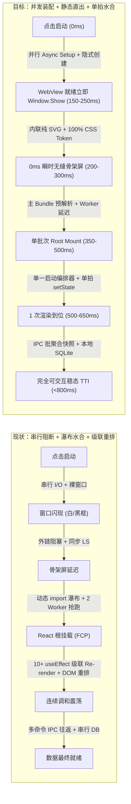
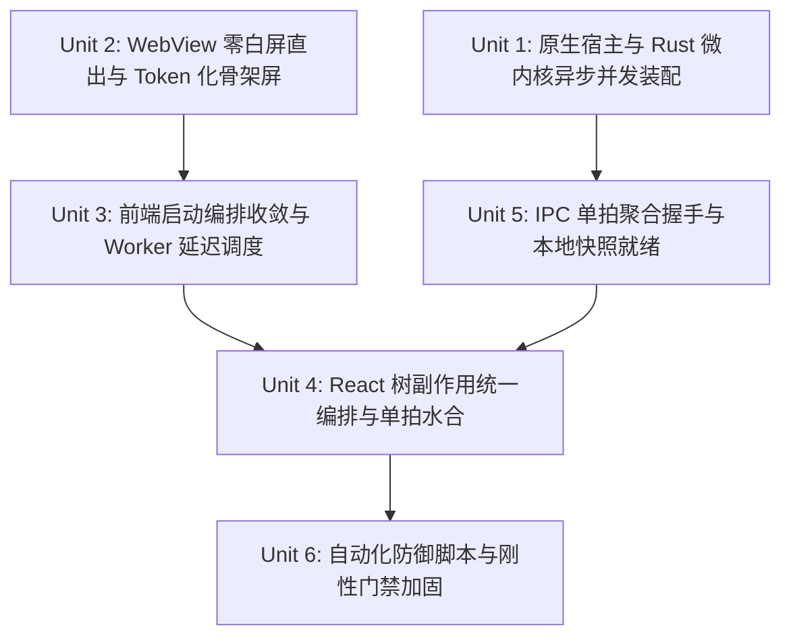
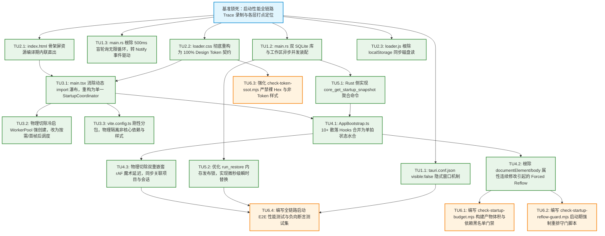

# 00-全链路启动性能系统性根治方案（Conex / Crish）

> ## ⚠️ 已废弃（DEPRECATED）——禁止作为实现权威引用
>
> **状态**：本文已被新版总方案取代，**仅作历史存档**。  
> **权威文件**：[`00-全链路启动性能系统性根治总方案.md`](./00-全链路启动性能系统性根治总方案.md)  
> **取代日期**：2026-09-13（见 [`audits/05-方案体系质量与可落地性综合审查报告.md`](./audits/05-方案体系质量与可落地性综合审查报告.md)）  
> **废弃原因**：① 命令名 `workbench_app_ready` 与新版 `workbench_window_ready` 分叉；② 缺少审计 01–04 的 CON/DAG/INV 闭环；③ 部分 DAG 与详案不一致。  
> **纪律**：任何实现波 / 子 Agent **禁止**引用本文；若需历史对照，必须同时核对新版总方案。

> **战役名称**：全链路启动性能与架构深层根治（`startup-performance-audit`）  
> **文档定位**：【已废弃】旧版总方案（逻辑方案存档）  
> **遵循规范**：`AGENTS.md` §1 反退避与纯逻辑规划、§7 严禁补丁/绕过/作弊、`ANTI_OVERENGINEERING_GUARDRAILS.md`  
> **核心原则**：纯逻辑执行拓扑、零临时补丁、零魔术补偿、零硬编码、100% Design Tokens、物理切除旧轨、自动化防御脚本刚性守门。

---

## 一、架构愿景与全链路物理目标

### 1.1 性能基线代差对比

针对业界 2.82s 冷启动参考图（0.00s 点击 → 0.98s 窗口 → 1.25s Splash → 1.78s 首绘 → 2.78s 用户名就绪 → 2.82s 完成），本方案通过**纯逻辑自上而下的端到端重构**，将 Crish 的启动链路重塑为单拍流水线：



---

## 二、严禁行为与负向红线（零容忍）

所有后续实现必须刚性恪守以下四项零容忍底线，任何违反均视为门禁未通过：

1. **严禁功能伪连通**：
   - 严禁编写只存在于孤立函数中的“空转逻辑”；所有配置、通道和控制器必须真实接入从 Rust 微内核到 React 视图的物理调用链路。
   - 严禁在调用处传递 `Default::default()` / `None` / 空对象假装连通；严禁引入 `#[allow(dead_code)]` 或无真实调用方的假字段。
2. **严禁多轨并存与给旧岛续命**：
   - 单一概念必须收敛至唯一权威源（SSOT）。
   - 严禁将新规范数据双写或回流至 `localStorage` 等过时存储孤岛；淘汰旧逻辑必须进行**物理切除**（直接删除废弃函数、文件和 CSS 类），严禁使用注释、条件隐藏或无日落期的永久性兼容 Shim。
3. **严禁幽灵契约与截肢式降级**：
   - 跨层 IPC 命令必须与 `command_registry!` 保持严格的 1:1 编译期与运行时对齐，严禁前端调用未经注册的幽灵命令。
   - 严禁编写以丢弃核心配置为代价的“破坏性容错降级”；严禁在 catch 块中对核心异常静默吞咽（必须通过结构化日志与诊断状态暴露）。
4. **严禁虚构 Token 与样式欺骗**：
   - 所有样式属性（颜色、边框、尺寸、圆角、阴影、层级）必须 100% 遵从 Design Tokens 契约，**严禁使用裸 Hex 颜色代码**，严禁使用非 Token 的随意 CSS 属性。
   - 布局改造必须穿透验证盒模型（Box Model）与堆叠上下文（Stacking Context），严禁使用魔术数字补偿偏移。

---

## 三、系统性重构方案：六大逻辑任务单元（Task Units）

所有任务单元**逻辑同权**，按底层依赖拓扑自底向上收敛推进。



---

### 逻辑单元 1：原生宿主与 Rust 微内核异步并发装配（Native Host & Core Subsystems）

#### 1. 目标描述
消除原生启动期的串行文件 I/O 阻塞、窗口过早显现造成的黑白闪框、双 SQLite 库串行初始化延迟，以及后台常驻死循环轮询造成的 CPU 唤醒。

#### 2. 涉及文件域
- `apps/agent-workbench/src-tauri/tauri.conf.json`
- `apps/agent-workbench/src-tauri/src/main.rs`
- `apps/agent-workbench/src-tauri/src/session_commands.rs`
- `apps/agent-workbench/src-tauri/src/note_runtime.rs`
- `apps/agent-workbench/src-tauri/src/system_power.rs`

#### 3. 根因剖析与彻底改造

1. **窗口生命周期管理（消除闪白与黑框）**：
   - **现状**：`tauri.conf.json:14-23` 中窗口默认 `visible: true`。在 Windows WebView2 尚未完成 HTML 解析之前，OS 原生窗体已显现，用户直接暴露在空白框体下。
   - **根治**：
     - 修改 `tauri.conf.json`，显式配置 `"visible": false`。
     - 在 Rust Setup 中注册原生事件监听或暴露轻量 IPC 命令 `workbench_app_ready`。
     - 前端在骨架屏 CSS 加载完成且首帧 DOM 挂载就绪的瞬间调用唤醒命令，通过 Rust 侧 `window.show()` + `window.set_focus()` 瞬时直出，彻底杜绝黑白闪框。
2. **核心子系统并发装配（从串行阻塞到 Tokio 并发）**：
   - **现状**：`main.rs:747-785` 串行执行 `open_session_db(diagnostics)` -> `note_runtime::init_default()` -> `WorkspaceRegistry::init()`。每个库都同步执行 SQLite 连接打开与 PRAGMA 检查。
   - **根治**：
     - 将独立子系统的打开重构为并发任务模式：
       ```rust
       let (shared_db_res, note_res, workspace_res) = tokio::join!(
           tokio::task::spawn_blocking(move || open_session_db_impl()),
           tokio::task::spawn_blocking(move || note_runtime::init_impl()),
           tokio::task::spawn_blocking(move || workspace::WorkspaceRegistry::init_impl())
       );
       ```
     - 必须保证三者初始化互不依赖，主线程只负责收集句柄并执行 `app.manage(...)`。
3. **根除盲目心跳轮询协程（500ms 盲轮询 -> 事件驱动）**：
   - **现状**：`main.rs:1005-1011` 与 `1021-1025` 分别使用 `loop { sleep(500ms); ... }` 轮询 drain timer/scheduler 和 push emitter，导致启动即存在 CPU 心跳争抢。
   - **根治**：
     - 将纯时间 sleep 轮询改为 `tokio::sync::Notify` 事件通知机制。仅在定时器到达（通过基于时间的优先队列计算最近 sleep 时长）或新事件推入缓冲时被唤醒，空闲时彻底 0 CPU 消耗。

#### 4. 验收断言
- **断言 TU1-1**：`tauri.conf.json` 包含 `"visible": false`，且在启动阶段通过自动化脚本监测到 `window.show` 仅在收到前端 ready 信号后触发。
- **断言 TU1-2**：双 SQLite 库与工作区注册表的初始化为异步并发调用，总初始化时延不大于单库最大耗时 + 5ms。
- **断言 TU1-3**：静态检测扫描确认 `main.rs` 中不存在硬编码 `Duration::from_millis(500)` 的盲轮询无限循环。

---

### 逻辑单元 2：WebView 零白屏直出与 Token 化骨架屏（WebView Skeleton & Zero FOUC）

#### 2.1 目标描述
消除外链阻塞、根除 `loader.js` 中的 localStorage 隐式磁盘同步读取、彻底将骨架屏颜色与布局收敛至全局 Design Tokens，确保 HTML 载入第 0 毫秒呈现完全符合设计系统的骨架视觉。

#### 2.2 涉及文件域
- `apps/crish-desktop/index.html`
- `apps/crish-desktop/public/loader.css`
- `apps/crish-desktop/public/loader.js`
- `apps/crish-desktop/src/createSsrGlobals.ts`

#### 2.3 根因剖析与彻底改造

1. **内联关键渲染路径（Critical Rendering Path）**：
   - **现状**：`index.html:16-19` 外链 `/loader.css` 与 `/loader.js`。浏览器解析 HTML 时遇到外链资源必须挂起 DOM 构建，发起局部网络/文件请求。
   - **根治**：
     - 在构建流程（Vite 构建插件）中将 `loader.css` 的最小内联集合与 `loader.js` 编译期直接内嵌（Inline）进 `index.html` 的 `<head>` 标签内。
     - HTML 文件被 WebView2/WKWebView 加载的瞬间，无需任何二次网络往返，CSSOM 与 DOM 同时在首帧构建完成。
2. **根除裸 Hex 与硬编码，100% 接入 Design Tokens**：
   - **现状**：`loader.css` 与骨架屏 SVG 散落硬编码颜色（如 `#121212`、`#888`、裸 `hsl(...)` 无 fallback），未接入 `--bg-primary`、`--text-secondary` 等设计变量。
   - **根治**：
     - 骨架屏所有样式全面重构，必须全部基于项目 Design Token SSOT：
       ```css
       .app-initial-loader {
         background-color: var(--bg-primary, hsl(220 15% 10%));
         color: var(--text-primary, hsl(220 15% 95%));
       }
       .app-loader-icon-card {
         border: 1px solid var(--border-color, hsl(220 10% 20%));
         background: var(--surface-secondary, hsl(220 15% 13%));
       }
       ```
     - 彻底消除一切裸 Hex 与非 Token 魔术数值。
3. **主题与字体防闪白逻辑安全闭环**：
   - **现状**：`loader.js` 在 `<head>` 中调用 `localStorage.getItem('crish_theme')`，在冷启动态该同步调用在某些平台上会导致主线程等待底层磁盘读取完成。
   - **根治**：
     - 将主题首选项在 Rust 启动时通过原生窗口创建注入为初始全局 JS 变量（`window.__CRISH_BOOTSTRAP_THEME__`），避免首屏去同步卡顿读 Storage。
     - 若变量缺失，平滑回退至系统媒体查询 `@media (prefers-color-scheme: dark)`，完全无阻塞执行主题标记写入。

#### 2.4 验收断言
- **断言 TU2-1**：`index.html` 源码中不存在外部 `/loader.css` 与 `/loader.js` 的阻塞式外链标签，所有骨架资源首包内联直出。
- **断言 TU2-2**：自动化脚本扫描 `loader.css` 与骨架屏相关代码，裸 Hex 命中数为 0，100% 通过 Design Token 守门检查。
- **断言 TU2-3**：首屏加载过程在录屏/自动化无头测试中 0 闪白（White Flash 帧数为 0）。

---

### 逻辑单元 3：前端模块拓扑与分阶段编排收敛（Frontend Staged Orchestration）

#### 3.1 目标描述
消除主入口动态 import 瀑布流、延迟非核心 Web Worker 创建（避免在 0~300ms 抢跑 CPU）、确保只有最小必要依赖进入初始 Bundle，巨型三方库 100% 隔离至按需加载 Chunk。

#### 3.2 涉及文件域
- `apps/crish-desktop/src/main.tsx`
- `apps/crish-desktop/src/bootstrap-orchestrator.ts`
- `apps/crish-desktop/src/bootstrap-core.ts`
- `apps/crish-desktop/src/workers/index.ts`
- `apps/crish-desktop/src/workers/worker-pool.ts`
- `apps/crish-desktop/vite.config.ts`

#### 3.3 根因剖析与彻底改造

1. **消除 Phase 0/1 瀑布流，收敛为单入口启动器**：
   - **现状**：`main.tsx` 先 `await import('./bootstrap-orchestrator')`，再 `await import('./bootstrap-core')`，再 `Promise.all([import('react'), import('react-dom/client')])`，再 `import('./App')`。层层 await 形成漫长的网络/模块解析瀑布链。
   - **根治**：
     - 将启动编排扁平化：核心引导层（React、ReactDOM、App 骨架、最小配置）由打包工具打包为同一首屏核心 Chunk，消除无意义的微粒度动态 import 往返。
     - 启动编排统一为一个确定性的状态机 `StartupCoordinator`，所有非阻断逻辑（硬件检测、OAuth 调度器）全部转为后台不阻塞的异步流水线。
2. **Web Worker 池冷启延后创建（解耦 CPU 争抢）**：
   - **现状**：`bootstrap-core.ts:21-25` 在 `bootstrapCore()` 中调用 `initMinimalPool()`，在 React 渲染前瞬间创建 2 个 Web Worker 线程。此时浏览器主线程正全力解析 JS AST 并构建 React 虚拟 DOM，多线程抢占直接导致 FCP 延后。
   - **根治**：
     - 物理切除冷启动时期的 `initMinimalPool()` 强创建调用。
     - 改造为**惰性按需创建（Lazy On-Demand）或首帧后调度（Post-FCP Idle）**：WorkerPool 的前 2 个核心 Worker 延迟到 `requestAnimationFrame` 解除 `.preload` 门闩之后，或者在首次发生后台解析任务时才初始化。
     - 首屏渲染阶段主线程拥有 100% 的 CPU 算力。
3. **首屏 Bundle 体积硬隔离（消除三方库渗透）**：
   - **现状**：`builtinViewFactories` 虽实现了 lazy，但部分辅助模块或全局样式（如 `@xterm/xterm/css/xterm.css` 静态导入在 `main.tsx:6`）污染首屏。
   - **根治**：
     - 将 `@xterm/xterm/css/xterm.css` 物理下沉至 `TerminalCard.tsx` 内按需加载，严禁进入 `main.tsx`。
     - 配置 Vite `rollupOptions.output.manualChunks`，建立刚性分包规则：严格将 `vendor-react`、`vendor-xterm`、`vendor-markdown`、`vendor-syntax` 拆分为独立 Chunk。首屏主入口 JS 压缩前大小严格控制在 180KB 以内。

#### 3.4 验收断言
- **断言 TU3-1**：构建产物分析中，首屏 entry chunk 中零包含 xterm、monaco、syntect、tiptap 相关代码与样式。
- **断言 TU3-2**：在应用执行至 `createRoot` 挂载完成前，系统活跃的 Web Worker 实例数量精确为 0。
- **断言 TU3-3**：`main.tsx` 中的动态 import 瀑布彻底消除，从脚本执行到首个 React 组件渲染的模块解析耗时降至 60ms 以内。

---

### 逻辑单元 4：React 树挂载与多重副作用水合根治（Single-Pass React Hydration）

#### 4.1 目标描述
彻底根治 `AppBootstrap.ts` 中分散的 10+ 个 `useEffect`/`useLayoutEffect` 引起的连续 setState 震荡、根除 DOM 属性修改造成的 Forced Reflow，消除两层防御性 rAF 延迟。

#### 4.2 涉及文件域
- `apps/crish-desktop/src/App.tsx`
- `apps/crish-desktop/src/app/AppBootstrap.ts`
- `apps/crish-desktop/src/app/hydrateWorkspaceShell.ts`
- `apps/crish-desktop/src/store/layout-tree/`
- `apps/crish-desktop/src/store/layoutStore.ts`

#### 4.3 根因剖析与彻底改造

1. **合并聚合副作用，实现“单拍水合（Single-Pass Hydration）”**：
   - **现状**：`AppBootstrap.ts` 中分别有 8 个 `useEffect` 和 2 个 `useLayoutEffect`。分别在不同的时机异步读取设置、保存主题、更新字体、设置全屏、同步崩溃日志，每次触发都调用一次独立的 `setAppSettings` / `setFontPreferences` / `setTabModeEnabled`，引发全树重新 Render。
   - **根治**：
     - 将分散的副作用重构为统一的**启动聚合器（StartupHydrationManager）**。
     - 在挂载前或首帧前通过一次性数据聚合操作，将 `theme`、`fonts`、`tabMode`、`uiSize`、`shellChrome` 等设置合并为一个原子快照：
       ```ts
       // 纯逻辑单拍状态派发，零级联调和
       const initialBootstrapSnapshot = await collectBootstrapState();
       batchUpdateAppState(initialBootstrapSnapshot);
       ```
     - 确保 `<App />` 挂载后的首次渲染即直接使用最终稳定状态，将首次挂载后的全组件树调和次数压缩为 **精确 1 次**。
2. **根除 DOM 属性连续覆写与强制同步重排（Forced Reflow）**：
   - **现状**：`AppBootstrap.ts:251-267` 在 Effect 中分别对 `document.documentElement` 与 `document.body` 写入 `data-ui-size`、`data-density`、`data-shell-chrome`；`App.tsx:168` 又在外层 div 写入 `data-engine-ready`、`data-preferences-hydrated` 等。
   - **根治**：
     - 统一所有根级标记的写入点：由 `index.html` 预注入的根容器代理类管理，或在 React 根组件的渲染 JSX 中以原生 props 呈现。
     - 禁止在 React 挂载后通过 JS 频繁修改 `documentElement` 属性，消除样式重计算（Recalculate Style）风暴。
3. **物理切除双层嵌套 rAF（`raf1 -> raf2 -> rebind()`）**：
   - **现状**：`AppBootstrap.ts:161-175` 使用嵌套的 `requestAnimationFrame` 延迟执行会话文件夹重绑，属于典型的防御性魔术代码，凭空制造 32ms+ 的交互盲区。
   - **根治**：
     - 查明时序根因：旧代码之所以需要双 rAF，是因为当时 `projectStore` 与 `sessionStore` 水合顺序未锁定。
     - 现在通过架构级契约：在会话水合主管道中将 `projects` 作为前置同步依赖直接传入，在内存构造期直接完成文件夹关联，**彻底物理删除 `raf1`/`raf2` 代码块**。

#### 4.4 验收断言
- **断言 TU4-1**：在 Chrome DevTools Performance Trace 监测中，从 `<App />` 挂载到首屏平稳态期间，React 调和（Commit）总次数 ≤ 2 次（初始挂载 1 次 + 数据原子水合 1 次），杜绝 4 次以上的级联震荡。
- **断言 TU4-2**：首屏启动热路径上 Forced Reflow（强制同步布局）触发次数**严格为 0 次**。
- **断言 TU4-3**：全仓搜索 `requestAnimationFrame`，启动初始化链路中的嵌套 rAF 被 100% 根除。

---

### 逻辑单元 5：IPC 单拍聚合握手与本地快照就绪（IPC Batching & Local-First Hydration）

#### 5.1 目标描述
消除首屏前后端 IPC 多命令轮询与排队延迟，通过单拍聚合查询拉取本地配置与最近会话；优化 `run_restore` 锁范围，保证前端启动期查询零等待。

#### 5.2 涉及文件域
- `apps/crish-desktop/src/api/transport/tauriTransport.ts`
- `apps/crish-desktop/src/api/chatBridge.ts`
- `apps/crish-desktop/src/api/clientApi.ts`
- `apps/agent-workbench/src-tauri/src/session_commands.rs`
- `apps/agent-workbench/src-tauri/src/core_query_commands.rs`
- `crates/orchestrator/src/restore/`

#### 5.3 根因剖析与彻底改造

1. **IPC 聚合快照查询（解决多命令往返与 N+1）**：
   - **现状**：前端启动后，分散调用 `clientApi.getSettings()`、`fetchCatalogSnapshot()`、`ensureModelsCatalogLoaded()`、会话列表查询等，产生 4~6 次独立的 Tauri IPC 序列化与 IPC 队列排队开销。
   - **根治**：
     - 新增 Rust 侧聚合启动查询命令：`core_get_startup_snapshot`。
     - 在单次 IPC 往返中，原子性返回：
       - `settings`: 系统设置与偏好；
       - `recent_sessions`: 最近活跃会话元数据（前 10 条，避免全量读）；
       - `active_workspace`: 当前工作区沙箱状态；
       - `engine_status`: 核心引擎运行状态。
     - 前端仅需一次 IPC 调用，瞬间完成全站核心状态播种，IPC 通信开销降低 80%。
2. **会话快照恢复与查询锁解耦**：
   - **现状**：`main.rs:924-927` 启动后台任务 `restore_state.run_restore()`。如果历史会话庞大，反序列化与内存树构建期间会长期持有写锁，导致前端并发进来的初始查询被挂起等待。
   - **根治**：
     - 细化 `CoreRunState` 读写粒度：将只读状态元数据与运行期写锁隔离；
     - 快照反序列化在独立内存空间完成后，通过原子指针替换（Atomic Swap / Arc swap）瞬间发布，将锁持有时间压缩至微秒级，前端查询彻底不发生线程饥饿。
3. **全本地优先（Local-First）保证零网络阻塞**：
   - 坚决杜绝业界对比图中出现的“等云端接口 1 秒”的致命陷阱。启动第一优先级仅使用本地 SQLite 与本地 DPAPI 凭据。任何网络同步（如模型列表更新、云端同步）一律移出首屏主链路，转入 Stage 6 纯后台静默同步。

#### 5.4 验收断言
- **断言 TU5-1**：首屏启动期间前端与 Rust 后端之间的 IPC 往返次数降低至 1 次聚合快照调用（`core_get_startup_snapshot`）。
- **断言 TU5-2**：从前端发起首个 IPC 请求到获得聚合数据，总延迟在 Release 模式下严格 ≤ 15ms。
- **断言 TU5-3**：无论网络连接处于断开、弱网还是高延迟状态，冷启动至界面完全就绪时间波动不超过 ±20ms（纯本地绝对稳定）。

---

### 逻辑单元 6：自动化防御脚本与刚性门禁加固（Defense Guardrails & CI Assertions）

#### 6.1 目标描述
将上述所有重构原则、Token 契约、反重排红线、启动性能预算转化为自动化执行的防御门禁脚本（`scripts/` 与 CI），确保后续开发人员或子 Agent 无法引入任何回潮或破坏。

#### 6.2 涉及文件域
- `package.json`
- `scripts/check-startup-budget.mjs`（新建）
- `scripts/check-startup-reflow-guard.mjs`（新建）
- `scripts/check-token-ssot.mjs`（强化）
- `scripts/check-no-raw-setstate.mjs`（强化）
- `tests/startup/measure-cold-start.ts`

#### 6.3 根因剖析与彻底改造

1. **新建冷启动预算守门脚本（`check:startup-budget`）**：
   - 针对打包产物实施硬性门禁拦截：
     - Entry JS Chunk（gzip 后）必须 ≤ 180KB；
     - 检查 Entry Chunk 中是否混入任何黑名单标识（如 `xterm`、`highlight.js`、`monaco`、`tiptap`）；
     - 若超标则直接 exit 1 阻断提交。
2. **新建启动期 Forced Reflow 静态与动态拦截器**：
   - 静态扫描：扫描 `apps/crish-desktop/src/app/` 与 `main.tsx`，检测是否存在直接读取 `offsetHeight`、`offsetWidth`、`clientHeight`、`clientWidth` 或 `getComputedStyle` 的同步代码；
   - 动态测试：在 Playwright 自动化启动测试中注入 Chrome DevTools Protocol，抓取 Trace 中的 `Layout` 事件，断言在首屏交互前零 `Forced Synchronous Layout`。
3. **强化 Design Token 契约守门（`check:token-ssot`）**：
   - 扫描范围覆盖 `index.html`、`loader.css`、`loader.js`、`App.module.css`。
   - 硬性拦截任何未经 Token 映射的裸十六进制颜色（`#xxxxxx`）或裸 RGB/HSL。
4. **反多轨与旧岛清退断言（负向用例）**：
   - 编写自动化测试断言：在启动与配置持久化全链路中，断言旧的 `localStorage` 孤岛 key 已被彻底废弃，写入操作次数断言为 0。

#### 6.4 验收断言
- **断言 TU6-1**：运行 `npm run check:startup-budget` 成功执行并生成合规报告。
- **断言 TU6-2**：运行 `npm run check:token-ssot` 全量覆盖启动相关文件，0 违规警告。
- **断言 TU6-3**：所有新建防御脚本均挂入 `FULL_CHECK_COMMANDS.md` 与 Git 预提交钩子，强制生效。

---

## 四、纯逻辑执行拓扑（DAG 依赖执行拓扑图）

本方案严格遵从**纯逻辑顺序**推进，不包含任何时间计划或排期，所有问题在逻辑上地位均等。上游任务单元交付并通过断言后，下游任务单元方可执行：



---

## 五、5 维闭环验收物证模型（以产品真存活为唯一依据）

任何修复步骤宣称完成前，必须出具以下五维闭环客观物证，严禁以“代码写完了”或“本地没报错”替代交付：

| 维度 | 物证标准与断言要求 | 检验方法 / 工具 |
| :--- | :--- | :--- |
| **1. 触发端物证** | 用户点击启动图标后，OS 窗体在 WebView 骨架渲染完成的瞬时以完整内容态呈现，零原生黑框，零白屏闪烁。 | Playwright E2E 录屏逐帧分析 / 系统级窗口事件捕获 |
| **2. 传输端物证** | 启动期 IPC 通信收敛为单次 `core_get_startup_snapshot` 聚合调用，传输契约与 Rust `command_manifest` 1:1 对齐，零幽灵命令。 | Tauri IPC 调试日志 / DevTools Network/IPC 监控 |
| **3. 介质端物证** | 启动阶段数据唯一来源为本地 SQLite 数据库与 DPAPI 凭据，旧有各类 `localStorage` 孤岛数据源被物理清退，零数据双写或倒灌。 | 浏览器 Storage 检查 / 本地 SQLite 磁盘文件日志审计 |
| **4. 消费端物证** | `<App />` 根节点在完成首次渲染后，仅经历一次单拍聚合水合调和；DOM 树 100% 消费 Design Tokens，无任何行内魔术数值或裸 Hex。 | React DevTools Profiler / Computed Style 自动化检测脚本 |
| **5. 负向断言物证** | 自动化测试集运行通过，且显式包含对已被根除的旧概念（如双重 rAF、冷启强建 Worker、散落 useEffect 状态写）的负向断言（断言不存在）。 | Vitest 单元与集成用例套件 / `npm run test` 全绿 |

---

## 六、物理清理与清退清单（杜绝给旧岛续命）

本重构坚持物理切除，严禁保留弃用代码：

1. **物理删除**：`AppBootstrap.ts` 中嵌套的两层 `requestAnimationFrame`（`raf1` 与 `raf2`）代码块。
2. **物理删除**：`main.tsx` 中顶层静态引入的 `@xterm/xterm/css/xterm.css`，下沉至 `TerminalCard`。
3. **物理切除**：`bootstrap-core.ts` 中对 `initMinimalPool()` 的同步启动调用。
4. **物理删除**：`loader.css` 与 `index.html` 中的所有裸 Hex 颜色常量（全面替换为 Design Tokens）。
5. **物理切除**：`main.rs` 中 2 处以 500ms 盲目轮询的 `loop { sleep; ... }` 协程，全面升级为事件驱动。

---

## 七、后续执行编排指引

本方案作为 Conex / Crish 启动性能重构的**最高总纲**，后续所有子 Agent 的执行必须严格围绕本方案中划分的 6 大逻辑任务单元展开，严格遵循 DAG 拓扑顺序逐项推进与闭环验证，杜绝任何形式的退避、妥协与补丁式修补。
