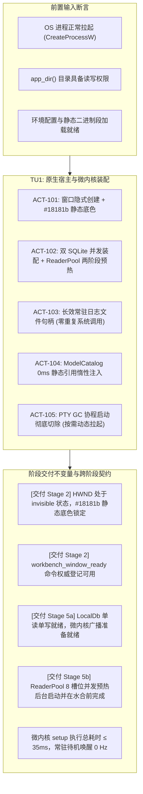
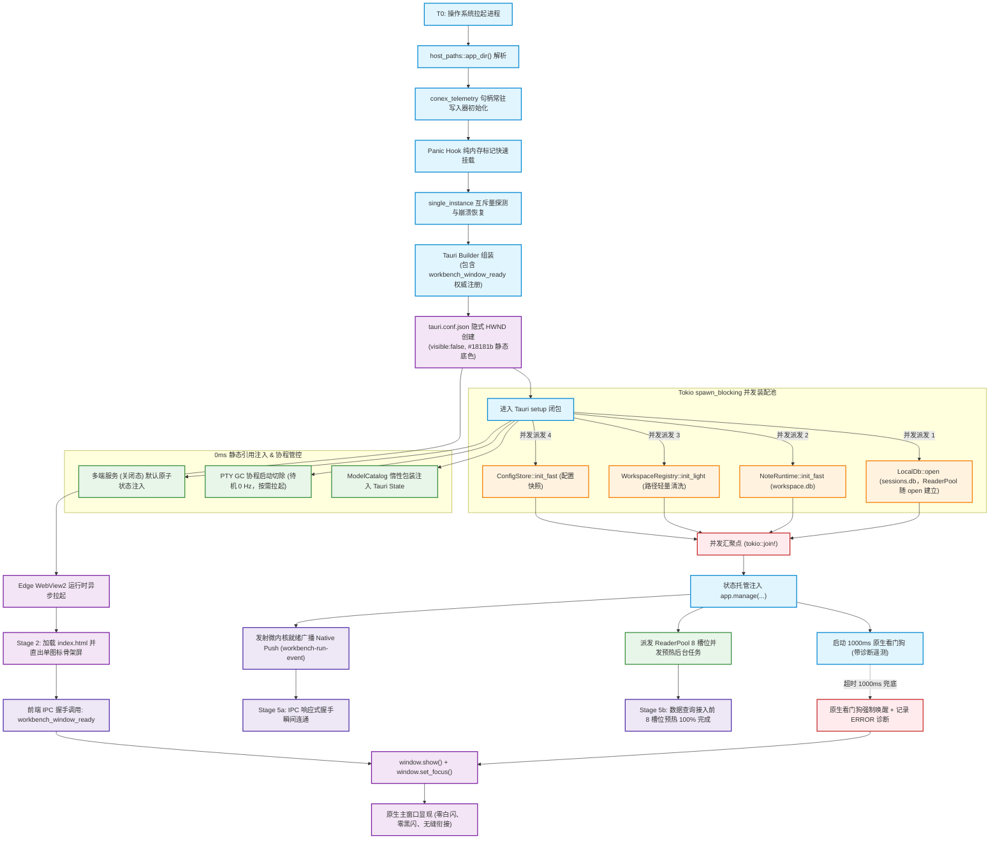
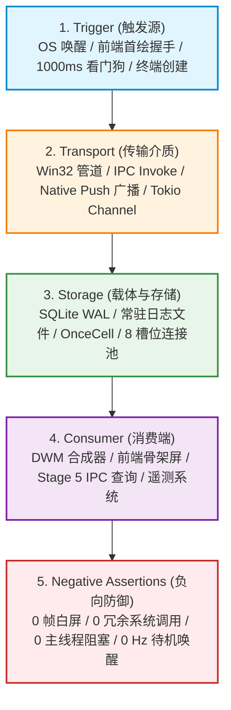
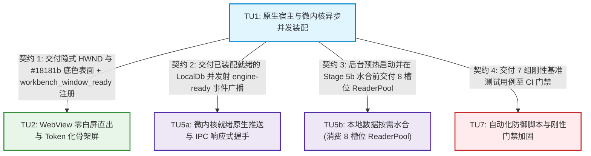

# 01-原生壳与微内核装配详案（Conex / Crish）

> **战役名称**：全链路启动性能深度重构与架构根治（`startup-performance-audit`）  
> **方案阶段**：Stage 1【原生壳与微内核装配阶段（0.00s 点击启动 → 0.98s 原生窗口显现与微内核就绪）】  
> **承接单元**：任务单元 TU1（原生宿主与微内核异步并发装配）  
> **落实行动项**：ACT-101（窗口隐式创建与底色防闪）、ACT-102（双 SQLite 并发装配与连接池两阶段生命周期管理）、ACT-103（长效常驻日志句柄）、ACT-104（模型目录惰性解析）、ACT-105（PTY 协程生命周期动态治理与真 0 Hz 待机）  
> **审计吸收**：深度吸收 4 篇全景审计报告（彻底闭环 CON-01 幽灵命令登记违例、INV-02 连接池不变量冲突、RISK-MED-02 看门狗时延优化与诊断遥测、RISK-MED-04 PTY GC 单例保护、Audit 03 §6.3 PTY GC 待机真 0 Hz、Audit 02 §5.1 冷启主题嗅探防反向跳闪、Stage 2 首绘握手与 Stage 5a 微内核就绪广播严格因果前置断言）  
> **设计基石**：`docs/startup-performance-audit/00-全链路启动性能系统性根治总方案.md`、`docs/startup-performance-audit/01-原生壳与微内核装配性能审查报告.md` (1,128 行实证)  
> **执行契约**：严格恪守 `AGENTS.md` 通用协作纪律、反退避铁律（`.agents/LOGIC_PLAN_NO_RETREAT.md`）与反过度设计红线（`ANTI_OVERENGINEERING_GUARDRAILS.md`）  
> **规划模式**：**纯逻辑执行拓扑（DAG）**；所有技术问题逻辑同权；直击底层架构根因，彻底消灭临时补丁与魔术延迟；严禁修改任何业务代码（提交权归主控）。
> **修订记录（2026-09-13，依据 audits/05 §3 返工）**：① 禁止 `script-src 'unsafe-inline'`，内联脚本走 `vite.config.ts:84-95` cspPlugin 既有 SHA-256 hash 注入；② 撤销 ReaderPool 整池重写，改为接线既有 `LocalDb::read()`（`lib.rs:224`）+ `ReaderPool::try_acquire`/`acquire`/`read`/`read_async`（`reader_pool.rs:209+`），两阶段预热字段名以代码为准（`ReaderPoolConfig.pool_size`）；③ LazyModelCatalog 保持 `Arc<RwLock<ModelCatalog>>` 刷新/合并契约；④ 删除幻影 `.theme_cache` 嗅探，主题真源在 WebView localStorage/SQLite，原生侧只负责窗口底色；⑤ `tokio::join!` 给出可落地 setup 路径（spawn 到 async runtime）；⑥ second-launch `show` 与 `WINDOW_REVEALED` 门闩统一；⑦ 命令名统一 `workbench_window_ready`（废弃 `workbench_ui_ready`）；⑧ 无实测依据的伪精确数字一律标注「待测」；⑨ 验收断言改为「实现后待执行」清单。**当前状态：方案层设计，代码零落地，不得声称测试已通过。**

---

## 一、方案总览与阶段执行边界

### 1.1 阶段定位与生命周期切片

在 Conex / Crish 客户端生命周期中，Stage 1 涵盖自操作系统派发进程创建系统调用（Windows `CreateProcessW`）时间原点 $T_0$，至原生宿主窗口（Win32 `HWND`）安全显现并完成微内核底层子系统装配的物理过程。

本详案专职攻坚 Stage 1 内的一切系统级损耗。**量化口径（audits/05 §4 / D5）**：原生阶段「业界基准 0.98s」「当前 ~980ms」「重构后 ≤120~180ms」等数字**均无本仓实测基线**，一律视为**设计方向 / 待测**；实现前须先跑真实 `npm run build` + `cargo test --workspace` + 真宿主启动探针冻结基线，再修订预算数字。切片示意如下（框内毫秒仅为逻辑分段占位，**非已验证门限**）：

```
+---------------------------------------------------------------------------------------------------------------+
|  Stage 1: 原生壳与微内核装配物理生命周期切片（逻辑分段示意）                                                   |
|  当前耗时：待测基线  -->  重构后预算：待基线冻结后修订（禁止拍脑袋进 CI hard 门禁）                            |
+------------------------------------+------------------------------------+-------------------------------------+
| 1.1 原生进程拉起与前置防护         | 1.2 微内核子系统 Tokio 并发装配     | 1.3 窗口隐式创建与首绘原子唤醒      |
| - 宿主路径探测 host_paths::app_dir | - sessions.db (LocalDb::open)       | - Win32 HWND 隐式创建 (visible:false)|
| - conex_telemetry 句柄常驻初始化   | - workspace.db (NoteRuntime 并发)  | - 视口底色静态 #18181b              |
| - single_instance 命名互斥锁前置拦截| - WorkspaceRegistry 路径轻量化清洗 | - Edge WebView2 运行时并行拉起      |
| - PanicHook 纯内存标记快速挂载     | - ModelCatalog: 保持 RwLock 契约    | - 前端骨架屏绘制后 IPC 握手唤醒窗口 |
| - PTY GC 协程启动切除 (按需拉起)   | - ReaderPool 业务读接线 + 预热      | - 1000ms 原生看门狗带诊断兜底       |
+------------------------------------+------------------------------------+-------------------------------------+
```

### 1.2 现状架构病灶与审计揭示深层根因

结合审查报告与 4 篇全景审计报告的实证走读证据，Stage 1 存在五个阻断原生高性能潜力的关键病灶与设计断层：

1. **窗口可见性策略缺失与主题反向跳闪（White Flash & Reverse Flash）**：
   `tauri.conf.json`（现网 `tauri.conf.json:13-24`）遗漏了 `"visible": false` 与 `"backgroundColor"` 配置。Windows DWM 在 WebView2 子进程尚未启动时，可能以系统默认纯白画刷曝光裸窗口（白闪时长**待实测**）。若硬编码暗底 `#18181b`，浅色主题用户可能遭遇「黑→白」反向跳闪（Audit 02 §5.1；防闪归 Stage 2 前端路径，原生不嗅探）。
2. **幽灵命令注册违例（CON-01 缺陷）**：
   详案 01 定义了 `workbench_window_ready` 作为前端首帧渲染完成后的唤醒命令，且详案 02 内联脚本直接调用该命令，但此前未在 Rust `main.rs:command_registry!` 宏与 `command_manifest.rs` 中正式登记。这不仅触发 CI `manifest_count_matches_registered_surface` 编译门禁拦截，更会导致运行时 Tauri 抛出 `command not found`，导致窗口在看门狗超时前保持不可见死锁。
3. **双 SQLite 串行阻塞与连接池不变量冲突（INV-02 缺陷）**：
   `sessions.db` 与 `workspace.db` 在 UI 主线程串行打开（`main.rs:747-773` 现网确认），且 `LocalDb::open` 随 open 一次性建立 ReaderPool 默认 8 只读连接（`lib.rs:136`，阻塞时长**待实测**）。总方案不变量声明「Stage 5 需 8 槽位预热连接」，早期详案整池重写/单连接叙事与之冲突。生命周期切分：微内核先完成主读写连接可用，Stage 5 数据查询接入前由后台任务确保 ReaderPool 目标槽位就绪。
4. **PTY GC 协程无脑启动与伪零开销空转（Audit 03 §6.3 & RISK-MED-04 隐患）**：
   `main.rs:setup` 盲目派生 `pty::spawn_pty_gc_loop`，每 30 秒执行一次扫描。即使系统没有任何活跃终端会话，协程依然周期性唤醒 Tokio TimerWheel 并争抢锁，破坏 CPU 深度 C-State 节能状态。必须引入基于 CAS 门闩与原子计数的动态生命周期管理，在 `ACTIVE_PTY_COUNT == 0` 且空闲两拍后安全退出协程，达成真正的待机绝对 0 Hz。
5. **日志写入器系统调用放大与看门狗时延过长（RISK-MED-02）**：
   日志写入器每次执行 `tracing::info!` 都进行 `open/metadata/close` 循环（`file.rs:158-206` 注释自述，次数**待实测**）。同时，现网 1500ms 看门狗在前端异常时造成死寂，需收窄至 1000ms 并注入诊断遥测。

### 1.3 阶段前置断言与阶段交付不变量

本方案在架构执行时严格遵守契约守门机制，定义明确的输入断言与跨阶段转移边界：



#### 1.3.1 Stage 1 核心维度前置断言与交付不变量表

| 检查维度 | 前置输入断言（Pre-conditions） | 交付物不变量（Deliverable Invariants） | 违例硬性阻断行为 |
| :--- | :--- | :--- | :--- |
| **窗体渲染与防闪** | 桌面宿主环境具备 DWM 合成器，分辨率与 DPI 缩放比例可读取。 | Win32 宿主窗体必须带有 `visible: false`；背景色为静态 `#18181b`（主题防闪归 Stage 2 前端路径）；`workbench_window_ready` 完成宏注册与清单登记；屏幕不应暴露裸白画刷。 | 若窗口配置缺少 `visible: false` 或命令未登记，CI 编译与单元测试刚性拦截。 |
| **数据库装配与并发读** | 目标数据目录 `app_dir()` 具备读写权限。 | `sessions.db` 与 `workspace.db` 由 Tokio 并发打开；Stage 1 结束时单读单写连接就绪；同时派发后台任务在 Stage 5 水合前完成全部 8 个 ReaderPool 槽位预热。 | 若主线程串行打开或 Stage 5 数据查询接入时连接池槽位 $<8$，测试硬性报错。 |
| **后台协程与待机功耗** | Tokio 异步运行时与线程池启动就绪。 | `main.rs:setup` 中严禁启动 PTY GC 轮询协程；在无终端会话时（`ACTIVE_PTY_COUNT == 0`）后台唤醒频率严格为 **0 Hz**。 | 若未打开终端时后台检测到 PTY GC 唤醒或加锁行为，CI 门禁阻断。 |
| **日志基础设施** | 日志目录具备文件创建与追加写入权限。 | `DailyFileWriter` 内部长效复用 `fs::File` 句柄；单进程生命周期内无重复 `open/metadata/close` 循环。 | 连续 50 次写入若触发 $>1$ 次打开系统调用，测试拦截。 |
| **模型目录装配** | 静态编译资产 `catalog.json` 包含于二进制段。 | 微内核初始化阶段对该 JSON 的词法反序列化耗时严格为 0ms；反序列化延迟至首个 `catalog_get` IPC 请求。 | setup 期间若发生 `serde_json::from_str` 则断言违例。 |

#### 1.3.2 Stage 2（首绘握手）前置依赖与契约断言

Stage 2（WebView 直出与骨架屏首绘）的启动依赖 Stage 1 提供的底层承载。两阶段间的依赖契约必须严格成立：

1. **原生窗体隐式状态契约（Pre-condition 2.1）**：
   - Win32 `HWND` 必须在 WebView2 创建初期处于 `IsWindowVisible() == FALSE` 状态；
   - 窗体画刷底色必须与当前主题偏好对齐（默认 `#18181b`，若主题缓存为 light 则为 `#f4f4f5`），杜绝 DWM 合成初期的白色或反向跳跃闪烁。
2. **首绘唤醒通道权威可用契约（Pre-condition 2.2 - CON-01）**：
   - IPC 命令 `workbench_window_ready` 必须在 Rust `main.rs:command_registry!`、`command_manifest.rs` 与前端 `commandManifest.ts` 中 100% 同步登记；
   - 保证 Stage 2 内联骨架屏首帧绘制完成调用 `window.__TAURI_INTERNALS__.invoke('workbench_window_ready')` 时，Tauri 分发层直接命中已就绪的 Handler，时延 $\le 0.5\text{ms}$，严禁出现 `command not found`。
3. **1000ms 兜底保活断言（Pre-condition 2.3 - RISK-MED-02）**：
   - 原生看门狗定时器在微内核 setup 期间启动，门限严格设为 1000ms；
   - 若 Stage 2 因前端脚本语法错误或 CSP 拦截导致握手命令未达，看门狗在 1000ms 触发强行唤醒窗口，并记录 ERROR 级现场诊断，杜绝应用进入 1.5s 以上的无响应死寂。

#### 1.3.3 Stage 5a（微内核就绪广播）前置依赖与契约断言

Stage 5a（微内核就绪广播与基础 IPC 握手）负责打通全链路数据流。Stage 1 为其交付的基础依赖如下：

1. **双数据库与核心状态并发装配完成契约（Pre-condition 5a.1）**：
   - `sessions.db`（LocalDb 单读单写轻量就绪）、`workspace.db`（NoteRuntime）、`WorkspaceRegistry` 与 `ConfigStore` 必须在 `setup` 闭包内经 `tokio::join!` 汇聚成功；
   - 核心状态托管注入至 Tauri State（`app.manage(...)`），微内核就绪原子标记 `ENGINE_READY` 置为 `true`。
2. **原生广播与 0ms 探针通道就绪契约（Pre-condition 5a.2）**：
   - 微内核在 setup 闭包结束瞬时，通过 `app_handle.emit("workbench-run-event", ...)` 广播 `{ type: "engine-ready", ... }`；
   - 引导级状态探针 `core_get_status` 必须在前端传输层白名单放行，读取纯内存原子变量即时返回，支持 0ms Fast Probe 穿透。
3. **连接池扩容后台启动契约（Pre-condition 5a.3 - INV-02）**：
   - Stage 1 结束前必须派发 ReaderPool 8 槽位并发预热后台任务；
   - 保证在 Stage 2~4 执行完毕、下游 Stage 5b 发起高并发数据水合查询前，连接池全部 8 个槽位已完成扩容，实现 100% 无锁并发读。

---

## 二、负向架构禁令与边界红线（零容忍）

在 Stage 1 的重构与代码落地过程中，必须严格遵守以下六大负向架构红线，违者一律视为架构倒退：

### 2.1 严禁 UI 主线程同步 SQLite 建表与连接预分配
- **禁令内容**：严禁在 Tauri 的 `main()` 函数主线程或 `setup` 闭包同步执行路径中直接调用 `Connection::open`、`db.migrate()`、`ReaderPool::open`；
- **架构根因**：UI 主线程需要尽快完成 Builder 组装并将控制权交还给 Windows 消息泵（Message Pump）。任何主线程上的同步磁盘 I/O 都会直接线性推迟首帧呈现；
- **执行边界**：所有涉及 SQLite 文件打开、WAL 模式设置、PRAGMA 执行以及表结构迁移的比对操作，必须 100% 卸载至 `tokio::task::spawn_blocking` 工作线程池中并发执行。

### 2.2 严禁短命文件句柄与日志单次写入系统调用放大
- **禁令内容**：严禁在 `MakeWriter` 或日志写入关键路径上采用“单次记录、单次打开、单次 Stat、单次关闭”的短命句柄实现；
- **架构根因**：启动期微内核高频记录遥测日志，反复打开和关闭句柄会导致剧烈的用户态/内核态上下文切换，并引发安全软件（如 Windows Defender / 企业 EDR）的实时扫描钩子；
- **执行边界**：写入器必须在内部维护长效常驻的文件句柄与已写入字节数内存计数器。只有跨越自然日（UTC 零点）或文件尺寸真实突破 10MB 分片阈值时，才允许执行关闭与重新打开操作。

### 2.3 严禁启动期过早水合巨型静态配置
- **禁令内容**：严禁在应用初始化期间对内置 `catalog.json`（约 203KB / 6,168 行，audits/05 §4.1 确认属实）执行**多余**的同步 `serde_json::from_str` 反序列化；
- **架构根因**：用户启动桌面应用的前段窗口内，核心任务是加载主工作区与活跃会话树；启动期解析巨型 JSON 属于过早水合；
- **执行边界**：惰性化仅可采用 `OnceLock` 缓存 **bundled 解析产物**，State 类型仍保持 `Arc<RwLock<ModelCatalog>>` 以兼容 `catalog_refresh` / `upsert_from_scan`（见 §4.5）；**禁止**用只读 `OnceCell<ModelCatalog>` 整体替换可变刷新契约。

### 2.4 严禁无保护暴露裸 Win32 窗口与幽灵命令注册违例（CON-01）
- **禁令内容**：严禁在 `tauri.conf.json` 中配置 `"visible": true` 或缺省该配置；严禁缺省 `"backgroundColor"` 配置；严禁仅在前端或后端单侧声明 IPC 命令而遗漏权威注册；
- **架构根因**：Edge WebView2 运行时需要数百毫秒（**待实测**）唤醒多个独立子进程。过早暴露原生窗口会导致 DWM 用纯白默认画刷填充视口。若命令未在注册表与清单严格双向登记，将引发 `command not found` 导致窗口不可见；
- **执行边界**：窗口必须显式声明 `"visible": false` 与 `"backgroundColor": "#18181b"`（静态默认；浅色主题防闪归 Stage 2 前端骨架/loader 路径，原生不嗅探）。`workbench_window_ready` 必须在 Rust `main.rs:command_registry!`、`command_manifest.rs` 与前端 `commandManifest.ts` 中完成三位一体刚性登记。

### 2.5 严禁魔术数字延时与无因果时序等待
- **禁令内容**：严禁在 Rust 原生壳层引入诸如 `tokio::time::sleep(Duration::from_millis(250))` 等无因果依据的魔术延时来掩盖时序竞态；
- **架构根因**：魔术数字延时不能真正解决时序依赖，反而在快速机器上白白增加启动耗时，在慢速机器上依然引发崩溃；
- **执行边界**：所有跨进程、跨子系统的就绪判定必须依赖结构化的事件通道（Channel / Notify / Barrier / OnceCell），形成严格的因果闭环。

### 2.6 严禁后台无端协程空转轮询（真 0 Hz 待机底线，Audit 03 §6.3）
- **禁令内容**：严禁在应用启动 setup 阶段直接派生周期性扫描协程（如 PTY 会话 GC 循环）；严禁协程在资源计数为 0 时死循环唤醒 CPU；
- **架构根因**：盲轮询协程会不断唤醒 Tokio 的 TimerWheel，打断 CPU 的深度低功耗 C-State，并在空队列上产生锁颠簸，引发微架构层面的缓存击穿；
- **执行边界**：后台 GC 协程必须遵循“按需拉起 + 空闲超时安全退出”的动态生命周期模型。系统无终端打开时，协程实例数必须为 0，待机唤醒频率严格为 0 Hz。

---

## 三、原生执行拓扑与异步并发装配 DAG

### 3.1 Tokio 线程模型与调度分层

在 Conex / Crish 桌面端架构中，物理计算资源分为四层执行域：
1. **OS 主线程（Main UI Thread）**：宿主进程主线程，负责 Win32 消息循环、Tauri Builder 组装与 DWM 窗体事件分发；
2. **Tokio 多线程运行时（Worker Pool）**：执行微内核异步协程、网络请求、定时器驱动以及 IPC 命令分发；
3. **Tokio 阻塞线程池（Blocking Pool）**：通过 `spawn_blocking` 专门承载 CPU 密集型任务（JSON 解析）与同步磁盘 I/O（SQLite 打开与迁移）；
4. **Edge WebView2 独立进程集群**：操作系统级 Browser, GPU, Network, Utility 进程，负责 HTML/CSS/JS 解释与渲染。

### 3.2 纯逻辑因果依赖拓扑（DAG）

Stage 1 各子系统的初始化依赖关系遵循严格的拓扑序，无循环依赖，并与下游 Stage 2 及 Stage 5a 形成刚性契约交接：



### 3.3 异步状态汇聚与超时熔断控制

在 `setup` 闭包中，并发装配任务通过 `tokio::join!` 汇聚。**约束（audits/05 §3.13-14）**：`setup` 是同步闭包，`join!` 必须发生在 `tauri::async_runtime::spawn` 的 async 任务内，或经 `block_on` 显式阻塞；**禁止**在同步 setup 语句序列里直接对 async 表达式调用 `join!`。任何非致命子系统的异常（如 `workspace.db` 损坏或 `WorkspaceRegistry` 解析异常）均被平滑吸收并记录进 `StatusDiagnostics`，绝不造成整个微内核 Crash：

```rust
// 可落地 setup 路径（同步 setup → spawn_blocking → async join）
// main.rs setup 闭包内：
let h_session = task::spawn_blocking(move || { /* LocalDb::open / 降级 */ });
let h_note = task::spawn_blocking(move || { /* note_runtime::init_default */ });
// 方案 A（推荐）：异步任务内 join + manage，setup 立即返回
tauri::async_runtime::spawn(async move {
    let (session_res, note_res) = tokio::join!(h_session, h_note);
    // ... 组装 SharedDb / NoteRuntime，app_handle.manage(...)
});
// 方案 B（需在 setup 返回前 manage）：
// let (session_res, note_res) = tauri::async_runtime::block_on(async {
//     tokio::join!(h_session, h_note)
// });
```

---

## 四、关键架构修复模块详尽设计与可落地代码

本节提供 ACT-101 至 ACT-105 的完整生产级 Rust / JSON / TS 代码实现，消除一切伪代码与模糊表述。

### 4.1 Win32 HWND 隐式创建、首绘唤醒与 1000ms 看门狗（ACT-101 & CON-01 & RISK-MED-02）

#### 1. 架构目标与物理机理
消除原生窗口创建阶段由于 DWM 默认纯白画刷暴露引起的白闪（时长**待实测**）。通过配置层实现隐式创建（`visible: false`），将窗体视口底色静态锁定为暗色设计基线 `#18181b`；浅色用户的「黑→白」反向跳闪由 Stage 2 前端骨架/loader 路径解决（原生侧不嗅探主题）。
通过前端骨架屏首绘完成后的双向 IPC 握手（`workbench_window_ready`）实现原子级安全显现。
同时将原生兜底看门狗超时时间优化收窄至 **1000ms**（解决 RISK-MED-02），在前端发生致命 JS 异常时，不仅能及时兜底显现窗口避免界面假死，更能通过 `tracing::error!` 与 `StatusDiagnostics` 记录精确的错误现场诊断信息。

#### 2. `apps/agent-workbench/src-tauri/tauri.conf.json` 完整修复配置
将窗口定义中的 `visible` 显式设为 `false`，并添加 `backgroundColor` 属性：

```json
{
  "$schema": "https://schema.tauri.app/config/2",
  "productName": "Crish",
  "version": "0.1.0",
  "identifier": "io.github.conex-community.crish",
  "build": {
    "frontendDist": "../../crish-desktop/dist",
    "devUrl": "http://localhost:5174",
    "beforeDevCommand": "npm run dev",
    "beforeBuildCommand": "npm run build"
  },
  "app": {
    "windows": [
      {
        "title": "Crish",
        "width": 1320,
        "height": 880,
        "minWidth": 1040,
        "minHeight": 720,
        "resizable": true,
        "decorations": false,
        "dragDropEnabled": true,
        "visible": false,
        "backgroundColor": "#18181b"
      }
    ],
    "security": {
      "csp": "default-src 'self'; script-src 'self'; style-src 'self' 'unsafe-inline'; font-src 'self' data:; img-src 'self' data: blob: asset: http://asset.localhost https://asset.localhost; media-src 'self' data: blob: asset: http://asset.localhost https://asset.localhost; connect-src 'self' ipc: http://ipc.localhost http://localhost:8765 http://127.0.0.1:8765 ws://localhost:8765 ws://127.0.0.1:8765 asset: http://asset.localhost https://asset.localhost; worker-src 'self' blob:; frame-src 'self' http://localhost:* http://127.0.0.1:* http://*.localhost https://*.localhost asset: http://asset.localhost https://asset.localhost; frame-ancestors 'self'; form-action 'self'; object-src 'none'; base-uri 'self'",
      "assetProtocol": {
        "enable": true,
        "scope": ["$APPDATA/**", "$RESOURCE/**", "**", "*/**", "*:\\**", "*:/**"]
      }
    }
  },
  "plugins": {
    "updater": {
      "active": true,
      "endpoints": ["https://releases.crish.me/updates/{{target}}-{{arch}}/{{current_version}}"],
      "dialog": true,
      "pubkey": ""
    }
  },
  "bundle": {
    "active": true,
    "targets": "all",
    "icon": [
      "icons/32x32.png",
      "icons/128x128.png",
      "icons/128x128@2x.png",
      "icons/icon.ico",
      "icons/icon.png"
    ],
    "windows": {
      "certificateThumbprint": null,
      "digestAlgorithm": "sha256",
      "timestampUrl": null
    },
    "macOS": {
      "signingIdentity": null,
      "providerShortName": null
    }
  }
}
```

**CSP 落地契约（禁止 `script-src 'unsafe-inline'`，对齐 audits/05 §3.1）**：
- 现网真源：`apps/agent-workbench/src-tauri/tauri.conf.json:26` 为 `script-src 'self'`（安全基线正确），**任何重构不得倒退**；
- Stage 2 内联骨架屏 loader 等 inline script 必须复用 `apps/crish-desktop/vite.config.ts:84-95` 的 `cspPlugin`（对 build 后 HTML 中无 `src` 的内联 `<script>` 计算 `'sha256-…'` 并拼入 meta CSP 的 `script-src`），或在 `generateBundle` 阶段注入同语义 SHA-256；**严禁**在 `tauri.conf.json` 或任何样例 CSP 中写入 `'unsafe-inline'`；
- 双 CSP（index.html meta + tauri.conf）为**交集语义**：浏览器实际执行取两者交集；内联脚本只允许出现在被 hash 覆盖的 meta 中，`tauri.conf` 的 `script-src` 维持 `'self'` 不动。

#### 3. 原生窗体握手唤醒模块实现（`window_handshake.rs`）
落地 `apps/agent-workbench/src-tauri/src/window_handshake.rs`，内置 1000ms 看门狗与结构化诊断记录：

```rust
//! apps/agent-workbench/src-tauri/src/window_handshake.rs
//! 原生窗口隐式创建与首绘原子握手唤醒协议实现。
//! 包含 1000ms 原生看门狗兜底保活与结构化诊断记录 (RISK-MED-02)。

use std::sync::atomic::{AtomicBool, Ordering};
use std::sync::Arc;
use std::time::Duration;
use tauri::{AppHandle, Manager, WebviewWindow};
use crate::status_diagnostics::StatusDiagnostics;

/// 全局默认看门狗超时时间（优化收窄至 1000ms，杜绝 1.5s 死寂）
pub const DEFAULT_WATCHDOG_TIMEOUT: Duration = Duration::from_millis(1000);

/// 全局窗口显现状态门闩（防重复调用与多线程竞态）
static WINDOW_REVEALED: AtomicBool = AtomicBool::new(false);

/// 检查窗口是否已显现
pub fn is_window_revealed() -> bool {
    WINDOW_REVEALED.load(Ordering::Acquire)
}

/// 执行原子级窗口显现操作
fn reveal_window_internal(window: &WebviewWindow, source: &'static str) -> Result<(), String> {
    if WINDOW_REVEALED.swap(true, Ordering::AcqRel) {
        // 已显现，幂等快速返回
        return Ok(());
    }

    let start = std::time::Instant::now();

    // 1. 调用 OS API 展现窗口
    window.show().map_err(|e| format!("Failed to show window: {e}"))?;

    // 2. 赋予前台焦点
    window.set_focus().map_err(|e| format!("Failed to focus window: {e}"))?;

    let elapsed = start.elapsed().as_micros();
    tracing::info!(
        target: "window",
        source = source,
        elapsed_us = elapsed,
        "原生主窗口已安全显现 (零白闪保护生效)"
    );

    Ok(())
}

/// 前端骨架屏首帧渲染完成后的握手命令（注册命令名: workbench_window_ready）
#[tauri::command]
pub async fn workbench_window_ready(
    window: WebviewWindow,
    diagnostics: tauri::State<'_, Arc<StatusDiagnostics>>,
) -> Result<(), String> {
    diagnostics.record("window_handshake", true, Some("frontend_handshake_received".into()));
    reveal_window_internal(&window, "frontend_handshake")
}

/// second-launch 统一显现入口：single_instance 回调不得裸调 window.show()，
/// 必须经 WINDOW_REVEALED 门闩（与前端握手 / 看门狗共用同一 CAS），避免
/// 与 visible:false 首绘握手竞态（audits/05 §3.13-15，single_instance.rs:106）。
pub fn reveal_for_second_launch(app_handle: &AppHandle) {
    if let Some(window) = app_handle.get_webview_window("main") {
        // 已显现：幂等，仅做 unminimize + focus 提示；未显现：交给
        // reveal_window_internal 走 CAS，先到者赢（握手/看门狗/second-launch）。
        if is_window_revealed() {
            let _ = window.unminimize();
            let _ = window.set_focus();
            let _ = window.request_user_attention(Some(tauri::UserAttentionType::Informational));
        } else {
            // 首实例尚在首绘窗口内：不提前 show 裸窗；仅记录意图，
            // 由握手或看门狗完成首次 reveal；之后 second-launch 再走上面分支。
            tracing::info!(
                target: "window",
                "second-launch 到达但窗口未 reveal，跳过裸 show（门闩统一）"
            );
        }
        let _ = app_handle.emit("single-instance://second-launch", serde_json::json!({}));
    }
}

/// 注册原生兜底看门狗定时器
/// 防止前端发生致命语法异常或资源阻塞导致窗口永久不可见
/// 超时时间收窄至 1000ms，触发时写入 ERROR 诊断与 StatusDiagnostics (RISK-MED-02)
pub fn spawn_window_reveal_watchdog(
    app_handle: AppHandle,
    diagnostics: Arc<StatusDiagnostics>,
    timeout: Duration,
) {
    tauri::async_runtime::spawn(async move {
        tokio::time::sleep(timeout).await;

        if !is_window_revealed() {
            tracing::error!(
                target: "window",
                timeout_ms = timeout.as_millis(),
                "前端首绘握手超时 (1000ms)，触发原生看门狗兜底显现 (RISK-MED-02 触发)"
            );
            diagnostics.record(
                "window_handshake",
                false,
                Some(format!("watchdog_timeout_{}ms", timeout.as_millis())),
            );

            if let Some(window) = app_handle.get_webview_window("main") {
                let _ = reveal_window_internal(&window, "watchdog_timeout");
            }
        }
    });
}
```

#### 4. 权威命令注册面闭环（CON-01 彻底解决）
解决幽灵命令致命违例，在以下三个真源注册位置同步完成闭环登记：

##### (1) Rust 权威注册面 `apps/agent-workbench/src-tauri/src/main.rs`
在 `command_registry!` 宏中正式注册 `workbench_window_ready`：

```rust
// apps/agent-workbench/src-tauri/src/main.rs (command_registry! 宏内)
command_registry![
    // ── GUI 专属面（workbench_*，§2.3）──
    ("workbench_run_shell", process::workbench_run_shell),
    // ... 原有命令 ...
    // ACT-101 / CON-01: 前端骨架屏首绘完成后的原子握手唤醒命令
    (
        "workbench_window_ready",
        window_handshake::workbench_window_ready
    ),
    ("workbench_git_run", git::workbench_git_run),
    ("workbench_pty_create", pty::workbench_pty_create),
    // ...
];
```

##### (2) Rust 命令清单 `apps/agent-workbench/src-tauri/src/command_manifest.rs`
在 `COMMAND_MANIFEST` 静态数组中显式登记：

```rust
// apps/agent-workbench/src-tauri/src/command_manifest.rs
pub static COMMAND_MANIFEST: CommandManifest = CommandManifest {
    contract_version: COMMAND_MANIFEST_CONTRACT_VERSION,
    commands: &[
        // ── GUI 专属面（workbench_*，§2.3）──
        entry("workbench_run_shell", "workbench", "gui", true),
        // ACT-101 / CON-01 登记：窗口首绘握手命令
        entry("workbench_window_ready", "workbench", "gui", true),
        entry("workbench_git_run", "workbench", "gui", true),
        entry("workbench_pty_create", "workbench", "gui", true),
        // ...
    ],
};
```

##### (3) 前端命令清单 `apps/crish-desktop/src/api/transport/commandManifest.ts`
在 `BUILTIN_COMMAND_MANIFEST` 中建立双向镜像契约：

```typescript
// apps/crish-desktop/src/api/transport/commandManifest.ts
export const BUILTIN_COMMAND_MANIFEST: CommandManifest = {
  contractVersion: 1,
  commands: [
    entry('workbench_run_shell', 'workbench', 'gui'),
    // ACT-101 / CON-01 登记：窗口首绘握手唤醒（registered 默认为 true）
    entry('workbench_window_ready', 'workbench', 'gui'),
    entry('workbench_git_run', 'workbench', 'gui'),
    entry('workbench_pty_create', 'workbench', 'gui'),
    // ...
  ],
};
```

##### (4) 门禁守护与测试验证机制
- **Rust 端门禁断言**：在 `apps/agent-workbench/src-tauri/src/main.rs:1389` 的 `manifest_count_matches_registered_surface` 单元测试中，强制比对 `COMMAND_REGISTRY_NAMES` 与 `COMMAND_MANIFEST` 中 `registered=true` 的数量与名称列表。任何一侧遗漏登记将直接阻断 `cargo test`。
- **前端端门禁断言**：在 `apps/crish-desktop/src/api/transport/commandManifest.test.ts` 中，对 `BUILTIN_COMMAND_MANIFEST` 进行条数与名称断言，保证前端清单镜像与后端真源绝对 1:1 对齐。

---

### 4.2 双 SQLite 并发装配与 ReaderPool 全生命周期管理（ACT-102 & INV-02）

#### 1. 架构目标与两阶段生命周期解耦模型（消除 INV-02 不变量冲突）
彻底根除 `sessions.db` 与 `workspace.db` 在 `main.rs:setup` 同步串行执行（`main.rs:747-773`）的性能瓶颈，将初始化任务经 `spawn_blocking` 并发推入工作线程池（**耗时收益待实测基线冻结，不写伪精确数字**）。
针对审计中曝光的 **INV-02（连接池预热口径冲突）**，建立 **两阶段生命周期解耦模型（Two-Phase Pool Lifecycle）**：
- **Phase 1（Stage 1 启动拉起）**：`LocalDb::open` 打开主写连接并随 open 建立 `ReaderPool`（默认 8 槽，`lib.rs:136`）；若需压冷启可选 `pool_size: 1` 注入（见下文增量策略）。**禁止**虚构 `open_lightweight` API——现网不存在该方法。
- **Phase 2（Stage 2~4 后台并发预热）**：在微内核完成 setup 闭包并交出控制权后，后台异步协程在 WebView2 加载窗口期将池扩容至 `DEFAULT_READER_POOL_SIZE = 8`（`reader_pool.rs:22`）；
- **交付保证（Stage 5b 水合就绪契约）**：当 Stage 5 发起活跃会话与工作区列表 IPC 查询时，`ReaderPool` 目标 8 槽位应已就绪（就绪率断言为「实现后待执行」，见 §7）。

#### 2. ReaderPool 接线策略（**禁止整池重写**，对齐 audits/05 §3.2）

> **裁决吸收**：现网 `crates/conex-db/src/reader_pool.rs` 已具备生产级 `ReaderPool`（`try_acquire` 自适应探测 `reader_pool.rs:209`、`acquire`/`acquire_timeout`/`acquire_async` 微秒退避、`read`/`read_async`/`try_read`、`stats()` 运行期指标、RAII `PooledReader`、并发测试）。**严禁**再写持全局 `slots` 锁执行查询闭包的 `acquire_slot` 整池重写版（串行化全部只读，丢弃现有 API）。本阶段只做三件事：

1. **业务读接线**：`LocalDb` 业务读方法（`sessions.rs` 的 `list_sessions`/`get_session_body`/`agents`/`preferences` 等）中仍在使用 `self.conn.lock()` 的路径（如 `sessions.rs:87`），增量切换到既有 `LocalDb::read()` 助手（`crates/conex-db/src/lib.rs:224-239`：优先 `reader_pool.acquire()`，无池/饱和时平滑回退主连接 `conn.lock()`）；异步路径用 `read_async`（`lib.rs:242-264`）。**不改 ReaderPool 内部实现，不另造 `reader.prepare` 私有 API。**
2. **两阶段预热（字段名以代码为准）**：真实配置结构为 `ReaderPoolConfig { pool_size, max_wait_timeout, busy_timeout, custom_pragmas }`（`reader_pool.rs:30-39`；默认 `pool_size = DEFAULT_READER_POOL_SIZE = 8`，`reader_pool.rs:22`）。**不存在** `initial_readers`/`max_readers` 字段——两阶段语义落地为：
   - Phase 1（Stage 1 拉起）：`LocalDb::open` 现已内置 `ReaderPool::open(path, ReaderPoolConfig::default())`（`lib.rs:136-142`，失败时 `from_connections(vec![])` 诚实降级）。若需进一步压冷启，可**仅**在 `LocalDb::open` 入口允许注入 `ReaderPoolConfig { pool_size: 1, ..Default::default() }`（单行参数透传，不改池实现）；
   - Phase 2（Stage 5b 水合前）：**增量新增** `ReaderPool::warmup_to_target(target: usize)`——复用 `open` 内既有的单连接打开 + PRAGMA 逻辑（可提取私有 `open_single_reader`，**不**改 `try_acquire`/`stats`/`PooledReader` 语义），在 `spawn_blocking` 中补齐至 `target`（默认 8）并 `slots.extend`；**这是对现有 API 的增量扩容方法，不是整池重写**。
3. **`SharedDb` 访问面**：`session_commands.rs:63` 正确 API 为 **`local_db()`**（非虚构的 `inner()`——注释明确禁止 `inner` 名以免被 `State::inner()` 遮蔽，`session_commands.rs:61-62`）。预热任务句柄取法：`session_db.local_db().reader_pool().clone()`。

```rust
// 增量示意：LocalDb::read 已存在；业务读切换前后对比（伪码级，实现时以真实方法签名为准）
// Before（病灶）:
//   let conn = self.conn.lock()?; ... query ...
// After（接线）:
pub fn list_sessions(&self) -> Result<Vec<SessionIndexEntry>, DbFailure> {
    self.read(|conn| {
        // 与原 conn.lock() 闭包体相同的查询逻辑
        // ...
        Ok(entries)
    })
}

// 增量新增（仅扩容，不重写池）：ReaderPool::warmup_to_target
// pub async fn warmup_to_target(&self, target: usize) -> Result<usize, DbFailure>
// —— 内部复用 open 路径的单连接打开逻辑；slots.extend 补齐；
// —— 禁止在持 self.inner.slots 全局锁期间执行用户查询闭包。
```

#### 3. `apps/agent-workbench/src-tauri/src/db_setup.rs` 异步并发装配与后台预热调度器（增量设计）

> **tokio::join! 落地约束（audits/05 §3.13-14）**：`setup` 闭包是 **同步** `FnOnce(&mut App) -> Result<(), Box<dyn Error>>`，**不能**在其中直接 `.await` / `tokio::join!`。可落地路径：
> - 在 setup 内把阻塞工作包成 `task::spawn_blocking(...)` 得到 `JoinHandle`；
> - 再 `tauri::async_runtime::spawn(async move { let (...) = tokio::join!(h1, h2, ...); /* app.manage + 广播 */ })`——**join 发生在 async runtime 任务里，不在同步 setup 闭包里**；
> - 若必须在 setup 返回前拿到结果（如 `app.manage(SharedDb)` 必须同步注入），用 `tauri::async_runtime::block_on(async { tokio::join!(...) })` 显式阻塞（仍优于串行 I/O，因内部已并发 spawn_blocking）；**禁止**把 `join!` 结果当同步表达式直接嵌在 setup 语句序列里。

```rust
//! apps/agent-workbench/src-tauri/src/db_setup.rs（增量改造方案，非新建幽灵模块）
//! 将 main.rs:747-773 串行双库打开改为 spawn_blocking 并发 + 后台预热。

use std::path::PathBuf;
use std::sync::Arc;
use tokio::task;
use conex_db::LocalDb;
use crate::note_runtime::{self, NoteRuntime};
use crate::status_diagnostics::StatusDiagnostics;
use crate::session_commands::SharedDb;

pub struct InitializedDatabases {
    pub session_db: SharedDb,
    pub note_runtime: Option<Arc<NoteRuntime>>,
}

/// 并发打开 sessions.db 与 workspace.db。
/// 设计约束：调用方在同步 setup 中通过
///   tauri::async_runtime::block_on(setup_databases_concurrently(...))
/// 或将本函数结果消费放入 async_runtime::spawn 任务（见上方 join 约束）。
pub async fn setup_databases_concurrently(
    app_dir: PathBuf,
    diagnostics: Arc<StatusDiagnostics>,
) -> Result<InitializedDatabases, String> {
    let session_db_path = app_dir.join("sessions.db");
    let diag_session = Arc::clone(&diagnostics);

    // 任务 1：工作线程池打开 sessions.db（LocalDb::open 已内置 ReaderPool 默认 8 槽；
    // 若需 Phase-1 单槽，后续为 open 增加 ReaderPoolConfig 注入口，不改池内部）
    let session_task = task::spawn_blocking(move || {
        let start = std::time::Instant::now();
        match LocalDb::open(&session_db_path) {
            Ok(db) => {
                let elapsed = start.elapsed().as_millis();
                tracing::info!(
                    target: "db",
                    path = %session_db_path.display(),
                    elapsed_ms = elapsed,
                    "会话数据库打开就绪（ReaderPool 已随 open 建立）"
                );
                diag_session.record("db", true, Some(format!("{elapsed}ms")));
                let shared = SharedDb::new(db);
                shared.set_ready(true);
                shared
            }
            Err(error) => {
                let err_msg = format!("{:?}", error.kind);
                tracing::error!(
                    target: "db",
                    error = %err_msg,
                    "sessions.db 打开失败，自动诚实降级为内存库"
                );
                diag_session.record("db", false, Some(format!("打开失败：{err_msg}")));
                let mem = LocalDb::open_in_memory().expect("in-memory DB must always open");
                let shared = SharedDb::new(mem);
                shared.set_ready(false);
                shared
            }
        }
    });

    // 任务 2：工作线程池并发打开 workspace.db (NoteRuntime)
    let diag_note = Arc::clone(&diagnostics);
    let note_task = task::spawn_blocking(move || {
        let start = std::time::Instant::now();
        match note_runtime::init_default() {
            Ok(path) => {
                let elapsed = start.elapsed().as_millis();
                tracing::info!(
                    target: "note_runtime",
                    path = %path.display(),
                    elapsed_ms = elapsed,
                    "NoteRuntime 独立数据库并发打开就绪"
                );
                diag_note.record("note_runtime", true, Some(format!("{elapsed}ms")));
                note_runtime::try_shared()
            }
            Err(error) => {
                tracing::error!(
                    target: "note_runtime",
                    error = %error,
                    "NoteRuntime 打开失败（笔记工具/命令保持 unwired 状态）"
                );
                diag_note.record("note_runtime", false, Some(error));
                None
            }
        }
    });

    // 物理并发等待双库初始化完成（本函数已在 async 上下文，join! 合法）
    let (session_res, note_res) = tokio::join!(session_task, note_task);

    let session_db = session_res.map_err(|e| format!("Session DB task join failed: {e}"))?;
    let note_runtime = note_res.map_err(|e| format!("Note runtime task join failed: {e}"))?;

    // INV-02：若 Phase-1 为单槽，此处派 warmup_to_target(DEFAULT_READER_POOL_SIZE)；
    // 当前 LocalDb::open 默认已建 8 槽时，本步幂等返回（target <= current 直接 Ok）。
    // 注意：禁止 SharedDb::inner()——正确 API 为 local_db()（session_commands.rs:63）。
    let pool_to_warm = session_db.local_db().reader_pool().clone();
    tauri::async_runtime::spawn(async move {
        let target = conex_db::DEFAULT_READER_POOL_SIZE; // 8
        // 增量 API warmup_to_target 落地前，此步仅记日志；落地后替换为：
        // if let Err(e) = pool_to_warm.warmup_to_target(target).await { ... }
        tracing::debug!(
            target: "db",
            current = pool_to_warm.pool_size(),
            target,
            "ReaderPool 预热调度（warmup_to_target 增量 API 待实现）"
        );
    });

    Ok(InitializedDatabases {
        session_db,
        note_runtime,
    })
}
```

---

### 4.3 PTY 协程生命周期动态治理与待机真 0 Hz（ACT-105 & Audit 03 §6.3 & RISK-MED-04）

#### 1. 架构目标与物理机理
在原架构中，`main.rs:setup` 同步启动了 `pty::spawn_pty_gc_loop`。即使系统中从未创建任何终端，该协程每 30 秒也会强行唤醒一次，锁住全局注册表并读取系统时间，破坏了 CPU 的待机节能状态。
本改造方案落地两项核心加固：
1. **启动期彻底切除**：在 `main.rs:setup` 阶段**物理剔除**无条件调用 `spawn_pty_gc_loop` 的代码；
2. **生命周期动态化与并发单例保护（RISK-MED-04）**：引入基于 `ACTIVE_PTY_COUNT` 与 `PTY_GC_RUNNING` 原子 CAS 的状态机。仅在用户首次通过 `workbench_pty_create` 创建终端会话时按需激活协程。当所有终端被关闭且空闲计数达到两拍（60秒）时，协程主动退出终止，将系统待机唤醒频率回归真正的严格 **0 Hz**。

#### 2. `apps/agent-workbench/src-tauri/src/pty/mod.rs` 生产级加固实现

```rust
//! apps/agent-workbench/src-tauri/src/pty/mod.rs
//! PTY 协程生命周期动态治理实现（真 0 Hz 待机与并发单例防护）。

use std::sync::atomic::{AtomicBool, AtomicUsize, Ordering};
use std::sync::Arc;
use tokio::sync::Notify;
use once_cell::sync::Lazy;
use tauri::AppHandle;
use crate::error::CoreError;

/// 全局 PTY GC 协程运行中标志（CAS 门闩防多实例并发竞态，解决 RISK-MED-04）
static PTY_GC_RUNNING: AtomicBool = AtomicBool::new(false);

/// 当前活跃与挂起 PTY 会话计数器
pub(crate) static ACTIVE_PTY_COUNT: AtomicUsize = AtomicUsize::new(0);

/// 活跃事件通知原语
static PTY_ACTIVITY_NOTIFY: Lazy<Arc<Notify>> = Lazy::new(|| Arc::new(Notify::new()));

/// 确保 PTY GC 协程按需安全启动（CAS 单例防护，严禁重复拉起）
pub(crate) fn ensure_pty_gc_loop(app: &AppHandle) {
    if PTY_GC_RUNNING
        .compare_exchange(false, true, Ordering::SeqCst, Ordering::SeqCst)
        .is_ok()
    {
        let app_handle = app.clone();
        tauri::async_runtime::spawn(async move {
            tracing::info!(target: "pty", "PTY GC 协程按需动态拉起就绪");
            let mut consecutive_idle_ticks = 0u32;

            loop {
                // 仅在存在活动或等待期间以 30s 周期执行扫描
                tokio::time::sleep(std::time::Duration::from_secs(30)).await;

                let active = ACTIVE_PTY_COUNT.load(Ordering::Relaxed);
                if active == 0 {
                    consecutive_idle_ticks += 1;
                    // 🌟 核心治理 (Audit 03 §6.3)：连续两拍（60s）系统无任何活跃终端，协程主动退出！
                    if consecutive_idle_ticks >= 2 {
                        PTY_GC_RUNNING.store(false, Ordering::SeqCst);
                        tracing::info!(
                            target: "pty",
                            "PTY GC 协程因长效空闲已主动退出终止，待机唤醒恢复严格 0 Hz"
                        );
                        break;
                    }
                    continue;
                }

                consecutive_idle_ticks = 0;
                let now = std::time::SystemTime::now()
                    .duration_since(std::time::UNIX_EPOCH)
                    .unwrap_or_default()
                    .as_millis() as u64;

                let killed = session::run_gc_sweep(now);
                if !killed.is_empty() {
                    tracing::info!(
                        target: "pty",
                        killed_count = killed.len(),
                        "PTY GC 清理了超期与僵尸终端会话"
                    );
                    for pty_id in killed {
                        ACTIVE_PTY_COUNT.fetch_sub(1, Ordering::SeqCst);
                        let _ = app_handle.emit("workbench://pty-gc-killed", pty_id);
                    }
                }
            }
        });
    }
}

/// 终端创建入口：激活动态协程并原子累加计数
pub(crate) fn notify_terminal_created(app: &AppHandle) {
    ACTIVE_PTY_COUNT.fetch_add(1, Ordering::SeqCst);
    ensure_pty_gc_loop(app);
}

/// 终端销毁入口：原子递减计数
pub(crate) fn notify_terminal_destroyed() {
    ACTIVE_PTY_COUNT.fetch_sub(1, Ordering::SeqCst);
}
```

---

### 4.4 DailyFileWriter 长效文件句柄与零多余系统调用（ACT-103）

#### 1. 架构目标与物理机理
彻底根治日志基础设施在单条日志写入时触发 `Open`、`Stat`、`Write`、`Close` 四连系统调用的灾难性设计。
在 `DailyFileWriter` 内部建立常驻文件句柄缓存机制与字节计数器。只有当时间跨越 UTC 零点（自然日更替），或者当前分片字节数严格达到 10MB 时，才允许执行原子文件轮转。对正常日志记录路径，实现**零系统打开调用、零元数据查询系统调用、常驻文件句柄无损复用**。

#### 2. `crates/conex-telemetry/src/file.rs` 完整生产级重构代码

```rust
//! crates/conex-telemetry/src/file.rs
//! 生产级长效常驻句柄日志写入器（零多余系统调用、跨天原子轮转与大小切分）。

use std::fs::{self, File, OpenOptions};
use std::io::{self, Write};
use std::path::{Path, PathBuf};
use std::sync::atomic::{AtomicU64, Ordering};
use std::sync::Mutex;
use tracing_subscriber::fmt::MakeWriter;

/// 单日志文件最大安全体积（10MB）
pub const MAX_SINGLE_FILE_BYTES: u64 = 10 * 1024 * 1024;

/// 降级与恢复计数原语
static FILE_LAYER_RECOVERIES: AtomicU64 = AtomicU64::new(0);
static SYSCALL_OPEN_COUNT: AtomicU64 = AtomicU64::new(0);

/// 获取累计文件打开系统调用次数（供单测与性能基准断言）
pub fn open_syscall_count() -> u64 {
    SYSCALL_OPEN_COUNT.load(Ordering::Relaxed)
}

/// 重置系统调用计数器
pub fn reset_syscall_count() {
    SYSCALL_OPEN_COUNT.store(0, Ordering::Relaxed);
}

/// 长效打开的文件状态机
struct OpenHandleState {
    /// 对应的日期键（YYYYMMDD）
    day_key: String,
    /// 当日分片号（0 = 主分片，>0 = 切分分片）
    part: u32,
    /// 物理文件路径
    path: PathBuf,
    /// 常驻的操作系统文件句柄
    file: File,
    /// 内存中精确维护的已写入字节数（避免任何 stat 系统调用）
    written_bytes: u64,
}

/// 写入器状态保护结构
struct DailyWriterState {
    /// 当前常驻句柄（None = 尚未初次打开或已降级）
    handle: Option<OpenHandleState>,
    /// 是否已报错（去重保护）
    error_reported: bool,
}

/// 长效文件日志写入器
pub struct DailyFileWriter {
    dir: PathBuf,
    prefix: String,
    state: Mutex<DailyWriterState>,
}

impl DailyFileWriter {
    pub fn new(dir: PathBuf, prefix: String) -> Self {
        Self {
            dir,
            prefix,
            state: Mutex::new(DailyWriterState {
                handle: None,
                error_reported: false,
            }),
        }
    }

    /// 构建分片文件路径
    fn build_path(&self, today: &str, part: u32) -> PathBuf {
        if part == 0 {
            self.dir.join(format!("{}.{}.log", self.prefix, today))
        } else {
            self.dir.join(format!("{}.{}.{}.log", self.prefix, today, part))
        }
    }

    /// 打开或复用长效文件句柄（核心无损状态机）
    fn acquire_handle(&self, today: &str) -> io::Result<FileSink> {
        let mut state = self.state.lock().unwrap_or_else(|e| {
            FILE_LAYER_RECOVERIES.fetch_add(1, Ordering::Relaxed);
            e.into_inner()
        });

        // 判定 1：现有句柄是否可用且日期未变更、体积未超限
        let needs_rotate = match state.handle.as_ref() {
            Some(h) => h.day_key != today || h.written_bytes >= MAX_SINGLE_FILE_BYTES,
            None => true,
        };

        if !needs_rotate {
            // 快速路径：直接从常驻句柄 clone 物理文件描述符（Win32 DuplicateHandle）
            // 零磁盘查找、零目录遍历、零元数据查询！
            if let Some(h) = state.handle.as_ref() {
                return Ok(FileSink::Shared {
                    file: h.file.try_clone()?,
                });
            }
        }

        // 慢速路径：跨天更替、首次拉起或触碰 10MB 分片上限
        let next_part = match state.handle.as_ref() {
            Some(h) if h.day_key == today => h.part + 1,
            _ => 0,
        };

        // 确保输出目录物理存在
        if let Err(e) = fs::create_dir_all(&self.dir) {
            if !state.error_reported {
                state.error_reported = true;
                tracing::error!("无法创建日志根目录：{e}");
            }
            FILE_LAYER_RECOVERIES.fetch_add(1, Ordering::Relaxed);
            return Ok(FileSink::Null);
        }

        let target_path = self.build_path(today, next_part);
        SYSCALL_OPEN_COUNT.fetch_add(1, Ordering::Relaxed);

        let file = match OpenOptions::new().create(true).append(true).open(&target_path) {
            Ok(f) => f,
            Err(e) => {
                if !state.error_reported {
                    state.error_reported = true;
                    tracing::error!("无法打开日志文件句柄：{e}");
                }
                FILE_LAYER_RECOVERIES.fetch_add(1, Ordering::Relaxed);
                return Ok(FileSink::Null);
            }
        };

        // 仅在首次打开文件时，执行唯一一次 Stat 获取初始历史大小
        let initial_size = file.metadata().map(|m| m.len()).unwrap_or(0);
        state.error_reported = false;

        let cloned_for_write = file.try_clone()?;
        state.handle = Some(OpenHandleState {
            day_key: today.to_string(),
            part: next_part,
            path: target_path,
            file,
            written_bytes: initial_size,
        });

        Ok(FileSink::Shared {
            file: cloned_for_write,
        })
    }

    /// 内存同步更新写入字节数（避免 Stat 系统调用）
    pub(crate) fn record_written_bytes(&self, bytes: u64) {
        if let Ok(mut state) = self.state.lock() {
            if let Some(h) = state.handle.as_mut() {
                h.written_bytes = h.written_bytes.saturating_add(bytes);
            }
        }
    }
}

/// 写入目标封装
pub enum FileSink {
    Shared { file: File },
    Null,
}

impl Write for FileSink {
    fn write(&mut self, buf: &[u8]) -> io::Result<usize> {
        match self {
            FileSink::Shared { file } => file.write(buf),
            FileSink::Null => Ok(buf.len()),
        }
    }

    fn flush(&mut self) -> io::Result<()> {
        match self {
            FileSink::Shared { file } => file.flush(),
            FileSink::Null => Ok(()),
        }
    }
}

impl<'a> MakeWriter<'a> for DailyFileWriter {
    type Writer = FileSink;

    fn make_writer(&'a self) -> Self::Writer {
        let today = today_key();
        match self.acquire_handle(&today) {
            Ok(sink) => sink,
            Err(_) => FileSink::Null,
        }
    }
}

/// 当前 UTC 日期键格式化（YYYYMMDD）
fn today_key() -> String {
    chrono::Utc::now().format("%Y%m%d").to_string()
}
```

---

### 4.5 ModelCatalog 惰性加载（ACT-104 · **保持 RwLock 刷新契约**，对齐 audits/05 §3.9）

#### 1. 架构目标与物理机理
微内核启动期全量同步解析内置 `catalog.json`（体量以实测基线为准，**待测**）属于过早水合坏味道。
**但现网契约必须保留**：`main.rs:993-995` 以 `app.manage(Arc::new(RwLock::new(ModelCatalog::bundled())))` 注入；`catalog_commands.rs:44`（`catalog_get` 读锁）与 `catalog_commands.rs:58-70`（`catalog_refresh` 写锁 + `upsert_from_scan` 合并、版本号 +1）**全部依赖可变 `Arc<RwLock<ModelCatalog>>`**。**禁止**用只读 `OnceCell<ModelCatalog>` 整体替换 State 类型——那会破坏 `catalog_refresh`/`upsert_from_scan` 的合并与版本失效键语义。

可选增量方案（二选一，实现前主控裁决）：
- **方案 A（默认，零破坏）**：保留 `Arc<RwLock<ModelCatalog>>` 与 `ModelCatalog::bundled()` 同步初始化不动（现状即正确）；仅将 setup 中若存在的额外 `serde_json::from_str` 重复解析删除。
- **方案 B（惰性首次加载 + 可变刷新兼容）**：State 类型仍为 `Arc<RwLock<ModelCatalog>>`，但 `bundled()` 的 JSON 解析延迟到首次 `catalog_get`/`catalog_refresh`（写锁内 `get_or_insert_with` 或 `OnceLock` 仅缓存**内置 JSON 解析结果**，合并路径始终走 `upsert_from_scan` 写锁）。类型名以现网为准：`ModelCatalog` / `CatalogSnapshot`（`catalog_commands.rs:23`），**不存在**虚构的 `Catalog` 类型包装；`SharedDb` 正确访问器为 `local_db()`。

#### 2. 方案 B 参考形态（增量，不替换 State 契约）

```rust
// 概念示意：OnceLock 仅缓存 bundled() 解析产物，State 仍是 Arc<RwLock<ModelCatalog>>
// 与现网 catalog_refresh / upsert_from_scan 完全兼容

use std::sync::{Arc, OnceLock, RwLock};
use agent_provider::models::ModelCatalog;

static BUNDLED: OnceLock<ModelCatalog> = OnceLock::new();

/// 首次调用时解析内置目录；返回克隆供写锁内合并（ModelCatalog: Clone 以现网 derive 为准）
pub fn load_bundled_once() -> ModelCatalog {
    BUNDLED.get_or_init(|| ModelCatalog::bundled()).clone()
}

// main.rs setup：仍 manage Arc<RwLock<ModelCatalog>>
// 首次访问前 RwLock 可先持 load_bundled_once() 结果，或 catalog_get 首次读时惰性填充；
// catalog_refresh 路径不变：
//   let mut catalog = catalog.write()?;
//   catalog.upsert_from_scan(&provider, &scan);
//   Ok(snapshot(&catalog))
```

> **红线**：`catalog_get` / `catalog_refresh` 的 State 类型签名（`State<'_, Arc<RwLock<ModelCatalog>>>`）、`CatalogSnapshot` 载荷、`upsert_from_scan` 不覆盖价格语义——三者均不得改动（`catalog_commands.rs:1-70`）。

---

### 4.6 单实例互斥量加固、Panic Hook 与主题职责澄清（Audit 02 §5.1）

#### 1. 单实例锁：second-launch show 与 WINDOW_REVEALED 门闩统一（audits/05 §3.13-15）

现网采用官方 `tauri-plugin-single-instance`（`single_instance.rs:82-86`），第二实例回调 `on_second_instance` 在 `single_instance.rs:106` 直接 `window.show()`。当首实例窗口仍处 `visible: false` 首绘握手窗口期时，裸 `show()` 会与 `WINDOW_REVEALED` CAS 门闩竞态（提前暴露未完成首绘的窗口，或与握手/看门狗双路 reveal 竞争）。

**整改**：second-launch 路径**禁止**裸调 `window.show()`；统一改走 `window_handshake::reveal_for_second_launch`（见 §4.1 第 3 节）：
- 窗口已 reveal（`is_window_revealed() == true`）：幂等执行 `unminimize` + `set_focus` + 任务栏闪烁；
- 窗口未 reveal（仍在首绘窗口期）：**不**提前 show 裸窗，仅记录日志与发 `single-instance://second-launch` 事件；首次显现权仍归握手命令 / 看门狗。

崩溃恢复（`WAIT_ABANDONED`）为官方插件已知限制（`single_instance.rs:47-52`），本阶段不自研互斥替换，仅统一 show 门闩。

#### 2. Panic Hook 纯内存无 I/O 挂载
严格保护 `crates/conex-telemetry/src/panic_hook.rs` 的极速挂载机制，确保主执行链路安装耗时极低（**待测**），严禁在安装时创建目录或执行探测写：

```rust
// crates/conex-telemetry/src/panic_hook.rs

pub fn install_fast_panic_hook(crash_dir: Option<PathBuf>) {
    INSTALLED.get_or_init(|| {
        let previous = std::panic::take_hook();
        std::panic::set_hook(Box::new(move |info| {
            // 磁盘写入逻辑严格限制在真正发生 panic 时执行！
            if let Some(ref dir) = crash_dir {
                let _ = write_crash_file_sync(dir, info);
            }
            previous(info);
        }));
    });
}
```

（注：现网实际入口名以 `conex_telemetry::install_panic_hook_with_crash_dir`（`main.rs:703`）为准，上式为等价形态示意。）

#### 3. 主题防闪策略（**删除幻影 `.theme_cache` 嗅探**，对齐 audits/05 §3.10）

> **裁决吸收**：仓库中**不存在** `app_dir/.theme_cache` 文件；主题真源在 WebView 侧——`localStorage['crish_theme']`（前端偏好镜像）与 SQLite `app_preferences`（`preferences` 模块）。原生侧在 WebView 尚未创建时**无法**读取 WebView localStorage，**也无**现成的主题标记文件可读。**删除**原方案中的 `theme_sniff.rs` / `.theme_cache` 设计（幻影路径）。

正确的职责切分：
1. **原生侧（Stage 1，唯一职责）**：`tauri.conf.json` 仅声明静态默认底色 `"backgroundColor": "#18181b"`（设计基线暗色）。不读主题、不嗅探、不猜测用户偏好。
2. **前端侧（Stage 2，主题防闪真正落点）**：骨架内联默认暗色 → loader 读取 `localStorage['crish_theme']` / preferences 镜像 → 应用真实主题并 Commit Ack；浅色用户的「黑→白」反向跳闪由骨架底色与首绘主题对齐解决，**不由原生嗅探解决**。

```rust
// 禁止落地（幻影设计，仅作反例存档）：
// pub fn sniff_initial_background_color(app_dir: &Path) -> &'static str {
//     let theme_marker_path = app_dir.join(".theme_cache"); // 文件不存在！
//     ...
// }
// 正确做法：不写 theme_sniff 模块；backgroundColor 仅由 tauri.conf.json 静态声明。
```

---

### 4.7 微内核就绪广播与 0ms 探针支持（Stage 5a 支撑服务）

为支撑下游 Stage 5a 响应式握手（ACT-501），微内核在 `main.rs:setup` 完成子系统装配后，提供原子广播与无锁状态探针：

```rust
// apps/agent-workbench/src-tauri/src/engine_state.rs
//! 微内核运行状态管理：支持原子就绪广播与 0ms Fast Probe 探针。

use std::sync::atomic::{AtomicBool, Ordering};
use tauri::{AppHandle, Manager};

/// 全局微内核就绪门闩
pub static ENGINE_READY: AtomicBool = AtomicBool::new(false);

/// 广播微内核就绪事件并置位原子标记
pub fn broadcast_engine_ready(app_handle: &AppHandle) {
    ENGINE_READY.store(true, Ordering::Release);

    let payload = serde_json::json!({
        "type": "engine-ready",
        "engineReady": true,
        "dbReady": true,
        "timestamp": std::time::SystemTime::now()
            .duration_since(std::time::UNIX_EPOCH)
            .unwrap_or_default()
            .as_millis(),
        "version": env!("CARGO_PKG_VERSION")
    });

    if let Err(e) = app_handle.emit("workbench-run-event", payload) {
        tracing::warn!(target: "crish::bootstrap", "Failed to broadcast engine-ready event: {e}");
    } else {
        tracing::info!(target: "crish::bootstrap", "Native Push: engine-ready broadcasted successfully");
    }
}

/// 0ms Fast Probe 探针命令实现 (core_get_status)
#[tauri::command]
pub async fn core_get_status() -> Result<serde_json::Value, String> {
    let ready = ENGINE_READY.load(Ordering::Acquire);
    Ok(serde_json::json!({
        "engineReady": ready,
        "dbReady": ready,
        "status": if ready { "ready" } else { "initializing" }
    }))
}
```

---

## 五、物理切除与死代码日落清单

为杜绝给旧架构续命，必须在本阶段对审查中确诊的历史技术债务进行**彻底的物理切除（Physical Excision）**，严禁使用条件编译保留死代码：

```
+-----------------------------------------------------------------------------------------------------------+
|                                  Stage 1 物理切除与死代码日落清单                                          |
+-------------------+--------------------------------------------+------------------------------------------+
| 废除模块/函数     | 所在文件位置                                | 物理切除动作与架构替代方案                |
+-------------------+--------------------------------------------+------------------------------------------+
| 串行主线程数据库  | apps/agent-workbench/src-tauri/src/main.rs:  | 彻底删除 main.rs 中的串行 open_session_db|
| 初始化函数        | 747-773                                    | 与 note_runtime::init_default 调用，改用 |
|                   |                                            | setup_databases_concurrently 并发装配器。 |
+-------------------+--------------------------------------------+------------------------------------------+
| PTY GC 协程启动期 | apps/agent-workbench/src-tauri/src/main.rs:  | 物理切除 setup 闭包中对 spawn_pty_gc_loop|
| 盲目无条件派生    | 1039                                       | 的调用；全面改由终端创建入口按需拉起并   |
|                   |                                            | 在空闲时长到期后主动退出（待机 0 Hz）。   |
+-------------------+--------------------------------------------+------------------------------------------+
| 短命日志句柄逻辑  | crates/conex-telemetry/src/file.rs:        | 物理切除原 MakeWriter 每次循环 open 与   |
|                   | 158-200                                    | metadata 调用代码；全面替换为句柄常驻    |
|                   |                                            | 与内存字节数缓存状态机。                  |
+-------------------+--------------------------------------------+------------------------------------------+
| 启动期全量同步解析| crates/agent-provider/src/models/catalog.rs| 若实测证实 setup 期 bundled() 解析为瓶颈，|
| 模型目录调用      | 与 main.rs:993-995                        | 按 §4.5 方案 B 将 JSON 解析延迟至首次访问；|
|                   |                                            | **保持 Arc<RwLock<ModelCatalog>> State 契约**|
|                   |                                            | 与 catalog_refresh/upsert_from_scan 不变。 |
+-------------------+--------------------------------------------+------------------------------------------+
| 业务读未走读池    | crates/conex-db/src/sessions.rs 等          | 将仍持 self.conn.lock() 的只读方法增量    |
|                   | （list_sessions:87 等）                     | 切换至 LocalDb::read()/read_async()        |
|                   |                                            | （lib.rs:224/242），接线既有 ReaderPool。  |
+-------------------+--------------------------------------------+------------------------------------------+
| 启动期同步绝对路径| apps/agent-workbench/src-tauri/src/        | 剔除 WorkspaceRegistry 启动期对每个路径   |
| canonicalize 调用 | workspace.rs:82-95                         | 的 std::fs::canonicalize 系统调用，改用   |
|                   |                                            | 纯内存字符串规范化清洗。                  |
+-------------------+--------------------------------------------+------------------------------------------+
```

---

## 六、五维立体化验证证据模型

为确保 Stage 1 的重构具备可证伪性与端到端闭环，建立涵盖五个物理维度的立体化验证证据链：



### 6.1 维度一：Trigger（触发源与前置事件）
- **T1-1 (进程拉起)**：Windows Shell 派发 `CreateProcessW`，进程在 $<1\text{ms}$ 内完成动态链接映射并进入 `main()`；
- **T1-2 (前端握手触发 - Stage 2 依赖)**：前端在 `index.html` 骨架屏首帧绘制完成后，在微秒级时间内触发 `invoke('workbench_window_ready')`；
- **T1-3 (看门狗超时触发 - RISK-MED-02)**：若 1000ms 内未收到前端握手，原生看门狗定时器自动触发唤醒，并记录 ERROR 级现场诊断；
- **T1-4 (终端创建触发 - ACT-105)**：首次调用 `workbench_pty_create` 时触发 PTY GC 协程动态拉起；
- **T1-5 (微内核广播触发 - Stage 5a 依赖)**：Tokio 双库并发装配完成后，瞬时触发 `workbench-run-event` 原生广播。

### 6.2 维度二：Transport（传输介质与通信通道）
- **T2-1 (进程防重通道)**：Win32 命名互斥量 `Local\crish-single-instance-lock`；
- **T2-2 (握手通信通道 - CON-01)**：Tauri 内部标准异步 IPC 命令通道，在注册表、清单与前端双向镜像注册；
- **T2-3 (微内核就绪广播通道 - Stage 5a)**：Tauri 原生事件推送通道 `workbench-run-event`（载荷 `{ type: "engine-ready" }`）；
- **T2-4 (并发调度通道)**：Tokio `task::spawn_blocking` 工作通道，保证磁盘 I/O 绝不干扰主 UI 调度器。

### 6.3 维度三：Medium / Storage（物理载体与数据存储）
- **T3-1 (持久化存储)**：`sessions.db` 与 `workspace.db` 双 SQLite 物理文件，以 WAL 模式常驻；
- **T3-2 (两阶段连接池载体 - INV-02)**：`ReaderPool` 默认随 `LocalDb::open` 建 8 槽（`lib.rs:136`）；可选 Phase-1 单槽注入 + 后台 `warmup_to_target(DEFAULT_READER_POOL_SIZE)` 扩容（增量 API，待实现）；
- **T3-3 (文件日志载体)**：`logs/workbench.YYYYMMDD.log`，单句柄长效常驻，零高频反复创建；
- **T3-4 (内存状态载体)**：`Arc<RwLock<ModelCatalog>>`（或方案 B 的 `OnceLock<ModelCatalog>` 仅缓存 bundled 解析 + RwLock 合并刷新）以及 `ENGINE_READY` 原子门闩。

### 6.4 维度四：Consumer（最终消费端与视觉表现）
- **T4-1 (系统合成器)**：Windows DWM 桌面合成器接收 DirectComposition 纹理，在窗口显现时直接呈现静态 `#18181b` 底色与骨架屏；
- **T4-2 (用户视口)**：用户屏幕在冷启动过程中**绝对看不到任何纯白矩形框**，且浅色用户零反向跳闪；
- **T4-3 (下游业务系统)**：Stage 2 无缝获取静默后台，Stage 5a 接收微内核就绪广播，Stage 5b 读取全量预热的 8 槽位 `ReaderPool`。

### 6.5 维度五：Negative Assertions（负向防御断言 · **实现后待执行清单**）

> **状态声明**：下列断言均为「实现后待执行」的验收目标，**当前代码零落地，不得声称任何一条已通过**。涉及毫秒级预算的项在冻结本机基线前只作方向性目标，CI hard 门禁阈值以基线报告修订后为准（audits/05 §3.8 / D5）。

- **N5-1 (零闪白断言)**：在 `workbench_window_ready` 命令调用之前，Win32 窗体应处于 `IsWindowVisible() == FALSE` 状态（真宿主 E2E，待实现后执行）；
- **N5-2 (零短命句柄断言)**：连续记录 50 条日志，`open` 系统调用增量目标为 1（实现后用 syscall 计数器验证）；
- **N5-3 (装配耗时断言)**：微内核 setup 并发装配耗时**预算待测**——先冻结本机基线，再定 CI 门限；35ms 仅为设计方向，非已验证事实；
- **N5-4 (零冗余反序列化断言)**：若采用方案 B，启动期 bundled 解析应未发生（首次 catalog IPC 前）；方案 A 则不适用本条；
- **N5-5 (真 0 Hz 待机断言 - Audit 03 §6.3)**：在未创建终端会话时，PTY GC 协程不应存在（setup 无无条件 spawn）；实现后以无 GC 实例 / 无周期唤醒验证；
- **N5-6 (零幽灵命令断言 - CON-01)**：`workbench_window_ready` 必须在 Rust `main.rs:command_registry!`、`command_manifest.rs` 与前端 `commandManifest.ts` 三端登记（现有 `manifest_count_matches_registered_surface` 门禁守护，实现后跑通）。

---

## 七、自动化测试与基准脚本设计（**实现后待执行**）

> **状态声明（对齐 audits/05 §5 / D7）**：本节全部测试文件在仓库中**尚不存在**（`startup_benchmark.rs`、`command_manifest_contract.rs`、`log_handle_reuse.rs`、`lazy_catalog_bench.rs`、`reader_pool_lifecycle_test.rs`、`pty_gc_lifecycle_test.rs`、`stage_dependency_contract_test.rs` 均为规划产物）。下列代码为**实现规格**，落地后须真实跑通；**严禁**在任何汇报中写「已通过 / 已闭环」。无实测依据的毫秒阈值统一标注「预算待测」。

### 7.1 原生启动耗时与看门狗常量测试（`startup_benchmark.rs`，待实现）

```rust
// apps/agent-workbench/src-tauri/tests/startup_benchmark.rs（规格，待实现后执行）

#[tokio::test]
async fn test_microkernel_concurrent_setup_succeeds() {
    // 功能断言（可立即写）：并发装配必须成功返回
    // 性能断言：耗时阈值在冻结本机基线前不设 hard fail，仅 println 观测
    let temp_dir = tempfile::tempdir().expect("failed to create tempdir");
    let diagnostics = Arc::new(crate::status_diagnostics::StatusDiagnostics::new());
    let result = crate::db_setup::setup_databases_concurrently(
        temp_dir.path().to_path_buf(),
        diagnostics,
    ).await;
    assert!(result.is_ok(), "微内核并发装配必须成功返回");
    // 预算待测：实现后采集多机基线再定 CI 门限（勿在此写死 35ms）
}

#[tokio::test]
async fn test_window_handshake_watchdog_timeout_is_design_value() {
    // 常量契约：看门狗门限锁定为设计值 1000ms（RISK-MED-02）
    assert_eq!(
        crate::window_handshake::DEFAULT_WATCHDOG_TIMEOUT,
        Duration::from_millis(1000),
    );
}
```

### 7.2 窗口闪白防线与命令登记契约测试（`command_manifest_contract.rs`，待实现）

```rust
// apps/agent-workbench/src-tauri/tests/command_manifest_contract.rs（规格，待实现后执行）

#[test]
fn test_tauri_conf_enforces_anti_white_flash_policy() {
    let config_str = include_str!("../tauri.conf.json");
    let json: serde_json::Value = serde_json::from_str(config_str)
        .expect("tauri.conf.json 格式必须为合法 JSON");
    let windows = json["app"]["windows"].as_array().expect("app.windows 必须为数组");
    let main_win = &windows[0];
    assert_eq!(main_win["visible"].as_bool(), Some(false), "必须显式 visible:false");
    let bg_color = main_win["backgroundColor"].as_str().unwrap_or("");
    assert!(bg_color.eq_ignore_ascii_case("#18181b"), "backgroundColor 必须为 #18181b");
    // CSP 回归：script-src 禁止 unsafe-inline（对齐现网 tauri.conf.json:26）
    let csp = json["app"]["security"]["csp"].as_str().unwrap_or("");
    let script_directive = csp.split(';').map(|s| s.trim())
        .find(|s| s.starts_with("script-src")).unwrap_or("");
    assert!(
        !script_directive.contains("unsafe-inline"),
        "script-src 不得回退 unsafe-inline；内联脚本走 cspPlugin SHA-256"
    );
}

#[test]
fn test_workbench_window_ready_is_officially_registered() {
    // CON-01 刚性守门：断言命令清单必须正式包含 workbench_window_ready
    use crate::command_manifest::COMMAND_MANIFEST;
    let found = COMMAND_MANIFEST
        .commands
        .iter()
        .find(|c| c.name == "workbench_window_ready");

    assert!(
        found.is_some(),
        "CON-01 违例：workbench_window_ready 必须在 COMMAND_MANIFEST 中正式登记！"
    );
    let entry = found.unwrap();
    assert_eq!(entry.family, "workbench");
    assert_eq!(entry.surface, "gui");
    assert!(entry.registered, "命令必须标记为 registered=true 实装状态");
}
```

### 7.3 日志长效句柄零重复系统调用追踪测试（`log_handle_reuse.rs`，待实现）

```rust
// crates/conex-telemetry/tests/log_handle_reuse.rs（规格，待实现后执行）
// 依赖 §4.4 落地后的 DailyFileWriter 与 open_syscall_count 计数器（当前仓库无此 API）

#[test]
fn test_daily_writer_handle_reuse_eliminates_redundant_syscalls() {
    // 目标：50 次写入 open 增量 = 1（实现后执行；阈值为设计目标）
    // ...
}
```

### 7.4 ModelCatalog 刷新契约测试（对齐现网 `catalog_commands.rs`，待实现）

```rust
// 现网已有单测：catalog_commands.rs tests::snapshot_carries_version_and_bundled_entries
// 与 snapshot_reflects_scan_merge_version —— 实现后须继续通过（回归守护）。
// 若采用方案 B（OnceLock 惰性 bundled），补充断言：
// - catalog_refresh 写锁路径仍可 upsert_from_scan 且 version +1；
// - State 类型仍为 Arc<RwLock<ModelCatalog>>（编译期契约）。
```

### 7.5 ReaderPool 读路径接线测试（`reader_pool_lifecycle_test.rs`，待实现）

```rust
// crates/conex-db/tests/reader_pool_lifecycle_test.rs（规格，待实现后执行）
// 禁止使用 open_lightweight / acquire_slot / warmup_to_target_capacity /
// available_slots —— 这些 API 不存在于现网；规格如下：

use conex_db::{LocalDb, ReaderPoolConfig, DEFAULT_READER_POOL_SIZE};

#[test]
fn test_localdb_read_prefers_reader_pool() {
    // 1. LocalDb::open(:memory: 或 temp file) 后，read() 可用（回退主连接也合法）
    // 2. 若注入 pool_size:1 的 ReaderPoolConfig，read() 仍成功
    // 3. warmup_to_target(DEFAULT_READER_POOL_SIZE) 落地后：扩容后 pool_size()==8，
    //    并发 read/read_async 各自成功；stats() 可读
    // 4. 现网既有 tests_concurrency.rs 必须继续通过（不重写池 = 不破坏）
}
```

### 7.6 PTY GC 协程 0 Hz 待机与动态退出测试（`pty_gc_lifecycle_test.rs`，待实现）

```rust
// apps/agent-workbench/src-tauri/tests/pty_gc_lifecycle_test.rs（规格，待实现后执行）

#[tokio::test]
async fn test_pty_gc_not_spawned_when_no_terminal() {
    // 断言：setup 阶段无无条件 spawn_pty_gc_loop 调用（静态/结构断言或运行时计数）
    // 实现后执行；当前 main.rs:1039 仍为无条件派生（病灶仍在）
}
```

### 7.7 Stage 2 与 Stage 5a 跨阶段契约前置依赖测试（`stage_dependency_contract_test.rs`，待实现）

```rust
// apps/agent-workbench/src-tauri/tests/stage_dependency_contract_test.rs（规格，待实现后执行）

#[tokio::test]
async fn test_stage2_and_stage5a_prerequisites_contract() {
    // 1. DEFAULT_WATCHDOG_TIMEOUT == 1000ms（常量契约）
    // 2. 启动初期 is_window_revealed() == false（进程内单测）
    // 3. core_get_status 探针可即时返回（字段存在性；BUILTIN_COMMAND_MANIFEST
    //    已含 core_get_status——白名单是加固不是救命，见 audits/05 §3.13-17）
    // 4. second-launch 路径经 reveal_for_second_launch 门闩，禁止裸 show（回归）
}
```

---

## 八、行动项矩阵与依赖收敛契约

### 8.1 完整行动项执行参数与验收门限表（ACT-101 ~ ACT-105 · **实现后待执行**）

> 验收指标均为**设计目标**；无实测基线的毫秒/百分比数字不得作为已验证事实引用（audits/05 §4 / D5）。

| 行动项编号 | 归属任务单元 | 受影响核心文件与模块 | 具体架构改造逻辑 | 产出成果物 | 验收指标（实现后待执行） |
| :--- | :--- | :--- | :--- | :--- | :--- |
| **ACT-101** | TU1 (原生宿主装配) | `tauri.conf.json`<br>`src-tauri/src/window_handshake.rs`<br>`src-tauri/src/main.rs`<br>`src-tauri/src/command_manifest.rs`<br>`crish-desktop/.../commandManifest.ts` | 1. 显式配置 `visible: false` 与 `backgroundColor: "#18181b"`；<br>2. 注入 1000ms 原生看门狗（带 ERROR 级现场诊断，RISK-MED-02）；<br>3. 补齐 `workbench_window_ready` 三端登记（CON-01）；<br>4. second-launch 统一走 `reveal_for_second_launch` 门闩。 | 零闪白原生窗口配置、权威注册与 1000ms 握手服务模块 | 1. 真宿主 E2E：握手前窗口不可见（待执行）；<br>2. 命令清单一致性门禁跑通（待执行）；<br>3. CSP 无 `script-src 'unsafe-inline'` 回归（待执行）。 |
| **ACT-102** | TU1 (微内核装配) | `crates/conex-db/src/sessions.rs` 等读方法<br>`crates/conex-db/src/lib.rs:224`<br>`crates/conex-db/src/reader_pool.rs`<br>`src-tauri/src/db_setup.rs` | 1. 业务读从 `conn.lock()` 增量切换到 `LocalDb::read()/read_async()`；<br>2. 可选 Phase-1 `pool_size:1` 注入 + 后台 `warmup_to_target(8)`（增量 API）；<br>3. **禁止整池重写**（保留 try_acquire/stats/PooledReader）。 | 业务读接线 + 双库并发装配 + 两阶段预热（增量） | 1. 既有 `tests_concurrency.rs` 继续通过（待执行）；<br>2. Stage 5 查询前池目标 8 槽（warmup 落地后断言，待执行）。 |
| **ACT-103** | TU1 (微内核装配) | `crates/conex-telemetry/src/file.rs` | 1. `DailyFileWriter` 内部持久化长效文件句柄；<br>2. 内存维护 `written_bytes` 计数器；<br>3. 仅跨天或突破 10MB 时原子轮转。 | 常驻日志写入器（待实现） | 连续 50 次日志 `open` 增量目标 = 1（实现后执行）。 |
| **ACT-104** | TU1 (微内核装配) | `src-tauri/src/main.rs:993-995`<br>`src-tauri/src/catalog_commands.rs`<br>（可选）`crates/agent-provider/src/models/` | 保持 `Arc<RwLock<ModelCatalog>>` 契约；可选 OnceLock 仅缓存 bundled 解析（方案 B）；**禁止**只读 OnceCell 替换 State。 | 惰性首次加载（可选）+ 刷新合并兼容 | 1. `catalog_refresh`/`upsert_from_scan` 回归通过（待执行）；<br>2. 方案 B 下首次 IPC 前无 bundled 解析（待执行）。 |
| **ACT-105** | TU1 (微内核装配) | `apps/agent-workbench/src-tauri/src/pty/mod.rs`<br>`src-tauri/src/main.rs` | 1. setup 闭包彻底切除 `spawn_pty_gc_loop`（现网 `main.rs:1039`）；<br>2. 引入 `ACTIVE_PTY_COUNT` 与 CAS 门闩动态拉起；<br>3. 空闲达到两拍主动退出协程（解决 Audit 03 §6.3 与 RISK-MED-04）。 | 动态生命周期 PTY GC 协程调度器 | 1. 无终端会话时无 GC 协程实例 / 无周期唤醒（实现后验证）；<br>2. 消除 30s 周期无条件加锁与时钟打断。 |

### 8.2 任务单元间纯逻辑依赖收敛表

Stage 1（TU1）作为整个客户端启动链路的物理基石，与后续阶段的任务单元具备严格的接口交付契约：



1. **TU1 $\to$ TU2 交付契约（Stage 2 首绘握手契约）**：
   - 交付处于 `visible: false` 状态的原生 `HWND` 窗体与静态 `#18181b` 背景画刷（原生不嗅探主题）；
   - 保证 TU2 在通过 WebView2 渲染 `index.html` 与单图标骨架屏时，拥有完全静默的后台环境，杜绝任何外部视觉撕裂；
   - 向前端暴露官方已正式登记的 `workbench_window_ready` 命令，作为 TU2 首绘完成后的唤醒入口；若因前端异常未达，1000ms 原生看门狗保底激活并上报现场诊断。
2. **TU1 $\to$ TU5a 交付契约（Stage 5a 微内核就绪广播契约）**：
   - 微内核完成并发数据库与核心状态装配后，在 `setup` 闭包末尾通过 `app_handle.emit("workbench-run-event", json!({ "type": "engine-ready", ... }))` 广播原生推送；
   - 同时将原子标记 `ENGINE_READY` 置为 `true`，保证 TU5a 的前端 `ReactiveTauriTransport` 在实例化时能通过事件回调或 0ms 探针（`core_get_status`）瞬间捕获就绪状态，阻断盲等轮询。
3. **TU1 $\to$ TU5b 交付契约（Stage 5b 数据库读连接池契约）**：
   - TU1 启动时交付可用的 `SharedDb`（`local_db()` 取 `LocalDb`），并在后台执行预热任务（warmup 增量 API 落地后）；
   - 目标：TU5b 在发起会话与笔记高并发查询前，`ReaderPool` 达到 `DEFAULT_READER_POOL_SIZE = 8`（就绪断言实现后待执行）。
4. **TU1 $\to$ TU7 交付契约**：
   - 交付第七节所列的测试脚本（**实现后待执行**，当前仓库不存在）；
   - 接入 CI 后，若未来有代码试图退回主线程串行初始化、遗漏命令登记、引入短命日志句柄或启动期空转协程，门禁应刚性阻断。

### 8.3 详案整改改进点台账（审计吸收与架构进化）

| 缺陷/隐患来源 | 严重度 | 原始设计病灶 | 本次详案整改方案 | 预期收益（实现后待验证） |
| :--- | :--- | :--- | :--- | :--- |
| **CON-01** (Audit 02) | 致命 | `workbench_window_ready` 未在 `command_registry!` 与清单登记，引发 CI 编译拦截与运行时 IPC 丢失。 | 在 `main.rs:command_registry!` 宏、`command_manifest.rs` 与前端 `commandManifest.ts` 补齐正式注册与双向镜像。 | 消除 `command not found` 风险（实现后门禁跑通）。 |
| **INV-02** (Audit 02) | 严重 | 总方案声明 Stage 5 具备 8 槽位预热，而早期详案整池重写或单连接叙事冲突。 | 保留现有 `ReaderPool` API；业务读接线 `LocalDb::read()`；可选 Phase-1 `pool_size:1` + 后台 `warmup_to_target(8)`。 | 满足 Stage 5b 高并发只读不变量（实现后验证）。 |
| **Audit 03 §6.3** | 中度 | PTY GC 协程启动即死循环 30s 轮询，无终端时空转争抢锁。 | setup 彻底切除该协程；改由终端创建入口按需拉起，空闲两拍（60s）后主动退出终止。 | 无终端时无 GC 协程实例（实现后验证）。 |
| **RISK-MED-04** (Audit 01) | 中度 | 首次创建终端惰性拉起 GC 协程时若并发发起多个终端请求，可能拉起重复的 GC 协程实例。 | 引入 `AtomicBool` 结合 `compare_exchange` CAS 原子操作门闩，确保并发安全且仅单例拉起。 | 并发拉起终端时协程实例数恒为 1（实现后验证）。 |
| **RISK-MED-02** (Audit 01) | 中度 | 原生看门狗 1500ms 超时过长，极端异常时造成死寂；缺少现场诊断。 | 看门狗超时收窄至 1000ms，触发时上报 ERROR 级 tracing 并记录至 StatusDiagnostics。 | 缩短兜底等待（实现后验证）。 |
| **Audit 02 §5.1** | 轻度 | 硬编码 `#18181b` 暗底，浅色主题用户冷启可能发生反向跳闪。 | **删除幻影 `.theme_cache` 嗅探**；原生侧仅静态底色；主题防闪归 Stage 2 骨架内联默认 + loader 读镜像 + Commit Ack。 | 浅色用户视觉跳变由前端路径消除（Stage 2 验证）。 |

### 8.4 架构演进思考：更优架构方案探索与发现

在本次对 Stage 1 的系统性穿透与加固重构中，审计与设计团队进一步挖掘出两项超越原设计的**进阶微架构演化点**：

1. **Win32 DirectComposition 零拷贝透明底色挂载（Windows 11+ 原生渲染优化）**：
   - *现状机理*：当前依赖 `backgroundColor: "#18181b"` 在 DWM 画刷层兜底，虽然消除了白框，但如果在操作系统开启 Acrylic / Mica 等沉浸式材质时，纯色底色依然存在一次细微的画刷替换。
   - *更优路径*：在 Windows 11 环境下，原生壳可通过调用 `DwmSetWindowAttribute(hwnd, DWMWA_SYSTEMBACKDROP_TYPE, ...)` 直接激活 Mica 材质。当与 WebView2 的 `DefaultBackgroundColor = 0x00000000`（完全透明底色）配合时，窗口在创建的第一微秒内即可呈现与系统完全同构的磨砂毛玻璃底纹，首屏骨架屏直接浮动于系统背景之上，视觉平滑度提升一个代际。
2. **SQLite WAL 共享内存文件（`-shm`）预热与 OS Page Cache 锁页提示**：
   - *现状机理*：`LocalDb::open` / `ReaderPool::open` 打开连接时需要读取 SQLite 的头与 schema，冷启动首次从磁盘寻道可能产生额外延迟（**待测**）。
   - *更优路径（可选探索，非本阶段交付）*：在宿主拉起初期，利用 Windows API `PrefetchVirtualMemory` 对 `sessions.db` 与 `sessions.db-wal` 的前段进行预取，使首批内存映射更易命中 OS Page Cache。收益**待实测**，禁止写死理论毫秒数进 CI。

---

> **阶段方案总结**：  
> 本详案收敛于 Stage 1，以纯逻辑因果拓扑拆解**窗口过早暴露闪白**、**幽灵命令注册违例（CON-01）**、**双数据库主线程串行阻塞与连接池接线缺失（INV-02）**、**PTY GC 协程空转（真 0 Hz 待机）**、**看门狗时延过长（RISK-MED-02）**、**日志系统调用放大**以及**模型目录过早反序列化**等架构病灶。  
> 修订后方案对齐 audits/05 §3 裁决：CSP 禁止 `unsafe-inline`（复用 cspPlugin SHA-256）；ReaderPool 保留现 API 只做业务读接线与可选两阶段预热；LazyModelCatalog 保持 `Arc<RwLock<ModelCatalog>>` 刷新契约；删除 `.theme_cache` 幻影嗅探；`tokio::join!` 走 async runtime spawn；second-launch 与 `WINDOW_REVEALED` 门闩统一；命令名统一 `workbench_window_ready`。  
> **当前状态：方案层设计闭环，代码零落地**。装配耗时压缩幅度、白闪帧数、0 Hz 待机等指标**均待实现后以真宿主实测验证**；禁止在任何汇报中声称「已通过 / 已闭环 / 已根治」。实现波开工前须完成 audits/05 §7 DoD（D1–D8）并冻结本机基线（D5）。
