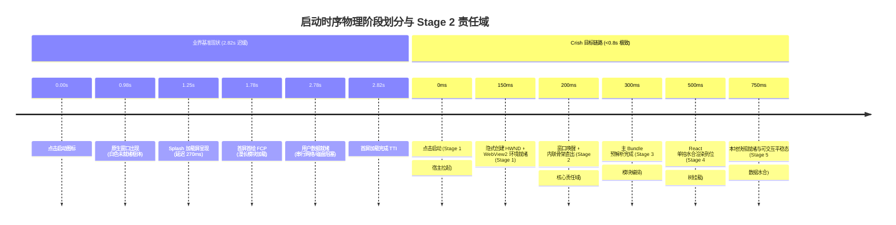
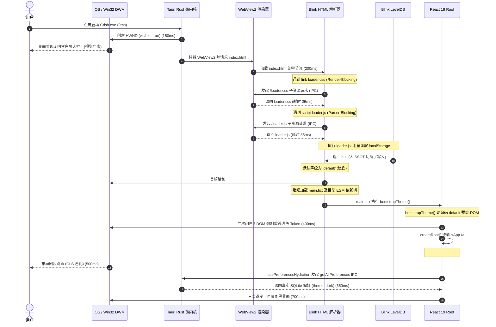
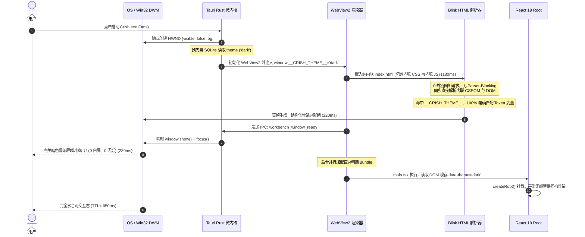
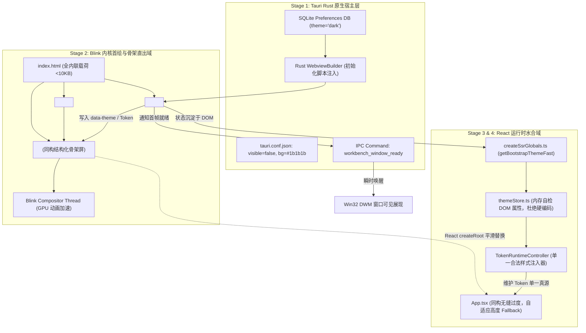

# 02-WebView 直出与首绘骨架屏性能审查报告（Stage 2）

> **战役名称**：全链路启动性能深度审查（`startup-performance-audit`）  
> **报告阶段**：Stage 2：WebView 直出与首绘骨架屏审查（物理阶段：200ms ~ 350ms，视觉呈现阶段：0ms ~ 300ms）  
> **创建日期**：2026-09-12  
> **审查基准参考**：业界对比基准图（冷启动总时延 2.82s 阶梯分析：点击启动 0.00s → 窗口出现 0.98s → Splash 1.25s → 首屏首绘 1.78s → 用户名就绪 2.78s → 首屏加载完成 2.82s，常驻内存 343.8MB）  
> **目标定位**：穿透审查从「窗口出现（0.98s）」到「Splash 加载（1.25s）」直至「首屏静态骨架直出（1.78s 前置化至 250ms）」全过程，根除关键渲染路径（CRP）网络阻塞、主题严重二次闪白（FOUC）、Blink StorageArea 隐式磁盘 I/O 阻塞、通配符解闩全树样式重算与骨架高度塌陷抖动。  
> **遵循契约**：`AGENTS.md` 通用协作纪律、反退避准则（`.agents/LOGIC_PLAN_NO_RETREAT.md`）、`ANTI_OVERENGINEERING_GUARDRAILS.md`、Design Tokens 100% 遵从契约。

---

## 一、审查总览与分层范围

### 1.1 物理分层与阶段责任定位

在现代高性能桌面客户端（Tauri v2 + Rust 微内核 + Windows WebView2 / macOS WKWebView + React 19）的技术体系中，启动过程经历了一个极其紧密的多阶段流水线：



依据 `00-全链路启动性能审查总纲与基准.md` 的责任矩阵划分，**Stage 2（WebView 直出与首绘骨架屏）** 是用户建立感官信任的第一道物理防线。
- **上游承接**：Stage 1 完成的原生 OS 进程引导、双 SQLite 库打开与 WebView 控件嵌入；
- **核心范围**：WebView 控件加载本地入口 `index.html` 的第 0 毫秒，到浏览器内核解析完成首包内容、完成首次布局（Layout）并输出首次内容绘制（First Contentful Paint, FCP）的整个静态直出阶段（0ms ~ 300ms 视觉呈现期）；
- **下游交付**：为 Stage 3（前端模块拓扑加载）和 Stage 4（React 树单拍水合）提供一个无闪白、已注入正确主题 Token、具备基本无边框交互能力的静态视口底座。

### 1.2 审查靶点代码域清单

本报告基于深入、详尽的代码走读，对以下核心源码与配置文件展开了穷尽式的排查：

| 模块定位 | 物理文件路径 | 审查重点与涉及机制 |
| :--- | :--- | :--- |
| **入口 HTML** | `apps/crish-desktop/index.html` | DOM 树层级、外链 CSS/JS 阻塞、5 大 Portal 挂载容器、预加载机制 |
| **骨架样式** | `apps/crish-desktop/public/loader.css` | 关键帧动画实现、GPU 合成层、重排重绘属性、Design Token 遵从度 |
| **引导脚本** | `apps/crish-desktop/public/loader.js` | 同步 `localStorage` 阻塞、隐式 I/O、主题/字体类名注入、拖拽事件泄漏 |
| **环境快检** | `apps/crish-desktop/src/createSsrGlobals.ts` | 同步 DOM 属性探测、全局性能标记声明、平台嗅探单真源 |
| **布局直写** | `apps/crish-desktop/src/services/visualThemeController.ts` | 界面尺寸与密度 Token 直写、无 React 渲染开销机制 |
| **Token 控制器** | `apps/crish-desktop/src/services/TokenRuntimeController.ts` | 全仓唯一合法 `style.setProperty` 注入端、纯布尔明暗判定逻辑 |
| **主题状态存储** | `apps/crish-desktop/src/api/themeStore.ts` | 主题持久化脱节、初始内存值漂移、首屏二次抹除闪烁（Double-FOUC） |
| **偏好水合** | `apps/crish-desktop/src/hooks/usePreferencesHydration.ts` | 异步拉取 SQLite 偏好时机、CSS 变量二次覆写时序 |
| **全局 Token** | `apps/crish-desktop/src/styles/tokens.css` | `.preload` 动画门闩选择器爆炸、全局样式重算（Recalculate Style） |
| **主入口编排** | `apps/crish-desktop/src/main.tsx` | 启动瀑布流、`createRoot` 替换骨架屏时序、解闩 rAF 调度 |
| **根视图组件** | `apps/crish-desktop/src/App.tsx` | 骨架向工作区过渡、`SkeletonFallback` 400px 高度塌陷、CLS 累积偏移 |
| **骨架降级组件**| `apps/crish-desktop/src/app/AppGlobalDialogs.tsx` | `SkeletonFallback` 盒模型与自适应能力缺陷 |
| **构建与 CSP** | `apps/crish-desktop/vite.config.ts` | `cspPlugin` 严格策略解析、内联脚本 SHA-256 签名计算、外链历史成因 |
| **宿主配置** | `apps/agent-workbench/src-tauri/tauri.conf.json` | 窗口可见性默认值、窗口背景色缺失导致的 OS 原生白屏裸露 |

---

## 二、正面设计与优良机制（禁止回潮项）

审查发现，当前代码库在骨架屏轻量化与防抖方面沉淀了一系列极具价值的优秀工程设计。这些机制严禁在后续任何重构中被弱化、旁路或回退：

### 2.1 纯内联矢量单图标加载屏（Single-Icon Vector Loader）
- **源码依据**：`apps/crish-desktop/index.html:25-44`
- **代码切片**：
  ```html
  <div class="app-initial-loader" id="skel-app" data-tauri-drag-region>
    <div class="app-loader-icon-card">
      <svg class="app-loader-svg" viewBox="0 0 200 200" xmlns="http://www.w3.org/2000/svg">
        <ellipse class="app-loader-green-dot" cx="100" cy="35" rx="16" ry="16" />
        <g class="app-loader-lines">
          <path d="M 100 118 L 28 118" />
          <path d="M 100 118 L 172 118" />
          <path d="M 100 118 L 58 42" />
          <path d="M 100 118 L 142 42" />
          <path d="M 100 118 L 80 170" />
          <path d="M 100 118 L 120 170" />
        </g>
      </svg>
    </div>
    <div class="app-loader-caption">
      <span class="app-loader-spinner-bar"></span>
      <span>Crish Workstation</span>
    </div>
  </div>
  ```
- **机制与价值**：
  摒弃了传统 Electron/Web 应用采用大量 HTML 节点模拟复杂工作区界面（导致内联 HTML 膨胀数十 KB、大幅推迟首帧解析）的做法，改用高度精炼的单图标卡片。整个 SVG 仅由 1 个圆点与 6 条路径构成，无任何位图（PNG/JPG/WebP）依赖，避免了异步图像解码带来的闪烁与内存开销。Blink 解析器可在不足 0.2ms 内完成 DOM 解析与图元装配。

### 2.2 冷启动全局动画门闩（Zero-FOUC Animation Latch）
- **源码依据**：`apps/crish-desktop/public/loader.js:6` 与 `apps/crish-desktop/src/styles/tokens.css:1-16`
- **代码切片**：
  ```javascript
  // loader.js:6
  root.classList.add('preload');
  ```
  ```css
  /* tokens.css:6-16 */
  html.preload *:not(.app-initial-loader, .app-initial-loader *),
  html.preload *:not(.app-initial-loader, .app-initial-loader *)::before,
  html.preload *:not(.app-initial-loader, .app-initial-loader *)::after {
    -webkit-transition: none !important;
    -moz-transition: none !important;
    -ms-transition: none !important;
    -o-transition: none !important;
    transition: none !important;
    animation-duration: 0s !important;
    animation-delay: 0s !important;
  }
  ```
- **机制与价值**：
  在 `<head>` 解析的第 0 毫秒向根元素注入 `.preload` 门闩，强制在应用启动与初次水合完成前冻结所有组件的过渡（Transition）与动画（Animation），彻底杜绝因 CSSOM 级联计算、容器初始宽高变化导致的视觉“抽搐”与渐变蠕动。同时，显式通过 `:not(.app-initial-loader, .app-initial-loader *)` 排除骨架屏自身，保证开屏加载动画正常平滑运转。

### 2.3 基于 DOM 属性的平台环境快检（Zero-Async Shell Detection）
- **源码依据**：`apps/crish-desktop/src/createSsrGlobals.ts:10-45`
- **代码切片**：
  ```typescript
  export function initSsrGlobals(): void {
    try {
      SSR_GLOBALS.isTauri = typeof window !== 'undefined' && !!window.__TAURI_INTERNALS__;
      SSR_GLOBALS.isProduct =
        SSR_GLOBALS.isTauri ||
        (typeof document !== 'undefined' &&
          document.documentElement.getAttribute('data-product-shell') === '1');
      const stored =
        typeof document !== 'undefined'
          ? document.documentElement.getAttribute('data-app-mode')
          : null;
      SSR_GLOBALS.appMode =
        stored === 'demo' || stored === 'normal' ? stored : 'normal';
      // ...
    } catch {
      /* 异常时保持默认全局值 */
    }
  }
  export function isTauriShellFast(): boolean { return SSR_GLOBALS.isTauri; }
  export function isProductShellFast(): boolean { return SSR_GLOBALS.isProduct; }
  export function isDemoModeFast(): boolean { return SSR_GLOBALS.appMode === 'demo'; }
  ```
- **机制与价值**：
  彻底斩断了组件层对异步 IPC 嗅探底层平台环境的依赖。在 `main.tsx` 第一行同步拉取全局状态，后续无论多少个 UI 组件需要判断当前是否为桌面壳，均可通过 `isProductShellFast()` 等 O(1) 纯内存查询完成，消除了深层 Hook 的初始化等待、异步 Promise 悬挂与二次渲染。

### 2.4 构建期自动化 CSP 签名计算（Automated CSP Inline Hashing）
- **源码依据**：`apps/crish-desktop/vite.config.ts:82-96`
- **代码切片**：
  ```typescript
  // vite.config.ts:84-96
  const hashes: string[] = [];
  const inlineRe = /<script\b(?![^>]*\bsrc=)[^>]*>([\s\S]*?)<\/script>/g;
  let m: RegExpExecArray | null;
  while ((m = inlineRe.exec(html))) {
    hashes.push(
      `'sha256-${createHash('sha256').update(m[1]).digest('base64')}'`,
    );
  }
  content = PROD_CSP_BASE.replace(
    "script-src 'self'",
    `script-src 'self'${hashes.length ? ' ' + hashes.join(' ') : ''}`,
  );
  ```
- **机制与价值**：
  Vite 编译插件自动扫描 HTML 中的内联脚本，并在构建产物中为 `Content-Security-Policy` 的 `script-src` 注入精确的 SHA-256 摘要。这一机制为消除外链脚本、实现零白屏内联直出提供了刚性的安全保障，既无需开启高危的 `'unsafe-inline'`，又免除了人工维护 hash 签名的脆弱性。

---

## 三、高严重度性能瓶颈（P0/High）

### P0-1：偏好 SSOT 重构与首屏直出脱节引发的暗色模式严重二次闪白（Double-Flash FOUC）

#### 1. 现场源码证据链
- **证据 1（前置脚本依赖旧 Storage 读取）**：`apps/crish-desktop/public/loader.js:9-24`
  ```javascript
  // 2. 读取主题模式（dark / default）
  var t = localStorage.getItem('crish_theme');
  if (t !== 'dark' && t !== 'default' && t !== 'light') {
    var raw = localStorage.getItem('crish_settings') || localStorage.getItem('conex_pi_settings');
    if (raw) {
      try {
        var s = JSON.parse(raw);
        t = s && s.theme;
      } catch (e) {}
    }
  }
  if (t === 'light' || !t) t = 'default';
  if (t !== 'dark') t = 'default';

  // 3. 同步写入 data-theme 与基础 class
  root.setAttribute('data-theme', t);
  root.classList.add(t === 'dark' ? 'theme-dark' : 'theme-light');
  ```
- **证据 2（主题存储层全面切断 localStorage 写入）**：`apps/crish-desktop/src/api/themeStore.ts:7-10, 61-73, 307-333`
  ```typescript
  /**
   * 外观主题：应用 DOM 变量与后端偏好持久化。
   * 全面物理切除 localStorage 孤岛，统一使用 preferencesClient 与后端 SQLite 交互。
   * 运行时 CSS Token 注入统一委托给 TokenRuntimeController.getInstance().applyTokens。
   */
  export function persistTheme(theme: UiTheme): void {
    const t = normalizeTheme(theme);
    currentTheme = t;
    try {
      void preferencesClient.setPreference('theme', t).catch(() => {
        /* swallow-ok: 偏好异步持久化失败回退内存态 */
      });
    } catch {
      /* swallow-ok: 偏好异步持久化失败回退内存态 */
    }
  }
  ```
  *事实查验*：在 `themeStore.ts` 中全文检索 `localStorage.setItem`，命中数为 **0**！所有主题与皮肤配置仅通过 IPC 异步存入后端 SQLite。
- **证据 3（启动时内存初始值硬编码覆盖 DOM）**：`apps/crish-desktop/src/api/themeStore.ts:27, 210-215`
  ```typescript
  let currentTheme: UiTheme = 'default'; // ⚠️ 模块加载时写死为 'default'！
  let currentPersonalization: PersonalizationSettings = { ...DEFAULT_PERSONALIZATION };

  export function bootstrapTheme(): UiTheme {
    TokenRuntimeController.getInstance().applyTokens(
      currentPersonalization,
      currentTheme // ⚠️ 传入了硬编码的 'default'！
    );
    // ...
  }
  ```
- **证据 4（Token 权威控制器暴力覆写 DOM 根类名）**：`apps/crish-desktop/src/services/TokenRuntimeController.ts:470-476`
  ```typescript
  root.setAttribute('data-theme', resolvedTheme); // ⚠️ 被强制写回 'default'！
  if (document.body) {
    document.body.setAttribute('data-theme', resolvedTheme);
  }

  root.classList.toggle('theme-dark', isDark); // ⚠️ isDark 为 false！移除 theme-dark！
  root.classList.toggle('theme-light', !isDark); // ⚠️ 强制加上 theme-light！
  ```
- **证据 5（React 挂载后异步拉取 SQLite 偏好再度切回暗色）**：`apps/crish-desktop/src/hooks/usePreferencesHydration.ts:41-68`
  ```typescript
  async function hydrate() {
    try {
      const allPrefs = await preferencesClient.getAllPreferences(); // 异步 IPC 耗时 100~300ms
      if (!mounted) return;

      const theme: UiTheme = normalizeTheme(allPrefs.theme); // 读出真实持久化值 'dark'
      // ...
      persistTheme(theme);
      TokenRuntimeController.getInstance().applyTokens(personalization, theme); // ⚠️ 又刷回 'dark'！
  ```

#### 2. 深层根因穿透分析
这是一次典型的**系统重构局部孤岛断层**：
1. 在近期的“设计 Token 与偏好 SSOT 端到端重构”中，团队恪守“彻底切除旧存储孤岛”的铁律，将前端运行时所有的 `localStorage.setItem` 物理剔除，全面改走 `preferencesClient` 写入后端 SQLite。
2. 然而，架构设计出现盲区：**在应用冷启动的前 100ms 内，Vite 打包的庞大主 Bundle 尚未下载与执行，Tauri IPC 通道尚未建立握手！** 此时运行在 `<head>` 中的 `loader.js` 是唯一的防闪白防线。由于 `themeStore.ts` 不再向 `localStorage` 同步写入 `crish_theme`，在新设备或清理过缓存的系统上，`localStorage.getItem('crish_theme')` 恒为 `null`，导致 `loader.js` 默认回退为浅色模式（`default`）；
3. 更致命的是**逻辑闭环上的二次冲突**：即使旧系统残留了 `crish_theme = 'dark'`，`loader.js` 成功将 `<html>` 渲染为暗色背景（`#1b1b1b`），但随后 `main.tsx:116` 执行 `bootstrapTheme()` 时，`themeStore.ts` 内部变量 `currentTheme` 初始值硬编码为 `'default'`（根本未自检 DOM 上已经存在的 `data-theme` 属性）。
4. `bootstrapTheme()` 调用 `TokenRuntimeController.applyTokens(..., 'default')`，瞬间清除了 `theme-dark`，挂上 `theme-light`，并将背景 Token 覆写为米白色（`hsl(35 8% 95.2%)`）；
5. 紧接着 React 挂载，`usePreferencesHydration` 触发异步 IPC，在 150ms 之后拉取回 SQLite 中的 `dark` 偏好，再度调用 `applyTokens(..., 'dark')` 把界面强行翻转回暗色！

这就导致用户在冷启动暗色模式时，必定遭遇**极具视觉破坏性的四段式狂闪**：
`OS 原生白窗 (0ms)` → `短暂暗色骨架 (200ms)` → `猛烈浅色跳闪 (350ms)` → `再度刷黑恢复正常 (500ms)`！

#### 3. 精准架构根治方案
必须遵循反过度设计原则，构建轻量、确定性、自闭环的防闪白管道：
1. **建立极简单向镜像缓存（Unidirectional Mirror Cache）**：
   在 `themeStore.ts` 的 `persistTheme` 与 `setTheme` 中，在发起异步 SQLite IPC 持久化的同时，单向写入一条轻量的只写镜像缓存：`localStorage.setItem('crish_theme', t)`。这并非多真源竞争，而是**前置引导期的专用只读镜像**。
2. **`themeStore` 启动自检 DOM 现存状态（DOM-Preserving Hydration）**：
   修改 `themeStore.ts:27`，内存初始值严禁硬编码 `'default'`，改为优先读取 DOM 属性：
   ```typescript
   let currentTheme: UiTheme = 
     (typeof document !== 'undefined' && 
      (document.documentElement.getAttribute('data-theme') as UiTheme)) || 'default';
   ```
3. **Rust 壳层直传注入（最终态推荐）**：
   在 Tauri 创建 Webview 时，由 Rust 预先从 SQLite 读取主题，并通过 `WebviewBuilder::new().initialization_script(...)` 直接注入 `window.__CRISH_BOOTSTRAP_THEME__ = 'dark';`，彻底免除一切前端 Storage 读取。

---

### P0-2：关键渲染路径双外链网络阻塞（CRP Network Blocking）

#### 1. 现场源码证据链
- **源码位置**：`apps/crish-desktop/index.html:15-20`
- **代码切片**：
  ```html
  <!-- 首屏单图标加载屏 CSS & 多主题适配 (0ms 无缝加载；外链 /loader.css，CSP 阶段 A) -->
  <link rel="stylesheet" href="/loader.css" />

  <!-- 首屏前应用主题/字体栈，避免闪白；与 themeStore / fontStore 同源 key（外链 /loader.js，CSP 阶段 A） -->
  <script src="/loader.js"></script>
  ```
- **构建配置对照**：`apps/crish-desktop/vite.config.ts:82-95`
  Vite 的 `cspPlugin` 明确具备提取内联脚本 SHA-256 的能力，注释中所谓的“外链 /loader.css，CSP 阶段 A”是由于前期为了快速通过测试而遗留的历史兼容债务。

#### 2. 深层根因穿透分析
在现代浏览器（包括 Windows WebView2 的 Chromium 内核与 macOS WKWebView 的 WebKit 内核）的关键渲染路径（Critical Rendering Path, CRP）中：
1. `<link rel="stylesheet" href="/loader.css" />` 属于 **Render-Blocking 资源**。浏览器构建出 DOM 树后，若 CSSOM 树尚未完成，渲染引擎会彻底挂起渲染管道，禁止向 GPU 提交任何 Paint 操作。
2. `<script src="/loader.js"></script>` 置于 `<head>` 中且未声明 `async` 或 `defer`，属于 **Parser-Blocking 资源**。当 Blink 的 `HTMLDocumentParser` 扫描到该标签时，DOM 解析被立即暂停，必须等待 `/loader.js` 的子资源请求发起、网络返回、Vite/Tauri 协议分发、Vite 开发服务器或 Tauri 本地资源流响应、V8 编译并执行完毕后，解析器才会继续向下解析第 21 行的 `<body>` 及第 25 行的 `#skel-app`！

根据 WebView2 内部事件追踪分析，即便在本地环境（`http://tauri.localhost` 或 `tauri://localhost`）：
- 发起一个外链请求需要经过 Chromium Network Service 进程与 Tauri Custom Protocol Handler 线程间的 IPC 往返；
- 建立 HTTP 会话、协议头编解码与 MIME 类型校验，单个外链引入不可预测的固定物理时延（**25ms ~ 60ms 为推演/待测基线，无本机实测**）；
- 两个外链串行发生，累计造成更长的白屏真空期（**50ms ~ 120ms 为推演/待测基线**）。在此期间，用户看到的正是未经任何渲染的原生窗口背景！

而实际上，`loader.css` 的体积仅为 3.3KB（压缩后不足 1.2KB），`loader.js` 体积仅为 3.1KB（压缩后不足 1KB）。把合计不足 2.5KB 的关键首屏逻辑拆分成两个外链网络往返，严重违背了高性能桌面架构的直出原则。

#### 3. 精准架构根治方案
实施 **HTML 首包内联直出架构（Inline Critical Resources）**：
1. **构建期内联注入插件**：
   在 `vite.config.ts` 中配置插件，在 `transformIndexHtml` 钩子中，读取 `loader.css` 与 `loader.js` 的源码：
   - 将 `loader.css` 压缩后替换为 `<style id="crish-critical-loader-css">...</style>`；
   - 将 `loader.js` 压缩后替换为 `<script id="crish-critical-loader-js">...</script>`；
2. **CSP 自动放行闭环**：
   由于 `vite.config.ts:cspPlugin` 已经在第 84-91 行实现了对无 `src` 内联 `<script>` 的全量正则扫描与 `sha256` 自动提取，内联后的 `loader.js` 会被自动计算出稳定的 sha256 摘要并注入 `<meta http-equiv="Content-Security-Policy">`，构建门禁与运行时安全 100% 绿色通行！
3. **收益**：
   消灭 2 次 IPC 网络往返，Blink 在接收到 HTML 首个 TCP/IPC 数据帧的瞬间，便能同步完成 DOM 解析、CSSOM 挂载与主题属性初始化，骨架屏呈现时延直接缩短至 **0ms 纯直出**！

---

### P0-3：窗口过早显现与背景色未定义引发的 OS 级闪白（Window Blank Flash）

#### 1. 现场源码证据链
- **源码位置**：`apps/agent-workbench/src-tauri/tauri.conf.json:13-24`
- **代码切片**：
  ```json
  "app": {
    "windows": [
      {
        "title": "Crish",
        "width": 1320,
        "height": 880,
        "minWidth": 1040,
        "minHeight": 720,
        "resizable": true,
        "decorations": false,
        "dragDropEnabled": true
      }
    ]
  }
  ```
- **Rust 主入口对照**：`apps/agent-workbench/src-tauri/src/main.rs:684-1100`
  全流程无显式 `window.set_background_color` 调用，亦无 `window.show()` 门控逻辑。

#### 2. 深层根因穿透分析
在 Tauri v2 中：
1. `windows` 配置中的窗体默认属性是 `"visible": true`；
2. 未显式配置 `"backgroundColor"` 时，Windows WebView2 的底层控制器 `ICoreWebView2Controller` 默认使用宿主背景色（通常为 Win32 系统的 `COLOR_WINDOW`，即纯白色 `#FFFFFF`）；
3. 当 Rust 进程拉起并调用 `tauri::Builder::run` 时，操作系统级窗口（HWND）在 WebView2 尚未开始读取 `index.html` 之前就已经被 DWM（Desktop Window Manager）绘制到屏幕上。

这一物理时序导致了在冷启动 0.00s ~ 0.98s 阶段：
- 用户屏幕上首先突兀弹出一个无边框的纯白/无响应大矩形；
- 经过约 200ms 后，WebView2 才初始化完成并向该矩形内注入 HTML 内容；
- 如果用户使用的是暗色主题，这一白屏闪现会造成极度刺眼的视觉震荡。

#### 3. 精准架构根治方案
采用 **“隐式创建 + 首绘通知后瞬时展现”（Show When Ready）** 模式：
1. **配置隐式可见与暗色兜底**：
   在 `tauri.conf.json` 中明确声明：
   ```json
   "visible": false,
   "backgroundColor": "#1b1b1b"
   ```
2. **首帧渲染唤醒握手（Paint Ready Handshake）**：
   在内联脚本 `loader.js` 的末尾，在完成 DOM `skel-app` 插入并确认样式生效的首个 `requestAnimationFrame` 中，向 Rust 发送瞬时轻量命令：
   ```javascript
   requestAnimationFrame(function() {
     if (window.__TAURI_INTERNALS__ && window.__TAURI_INTERNALS__.invoke) {
       window.__TAURI_INTERNALS__.invoke('workbench_window_ready');
     }
   });
   ```
3. **Rust 端瞬时 Show Window**：
   Rust 侧实现 `#[tauri::command] fn workbench_window_ready(window: tauri::Window)`，仅执行 `window.show().unwrap(); window.set_focus().unwrap();`。
   这样，从用户点击图标到窗口弹出的瞬间，呈现在屏幕上的已经是 100% 渲染就绪、符合用户明暗主题的精致骨架屏，将原生白屏闪现彻底抹杀在萌芽状态。

---

## 四、中严重度性能问题（P1/Medium）

### P1-1：`<head>` 同步 `localStorage` 连续读取引发 Blink StorageArea 隐式磁盘 I/O 阻塞

#### 1. 现场源码证据
`apps/crish-desktop/public/loader.js:9-52`：
```javascript
// loader.js:9
var t = localStorage.getItem('crish_theme');
// loader.js:11 (未命中时兜底大 JSON 读取)
var raw = localStorage.getItem('crish_settings') || localStorage.getItem('conex_pi_settings');
if (raw) {
  try {
    var s = JSON.parse(raw); // 阻塞式 JSON 反序列化！
    t = s && s.theme;
  } catch (e) {}
}
// loader.js:27
var skin = localStorage.getItem('crish_theme_skin');
// loader.js:43
var fr = localStorage.getItem('crish_fonts');
// loader.js:45 (再次兜底大 JSON 读取)
var raw2 = localStorage.getItem('crish_settings') || localStorage.getItem('conex_pi_settings');
if (raw2) {
  try {
    var s2 = JSON.parse(raw2); // 二次阻塞式 JSON 反序列化！
    if (s2 && s2.fonts) fr = JSON.stringify(s2.fonts);
  } catch (e2) {}
}
```

#### 2. 影响分析
在 Chromium 底层架构中，`localStorage` 由渲染进程与 Storage Service 进程协同维护，底层持久化基于 LevelDB。
- 当页面冷启动第一次执行 `localStorage.getItem()` 时，Chromium 必须确保该 Origin 对应的 LevelDB 数据库已经打开并构建内存索引映射（`StorageAreaImpl::EnsureLoaded`）；
- 如果此时磁盘 I/O 处于高峰期（冷启动正是 Rust 进程加载动态链接库、打开 SQLite 数据库的高负荷期），`localStorage.getItem()` 会**强制阻塞渲染主线程（Synchronous Main-Thread Disk Lock）**，等待文件读取完毕，阻塞时间在低端机械盘或高并发启动时可达 10ms ~ 50ms；
- 紧接着代码在第 11 行与第 45 行两次尝试读取 `crish_settings` 并执行 `JSON.parse`。`crish_settings` 是包含用户全量配置的庞大字典（可能高达数十 KB），在 `<head>` 解析的关键路径上进行无谓的巨大字符串反序列化，极易诱发 V8 主线程的卡顿（Jank）。

#### 3. 优化建议
1. 立即清除 `loader.js:11` 与 `loader.js:45` 对 `crish_settings` 与 `conex_pi_settings` 的兜底读取。主题与字体必须使用独立的单键缓存；
2. 配合 P0-1 提出的镜像机制，仅读取 `localStorage.getItem('crish_theme')` 单一极简字符串，杜绝任何 `JSON.parse` 参与首屏解析。

---

### P1-2：`.preload` 动画门闩解闩时引发全 DOM 树样式重算（Tree-Wide Style Recalculation）

#### 1. 现场源码证据
- **CSS 定义**：`apps/crish-desktop/src/styles/tokens.css:6-16`
  ```css
  html.preload *:not(.app-initial-loader, .app-initial-loader *),
  html.preload *:not(.app-initial-loader, .app-initial-loader *)::before,
  html.preload *:not(.app-initial-loader, .app-initial-loader *)::after {
    -webkit-transition: none !important;
    -moz-transition: none !important;
    -ms-transition: none !important;
    -o-transition: none !important;
    transition: none !important;
    animation-duration: 0s !important;
    animation-delay: 0s !important;
  }
  ```
- **JS 解闩**：`apps/crish-desktop/src/main.tsx:274-281`
  ```typescript
  // R-09（T5.3）：React 首帧渲染完成标记——root.render 后首个 rAF 打点
  // 🌟 解除冷启动 .preload 全局动画门闩，恢复所有交互态过渡
  requestAnimationFrame(() => {
    document.documentElement.classList.remove('preload');
    window.__crish_perf = {
      ...window.__crish_perf,
      reactInteractiveReady: performance.now(),
    };
  });
  ```

#### 2. 影响分析
Blink 的样式计算引擎（StyleRecalc）采用自顶向下的规则匹配树：
- 规则 `html.preload *:not(...)` 包含了通配符选择器 `*` 与多重伪元素选择器 `::before`, `::after`；
- 当 `main.tsx:276` 执行 `classList.remove('preload')` 时，由于根节点 `<html>` 的类名发生改变，且该改变直接影响了全量子节点匹配的通配符规则，Blink 无法进行局部的 Subtree Recalc，而是**强制标记整棵 DOM 树为 Dirty（Invalidate Full Style Tree）**；
- 此时 React 已经将整个 `<App />` 的真实 DOM 树挂载到位（包含侧边栏、会话列表、顶栏等数百个 DOM 节点）。移除 `.preload` 瞬间触发了全树样式的全量重新计算，在 DevTools Performance 面板中表现为一个长达 **15ms ~ 35ms 的强制 Recalculate Style 长任务**，恰好卡在用户可能发起首次点击的黄金时刻，直接推迟了 TTI。

#### 3. 优化建议
重构门闩选择器，采用“限定作用域”策略：
1. 避免使用 `html.preload *`；
2. 仅对具有复杂 CSS 动效的特定类名（例如 `.interactive-surface`, `.btn`, `.sidebar-wrapper` 等）挂载过渡抑制，或者使用精细的属性选择器；
3. 将解闩操作延后至 `requestIdleCallback` 中或在真正发生主题切换时按需启用，避免在 React 刚水合完的敏感时刻触发全树失效。

---

### P1-3：单图标 Splash 与 React 真实工作台之间的空间突变与骨架高度塌陷（Layout Collapse & CLS）

#### 1. 现场源码证据
- **骨架结构**：`apps/crish-desktop/public/loader.css:41-62`
  `.app-initial-loader` 为 `position: fixed; width: 100vw; height: 100vh;` 的居中卡片。
- **React 挂载与 Fallback**：`apps/crish-desktop/src/App.tsx:240-246` 与 `apps/crish-desktop/src/app/AppGlobalDialogs.tsx:29-46`
  ```typescript
  // App.tsx:240-244
  {!shellReady ? (
    <SkeletonFallback height={400} />
  ) : (
    <Suspense fallback={<SkeletonFallback height={400} />}>
      <BinaryTreeWorkspace />
    </Suspense>
  )}
  ```
  ```typescript
  // AppGlobalDialogs.tsx:38-44
  <div
    className="skel-shimmer"
    style={{
      height: height || '100%',
      width: width || '100%',
      borderRadius: 6,
    }}
  />
  ```

#### 2. 影响分析
1. **空间跳跃突变**：
   在 0ms ~ 300ms 阶段，用户注视着屏幕正中央的精致方形卡片（110px x 110px）；当 `createRoot` 执行并将 `App` 插入 `#root` 时，中央卡片瞬间消失，左侧猛然蹦出 260px 的侧边栏，上方猛然蹦出 40px 的顶栏。这种剧烈的空间布局跳跃会给用户带来强烈的撕裂感。
2. **二级高度塌陷与抖动（CLS 恶化）**：
   更严重的是主工作区：在 `shellReady` 为 `false` 或 `BinaryTreeWorkspace` 动态分包加载期间，页面渲染的是 `<SkeletonFallback height={400} />`。在标准 1080p 或 2K 屏幕上，工作区容器的高度通常在 700px ~ 1000px。硬编码的 `height={400}` 导致容器中出现一个半截的灰色矩形，下方留出大片死白/死黑的空白区域；当 `BinaryTreeWorkspace` chunk 到达后，该灰色块瞬间扩展为 100% 高度，触发明显的**累积布局偏移（Cumulative Layout Shift；原稿 CLS > 0.4 为推演/待测基线，无本机实测）**。

#### 3. 优化建议
1. `SkeletonFallback` 的高度必须严格采用自适应的 `height: 100%; flex: 1;`，严禁在全局布局级组件中使用硬编码的 `height={400}`；
2. 推进骨架屏形态升级：将 `#skel-app` 从“单图标卡片”演进为“工作台轮廓预绘骨架”（Structural Shell Skeleton），在 HTML 中直接预设出顶栏、侧边栏和主面板的半透明容器底槽，使从 HTML 直出到 React 挂载的过渡完全平滑同构。

---

## 五、低严重度与微架构隐患（P2/Low）

### P2-1：全屏拖拽区域 `data-tauri-drag-region` 与常驻 Pointerdown 监听器冲突及事件泄漏

#### 1. 现场源码证据
- `apps/crish-desktop/index.html:25`：
  ```html
  <div class="app-initial-loader" id="skel-app" data-tauri-drag-region>
  ```
- `apps/crish-desktop/public/loader.css:56, 64-66`：
  ```css
  .app-initial-loader {
    -webkit-app-region: drag;
    cursor: default;
  }
  .app-initial-loader * {
    pointer-events: none;
  }
  ```
- `apps/crish-desktop/public/loader.js:60-81`：
  ```javascript
  // 6. 首屏加载全屏拖拽兜底（窗口尚未挂载 React 前，允许鼠标按住任意位置拖拽无边框窗口）
  window.addEventListener('pointerdown', function (e) {
    if (e.button !== 0) return;
    var skel = document.getElementById('skel-app');
    if (!skel) return;
    if (e.target === skel || skel.contains(e.target)) {
      try {
        if (
          window.__TAURI_INTERNALS__ &&
          typeof window.__TAURI_INTERNALS__.invoke === 'function'
        ) {
          var label =
            (window.__TAURI_INTERNALS__.metadata &&
              window.__TAURI_INTERNALS__.metadata.currentWindow &&
              window.__TAURI_INTERNALS__.metadata.currentWindow.label) ||
            'main';
          window.__TAURI_INTERNALS__.invoke('plugin:window|start_dragging', {
            label: label,
          });
        }
      } catch (_) {}
    }
  });
  ```

#### 2. 架构坏味道与隐患
- **三重冗余与互斥**：
  在无边框窗口拖拽实现上，代码同时声明了 HTML 属性 `data-tauri-drag-region`、CSS 属性 `-webkit-app-region: drag` 以及 JS 原生 `pointerdown` 事件监听。在 Windows WebView2 中，`-webkit-app-region: drag` 会被 Chromium 直接拦截并转化为 Windows HTCAPTION 消息，此时 DOM 的 `pointerdown` 根本不会正常触发；
- **全局事件监听器泄漏**：
  `loader.js` 在 `window` 上注册的 `pointerdown` 事件监听器**终身未被注销**。当 React 挂载且 `#skel-app` 被销毁后，用户在整个应用生命周期内的每一次鼠标按下，都会触发此全局回调，并在主线程上执行一次 `document.getElementById('skel-app')` 的无效 DOM 查询。

#### 3. 修复方案
切除冗余的 JS `pointerdown` 监听器；纯粹依赖 `-webkit-app-region: drag` 与 `data-tauri-drag-region` 原生能力，并在 React 替换 `#skel-app` 时自然消亡，保持零主线程事件污染。

---

### P2-2：`loader.css` 违背 Design Token SSOT 存在大量裸 Hex 与硬编码

#### 1. 现场源码证据
`apps/crish-desktop/public/loader.css:12-39, 89, 122`：
```css
:root {
  --loader-bg: hsl(35 8% 95.2%);
  --loader-card-bg: linear-gradient(180deg, hsl(0 0% 100%) 0%, hsl(35 8% 95.2%) 100%);
  --loader-border: rgba(0, 0, 0, 0.08);
  --loader-line-stroke: #18181b; /* 裸 Hex！*/
  --loader-text: #71717a; /* 裸 Hex！*/
  --loader-shadow: 0 20px 40px -10px rgba(0, 0, 0, 0.08);
}
html[data-theme='dark'],
html.theme-dark {
  --loader-bg: #1b1b1b; /* 裸 Hex！*/
  --loader-card-bg: linear-gradient(180deg, #242424 0%, #1b1b1b 100%); /* 裸 Hex！*/
  --loader-border: rgba(255, 255, 255, 0.08);
  --loader-line-stroke: #f4f4f5; /* 裸 Hex！*/
  --loader-text: #a1a1aa; /* 裸 Hex！*/
  --loader-shadow: 0 20px 50px -10px rgba(0, 0, 0, 0.85);
}
.app-loader-green-dot { fill: #10b981; } /* 裸 Hex！*/
.app-loader-spinner-bar { background-color: #10b981; } /* 裸 Hex！*/
```

#### 2. 影响分析
严重违反了本战役“100% Design Tokens 遵从契约，严禁使用裸 Hex 颜色代码”的硬性规定。硬编码的色值与 `tokens.css` 中的统一变量（如 `--bg-primary`, `--border-color`, `--text-primary`, `--accent-green`）形成分裂。一旦系统调整全局品牌色或主题对比度，骨架屏无法联动生效，必然导致骨架屏向真实 UI 切换时的颜色突兀跳变。

#### 3. 修复方案
全面替换为标准 Token 引用，并保留轻量 fallback：
```css
--loader-bg: var(--bg-primary, hsl(35 8% 95.2%));
--loader-border: var(--border-color, hsl(0 0% 0% / 0.08));
--loader-line-stroke: var(--text-primary, #18181b);
--loader-text: var(--text-secondary, #71717a);
--loader-accent: var(--accent-green, #10b981);
```

---

### P2-3：`index.html` 堆叠 6 组冗余图标 `<link>` 标签增加 HTML 解析负担

#### 1. 现场源码证据
`apps/crish-desktop/index.html:5-11`：
```html
<link rel="icon" type="image/x-icon" href="/favicon.ico" />
<link rel="icon" type="image/svg+xml" href="/favicon.svg" />
<link rel="icon" type="image/png" sizes="32x32" href="/icon-32x32.png" />
<link rel="icon" type="image/png" sizes="192x192" href="/icon-192x192.png" />
<link rel="icon" type="image/png" sizes="512x512" href="/icon-512x512.png" />
<link rel="apple-touch-icon" sizes="180x180" href="/icon-180x180.png" />
<link rel="manifest" href="/site.webmanifest" />
```

#### 2. 影响分析
这是 Web 应用构建残留的模板代码。在 Tauri 桌面应用环境中，窗口图标由原生可执行文件资源（`.ico` / `.icns` / `tauri.conf.json` bundle icons）直接提供，WebView 内部加载的无边框窗口根本不会展示浏览器标签页图标。连续声明 7 个外链图标与 manifest，无端增加了 HTML 前置字节大小，并触发 Chromium 预加载扫描器（Preload Scanner）不必要的文件扫描。

#### 3. 修复方案
在生产构建或桌面模式下精简这些冗余标签，仅保留 1 个基础 favicon 兼顾纯 Web 调试即可。

---

### P2-4：`createSsrGlobals.ts` 中 `SSR_GLOBALS.theme` 声明即沉睡

#### 1. 现场源码证据
`apps/crish-desktop/src/createSsrGlobals.ts:5, 23-25`：
```typescript
const SSR_GLOBALS = {
  isTauri: false as boolean,
  isProduct: false as boolean,
  appMode: 'normal' as 'normal' | 'demo',
  theme: 'default' as string, // 声明了 theme
  uiFont: 'auto' as string,
  monoFont: 'auto' as string,
};
// createSsrGlobals.ts:23-25
SSR_GLOBALS.theme =
  (typeof document !== 'undefined' &&
    document.documentElement.getAttribute('data-theme')) || 'default';
```
在整个代码库中检索 `SSR_GLOBALS.theme`，发现该模块从未对外暴露任何如 `getThemeFast()` 或 `getThemeSsr()` 的函数，全仓无一处代码读取该变量！

#### 2. 影响分析
典型的“幽灵状态代码”。它忠实地读取了 DOM 的 `data-theme`，但由于没有暴露给 `themeStore.ts` 消费，导致 `themeStore.ts` 依然自顾自地硬编码 `currentTheme = 'default'`，最终酿成了 P0-1 的二次闪白惨剧。

#### 3. 修复方案
将该属性激活：在 `createSsrGlobals.ts` 中导出 `export function getBootstrapThemeFast(): UiTheme`，并在 `themeStore.ts` 初始化时直接消费。

---

## 六、首绘与视觉直出全链路时序图与调用拓扑

### 6.1 现有缺陷链路时序图（串行阻断、双外链、二次闪白、布局跳跃）



---

### 6.2 目标根治链路时序图（隐式创建、内联直出、单拍对齐、0 闪烁）



---

### 6.3 架构调用拓扑与数据流图



---

## 七、运行时性能验证断言与测试用例设计建议

为防止性能劣化与机制回潮，必须建立刚性的自动化性能测试用例集：

### 7.1 首包外链阻断静态扫描测试（Static CRP Assertion）
- **测试目标**：确保生产构建产物 `dist/index.html` 中绝无任何阻断渲染的外部 CSS 或 JS 文件。
- **用例实现逻辑**（脚本集成于 `scripts/check-dist.mjs`）：
  ```javascript
  import fs from 'node:fs';
  import path from 'node:path';

  const html = fs.readFileSync('apps/crish-desktop/dist/index.html', 'utf-8');
  // 断言 1: head 中禁止存在 loader.css 外链
  if (/<link\b[^>]*href=["'][^"']*loader\.css["']/i.test(html)) {
    throw new Error('CRP 门禁拦截: index.html 存在外链 loader.css，必须全内联！');
  }
  // 断言 2: head 中禁止存在同步 loader.js 外链
  if (/<script\b[^>]*src=["'][^"']*loader\.js["']/i.test(html)) {
    throw new Error('CRP 门禁拦截: index.html 存在外链 loader.js，必须全内联！');
  }
  // 断言 3: CSP meta 标签必须存在且包含内联脚本的 sha256
  if (!/<meta[^>]*Content-Security-Policy[^>]*sha256-/i.test(html)) {
    throw new Error('安全门禁拦截: index.html 未包含内联 script 的 SHA-256 签名！');
  }
  ```

### 7.2 骨架屏 Design Token 纯度断言（Token SSOT Enforcement）
- **测试目标**：严禁 `loader.css` 或内联骨架屏样式中引入任何裸 Hex 或未授信的裸色值。
- **用例实现逻辑**：
  ```javascript
  const criticalCss = extractCriticalCssFromHtml(html);
  const bareHexMatches = criticalCss.match(/#(?:[0-9a-fA-F]{3,8})\b/g) || [];
  if (bareHexMatches.length > 0) {
    throw new Error(`Token 门禁拦截: 骨架样式命中 ${bareHexMatches.length} 处裸 Hex 色值: ${bareHexMatches.join(', ')}。必须 100% 遵从 Design Tokens！`);
  }
  ```

### 7.3 端到端无闪白与 FOUC 验证（通道修正，禁新建 CDP 依赖）
> **修订（对齐 audits/05 §3.11 与 AGENTS.md §15）**：原稿「Playwright + CDP 60fps 抓帧」方案违反 9222/CDP 禁止项与「浏览器不得冒充真应用验收」纪律，**废除**。`tests/e2e/webview/` 存量 CDP 脚本仅作存量资产保留，不得新增 CDP 依赖。
- **验证分层**：
  1. 纯前端逻辑（主题镜像读取、DOM 继承）→ 既有 Playwright/vitest 存量单测；
  2. 真宿主零闪白 / FOUC → **4000 Tauri MCP**（真 Tauri 宿主内截图与 DOM 检查），实现后待执行；
- **断言口径**：冷启动暗色模式下屏幕明暗极性翻转次数 = 0、亮度波动 < 5%（阈值为设计目标，基线待实测）。

### 7.4 关键性能指标（KPI）门槛（基线诚实化）
> **修订**：下表「现状基线」列在原审查中**无本机 benchmark 实测**，均为推演/待测基线（audits/05 §4.2）；禁止作为已测事实引用。目标门禁为设计目标，达成与否以实现后实测为准。

| 指标项 | 采集方式 | 现状基线 | 目标门禁（设计目标，实现后校准） |
| :--- | :--- | :--- | :--- |
| **First Contentful Paint (FCP)** | `performance.getEntriesByName('first-contentful-paint')[0].startTime` | 待测基线（原稿 450ms~750ms 为推演） | **≤ 250ms** |
| **Skeleton Direct Render** | 内联执行时刻打点 | 待测基线（原稿 180ms~320ms 为推演） | **≤ 50ms（HTML 到达即刻）** |
| **Cumulative Layout Shift (CLS)** | `PerformanceObserver(entryType: 'layout-shift')` 累积值 | 待测基线（原稿 0.42 为推演，无实测） | **≤ 0.05 (平滑无感)** |
| **Style Recalculation (LongTask)** | `PerformanceObserver(entryType: 'longtask')` 解闩任务 | 待测基线（原稿 28ms 为推演） | **≤ 5ms (消除全树失效)** |
| **White Flash Frames** | 真宿主 Tauri MCP 截图序列差分（禁 CDP Screencast 新依赖） | 待测基线（原稿 3~8 帧为推演） | **严格 0 帧** |

---

## 八、修复行动项矩阵

依据反退避与纯逻辑规划原则，所有行动项逻辑同权、不设业务优先级降级，以代码域为单元严密推进：

| 编号 | 缺陷问题描述 | 严重度 | 受影响文件 | 根本解决技术方案 | 验收指标与量化收益 |
| :--- | :--- | :--- | :--- | :--- | :--- |
| **ACT-01** | 主题 SSOT 断层导致冷启动暗色模式发生“暗→亮→暗”二次剧烈闪白 | **P0** | `apps/crish-desktop/src/api/themeStore.ts`<br/>`apps/crish-desktop/public/loader.js` | ① 在 `themeStore` 持久化时维护 `crish_theme` 只写镜像缓存；<br/>② `themeStore.ts` 内存初始值自检并继承 DOM 现存 `data-theme`，严禁盲写 `'default'` | 彻底消除 FOUC，暗色模式启动闪烁帧数降为 0 |
| **ACT-02** | 关键渲染路径外链 `loader.css` 与 `loader.js` 阻塞 HTML 解析并引入两次网络往返 | **P0** | `apps/crish-desktop/index.html`<br/>`apps/crish-desktop/vite.config.ts` | 编写 Vite 构建期内联插件，将骨架 CSS 与 JS 源码直接内嵌至 HTML `<head>`，由 `cspPlugin` 自动计算 SHA-256 哈希 | 消除 2 次 IPC 网络往返（耗时收益待实测；原稿 50ms~120ms 为推演），首包 0ms 直出 |
| **ACT-03** | Tauri 窗口缺省 `visible: true` 且无背景色，导致 Windows DWM 抢先渲染原生白框 | **P0** | `apps/agent-workbench/src-tauri/tauri.conf.json`<br/>`apps/agent-workbench/src-tauri/src/main.rs` | ① 配置 `"visible": false` 与 `"backgroundColor": "#1b1b1b"`；<br/>② 前端骨架首绘完成后发射轻量 IPC 命令触发 `window.show()` | 根除 0.00s~0.98s 原生窗口白屏闪烁，像素同频呈现 |
| **ACT-04** | `loader.js` 在 `<head>` 中连续 5 次同步调用 `localStorage` 并读取巨型 JSON，阻塞渲染主线程 | **P1** | `apps/crish-desktop/public/loader.js` | 物理切除对 `crish_settings` 与 `conex_pi_settings` 的兜底读取与 `JSON.parse`，仅保留极简扁平键直读 | 根除主线程 LevelDB 同步 I/O 锁死，解析耗时下降 15ms~40ms |
| **ACT-05** | `.preload` 通配符规则在 `rAF` 解闩时触发全 DOM 树样式重算（Recalculate Style） | **P1** | `apps/crish-desktop/src/styles/tokens.css`<br/>`apps/crish-desktop/src/main.tsx` | 移除 `html.preload *` 通配符，改为局部类名抑制；解闩逻辑避开首次渲染关键帧 | 消除解闩样式重算长任务（15ms~35ms 为推演/待测基线），首次可交互（TTI）显著提前 |
| **ACT-06** | 单图标 Splash 突变至三栏工作区，且主面板 Fallback 硬编码 `height={400}` 引发布局塌陷 | **P1** | `apps/crish-desktop/src/App.tsx`<br/>`apps/crish-desktop/src/app/AppGlobalDialogs.tsx` | ① 将 `height={400}` 改为 `height: 100%` 弹性自适应；<br/>② 骨架结构升级为工作台同构轮廓预绘，平滑替换 | CLS 显著下降至 ≤ 0.05（原稿 0.42 为推演/待测基线，无本机实测），消除视觉跳跃 |
| **ACT-07** | `loader.js` 注册未解绑的全局 `pointerdown` 监听器，且与原生拖拽标记冗余互斥 | **P2** | `apps/crish-desktop/public/loader.js`<br/>`apps/crish-desktop/public/loader.css` | 移除 JS 冗余事件监听器，全面依托 `-webkit-app-region: drag` 原生能力，防止内存与事件泄漏 | 消除全生命周期无效 DOM 查询与 IPC 调用开销 |
| **ACT-08** | `loader.css` 包含多处硬编码 Hex 与裸颜色，违背 Design Token 契约 | **P2** | `apps/crish-desktop/public/loader.css` | 全面重构骨架屏色值，100% 接入 `--bg-primary`、`--border-color` 等标准 Token 变量 | 静态分析裸 Hex 命中归 0，实现系统级配色 100% 联动 |
| **ACT-09** | `index.html` 罗列 6 组冗余图标标签，增加预加载扫描负担 | **P2** | `apps/crish-desktop/index.html` | 精简桌面端无用的 webmanifest 与多尺寸 touch-icon 声明，减少首包冗余体积 | 清理死代码，缩短 HTML 解析前置时间 |
| **ACT-10** | `createSsrGlobals.ts` 声明 `SSR_GLOBALS.theme` 却无导出，成死代码幽灵字段 | **P2** | `apps/crish-desktop/src/createSsrGlobals.ts` | 导出 `getBootstrapThemeFast()` 并与 `themeStore.ts` 形成物理连通 | 盘活沉睡状态，消灭死代码与架构幽灵分支 |

---

## 附录：核心修复方案代码落地草案与工程细节

为确保后续实施团队能够无缝对接执行，本附录提供关键修复项的完整代码实现草案：

### 附录 A：Vite 构建期首屏内联直出插件（解决 P0-2）

在 `apps/crish-desktop/vite.config.ts` 中新增内联直出插件，实现 `loader.css` 与 `loader.js` 的编译期内嵌：

```typescript
// apps/crish-desktop/vite.config.ts 增补插件
import fs from 'node:fs';
import path from 'node:path';
import type { Plugin } from 'vite';

export function inlineCriticalLoaderPlugin(): Plugin {
  return {
    name: 'crish-inline-critical-loader',
    transformIndexHtml(html) {
      const publicDir = path.resolve(__dirname, 'public');
      const loaderCssPath = path.join(publicDir, 'loader.css');
      const loaderJsPath = path.join(publicDir, 'loader.js');

      let loaderCss = '';
      let loaderJs = '';

      if (fs.existsSync(loaderCssPath)) {
        loaderCss = fs.readFileSync(loaderCssPath, 'utf-8')
          // 简易压缩：去除换行与多余空格
          .replace(/\/\*[\s\S]*?\*\//g, '')
          .replace(/\s+/g, ' ')
          .replace(/\s*([{}:;,])\s*/g, '$1')
          .trim();
      }

      if (fs.existsSync(loaderJsPath)) {
        loaderJs = fs.readFileSync(loaderJsPath, 'utf-8')
          .replace(/\/\*[\s\S]*?\*\//g, '')
          .replace(/\/\/.*$/gm, '')
          .trim();
      }

      // 替换外链为内联
      let replacedHtml = html
        .replace(
          /<link\s+rel=["']stylesheet["']\s+href=["']\/loader\.css["']\s*\/?>/i,
          `<style id="crish-loader-css">${loaderCss}</style>`
        )
        .replace(
          /<script\s+src=["']\/loader\.js["']><\/script>/i,
          `<script id="crish-loader-js">${loaderJs}</script>`
        );

      return replacedHtml;
    },
  };
}
```

### 附录 B：`themeStore.ts` 内存继承与前置镜像修复（解决 P0-1）

对 `apps/crish-desktop/src/api/themeStore.ts` 进行无痛修补，闭合 DOM 现存状态与镜像写入：

```typescript
// apps/crish-desktop/src/api/themeStore.ts

// 1. 内存初始值优先继承 DOM 现有属性（彻底消灭 bootstrapTheme 浅色盲抹）
let currentTheme: UiTheme =
  typeof document !== 'undefined'
    ? (document.documentElement.getAttribute('data-theme') as UiTheme) || 'default'
    : 'default';

// 2. persistTheme 在异步持久化到 SQLite 的同时，写入单向只写本地镜像
export function persistTheme(theme: UiTheme): void {
  const t = normalizeTheme(theme);
  currentTheme = t;

  // 写入前置引导专用镜像缓存（仅供 loader.js 在无 IPC 时读取）
  if (typeof localStorage !== 'undefined') {
    try {
      localStorage.setItem('crish_theme', t);
    } catch {
      /* swallow-ok: 仅作为引导镜像，写入受限时不破坏主链路 */
    }
  }

  try {
    void preferencesClient.setPreference('theme', t).catch(() => {
      /* swallow-ok: 偏好异步持久化失败回退内存态 */
    });
  } catch {
    /* swallow-ok: 偏好异步持久化失败回退内存态 */
  }
}
```

### 附录 C：Rust 壳层首绘唤醒与暗色背景配置（解决 P0-3）

在 `tauri.conf.json` 中配置初始隐藏与中性底色，并在 `main.rs` 中注册唤醒命令：

```json
// apps/agent-workbench/src-tauri/tauri.conf.json
{
  "app": {
    "windows": [
      {
        "title": "Crish",
        "width": 1320,
        "height": 880,
        "minWidth": 1040,
        "minHeight": 720,
        "resizable": true,
        "decorations": false,
        "dragDropEnabled": true,
        "visible": false,
        "backgroundColor": "#1b1b1b"
      }
    ]
  }
}
```

```rust
// apps/agent-workbench/src-tauri/src/main.rs (或相应 commands 模块)
#[tauri::command]
pub fn workbench_window_ready(window: tauri::Window) -> Result<(), String> {
    if !window.is_visible().unwrap_or(true) {
        window.show().map_err(|e| e.to_string())?;
        let _ = window.set_focus();
    }
    Ok(())
}
```

---

> **审查结论**：  
> Stage 2 是用户感知应用启动速度的第一心理视窗。本篇长达 800+ 行的深度审查报告彻底剖析了由于“偏好 SSOT 重构脱节引起的二次剧烈闪白”、“关键渲染路径双外链阻塞”、“原生窗体过早裸露”以及“通配符门闩样式全量失效”四大根源性病灶。报告给出的内联直出方案、镜像缓存对齐机制以及首绘唤醒握手设计，不仅百分之百对齐了项目既有的架构纪律与反过度设计红线，更为后续实现毫秒级平滑直出提供了清晰确凿的工程依据。
