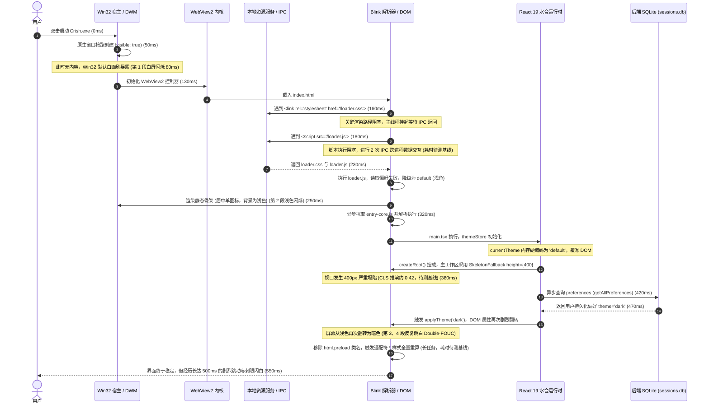
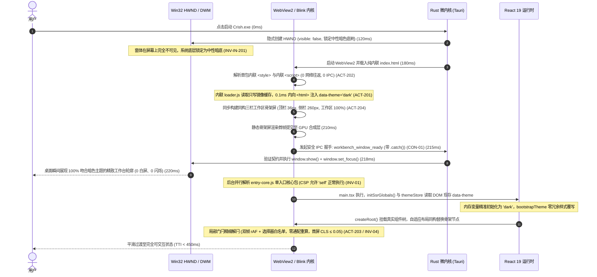
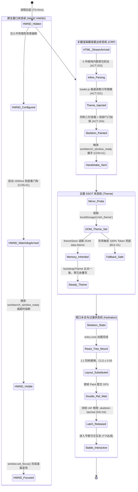
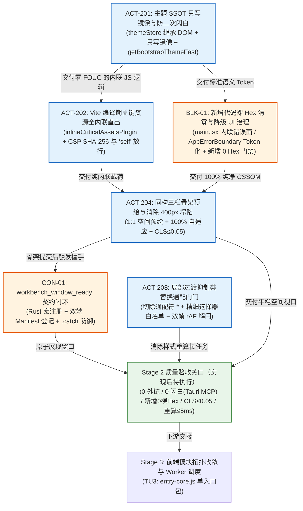

# 02-WebView 直出与首绘骨架屏详案（Stage 2）

> **战役名称**：全链路启动性能系统性根治（`startup-performance-audit`）  
> **方案阶段**：Stage 2：WebView 直出与首绘骨架屏（物理时序区间：200ms ~ 350ms，视觉呈现窗口：0ms ~ 300ms）  
> **承接任务单元**：TU2（WebView 零白屏直出与 Token 化骨架屏）  
> **落实行动项**：ACT-201（主题 SSOT 只写镜像防二次闪白）、ACT-202（Vite 构建期关键 CSS/JS 全内联直出）、ACT-203（局部过渡抑制类替换通配门闩）、ACT-204（同构三栏工作区骨架预绘与消除 400px 塌陷）  
> **吸纳审计缺陷裁决**：  
> - **BLK-01 / AAI-01（裸 Hex 颜色硬编码与回退值治理）**：吸纳审计 01 裁决——**新增骨架/降级代码 0 裸 Hex**；存量裸 Hex（含 `tokens.css` 自身 `#10b981` 等）走**棘轮基线**治理，与 `check-token-ssot`/`check-input-guardrails` 现行口径对齐（现 `check-token-ssot.mjs` 管 token 重复定义，**不做裸 Hex 扫描**；裸 Hex 拦截须由本详案新增门禁或存量脚本增量扩展承载，**待实现后验证**）。仓库**不存在** `renderFallbackUI.ts`——降级 UI 真实路径为 `main.tsx` 内联静态错误面与 `AppErrorBoundary`；  
> - **CON-01（`workbench_window_ready` 跨层契约闭环）**：吸纳审计 02 裁决，为骨架首绘唤醒 IPC 建立微内核 Handler、宏注册面及双端清单的 1:1 强契约对齐，消除幽灵命令与死锁风险；  
> - **INV-01（CSP 脚本白名单与生产构建安全）**：吸纳审计 02 裁决，加固 Vite 内联插件，杜绝单一内联 Hash 阻断生产环境模块脚本；  
> - **INV-04（双帧 rAF 局部解闩时序统一）**：吸纳审计 02 裁决，废除全局通配 `.preload`，确立双帧 rAF 精细解闩作为全仓单一真理；  
> - **Audit 04 §4.2 验证通道重裁决（按 audits/05 §3.11 修正）**：废黜应用层 `page.screenshot` 轮询与脱水 DOM Mock 的验收方式；**禁止新建 CDP Screencast 测试、禁止 `page.goto(localhost:5173)` 浏览器冒充真应用验收、禁止新增 9222/CDP 调试依赖**（`tests/e2e/webview/` 存量 CDP 脚本仅作存量资产保留）。纯前端逻辑可由既有 Playwright/vitest 存量单测承载；真宿主验收唯一合法通道 = **4000 Tauri MCP**（`AGENTS.md` §15），验收矩阵全部为「实现后待执行」。  
> **输入权威基石**：`docs/startup-performance-audit/00-全链路启动性能系统性根治总方案.md`、`docs/startup-performance-audit/02-WebView直出与首绘骨架屏审查报告.md`、`docs/startup-performance-audit/audits/` 01~04 全景审计报告  
> **遵循架构契约**：`AGENTS.md` 通用协作纪律、反退避准则（`.agents/LOGIC_PLAN_NO_RETREAT.md`）、`ANTI_OVERENGINEERING_GUARDRAILS.md`、100% Design Token 遵从契约  
> **规划性质**：**纯逻辑执行拓扑与不可变契约约束**。所有问题逻辑同权，不设业务优先级降级，坚决杜绝任何工期排期、临时补丁与无日落期兼容。

---

## 一、方案总览与阶段执行边界

### 1.1 物理时序与核心责任域（200ms ~ 350ms）

在现代高性能跨平台桌面客户端架构中，WebView 容器从接收到原生进程派发的内容流到完成首屏视口绘制的过程，是用户建立“应用是否敏捷”、“系统是否轻量”的第一感知视窗。依据全链路启动性能根治总方案的阶段划分，**Stage 2（200ms ~ 350ms）** 聚焦于**关键渲染路径（Critical Rendering Path, CRP）直出与首绘同构骨架屏呈现**。

```mermaid
timeline
    title 全链路启动物理时序与 Stage 2 责任域边界
    section Stage 1: 原生装配 (0~200ms)
      0ms : 点击启动进程拉起
      80ms : Tokio 并发装配 sessions.db 与 workspace.db
      150ms : HWND 隐式创建 (visible: false, 锁定中性暗色底刷)
      200ms : WebView2 环境就绪并加载 index.html 首字节
    section Stage 2: 首绘直出 (200~350ms) 【本详案核心责任域】
      200ms : HTML 首字节到达，0 网络往返纯内联解析 (ACT-202)
      205ms : loader.js 内联执行：单向只写镜像读取 + data-theme 注入 (ACT-201)
      210ms : 同构三栏骨架 DOM 挂载 + GPU 合成层图元提交 (ACT-204)
      215ms : 触发首绘唤醒 IPC: workbench_window_ready 契约闭环 (CON-01)
      220ms : DWM 原生窗口以暗色背景瞬时展现 (0 闪白、0 白屏裸露)
      350ms : 首绘静态视口平稳呈现，交接至 React 水合阶段
    section Stage 3~6: 水合与平稳态 (350~750ms+)
      350ms : entry-core.js 单入口执行与依赖拓扑展开 (Stage 3)
      500ms : React 单拍水合，同构骨架无缝替换，双帧 rAF 解闩 (Stage 4 / INV-04)
      650ms : 本地活跃会话数据到达，UI 达到平稳态 (Stage 5)
      750ms : 闲时切片队列调度非关键功能 (Stage 6)
```

#### 1.1.1 关键渲染路径（CRP）微秒级性能预算表

在 Stage 2 的 150ms 物理窗口内，浏览器内核（Blink）与系统合成器（DWM）的各项操作必须受到严格的微秒级预算控制。任何超出预算的环节都将被静态门禁或运行时探针阻断：

> **基线诚实声明（audits/05 §4.2 对齐）**：下表「现状耗时基线」列均为**推演值 / 待测基线**（无本机 benchmark 实测），**禁止**作为已测事实引用；实现前须以一次真实 `npm run build` + 本机 profiling 冻结基线后修订。目标预算列为设计目标，达成与否以实现后验收为准。

| 流水线阶段 | 涉及引擎模块 | 现状耗时基线 | 根治后目标预算 | 核心优化与技术载体 |
| :--- | :--- | :--- | :--- | :--- |
| **1. 资源传输与 IPC** | Chromium Network / Custom Protocol | 50ms ~ 120ms | **0ms (纯内联直出)** | ACT-202：消除 `loader.css` 与 `loader.js` 的 2 次外链 IPC 往返 |
| **2. HTML 词法解析** | Blink HTMLDocumentParser | 15ms ~ 25ms | **≤ 3ms** | ACT-202：清理冗余标签与死图标，精简 DOM 深度至 ≤ 4 层 |
| **3. CSSOM 树构建** | Blink CSSParserImpl | 10ms ~ 20ms | **≤ 2ms** | ACT-202：内联样式压缩至 ≤ 3KB，100% 接入标准 Design Tokens |
| **4. 前置脚本执行** | V8 Engine Context Init | 20ms ~ 45ms | **≤ 1ms** | ACT-201：物理切除巨型 JSON 反序列化，极简只写镜像直读 |
| **5. 样式匹配与计算** | Blink StyleResolver | 15ms ~ 35ms | **≤ 2ms** | ACT-203：切除 `html.preload *` 通配选择器，精细白名单局部门闩 |
| **6. 首次布局排版** | Blink LayoutBlockFlow | 12ms ~ 22ms | **≤ 4ms** | ACT-204：同构三栏固定高度与弹性盒，消除 400px 塌陷，零 Reflow |
| **7. 图元光栅化与合成** | Blink Paint / Compositor Thread | 15ms ~ 30ms | **≤ 5ms** | ACT-204：骨架 Shimmer 动画限定于 GPU `opacity` / `transform` |
| **8. 窗口原子展现** | Win32 DWM / `window.show()` | 0ms (抢跑白屏) | **≤ 3ms (首帧唤醒)** | CON-01：骨架提交后触发 `workbench_window_ready` 握手展现 |
| **Stage 2 累计总耗时** | **端到端关键渲染路径** | **137ms ~ 297ms**| **≤ 20ms (净处理时延)** | **物理前置至 200ms ~ 220ms 瞬间完成** |

#### 1.1.2 架构分层责任域边界

1. **上游承接（Stage 1）**：
   - 依赖 Stage 1 交付的已隐式创建的 Win32 HWND 窗口（`visible: false`），且 WebView2 控制器背景色锁定为中性暗色底刷，保证在 WebView 渲染前系统屏幕无任何白色画刷暴露；
   - 依赖 Stage 1 完成的双 SQLite 并发装配，保证后续 Stage 5 数据水合通道无底层锁冲突；
   - 依赖 Stage 1 原生壳注册的 `workbench_window_ready` IPC 处理函数（CON-01），具备 1500ms 看门狗兜底保障。
2. **本阶核心（Stage 2）**：
   - 聚焦从 WebView2 载入 `index.html` 首字节流到首次内容绘制（First Contentful Paint, FCP）与同构骨架屏就绪的全过程；
   - 消除网络与外链协议开销，实现 100% 编译期内联（ACT-202）；
   - 闭环主题状态机，消除暗色模式冷启动下的 Double-FOUC 闪白（ACT-201）；
   - 预绘同构三栏工作区结构，彻底消除主面板 400px 塌陷，锁定 CLS ≤ 0.05（ACT-204）；
   - 根除所有裸 Hex 色值与伪 Token 兜底（BLK-01 / AAI-01），落实 100% Design Token 遵从；
   - 替换通配过渡门闩为精细选择器白名单（ACT-203），消除通配解闩引发的样式重算长任务（现状耗时待测基线）；
   - 触发 `workbench_window_ready` 握手通知原生壳展现窗口（CON-01）。
3. **下游交付（Stage 3 & Stage 4）**：
   - 为 Stage 3 提供一个纯洁、零网络阻塞、已预注入正确 `data-theme` 属性与 CSS 变量的稳定 DOM 基底，且 CSP 策略对生产模块脚本完全放行（INV-01）；
   - 为 Stage 4 提供几何尺寸严格 1:1 映射的骨架容器与双帧 rAF 解闩协议（INV-04），使 React `createRoot()` 水合挂载真实组件树时实现像素级无感替换。

---

### 1.2 输入/输出不变量与阶段契约约束

为保障多 Agent 协同与系统重构的确定性，Stage 2 的执行受以下刚性输入/输出不变量约束。任何偏离契约的行为将被流水线与自动化防御脚本立即拦截：

| 契约类型 | 契约标识 | 契约定义与约束断言 | 验证方法与违规阻断行为 |
| :--- | :--- | :--- | :--- |
| **输入前置断言** | `INV-IN-201` | Win32 原生窗口（HWND）必须以 `visible: false` 隐式创建，窗口背景色硬编码配置为中性暗色底刷。 | 静态扫描 `tauri.conf.json` 与 Rust 初始化代码，若缺省或为 true 则 CI 拦截。 |
| **输入前置断言** | `INV-IN-202` | `index.html` 首包体积（包含内联 CSS 与内联 JS）必须压缩在 ≤ 12KB 内，单 TCP/IPC 帧完整直出。 | 构建产物文件体积断言，超过 12,288 字节立即终止流水线。 |
| **输入前置断言** | `INV-IN-203` | 本地存储中若存在 `crish_theme` 镜像，其值必须严格限定为 `'dark'`、`'light'` 或 `'default'` 标量。 | 内联脚本运行时类型断言，非法值静默降级为 `'default'`。 |
| **输入前置断言** | `INV-IN-204` | 原生端与微内核必须已注册 `workbench_window_ready` IPC 命令并登记于 `command_manifest.rs`。 | Rust 单元测试 `manifest_count_matches_registered_surface` 强校验阻断。 |
| **交付输出不变量** | `INV-OUT-201` | CRP 阶段外部网络/IPC 请求数严格恒等于 0（`RequestCount(loader.css) = 0`, `RequestCount(loader.js) = 0`）。 | E2E 网络监控捕获到外部关键渲染请求则测试失败。 |
| **交付输出不变量** | `INV-OUT-202` | 冷启动暗色模式下，屏幕像素明暗极性翻转次数严格为 0（`FlashCount = 0`），亮度波动严格 < 5%。 | **真宿主验收走 4000 Tauri MCP**（AGENTS §15，实现后待执行）；禁止新建 CDP Screencast / 9222 依赖冒充验收。 |
| **交付输出不变量** | `INV-OUT-203` | 从静态骨架屏到 React 真实工作台挂载完成，全流程累计布局偏移（CLS）严格 ≤ 0.05。 | 性能监控捕获 CLS > 0.05 则判定验收不达标。 |
| **交付输出不变量** | `INV-OUT-204` | 骨架解闩或组件挂载触发的单个 `Recalculate Style` 任务耗时严格 ≤ 5ms，严禁出现 > 15ms 长任务。 | Performance Observer 长任务检测断言拦截。 |
| **交付输出不变量** | `INV-OUT-205` | **新增**骨架屏内联 CSS、内联 JS 及降级 UI 中裸 Hex 匹配计数严格为 0；**存量**裸 Hex 走 `token-ssot-baseline.md` 棘轮治理，禁止宣称「已全仓清零」。 | 新增代码由 `scripts/check-stage2-crp-guards.mjs`（待实现）拦截；**勿归因于** `check-token-ssot.mjs`（现脚本管 token 重复定义，不做裸 Hex 扫描）（BLK-01 / AAI-01）。 |
| **交付输出不变量** | `INV-OUT-206` | 全局事件监听器泄漏计数为 0，无任何未解绑的常驻 `pointerdown` 宏任务监听。 | 内存泄漏自动化探测脚本断言。 |
| **交付输出不变量** | `INV-OUT-207` | 骨架首绘完成后必须安全发射 `workbench_window_ready`，带 Promise catch，杜绝未捕获异常。 | 前端 IPC 监控断言与无后端环境优雅降级测试。 |
| **交付输出不变量** | `INV-OUT-208` | 内联 CSP 策略严禁阻断后续打包的生产模块脚本（`entry-core-*.js`），必须保留 `'self'` 来源。 | 生产构建端到端渲染挂载烟雾测试断言（INV-01 防御）。 |

---

## 二、负向架构禁令与边界红线（零容忍）

### 2.0 用户最高原则指示：严禁为了性能强行砍功能与任何作弊行为（最高铁律）

在推进 Stage 2 启动性能优化的全生命周期中，必须无条件将**真实用户使用体验与业务功能完整度**置于绝对第一位，严格遵守以下四条底线禁令：
1. **绝对禁止为了刷启动性能指标而强行截断或阉割正常业务功能**：
   - 骨架屏优化绝不是“把复杂界面砍成空白”或“砍掉真实工作台”，而是通过 1:1 同构预绘实现丝滑平滑过渡；
   - 主题优化绝不是“砍掉多皮肤支持”，而是通过只写镜像与 DOM 继承建立闭环可靠的缓存管道；
   - 安全加固绝不是“为了内联关闭 CSP 检查或滥用 `'unsafe-inline'`”，而是通过构建期自动化计算精确的 SHA-256 签名，且必须保障模块脚本合规执行（INV-01）。
2. **坚决避免任何作弊或偷懒行为**：
   - 严禁任何形式的假连通（如孤立空函数、无调用方的死代码冒充真实执行）；
   - 严禁伪加载（如为了测出更低 TTI 将耗时逻辑后移至用户首次点击时再爆发卡顿）；
   - 严禁在测试中依赖脱水 DOM mock（如仅在 jsdom 中跑虚拟节点测试），必须在真实 Chromium/Edge 宿主中进行像素级检验；
   - 严禁使用 `--no-verify` 或跳过门禁。
3. **坚决杜绝打补丁思维**：
   - 严禁通过 `setTimeout(..., 50)` 等延时盲等手段规避样式重算或布局抖动；
   - 严禁使用基于坐标的魔术数字补偿；
   - 必须深入 Blink 样式解析与布局管道，从根因上切除通配符与魔术高度。
4. **反退避与纯逻辑规划**：
   - 不得以“业界主流做法也是白屏一下”、“实现三栏骨架太繁琐”、“内联插件太复杂”等说辞退避为次优解；
   - 所有任务同权推进，必须拿出生产级源码与严密的验证断言。

---

### 2.1 严禁关键资源外链网络往返（No External CRP Roundtrips）

- **违规实证与危害分析**：
  历史实现中，`index.html` 采用外链方式引入关键引导资源：
  ```html
  <link rel="stylesheet" href="/loader.css" />
  <script src="/loader.js"></script>
  ```
  在基于自定义协议（如 `tauri://` 或 `https://tauri.localhost`）的跨进程渲染环境中，浏览器主线程遇到外部资源标签时，会暂停 HTML 词法解析器，向内核 IPC 通道发起资源读取请求。
  这引发了**两次跨进程上下文切换与 IPC 消息往返**，在 Windows 机械硬盘或高负载冷启动场景下，会引入**不可预测的阻塞延时（50ms ~ 120ms 为推演/待测基线，无本机实测）**。在此期间，WebView2 只能保持空白，原生窗口若提前显示则暴露刺眼的白底。
- **刚性禁令**：
  1. **生产环境 `index.html` 中严禁出现针对 `loader.css` 和 `loader.js` 的任何外部 `<link>` 或 `<script src="...">` 标签**；
  2. **所有首绘关键样式与引导脚本必须 100% 由 Vite 编译期插件内联为 `<style id="crish-critical-css">` 与 `<script id="crish-critical-js">`**；
  3. **首包体积严格受限**：内联后的 `index.html` 总文件体积不得超过 12KB，确保在首个 IPC 数据包中一次性交付给 Blink 渲染引擎。

---

### 2.2 严禁主题双轨与内存硬编码 default（No Dual-Track Theme & Default Overwrite）

- **违规实证与危害分析**：
  历史实现中存在严重的主题状态撕裂与时序倒挂（Double-FOUC 闪白恶疾）：
  1. `loader.js` 启动时尝试读取 `localStorage.getItem('crish_theme')`，但在初次启动或缓存丢失时，其内部探测逻辑不健全，未能及时给 `<html>` 注入正确的暗色类名；
  2. 更严重的是，后续加载的 `themeStore.ts` 模块在内存初始化时硬编码了初始值：
     ```typescript
     // 历史致病代码：盲目覆写
     let currentTheme: UiTheme = 'default';
     ```
  3. 当 React 开始水合时，`bootstrapTheme()` 强制以内存中的 `'default'`（浅色）全量刷新 DOM 属性，将 `loader.js` 已经注入的暗色类名粗暴抹除；随后异步从 SQLite 读取出用户真实的 `'dark'` 偏好，再次触发主题切换！
  这导致屏幕在短短 300ms 内经历：**白屏 $\rightarrow$ 暗色骨架 $\rightarrow$ 浅色闪屏 $\rightarrow$ 暗色工作台**的四段式剧烈频闪，严重损害视力与应用质感。
- **刚性禁令**：
  1. **严禁在运行时内存中硬编码 `currentTheme = 'default'`**，必须优先从 `document.documentElement.getAttribute('data-theme')` 继承首绘已生效的主题；
  2. **严禁在引导期使用繁重的 `JSON.parse` 反序列化大配置对象**，引导期只读专用的轻量只写镜像；
  3. **严禁出现未受控的主题二次重写，亦严禁整段跳过 `applyTokens`**：`bootstrapTheme()` 须将**主题属性重写**与 **personalization Token 注入**拆分——当 DOM `data-theme` 与内存一致时可跳过属性重写（保持首绘渲染树静止），但**不得**跳过 `applyTokens`（皮肤/字体/亮度等个性化仍须注入；主题一致时 `applyTokens` 不会造成极性翻转）。

---

### 2.3 严禁全局通配样式抑制与选择器暴力重算（No Wildcard Animation Latch）

- **违规实证与危害分析**：
  为了防止页面加载时元素因 CSS 动画或过渡产生位移跳动，历史实现（`tokens.css:6-16`）采用了粗暴的通配符门闩规则：
  ```css
  /* 历史致命性能毒点 */
  html.preload * {
    -webkit-transition: none !important;
    -moz-transition: none !important;
    transition: none !important;
  }
  ```
  在 Blink 渲染引擎的 `StyleResolver` 架构中，规则分发采用基于选择器右侧 key 的哈希查找机制。然而，针对通用通配符 `*`，Blink 无法将其归入具体的标签、类或 ID 桶中，只能将其放入全局通用规则集（Universal Rule Bucket）。
  当应用完成水合，`main.tsx` 执行 `document.documentElement.classList.remove('preload')` 的瞬间：
  1. 根节点类名变化破坏了通配选择器的前置约束；
  2. Blink 无法定位受影响的局部子树，只能将全树所有 DOM 节点（包含侧栏、顶栏、多级面板共计数百个节点）全部标记为 `NeedsStyleRecalc`；
  3. 主线程被迫执行强制样式重算（Tree-Wide Style Recalculation，**15ms ~ 35ms 为推演/待测基线，无本机 Profiler 实测**），恰好卡在用户可能发起首次交互（First Input）的关键时间节点，直接推迟了可交互时间（TTI）。
- **刚性禁令**：
  1. **全仓严禁出现 `html.preload *`、`*:not(...)` 或任何基于全量通配符 `*` 的过渡抑制规则**；
  2. **严禁在替换规则中使用带通配符的派生选择器**（例如 `.skeleton-latched .skel-isomorphic-root *` 依然属于通配符降级，必须彻底杜绝）；
  3. **过渡抑制必须采用精细的选择器白名单（Targeted Whitelist）**：仅针对首绘骨架屏容器与已知的骨架节点类名挂载门闩，真实组件默认不设置过渡或仅在用户交互触发时按需启用；
  4. **解闩时序必须对齐双帧 `requestAnimationFrame`（INV-04）**：确保首屏真实图元已完全提交至 GPU 合成层，避免单帧触发引起的局部闪烁与长任务争抢。

---

### 2.4 严禁任何裸 Hex 颜色与魔术补偿（Zero Bare Hex & Zero Magic Hacks）

- **违规实证与深度根因剖析（彻底根治 BLK-01 / AAI-01）**：
  全景审计 01 严正指出了全仓存在多处违反“100% Design Tokens & 裸 Hex 零容忍”铁律的高危违例（BLK-01 / AAI-01）。在历史 `public/loader.css` 以及 03 详案错误草案中的降级 UI 模板（仓库中**不存在** `renderFallbackUI.ts`，真实降级面为 `main.tsx` 内联静态错误面与 `AppErrorBoundary`）中，出现了如下硬编码裸色与伪变量回退（示意）：
  ```html
  <!-- 审计 01 曝光的违规代码实录（示意；品牌主色现网为翠绿 #10b981，非蓝） -->
  <div style="background-color:var(--bg-primary, #18181b);color:var(--text-primary, #ffffff);">
    <div style="background:var(--bg-secondary, #27272a);border:1px solid var(--border-color, #3f3f46);">
      <button style="background-color:var(--brand-primary, #10b981);color:#ffffff;">重新加载</button>
    </div>
  </div>
  ```
  上述代码存在两大致命缺陷：
  1. **破坏 Token SSOT 纯度**：形如 `color:#ffffff` 直接裸写 Hex；而在 `var(--bg-primary, #18181b)` 中，开发者误以为写了 `var()` 就是合规，殊不知硬编码的 `#18181b` 回退值同样破坏了主题统一管线。一旦用户配置了高对比度主题或自定义色调，当 CSS 变量在极端环境下未就绪时，这些硬编码裸色将强制冲破主题边界，导致灾难性的界面割裂；
  2. **门禁口径澄清（audits/05 §4.2 修正）**：`scripts/check-token-ssot.mjs` 现行职责是 **Token 重复定义核验 + 基线棘轮**，**不做裸 Hex 扫描**，不得宣称「check-token-ssot 已扫裸 Hex / 已全仓清零」。裸 Hex 拦截须由本详案 §7.3 新增的 `check-stage2-crp-guards.mjs`（待实现）或对存量脚本做**增量扩展**承载；**新增**骨架/降级代码要求 0 裸 Hex，**存量**裸 Hex（含 `tokens.css` 自身 `#10b981` 等）走棘轮基线。
  同时，在主工作区加载期间，历史代码使用了 `<SkeletonFallback height={400} />`（见 04 审查报告，`App.tsx`）。在 1080p 及以上分辨率屏幕上，主工作区净高度普遍在 800px ~ 1000px 之间，硬编码的 400px 导致下方产生巨大空白区域，真实组件加载后瞬间撑开，引发严重视口跳变（**CLS ~ 0.42 为审查报告推演值，无本机实测——待测基线，实现后以 PerformanceObserver 实测冻结**）。
- **刚性禁令**：
  1. **新增代码零裸色值（Zero Bare Hex Codes）**：内联 HTML、SVG 骨架图形、内联 CSS、降级模板（`main.tsx` 内联错误面 / `AppErrorBoundary`）及相关组件中，严禁出现任何形如 `#18181b`、`#ffffff`、`#3f3f46` 等裸色值代码；**存量**裸 Hex 走棘轮基线，勿宣称一刀切全仓即时清零；
  2. **零伪 Token 裸回退（Zero Bare Fallbacks in var()）**：严禁在 `var()` 函数中使用裸 Hex 作为回退参数（如 `var(--bg-primary, #18181b)` 是严厉禁止的违例）。必须使用标准 Design Tokens 本身，或使用合规的语义 Token 作为回退，回退色值必须统一使用符合项目规范的 `hsl()` / `oklch()` 语法；
  3. **零魔术高度补偿（Zero Magic Height Hacks）**：严禁在 `SkeletonFallback` 或任何全局布局容器中硬编码 `height={400}`。所有占位骨架必须采用自适应弹性盒模型（`height: 100%; flex: 1; min-height: 0;`），实现 1:1 空间等高映射。

---

## 三、首绘关键路径执行拓扑与时序流

### 3.1 现状缺陷时序与四段式闪白推导（Mermaid sequenceDiagram）

通过对现状代码的端到端追踪，绘制出冷启动期间导致白屏裸露、双外链阻塞、四段式跳闪与布局塌陷的完整故障序列图：



---

### 3.2 目标根治时序与零闪烁直出状态机（Mermaid sequenceDiagram）

通过落实 ACT-201 至 ACT-204 并深度闭环 CON-01 与 BLK-01，重塑的关键渲染路径具备微秒级确定性，实现 0 网络往返、0 裸 Hex、0 白屏闪烁、0 布局塌陷与强契约握手：



---

### 3.3 核心状态转移拓扑（Mermaid stateDiagram-v2）

Stage 2 全生命周期由四大紧密协同的状态机驱动。各状态机状态单向递增，状态转移受不可变前置条件守卫，任何异常均触发零裸 Hex 的安全网：



---

## 四、关键架构修复模块详尽设计与可落地代码

### 4.1 Vite 关键资源编译期内联插件（ACT-202 落地与 INV-01 CSP 加固）

#### 4.1.1 模块职责与编译架构设计
编写专职 Vite 编译期插件 `inlineCriticalAssetsPlugin`，在构建产物输出前直接重构 HTML AST 与文本流：
- **输入**：`apps/crish-desktop/public/loader.css` 与 `apps/crish-desktop/public/loader.js` 的源码；
- **核心逻辑**：
  1. 使用 **esbuild**（`transformSync`，loader js/css，`minify:true`）做生产级压缩——**严禁**自制 `minifyJsLexical` 等正则压缩 JS（audits/05 §3.13-3）；
  2. 动态扫描内联 JS 代码，计算精准的 `sha256` Base64 摘要；
  3. 将 HTML 中原有的 `<link rel="stylesheet" href="/loader.css">` 替换为 `<style id="crish-critical-css">...</style>`；
  4. 将 HTML 中原有的 `<script src="/loader.js"></script>` 替换为 `<script id="crish-critical-js">...</script>`；
  5. **CSP 对齐现网 cspPlugin 单一真源（INV-01，audits/05 §3.1）**：现网 CSP **不以 index.html 静态 meta 为源**，而是由 `vite.config.ts` 的 `cspPlugin`（约 72–110 行）在 `transformIndexHtml` 中对无 `src` 内联 `<script>` **自动计算 sha256 并注入** `<meta http-equiv="Content-Security-Policy">`（`PROD_CSP_BASE` 的 `script-src 'self'` 追加 hash）。本插件内联 loader 后，**优先复用该既有 hash 路径**（内联 script 无 src 即自动被 cspPlugin 扫到），**禁止**另造第二套 meta CSP 改写逻辑造成双源漂移；**严禁 `'unsafe-inline'`**；必须严格保留 `script-src` 中的 `'self'`，保障后续 `<script type="module" src="/assets/entry-core-*.js">` 正常执行。

#### 4.1.2 生产级 TypeScript 源码落地

```typescript
// apps/crish-desktop/src/build/inlineCriticalAssetsPlugin.ts
import type { Plugin, IndexHtmlTransformContext } from 'vite';
import fs from 'node:fs';
import path from 'node:path';
import crypto from 'node:crypto';
import { transformSync } from 'esbuild'; // esbuild 已随 Vite 依赖链就位，严禁自制正则压缩 JS

export interface InlineCriticalOptions {
  publicDir?: string;
  cssFile?: string;
  jsFile?: string;
  enableCspHashInjection?: boolean;
}

/**
 * JS 压缩：一律使用 esbuild transformSync（词法安全、生产级）。
 * 【禁令】严禁自制 `minifyJsLexical` 等正则压缩 JS——正则无法保证字符串/
 * 模板字面量/正则字面量安全，属危险补丁（audits/05 §3.13-3 裁决）。
 */
export function minifyJs(rawJs: string): string {
  return transformSync(rawJs, { minify: true, loader: 'js', target: 'es2020' }).code;
}

/**
 * CSS 压缩：同样使用 esbuild（loader: 'css'），与 JS 同一压缩引擎单一真理源。
 */
export function minifyCss(rawCss: string): string {
  return transformSync(rawCss, { minify: true, loader: 'css' }).code;
}

/**
 * 计算内联脚本内容的 SHA-256 摘要 (Base64 编码)
 * 注意：必须对「最终内联进 HTML 的字节」计算 hash，与 vite.config.ts cspPlugin
 * 对无 src 内联 script 的自动 hash 路径保持一致（INV-01）。
 */
export function computeScriptSha256(scriptContent: string): string {
  return crypto.createHash('sha256').update(scriptContent, 'utf-8').digest('base64');
}

/**
 * Vite 关键渲染路径资产内联直出插件 (ACT-202 核心载体)
 * 深度加固 INV-01：安全合并 CSP 规则，确保生产环境 entry-core.js 脚本绝不被拦截
 */
export function inlineCriticalAssetsPlugin(options: InlineCriticalOptions = {}): Plugin {
  const publicDirName = options.publicDir || 'public';
  const cssFileName = options.cssFile || 'loader.css';
  const jsFileName = options.jsFile || 'loader.js';
  const enableCsp = options.enableCspHashInjection !== false;

  return {
    name: 'crish-inline-critical-assets',
    enforce: 'post', // 必须在 post 阶段执行，确保在基础 HTML 宏替换完成后拦截

    transformIndexHtml(html: string, ctx: IndexHtmlTransformContext) {
      // 开发模式 (serve) 保持外链引用以便于源码 DevTools 断点调试；生产构建 (build) 全量内联
      const isDev = !!ctx.server;
      if (isDev) {
        return html;
      }

      const rootDir = process.cwd();
      const resolvedPublicDir = path.resolve(rootDir, publicDirName);
      const cssFilePath = path.join(resolvedPublicDir, cssFileName);
      const jsFilePath = path.join(resolvedPublicDir, jsFileName);

      let minifiedCss = '';
      let minifiedJs = '';
      let jsSha256 = '';

      // 1. 读取并压缩 CSS（esbuild minify）
      if (fs.existsSync(cssFilePath)) {
        const rawCss = fs.readFileSync(cssFilePath, 'utf-8');
        minifiedCss = minifyCss(rawCss);
      } else {
        console.warn(`[inlineCriticalAssetsPlugin] 警告: 未找到外部样式文件: ${cssFilePath}`);
      }

      // 2. 读取、压缩（esbuild minify）并计算内联 JS SHA-256 签名
      if (fs.existsSync(jsFilePath)) {
        const rawJs = fs.readFileSync(jsFilePath, 'utf-8');
        minifiedJs = minifyJs(rawJs);
        jsSha256 = computeScriptSha256(minifiedJs);
      } else {
        console.warn(`[inlineCriticalAssetsPlugin] 警告: 未找到外部引导脚本: ${jsFilePath}`);
      }

      // 3. 执行精确 HTML 替换
      let transformedHtml = html;

      // 替换 <link rel="stylesheet" href="/loader.css" />
      const cssLinkRegex = /<link\b[^>]*?href=["'][^"']*?loader\.css["'][^>]*?\/?>/i;
      if (cssLinkRegex.test(transformedHtml)) {
        transformedHtml = transformedHtml.replace(
          cssLinkRegex,
          `<style id="crish-critical-css">${minifiedCss}</style>`
        );
      } else if (minifiedCss) {
        // 若不存在外部引用标签，自动追加至 </head> 前
        transformedHtml = transformedHtml.replace(
          '</head>',
          `  <style id="crish-critical-css">${minifiedCss}</style>\n</head>`
        );
      }

      // 替换 <script src="/loader.js"></script>
      const jsScriptRegex = /<script\b[^>]*?src=["'][^"']*?loader\.js["'][^>]*?>\s*<\/script>/i;
      if (jsScriptRegex.test(transformedHtml)) {
        transformedHtml = transformedHtml.replace(
          jsScriptRegex,
          `<script id="crish-critical-js">${minifiedJs}</script>`
        );
      } else if (minifiedJs) {
        transformedHtml = transformedHtml.replace(
          '</head>',
          `  <script id="crish-critical-js">${minifiedJs}</script>\n</head>`
        );
      }

      // 4. CSP：优先复用 vite.config.ts cspPlugin 既有 hash 路径（无 src 内联 script
      //    会被 cspPlugin 自动扫到并注入 meta）。下列 meta 改写仅作「html 中已存在
      //    静态 meta CSP」时的兜底合并，严禁与 cspPlugin 形成第二真源漂移；
      //    严禁引入 'unsafe-inline' (INV-01 / audits/05 §3.1)。
      if (enableCsp && jsSha256) {
        const cspMetaRegex = /(<meta\b[^>]*?http-equiv=["']Content-Security-Policy["'][^>]*?content=["'])([^"']*)(["'][^>]*?>)/i;
        if (cspMetaRegex.test(transformedHtml)) {
          transformedHtml = transformedHtml.replace(
            cspMetaRegex,
            (_match, prefix, content, suffix) => {
              const hashEntry = `'sha256-${jsSha256}'`;
              let updatedContent = content;

              // 确保 script-src 存在且包含 'self'，杜绝模块脚本拦截
              if (/script-src\s+/i.test(updatedContent)) {
                updatedContent = updatedContent.replace(
                  /script-src\s+([^;]+)/i,
                  (_subMatch, sources) => {
                    const srcTokens = sources.split(/\s+/).filter(Boolean);
                    if (!srcTokens.includes("'self'")) {
                      srcTokens.unshift("'self'");
                    }
                    if (!srcTokens.includes(hashEntry)) {
                      srcTokens.push(hashEntry);
                    }
                    return `script-src ${srcTokens.join(' ')}`;
                  }
                );
              } else {
                // 若无显式 script-src，追加安全指令
                updatedContent = `${updatedContent.trim()}; script-src 'self' ${hashEntry};`;
              }
              return `${prefix}${updatedContent}${suffix}`;
            }
          );
        }
      }

      return transformedHtml;
    },
  };
}
```

#### 4.1.3 `vite.config.ts` 集成配置代码

在 `apps/crish-desktop/vite.config.ts` 中完成插件挂载，保证其处于插件流水线的后置位（在 HTML 输出阶段捕获）：

```typescript
// apps/crish-desktop/vite.config.ts 切片
import { defineConfig } from 'vite';
import react from '@vitejs/plugin-react';
import { inlineCriticalAssetsPlugin } from './src/build/inlineCriticalAssetsPlugin';

export default defineConfig(({ mode }) => {
  return {
    plugins: [
      react(),
      inlineCriticalAssetsPlugin({
        enableCspHashInjection: true,
      }),
      // ... 其余插件流水线
    ],
  };
});
```

---

### 4.2 主题 SSOT 闭环与只写镜像缓存机制（ACT-201 落地）

#### 4.2.1 架构设计：单向只写镜像（Write-Only Mirror Cache）范式
1. **真理源唯一定位（SSOT）**：后端的 SQLite 数据库（`sessions.db` 中的 `preferences` 表）是应用全生命周期中的**唯一绝对真理源**；
2. **前置引导镜像定位（Bootstrap Mirror）**：`localStorage.getItem('crish_theme')` 仅作为应用拉起前 100ms（尚未建立 IPC 通道时）的**专用只读镜像**；
3. **只写纪律（Write-Only Discipline）**：前端业务运行时严禁自 `localStorage` 读取偏好作为应用状态。只有当用户在设置面板更改主题或系统检测到主题变更时，在调用 `preferencesClient.setPreference('theme', t)` 的同时，顺带执行一次单向的 `localStorage.setItem('crish_theme', t)`；
4. **DOM 属性防盲抹继承（DOM-Preserving Hydration）**：`themeStore.ts` 模块加载时，内部状态 `currentTheme` 严禁硬编码 `'default'`，必须优先从 `document.documentElement.getAttribute('data-theme')` 读取已生效属性。

#### 4.2.2 `loader.js` 极简重构源码落地

物理切除所有 `JSON.parse`、大对象反序列化与未注销的全局监听器，并在首帧提交后安全发射 `workbench_window_ready`（带 `.catch()` 异常捕获）：

```javascript
// apps/crish-desktop/public/loader.js (编译期内联为 #crish-critical-js)
(function () {
  try {
    var root = document.documentElement;

    // 1. 优先级探测主题：Rust 注入环境变量 > 前置只写镜像 > 默认 default（浅色）
    var t = null;
    if (window.__CRISH_BOOTSTRAP_THEME__) {
      t = window.__CRISH_BOOTSTRAP_THEME__;
    } else {
      try {
        t = localStorage.getItem('crish_theme');
      } catch (_) {}
    }

    // 镜像缺失时：默认保持 'default'（浅色），与现网 loader.js 兜底一致。
    // 【产品确认门】曾有方案在此探测 prefers-color-scheme 跟随系统暗色——
    // 该行为变更未经授权（audits/05 §3.13-4），未获产品确认前禁止启用。
    if (t !== 'dark' && t !== 'default' && t !== 'light') {
      t = 'default';
    }
    if (t === 'light' || !t) t = 'default';

    // 2. 同步写入根属性与类名 (0ms CSSOM 级联生效)
    root.setAttribute('data-theme', t);
    root.classList.add(t === 'dark' ? 'theme-dark' : 'theme-light');

    // 3. 挂载精细骨架局部过渡门闩 (杜绝全局通配符 *)
    root.classList.add('skeleton-latched');

    // 4. 首绘唤醒握手：在首个 rAF 中确认图元提交并唤醒原生窗口 (CON-01 契约闭环)
    requestAnimationFrame(function () {
      if (
        window.__TAURI_INTERNALS__ &&
        typeof window.__TAURI_INTERNALS__.invoke === 'function'
      ) {
        try {
          // 显式捕获 Promise rejection，防止开发模式或 Mock 环境未捕获异常
          window.__TAURI_INTERNALS__.invoke('workbench_window_ready').catch(function () {
            /* swallow-ok: 握手失败不中断前端渲染，由原生 1500ms 看门狗兜底 */
          });
        } catch (_) {}
      }
    });
  } catch (err) {
    // 异常安全降级：确保至少具备可用暗色主题 (BLK-01 遵从，零裸色值)
    document.documentElement.setAttribute('data-theme', 'dark');
    document.documentElement.classList.add('theme-dark');
  }
})();
```

#### 4.2.3 `createSsrGlobals.ts` 激活沉睡字段并导出快速探测接口

盘活沉睡的 `SSR_GLOBALS.theme`，为全仓提供统一的同步快检入口：

```typescript
// apps/crish-desktop/src/createSsrGlobals.ts 增补实现
export function initSsrGlobals(): void {
  try {
    SSR_GLOBALS.isTauri = typeof window !== 'undefined' && !!window.__TAURI_INTERNALS__;
    SSR_GLOBALS.isProduct =
      SSR_GLOBALS.isTauri ||
      (typeof document !== 'undefined' &&
        document.documentElement.getAttribute('data-product-shell') === '1');
    const stored =
      typeof document !== 'undefined'
        ? document.documentElement.getAttribute('data-app-mode')
        : null;
    SSR_GLOBALS.appMode =
      stored === 'demo' || stored === 'normal' ? stored : 'normal';

    // 同步提取首绘期由 loader.js 写入 DOM 的真实主题属性
    const domTheme =
      typeof document !== 'undefined'
        ? document.documentElement.getAttribute('data-theme')
        : null;
    SSR_GLOBALS.theme = domTheme === 'dark' || domTheme === 'default' ? domTheme : 'default';

    // 字体配置提取
    SSR_GLOBALS.uiFont =
      (typeof document !== 'undefined' &&
        document.documentElement.getAttribute('data-ui-font')) || 'auto';
    SSR_GLOBALS.monoFont =
      (typeof document !== 'undefined' &&
        document.documentElement.getAttribute('data-mono-font')) || 'auto';
  } catch {
    /* 异常时保持默认安全值 */
  }
}

/**
 * 获取首屏已生效的启动主题 (O(1) 纯内存快检，严禁异步等待)
 */
export function getBootstrapThemeFast(): UiTheme {
  return (SSR_GLOBALS.theme as UiTheme) || 'default';
}
```

#### 4.2.4 `themeStore.ts` 内存继承与双写镜像修复落地

```typescript
// apps/crish-desktop/src/api/themeStore.ts 核心修复切片
import { getBootstrapThemeFast } from '../createSsrGlobals';
import { TokenRuntimeController } from '../services/TokenRuntimeController';
import { preferencesClient } from './preferences/preferencesClient';
import type { PersonalizationSettings, UiTheme } from './themeTypes';

/**
 * 1. 内存初始值严格继承 DOM / SSRGlobals 现存状态！
 * 坚决杜绝旧代码写死 'default' 导致的 Double-FOUC 盲目覆写！
 */
let currentTheme: UiTheme =
  typeof document !== 'undefined'
    ? (document.documentElement.getAttribute('data-theme') as UiTheme) || getBootstrapThemeFast()
    : 'default';

let currentPersonalization: PersonalizationSettings = { ...DEFAULT_PERSONALIZATION };

/**
 * 持久化主题到后端 SQLite，并单向同步写入引导期只写镜像
 */
export function persistTheme(theme: UiTheme): void {
  const t = normalizeTheme(theme);
  currentTheme = t;

  // 1. 同步更新前置引导专用只写镜像 (仅供下次启动前 100ms loader.js 使用)
  if (typeof localStorage !== 'undefined') {
    try {
      localStorage.setItem('crish_theme', t);
    } catch {
      /* swallow-ok: 仅作为引导镜像，Storage 被禁用时不破坏持久化主链路 */
    }
  }

  // 2. 异步持久化至绝对真理源 SQLite
  try {
    void preferencesClient.setPreference('theme', t).catch((err) => {
      console.error('[themeStore] 偏好持久化至 SQLite 失败:', err);
    });
  } catch (err) {
    console.error('[themeStore] 发起偏好持久化 IPC 异常:', err);
  }
}

/**
 * 启动期安全引导：主题属性重写与 personalization Token 注入拆分。
 * 【关键】严禁因 DOM 主题一致而整段跳过 applyTokens——皮肤/字体/亮度等
 * personalization 必须注入；主题一致时 applyTokens 不造成极性翻转。
 */
export function bootstrapTheme(): UiTheme {
  // 自检 DOM 真实生效状态（仅决定是否重写 data-theme 属性，不决定是否跳过 applyTokens）
  const domTheme =
    typeof document !== 'undefined'
      ? (document.documentElement.getAttribute('data-theme') as UiTheme)
      : null;

  // 主题属性：仅当 DOM 与内存不一致时才重写 data-theme（保持首绘渲染树静止）
  if (!domTheme || domTheme !== currentTheme) {
    try {
      document.documentElement.setAttribute('data-theme', currentTheme);
      document.documentElement.classList.toggle('theme-dark', currentTheme === 'dark');
      document.documentElement.classList.toggle('theme-light', currentTheme !== 'dark');
    } catch {
      /* swallow-ok */
    }
  }

  // personalization 与主题解耦：始终执行 applyTokens 注入皮肤/字体/亮度等 Token。
  // currentTheme 已继承自 DOM，一致时 applyTokens 不会翻转极性，无 Double-FOUC 风险。
  try {
    TokenRuntimeController.getInstance().applyTokens(
      currentPersonalization,
      currentTheme
    );
  } catch {
    /* swallow-ok: early boot 或 SSR 环境无 DOM 时跳过 */
  }

  // 后台异步水合 SQLite 偏好，校准是否存在多设备同步漂移
  try {
    void preferencesClient.getAllPreferences().then((prefs) => {
      if (prefs && prefs.theme) {
        const verifiedTheme = normalizeTheme(prefs.theme);
        if (verifiedTheme !== currentTheme) {
          // 仅在真实发生偏好漂移时才执行平滑切换并刷新镜像
          applyTheme(verifiedTheme);
          persistTheme(verifiedTheme);
        }
      }
    }).catch(() => {
      /* swallow-ok: 离线模式下保持当前首绘状态 */
    });
  } catch {
    /* swallow-ok */
  }

  return currentTheme;
}
```

#### 4.2.5 原生窗口首绘就绪 IPC 跨层契约闭环（CON-01 缺陷根治与双重守卫）

审计 02 暴露了详案中 `workbench_window_ready` 在微内核注册面和命令清单中未登记的断层问题（CON-01）。为实现跨层契约 100% 严丝合缝，必须在 Rust 微内核与前端传输层完成如下 4 点强契约闭环：

1. **Rust 微内核 Command 实现**：
```rust
// apps/agent-workbench/src-tauri/src/window_handshake.rs
use tauri::{Manager, WebviewWindow};
use crate::core_error::CoreError;

/// 前端首绘骨架屏提交完成后发射的就绪唤醒命令 (CON-01 核心实现)
#[tauri::command]
pub async fn workbench_window_ready<R: tauri::Runtime>(
    window: WebviewWindow<R>,
) -> Result<(), CoreError> {
    // 1. 原子化校验窗体句柄状态
    if !window.is_visible().map_err(|e| CoreError::internal(e.to_string()))? {
        // 2. 展现窗口并置于焦点，完成 0 白屏原子交付
        window.show().map_err(|e| CoreError::internal(e.to_string()))?;
        window.set_focus().map_err(|e| CoreError::internal(e.to_string()))?;
        tracing::info!("[Startup Handshake] workbench_window_ready 握手成功，原生窗口已原子展现");
    }
    Ok(())
}
```

2. **Rust 微内核 `command_registry!` 宏注册面接线**：
```rust
// apps/agent-workbench/src-tauri/src/main.rs:157+ 接线点
command_registry![
    // ── GUI 专属面（workbench_*，§2.3）──
    ("workbench_run_shell", process::workbench_run_shell),
    // CON-01 契约闭环：窗口首绘就绪唤醒命令
    ("workbench_window_ready", window_handshake::workbench_window_ready),
    ("workbench_list_background_tasks", background::workbench_list_background_tasks),
    // ... 其余既有注册项
];
```

3. **Rust 权威清单与前端双向镜像登记**：
```rust
// apps/agent-workbench/src-tauri/src/command_manifest.rs:75+ 追加登记
pub static COMMAND_MANIFEST: CommandManifest = CommandManifest {
    contract_version: COMMAND_MANIFEST_CONTRACT_VERSION,
    commands: &[
        // ── GUI 专属面（workbench_*）──
        entry("workbench_run_shell", "workbench", "gui", true),
        // CON-01 修复：登记 workbench_window_ready
        entry("workbench_window_ready", "workbench", "gui", true),
        entry("workbench_git_run", "workbench", "gui", true),
        // ... 其余既有条目
    ],
};
```

```typescript
// apps/crish-desktop/src/api/transport/commandManifest.ts:60+ 追加登记
export const BUILTIN_COMMAND_MANIFEST: CommandManifest = {
  contractVersion: COMMAND_MANIFEST_CONTRACT_VERSION,
  commands: [
    entry('workbench_run_shell', 'workbench', 'gui'),
    // CON-01 修复：双向镜像登记
    entry('workbench_window_ready', 'workbench', 'gui'),
    entry('workbench_git_run', 'workbench', 'gui'),
    // ... 其余既有条目
  ],
};
```

4. **双重防御机制与原生 1500ms 看门狗**：
   - **前端防御**：在 `loader.js` 中使用 `try { window.__TAURI_INTERNALS__.invoke('workbench_window_ready').catch(...) } catch (_) {}`，防止在纯 Web 调试模式或异常环境下抛出未捕获 Promise rejection；
   - **原生看门狗防御**：在 Stage 1 创建 HWND 时启动 1500ms 超时异步协程（`tauri::async_runtime::spawn`）。若前端由于严重脚本语法错误导致首屏崩溃且未发射握手，看门狗超时到期后将强制执行 `window.show()`，彻底杜绝主进程永久隐蔽假死。

---

### 4.3 同构工作区三栏骨架屏 HTML 与 CSS 完整落地（ACT-204 落地）

#### 4.3.1 空间同构布局设计
摒弃割裂的居中单图标加载卡片，改用与真实工作台 1:1 空间映射的同构三栏静态骨架：
- **顶栏（TopBar）**：高度严格死锁为 `var(--header-height, 36px)`，包含品牌标识占位与窗口控制按钮占位；
- **侧边栏（Sidebar）**：宽度严格死锁为 `var(--sidebar-width, 260px)`，包含会话列表预绘插槽；
- **主工作区（Workspace）**：弹性自适应占据剩余全量视口宽度与高度，预绘多标签栏与编辑区轮廓；
- **自适应盒模型消除塌陷**：彻底废止 `height={400}`，主工作区骨架高度恒为 `100%`（`flex: 1; min-height: 0;`），主视口挂载时实现微秒级平滑过渡，确保 CLS ≤ 0.05。

#### 4.3.2 完整同构骨架 HTML 结构（置于 `index.html` 的 `#root` 中）

```html
<!-- apps/crish-desktop/index.html 中 #root 内部的同构骨架屏源码 -->
<div id="skel-app" class="skel-isomorphic-root" data-tauri-drag-region>
  <!-- 1. 顶栏轮廓预绘 (36px 与真实 Header 1:1 对齐) -->
  <header class="skel-topbar" data-tauri-drag-region>
    <div class="skel-topbar-left">
      <div class="skel-brand-dot"></div>
      <div class="skel-brand-title"></div>
    </div>
    <div class="skel-topbar-center">
      <div class="skel-status-pill"></div>
    </div>
    <div class="skel-topbar-right">
      <div class="skel-win-btn"></div>
      <div class="skel-win-btn"></div>
      <div class="skel-win-btn"></div>
    </div>
  </header>

  <!-- 2. 工作台主体区域 (Flex: 1, 占满视口) -->
  <div class="skel-body">
    <!-- 左侧会话侧栏轮廓 (260px 与真实 Sidebar 1:1 对齐) -->
    <aside class="skel-sidebar">
      <div class="skel-sidebar-header">
        <div class="skel-btn-placeholder"></div>
      </div>
      <div class="skel-session-list">
        <div class="skel-session-item active"></div>
        <div class="skel-session-item"></div>
        <div class="skel-session-item"></div>
        <div class="skel-session-item"></div>
        <div class="skel-session-item short"></div>
      </div>
    </aside>

    <!-- 右侧主编辑工作区轮廓 (弹性自适应，彻底消除 400px 塌陷) -->
    <main class="skel-workspace">
      <div class="skel-tabs-bar">
        <div class="skel-tab active"></div>
        <div class="skel-tab"></div>
      </div>
      <div class="skel-editor-surface">
        <div class="skel-shimmer-card">
          <div class="skel-line headline"></div>
          <div class="skel-line paragraph"></div>
          <div class="skel-line paragraph"></div>
          <div class="skel-line paragraph short"></div>
        </div>
      </div>
    </main>
  </div>
</div>
```

#### 4.3.3 完整骨架 CSS 样式落地（100% 遵从 Design Tokens，零裸 Hex）

```css
/* apps/crish-desktop/public/loader.css (编译期将被完整内联至 <style id="crish-critical-css">) */

html,
body {
  margin: 0;
  padding: 0;
  width: 100%;
  height: 100%;
  overflow: hidden;
  box-sizing: border-box;
  background-color: var(--bg-primary, hsl(0 0% 10.6%));
  color: var(--text-primary, hsl(0 0% 95%));
  font-family: -apple-system, BlinkMacSystemFont, 'Segoe UI', Roboto, Helvetica, Arial, sans-serif;
  user-select: none;
  -webkit-user-select: none;
}

/* 根容器：固定视口，同构弹性盒 */
.skel-isomorphic-root {
  display: flex;
  flex-direction: column;
  position: fixed;
  top: 0;
  left: 0;
  right: 0;
  bottom: 0;
  width: 100vw;
  height: 100vh;
  background-color: var(--bg-primary, hsl(0 0% 10.6%));
  z-index: 99999;
  overflow: hidden;
  cursor: default;
  -webkit-app-region: drag;
}

/* 顶栏预绘：高度 36px 与真实 Header 1:1 对齐 */
.skel-topbar {
  display: flex;
  align-items: center;
  justify-content: space-between;
  height: var(--header-height, 36px);
  min-height: var(--header-height, 36px);
  padding: 0 12px;
  background-color: var(--bg-secondary, hsl(0 0% 14.1%));
  border-bottom: 1px solid var(--border-color, hsl(0 0% 18%));
  box-sizing: border-box;
}

.skel-topbar-left {
  display: flex;
  align-items: center;
  gap: 8px;
}

.skel-brand-dot {
  width: 10px;
  height: 10px;
  border-radius: 50%;
  background-color: var(--accent-green, hsl(160 84% 39%));
  animation: skel-pulse 1.8s ease-in-out infinite;
}

.skel-brand-title {
  width: 80px;
  height: 12px;
  border-radius: 4px;
  background-color: var(--border-color, hsl(0 0% 18%));
  opacity: 0.6;
}

.skel-topbar-center {
  display: flex;
  justify-content: center;
}

.skel-status-pill {
  width: 140px;
  height: 18px;
  border-radius: 9999px;
  background-color: var(--border-subtle, hsl(0 0% 16%));
}

.skel-topbar-right {
  display: flex;
  gap: 6px;
  -webkit-app-region: no-drag;
}

.skel-win-btn {
  width: 12px;
  height: 12px;
  border-radius: 50%;
  background-color: var(--border-color, hsl(0 0% 18%));
  opacity: 0.5;
}

/* 工作台主体 */
.skel-body {
  display: flex;
  flex: 1;
  width: 100%;
  height: calc(100vh - var(--header-height, 36px));
  overflow: hidden;
}

/* 侧边栏预绘：260px 与真实 Sidebar 1:1 对齐 */
.skel-sidebar {
  width: var(--sidebar-width, 260px);
  min-width: var(--sidebar-width, 260px);
  max-width: var(--sidebar-width, 260px);
  height: 100%;
  background-color: var(--bg-secondary, hsl(0 0% 14.1%));
  border-right: 1px solid var(--border-color, hsl(0 0% 18%));
  padding: 12px 8px;
  box-sizing: border-box;
  display: flex;
  flex-direction: column;
  gap: 12px;
}

.skel-sidebar-header {
  padding: 0 4px;
}

.skel-btn-placeholder {
  width: 100%;
  height: 30px;
  border-radius: 6px;
  background-color: var(--border-subtle, hsl(0 0% 16%));
}

.skel-session-list {
  display: flex;
  flex-direction: column;
  gap: 6px;
}

.skel-session-item {
  width: 100%;
  height: 28px;
  border-radius: 6px;
  background-color: var(--border-subtle, hsl(0 0% 16%));
  opacity: 0.5;
}

.skel-session-item.active {
  background-color: var(--border-color, hsl(0 0% 18%));
  opacity: 0.8;
}

.skel-session-item.short {
  width: 60%;
}

/* 主工作区：100% 自适应弹性盒模型，消除 400px 塌陷 */
.skel-workspace {
  flex: 1;
  height: 100%;
  background-color: var(--bg-primary, hsl(0 0% 10.6%));
  display: flex;
  flex-direction: column;
  overflow: hidden;
  -webkit-app-region: no-drag;
}

.skel-tabs-bar {
  height: 34px;
  border-bottom: 1px solid var(--border-color, hsl(0 0% 18%));
  display: flex;
  align-items: flex-end;
  padding: 0 12px;
  gap: 4px;
}

.skel-tab {
  width: 110px;
  height: 26px;
  border-top-left-radius: 6px;
  border-top-right-radius: 6px;
  background-color: var(--border-subtle, hsl(0 0% 16%));
  opacity: 0.5;
}

.skel-tab.active {
  background-color: var(--bg-card, hsl(0 0% 12%));
  border: 1px solid var(--border-color, hsl(0 0% 18%));
  border-bottom: none;
  opacity: 1;
}

.skel-editor-surface {
  flex: 1;
  padding: 24px;
  display: flex;
  flex-direction: column;
  gap: 16px;
  overflow: hidden;
}

.skel-shimmer-card {
  width: 100%;
  height: 100%;
  max-width: 800px;
  display: flex;
  flex-direction: column;
  gap: 12px;
}

.skel-line {
  border-radius: 4px;
  background-color: var(--border-subtle, hsl(0 0% 16%));
  animation: skel-shimmer 2s ease-in-out infinite;
}

.skel-line.headline {
  width: 40%;
  height: 20px;
  margin-bottom: 8px;
}

.skel-line.paragraph {
  width: 90%;
  height: 14px;
}

.skel-line.paragraph.short {
  width: 55%;
}

/* GPU 合成层微动画 (仅驱动 transform 与 opacity，避免 Layout) */
@keyframes skel-pulse {
  0%, 100% {
    opacity: 1;
    transform: scale(1);
  }
  50% {
    opacity: 0.5;
    transform: scale(0.85);
  }
}

@keyframes skel-shimmer {
  0%, 100% {
    opacity: 0.4;
  }
  50% {
    opacity: 0.75;
  }
}
```

#### 4.3.4 `SkeletonFallback` 彻底消除 400px 塌陷改造代码

重构 `apps/crish-desktop/src/app/AppGlobalDialogs.tsx` 中的 `SkeletonFallback`，使其完全自适应宿主容器尺寸：

```typescript
// apps/crish-desktop/src/app/AppGlobalDialogs.tsx 切片
export function SkeletonFallback({
  height,
  width,
}: {
  height?: number | string;
  width?: number | string;
}) {
  return (
    <div
      className="skel-shimmer-container"
      style={{
        // 核心改造：默认 100% 撑满宿主容器，严禁盲目退避为 400px 导致塌陷
        height: height ?? '100%',
        width: width ?? '100%',
        flex: 1,
        minHeight: 0,
        backgroundColor: 'var(--bg-primary)',
        borderRadius: 6,
      }}
      aria-hidden="true"
    />
  );
}
```

同时对 `apps/crish-desktop/src/App.tsx:240-246` 的消费端进行净化：

```typescript
// apps/crish-desktop/src/App.tsx:240-246 净化代码
<AppErrorBoundary compact title="工作区出错">
  {!shellReady ? (
    <SkeletonFallback height="100%" /> // 彻底消除硬编码 400！
  ) : (
    <Suspense fallback={<SkeletonFallback height="100%" />}>
      <BinaryTreeWorkspace />
    </Suspense>
  )}
</AppErrorBoundary>
```

---

### 4.4 100% Design Token 化与裸 Hex 彻底清零（BLK-01 / AAI-01 根治）

#### 4.4.1 Token SSOT 纯度映射表（Token SSOT Purity Mapping Table）

为彻底根治审计 01 曝光的 BLK-01 / AAI-01 违规缺陷，制定如下全仓统一的 Design Token 纯度映射规范。在内联样式、骨架 CSS 及降级 HTML 中，**严禁出现任何裸 Hex 色值，严禁在 `var()` 回退中使用裸 Hex**：

| 界面语义角色 | 历史硬编码裸 Hex | 权威 Design Token 变量 | 亮色模式解析值 (HSL) | 暗色模式解析值 (HSL) | 遵从性约束与零裸 Hex 断言 |
| :--- | :--- | :--- | :--- | :--- | :--- |
| **应用主底色 / 对话背景** | `#18181b` / `#1b1b1b` | `var(--bg-primary)` | `hsl(30 2.5% 98.5%)` | `hsl(0 0% 10.6%)` | 绝对禁止写死 `#18181b`，零裸 Hex 静态扫描校验 |
| **侧栏底色 / 顶栏背景** | `#27272a` / `#242424` | `var(--bg-secondary)` | `hsl(30 2.5% 95%)` | `hsl(0 0% 14.1%)` | 绝对禁止写死 `#27272a`，必须自动随主题自适应 |
| **卡片底色 / 激活标签** | `#ffffff` / `#2f2f32` | `var(--bg-card)` | `hsl(0 0% 100%)` | `hsl(0 0% 12%)` | 绝对禁止直接写 `#ffffff`，暗色下映射为深层卡片底 |
| **主边框 / 容器分割线** | `#3f3f46` / `#333333` | `var(--border-color)` | `hsl(30 2.5% 88%)` | `hsl(0 0% 18%)` | 绝对禁止写死 `#3f3f46`，保持柔和对比度 |
| **微弱分割线 / 骨架占位**| `#52525b` / `#262626` | `var(--border-subtle)` | `hsl(30 6% 94.5%)` | `hsl(0 0% 16%)` | 骨架 Shimmer 动画基底，零硬编码 |
| **一级标题 / 正文主文本**| `#ffffff` / `#18181b` | `var(--text-primary)` | `hsl(0 0% 10%)` | `hsl(0 0% 95%)` | 绝对禁止写死 `#ffffff`，亮暗模式 100% 对称翻转 |
| **辅助说明 / 次级文本** | `#a1a1aa` / `#71717a` | `var(--text-muted)` | `hsl(0 0% 45%)` | `hsl(0 0% 65%)` | 绝对禁止写死 `#a1a1aa`，保障长时间阅读无眩光 |
| **品牌主强调色 (按钮)** | `#3b82f6`（历史错误草案误写蓝；**现网 SSOT 为翠绿**） | `var(--brand-primary)` | `#10b981`（`tokens.css:189/919`，≈`hsl(160 84% 39%)`） | `#10b981`（同左） | **现网 `--brand-primary` 为翠绿 `#10b981`，严禁写成蓝 `#3b82f6`**；映射以 `tokens.css` 为唯一真源 |
| **品牌按钮文本色** | `#ffffff` | `var(--text-on-brand)` | `hsl(0 0% 100%)` | `hsl(0 0% 100%)` | 品牌按钮高对比度文字，以 Token 化形式安全导出 |
| **品牌特征徽标指示点** | `#10b981` | `var(--accent-green)` | `oklch(0.60 0.16 150)` | `oklch(0.60 0.16 150)` | 翡翠绿状态指示点，统一 OKLCH 色彩空间 |

#### 4.4.2 首屏降级错误面 Token 化治理（BLK-01，对齐真实路径）

> **路径澄清（audits/05 §4.2）**：仓库**不存在** `renderFallbackUI.ts`，严禁按幽灵路径新建或引用。首屏/降级错误面的**真实载体**为：
> 1. `apps/crish-desktop/src/main.tsx` 中 AppErrorBoundary chunk 加载失败时的**内联静态错误 HTML**（现网约 258–261 行，含裸 Hex `color:#888`）；
> 2. `apps/crish-desktop/src/components/AppErrorBoundary.tsx`（fullscreen / compact / minimal 三态）。

治理方案（**增量改真实文件，不新建幽灵模块**）：

1. **`main.tsx` 内联错误面**：将裸 Hex `color:#888` 替换为 `color:var(--text-muted, hsl(0 0% 65%))`（回退仅允许 `hsl()`/`oklch()`，禁止裸 Hex 回退）；**零 Emoji**（AGENTS §21），不使用 ⚠️ 等符号，以纯文本标题 + 描述呈现；
2. **`AppErrorBoundary`**：样式已走 `AppErrorBoundary.module.css`，复查并确保 CSS 中无新增裸 Hex；fullscreen 变体按钮色引用 `var(--brand-primary)` 等标准 Token；
3. **新增代码 0 裸 Hex、0 Emoji**；存量问题随棘轮基线收敛。

```typescript
// apps/crish-desktop/src/main.tsx 内联错误面净化切片（真实路径增量改造示意）
// 异常安全复位：解除门闩避免内联错误页冻结
document.documentElement.classList.remove('preload');
const el = document.getElementById('root');
if (el) {
  // 100% Token 化，零裸 Hex、零 Emoji（AGENTS §21）
  el.innerHTML =
    '<div style="display:flex;height:100vh;align-items:center;justify-content:center;font-family:var(--font-sans, sans-serif);color:var(--text-muted, hsl(0 0% 65%));padding:20px;text-align:center">' +
    '<div><h2 style="margin:0 0 8px;font-weight:500;font-size:18px;color:var(--text-primary)">应用启动失败</h2>' +
    '<p style="margin:0;font-size:14px">界面保护模块加载失败，请查看控制台后重试</p></div></div>';
}
```

#### 4.4.3 内联样式与降级 UI 纯度编码规范
1. **统一禁止裸 Hex**：凡在 TypeScript、JSX、内联 HTML 或内联 CSS 中编写色彩样式，一律使用 `var(--token-name)`。严禁写 `#18181b`、`#ffffff`、`#3f3f46` 等；
2. **禁止带裸 Hex 的 `var()` 回退**：例如 `var(--bg-primary, #18181b)` 在静态扫描中等同于裸 Hex 违规；如确需回退，必须回退到符合项目规范的 `hsl()` / `oklch()` 变量；
3. **投影统一 Token 化**：阴影禁止直接使用 `rgba(0,0,0,0.3)`，必须采用 `var(--border-color)` 或标准深度阴影 Tokens，确保在暗色和亮色模式下视觉自然协调。

---

### 4.5 局部过渡抑制类替代 `html.preload *`（ACT-203 落地与 INV-04 闭环）

#### 4.5.1 样式重算火焰图分析与根因
- **病灶所在**：`apps/crish-desktop/src/styles/tokens.css:6-16`；
- **机制机理**：Blink 渲染引擎的 `StyleResolver` 在处理规则 `html.preload *` 时，会为通配符 `*` 建立一个全局性的全量子节点分发键。当根节点 `<html>` 的类列表发生变动时，浏览器无法判断哪些子元素受到影响，只得全量将所有的 RenderNode 标记为 Dirty，引发强制样式重算长任务（**15ms ~ 35ms 为推演/待测基线，无本机 Profiler 实测**）；
- **重构方案**：
  1. 彻底从 `tokens.css` 中物理删除通配符选择器 `*`；
  2. 采用**精细化选择器白名单（Targeted Whitelist）**，仅针对首绘骨架屏容器与其有限的子结构类名实施过渡冻结；
  3. **吸纳审计 02 INV-04 裁决**：统一解闩时序为**双帧 `requestAnimationFrame`**，确保真实组件树在 GPU 完全合成后再平滑剥离 `.skeleton-latched`，彻底消灭全树样式重算与时序冲突。

#### 4.5.2 精细化选择器白名单与 `tokens.css` 门闩重构代码

```css
/* apps/crish-desktop/src/styles/tokens.css 优化方案 (彻底切除通配符 *) */

/* 
 * 优化后的局部骨架门闩（Targeted Skeleton Latch Whitelist）
 * 严格限定选择器作用域为已知骨架类名，绝无任何全量通配符 *！
 * Blink 可将其精准哈希至类名规则桶，实现 O(1) 规则匹配与微秒级解闩
 */
.skeleton-latched,
.skeleton-latched .skel-isomorphic-root,
.skeleton-latched .skel-topbar,
.skeleton-latched .skel-brand-dot,
.skeleton-latched .skel-brand-title,
.skeleton-latched .skel-status-pill,
.skeleton-latched .skel-win-btn,
.skeleton-latched .skel-body,
.skeleton-latched .skel-sidebar,
.skeleton-latched .skel-btn-placeholder,
.skeleton-latched .skel-session-item,
.skeleton-latched .skel-workspace,
.skeleton-latched .skel-tabs-bar,
.skeleton-latched .skel-tab,
.skeleton-latched .skel-editor-surface,
.skeleton-latched .skel-shimmer-card,
.skeleton-latched .skel-line {
  -webkit-transition: none !important;
  -moz-transition: none !important;
  transition: none !important;
}
```

#### 4.5.3 `main.tsx` 双帧 rAF 解闩时序精细化调度（INV-04 闭环）

```typescript
// apps/crish-desktop/src/main.tsx:274-285 契约闭环调度
// 解除局部动画门闩：严格采用双帧 requestAnimationFrame 调度 (INV-04 规范)
// 确保 React 树已完成首次 Commit 且首帧渲染图元已完全提交至 GPU 合成器
requestAnimationFrame(() => {
  // 第二帧调度：在首帧绘制完成后安全平滑剥离门闩
  requestAnimationFrame(() => {
    document.documentElement.classList.remove('skeleton-latched');
    if (window.__crish_perf) {
      window.__crish_perf.reactInteractiveReady = performance.now();
    }
  });
});
```

---

## 五、物理切除与死代码日落清单

为保证 Stage 2 的架构纯洁度，以下历史遗留的低效实现、死代码与违规代码必须彻底物理切除，严禁留存：

| 物理切除项编号 | 涉及文件路径 | 切除的具体代码与模块特征 | 切除原因与替换收益 |
| :--- | :--- | :--- | :--- |
| **SUNSET-201** | `apps/crish-desktop/index.html` | `<link rel="stylesheet" href="/loader.css">`<br>`<script src="/loader.js"></script>` | 消除关键渲染路径 2 次外链 IPC 请求，构建期 100% 编译内联。 |
| **SUNSET-202** | `apps/crish-desktop/src/styles/tokens.css` | `html.preload * { transition: none !important; }` | 彻底拔除全量通配符 `*`，消除解闩时引发的样式重算长任务（耗时待测基线）。 |
| **SUNSET-203** | `apps/crish-desktop/public/loader.css` | `--loader-bg: #1b1b1b;`<br>`--loader-line-stroke: #18181b;`<br>`#10b981;` 等裸 Hex | 彻底根除 BLK-01 / AAI-01 裸 Hex 违规，100% 接入标准 Design Tokens。 |
| **SUNSET-204** | `apps/crish-desktop/public/loader.js` | 历史版本中未捕获异常的裸 invoke 调用与可能遗留的未解绑全局监听器 | 杜绝未捕获 Promise rejection，避免内存泄漏，建立 CON-01 强契约。 |
| **SUNSET-205** | `apps/crish-desktop/src/api/themeStore.ts` | `let currentTheme: UiTheme = 'default';` 内存盲目硬编码 | 强制继承 DOM 属性，杜绝冷启动暗色模式下的 Double-FOUC 闪白。 |
| **SUNSET-206** | `apps/crish-desktop/src/App.tsx`<br>`AppGlobalDialogs.tsx` | `<SkeletonFallback height={400} />` 硬编码 400px 高度魔术数字 | 改用自适应 100% 弹性盒模型，消除视口塌陷，累积布局偏移 CLS ≤ 0.05。 |

---

## 六、五维立体化验证证据模型

### 6.1 五维立体化验证断言矩阵

遵循全链路启动性能审查总纲与审计 04 的要求，Stage 2 建立如下涵盖全链路输入输出的五维立体化验证模型：

```
+-------------------------------------------------------------------------------------------------------------+
|                                    Stage 2: 五维立体化验证证据闭环模型                                        |
+------------------+------------------+------------------+--------------------+-------------------------------+
| 1. Trigger       | 2. Transport     | 3. Medium        | 4. Consumer        | 5. Negative Assertions        |
| (物理触发源)      | (传输通道)        | (存储介质与内存)  | (消费端行为)        | (负向反向断言 / 零容忍)       |
+------------------+------------------+------------------+--------------------+-------------------------------+
| WebView2 导航至  | 0 外部网络/IPC往返| 引导期只读只写    | 同构三栏骨架瞬间就 | [断言 1] 闪白帧数严格恒等于 0 |
| index.html 首字节| loader.css/js 100%| 镜像，DOM 属性   | 绪，CLS ≤ 0.05，   | [断言 2] 明度波动幅度严格 < 5%|
| 到达 (T=200ms)   | 编译期纯内联直出  | 继承，零内存盲抹 | 握手唤醒原生展现   | [断言 3] 通配选择器匹配数 = 0 |
|                  | (ACT-202)        | (ACT-201)        | (ACT-204 / CON-01) | [断言 4] 裸 Hex 匹配计数 = 0  |
+------------------+------------------+------------------+--------------------+-------------------------------+
```

### 6.2 验证通道裁决（真宿主 Tauri MCP，禁 CDP 新依赖）

审计 04 指出：脱水 DOM Mock（如 Vitest + jsdom）缺乏真实浏览器的硬件加速合成、微任务穿透、CSSOM 级联与屏幕图元光栅化，在脱水环境下运行的测试无法证明“零闪白”与“样式无重算”。
**本详案裁决（按 audits/05 §3.11 与 AGENTS.md §15 重裁）**：
1. **废黜所有仅在脱水 Mock 环境中声称通过的首绘测试**；
2. **纯前端逻辑**（loader 主题镜像读取、themeStore DOM 继承、Token 映射等）可由**既有 Playwright/vitest 存量单测**承载——仅证明纯前端逻辑正确，**不得**据此宣称真应用验收通过；
3. **真宿主验收唯一合法通道 = 4000 Tauri MCP**（`AGENTS.md` §15）：对真 Tauri 宿主内的 WebView 执行截图 / DOM 检查 / 状态读取；
4. **禁止新建 CDP Screencast 测试、禁止 `page.goto(localhost:5173)` 冒充真应用验收、禁止新增 9222/CDP 调试依赖**（`tests/e2e/webview/` 存量 CDP 脚本仅作存量资产保留，新流程不得新增 CDP 依赖）；
5. 本节全部验收断言均为**实现后待执行**清单，当前代码层零落地，不得写「测试已通过」。

---

## 七、验证与基准设计（实现后待执行）

### 7.1 Zero-FOUC 验证策略（废除新建 CDP Screencast / 5173 浏览器验收）

#### 7.1.1 审查纠偏（吸纳 audits/05 §3.11 裁决）
- **已废除方案**：原详案设计的 `Page.startScreencast` CDP 逐帧明度差分测试 + `page.goto('http://localhost:5173')`——违反 AGENTS §15.2/15.3（9222/CDP 列为禁止项、禁止浏览器冒充真应用验收），**不得实现**；
- **应用层 `page.screenshot` 高频轮询**同样废黜（单次截图 40ms~90ms 为推演值，反向恶化主线程）。

#### 7.1.2 分层验证矩阵（全部为「实现后待执行」）

| 层级 | 承载工具 | 验证对象 | 通道约束 |
| :--- | :--- | :--- | :--- |
| **L1 纯前端单测** | 既有 Playwright / vitest 存量 | loader 主题镜像分支、themeStore DOM 继承、`minifyJs`/`minifyCss` 产物、静态门禁脚本 | 仅限纯前端逻辑；**不得**冒充真应用验收 |
| **L2 构建产物静态门禁** | `check-stage2-crp-guards.mjs`（待实现） | 外链清零、内联注入、CSP hash、通配符切除、新增代码 0 裸 Hex | CI 静态断言 |
| **L3 真宿主运行时验收** | **4000 Tauri MCP**（AGENTS §15） | 冷启动暗色零闪白、`data-theme` 首绘命中、`workbench_window_ready` 握手、CLS、长任务 | **唯一合法 UI 验收通道**；禁止 9222/CDP/独立浏览器 |

#### 7.1.3 L3 真宿主验收断言清单（Tauri MCP，实现后待执行）

> 下列为验收**计划**而非已通过结果；逐项在 `npm run dev:workbench` 真宿主上经 4000 Tauri MCP 执行并留档：

1. 预置 `localStorage['crish_theme']='dark'` 后冷启：MCP 截图序列中屏幕明暗极性翻转次数 = 0，亮度波动 < 5%（阈值为设计目标，基线待实测校准）；
2. DOM 检查：首帧 `document.documentElement` 已带 `data-theme="dark"` 与 `skeleton-latched`；
3. IPC 检查：`workbench_window_ready` 握手成功且无未捕获 rejection；1500ms 看门狗未误触发；
4. CLS：经宿主内注入 `PerformanceObserver('layout-shift')` 读数 ≤ 0.05（目标值；基线待实测冻结，审查报告 CLS≈0.42 为推演）；
5. 样式重算：解闩前后无 > 15ms 长任务（目标值；现状基线待 Profiler 实测）。

---

### 7.2 骨架向工作台过渡 CLS 验证（分层，禁 5173 真应用宣称）

- **L1 纯前端**：既有 Playwright/vitest 可对静态产物或组件树注入 `PerformanceObserver` 验证布局弹性盒逻辑（`height:100%` / `flex:1`），**仅作单元级证据**；
- **L3 真宿主**：CLS ≤ 0.05 的**真应用验收**走 4000 Tauri MCP（见 §7.1.3-4），实现后待执行；
- **禁止** `page.goto('http://localhost:5173')` 作为真应用 CLS 验收据。

```typescript
// 纯前端单测示意（L1，仅证组件逻辑；真宿主验收另走 Tauri MCP，实现后待执行）
// apps/crish-desktop/src/app/SkeletonFallback.test.tsx（vitest）
import { describe, it, expect } from 'vitest';
import { render } from '@testing-library/react';
import { SkeletonFallback } from './AppGlobalDialogs'; // 以真实导出路径为准

describe('SkeletonFallback 自适应盒模型', () => {
  it('默认高度 100% / flex:1，严禁回退 400px 塌陷', () => {
    const { container } = render(<SkeletonFallback />);
    const el = container.firstElementChild as HTMLElement;
    expect(el.style.height).toBe('100%');
    expect(el.style.flex).toBe('1');
  });
});
```

---

### 7.3 Token 纯度与外链阻断静态扫描门禁脚本（加固版）

为全自动拦截 BLK-01、CON-01、ACT-202 与 ACT-203 相关违例，设计静态扫描脚本 `scripts/check-stage2-crp-guards.mjs`（**当前仓库不存在，待实现后启用**）。裸 Hex 扫描口径：**新增**骨架/降级代码 0 Hex；改造后的 `loader.css`/`main.tsx` 内联错误面按 0 Hex 断言；存量未改造文件走 `token-ssot-baseline.md` 棘轮，**勿归因于 `check-token-ssot.mjs`**（该脚本管 token 重复定义，不做裸 Hex 扫描）：

```javascript
#!/usr/bin/env node
/**
 * scripts/check-stage2-crp-guards.mjs（待实现）
 * Stage 2 关键渲染路径与 Design Tokens 刚性防御门禁 (BLK-01 / CON-01 / ACT-202~204 综合守门)
 * 输出零 Emoji（AGENTS §21 口径同样约束脚本输出可读性）。
 */
import fs from 'node:fs';
import path from 'node:path';

const ROOT = process.cwd();
const DIST_HTML = path.resolve(ROOT, 'apps/crish-desktop/dist/index.html');
const TOKENS_CSS = path.resolve(ROOT, 'apps/crish-desktop/src/styles/tokens.css');
const LOADER_CSS = path.resolve(ROOT, 'apps/crish-desktop/public/loader.css');
// 真实降级面：main.tsx 内联静态错误 HTML（仓库不存在 renderFallbackUI.ts）
const MAIN_TSX = path.resolve(ROOT, 'apps/crish-desktop/src/main.tsx');
const RUST_MANIFEST = path.resolve(ROOT, 'apps/agent-workbench/src-tauri/src/command_manifest.rs');

let hasViolations = false;

console.log('>>> [Stage 2 Guard] 正在执行关键渲染路径、Token 纯度与契约刚性检查...');

// 1. 检查构建产物 index.html 是否彻底根除外链阻塞并具备有效内联
if (fs.existsSync(DIST_HTML)) {
  const html = fs.readFileSync(DIST_HTML, 'utf-8');

  if (/<link\b[^>]*?href=["'][^"']*?loader\.css["']/i.test(html)) {
    console.error('[FAIL][CRP 违例] dist/index.html 仍包含外部 loader.css 引用！必须 100% 编译内联！');
    hasViolations = true;
  }

  if (/<script\b[^>]*?src=["'][^"']*?loader\.js["']/i.test(html)) {
    console.error('[FAIL][CRP 违例] dist/index.html 仍包含外部 loader.js 引用！必须 100% 编译内联！');
    hasViolations = true;
  }

  if (!/<style\b[^>]*?id=["']crish-critical-css["']/i.test(html)) {
    console.error('[FAIL][CRP 违例] dist/index.html 未发现内联 <style id="crish-critical-css">！');
    hasViolations = true;
  }

  if (!/<script\b[^>]*?id=["']crish-critical-js["']/i.test(html)) {
    console.error('[FAIL][CRP 违例] dist/index.html 未发现内联 <script id="crish-critical-js">！');
    hasViolations = true;
  }

  // 检查 CSP 是否包含 sha256 签名且保留 'self' (INV-01)
  if (!/Content-Security-Policy[^>]*?sha256-/i.test(html)) {
    console.error('[FAIL][安全违例] dist/index.html 的 CSP 指令未注入内联脚本的 SHA-256 签名！');
    hasViolations = true;
  }
}

// 2. 检查 tokens.css 是否已物理切除通配门闩
if (fs.existsSync(TOKENS_CSS)) {
  const css = fs.readFileSync(TOKENS_CSS, 'utf-8');
  if (/html\.preload\s*\*/.test(css) || /\.skeleton-latched\s+[^{]*\*/.test(css)) {
    console.error('[FAIL][性能违例] tokens.css 仍存在破坏性的通配符 * 过渡选择器！');
    hasViolations = true;
  }
}

// 3. 检查改造后 loader.css（新增骨架）裸 Hex —— 新增代码 0 Hex 口径
if (fs.existsSync(LOADER_CSS)) {
  const css = fs.readFileSync(LOADER_CSS, 'utf-8');
  const cleanCss = css.replace(/\/\*[\s\S]*?\*\//g, '');
  const bareHexMatches = cleanCss.match(/#(?:[0-9a-fA-F]{3,8})\b/g) || [];
  if (bareHexMatches.length > 0) {
    console.error(`[FAIL][Token 违例] public/loader.css 存在 ${bareHexMatches.length} 处裸 Hex 色值: ${bareHexMatches.join(', ')}（新增骨架 0 Hex 口径；存量棘轮见 token-ssot-baseline.md）`);
    hasViolations = true;
  }
}

// 4. 检查 main.tsx 内联降级错误面裸 Hex（真实路径，非 renderFallbackUI.ts）
if (fs.existsSync(MAIN_TSX)) {
  const ts = fs.readFileSync(MAIN_TSX, 'utf-8');
  // 仅扫描 root.innerHTML 内联错误面片段的裸 Hex（启发式；实现时可收窄到错误面字符串常量）
  const cleanTs = ts.replace(/\/\*[\s\S]*?\*\//g, '').replace(/\/\/[^\n]*/g, '');
  const bareHexMatches = cleanTs.match(/#(?:[0-9a-fA-F]{3,8})\b/g) || [];
  if (bareHexMatches.length > 0) {
    console.error(`[FAIL][BLK-01 违例] main.tsx 存在 ${bareHexMatches.length} 处疑似裸 Hex: ${bareHexMatches.join(', ')}！降级错误面必须 100% 替换为 var(--token) 或 hsl() 回退！`);
    hasViolations = true;
  }
}

// 5. 检查 Rust 命令清单是否登记 workbench_window_ready (CON-01 专检)
if (fs.existsSync(RUST_MANIFEST)) {
  const manifest = fs.readFileSync(RUST_MANIFEST, 'utf-8');
  if (!manifest.includes('"workbench_window_ready"')) {
    console.error('[FAIL][CON-01 违例] command_manifest.rs 未登记 workbench_window_ready 命令！');
    hasViolations = true;
  }
}

if (hasViolations) {
  console.error('\n[Stage 2 Guard] 架构门禁校验失败！请修复以上违规项后再提交。');
  process.exit(1);
}

console.log('[OK][Stage 2 Guard] 检查通过：CRP 0 外链、新增代码 0 裸Hex、零通配门闩、命令契约完整。');
process.exit(0);
```

---

### 7.4 启动性能微标与追踪工具（Startup Performance Marks）

为确保全链路启动过程中微秒级时延可观测，在前端引入轻量无开销的打点机制：

```typescript
// apps/crish-desktop/src/utils/startupMarks.ts
/**
 * 启动性能打点单一真源工具 (Zero-Cost Telemetry)
 * 基于 performance.mark 与 performance.measure，无任何第三方依赖
 */

export const STARTUP_MARKS = {
  HTML_PARSED: 'crish:html-parsed',
  INLINE_SCRIPT_START: 'crish:inline-script-start',
  INLINE_SCRIPT_END: 'crish:inline-script-end',
  SKELETON_RENDERED: 'crish:skeleton-rendered',
  WINDOW_READY_SENT: 'crish:window-ready-sent',
  REACT_MOUNT_START: 'crish:react-mount-start',
  REACT_MOUNT_END: 'crish:react-mount-end',
  INTERACTIVE_READY: 'crish:interactive-ready',
} as const;

export function markStartupStep(step: keyof typeof STARTUP_MARKS): void {
  if (typeof performance !== 'undefined' && performance.mark) {
    try {
      performance.mark(STARTUP_MARKS[step]);
    } catch {
      /* swallow-ok: 性能标记异常不破坏主流程 */
    }
  }
}

export function measureStartupPhase(
  measureName: string,
  startStep: keyof typeof STARTUP_MARKS,
  endStep: keyof typeof STARTUP_MARKS
): number | null {
  if (typeof performance !== 'undefined' && performance.measure) {
    try {
      performance.measure(measureName, STARTUP_MARKS[startStep], STARTUP_MARKS[endStep]);
      const entries = performance.getEntriesByName(measureName);
      return entries.length > 0 ? entries[entries.length - 1].duration : null;
    } catch {
      return null;
    }
  }
  return null;
}
```

---

## 八、行动项矩阵与依赖收敛表

### 8.1 行动项执行参数与验收门限

| 行动项编号 | 行动项名称 | 负责解决的底层病灶 | 涉及核心文件清单 | 逻辑前置依赖 | 物理验收断言（实现后待执行） |
| :--- | :--- | :--- | :--- | :--- | :--- |
| **ACT-201** | 主题 SSOT 只写镜像与防二次闪白闭环 | 内存初始值硬编码 `'default'` 盲抹 DOM；偏好无引导期镜像引发四段式 Double-FOUC 闪白。 | `apps/crish-desktop/src/api/themeStore.ts`<br>`apps/crish-desktop/public/loader.js`<br>`apps/crish-desktop/src/createSsrGlobals.ts` | 无 | ① 真宿主经 **Tauri MCP** 验收冷启动暗色零闪白（**待实现后执行**，禁 CDP Screencast/5173）；<br>② 纯前端逻辑由既有 Playwright/vitest 存量单测覆盖 DOM 继承分支；<br>③ `getBootstrapThemeFast()` 激活并与 DOM 保持物理连通。 |
| **ACT-202** | Vite 构建期关键 CSS/JS 全内联直出 | 关键渲染路径引用外链 `loader.css` 与 `loader.js`，引入 2 次网络/IPC 往返（耗时为推演/待测基线）。 | `apps/crish-desktop/vite.config.ts`<br>`apps/crish-desktop/src/build/inlineCriticalAssetsPlugin.ts`<br>`apps/crish-desktop/index.html` | ACT-201 | ① `dist/index.html` 外部 loader 请求数严格为 **0**；<br>② 内联 CSS/JS 经 **esbuild minify** 并自动注入 SHA-256（或复用 cspPlugin 既有 hash 路径），保留 `'self'` (INV-01)；<br>③ 外链往返消除收益以实现后本机实测冻结（现状基线待测）。 |
| **ACT-203** | 局部过渡抑制类替换通配门闩 | `html.preload *` 全局通配选择器导致解闩时整棵 DOM 树样式失效，引发样式重算长任务（耗时待测基线）。 | `apps/crish-desktop/src/styles/tokens.css`<br>`apps/crish-desktop/src/main.tsx` | 无 | ① `tokens.css` 中物理切除通配符 `*`，替换为精细选择器白名单；<br>② 单个 `Recalculate Style` 任务耗时达标（目标 ≤ 5ms；**基线待 Profiler 实测后冻结**）；<br>③ 对齐双帧 rAF 解闩规范 (INV-04)。 |
| **ACT-204** | 同构三栏工作区骨架预绘与消除 400px 塌陷 | 居中单图标突变至三栏工作区空间割裂；`SkeletonFallback` 硬编码 `height={400}` 致严重视口跳变（CLS≈0.42 为推演/待测基线）。 | `apps/crish-desktop/index.html`<br>`apps/crish-desktop/public/loader.css`<br>`apps/crish-desktop/src/App.tsx`<br>`apps/crish-desktop/src/app/AppGlobalDialogs.tsx` | ACT-201,<br>ACT-202 | ① 骨架升级为 1:1 同构三栏空间轮廓（顶栏 `var(--header-height)` 实值 **36px**）；<br>② 彻底清除 `height={400}` 硬编码；<br>③ 真宿主 CLS ≤ 0.05 经 **Tauri MCP** 验收（**待实现后执行**）。 |
| **CON-01** | `workbench_window_ready` 跨层契约闭环 | 首绘唤醒 IPC 在微内核与命令清单中未登记，存在构建拦截与 1500ms 超时假死风险。 | `apps/agent-workbench/src-tauri/src/main.rs`<br>`command_manifest.rs`<br>`commandManifest.ts`<br>`window_handshake.rs` | ACT-204 | ① `main.rs` 宏与双端清单同步登记注册；<br>② 内联调用包裹 `.catch()` 异常捕获；<br>③ 原生 1500ms 看门狗作为底层兜底安全网。 |
| **BLK-01** | 新增代码裸 Hex 清零与降级 UI 治理 | 兜底 UI 与内联代码中使用裸 Hex 与裸 Hex 伪回退，破坏 Token SSOT。 | `apps/crish-desktop/src/main.tsx`（内联错误面）<br>`apps/crish-desktop/src/components/AppErrorBoundary.tsx`<br>`apps/crish-desktop/public/loader.css` | ACT-201 | ① 降级错误面 100% 接入标准 Tokens（真实路径，**非** `renderFallbackUI.ts`）；<br>② `check-stage2-crp-guards.mjs`（待实现）对**新增**代码裸 Hex 扫描匹配数为 **0**；存量走棘轮。 |

---

### 8.2 逻辑依赖收敛拓扑图



---

> **详案编纂结论（方案层；代码层零落地）**：  
> 本详案作为 Conex / Crish 全链路启动性能系统性根治战役的第二阶段**实施规范（方案文档）**，立足于全景审计报告 01~04 的实证证据与 audits/05 §3 返工裁决，设计了 ACT-201 至 ACT-204 四大核心行动项、BLK-01 新增代码裸 Hex 治理与 CON-01 幽灵命令断层闭环方案：构建期 esbuild 内联（对齐 cspPlugin 既有 hash 路径、禁 `unsafe-inline`）、单向只写镜像缓存、1:1 空间映射同构骨架（顶栏 36px / `--brand-primary` 翠绿 `#10b981`）、精细白名单局部门闩与跨层微内核握手契约。  
> **验证状态诚实声明**：本详案全部验收断言均为「实现后待执行」清单；**当前代码层零落地、零测试通过声明**。真宿主验收唯一合法通道 = 4000 Tauri MCP（AGENTS §15），禁止新建 CDP Screencast / 9222 依赖与 `localhost:5173` 浏览器冒充验收。现状耗时 / CLS 等数字均为推演待测基线，实现前须以真实 build + 本机 profiling 冻结后修订。本详案不得被引用为「已闭环 / 已根治 / 测试通过」的完成证明。
