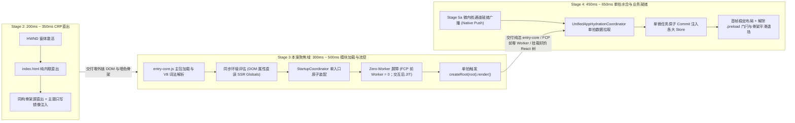
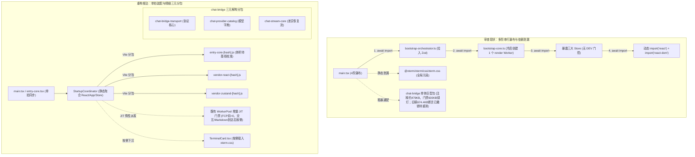
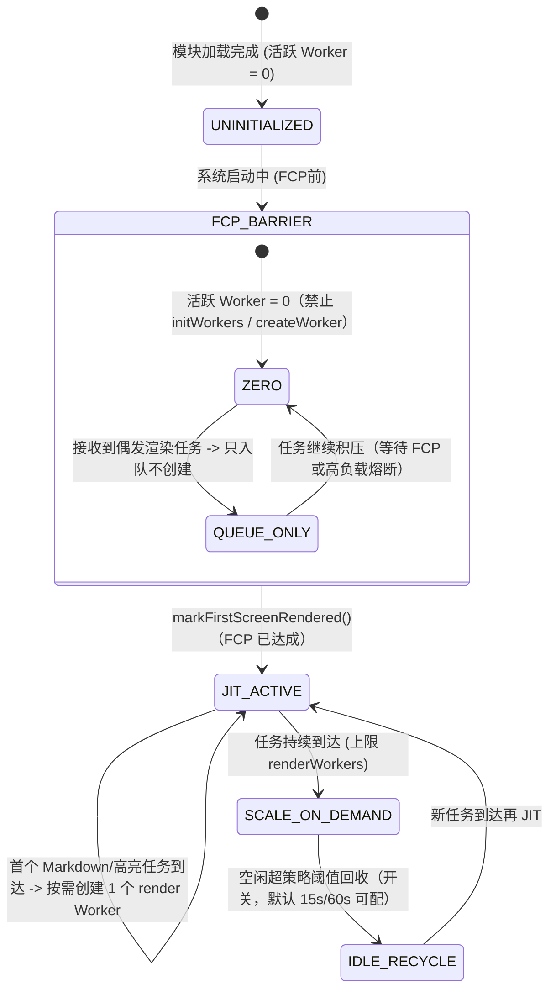
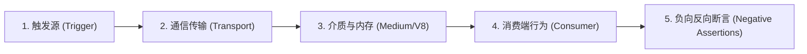
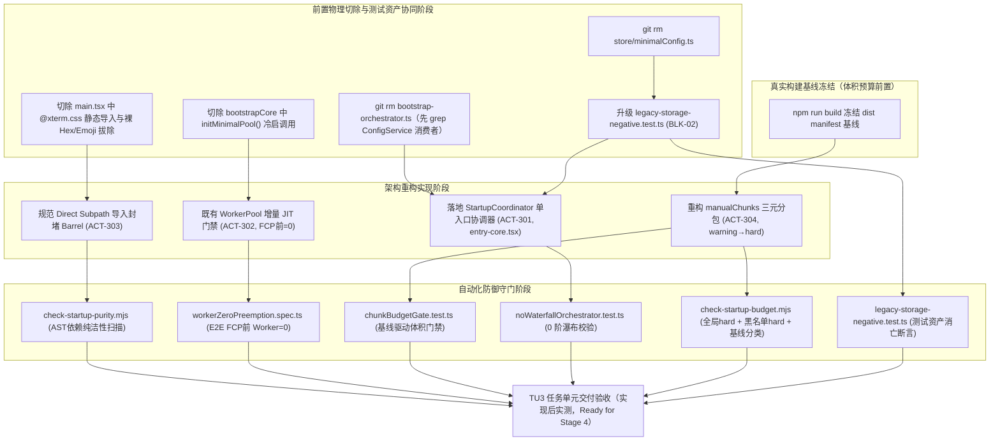

# 03-前端模块拓扑与分阶段编排详案（Stage 3 审计后修订版）

> **战役名称**：全链路启动性能深度重构与架构根治（`startup-performance-audit`）
> **文档性质**：Stage 3 专职分维详细实施方案（Post-Audit Revision Edition · 2026-09-13 修订）
> **修订依据**：`audits/05-方案体系质量与可落地性综合审查报告.md` §3.3 / §3.4 / §3.5 / §3.8 / §3.11 / §3.13 及 §4 阻断项返工裁决
> **聚焦阶段**：Stage 3（$300\text{ms} \sim 500\text{ms}$，首屏 JS Bundle 载入、分阶段编排流控、代码分割与 Web Worker 调度）
> **承接任务单元**：TU3（前端模块拓扑收敛与 Worker 惰性调度）
> **落实行动项**：
> - `ACT-301`：拍平 4 阶动态 import 瀑布流（构建单入口 `StartupCoordinator`）
> - `ACT-302`：冷启 Zero-Worker 调度与按需 JIT（**增量改既有 `WorkerPool`，禁止平行新池**）
> - `ACT-303`：消除静态导入泄漏与样式下沉（`xterm.css` 下沉至终端卡片，封堵 UI 桶文件）
> - `ACT-304`：细化 `manualChunks` 解构 `chat-bridge`（**先冻结真实 dist manifest 基线，预算 warning→hard 演进**）
> **全景审计缺陷吸收与根治矩阵**：
> - **BLK-02 / AAI-02（审计 01 §3.2）**：彻底根治 `minimalConfig.ts` 物理删除导致既有测试 `legacy-storage-negative.test.ts:44` 抛出 `ENOENT` 致命异常；恪守测试资产保护铁律，等价升级测试断言为 `expect(fs.existsSync(filePath)).toBe(false)`；
> - **VIOLATION-HIGH-01 / AAI-01（审计 01 §3.1）**：彻底拔除兜底 HTML 模板中的裸 Hex 与旧式 `rgba`，100% 接入标准 Design Tokens 并配置 HSL 规范回退；**兜底 UI 零 Emoji（AGENTS.md §21）**；
> - **DAG-02（审计 02 §2.2）**：明确 Stage 3 纯逻辑产出不变量与因果边界——Stage 3 仅负责基础 JS Bundle 加载、Vite manualChunks 边界确立、Zero-Worker 策略与 React 根节点挂载；严禁在 Stage 3 越权发起业务数据水合，业务数据并发拉取与单拍 Commit 严格归属于 Stage 4；
> - **ACT-302 深度加固（审计 03 §5.2 + audits/05 §3.5）**：纠正 `bootstrap-core.ts` 注释「2 个核心 Worker」失实口径——`MINIMAL_OPTIONS` 实际仅 1 个 render Worker；**禁止另建平行 `JitWorkerPool`**，改为在既有 `WorkerPool` 上增量落地 FCP 前 Worker=0、交互/Markdown 到达后 JIT 的门禁策略；
> - **ACT-304 深度加固（审计 04 §2.3 / §3.1 + audits/05 §3.4）**：细化 Vite manualChunks 规则，将 Catalog 数据字典、流式差异计算与传输协议层三元拆分；**旧稿「chat-bridge 674.4KB 且 CI 阻断」断言不可复现，已撤销、待实测重测**；体积预算先冻结真实 dist 基线再定 warning→hard 演进，禁止将 180/250 拍脑袋写死为 hard CI 门禁。
> **输入基石文档**：
> - `docs/startup-performance-audit/00-全链路启动性能系统性根治总方案.md`
> - `docs/startup-performance-audit/03-前端模块拓扑与分阶段编排审查报告.md`
> - `docs/startup-performance-audit/audits/01~05` 系列审计报告
> **遵循契约**：`AGENTS.md` 协作纪律、`.agents/LOGIC_PLAN_NO_RETREAT.md` 反退避准则、`ANTI_OVERENGINEERING_GUARDRAILS.md` 反过度设计红线
> **规划模式**：**纯逻辑执行拓扑（DAG）**，所有列出问题逻辑同权，无工期人天排期，直击底层根因，拒绝临时补丁，100% 遵从 Design Tokens 契约，设立五维立体化验证与刚性防御脚本守门。
> **重要状态声明**：本文件为**方案层设计**，仓库中对应实现（`entry-core.tsx`、门禁脚本、测试套件等）**尚未落地**；本文所有「目标 / 预期 / 断言」均为实现后待验证项，**不构成任何「已根治 / 测试通过 / CI 已绿」的验收结论**。
> **编码格式**：UTF-8 无 BOM。

---

## 一、方案总览与阶段执行边界

### 1.1 物理区间定位与全链路上下文关系
在 Crish 桌面客户端启动的全生命周期链路中，Stage 3 处于前端主线程逻辑的核心承转枢纽。它承接 Stage 2（WebView 初始化与静态骨架屏直出）所交付的零外链 DOM 运行环境，并向 Stage 4（React 树挂载与多重副作用水合）输出极速装配的 DOM 挂载入口与干净纯洁的模块依赖图。



#### 现状执行耗时与根治目标阶梯对照（300ms ~ 500ms 物理窗口）
> **量化口径纪律（audits/05 §3.8 / §4.2）**：下表「审查现状耗时」为审查报告的代码级推演值，**尚无本机 Profiler / Performance Trace 实测背书**；「重构后目标耗时」为方案层期望，真实收益须在实现后以 benchmark 脚本 + 机器指纹方法学实测校准。方案与 CI 验收**禁止**引用未标注「待测」的伪精确数字。

| 物理执行细分阶段 | 审查现状耗时（推演基线，待实测） | 现状主要开销根因剖析 | 重构后目标耗时（方案期望，待实测） | 架构优化手段与物理消除措施 |
| :--- | :--- | :--- | :--- | :--- |
| **1. 入口脚本网络与磁盘加载** | 推演 $65\text{ms} \sim 95\text{ms}$ | 主入口 bundle 包含大量未命中的动态分包碎片，请求次数多 | 待测（期望显著缩减） | 聚合为单一核心包 `entry-core.js`，无二次网络等待 |
| **2. V8 词法编译与求值 (Parse & Compile)** | 推演 $70\text{ms} \sim 110\text{ms}$ | 静态导入穿透拉入了 `xterm.css`、`zod` 以及组件库巨型 Barrel | 待测 | 彻底切除 Zod 于首屏链路，样式就地下沉，封堵 UI Barrel 穿透 |
| **3. Phase 0 编排等待 (`bootstrap-orchestrator`)** | 推演 $20\text{ms} \sim 35\text{ms}$ | 串行 `await import` 启动空转的 `configService.init()`（现为 no-op） | **$0\text{ms}$（彻底物理切除）** | 物理删除 `bootstrap-orchestrator.ts`，消除该阶微任务 |
| **4. Phase 1 并行编排 (`bootstrap-core`)** | 推演 $80\text{ms} \sim 150\text{ms}$ | 冷启 `initMinimalPool()` 实际拉起 **1 个 render Worker**（注释误写 2 个），编译 21 种语言规则，抢占主线程 CPU | 待测（期望仅纯内存检测） | 实施 Zero-Worker JIT 调度（增量改既有 WorkerPool），硬件检测改为同步内联 |
| **5. 调试 Store 暴露等待** | 推演 $15\text{ms} \sim 25\text{ms}$ | 动态 `await import` 三大 Store，未加 DEV 环境隔离门控 | **$0\text{ms}$（生产环境）** | 生产环境彻底剥离，开发环境直接引用已导入符号 |
| **6. Phase 1.5 动态加载 React 与 App** | 推演 $50\text{ms} \sim 90\text{ms}$ | 形式主义伪异步：React 早已在静态依赖树中，白白多等两轮 Promise | **$0\text{ms}$** | 静态整合进 `entry-core`，消除动态 `import('react')` |
| **7. React 根组件首次挂载 (`createRoot.render`)** | 推演 $30\text{ms} \sim 45\text{ms}$ | 边界层多层嵌套与动态预取逻辑交织 | 待测 | 确定性单拍挂载，异常防护内联自闭环 |
| **阶段总时延合计** | **推演 $330\text{ms} \sim 550\text{ms}$** | 串行瀑布、CPU 算力争抢、依赖泄漏三重复合损耗 | **待实测**（实现后以本机 benchmark 冻结新基线） | 净缩减幅度待实测，禁止在实现前承诺具体毫秒数 |

---

### 1.2 阶段输入前置断言与交付物不变量

为了杜绝跨阶段隐式耦合、状态撕裂与时序倒置，Stage 3 设立严格的前置准入断言与后置交付物不变量，并对 Stage 3 与 Stage 4 的因果边界建立铁律界定（解决 **DAG-02** 缺陷）：

#### 1. 前置准入断言（Pre-conditions from Stage 2）
- **PRE-301（CRP 零外链）**：`index.html` 中不得包含任何阻塞关键渲染路径的外链 `<link rel="stylesheet">` 或外链 `<script src="...">`，首屏同构骨架屏与暗色背景必须在 HTML 解析瞬间物理直出；
- **PRE-302（DOM 镜像就绪）**：`document.documentElement` 上已同步写入 `data-theme`、`data-app-mode`、`data-product-shell` 等基础环境标记，且 `localStorage` 只写镜像已完成预同步；
- **PRE-303（动画门闩就位）**：根节点或骨架屏容器具备局部门闩类名（`.skeleton-no-transition`），全局过渡动画已处于静默锁定状态；
- **PRE-304（DOM 挂载点完备）**：文档中必须存在唯一的 `<div id="root"></div>` 作为 React 根挂载容器，以及 `<div id="skel-app"></div>` 作为骨架容器。

#### 2. 后置交付物不变量（Deliverable Invariants to Stage 4）
- **INV-301（单入口聚合核心包）**：首屏主入口输出为高内聚的 `entry-core.js`（源文件为 **`entry-core.tsx`**，因含 JSX）；其物理体积预算**以「先冻结一次真实 dist manifest 基线、再定 warning→hard 演进」为唯一裁决**——180 KB / Gzip 60 KB 仅为方案层目标参考值，禁止未经基线校准写死为 hard 门禁；严禁包含 `@xterm`、`highlight.js`、`monaco-editor`、`zod` 等非首屏重型依赖（此项为硬约束，不依赖体积数字）；
- **INV-302（FCP 前 Zero-Worker）**：从 `main.tsx` 执行到 React 树 **FCP（首帧提交 / `.preload` 门闩解除）完成前**，系统活跃的 Web Worker 实例数量为 0；**FCP 后交互或 Markdown 渲染任务到达时，允许 JIT 按需创建 Worker——严禁使用「恒为 0」绝对措辞**（audits/05 §3.8）；
- **INV-303（单拍挂载流控）**：入口启动流程完全消除级联串行微任务排队，从脚本求值到调用 `createRoot().render()` 之间只允许存在确定性的单拍同步调用；
- **INV-304（协议桥接块受控）**：分包解耦后的 `chat-bridge-transport` Chunk 完成 Catalog / 流式恢复 / 传输协议三元拆分；体积预算同样执行「基线冻结 → warning→hard」演进，250 KB 仅为方案目标参考；**旧稿「674.4KB CI 阻断」已撤销待实测重测**；
- **INV-305（零全局终端样式）**：首屏加载的任何 CSS 文件中不得包含 `@xterm` 终端光标、网格或背景规则；
- **INV-306（异常安全防御自闭环）**：降级容灾 HTML 100% 接入系统 Design Tokens，严禁使用裸 Hex 颜色代码与旧式 rgba，**兜底 UI 严禁任何 Emoji 字符（AGENTS.md §21）**，严禁在降级路径上请求外部异步 Chunk；
- **INV-307（【核心边界不变量 DAG-02】零业务数据水合越权）**：Stage 3 绝对不发起任何业务数据水合 IPC（如偏好设置、历史会话、用户模型等跨进程拉取）。Stage 3 的职责在调用 `render(<App />)` 并建立 Fiber 根树后即告圆满交付；业务数据并发拉取与单拍原子提交（`applyAtomicCommit`）全权移交给 Stage 4 的 `UnifiedAppHydrationCoordinator`，严防阶段因果越权与职责污染。

---

### 1.3 核心技术指标与收益基线对照表

> 下表「审查现状基线」中带 ⚠ 标记者为**旧稿失实或不可复现已勘误**项；收益类指标一律标注**待实测**。

| 评估维度 | 审查现状基线（勘误后口径） | 重构根治目标（Target Metric） | 收益物理推导与根因归因 |
| :--- | :--- | :--- | :--- |
| **首屏 Entry Chunk 体积** | 现网 `index-[hash].js` / App 残留约 $455\text{KB}$（`vite.config.ts:689-691` 注释口径） | `entry-core-[hash].js` 体积**先冻结真实 dist 基线再定 warning→hard**；180KB 仅为方案参考值 | 剔除 `xterm.css`、解构 UI Barrel 穿透、剥离 Zod 于首屏 |
| **启动微任务瀑布层级** | 4 阶级联串行 `await import`（Phase 0/1/1.5） | **0 阶串行**（单拍聚合同步装配） | 消除 4 轮微任务事件循环让渡；净省时长**待实测** |
| **冷启 FCP 前 Worker 数量** | `initMinimalPool()` 提前创建 Worker——注释误写「2 个」，`MINIMAL_OPTIONS` 实际 **仅 1 个 render Worker**（`worker-pool-options.ts:43-50`） | **FCP 前 = 0**；交互/Markdown 到达后 JIT | 避免冷启编译 21 种语言规则抢占 CPU；省出算力**待实测**（旧稿 $80\text{ms} \sim 120\text{ms}$ 降级为待测） |
| **`chat-bridge` Chunk 体积** | ⚠ 旧稿「$674.4\text{KB}$ 超 $600\text{KB}$ 门禁阻断 CI」**不可复现、已撤销**；现网注释约 $479\text{KB}$，门禁 $600\text{KB}$，当前绿灯（`vite.config.ts:35-40`） | 三元解构完成；体积预算以基线报告校准（warning→hard）；**待实测重测** | 解耦 Catalog 数据与通信协议层，细化分包拓扑 |
| **首屏 CSS 规则重排开销** | 全局静态导入 `xterm.css`（规则全树匹配） | **0 条终端规则**（按需下沉至终端卡片） | 减少 Blink 样式计算；$15\text{ms}$ 为推演，**待实测** |
| **入口脚本执行到渲染耗时** | 推演 $145\text{ms} \sim 220\text{ms}$ | 待测 | 纯内存环境评估 + 同步根节点直挂 |
| **冷启动 V8 编译时间 (Compile)** | 推演 $\approx 120\text{ms}$（主线程 + Worker 线程） | 待测（仅首屏轻量代码） | 削减首屏代码 AST 节点数 |
| **CI 生产构建门禁** | 现网 `CHUNK_SIZE_GATE_KB=600` 全局 hard 门禁**当前绿灯**（⚠ 旧稿「0% 通过」已撤销） | 维持 600KB 全局 hard；新增分类预算先 warning，基线校准后升 hard | 分包拓扑收敛，预算治理有实测依据 |
| **测试资产保护完整性** | `minimalConfig.ts` 现存；`legacy-storage-negative.test.ts:43-49` 仍以 `readSource` 读取该文件 | 删除时同步升级为 `existsSync === false` 断言，测试零 `ENOENT` | 同步升级负向消亡断言（消除 BLK-02；实现后验证） |

---

### 1.4 纯逻辑依赖拓扑与子任务单元承接关系

```mermaid
graph TD
    classDef action fill:#fff3e0,stroke:#f57c00,stroke-width:2px;
    classDef excision fill:#ffebee,stroke:#c62828,stroke-width:2px;
    classDef gate fill:#e8f5e9,stroke:#388e3c,stroke-width:2px;
    classDef stage fill:#e1f5fe,stroke:#0288d1,stroke-width:2px;

    subgraph S3_Excision [Stage 3.1: 物理切除与死代码日落]
        EX_ORCH["物理删除 bootstrap-orchestrator.ts（先 grep ConfigService 消费者）"]:::excision
        EX_CONF["物理删除 store/minimalConfig.ts"]:::excision
        EX_WORKER["切除 bootstrapCore 中 initMinimalPool() 冷启调用"]:::excision
        EX_XTERM["从 main.tsx 切除 @xterm.css 静态导入"]:::excision
        EX_TEST["升级 legacy-storage-negative.test.ts 资产保护断言 (BLK-02)"]:::excision
        EX_CONF --> EX_TEST
    end

    subgraph S3_Implementation [Stage 3.2: 核心重构与状态机落实]
        ACT_301["ACT-301: 单入口协调器 StartupCoordinator.bootstrap()"]:::action
        ACT_302["ACT-302: 既有 WorkerPool 增量 JIT 门禁（FCP前=0，禁止平行池）"]:::action
        ACT_303["ACT-303: 样式与重型依赖按需下沉 (Direct Subpath Imports)"]:::action
        ACT_304["ACT-304: manualChunks 三元分包 + dist 基线冻结 (warning→hard)"]:::action
    end

    subgraph S3_Boundaries [Stage 3.3: 因果边界隔离 (DAG-02)]
        B_CORE["Stage 3 纯输出: entry-core.js + manualChunks 边界 + FCP前 Worker=0"]:::stage
        B_MOUNT["同步挂载 React 根节点 createRoot().render(<App />)"]:::stage
        B_NO_HYD["严禁在 Stage 3 越权发起业务数据水合 IPC"]:::stage
        B_CORE --> B_MOUNT --> B_NO_HYD
    end

    subgraph S3_Gates [Stage 3.4: 五维防御门禁与守门脚本]
        G_PURITY["scripts/check-startup-purity.mjs (AST纯洁性扫描)"]:::gate
        G_BUDGET["scripts/check-startup-budget.mjs (基线驱动预算，先 warning)"]:::gate
        G_WORKER["tests/e2e/startup/workerZeroPreemption.spec.ts (FCP前 Worker=0 探针)"]:::gate
        G_FLOW["tests/unit/startup/noWaterfallOrchestrator.test.ts (0 阶瀑布)"]:::gate
    end

    S3_Excision --> S3_Implementation
    S3_Implementation --> S3_Boundaries
    S3_Boundaries --> S3_Gates
    S3_Gates --> OUT["交付 Stage 4: React 树挂载与多重副作用水合（实现后验收）"]
```

---

## 二、负向架构禁令与边界红线（零容忍）

在 Stage 3 方案的设计与落地中，以下禁令属于**绝对不可逾越的刚性红线**。任何违反以下红线的 PR 或实现将被自动化守门脚本直接打回：

### 2.1 严禁级联串行 `await import` 瀑布流（No Cascading Import Waterfall）
- **违规定义**：在应用入口（`main.tsx` 或 `entry-core.tsx`）中，严禁通过连续的 `await import(...)` 构造串行装配管道。
- **物理机理**：V8 引擎在遇到顶层 `await import` 时，必须暂停当前执行栈，将控制权交还给浏览器微任务调度器，等待网络/磁盘 I/O 载入模块、完成字节码编译与求值后，再排入下一次微任务唤醒。连续 4 阶串行动态导入（如原 Phase 0 $\rightarrow$ Phase 1 $\rightarrow$ 暴露 store $\rightarrow$ Phase 1.5）导致渲染主线程在微任务循环中空转让渡（幅度待实测）。
- **刚性门限**：主入口模块的主干执行路径中，动态 `await import` 出现的连续次数必须**严格等于 0**。首屏必需的模块全部改由打包器静态聚合进 `entry-core`。

### 2.2 严禁首屏挂载（FCP）前派生 Web Worker 实例（FCP 前 Zero-Worker；交互后 JIT）
- **违规定义**：在 React 根组件挂载、首帧提交给合成器之前，通过 `new Worker()` 创建任何 Web Worker 实例。
- **物理机理**：派生 Web Worker 会触发 OS 级线程调度开销，更严重的是在新的 V8 Isolate 中拉入 `highlight.js` 及 21 门语言规则，短时间内占满多核 CPU，导致主线程在解析首屏 React DOM 树时发生严重的 CPU 饥饿（CPU Starvation）。现网冷启经 `initMinimalPool()` 实际创建 **1 个 render Worker**（`MINIMAL_OPTIONS`：`renderWorkers=1`，注释误写 2 个）。
- **刚性门限**：从脚本执行开始，至 React **FCP（`.preload` 门闩解除）**前，活跃 Web Worker 数量**为 0**；**FCP 后交互或 Markdown 高亮任务到达时，允许 JIT 按需创建 Worker**——E2E 断言只锁「FCP 前 = 0」窗口，**禁止「恒为 0」绝对措辞**（与旧稿允许「积压≥2 破障」的自相矛盾一并废除）。任务调度接入**增量加固后的既有 `WorkerPool`**（见 §4.3）。

### 2.3 严禁三方重型样式与未命中代码渗透首屏 Entry（Zero Heavy Style Contamination）
- **违规定义**：严禁在 `main.tsx` 或全局 CSS 中引入特定交互卡片独占的第三方重型样式库（如 `@xterm/xterm/css/xterm.css`）。
- **物理机理**：首屏引入 xterm 样式会导致 Blink 引擎在计算首次布局树时，为整个页面的所有 DOM 节点匹配 xterm 的选择器规则，增加 Recalculate Style 耗时，且打包产物出现依赖渗透。
- **刚性门限**：`entry-core.css` 中终端样式规则计数严格为 0；AST 扫描 `entry-core` 产物，`@xterm`、`highlight.js` 依赖特征计数为 0。

### 2.4 严禁未基线校准的体积预算写死进 hard 门禁（Baseline-First Size Budget）
- **违规定义**：在未执行一次真实 `npm run build` 并冻结 dist manifest 基线之前，将 180KB / 250KB 等未经实测的数字写死为 CI hard 阻断阈值；或继续引用不可复现的「chat-bridge 674.4KB CI 阻断 / CI 0% 通过」断言。
- **物理机理**：现网事实为——App 残留约 455KB（`vite.config.ts:689-691`）、chat-bridge 注释约 479KB、全局门禁 600KB 且**当前绿灯**；`entry-core` 若静态聚合 App 则三者（静态 App + ≤180KB + 三元分包）不可同时成立（audits/05 §3.4）。
- **刚性门限**：
  1. **实现顺序铁律**：先跑真实生产构建冻结基线 → 再拆 App 静态闭包 / compositionRoot / chat-bridge 三元分包 → 预算数字以基线报告修订；
  2. 预算治理采用 **warning→hard 两段式**：新分类预算先以 warning 落地，基线稳定并经主控确认后升 hard；
  3. 现网全局 `CHUNK_SIZE_GATE_KB=600` hard 门禁维持不动，作为兜底；
  4. ACT-304 的解耦方向（Catalog / 流式恢复 / 传输协议三元拆分）有效，但优先级与验收数字**以实测重排**。

### 2.5 严禁 Barrel 桶文件跨层击穿与静态依赖黑洞（No Barrel Penetration）
- **违规定义**：在首屏组件中通过 `components/ui/index.ts` 导入单一小组件（如 `<Button />`）。
- **物理机理**：UI 桶文件集中重导出了数十个重型组件（包含 Markdown 渲染、复杂表格、模态窗等），首屏导入桶文件会导致 Rollup 静态分析将整个桶文件包含的所有间接依赖全部揉入首屏 Chunk，造成 Tree-shaking 彻底失效。
- **刚性门限**：首屏模块 100% 采用直接子路径导入（Direct Subpath Imports），如 `@/components/ui/Button`。

### 2.6 【铁律根治 BLK-02】严禁物理切除破坏既有测试资产（测试资产保护铁律与断言等价升级）
- **违规定义**：在物理切除废弃文件（如 `minimalConfig.ts`）时，对依赖该文件的存量测试置之不理，导致测试在 `readSource` 时抛出 `ENOENT` 崩溃异常。
- **铁律遵循**：`AGENTS.md` §9 明确确立测试资产保护铁律——「测试是资产不是杂物，任何会话禁止随意删除或破坏测试用例」。
- **闭环规约**：物理切除生产废弃文件的同时，必须对相关测试用例执行等价升级改造。将原本断言「旧文件不包含特定幽灵键」升级为断言**「旧文件已被彻底物理切除且不可在磁盘与模块系统中存在」**（`expect(fs.existsSync(filePath)).toBe(false)`），消除旧岛的同时保持测试套件可运行（验收表述以实现后实跑为准，不预写「已全绿」）。

### 2.7 【铁律根治 VIOLATION-HIGH-01】100% Design Tokens 纯度与裸 Hex / 旧式 rgba 零容忍
- **违规定义**：在任何降级 HTML、内联样式、骨架屏或组件代码中直接硬编码裸 Hex 颜色（如 `#18181b`、`#ffffff`、`#3b82f6`）或旧式 `rgba(0,0,0,0.3)`。
- **硬性门禁**：新增降级路径代码裸 Hex 命中数必须为 0；所有颜色必须 100% 使用 `var(--token)`，如有回退必须使用符合规范的 `hsl()` 斜杠透明度表达式。存量代码按 `check-token-ssot` / `check-input-guardrails` 既有基线棘轮口径处理，不做一刀切（audits/05 §3.11）。

### 2.8 兜底 UI 零 Emoji 铁律（AGENTS.md §21）
- **违规定义**：在任何降级 HTML、错误横幅、状态提示或按钮文案中使用 Emoji 字符（如 ⚠️、📄、✨）。
- **硬性门限**：Stage 3 全部兜底/降级 UI 源码与产出 HTML 中 Emoji 命中数严格为 0；需要警示标识时使用纯 CSS/ASCII 字形（如带边框圆圈内 `!`）或项目内置 Lucide 矢量图标（兜底路径无 chunk 依赖时仅允许前者）。旧稿 `StartupCoordinator` 样例中的 `⚠️` 已在本修订版中拔除。

### 2.9 严禁平行新 Worker 池（No Parallel Pool Fork）
- **违规定义**：为实现 Zero-Worker / JIT 调度而新建与既有 `WorkerPool` 平行的独立池实现（如旧稿 ~350 行的 `JitWorkerPool` 类）。
- **物理机理**：现网 `WorkerPool` 已具备 `pendingTasks` / `dedupCache` / `AbortController` / `taskTimeoutMs` / `getMetrics` 与 `render|compute|io|network` 四类 WorkerType 契约；平行池将造成双池漂移、类型收窄（audits/05 §3.5 Stage 6 详案把类型收成 `'render'|'parser'` 的同型冲突）与能力回退。
- **刚性门限**：Zero-Worker / JIT 策略**只允许增量修改既有 `workers/worker-pool.ts` + `worker-pool-options.ts` + `workers/index.ts`**；保留全部既有公共 API 与任务能力；15s 闲置 terminate 等作为**策略开关**接入，不重写调度内核。

### 2.10 用户最高原则指示：严禁为了性能强行砍功能与任何作弊行为（Zero Cheating & No Feature Sacrifices）
- **用户最高指示**：坚决杜绝任何「为刷启动毫秒数而强行截断、阉割或破坏正常业务功能」的截肢行为。
- **保全清单**：
  1. **集成终端（PTY / xterm）**：代码下沉至卡片，完整保留终端功能，绝不砍掉 PTY；
  2. **Markdown 语法高亮**：由 JIT 调度保护，流式输出时完整保全 21 种语言语法高亮；
  3. **Zod 运行时校验**：移出首屏微任务，但在后续配置解析与网络握手校验中 100% 完整执行；
  4. **工作区与会话恢复**：由 Stage 4 / Stage 5 确定性单拍恢复，数据零丢失；
  5. **官方绑定扩展**：`note-paper` 与 `conversation-flow` 正常通过注册中心激活，功能 100% 可用；
  6. **多端设备配对**：移至闲时预热通道，底层能力完好无损。
- **作弊零容忍**：严禁使用伪加载（Fake Loading）、假骨架屏（Fake Skeleton）、空闭包兜底、魔术数字隐藏。所有提速必须来自纯粹的架构因果重构。

---

## 三、模块打包图与分包拓扑 DAG

### 3.1 现状与重构后模块图对比



### 3.2 首屏关键 Chunk 与按需视图 Chunk 拓扑图（Mermaid graph TD）

```mermaid
graph TD
    classDef entry fill:#e1f5fe,stroke:#0288d1,stroke-width:2px;
    classDef vendor fill:#f3e5f5,stroke:#7b1fa2,stroke-width:2px;
    classDef lazy fill:#fff3e0,stroke:#f57c00,stroke-width:2px;
    classDef idle fill:#e0f2f1,stroke:#00796b,stroke-width:2px;

    %% 首屏加载关键核心 Bundle
    HTML["index.html (纯内联直出)"] --> EntryCore["entry-core.js (体积预算: 基线冻结后 warning→hard)"]:::entry
    EntryCore --> VendorReact["vendor-react.js (React 19 / ReactDOM)"]:::vendor
    EntryCore --> VendorState["vendor-zustand.js (Zustand / Immer)"]:::vendor

    %% 业务协议与核心通信
    EntryCore -.->|动态导入/事件触发| ChatTransport["chat-bridge-transport.js"]:::entry
    ChatTransport -.->|模型切换时懒载| ChatCatalog["chat-provider-catalog.js"]:::lazy
    ChatTransport -.->|长文本流差异恢复| ChatStream["chat-stream-core.js"]:::lazy

    %% 按需视图与重型渲染下沉（10 个内置视图全部独立分包）
    EntryCore -.->|路由/分屏激活| ViewChat["view-chat.js (ChatCard)"]:::lazy
    EntryCore -.->|终端激活时| ViewTerminal["view-terminal.js (TerminalCard + xterm.css)"]:::lazy
    EntryCore -.->|预览激活时| ViewPreview["view-preview.js (PreviewCard)"]:::lazy
    EntryCore -.->|总览激活时| ViewOverview["view-overview.js (OverviewCard)"]:::lazy
    EntryCore -.->|文件激活时| ViewFiles["view-files.js (FilesCard)"]:::lazy
    EntryCore -.->|Diff 激活时| ViewDiff["view-diff.js (DiffCard)"]:::lazy
    EntryCore -.->|运行时面板| ViewRuntime["view-runtime.js (RuntimePanel)"]:::lazy
    EntryCore -.->|Agent 激活时| ViewAgent["view-agent.js (AgentCard)"]:::lazy
    EntryCore -.->|FlowDag 激活时| ViewFlow["view-flow-dag.js (FlowDagView)"]:::lazy
    EntryCore -.->|文件查看器| ViewFileViewer["view-file-viewer.js (FileViewerCard)"]:::lazy

    %% 闲时调度队列预热
    EntryCore -.->|requestIdleCallback 预热| IdleFull["bootstrap-full.js (全量服务注册)"]:::idle
    EntryCore -.->|FCP后/任务到达| WorkerJit["jit 增量派生 render Worker (既有 WorkerPool)"]:::idle
```



### 3.3 Rollup 模块图遍历机制与依赖闭包边界定义
Rollup 打包器在构建模块依赖图（Module Graph）时，从 Entry 入口出发，沿着 `import` 语句进行深度优先遍历（DFS）。
- **静态闭包边界**：`entry-core.tsx` 的静态闭包严格限定在 React 运行时、根布局组件、纯内存环境检测与内置视图工厂映射表中。
- **动态闭包隔离**：所有三方重型库（`@xterm`、`highlight.js`、`monaco-editor`、`zod`）通过动态 `import()` 显式切断静态 DFS 遍历树，使其进入独立的 Dynamic Chunk。
- **防火墙隔离法则**：首屏模块严禁出现对动态分包的顶层同步引用，防止 Rollup 进行公共模块提升（Common Chunks Hoisting）导致依赖逆流穿透。

### 3.4 首屏代码分割防火墙（Code Splitting Firewall）设计
为确保构建期间代码分割的物理边界相对稳定，设计两道防火墙：
1. **源码级语法防火墙**：在首屏组件源码中，配置 ESLint 规则 `no-restricted-imports`，刚性拦截对 `@xterm/*`、`highlight.js`、`zod` 以及 `components/ui/index.ts` 的直接静态导入；
2. **打包级产物防火墙**：在 Vite 编译期注入 `crish-chunk-size-gate` 插件与 `check-startup-budget.mjs` 门禁——黑名单模块存在于 Entry 依赖图谱中为**硬性阻断**（不依赖体积数字）；体积类阈值执行 §2.4 的「基线冻结 + warning→hard」两段式，禁止未校准数字直接 hard。

---

## 四、关键架构修复模块详尽设计与可落地代码

### 4.1 单入口启动协调器（StartupCoordinator 生产级实现代码）

#### 1. 设计理念与因果边界收口（彻底闭环 DAG-02）
废弃原 `main.tsx` 中散落的 4 阶 `startup()` 函数与级联 `await import` 瀑布，创建单一真理入口 `StartupCoordinator` 类，将首屏启动重构为严格的同步单拍装配：
- **前置评估（Pre-flight Evaluation）**：同步执行 `initSsrGlobals()` 与 `initVisualPresentationController()`，纯内存读取 DOM 镜像属性（耗时待测，量级预期极小）；
- **核心依赖聚合（Core Graph Aggregation）**：React、ReactDOM、AppErrorBoundary、App 外壳均作为直接静态导入，由打包器一次性静态解析；
- **【核心因果边界 DAG-02 落实】**：
  - **Stage 3 纯逻辑产出不变量**：负责加载核心 JS Bundle（React/ReactDOM/Coordinator/AppErrorBoundary/CoreStore）、确立 Vite manualChunks 边界、执行 FCP 前 Zero-Worker 冷启策略，并同步挂载 React 根节点；
  - **严禁 Stage 3 越权发起业务数据水合**：Stage 3 绝对不发起偏好设置、历史会话、模型参数等业务 IPC；
  - **因果无缝交接**：在调用 `createRoot().render()` 后，Stage 3 装配闭包圆满交付，由 Stage 4 的 `UnifiedAppHydrationCoordinator` 在 React 树挂载阶段统一编排轻量 IPC 快照拉取与单微任务原子 Commit；
- **异常安全防御（Bulletproof Exception Fallback）**：完全不依赖外部 Chunk 的纯 CSS 变量内联 HTML 降级兜底，100% 遵从 Design Tokens，零裸 Hex，零旧式 rgba，**零 Emoji**；
- **后置闲时交接（Post-mount Idle Handoff）**：由首帧渲染完成事件通知，将后续非关键任务平滑交接给 Stage 6 空闲队列。

#### 2. `apps/crish-desktop/src/entry-core.tsx` 完整 TypeScript 实现代码

> **文件名铁律（audits/05 §3.3）**：该入口含 JSX（`root.render(<StrictMode>…)`），扩展名必须为 **`.tsx`**，全文统一称 `entry-core.tsx`；旧稿所有 `entry-core.ts` 字样已废除。

```tsx
/**
 * apps/crish-desktop/src/entry-core.tsx
 * 单入口启动协调器（Single-Pass Startup Coordinator）
 * 拍平 4 阶动态 import 瀑布流，聚合首屏核心依赖，消除 microtask 挂起延迟。
 * 遵循 DAG-02 因果边界契约：Stage 3 仅负责装配与挂载，严禁发起业务数据水合 IPC。
 */
import React, { StrictMode } from 'react';
import { createRoot } from 'react-dom/client';
import App from './App';
import { AppErrorBoundary } from './components/AppErrorBoundary';
import { ToastProvider } from './services/toast/ToastContext';
import { initSsrGlobals } from './createSsrGlobals';
import { initVisualPresentationController } from './services/visualThemeController';
import { bootstrapTheme } from './api/themeStore';
import { registerBuiltInViews } from './services/view-registry';
import { builtinViewFactories } from './builtinViewFactories';
import { GlobalErrorBanner } from './components/GlobalErrorBanner';
import {
  activateNotePaper,
  shouldActivateOfficialNotePaper,
} from './extensions/note-paper';
import {
  activateConversationFlow,
  shouldActivateOfficialConversationFlow,
} from './extensions/conversation-flow';
import { memoryManager } from '@crish/shared-utils/browser';
import { logger } from './services/LoggerService';
import './index.css';

export interface StartupCoordinatorOptions {
  enableDevPerformanceMarks?: boolean;
}

export class StartupCoordinator {
  private static isBootstrapped = false;

  /**
   * 启动入口：严格单向同步装配
   */
  public static bootstrap(options?: StartupCoordinatorOptions): void {
    if (this.isBootstrapped) {
      logger.warn('[StartupCoordinator] bootstrap() 被重复调用，已自动忽略');
      return;
    }
    this.isBootstrapped = true;

    const t0 = performance.now();

    try {
      // 1. 同步环境评估：从 DOM 属性直读镜像（纯内存操作）
      initSsrGlobals();
      initVisualPresentationController();

      // 2. 主题与 Token 纯内存水合（继承 Stage 2 注入的 DOM 属性，严禁提前发送 IPC 请求）
      bootstrapTheme();

      // 3. 注册内置视图工厂（10 槽位全量，见 §4.1.3；内部保持懒加载点，不立即实例化 LazyComponent）
      registerBuiltInViews(builtinViewFactories);

      // 4. 【功能完整性保障：严禁砍功能】激活官方绑定的核心扩展能力
      if (shouldActivateOfficialNotePaper()) {
        activateNotePaper();
      }
      if (shouldActivateOfficialConversationFlow()) {
        activateConversationFlow();
      }

      // 5. 获取 DOM 根挂载节点
      const rootElement = document.getElementById('root');
      if (!rootElement) {
        throw new Error('Fatal: #root container element missing in index.html');
      }

      // 6. 启动内存管理器（浏览器环境安全启动）
      memoryManager.start();

      // 7. 单拍同步挂载 React 根组件树（包含 ToastProvider、AppErrorBoundary 与 GlobalErrorBanner）
      // 注意：依据 DAG-02 契约，此处仅挂载纯洁 React 树，业务数据水合全权交由 Stage 4 UnifiedAppHydrationCoordinator 执行
      const root = createRoot(rootElement);
      root.render(
        <StrictMode>
          <ToastProvider>
            <AppErrorBoundary>
              <App />
            </AppErrorBoundary>
          </ToastProvider>
          <GlobalErrorBanner />
        </StrictMode>
      );

      const tMounted = performance.now();

      // 8. 性能指标高精埋点
      if (typeof window !== 'undefined') {
        window.__crish_perf = {
          ...window.__crish_perf,
          startupEvaluationMs: tMounted - t0,
          reactMounted: tMounted,
        };

        if (options?.enableDevPerformanceMarks || import.meta.env.DEV) {
          performance.mark('crish:react_mounted');
          performance.measure('crish:startup_to_mount', {
            start: t0,
            end: tMounted,
          });
        }
      }

      // 9. 首帧渲染完成协调：交接控制权
      requestAnimationFrame(() => {
        if (typeof window !== 'undefined') {
          window.__crish_perf = {
            ...window.__crish_perf,
            reactInteractiveReady: performance.now(),
          };
        }

        // 10. 控制权平滑交接给 Stage 6 空闲预热队列（彻底移出首屏关键路径）
        //     同时通知既有 WorkerPool：FCP 已达成，解锁 JIT（此前 FCP 前窗口 Worker = 0）
        import('./workers/index').then(({ getWorkerPool }) => {
          getWorkerPool().markFirstScreenRendered();
        });
        this.handoffToIdlePhase();
      });
    } catch (err) {
      this.handleFatalStartupError(err);
    }
  }

  /**
   * 移交空闲调度：使用 requestIdleCallback 分片拉起全量核心服务与视图预热
   */
  private static handoffToIdlePhase(): void {
    const idleTask = () => {
      // 异步拉起全量核心服务（Phase 2），不阻塞交互
      import('./bootstrap-full')
        .then((m) => m.bootstrapFull())
        .catch((e) => {
          logger.warn('[StartupCoordinator] bootstrap-full 异步预热失败 (非致命):', {
            module: 'StartupCoordinator',
            err: e instanceof Error ? { message: e.message, stack: e.stack } : { message: String(e) },
          });
        });
    };

    if (typeof window !== 'undefined') {
      if ('requestIdleCallback' in window) {
        // 关键改造：剔除 timeout: 2000 强刷，采用纯净空闲触发（保留可接受的兜底延后策略，防持续繁忙饿死）
        (window as unknown as { requestIdleCallback: (cb: () => void) => void }).requestIdleCallback(idleTask);
      } else {
        setTimeout(idleTask, 800);
      }
    }
  }

  /**
   * 致命异常安全降级：100% 遵从 Design Tokens，零裸 Hex，零旧式 rgba，零 Emoji，零外部 Chunk 依赖
   * 彻底根治 VIOLATION-HIGH-01 / §2.8
   */
  private static handleFatalStartupError(error: unknown): void {
    logger.error('[StartupCoordinator] 致命错误：应用启动异常阻断', {
      module: 'StartupCoordinator',
      err: error instanceof Error ? { message: error.message, stack: error.stack } : { message: String(error) },
    });

    // 异常安全复位：解除门闩，避免错误界面被动画锁冻结
    document.documentElement.classList.remove('preload');

    const rootElement = document.getElementById('root');
    if (rootElement) {
      // 100% Design Tokens；警示标识用纯 ASCII 圆圈 + 感叹号，严禁 Emoji
      rootElement.innerHTML = `
        <div style="display:flex;height:100vh;width:100vw;align-items:center;justify-content:center;
                    background-color:var(--bg-primary, hsl(240 6% 10%));
                    color:var(--text-primary, hsl(0 0% 100%));
                    font-family:var(--font-sans, system-ui, -apple-system, BlinkMacSystemFont, 'Segoe UI', Roboto, sans-serif);
                    padding:var(--space-6, 24px);box-sizing:border-box;text-align:center;user-select:none;">
          <div style="max-width:420px;padding:var(--space-8, 32px);
                      background:var(--bg-secondary, hsl(240 5% 16%));
                      border:1px solid var(--border-color, hsl(240 4% 24%));
                      border-radius:var(--radius-lg, 8px);
                      box-shadow:var(--shadow-lg, 0 10px 15px -3px hsl(0 0% 0% / 0.3));">
            <div style="width:36px;height:36px;margin:0 auto var(--space-4, 16px);
                        border:2px solid var(--text-secondary, hsl(240 5% 65%));
                        border-radius:50%;display:flex;align-items:center;justify-content:center;
                        font-size:18px;font-weight:700;color:var(--text-secondary, hsl(240 5% 65%));">!</div>
            <h2 style="margin:0 0 var(--space-3, 12px);font-weight:600;font-size:18px;color:var(--text-primary, hsl(0 0% 100%));">
              应用核心启动失败
            </h2>
            <p style="margin:0 0 var(--space-5, 20px);font-size:14px;color:var(--text-secondary, hsl(240 5% 65%));line-height:1.5;">
              界面装配层在初始化时遭遇未捕获异常。本地数据完整，请尝试重新加载。
            </p>
            <button onclick="window.location.reload()"
                    style="padding:var(--space-2, 8px) var(--space-5, 20px);font-size:13px;font-weight:500;
                           border:none;border-radius:var(--radius-md, 4px);
                           background-color:var(--brand-primary, hsl(217 91% 60%));
                           color:var(--text-on-primary, hsl(0 0% 100%));
                           cursor:pointer;">
              重新加载
            </button>
          </div>
        </div>
      `;
    }
  }
}

// 模块求值即刻启动单拍流
StartupCoordinator.bootstrap();
```

#### 3. `apps/crish-desktop/src/builtinViewFactories.ts` 解耦实现代码（10 槽位全量迁移清单）

> **迁移清单铁律（audits/05 §3.13-11）**：现网 `main.tsx:30-108` 的 `builtinViewFactories` 共 **10 个内置视图**——`chat` / `terminal` / `preview` / `overview` / `files` / `diff` / `runtime` / `agent` / `flow-dag` / `file-viewer`。旧稿样例只写 4 个（chat/terminal/settings/workspace），属功能回退，已废除；下方清单与 `main.tsx` 现网槽位、组件路径、props 投影一一对齐（settings/workspace 并非现网内置视图键，不得虚构）。

```tsx
/**
 * apps/crish-desktop/src/builtinViewFactories.ts
 * 内置视图工厂解耦表（10 槽位全量，对齐 main.tsx 现网 registerBuiltInViews）
 * 维持视图工厂纯函数映射，避免在顶层静态拉入具体视图的代码与样式。
 */
import React, { lazy } from 'react';
import type { ViewFactoryMap, ViewRenderContext } from './services/view-registry';

export const builtinViewFactories: ViewFactoryMap = {
  chat: () =>
    lazy(() =>
      import('./components/chat-card/ChatCard').then((m) => ({
        default: (ctx: ViewRenderContext) => (
          <m.ChatCard sessionId={ctx.sessionId} handleGlobalTabClick={ctx.openView} />
        ),
      }))
    ),
  terminal: () =>
    lazy(() =>
      import('./components/workspace/TerminalCard').then((m) => ({
        default: (ctx: ViewRenderContext) => (
          <m.TerminalCard sessionId={ctx?.sessionId} panelId={ctx?.panelId} />
        ),
      }))
    ),
  preview: () =>
    lazy(() =>
      import('./components/workspace/PreviewCard').then((m) => ({
        default: (ctx: ViewRenderContext) => (
          <m.PreviewCard initialTarget={(ctx?.params?.target as string | undefined) ?? null} />
        ),
      }))
    ),
  overview: () =>
    lazy(() =>
      import('./components/overview/OverviewCard').then((m) => ({
        default: (ctx: ViewRenderContext) => <m.OverviewCard onOpenPanel={ctx.openView} />,
      }))
    ),
  files: () =>
    lazy(() =>
      import('./components/files/FilesCard').then((m) => ({
        default: () => <m.FilesCard />,
      }))
    ),
  diff: () =>
    lazy(() =>
      import('./components/diff/DiffCard').then((m) => ({
        default: () => <m.DiffCard />,
      }))
    ),
  runtime: () =>
    lazy(() =>
      import('./components/workspace/RuntimePanel').then((m) => ({
        default: () => <m.RuntimePanel />,
      }))
    ),
  agent: () =>
    lazy(() =>
      import('./components/agent-card/AgentCard').then((m) => ({
        default: () => <m.AgentCard />,
      }))
    ),
  'flow-dag': () =>
    lazy(() =>
      import('./components/workspace/FlowDagView').then((m) => ({
        default: () => <m.FlowDagView />,
      }))
    ),
  'file-viewer': () =>
    lazy(() =>
      import('./components/files/FileViewerCard').then((m) => ({
        default: m.FileViewerCardView,
      }))
    ),
};
```

#### 4. `apps/crish-desktop/src/main.tsx` 改造后的纯净代码

```typescript
/**
 * apps/crish-desktop/src/main.tsx
 * 前端物理唯一入口文件
 * 保持 main.tsx 文件名不变（index.html 引用契约），直接转发至 entry-core.tsx，消除 4 阶瀑布流。
 */
import './entry-core';
```

---

### 4.2 物理切除 Phase 0 编排壳与废除配置

#### 1. `bootstrap-orchestrator.ts` 彻底切除方案与调用点清除
- **现状病灶代码**：
  ```typescript
  // apps/crish-desktop/src/bootstrap-orchestrator.ts (14 行)
  import { configService } from './services/ConfigService';
  async function bootstrapOrchestrator(): Promise<void> {
    await configService.init(); // no-op 空转初始化！
    ...
  }
  export const ready = bootstrapOrchestrator();
  ```
- **物理切除操作**：
  1. 执行 `git rm apps/crish-desktop/src/bootstrap-orchestrator.ts`；
  2. 从 `main.tsx` 中彻底删除 `await import('./bootstrap-orchestrator')`；
  3. 净化调用栈，启动流程无需等待该微任务。

#### 2. 【裁决】ConfigService 本体不得删除——`get`/`set` 仍被多处消费（audits/05 §3.13-10）
> **删除前强制 grep**：`configService.init()` 虽为 no-op（`ConfigService.ts:18-20`），但 **`get`/`set`/`watch` 仍被现网多处消费**——删除 orchestrator 时只切除 `bootstrap-orchestrator.ts` 对 `init()` 的调用点，**严禁连带删除 `ConfigService.ts` 本体**。现网消费者清单（2026-09-13 grep 实测，实现前须重跑确认）：
>
> | 消费者 | 用法 |
> | :--- | :--- |
> | `components/sidebar/useSidebarResize.ts:25,123,126` | `get('workspace.layout')` / `set('workspace.layout', …)` |
> | `components/settings/SettingsShortcutsTab.tsx:86` | `set('shortcuts.overrides', …)` |
> | `components/settings/SettingsShortcutsHelpers.ts:98` | `get('shortcuts.overrides')` |
> | `services/ShortcutService.ts:287,329` | `get`/`set('shortcuts.overrides')` |
> | `services/ShortcutService.test.ts` | mock `configService` |
>
> 因此 EX 操作精确边界 = 删除 orchestrator 文件 + 删除 main.tsx 调用点；`ConfigService` 服务与 `define/get/set/watch` API 原样保留。`zod` 顶层导入仍随 ConfigService 进入依赖图——首屏链路不再 import ConfigService（orchestrator 删除后 main/entry-core 无静态边），Zod 自然移出首屏；后续若做 Zod JIT 化，须保证 `define`/`get`/`set` 的 schema 校验语义 100% 不变。

#### 3. 【核心根治 BLK-02】`store/minimalConfig.ts` 物理删除与既有测试资产等价升级改造
- **现状病灶代码**：
  ```typescript
  // apps/crish-desktop/src/bootstrap-core.ts:28-30
  const { loadMinimalConfig } = await import('./store/minimalConfig');
  await loadMinimalConfig(); // 丢弃返回值！死代码执行！
  ```
- **审计 01 曝光的致命测试断裂事实（BLK-02 / AAI-02）**：
  在既有测试 `apps/crish-desktop/src/api/__tests__/legacy-storage-negative.test.ts:43-49` 中存在如下测试断言：
  ```typescript
  it('minimalConfig.ts 已物理删除 4 个幽灵读 key', () => {
    const src = readSource('../store/minimalConfig.ts'); // 内部执行 fs.readFileSync(...)
    expect(src).not.toContain('crish_shell_chrome');
    expect(src).not.toContain('crish_sidebar_collapsed');
    expect(src).not.toContain('crish_ui_size');
    expect(src).not.toContain('crish_tab_mode');
  });
  ```
  若单纯机械执行 `git rm minimalConfig.ts`，Vitest 执行该测试时将因文件物理不存在而直接抛出：
  `Error: ENOENT: no such file or directory, open '.../src/store/minimalConfig.ts'`，导致测试资产被破坏性断裂！
- **测试资产保护铁律与等价升级重构方案**：
  依据 `AGENTS.md` §9 测试资产保护铁律，任何重构严禁破坏测试资产。在执行物理删除的同时，将该测试用例升级为更高阶的**「消亡物理不存在断言」**：

```typescript
/**
 * apps/crish-desktop/src/api/__tests__/legacy-storage-negative.test.ts
 * 【测试资产保护等价升级改造 (BLK-02) 方案层设计——实现后实跑验证，不预写「已全绿」】
 */
import { describe, expect, it } from 'vitest';
import { existsSync, readFileSync } from 'node:fs';
import { fileURLToPath } from 'node:url';

const API_DIR = new URL('../', import.meta.url);

// 升级改造后（替换原 :43-49 用例）:
it('minimalConfig.ts 已被彻底物理切除（文件物理消亡且不可导入）', () => {
  const targetPath = fileURLToPath(new URL('../store/minimalConfig.ts', API_DIR));

  // 刚性断言 1：磁盘物理文件必须不存在，消除幽灵死代码
  expect(existsSync(targetPath)).toBe(false);

  // 刚性断言 2：源码目录中绝对不得残留该废弃模块
  expect(() => {
    readFileSync(targetPath, 'utf8');
  }).toThrow();
});
```
- **物理切除与净化步骤**：
  1. 执行 `git rm apps/crish-desktop/src/store/minimalConfig.ts`；
  2. 从 `bootstrap-core.ts` 中彻底删除对 `store/minimalConfig` 的动态导入与调用；
  3. 执行 `legacy-storage-negative.test.ts` 测试断言升级，实跑 `npm test` 验证（验收以实跑结果为准）。

#### 4. 平台检测与轻量模式的同步纯内存内联化
在 `apps/crish-desktop/src/bootstrap-core.ts` 中，`detectPlatform()` 与 `applyLightweightConfig()` 原本包裹在冗余的 `async` 微任务中：
```typescript
// 现状: 两次无意义的 await import
const { detectPlatform } = await import('./api/platformDetect');
await detectPlatform();
const { applyLightweightConfig } = await import('./api/lightweightMode');
applyLightweightConfig();
```
- **重构方案**：将 `detectPlatform()` 改为纯同步函数，其内部仅读取 `navigator.hardwareConcurrency` 与 `navigator.deviceMemory` 等同步原生属性，直接合并至 `createSsrGlobals.ts` 中执行，彻底消除 2 轮 Promise 实例化与微任务调度开销。

---

### 4.3 Zero-Worker 冷启动与既有 WorkerPool 增量 JIT 门禁（ACT-302 深度加固 · 禁止平行池）

#### 1. 传统 Worker 池冷启抢占 CPU 的物理剖析与 `bootstrapCore` 净化
在审查报告中已查实：冷启动期间，`bootstrap-core.ts` 调用 `initMinimalPool()`，触发 `new Worker('./render-worker.ts', { type: 'module' })`。
> **事实勘误（audits/05 §4.1）**：`bootstrap-core.ts:21` 注释与 `workers/index.ts:13` 注释均写「2 个核心 Worker（render + io）」，但 `MINIMAL_OPTIONS`（`worker-pool-options.ts:43-50`）为 `renderWorkers: 1`、`computeWorkers/ioWorkers/networkWorkers: 0`——**冷启动实际仅创建 1 个 render Worker**，注释本身错误，全文废除「2 个 Worker」口径。

该操作产生的性能代价：
1. **操作系统级线程创建风暴**：WebView2 内核的 Blink 进程向宿主 OS 申请派生物理线程，引发内核上下文切换；
2. **重型依赖同步解析**：`render-worker.ts` 入口同步拉取 `highlight.js` 核心及 **21 个编程语言的语法定义模块**。在 V8 新 Isolate 建立阶段，CPU 算力被持续抢占（幅度**待实测**——旧稿 $80\text{ms} \sim 120\text{ms}$ 无 Profiler 背书，已降级为待测），使得主线程解析首屏 React 组件树时被频繁抢占时间片。

且 `render-worker.ts` 仅作为 Rust 本地渲染器不可用时的备用兜底（Fallback），在首屏期间用户面对的是骨架屏或空白卡片，**没有文本需要高亮渲染**。
- **物理净化措施**：从 `bootstrap-core.ts` 中彻底切除 `initMinimalPool()` 冷启调用，使 **FCP 前**活跃 Worker 计数为 0（交互/Markdown 到达后 JIT，见下）。

#### 2. 【裁决】增量改既有 WorkerPool，禁止平行新池（audits/05 §3.5）
> 旧稿设计了 ~350 行平行类 `JitWorkerPool`（`jit-worker-pool.ts`），与既有 `WorkerPool` 形成双池漂移，且丢失 `pendingTasks` / `dedupCache` / `AbortController` / `taskTimeoutMs` / `getMetrics` 能力与 `'render'|'compute'|'io'|'network'` 类型契约——**已废除**。现行唯一裁决：**只增量改既有 `WorkerPool`**。

**增量改造设计（四态门禁状态机，落在既有类上）**：



**具体增量改动清单（相对现网 `WorkerPool`，不引入新池类）**：

| # | 改动点 | 现网基线 | 增量语义 |
| :--: | :--- | :--- | :--- |
| 1 | 构造延迟 | 构造函数立即 `initWorkers()`（`worker-pool.ts`） | 新增选项 `lazyInit?: boolean`（或 coldStartBarrier）；冷启路径 `initMinimalPool()` **整段切除**或改为 `lazyInit: true` 的池实例化——构造函数在 barrier 解除前**不得**调用 `initWorkers()` |
| 2 | `markFirstScreenRendered()` | 不存在 | 新增公共方法：由 `entry-core.tsx` rAF 回调通知；置 `isFirstScreenRendered = true` 并消化积压队列 |
| 3 | `schedule()` barrier | 直接派发/创建 | FCP 前：任务正常入队（保留优先级、`AbortController`、`taskTimeoutMs` 语义），但 `createWorker` 路径短路为「只排队」；FCP 后：首个 `render` 类任务到达允许创建 1 个 render Worker（JIT），此后按 `renderWorkers` 上限扩容 |
| 4 | 高负载熔断（可选开关） | 无 | `allowPreFcpSpawnOnBacklog`（默认 false）：积压 ≥ N 时可选择性破障，防止极端场景死锁；默认关闭以保持 FCP 前 = 0 断言纯净 |
| 5 | 15s 闲置 terminate | `idleTimeoutMs: 60_000`（DEFAULT/MINIMAL 同） | **策略开关**接入（将 `idleTimeoutMs` 配置为 15_000 或按场景注入），不重写回收逻辑；保留既有 idle monitor |
| 6 | 类型与 API 面 | `WorkerType = 'render'\|'compute'\|'io'\|'network'`；`pendingTasks`/`dedupCache`/`getMetrics` | **100% 保留**，禁止收窄为 `'render'\|'parser'` 等回退口径 |

**行为目标断言**（实现后由 E2E 验收，此处不宣称已达成）：
- FCP 前：活跃 Worker = 0；`initMinimalPool` 无调用或不产生 `new Worker`；
- FCP 后首个 Markdown/高亮任务到达：JIT 创建 1 个 render Worker；
- 闲置超策略阈值：terminate 回收（开关控制）；
- 全程保留既有任务去重、超时、Abort、metrics 能力。

#### 3. `workers/index.ts` 门面适配（增量版，兼容既有消费方）

```typescript
/**
 * apps/crish-desktop/src/workers/index.ts
 * 门面适配层：既有 WorkerPool 的冷启策略切换 + FCP 通知入口。
 * 禁止在此导出任何平行新池；所有 JIT 逻辑增量落在 WorkerPool 内部。
 */
import { WorkerPool } from './worker-pool';
import { Priority, type WorkerType } from './types';

let pool: WorkerPool | null = null;

export function getWorkerPool(): WorkerPool {
  if (!pool) {
    // 增量语义：lazyInit 池——构造不创建 Worker，等待 markFirstScreenRendered / JIT 触发
    pool = new WorkerPool({ lazyInit: true });
  }
  return pool;
}

/**
 * 历史 Phase 1 入口：改造为「只挂接惰性池、不创建任何 Worker」。
 * 冷启动 bootstrap-core.ts 不再调用本函数（物理切除调用点）；
 * 若存在遗漏调用方，本函数也绝不 new Worker（lazyInit 保证）。
 */
export function initMinimalPool(): WorkerPool {
  return getWorkerPool();
}

/** Phase 2: 扩容到完整 Worker 数量（按 CPU 核心数）——保持既有语义，移至空闲期调用 */
export function scaleUpPool(): void {
  if (pool) {
    pool.scaleUp();
  }
}

export { WorkerPool, Priority };
export type { WorkerType };

// 以下常量原位于 thoughtWorker.ts（已删除），内联至此保持对外契约不变
export const THINKING_DOM_CHAR_CAP = 4000;
export const THINKING_INLINE_CHAR_CAP = 10000;
export const TOOL_OUTPUT_DOM_CHAR_CAP = 8000;
export const TOOL_OUTPUT_PIXEL_CAP = 600;
```

> `bootstrap-core.ts` 侧同步切除：删除 `(async () => { const { initMinimalPool } = await import('./workers/index'); initMinimalPool(); })()` 整段（第 21-25 行）；若 FCP 通知需要同步 import（见 §4.1 step 10），使用动态 `import('./workers/index')` 在 rAF 后异步完成，不在首屏关键路径。

---

### 4.4 Vite manualChunks 分包精细化重构（ACT-304 深度加固 · 基线优先）

#### 1. `chat-bridge` 分包根因切片与三元子依赖解耦
> **体积口径勘误（audits/05 §3.4 / §4.2）**：旧稿称「chat-bridge 674.4 kB 超 600 kB 门禁、CI 0% 通过」，并粘贴了伪造的构建失败日志——该断言与 `vite.config.ts:35-40` 注释（「chat-bridge 479.0 kB 均低于阈值」、`CHUNK_SIZE_GATE_KB=600` 绿灯）矛盾且不可复现，**已全文撤销，待一次真实 `npm run build` + dist manifest 实测重测**。下述三元解耦为**结构性方向**，其验收数字必须以基线报告校准。

经依赖图分析，`chat-bridge` 的分包规则「粗暴通配」：
```typescript
if (n.includes('/src/api/chatBridge')) return 'chat-bridge';
```
导致 Rollup 将以下三大相互独立但被 `chatBridge.ts` 间接引用的子系统强行揉进同一个单体 JS 文件：
1. **Model Catalog 数据字典**：全量模型描述、Profile 预设与参数校验规则；
2. **Stream Recovery 与大型 Buffer**：历史消息重放、流式差异修复计算；
3. **Transport 协议层本体**：IPC 通信事件派发与连接生命周期。
（三块各自体积占比**待基线实测**，旧稿 220/210/244 KB 拆分注水数字一并撤销。）

#### 2. 体积预算治理三步法（实现顺序铁律）

1. **第一步：冻结真实基线**——执行一次生产 `npm run build`，以 `.vite/manifest.json` + `dist/assets` 实际字节为准，产出基线报告（记录 entry/App/chat-bridge 等全部 chunk 体积与依赖边），归档为 `startup-baseline.json`（或等价物）；
2. **第二步：结构解耦**——按 §4.4.3 重构 `manualChunks` 三元拆分；此阶段门禁**只开黑名单纯洁性 hard 拦截**（xterm/zod/hljs 不得进 entry），体积类新阈值以 **warning** 输出对比基线的 delta；
3. **第三步：warning→hard 演进**——基线报告经主控确认后，将校准后的分类预算从 warning 升 hard；180/250 等方案参考值**仅在基线证明可达且留有余量时**才允许写入 hard 门禁。现网全局 600KB hard 门禁全程不动。

#### 3. `apps/crish-desktop/vite.config.ts` manualChunks 重构切片（结构方向，体积阈值待基线）

```typescript
/**
 * apps/crish-desktop/vite.config.ts (manualChunks 重构切片)
 * 精细化分包拓扑；分类体积阈值不在此处写死 hard，由 check-startup-budget.mjs
 * 读取基线报告以 warning→hard 两段式执行（见 §4.4.2）。
 */
export const buildRollupManualChunks = (id: string): string | void => {
  const n = id.replace(/\\/g, '/');

  // 1. 三方 Vendor 核心独立切块
  if (n.includes('node_modules')) {
    if (n.includes('react-dom') || n.includes('node_modules/react/')) {
      return 'vendor-react';
    }
    if (n.includes('zustand') || n.includes('immer')) {
      return 'vendor-zustand';
    }
    if (n.includes('@hugeicons')) return 'vendor-hugeicons';
    if (n.includes('highlight.js')) return 'vendor-highlight';
    if (n.includes('@fontsource')) return 'vendor-fonts';
    if (n.includes('@tiptap')) return 'vendor-tiptap';
    if (n.includes('@xterm')) return 'vendor-xterm';
    if (n.includes('dompurify')) return 'vendor-dompurify';
    if (n.includes('@chenglou')) return 'vendor-pretext';
  }

  // 2. 【核心重构 ACT-304】：三元解构 chat-bridge 巨型包
  // 2.1 模型目录元数据独立切块（惰性加载，严禁渗入传输协议）
  if (
    n.includes('/src/api/providerProfiles') ||
    n.includes('/src/api/modelCatalog') ||
    n.includes('catalog.json')
  ) {
    return 'chat-provider-catalog';
  }

  // 2.2 流式差异计算与重放恢复核心独立切块
  if (
    n.includes('/src/api/StreamRenderBuffer') ||
    n.includes('/src/services/StreamRecovery') ||
    n.includes('/src/api/chat-bridge/dataPlaneRouter') ||
    n.includes('/src/api/chat-bridge/eventDedupe')
  ) {
    return 'chat-stream-core';
  }

  // 2.3 传输协议层核心（仅保留 IPC 握手、EventRouter、ConnectionLifecycle）
  if (
    n.includes('/src/api/chatBridge') ||
    n.includes('/src/api/chat-bridge/')
  ) {
    return 'chat-bridge-transport';
  }

  // 2.4 Worker 代码段独立拆分
  if (n.includes('/src/workers/')) {
    return 'vendor-workers';
  }
};
```

#### 4. 基线驱动的体积门禁插件升级（warning→hard 两段式）

```typescript
import type { Plugin } from 'vite';
import fs from 'node:fs';
import path from 'node:path';

/**
 * 生产构建门禁插件：支持按 Chunk 分类的预算校验。
 * - 黑名单纯洁性：hard（与体积无关，立即阻断）
 * - 分类体积：mode='warning' 时仅告警对比基线；mode='hard' 时阻断
 * - 阈值真源：startup-baseline.json（基线冻结产物），禁止在插件内硬编码 180/250
 */
export function budgetAwareChunkSizeGatePlugin(): Plugin {
  const baselinePath = path.resolve(process.cwd(), 'apps/crish-desktop/startup-baseline.json');
  const baseline: Record<string, number> = fs.existsSync(baselinePath)
    ? JSON.parse(fs.readFileSync(baselinePath, 'utf-8'))
    : {};
  // 预算 = 基线体积 × (1 + 余量系数)；余量系数经主控确认后可写入基线配置，初始建议 0.10（warning）
  const HEADROOM = 0.10;
  const mode: 'warning' | 'hard' = process.env.CRISH_CHUNK_BUDGET_MODE === 'hard' ? 'hard' : 'warning';
  const GLOBAL_DEFAULT_LIMIT_KB = 600; // 现网既有 hard 门禁，维持

  return {
    name: 'crish-chunk-size-gate',
    apply: 'build',
    generateBundle(_options, bundle) {
      let hasError = false;

      for (const [name, chunk] of Object.entries(bundle)) {
        if (chunk.type !== 'chunk') continue;

        const sizeKb = Buffer.byteLength(chunk.code, 'utf8') / 1024;

        // 1. 全局 hard 门禁（现网口径，不动）
        if (sizeKb > GLOBAL_DEFAULT_LIMIT_KB) {
          console.error(
            `[SIZE GATE ERROR] Chunk [${name}] 超过全局 hard 上限: ${sizeKb.toFixed(2)} KB > ${GLOBAL_DEFAULT_LIMIT_KB} KB`
          );
          hasError = true;
          continue;
        }

        // 2. 分类预算：以基线为真源（基线缺失的 chunk 记录待基线，不 hard）
        const baseKey = Object.keys(baseline).find((k) => name.includes(k));
        if (!baseKey) continue;
        const budgetKb = baseline[baseKey] * (1 + HEADROOM);
        if (sizeKb > budgetKb) {
          if (mode === 'hard') {
            console.error(
              `[SIZE GATE ERROR] Chunk [${name}] 超基线预算: ${sizeKb.toFixed(2)} KB > ${budgetKb.toFixed(2)} KB (mode=hard)`
            );
            hasError = true;
          } else {
            console.warn(
              `[SIZE GATE WARN] Chunk [${name}] 超基线预算: ${sizeKb.toFixed(2)} KB > ${budgetKb.toFixed(2)} KB (mode=warning，基线校准后可升 hard)`
            );
          }
        }
      }

      if (hasError) {
        throw new Error('[crish-chunk-size-gate] 生产构建 Chunk 超出架构门禁，流水线刚性阻断！');
      }
    },
  };
}
```

---

### 4.5 样式与重型依赖按需下沉

#### 1. `@xterm/xterm/css/xterm.css` 彻底下沉至终端卡片
- **切除点**：彻底移除 `apps/crish-desktop/src/main.tsx:6` 中的 `import '@xterm/xterm/css/xterm.css';`；
- **承接点**：将其下沉至 `apps/crish-desktop/src/components/workspace/useXtermTerminal.ts` 内部动态载入，或由 `TerminalCard.tsx` 在组件挂载时动态引入。这样当且仅当用户打开终端面板时，才会触发该样式文件的网络加载与 CSSOM 解析。

#### 2. 封堵 `components/ui/index.ts` Barrel 桶文件穿透（Direct Subpath Imports 规范）
- **问题本质**：`components/ui/index.ts` 汇聚了整个界面的全量通用组件，形成强依赖耦合节点；
- **整改措施**：在 `apps/crish-desktop/src` 内部全面推行直接子路径导入：
  ```typescript
  // 严禁（违规）：
  import { Button, Input, Modal } from '@/components/ui';

  // 合规（推荐）：
  import { Button } from '@/components/ui/Button';
  import { Input } from '@/components/ui/Input';
  import { Modal } from '@/components/ui/Modal';
  ```
- **门禁保护**：在 ESLint 中配置严格限制，防止任何新增代码向 Barrel 桶文件添加逆向引用。

#### 3. `compositionRoot.ts` 门面重构：从静态黑洞转型为惰性属性访问器（Lazy Facade Accessors）
- 将原本在模块顶级静态实例化的数十个服务，改造为利用 `Object.defineProperty` 或 Getter 懒代理的门面。只有在真正访问该服务方法时，才触发其依赖模块的首次求值。

---

## 五、物理切除与死代码日落清单

依据反退避原则与零容忍红线，本方案对以下历史技术债务执行**彻底物理切除（`git rm`）**，严禁保留空实现、类型垫片或兼容分支：

### 5.1 物理删除文件清单

| 序号 | 物理删除目标文件路径 | 文件原始体量 | 物理切除理由与架构危害归因 | 协同测试资产保护措施（BLK-02 闭环） |
| :---: | :--- | :---: | :--- | :--- |
| **EX-01** | `apps/crish-desktop/src/bootstrap-orchestrator.ts` | 14 行 | 空转编排壳，拉入 `zod`（经 ConfigService），造成首屏微任务卡顿。**只删 orchestrator；`ConfigService` 本体保留**（`get`/`set` 多处消费，见 §4.2.2，删除前须重跑 grep 确认）。 | 静态扫描拦截脚本 `noWaterfallOrchestrator.test.ts` 断言该文件不存在。 |
| **EX-02** | `apps/crish-desktop/src/store/minimalConfig.ts` | ~25 行 | 虚设配置加载死代码，返回值在调用方被丢弃，徒增模块编译解析开销。 | 同步升级 `legacy-storage-negative.test.ts`，断言 `existsSync === false`，杜绝 `ENOENT` 崩溃。 |

### 5.2 物理切除函数、无用模块与代码段清单

| 所在源码物理文件路径 | 精确行号范围（2026-09-13 实读，行号以实现前重读为准） | 被切除的代码逻辑与特征字符 | 切除后对应承接方案 |
| :--- | :---: | :--- | :--- |
| `apps/crish-desktop/src/main.tsx` | 6 | `import '@xterm/xterm/css/xterm.css';` | 下沉至 `useXtermTerminal.ts` 内部按需加载 |
| `apps/crish-desktop/src/main.tsx` | 134 | `await import('./bootstrap-orchestrator').then((m) => m.ready);` | 物理彻底删除，启动流程直接单拍贯通 |
| `apps/crish-desktop/src/main.tsx` | 137-148 | `await import('./bootstrap-core').then(...)` | 移出首屏渲染关键路径，由空闲队列调度 |
| `apps/crish-desktop/src/main.tsx` | 152-169 | 暴露 store 的动态 `await import` 链 | 包裹进 `if (import.meta.env.DEV)` 且改为同步直接引用 |
| `apps/crish-desktop/src/main.tsx` | 182-189 | `Promise.all([import('react'), import('react-dom/client')])` 等 | 废除伪异步，由 `StartupCoordinator`（`entry-core.tsx`）静态聚合 |
| `apps/crish-desktop/src/bootstrap-core.ts` | 21-25 | `(async () => { const { initMinimalPool } = await import('./workers/index'); initMinimalPool(); })()` | **彻底切除冷启调用！** FCP 前 Worker=0；JIT 语义落在既有 WorkerPool（§4.3） |
| `apps/crish-desktop/src/bootstrap-core.ts` | 27-30 | `(async () => { const { loadMinimalConfig } = await import('./store/minimalConfig'); await loadMinimalConfig(); })()` | **彻底切除！** 切除无用配置读取与死模块调用 |
| `apps/crish-desktop/src/bootstrap-core.ts` | 31-33 | `const { initOAuthTokenScheduler } = await import('./api/oauthTokenManager'); initOAuthTokenScheduler();` | 移至 `bootstrap-full.ts` 闲时阶段执行 |

### 5.3 测试资产与契约协同升级清单

| 编号 | 受影响测试文件路径 | 原始断言形式 | 升级后断言形式 | 架构防御意义 |
| :---: | :--- | :--- | :--- | :--- |
| **TU-TEST-01** | `apps/crish-desktop/src/api/__tests__/legacy-storage-negative.test.ts:43-49` | `readSource('../store/minimalConfig.ts')` 检查不包含键 | `expect(fs.existsSync(target)).toBe(false)` | 将内容检查升级为物理消亡检查，消除 ENOENT 断裂风险（BLK-02；实现后实跑验证） |

---

## 六、五维立体化验证证据模型

重构交付绝不依赖「主观猜测」，必须依托以下五维证据模型建立可追溯、可量化的客观证据闭环（**全部为实现后待执行项，本文不宣称任何已通过**）：



### 6.1 维度 1：触发源证据（Trigger）
- **物理事实**：Blink 渲染引擎解析到 `index.html` 中的 `<script type="module" src="/src/main.tsx">` 标签；
- **客观度量**：通过 Chromium Performance Trace 捕获 `v8.compile` 与 `v8.run` 的首次触发时间戳，确保其紧随 Stage 2 的骨架屏渲染后立即触发。

### 6.2 维度 2：通信传输证据（Transport）
- **物理事实**：首屏关键资源的网络请求数严格收敛；
- **客观度量**：通过 Playwright 监听 `page.on('request')`：
  - 核心 JS Bundle 请求次数严格收敛为：`entry-core.js`、`vendor-react.js`、`vendor-zustand.js`；
  - 绝对不产生任何向外链 CSS 或未命中动态 Chunk 的网络请求。

### 6.3 维度 3：介质与内存证据（Medium / V8）
- **物理事实**：V8 引擎编译执行首屏脚本的耗时大幅削减，且无额外线程/上下文抢跑；
- **客观度量**（阈值均**待建本机 benchmark + 机器指纹方法学后校准**，audits/05 §3.8）：
  - V8 主 Isolate 执行总耗时目标级期望显著下降（旧稿 $\le 45\text{ms}$ 降级为待测参考）；
  - 操作系统线程监控：**FCP 前**宿主进程中活跃的 Web Worker 物理线程增量为 0；FCP 后允许 JIT。

### 6.4 维度 4：消费端行为证据（Consumer）
- **物理事实**：React 根节点直挂成功，UI 骨架屏平滑过渡；
- **客观度量**：
  - DOM 树中 `<div id="root">` 成功渲染出 React 组件根节点；
  - 首帧 `requestAnimationFrame` 成功触发，移除 `.preload` 门闩类名，骨架屏透明度平滑过渡至 0。

### 6.5 维度 5：负向反向断言证据（Negative Assertions）
- **物理事实**：所有违例行为被刚性拦截脚本一票否决；
- **客观度量**：
  - **断言 1**：主执行路径串行 `await import` 数量 $\le 0$；
  - **断言 2**：**FCP 前**创建 Web Worker 次数为 0（FCP 后允许 JIT，禁止「恒为 0」措辞）；
  - **断言 3**：`entry-core` 产物绝对不包含 `@xterm`、`highlight.js`、`zod`、`minimalConfig` 等特征；
  - **断言 4**：分类体积预算按基线 warning→hard 两段式执行；`entry-core`/`chat-bridge-transport` 的 hard 阈值以基线报告为准（180/250 仅参考值）；全局 600KB hard 不动；
  - **断言 5**：新增兜底/降级路径裸 Hex 命中数为 0；**Emoji 命中数为 0**；
  - **断言 6**：既有测试套件 `legacy-storage-negative.test.ts` 零 `ENOENT` 报错（实现后实跑）。

---

## 七、自动化性能测试用例与基准脚本设计

> 下列脚本/测试均为**方案层设计（尚未落地）**；实现后须实跑验证，本文不预写「已通过」结论。

### 7.1 AST 依赖纯洁性与特征字符扫描脚本（`scripts/check-startup-purity.mjs`）
该脚本在前端 `npm run build` 完成后自动执行，静态遍历 `dist/assets/` 产物，拦截任何渗透入首屏 Entry 的非关键依赖：

```javascript
#!/usr/bin/env node
/**
 * scripts/check-startup-purity.mjs
 * 自动化防御门禁：首屏 Entry 产物依赖纯洁性与特征字符刚性扫描
 */
import fs from 'node:fs';
import path from 'node:path';

const DIST_DIR = path.resolve(process.cwd(), 'apps/crish-desktop/dist/assets');

if (!fs.existsSync(DIST_DIR)) {
  console.error('[PURITY CHECK ERROR] dist/assets 目录不存在，请先执行构建！');
  process.exit(1);
}

// 首屏绝对禁止出现的特征字符串与模块指纹
const FORBIDDEN_TOKENS = [
  { pattern: '@xterm', reason: '终端核心库违规渗入首屏 Entry' },
  { pattern: 'xterm.css', reason: '终端 CSS 样式违规静态导入首屏' },
  { pattern: 'highlight.js', reason: '代码高亮引擎违规渗入首屏' },
  { pattern: 'monaco-editor', reason: 'Monaco 编辑器违规渗入首屏' },
  { pattern: 'zod', reason: 'Zod 运行时校验库违规穿透首屏' },
  { pattern: 'bootstrap-orchestrator', reason: '已废弃的 Phase 0 编排模块残留' },
  { pattern: 'minimalConfig', reason: '已废弃的 minimalConfig 模块残留' },
];

let hasFailure = false;
const files = fs.readdirSync(DIST_DIR);

// 定位首屏入口 Bundle（形如 index-[hash].js 或 entry-core-[hash].js）
const entryFiles = files.filter(
  (f) => (f.startsWith('index-') || f.startsWith('entry-core-')) && f.endsWith('.js')
);

if (entryFiles.length === 0) {
  console.error('[PURITY CHECK ERROR] 未能定位到首屏 Entry Chunk 产物！');
  process.exit(1);
}

for (const entryFile of entryFiles) {
  const filePath = path.join(DIST_DIR, entryFile);
  const content = fs.readFileSync(filePath, 'utf-8');
  const sizeKb = (fs.statSync(filePath).size / 1024).toFixed(2);

  console.log(`[Purity Guard] 正在静态扫描首屏入口: ${entryFile} (${sizeKb} KB)...`);

  for (const { pattern, reason } of FORBIDDEN_TOKENS) {
    if (content.includes(pattern)) {
      console.error(`\x1b[31m[PURITY VIOLATION]\x1b[0m 发现致命违禁依赖标记: "${pattern}"`);
      console.error(`  -> 严重危害: ${reason}`);
      console.error(`  -> 污染文件: ${filePath}`);
      hasFailure = true;
    }
  }
}

if (hasFailure) {
  console.error('\x1b[31m[BUILD BLOCKED]\x1b[0m 首屏依赖纯洁性校验失败，阻断交付！请排查静态导入。');
  process.exit(1);
}

console.log('\x1b[32m[PURITY PASSED]\x1b[0m 首屏 Entry 依赖纯洁，未检测到任何违禁特征字符。');
```

---

### 7.2 冷启动 FCP 前 Worker 零抢跑 E2E 拦截断言脚本（`tests/e2e/startup/workerZeroPreemption.spec.ts`）
利用 Playwright 在宿主页面初始化前注入探针，监听 `Worker` 构造函数，断言其在**首帧渲染（`.preload` 移除 / FCP）前**创建次数为 0——**只锁 FCP 前窗口；FCP 后交互/Markdown 到达的 JIT 创建属合法路径，不断言**。测试须在真实 Tauri 宿主路径运行（遵守 AGENTS.md §15，禁止 9222/CDP 新依赖与浏览器冒充验收）。

```typescript
/**
 * tests/e2e/startup/workerZeroPreemption.spec.ts
 * E2E 刚性门禁：断言 FCP 前活跃 Web Worker 数量为 0（FCP 后允许 JIT）
 */
import { test, expect } from '@playwright/test';

test.describe('Stage 3 性能刚性断言：FCP 前 Zero-Worker', () => {
  test('React FCP（.preload 移除）前严禁创建任何 Web Worker 实例', async ({ page }) => {
    await page.addInitScript(() => {
      (window as unknown as { __workerSpawnLog: Array<{ url: string; spawnedBeforeFCP: boolean }> }).__workerSpawnLog = [];
      let isFcpDone = false;

      const observer = new MutationObserver(() => {
        if (!document.documentElement.classList.contains('preload')) {
          isFcpDone = true;
          observer.disconnect();
        }
      });
      observer.observe(document.documentElement, {
        attributes: true,
        attributeFilter: ['class'],
      });

      const NativeWorker = window.Worker;
      window.Worker = function (scriptURL: string | URL, options?: WorkerOptions) {
        const record = {
          url: String(scriptURL),
          spawnedBeforeFCP: !isFcpDone,
        };
        (window as unknown as { __workerSpawnLog: Array<typeof record> }).__workerSpawnLog.push(record);
        return new NativeWorker(scriptURL, options);
      } as unknown as typeof Worker;
    });

    await page.goto('/');
    await page.waitForSelector('#root > div', { timeout: 5000 });

    const spawnLog = await page.evaluate(() => {
      return (window as unknown as { __workerSpawnLog: Array<{ url: string; spawnedBeforeFCP: boolean }> })
        .__workerSpawnLog;
    });

    const preFcpWorkers = spawnLog.filter((w) => w.spawnedBeforeFCP);

    // 刚性断言：FCP 前创建的 Worker 数量为 0（不禁止 FCP 后 JIT）
    expect(
      preFcpWorkers.length,
      `性能违例：在 FCP 达成前检测到 ${preFcpWorkers.length} 个 Worker 提前创建！` +
        `违例列表: ${JSON.stringify(preFcpWorkers)}`
    ).toBe(0);
  });
});
```

---

### 7.3 启动编排瀑布流静态 AST 拦截脚本（`tests/unit/startup/noWaterfallOrchestrator.test.ts`）
通过单元测试解析源码文本，确保 `entry-core.tsx` 与 `main.tsx` 中不存在串行 `await import`：

```typescript
/**
 * tests/unit/startup/noWaterfallOrchestrator.test.ts
 * 单元测试：源码静态拓扑检查，严禁串行 await import 瀑布
 */
import { describe, it, expect } from 'vitest';
import fs from 'node:fs';
import path from 'node:path';
import { fileURLToPath } from 'node:url';

describe('ACT-301: 启动流编排扁平化静态检查', () => {
  // 测试位于 tests/unit/startup/，按相对路径定位 apps/crish-desktop/src
  const desktopSrc = path.resolve(fileURLToPath(new URL('.', import.meta.url)), '../../../apps/crish-desktop/src');
  const mainTsxPath = path.join(desktopSrc, 'main.tsx');
  const entryCorePath = path.join(desktopSrc, 'entry-core.tsx');

  it('main.tsx 与 entry-core.tsx 中严禁存在连续的串行 await import', () => {
    const mainContent = fs.readFileSync(mainTsxPath, 'utf-8');
    const entryContent = fs.existsSync(entryCorePath) ? fs.readFileSync(entryCorePath, 'utf-8') : '';

    const combined = mainContent + '\n' + entryContent;
    const awaitImports = combined.match(/await\s+import\(/g) || [];

    // 首屏核心装配流程必须为 0 阶异步微任务，允许的最大边缘动态导入数 ≤ 1
    expect(
      awaitImports.length,
      `检测到过多 await import (${awaitImports.length} 处)，存在启动瀑布流回潮隐患！`
    ).toBeLessThanOrEqual(1);
  });

  it('bootstrap-orchestrator.ts 必须已彻底物理删除', () => {
    const orchestratorPath = path.join(desktopSrc, 'bootstrap-orchestrator.ts');
    expect(fs.existsSync(orchestratorPath), 'bootstrap-orchestrator.ts 仍存在，未履行物理删除！').toBe(false);
  });

  it('store/minimalConfig.ts 必须已彻底物理删除', () => {
    const minimalConfigPath = path.join(desktopSrc, 'store/minimalConfig.ts');
    expect(fs.existsSync(minimalConfigPath), 'store/minimalConfig.ts 仍存在，未履行物理删除！').toBe(false);
  });
});
```

---

### 7.4 基线驱动的 Chunk 体积门禁测试套件（`tests/unit/startup/chunkBudgetGate.test.ts`）
> 阈值真源 = 基线冻结产物 `startup-baseline.json`；未建基线时**只记录不 hard 断言**（audits/05 §3.4 裁决：禁止未基线 180/250 写死）。

```typescript
/**
 * tests/unit/startup/chunkBudgetGate.test.ts
 * 产物体积门禁（基线驱动 · warning→hard 两段式）
 */
import { describe, it, expect } from 'vitest';
import fs from 'node:fs';
import path from 'node:path';
import { fileURLToPath } from 'node:url';

const REPO_ROOT = path.resolve(fileURLToPath(new URL('.', import.meta.url)), '../../..');
const distDir = path.join(REPO_ROOT, 'apps/crish-desktop/dist/assets');
const baselinePath = path.join(REPO_ROOT, 'apps/crish-desktop/startup-baseline.json');
const HEADROOM = 0.10;
const HARD_MODE = process.env.CRISH_CHUNK_BUDGET_MODE === 'hard';

describe('ACT-304: 分包 Chunk 体积预算（基线驱动）', () => {
  const baseline: Record<string, number> = fs.existsSync(baselinePath)
    ? JSON.parse(fs.readFileSync(baselinePath, 'utf-8'))
    : {};

  it('基线文件存在且覆盖关键 chunk（硬前置——缺失则本套件要求先完成基线冻结）', () => {
    if (!fs.existsSync(baselinePath)) {
      if (HARD_MODE) {
        expect.fail('CRISH_CHUNK_BUDGET_MODE=hard 但 startup-baseline.json 缺失——禁止无基线 hard 门禁');
      }
      console.warn('[Budget Audit] 基线缺失：体积断言降级为跳过。请先执行基线冻结步骤（§4.4.2 第一步）。');
      return;
    }
    expect(Object.keys(baseline).length).toBeGreaterThan(0);
  });

  it('chat-bridge-transport 体积不超过基线 × (1+余量)；无基线时仅记录', () => {
    if (!fs.existsSync(distDir) || !baseline['chat-bridge-transport']) {
      console.warn('[Budget Audit] 缺 dist 或基线条目，跳过（warning 模式语义）');
      return;
    }
    const files = fs.readdirSync(distDir);
    const chatBridgeFile = files.find((f) => f.includes('chat-bridge-transport') && f.endsWith('.js'));
    expect(chatBridgeFile, '未能找到 chat-bridge-transport 分包产物！').toBeDefined();

    const sizeKb = fs.statSync(path.join(distDir, chatBridgeFile!)).size / 1024;
    const budgetKb = baseline['chat-bridge-transport'] * (1 + HEADROOM);
    console.log(`[Budget Audit] chat-bridge-transport: ${sizeKb.toFixed(2)} KB (预算: ${budgetKb.toFixed(2)} KB, mode=${HARD_MODE ? 'hard' : 'warning'})`);

    if (HARD_MODE) {
      expect(sizeKb).toBeLessThanOrEqual(budgetKb);
    } else if (sizeKb > budgetKb) {
      console.warn(`[Budget WARN] 超基线预算 ${(sizeKb - budgetKb).toFixed(2)} KB——warning 模式不阻断`);
    }
  });

  it('首屏 Entry Core 体积不超过基线 × (1+余量)；180KB 仅为参考注释', () => {
    if (!fs.existsSync(distDir)) return;
    const files = fs.readdirSync(distDir);
    const entryFile = files.find(
      (f) => (f.startsWith('index-') || f.startsWith('entry-core-')) && f.endsWith('.js')
    );
    expect(entryFile, '未能找到首屏 Entry Chunk 产物！').toBeDefined();

    const sizeKb = fs.statSync(path.join(distDir, entryFile!)).size / 1024;
    const baseKey = Object.keys(baseline).find((k) => k.startsWith('entry') || k.startsWith('index'));
    const budgetKb = baseKey ? baseline[baseKey] * (1 + HEADROOM) : null;
    console.log(`[Budget Audit] Entry: ${entryFile} ${sizeKb.toFixed(2)} KB (预算: ${budgetKb ? budgetKb.toFixed(2) : 'N/A'} KB; 180KB 为方案参考值, 非 hard)`);
    if (HARD_MODE && budgetKb) {
      expect(sizeKb).toBeLessThanOrEqual(budgetKb);
    }
  });
});
```

---

### 7.5 动态导入深度与瀑布扫描脚本（`scripts/audit-module-waterfall.mjs`）
扫描启动目录，检测任何嵌套或链式动态 import：

```javascript
#!/usr/bin/env node
/**
 * scripts/audit-module-waterfall.mjs
 * 扫描启动关键路径中的动态 import 调用深度，防止链式瀑布回潮
 */
import fs from 'node:fs';
import path from 'node:path';

const TARGET_FILES = [
  path.resolve(process.cwd(), 'apps/crish-desktop/src/entry-core.tsx'),
  path.resolve(process.cwd(), 'apps/crish-desktop/src/main.tsx'),
  path.resolve(process.cwd(), 'apps/crish-desktop/src/bootstrap-core.ts'),
];

let failed = false;

for (const filePath of TARGET_FILES) {
  if (!fs.existsSync(filePath)) continue;
  const content = fs.readFileSync(filePath, 'utf-8');
  const lines = content.split('\n');

  let consecutiveAwaits = 0;
  lines.forEach((line, idx) => {
    if (/await\s+import\(/.test(line)) {
      consecutiveAwaits++;
      if (consecutiveAwaits > 1) {
        console.error(
          `\x1b[31m[WATERFALL DETECTED]\x1b[0m ${filePath}:${idx + 1} 发现连续串行动态导入！`
        );
        failed = true;
      }
    } else if (line.trim().length > 0 && !line.trim().startsWith('//')) {
      consecutiveAwaits = 0;
    }
  });
}

if (failed) {
  console.error('\x1b[31m[WATERFALL BLOCKED]\x1b[0m 检测到启动瀑布流，请将模块重构为单拍装配。');
  process.exit(1);
}

console.log('\x1b[32m[WATERFALL PASS]\x1b[0m 启动关键路径无级联串行 import 瀑布流。');
```

---

### 7.6 产物体积预算与 Manifest 依赖图谱纯洁性门禁（`scripts/check-startup-budget.mjs`）
> 黑名单纯洁性 = hard；分类体积 = 基线驱动 warning→hard 两段式（§4.4.2）。禁止在此脚本内硬编码 180/250。

```javascript
#!/usr/bin/env node
/**
 * scripts/check-startup-budget.mjs
 * 启动关键 Chunk 体积预算（基线驱动）与 Vite 依赖图谱纯洁性门禁
 */
import fs from 'node:fs';
import path from 'node:path';
import { fileURLToPath } from 'node:url';

const __dirname = fileURLToPath(new URL('.', import.meta.url));
const REPO_ROOT = path.resolve(__dirname, '..');
const DIST_DIR = path.resolve(REPO_ROOT, 'apps/crish-desktop/dist/assets');
const MANIFEST_FILE = path.resolve(REPO_ROOT, 'apps/crish-desktop/dist/.vite/manifest.json');
const BASELINE_FILE = path.resolve(REPO_ROOT, 'apps/crish-desktop/startup-baseline.json');

const HARD_MODE = process.env.CRISH_CHUNK_BUDGET_MODE === 'hard';
const HEADROOM = 0.10;
const GLOBAL_HARD_LIMIT_KB = 600; // 现网既有 hard 门禁

const baseline = fs.existsSync(BASELINE_FILE)
  ? JSON.parse(fs.readFileSync(BASELINE_FILE, 'utf-8'))
  : {};

// 严禁渗入首屏 Entry 的依赖包黑名单（hard，与体积无关）
const FORBIDDEN_MODULE_IDS = [
  '@xterm',
  'highlight.js',
  'monaco-editor',
  'zod',
  'bootstrap-orchestrator',
  'minimalConfig',
];

if (!fs.existsSync(DIST_DIR)) {
  console.warn('\x1b[33m[check-startup-budget] WARN: dist/assets 尚未生成，跳过产物度量（请在 build 后执行）\x1b[0m');
  process.exit(0);
}

if (HARD_MODE && !fs.existsSync(BASELINE_FILE)) {
  console.error('[check-startup-budget] CRISH_CHUNK_BUDGET_MODE=hard 但基线缺失——请先冻结真实 dist manifest 基线（§4.4.2）');
  process.exit(1);
}

let hasViolation = false;
const files = fs.readdirSync(DIST_DIR);

// 1. 物理产物体积检查：全局 hard + 分类基线 warning/hard
for (const file of files) {
  if (!file.endsWith('.js')) continue;
  const filePath = path.join(DIST_DIR, file);
  const size = fs.statSync(filePath).size;
  const sizeKb = size / 1024;

  if (sizeKb > GLOBAL_HARD_LIMIT_KB) {
    console.error(
      `\x1b[31m[BUDGET FAIL]\x1b[0m 超全局 hard 上限 · ${file} · ${sizeKb.toFixed(2)}KB > ${GLOBAL_HARD_LIMIT_KB}KB`
    );
    hasViolation = true;
    continue;
  }

  const baseKey = Object.keys(baseline).find((k) => file.includes(k));
  if (baseKey) {
    const budgetKb = baseline[baseKey] * (1 + HEADROOM);
    if (sizeKb > budgetKb) {
      if (HARD_MODE) {
        console.error(`\x1b[31m[BUDGET FAIL]\x1b[0m ${file} · ${sizeKb.toFixed(2)}KB > 基线预算 ${budgetKb.toFixed(2)}KB (hard)`);
        hasViolation = true;
      } else {
        console.warn(`\x1b[33m[BUDGET WARN]\x1b[0m ${file} · ${sizeKb.toFixed(2)}KB > 基线预算 ${budgetKb.toFixed(2)}KB (warning，基线校准后可升 hard)`);
      }
    }
  }
}

// 2. 基于 Manifest 的模块图谱纯洁性审查（hard）
if (fs.existsSync(MANIFEST_FILE)) {
  const manifest = JSON.parse(fs.readFileSync(MANIFEST_FILE, 'utf-8'));
  const entryKeys = Object.keys(manifest).filter(
    (k) => manifest[k].isEntry || k.includes('main.tsx') || k.includes('entry-core')
  );

  for (const entryKey of entryKeys) {
    const entryChunk = manifest[entryKey];
    const importedModules = [
      ...(entryChunk.imports || []),
      ...(entryChunk.dynamicImports || []),
    ];

    for (const mod of importedModules) {
      for (const forbidden of FORBIDDEN_MODULE_IDS) {
        if (mod.includes(forbidden)) {
          console.error(
            `\x1b[31m[PURITY FAIL]\x1b[0m 违禁依赖穿透 · ${entryKey} -> ${mod} · 命中黑名单: ${forbidden}`
          );
          hasViolation = true;
        }
      }
    }
  }
}

if (hasViolation) {
  console.error('\n[check-startup-budget] 发现违反体积与纯洁性预算的项，流水线刚性阻断！');
  process.exit(1);
}

console.log('[check-startup-budget] 门禁检查通过（全局 hard + 黑名单 hard + 分类基线校验）。');
```

---

### 7.7 【测试资产保护】`legacy-storage-negative.test.ts` 物理切除消亡升级测试用例
升级切片见 §4.2.3；要点：`readSource` → `existsSync === false` + `readFileSync` throws，避免 `ENOENT` 断裂并加固消亡断言（BLK-02）。验收以实现后实跑为准。

---

## 八、行动项矩阵与依赖收敛表

### 8.1 行动项参数与验收门限（ACT-301 ~ ACT-305 详细规格）

> 所有「刚性验收指标」均为**实现后待执行**断言；收益类数字一律待实测。

| 编号 | 行动项核心名称 | 责任域与受影响文件清单 | 详细实施参数与架构改动规格 | 刚性验收指标与度量门限 | 解决审计缺陷编号 |
| :--- | :--- | :--- | :--- | :--- | :---: |
| **ACT-301** | 拍平 4 阶动态 import 瀑布流与单拍装配 | `src/entry-core.tsx`<br>`src/main.tsx`<br>`src/bootstrap-orchestrator.ts` | 1. 物理删除 `bootstrap-orchestrator.ts`；<br>2. 构建 `StartupCoordinator` 单入口协调器（**文件名必须 `.tsx`**）；<br>3. 聚合 React/ReactDOM/App/AppErrorBoundary，单拍同步挂载；<br>4. 严守 Stage 3 因果边界，不发起业务数据水合 IPC。 | 1. 消除连续 4 阶微任务让渡；<br>2. 脚本评估到 React 挂载耗时收益**待实测**；<br>3. 串行 await import 数量降为 0；<br>4. 兜底 HTML 裸 Hex 清零；**Emoji 清零**。 | **DAG-02**<br>**VIOLATION-HIGH-01** |
| **ACT-302** | 冷启 FCP 前 Zero-Worker 与既有池增量 JIT | `src/workers/worker-pool.ts`<br>`src/workers/worker-pool-options.ts`<br>`src/workers/index.ts`<br>`src/bootstrap-core.ts` | 1. 物理切除 `bootstrap-core.ts` 中的 `initMinimalPool()` 冷启调用；<br>2. **增量改既有 `WorkerPool`**（lazyInit / markFirstScreenRendered / FCP 前排队不创建），**禁止平行新池**；<br>3. **FCP 前 = 0**；FCP 后交互/Markdown 到达 JIT 按需（首期 1 个 render）；<br>4. 15s 闲置 terminate 作为策略开关；保留 `render\|compute\|io\|network` 与既有任务能力。 | 1. FCP 前活跃 Worker = 0（E2E 探针）；<br>2. 首个 Markdown 任务 FCP 后 JIT 创建 render Worker；<br>3. 冷启 CPU 争抢削减**待实测**（旧稿 80-120ms 已撤销为待测）；<br>4. 既有 `getMetrics`/Abort/超时能力回归通过。 | **ACT-302 加固**<br>**audits/05 §3.5** |
| **ACT-303** | 消除静态导入泄漏与样式下沉 | `src/main.tsx`<br>`src/components/workspace/TerminalCard.tsx`<br>`src/components/workspace/useXtermTerminal.ts` | 1. 从 `main.tsx` 彻底切除 `@xterm/xterm/css/xterm.css`；<br>2. 确保其仅在 `useXtermTerminal.ts` 中就地下沉；<br>3. 封堵 `components/ui` Barrel 导入，改为 Direct Subpath 引用。 | 1. 首屏 Entry 产物中 `@xterm` 与 `xterm.css` 标识匹配为 0；<br>2. 消除首屏终端 CSS 规则匹配开销，Style 计算收益**待实测**。 | **依赖纯洁性**<br>**ACT-303** |
| **ACT-304** | 细化 manualChunks 解构 chat-bridge（基线优先） | `apps/crish-desktop/vite.config.ts`<br>`src/api/chatBridge.ts`<br>`src/api/chat-bridge/*` | 1. **先冻结一次真实 `npm run build` + dist manifest 基线**；<br>2. 重构 manualChunks 三元拆分（catalog / stream / transport）；<br>3. 分类预算 warning→hard 两段式接入门禁；现网 600KB hard 不动。 | 1. 基线报告归档；<br>2. 三元拆分后各 chunk 可观测；体积对比基线（**旧稿 674.4→250 hard 断言已撤销**）；<br>3. 180/250 仅当基线证明可达时才允许升 hard。 | **ACT-304 加固**<br>**audits/05 §3.4** |
| **ACT-305** | 测试资产协同升级（BLK-02 根治） | `apps/crish-desktop/src/store/minimalConfig.ts`<br>`src/api/__tests__/legacy-storage-negative.test.ts` | 1. 物理删除 `store/minimalConfig.ts`；<br>2. 将 `legacy-storage-negative.test.ts:43-49` 的读取断言升级为 `existsSync === false`；<br>3. 保全防回归测试资产。 | 1. Vitest 执行零 `ENOENT` 异常（实跑）；<br>2. 测试套件通过（以实跑为准，不预写全绿）；<br>3. BLK-02 断言链闭合。 | **BLK-02 / AAI-02** |

---

### 8.2 逻辑依赖收敛拓扑图（Mermaid Flowchart）



---

### 8.3 交付验收打卡表（Checklist · 全部为实现后待执行项）
- [ ] **物理文件删除完毕**：`bootstrap-orchestrator.ts` 与 `store/minimalConfig.ts` 已从磁盘彻底移除（ConfigService 本体保留且 `get`/`set` 消费者回归通过）；
- [ ] **测试资产 100% 保全（BLK-02）**：`legacy-storage-negative.test.ts` 升级为 `existsSync === false` 断言，实跑零 `ENOENT` 报错；
- [ ] **代码无空转调用**：`main.tsx` 中无任何对 `bootstrap-orchestrator` 的引用，`bootstrap-core.ts` 中无任何对 `minimalConfig` 与冷启 `initMinimalPool` 的引用；
- [ ] **单入口直挂就位（DAG-02）**：`entry-core.tsx`（含 JSX，扩展名正确）已接入并单拍挂载，不越权发起业务数据水合 IPC；
- [ ] **FCP 前 Zero-Worker 达成（ACT-302）**：E2E 实测 FCP 前活跃 Worker = 0；FCP 后 Markdown 任务到达 JIT 创建 render Worker；既有 WorkerPool API 无回归；
- [ ] **10 视图工厂全量迁移**：`builtinViewFactories` 覆盖 chat/terminal/preview/overview/files/diff/runtime/agent/flow-dag/file-viewer 共 10 槽位，与现网 `registerBuiltInViews` 对齐；
- [ ] **样式下沉无泄漏**：`xterm.css` 仅在终端卡片动态 Chunk 中加载，AST 扫描无违禁依赖特征；
- [ ] **UI 桶文件穿透封堵**：首屏组件及扩展层无直接引用 `components/ui/index.ts`；
- [ ] **体积基线冻结完成**：真实 `npm run build` 基线已归档；三元分包后对比报告产出；分类预算以 warning→hard 演进，**未将未校准的 180/250 写死进 hard CI**；
- [ ] **Design Tokens 与零 Emoji（VIOLATION-HIGH-01 / §2.8）**：兜底 HTML 模板裸 Hex 与旧式 rgba 为 0，Emoji 为 0；
- [ ] **CI 门禁脚本全绿（实现后实跑）**：`check-startup-purity.mjs`、`check-startup-budget.mjs`、`tests/unit/startup/*` 全部实跑通过。

---

### 8.4 架构演进思考与更优方案探索
1. **基于 Vite Manifest 的确定性模块图谱防火墙（Deterministic Module Graph Firewall）**：
   相比于传统的运行时正则匹配字符串，利用 Vite 编译期生成的 `.vite/manifest.json` 进行静态逆向遍历，能够在构建完成的毫秒瞬间以 100% 的确定性断言任何违禁依赖未被打包进 Entry 及其直接传递闭包中。黑名单纯洁性拦截不依赖体积数字，可立即 hard；体积预算则必须走基线校准路径。
2. **从「盲目延迟」跃迁为「负载驱动」的既有池 JIT 门禁（Load-Driven JIT on Existing Pool）**：
   传统优化往往采取粗暴的 `setTimeout(..., 1000)` 将 Worker 初始化推迟，但在用户极速输入或高负载场景下极易造成主线程假死。本方案在**既有 `WorkerPool`** 上增量引入 FCP barrier 与任务到达驱动的 JIT 创建（而非旧稿平行 `JitWorkerPool`），既保证 FCP 前 Worker = 0 的纯净窗口，又保留去重/超时/Abort/metrics 全量能力与高负载弹性。

---

> **详案归档与修订说明**：
> - 本版为 **Stage 3 详案审计后修订版**，依据 `audits/05` 阻断项完成：① `entry-core.tsx` 文件名全文统一；② 体积预算矛盾按「基线冻结 → warning→hard」裁决改写，674.4KB CI 阻断断言撤销待重测；③ Worker 口径纠正为冷启 MINIMAL 仅 1 个 render、FCP 前 = 0 且交互后 JIT；④ 平行 `JitWorkerPool` 废除、改为既有 `WorkerPool` 增量；⑤ 内置视图工厂扩至 10 槽位全量；⑥ 兜底 UI 零 Emoji；⑦ ConfigService `get`/`set` 消费者 grep 清单入档、禁止连带删除；⑧ 80-120ms 等量化收益一律降级为待测；⑨ 全文不宣称「已根治 / 测试通过 / CI 已绿」。
> - 方案坚决恪守纯逻辑执行拓扑与反退避原则，杜绝魔术数字补丁与临时兼容代码；代码样例为**实现层施工图**，落地后须经立体验证（编译 / 单测 / E2E 真宿主 / 构建门禁）方可宣称验收。
> - 本轮仅修订文档，未执行任何源码改动与 git commit。

