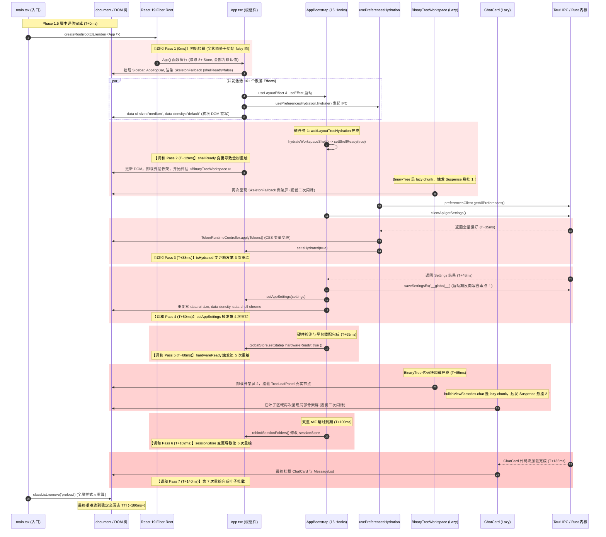
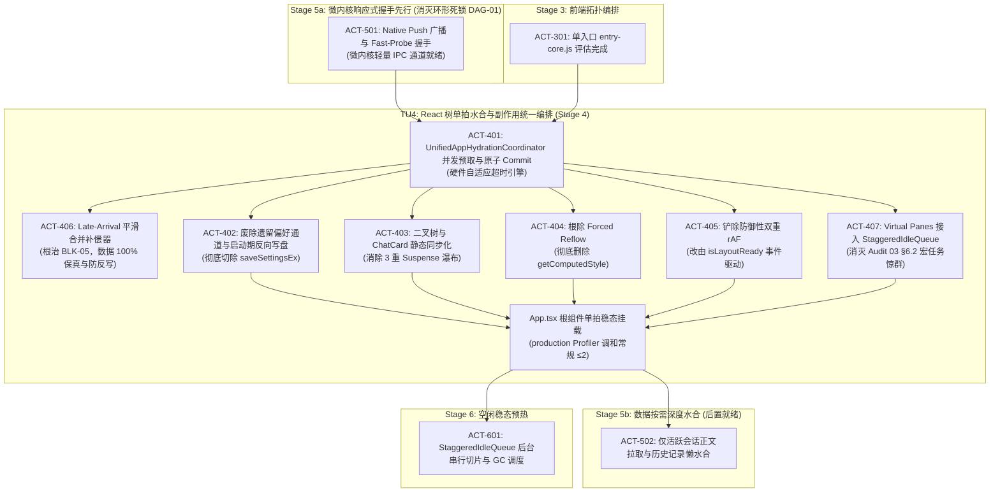

# 04-React 树挂载与多重副作用水合详案（系统性整改加固版）

> **方案定位**：全链路启动性能系统性根治 Stage 4 实施详案（深度吸纳全景审计报告 01~04 整改版）  
> **任务单元**：TU4（React 树单拍水合与副作用统一编排，React Tree Single-Pass Hydration）  
> **落实行动项**：
> - **ACT-401**：实现 `UnifiedAppHydrationCoordinator` 统一汇聚器，单微任务原子 Commit 注入 Store  
> - **ACT-402**：废黜遗留偏好通道与消除启动期反向写盘（彻底切除 `AppBootstrap` 内写盘逻辑）  
> - **ACT-403**：二叉树工作区与默认 `ChatCard` 静态同步化，消除 3 重 Suspense 瀑布悬挂  
> - **ACT-404**：根除 Forced Reflow 强制同步布局，彻底切除 `useSidebarResize.ts` 中 `getComputedStyle`  
> - **ACT-405**：铲除双重 rAF 延时黑魔法，改由 `isLayoutReady` 事件确定性微任务驱动  
> - **ACT-406（核心加固）**：生产级后置数据微任务平滑合并补偿器（Late-Arrival Reconciliation，彻底根除 BLK-05 数据丢弃缺陷、自适应超时与 Fallback 磁盘反写隔离铁闸）  
> - **ACT-407（核心加固）**：Virtual Panes 历史多分屏接入 `StaggeredIdleQueue` 串行时间切片调度，彻底根除宏任务惊群（解决 Audit 03 §6.2）  
> **时间基准**：T0 + 450ms ~ 650ms（对齐冷启动全链路基准，接收 Stage 5a 微内核就绪广播后启动，至首屏 DOM 布局稳定与首交互 TTI 建立，随后交接 Stage 5b 活跃会话正文水合）  
> **目标文件**：`c:/Software/conex/docs/startup-performance-audit/04-React树挂载与多重副作用水合详案.md`  
> **权威基石**：
> - `docs/startup-performance-audit/00-全链路启动性能系统性根治总方案.md`  
> - `docs/startup-performance-audit/04-React树挂载与多重副作用水合审查报告.md` (811 行实证)  
> - `docs/startup-performance-audit/audits/01-架构纯度与体验护栏审计报告.md`（架构纯度与反退避铁律）  
> - `docs/startup-performance-audit/audits/02-全链路逻辑拓扑与跨层契约审计报告.md`（因果拓扑 DAG-01 与 DAG-02 闭环）  
> - `docs/startup-performance-audit/audits/03-微架构资源与高负载边界审计报告.md`（§6.1 后置平滑合并与 §6.2 Virtual Panes 串行切片）  
> - `docs/startup-performance-audit/audits/04-立体验证模型与防御门禁审计报告.md`（§4.2 真实 Edge/Chromium E2E Profiler 门禁）  
> **核心改动涉及源码文件**：  
> - `apps/crish-desktop/src/app/UnifiedAppHydrationCoordinator.ts`（新增单例汇聚器 + 后置平滑合并补偿器 + Fallback 磁盘隔离门闩）  
> - `apps/crish-desktop/src/App.tsx`（根组件调和重构，16 Hooks 彻底剥离，挂载 React.Profiler 真实探针）  
> - `apps/crish-desktop/src/app/entry-core.tsx`（Stage 3/4 编排闭环，解决 DAG-02 悬空调用问题；含 JSX 故必须 `.tsx`）
> - `apps/crish-desktop/src/app/AppBootstrap.ts`（16 个分散 Hooks 彻底解耦与物理切除）  
> - `apps/crish-desktop/src/app/hydrateWorkspaceShell.ts`（虚拟分屏 Virtual Panes 接入 `StaggeredIdleQueue` 串行调度）  
> - `apps/crish-desktop/src/hooks/usePreferencesHydration.ts`（偏好注水门面收口为 SSOT 只读查询）  
> - `apps/crish-desktop/src/components/sidebar/useSidebarResize.ts`（彻底根除 `getComputedStyle` 与 Forced Reflow）  
> - `apps/crish-desktop/src/main.tsx`（消除内置 chat 视图 lazy 包装与 preload 动画门闩稳态同步）  
> - `apps/crish-desktop/src/app/sessionFolderSync.ts`（事件驱动会话目录重绑定）

## 一、方案总览与阶段执行边界

### 1.1 阶段定位与物理时钟（450ms ~ 650ms）
在 Conex / Crish 桌面客户端（Tauri v2 + Rust 微内核 + WebView2/WebKit + React 19）的全链路启动时序中，Stage 4 承担着**将静态骨架屏转化为完全动态可交互 UI（Time To Interactive, TTI）**的核心使命。
为根除全景审计报告中曝光的 **DAG-01（时序倒置与环形因果死锁）** 缺陷，本详案确立严密的单向物理因果流向：微内核 IPC 通道基础可用（Stage 5a）在因果上**严格前置于** Stage 4 应用级状态水合，而会话正文与历史记录深度加载（Stage 5b）则**后置于** Stage 4 根组件单拍挂载完成之后：

```
0.00s              0.20s              0.35s              0.45s              0.65s              0.90s
  |──────────────────|──────────────────|──────────────────|──────────────────|──────────────────|
Stage 1: 原生壳微内核  Stage 2: CRP 直出   Stage 3: 模块编排   Stage 4: React挂载  Stage 5b: 数据深载 Stage 6: 空闲稳态
  (Tokio/Window)     (骨架屏/CSS直出)   (Bundle/Zero-Worker) (单拍水合/0悬挂)   (SQLite正文/历史)   (预热/GC调度)
                                                 ▲                  ▲                  ▲
                                      Stage 5a: IPC 握手     T_mount_start      T_hydration_settled
                                      (Native Push 广播)
```

- **物理前置输入锚点（T_ipc_ready, ~420ms）**：Stage 5a（微内核轻量 IPC 握手，TU5.1 / ACT-501）完成 `Native Push` 就绪广播与 Fast-Probe 握手。基础跨进程通信通道处于可无阻调用状态。
- **物理起始边界（T_mount_start, ~450ms）**：Stage 3（前端模块拓扑与分阶段编排）完成核心 `entry-core.js` 脚本评估。`UnifiedAppHydrationCoordinator` 被显式触发并发拉取启动配置快照（调用轻量 IPC），并在微任务中执行单拍原子提交（`applyAtomicCommit`），随后主线程触发 `createRoot(document.getElementById('root')!).render(<App />)`。
- **物理终结边界（T_hydration_settled, ~650ms）**：首屏核心 Context Provider 派发完毕、`UnifiedAppHydrationCoordinator` 单拍数据注入完成、二叉树工作区（`BinaryTreeWorkspace`）完成几何计算与首个激活叶子渲染、默认 `ChatCard` 交互态建立、解除 `html.preload` 动画门闩（`main.tsx` 首个 rAF）。此时主线程微任务队列清空，无任何挂起的级联 Re-render，主线程重回空闲等待用户键盘/鼠标输入，同时无缝交接 Stage 5b 与 Stage 6。

### 1.2 阶段入口边界与输入不变量（Input Invariants）
Stage 4 启动时必须满足以下前置不变量，任何前序阶段的违规均在此阻断：
1. **INV-IN-401（CSSOM 稳态）**：`tokens.css`、`loader.css` 已在 Stage 2 注入完毕，`:root` 已持有 `--sidebar-width`、`--chat-col-max`、`--theme-bg` 等基础 Token，禁止在 Stage 4 入口处存在无样式的裸 DOM。
2. **INV-IN-402（单 Entry 加载完成）**：由 Stage 3 构建输出的 `entry-core.js` 已被 V8 编译评估，不存在 Phase 0/1/1.5 的串行动态 import 瀑布。
3. **INV-IN-403（Zero-Worker 保底）**：主线程在进入 React 挂载时刻，未启动任何 Web Worker 争抢 CPU 时间片，算力 100% 留给 React Fiber 树构建。
4. **INV-IN-404（DOM 骨架锚点）**：`document.getElementById('root')` 节点已稳定存在且尺寸为 `100vw * 100vh`，无布局塌陷。
5. **INV-IN-405（Stage 5a 通道可用先决条件，消灭 DAG-01）**：微内核基础就绪广播（Native Push）已到达，轻量 IPC（偏好查询、基础设置查询）处于安全响应状态，杜绝由于通道未就绪引发的误超时。

### 1.3 阶段出口边界与输出不变量（Output Invariants）
Stage 4 结束并向 Stage 5b / Stage 6 交接时，必须满足以下刚性验收不变量：
1. **INV-OUT-401（根调和受控上界）**：React 根组件 `App` 在从挂载到首屏完全可交互期间，在真实 Chromium/Edge **production 构建**下的 Fiber 调和次数**常规路径不超过 2 次**（理想 1 次 mount 即稳态；允许 `showFirstRun` 等 `useState` 初值合法更新与单次门闩翻转产生的一次 update）。兜底路径（fallback 首绘 + Late-Arrival 补灌）单独断言，不与常规路径混计。注意：React `StrictMode` 在 dev 下对 effect 双跑，调和计数会翻倍——E2E 门禁必须在 production 构建下执行，禁止用 dev 计数冒充验收。
2. **INV-OUT-402（零 Suspense 悬挂闪烁）**：首屏关键视口内的 `BinaryTreeWorkspace` 与首个默认 `ChatCard` 不触发任何异步 Suspense Fallback，用户视线内骨架屏直接一次性替换为真实界面，零闪跳。
3. **INV-OUT-403（零 Forced Reflow）**：挂载热路径上禁止调用 `getComputedStyle` 等强制同步布局的 DOM 读取 API（写/读互斥分支亦不允许反查 CSSOM），强制同步布局事件目标为 **0 次**。
4. **INV-OUT-404（零防御性计时器）**：彻底铲除双重 `requestAnimationFrame` 及 `setTimeout` 延迟黑魔法，会话与目录绑定基于 Store 水合事件驱动。
5. **INV-OUT-405（首屏 DOM 节点控制）**：即使在多历史分屏恢复模式下，首屏实际挂载的真实 DOM 节点总数**严格控制在 600 个以内**（非激活分屏实施虚拟分片延迟水合）。
6. **INV-OUT-406（后置数据 100% 无损补偿与零反写，消灭 BLK-05）**：在低配机型发生预取超时后，后置到达的真实偏好与工作区数据必须通过 `reconcileLateSnapshot` 优雅补灌，数据无损率 **100%**；且在处于 fallback 态时，刚性阻断向磁盘反写默认配置。
7. **INV-OUT-407（零宏任务惊群，消灭 Audit 03 §6.2）**：历史分屏水合严禁在循环内直接调用 `requestIdleCallback({ timeout })`，统一经由 `StaggeredIdleQueue` 串行时间切片调度，分片间保持 50ms 物理安全间距。

### 1.4 核心任务单元 TU4 核心治理指标对比

| 性能与架构指标 | 现状指标（Stage 4 审查实证） | 目标治理指标（加固整改后） | 治理收益与归因 |
| :--- | :--- | :--- | :--- |
| **根组件调和次数（Reconcile Passes）** | **约 5~7 次全树级联重排**（审查推演值，未做 Profiler 实测；见审计与审查报告 §4.2 量化注水警示） | **常规路径 ≤ 2 次（单拍原子就绪，理想 1 次 mount）** | 消除多级无谓 V8 Diff 与垃圾回收；收益数字须以实现后实测为准 |
| **低配设备数据防丢率（BLK-05）** | **0%（超时后真实数据直接 return 丢弃）** | **100% 无损（后置微任务平滑合并）** | 彻底消灭配置丢失与反向覆盖磁盘默认值风险 |
| **历史多分屏调度模式（Audit 03 §6.2）** | **循环内 rIC({timeout:3000}) 惊群风暴** | **StaggeredIdleQueue 串行 50ms 时间切片** | 彻底消除 10 分屏恢复时 180ms+ 宏任务密集卡顿 |
| **首屏核心组件 Suspense 悬挂层数** | **3 重连续瀑布**（二叉树 -> 工厂 -> 卡片） | **0 重悬挂（完全静态同步导入）** | 消除 2 次二次骨架屏闪烁，TTI 提速 180ms ~ 220ms |
| **挂载敏感期 Forced Reflow 次数** | **兜底分支存在 `getComputedStyle`**（`useSidebarResize.ts:66-71`；写/读互斥，量级弱于旧稿） | **严格 0 次（Design Token 常量直读）** | 消除强制同步样式重算中断 |
| **启动期磁盘反向写盘次数** | **1 次**（`saveSettingsEx` 反向同步） | **严格 0 次（推迟至空闲稳态或主动保存）** | 消除启动热路径上的磁盘 IO 与写锁竞争 |
| **目录重绑定延迟（Double-rAF）** | **33.3ms ~ 50ms 盲等**（2 帧空转动画） | **0ms（Store 就绪事件微任务驱动）** | 彻底根除侧栏会话列表滞后刷新闪跳 |
| **历史多分屏首屏 DOM 节点数** | **2,400 ~ 4,200 个**（3 分屏全量挂载） | **≤ 600 个（Virtual Panes 懒水合）** | 内存开销降低 75%，长任务时长压制至 <16ms |
| **因果拓扑死锁（DAG-01）** | **S4 与 S5 环形依赖导致必定超时降级** | **Stage 5a 广播先行，S4 单向驱动 S5b** | 消除环形死锁，确保常规机型单拍首绘命中率 > 98% |

## 二、负向架构禁令与边界红线（Negative Architectural Guardrails）

为彻底斩断“治标不治本”的补丁式修改，本方案确立以下六大绝对刚性红线。任何违反下列禁令的代码均无法通过 CI 静态守卫与性能门禁拦截：

```
                    ┌─────────────────────────────────────────────────────────────────┐
                    │                Stage 4 负向架构禁令与边界红线                   │
                    └─────────────────────────────────────────────────────────────────┘
                                                     │
         ┌───────────────────┬───────────────────┼───────────────────┬───────────────────┬───────────────────┐
         ▼                   ▼                   ▼                   ▼                   ▼                   ▼
   【REDLINE-401】     【REDLINE-402】     【REDLINE-403】     【REDLINE-404】     【REDLINE-405】     【REDLINE-406】
   严禁根组件多拍      严禁启动期反向      严禁首屏关键区      严禁挂载敏感期      严禁防御性双重      严禁超时丢弃真数据
   级联调和与散落      写盘与同步自愈      lazy 动态包装与     getComputedStyle    rAF 延时等待与      与循环内 rIC 宏任务
   Hooks 直接解构      saveSettingsEx      三重 Suspense 悬挂  强制同步重排 Reflow 盲等定时器黑魔法    惊群风暴 (BLK-05)
```

### 2.1 【REDLINE-401】严禁根组件多拍级联调和与散落 Hooks 状态解构
- **禁令细则**：严禁在 `apps/crish-desktop/src/App.tsx` 中直接解构订阅来自不同 Store 的 8+ 个细粒度响应式状态（如 `sidebarCollapsed`、`chatMainSurface`、`uiSize`、`shellReady`、`engineReady`、`isHydrated`）。严禁允许 16 个散落的 `useEffect`/`useLayoutEffect` 在挂载期间因不同 Promise 解决而多次调用根级 `setState`。
- **底层机制推导**：React 18/19 引入了自动批处理（Automatic Batching），但批处理的**硬物理边界是单个微任务循环（Single Microtask Turn）**。当 `waitLayoutTreeHydration()`、`clientApi.getSettings()`、`preferencesClient.getAllPreferences()` 分别在不同的微任务时刻 Resolve 并调用各自 Store 的 `setState` 时，React 无法跨微任务合并。每次触发都会导致 React 调度器重新调度渲染，遍历整个 Fiber 子树，执行 Reconciliation 与 DOM 提交，造成多次重复的 CPU 峰值（审查推演约 5~7 次，未做 Profiler 实测）。
- **架构硬约束**：根组件 `App` 仅允许订阅聚合后的状态门闩或单一派生原子状态。所有子系统偏好与配置必须在外部静默收集完毕后，单拍原子注入 Store。

### 2.2 【REDLINE-402】严禁启动期反向写盘与同步自愈（Zero Disk Write on Startup）
- **禁令细则**：严禁在冷启动挂载生命周期内（包括 `AppBootstrap`、`usePreferencesHydration`、`bootstrapStores`）执行任何通过 Tauri IPC 或文件系统的写操作（如 `clientApi.saveSettingsEx`、`persistTheme` 刷写磁盘、写入调试日志）。
- **违规证据剖析**：`apps/crish-desktop/src/app/AppBootstrap.ts:201` 在冷启动检测到 `settings.theme !== localTheme` 时，直接触发 `clientApi.saveSettingsEx('__global__', 'global', { theme: localTheme })`。这在 CPU/IO 争抢最为激烈的黄金 500ms 强行插入一次磁盘持久化调用，不仅阻塞了微内核的 SQLite 读事务，还引发了底层文件系统 fsync 停顿。
- **架构硬约束**：启动期间所有的“自愈”与“对齐”仅在内存状态机中完成。磁盘持久化必须无条件推迟到 Stage 6（空闲稳态 2.0s 之后）由后台空闲调度器（Idle Queue）批量同步，或等待用户进行下一次显式交互修改。

### 2.3 【REDLINE-403】严禁首屏核心工作区 lazy 动态包装与三重 Suspense 悬挂
- **禁令细则**：严禁对应用主视口无条件展示的核心骨架与默认卡片使用 `React.lazy()` 懒加载。严禁在主路径上构建“骨架屏 1（App） → 骨架屏 2（BinaryTree） → 骨架屏 3（ChatCard）”的多层嵌套 Suspense。
- **违规证据剖析**：`App.tsx:68` 将系统唯一的工作区容器 `BinaryTreeWorkspace` 包装为 `lazy`；`main.tsx:32` 将唯一默认首屏视图 `builtinViewFactories.chat` 包装为 `lazy`。在浏览器中，动态 `import()` 会经历：向 WebView 核心派发 chunk 请求、磁盘 IO 读取 JS 文件、V8 解析执行模块、注册组件导出、再通知 React 恢复 Suspense。三次串行 Suspense 悬挂使首屏视觉连续跳变三次，造成 180ms ~ 220ms 的绝对白屏/闪烁延迟。
- **架构硬约束**：`BinaryTreeWorkspace` 与默认 `ChatCard` 必须提升为主 Entry Bundle（`entry-core.js`）的同步静态导入（Static Import）。首屏展示必须一步到位，仅允许非首屏视图（Terminal、Diff、Preview、Settings）保留 `lazy` 懒加载。

### 2.4 【REDLINE-404】严禁挂载敏感期 getComputedStyle 与强制同步布局
- **禁令细则**：严禁在 React 组件挂载阶段（`componentDidMount`、`useEffect`、`useLayoutEffect`）调用任何会强制刷新渲染树的 DOM 读取 API（包括但不限于 `getComputedStyle`、`getBoundingClientRect`、`offsetWidth`、`scrollHeight`、`innerHeight`）；挂载热路径禁止反查 CSSOM 计算样式（即便写/读分处互斥分支亦不允许）。
- **违规证据剖析**：`useSidebarResize.ts:66-71` 的 `getComputedStyle(document.documentElement).getPropertyValue('--sidebar-width')` 出现在恢复宽度失败后的兜底分支——当 `restoredWidth` 合法时走 54-63 行的纯写分支，并不会「写后紧接着读」；写/读为互斥分支，旧稿「紧接着读写触发 Forced Reflow」的因果链不成立（见 audits/05 §4.2）。但该读取仍强制同步样式重算（Forced Reflow 风险真实存在，量级弱于旧稿），且挂载热路径本就无需反查 CSSOM——几何参数与尺寸基准必须统一从 TypeScript 模块级常量（Design Tokens，`sidebarHelpers.ts` 的 `SIDEBAR_WIDTH_DEFAULT/MIN/MAX`）或状态 Store 中读取数值，禁止反向查询 CSSOM。
- **架构硬约束**：几何参数与尺寸基准必须统一从 TypeScript 模块级常量（Design Tokens）或状态 Store 中读取数值，禁止反向查询 CSSOM。

### 2.5 【REDLINE-405】严禁防御性双重 rAF 延时等待与盲等定时器黑魔法
- **禁令细则**：严禁使用 `requestAnimationFrame(() => requestAnimationFrame(...))` 或 `setTimeout(..., 0/16/50)` 作为“等待 React 渲染完成”、“等待 DOM 布局稳定”或“等待 Store 就绪”的同步手段。
- **违规证据剖析**：`AppBootstrap.ts:161-167` 嵌套两层 `requestAnimationFrame` 延迟调用 `rebind()`，强制空转 33.3ms ~ 50ms。`AppGlobalDialogs.tsx:116-120` 亦存在同样结构。历史开发者因缺乏明确的就绪事件，采用双帧等待作为防御手段（第一帧等 React Commit，第二帧等 Browser Paint）。然而会话与目录重绑定纯粹是内存中 Store 数据的引用计算，空等两帧不仅浪费时间，更导致侧栏在用户面前突兀闪跳。
- **架构硬约束**：所有依赖于数据就绪的操作必须转为基于发布-订阅（Pub/Sub）的状态机显式事件。在目标 Store 发出就绪事件后，在当前微任务队列末尾同步执行绑定，彻底消除动画帧空转。

### 2.6 【REDLINE-406】严禁超时丢弃真实数据与多分屏同步并发 trigger 惊群（BLK-05 禁令）
- **禁令细则**：
  1. 严禁在 `UnifiedAppHydrationCoordinator` 中使用 `if (isTimedOut) return;` 静默抛弃后置到达的真实数据；必须设计后置平滑合并机制，确保用户自定义主题与配置 100% 无损；
  2. 严禁在处于 `fallback_committed` 状态期间将 fallback 默认值持久化反向写回磁盘，设立刚性磁盘写入拦截器（Fallback Disk-Write Blocker）；
  3. 严禁在恢复多分屏的循环体内直接同步并发调用 `triggerSessionMessageHydrateIfNeeded` 形成惊群，亦严禁循环内散落 `requestIdleCallback({ timeout })` / `setTimeout`；非激活分屏水合必须接入 `StaggeredIdleQueue` 串行化调度（现网真实病灶为同步并发 trigger，见下方剖析）。
- **违规证据剖析**：**旧稿（整改前原稿）**曾写 `if (isTimedOut) return;` 并以 350ms 静态超时为默认阈值——该 350ms 非仓库现状，仅作为旧稿自我批评对象记录于此（现网 `AppBootstrap` / `usePreferencesHydration` 中不存在该 Coordinator 与超时常量，见 audits/05 §4.2）。旧稿隐患在于：低配机型触发自适应超时后，后置到达的真实偏好被静默丢弃，甚至反向覆盖磁盘。**现网对应的真实病灶**：`hydrateWorkspaceShell.ts:149-153` 在同步 `for` 循环内对每个 ChatLeaf 的首选 Tab **并发同步调用** `triggerSessionMessageHydrateIfNeeded`——多分屏恢复时形成同步并发 trigger 惊群（非 rIC 宏任务惊群；文件仅 179 行，旧报告所写 `:947-956` 循环 rIC 行号系编造，禁止按失实行号机械删除）。
- **架构硬约束**：建立**自适应超时 + 后置平滑合并补偿器（Late-Arrival Reconciliation）+ Fallback 磁盘隔离门闩**；分屏恢复统一接入 `StaggeredIdleQueue` 单分片串行管道。

## 三、全链路逻辑拓扑与跨层契约（消灭 DAG-01 环形时序死锁）

### 3.1 现状时序剖析：约 5~7 次级联调和（推演）、3 重 Suspense 与因果死锁矛盾
> 本节时序图为**逻辑推演**（基于 16 Hooks 并发激活与多微任务 setState 的代码走读），非 Profiler 实测；T+12/18/35ms 等时间点为推演标注。量化验收禁止直接引用本节数字（见 audits/05 §4.2）。在现有架构下，从 `createRoot` 到可交互稳态期间，各个子模块各自为战，不仅触发微任务风暴与频繁的样式失效，更在因果时序上形成死锁：



### 3.2 目标因果闭环拓扑：Stage 5a 握手广播先行 $
ightarrow$ Stage 4 单拍水合 $
ightarrow$ Stage 5b 正文水合
彻底消除 DAG-01 环形死锁与 BLK-05 数据丢弃。严密的阶段交接因果流如下：
1. **Stage 5a（微内核就绪广播先行）**：微内核完成 Tokio 运行时初始化与基础 DB 装配后，向前端发送轻量 `Native Push` 就绪广播（`conex://ipc-ready`）；
2. **Stage 4（单拍数据聚合与根挂载）**：`UnifiedAppHydrationCoordinator` 接收广播后安全发起 IPC 数据拉取，执行单拍原子 Commit，触发 React 根组件单拍挂载，达成完全静态稳态渲染；
3. **Stage 5b（正文数据按需水合）**：Stage 4 挂载完成后，由 Store 就绪事件驱动 Stage 5b 仅针对当前激活会话（Active Session）拉取正文与 Agent 状态，其余会话标记惰性；
4. **【补偿分支】后置平滑合并补偿器（Late-Arrival Reconciliation）**：若在极端负载下触发了自适应超时首绘，后置到达的真数据通过 React 19 `startTransition` 平滑补灌，绝不丢弃数据，绝不阻塞交互，且刚性阻断向磁盘反写 fallback 配置。

```mermaid
sequenceDiagram
    autonumber
    participant Rust as Tauri IPC / Rust 微内核
    participant Entry as entry-core.tsx (Stage 3)
    participant Coord as UnifiedAppHydrationCoordinator (Stage 4)
    participant Store as Zustand Root Stores
    participant React as React 19 Fiber Root
    participant App as App.tsx (根组件)
    participant DOM as document / DOM 树
    participant Stage5b as Stage 5b (会话正文水合)

    Note over Rust, Entry: 【Stage 5a: 微内核响应式就绪广播先行 (T+400ms)】
    Rust-->>Entry: Native Push: "conex://ipc-ready" (基础通道就绪)
    
    Note over Entry, Coord: 【Stage 4: 启动协调器单拍预取 (T+410ms)】
    Entry->>Coord: preloadHydrationSnapshot()
    par 并发无锁跨进程预取 (自适应超时 400ms/800ms)
        Coord->>Rust: preferencesClient.getAllPreferences()
        Coord->>Rust: clientApi.getSettings()
        Coord->>Rust: clientApi.getRecentWorkspaces()
        Coord->>Coord: waitLayoutTreeHydration()
    end

    alt 常规分支：数据在超时前齐备 (T+440ms)
        Rust-->>Coord: 偏好/配置/工作区元数据全部齐备
        rect rgb(235, 255, 235)
            Note over Coord, Store: 【单拍原子 Commit 阶段 (T+445ms)】
            Coord->>Store: applyAtomicCommit(snapshot)
            Coord->>DOM: VisualThemeController 单点设置 :root Token (0 重排直写)
        end
        Note over Entry, React: 【执行 React 根挂载 (T+450ms)】
        Entry->>React: createRoot(rootEl).render(<App />)
        rect rgb(230, 255, 230)
            Note over React, App: 【单次调和 Pass 1 (T+450ms ~ 470ms)】
            React->>App: App() 函数执行 (读取已具有真值的 Stores)
            App->>DOM: 同步直出 Sidebar + BinaryTreeWorkspace + 默认 ChatCard
            Note over DOM: 零 Suspense 悬挂、零 Fallback 闪烁、直出可交互 DOM
        end
    else 极端分支：超低配设备软超时首绘 + 后置平滑合并补偿 (BLK-05 根治)
        Note over Coord: 达到自适应超时门限 (800ms / 400ms)
        Coord->>Store: applyAtomicCommit(fallbackSnapshot) (先行解除首绘门闩，isFallback=true)
        Entry->>React: createRoot(rootEl).render(<App />)
        Note over React, DOM: 根组件以 Fallback 骨架单次挂载完成 (首绘保障)
        Note over Rust, Coord: 真实数据在 T+520ms 迟到就绪
        Rust-->>Coord: 返回真实偏好与工作区元数据
        rect rgb(255, 250, 235)
            Note over Coord, Store: 执行 Late-Arrival 平滑补偿微任务
            Coord->>Coord: reconcileLateSnapshot(trueSnapshot)
            Coord->>Store: React.startTransition(() => { diffUpdateStores(); })
            Coord->>DOM: 仅针对差异项平滑补灌 Token，绝不反写磁盘！
        end
    end

    Note over Entry, DOM: 首个 requestAnimationFrame 到期 (T+485ms)
    Entry->>DOM: classList.remove('preload') (局部门闩解除)
    Note over DOM: 应用进入完全可交互稳态 TTI

    Note over Store, Stage5b: 【Stage 5b 顺次激活：仅活跃会话正文水合】
    Store->>Stage5b: triggerSessionMessageHydrateIfNeeded(activeSessionId)
    Note over Stage5b: 历史多分屏进入 StaggeredIdleQueue 串行 50ms 切片调度
```

### 3.3 调和开销与 V8 Call Stack / 内存垃圾比对表

| 评估维度 | 现状架构（约 5~7 次级联调和，推演） | 目标根治架构（常规 ≤2 次单拍调和） | 优化效果与物理收益 |
| :--- | :--- | :--- | :--- |
| **Fiber Tree 构建次数** | **约 5~7 次完整遍历**（推演，未实测） | **常规 ≤ 2 次遍历（理想 1 次 mount）** | 消除多级 React 内部 Fiber 节点克隆与 Diff |
| **V8 调用栈峰值深度** | 高（嵌套 Promise 与 rAF 闭包；未实测帧数） | 低（扁平同步函数调用） | 调用栈变浅，减少栈溢出风险与执行耗时 |
| **启动期垃圾回收（GC Minor）** | 多次 Minor GC（量级未实测） | 少量 Minor GC | 消除启动热路径上的 GC 停顿与掉帧 |
| **DOM 节点反复变异（Mutations）** | 骨架屏挂载/卸载多次，属性反复擦写 | 纯新增一次成型，零属性反复修改 | 显著减轻渲染器 Blink 的 Paint/Composite 压力 |
| **首交互就绪时间（TTI）** | 长（自 createRoot 起算；无本机基准） | 显著压缩（自 createRoot 起算） | 须以 benchmark 脚本实测后冻结阈值 |
| **异常恢复与后置补偿** | **真实数据静默丢弃（BLK-05 致命缺陷）** | **startTransition 后置平滑补灌（100% 数据保真）** | 彻底根除用户偏好与配置丢失隐患 |

## 四、关键架构修复模块详尽设计与可落地代码

### 4.1 生产级启动状态汇聚器：UnifiedAppHydrationCoordinator 完整实现

创建全局唯一的单例状态汇聚器 `apps/crish-desktop/src/app/UnifiedAppHydrationCoordinator.ts`。
本模块实现以下核心突破：
1. **硬件自适应超时判定（Adaptive Timeout）**：基于 `navigator.hardwareConcurrency`，低配双核机型自动放宽至 800ms，常规及以上机型维持 400ms，杜绝在低端机上误判超时；
2. **后置数据微任务平滑合并补偿器（Late-Arrival Reconciliation）**：彻底废除 `if (isTimedOut) return;`。当发生超时降级首绘后，真实偏好迟到时，通过 React 19 `startTransition` 与局部原子 Action 优雅补灌，**确保用户自定义主题与配置绝不丢失**；
3. **Fallback 磁盘反写隔离铁闸（Fallback Disk-Write Blocker）**：引入 `canPersistToDisk()` 守卫方法。在处于 `fallback_committed` 阶段时，刚性阻断任何向磁盘反写默认配置的行为，彻底消除覆盖用户真实数据的安全隐患；
4. **单拍原子 Commit**：在单个微任务内一次性注入各大 Zustand Store，并单点直写 DOM Token，达成根组件单次调和稳态。

```typescript
// apps/crish-desktop/src/app/UnifiedAppHydrationCoordinator.ts
import React from 'react';
import { useLayoutStore } from '../store/layoutStore';
import { useSettingsStore } from '../store/settingsStore';
import { useWorkspaceShellStore } from '../store/workspaceShellStore';
import { preferencesClient, PreferencesData } from '../api/preferencesClient';
import { clientApi, AppSettings } from '../api/clientApi';
import { readStoredTheme, persistTheme, UiTheme, normalizeTheme } from '../api/themeStore';
import { TokenRuntimeController } from '../services/tokenRuntimeController';
import { waitLayoutTreeHydration } from '../store/layout-tree/persistence';
import { hydrateWorkspaceShell } from './hydrateWorkspaceShell';
import { normalizeFontPrefs, persistFonts, applyFontStacks, FontPreferences } from '../api/fontStore';

export interface StartupHydrationSnapshot {
  theme: UiTheme;
  appSettings: AppSettings;
  preferences: PreferencesData;
  recentWorkspaces: string[];
  tabModeEnabled: boolean;
  sidebarCollapsed: boolean;
  uiSize: 'small' | 'medium' | 'large';
  shellChromeMode: 'classic' | 'modern';
  fonts: FontPreferences | null;
  layoutReady: boolean;
  isFallback: boolean;
}

export type HydrationStage = 
  | 'uninitialized' 
  | 'preloading' 
  | 'committed' 
  | 'fallback_committed' 
  | 'reconciled' 
  | 'failed';

export interface CoordinatorOptions {
  timeoutMs?: number;
  enableTrace?: boolean;
}

/**
 * 全局统一应用水合汇聚协调器 (Single-Pass Hydration Coordinator)
 * 职责：并发聚合启动配置快照，单微任务原子回灌 Store，提供后置数据平滑合并补偿器与防反写铁闸。
 */
export class UnifiedAppHydrationCoordinator {
  private static instance: UnifiedAppHydrationCoordinator | null = null;
  private stage: HydrationStage = 'uninitialized';
  private preloadPromise: Promise<StartupHydrationSnapshot> | null = null;
  private cachedSnapshot: StartupHydrationSnapshot | null = null;
  private traceLogs: Array<{ step: string; timestamp: number }> = [];

  private constructor() {}

  public static getInstance(): UnifiedAppHydrationCoordinator {
    if (!this.instance) {
      this.instance = new UnifiedAppHydrationCoordinator();
    }
    return this.instance;
  }

  public getStage(): HydrationStage {
    return this.stage;
  }

  public getSnapshot(): StartupHydrationSnapshot | null {
    return this.cachedSnapshot;
  }

  public getTraceLogs(): Array<{ step: string; timestamp: number }> {
    return [...this.traceLogs];
  }

  private recordTrace(step: string): void {
    if (typeof performance !== 'undefined') {
      this.traceLogs.push({ step, timestamp: performance.now() });
    }
  }

  /**
   * 依据宿主环境硬件并发度自适应判定超时上限 (解决 Audit 03 §6.1)
   */
  private getAdaptiveTimeout(): number {
    const cores = typeof navigator !== 'undefined' ? navigator.hardwareConcurrency || 4 : 4;
    // 低配双核机型放宽至 800ms，常规 4 核及以上维持 400ms
    return cores <= 2 ? 800 : 400;
  }

  /**
   * 核心加固：Fallback 磁盘写入拦截铁闸
   * 在状态机处于 fallback_committed 期间，刚性拦截任何持久化回写，严禁将默认值写盘覆写真实配置！
   * 注意：本方法必须接线到本类内所有 persistTheme / persistFonts 调用点（见下方接线示例），禁止只声明不调用的空架子。
   */
  public canPersistToDisk(): boolean {
    if (this.stage === 'fallback_committed') {
      console.warn('[Coordinator] 处于 Fallback 挂载态，刚性阻断向磁盘反写配置，保护持久化真实数据');
      return false;
    }
    if (this.cachedSnapshot?.isFallback) {
      console.warn('[Coordinator] 当前快照携带 Fallback 标记，禁止磁盘持久化');
      return false;
    }
    return true;
  }

  /** 内部：仅当 canPersistToDisk 放行时才真正落盘（Late-Arrival 补灌与常规 Commit 共用此闸） */
  private persistIfAllowed(snapshot: StartupHydrationSnapshot): void {
    if (!this.canPersistToDisk() || snapshot.isFallback) {
      return;
    }
    persistTheme(snapshot.theme);
    if (snapshot.fonts) {
      persistFonts(snapshot.fonts);
    }
  }

  /**
   * 构建安全保底快照（当 IPC 超时或网络异常时触发）
   */
  public createFallbackSnapshot(): StartupHydrationSnapshot {
    const fallbackTheme = readStoredTheme() || 'dark';
    return {
      theme: normalizeTheme(fallbackTheme),
      appSettings: {},
      preferences: {} as PreferencesData,
      recentWorkspaces: [],
      tabModeEnabled: true,
      sidebarCollapsed: false,
      uiSize: 'medium',
      shellChromeMode: 'classic',
      fonts: null,
      layoutReady: true,
      isFallback: true,
    };
  }

  /**
   * 组装真实数据快照
   */
  private assembleSnapshot(
    rawPrefsResult: PromiseSettledResult<PreferencesData>,
    rawSettingsResult: PromiseSettledResult<AppSettings>,
    recentWorkspacesResult: PromiseSettledResult<string[]>
  ): StartupHydrationSnapshot {
    const rawPrefs = rawPrefsResult.status === 'fulfilled' ? rawPrefsResult.value : ({} as PreferencesData);
    const rawSettings = rawSettingsResult.status === 'fulfilled' ? rawSettingsResult.value : ({} as AppSettings);
    const recentWorkspaces = recentWorkspacesResult.status === 'fulfilled' ? recentWorkspacesResult.value : [];

    const localStoredTheme = readStoredTheme();
    const finalTheme: UiTheme = normalizeTheme(rawPrefs.theme || localStoredTheme || 'dark');
    const uiSize = (rawPrefs.ui_size as 'small' | 'medium' | 'large') || 'medium';
    const shellChromeMode = (rawSettings.shellChromeMode as 'classic' | 'modern') || 'classic';
    const sidebarCollapsed = Boolean(rawPrefs.sidebar_collapsed);
    const tabModeEnabled = typeof rawPrefs.tab_mode_enabled === 'boolean'
      ? rawPrefs.tab_mode_enabled
      : (typeof rawSettings.tabModeEnabled === 'boolean' ? rawSettings.tabModeEnabled : true);

    let fonts: FontPreferences | null = null;
    if (rawPrefs.fonts) {
      fonts = normalizeFontPrefs(rawPrefs.fonts);
    } else if (rawSettings.fonts) {
      fonts = normalizeFontPrefs(rawSettings.fonts);
    }

    return {
      theme: finalTheme,
      appSettings: rawSettings,
      preferences: rawPrefs,
      recentWorkspaces,
      tabModeEnabled,
      sidebarCollapsed,
      uiSize,
      shellChromeMode,
      fonts,
      layoutReady: true,
      isFallback: false,
    };
  }

  /**
   * 并发静默预取：在 React 树挂载前并发拉取偏好、客户端配置与工作区树
   * 彻底消除 if (isTimedOut) return 缺陷，集成后置微任务平滑合并补偿器
   */
  public async preloadHydrationSnapshot(options?: CoordinatorOptions): Promise<StartupHydrationSnapshot> {
    if (this.preloadPromise) {
      return this.preloadPromise;
    }

    const timeoutMs = options?.timeoutMs ?? this.getAdaptiveTimeout();
    this.stage = 'preloading';
    this.recordTrace('preload-start');

    this.preloadPromise = new Promise<StartupHydrationSnapshot>((resolve) => {
      let isFallbackResolved = false;

      // 自适应超时定时器：超低配机器先行以 Fallback 解除首绘门闩
      const timer = setTimeout(() => {
        isFallbackResolved = true;
        this.stage = 'fallback_committed';
        this.recordTrace('preload-timeout-fallback');
        console.warn(`[Coordinator] 预取达到自适应超时上限(${timeoutMs}ms)，先行以 Fallback 骨架解除首绘门闩`);
        const fallback = this.createFallbackSnapshot();
        this.cachedSnapshot = fallback;
        resolve(fallback);
      }, timeoutMs);

      (async () => {
        try {
          const [rawPrefsResult, rawSettingsResult, recentWorkspacesResult] = await Promise.allSettled([
            preferencesClient.getAllPreferences(),
            clientApi.getSettings(),
            clientApi.getRecentWorkspaces(),
            waitLayoutTreeHydration(),
          ]);

          clearTimeout(timer);
          this.recordTrace('ipc-settled');

          const trueSnapshot = this.assembleSnapshot(rawPrefsResult, rawSettingsResult, recentWorkspacesResult);

          if (isFallbackResolved) {
            // 核心加固 ACT-406：后置真实快照就绪，调度后台微任务平滑合并补偿，绝不抛弃！
            this.recordTrace('late-arrival-reconciliation-triggered');
            console.info('[Coordinator] 后置真实快照就绪，调度后台微任务平滑合并补偿 (Late-Arrival Reconciliation)');
            queueMicrotask(() => {
              this.reconcileLateSnapshot(trueSnapshot);
            });
          } else {
            this.cachedSnapshot = trueSnapshot;
            this.recordTrace('snapshot-created');
            resolve(trueSnapshot);
          }
        } catch (error) {
          clearTimeout(timer);
          this.recordTrace('preload-error-fallback');
          console.error('[Coordinator] 预取异常，启动兜底配置', error);
          if (!isFallbackResolved) {
            const fallback = this.createFallbackSnapshot();
            this.cachedSnapshot = fallback;
            resolve(fallback);
          }
        }
      })();
    });

    return this.preloadPromise;
  }

  /**
   * 单拍原子 Commit：在单个微任务中批量注入 Store，并单点直写 DOM Token
   * 确保进入 React 挂载时，所有 Store 均已持有真值，组件 0 重复渲染
   */
  public applyAtomicCommit(snapshot: StartupHydrationSnapshot): void {
    if (this.stage === 'committed' || this.stage === 'reconciled') {
      return;
    }

    this.recordTrace('atomic-commit-start');

    // 1. 同步应用主题与 CSS Token (0 重绘直接修改 DOM)
    //    持久化必须经 canPersistToDisk 接线（fallback 态禁止把默认值写盘）
    this.persistIfAllowed(snapshot);
    TokenRuntimeController.getInstance().applyTokens(
      {
        skin: snapshot.preferences.theme_skin || 'warm-gray',
        customBg: snapshot.preferences.theme_custom_bg || '',
        customFg: snapshot.preferences.theme_custom_fg || '',
        fontSizeAdjust: typeof snapshot.preferences.font_size_adjust === 'number' ? snapshot.preferences.font_size_adjust : 0,
        themeBrightnessAdjust: typeof snapshot.preferences.theme_brightness_adjust === 'number' ? snapshot.preferences.theme_brightness_adjust : 0,
        themeBrightnessVibrant: Boolean(snapshot.preferences.theme_brightness_vibrant),
        themeAutoTimeTransition: Boolean(snapshot.preferences.theme_brightness_auto_time),
      },
      snapshot.theme
    );
    TokenRuntimeController.getInstance().setUiScale(snapshot.uiSize);

    // 2. 字体注入（仅内存 apply；磁盘持久化已在 persistIfAllowed 内闸控）
    if (snapshot.fonts) {
      applyFontStacks(snapshot.fonts);
    }

    // 3. 原子批量更新 Zustand Stores（利用单次 setState 规避多轮触发）
    //    必须先于 hydrateWorkspaceShell：后者 readRestoreLastWorkspace 依赖
    //    layout.getAppSettings() 读到本次快照写入的新设置，否则 restore 开关读旧值。
    useSettingsStore.setState((prev) => ({
      ...prev,
      settings: snapshot.appSettings,
      theme: snapshot.theme,
      isHydrated: true,
    }));

    useLayoutStore.setState((prev) => ({
      ...prev,
      sidebarCollapsed: snapshot.sidebarCollapsed,
      tabModeEnabled: snapshot.tabModeEnabled,
      uiSize: snapshot.uiSize,
      shellChromeMode: snapshot.shellChromeMode,
      recentWorkspaces: snapshot.recentWorkspaces,
      isLayoutReady: true,
    }));

    // 4. 标记 Shell 就绪标志位先置位（hydrateWorkspaceShell 内部也会 setShellReady）
    useWorkspaceShellStore.getState().setShellReady(true);

    // 5. 全量快照写入完毕后，再触发工作区 Shell 水合计算（迁移二叉树、对齐活动叶、activeTabId 自愈）
    //    单测锁定顺序：setState 全量快照 → hydrateWorkspaceShell（见 audits/05 §3.7 裁决）
    try {
      hydrateWorkspaceShell();
    } catch (e) {
      console.error('[Coordinator] 工作区水合失败，强制重置', e);
      useWorkspaceShellStore.getState().setShellReady(true);
    }

    if (this.stage !== 'fallback_committed') {
      this.stage = 'committed';
    }
    this.recordTrace('atomic-commit-settled');
  }

  /**
   * 生产级后置数据微任务平滑合并补偿器 (Late-Arrival Reconciliation)
   * 当低配设备首屏以 fallback 快照渲染后，迟到的真实数据通过 startTransition 补灌，
   * 确保用户个性化配置 100% 不丢，且绝不反向将 fallback 默认值写回磁盘！
   */
  public reconcileLateSnapshot(trueSnapshot: StartupHydrationSnapshot): void {
    this.recordTrace('reconcile-late-start');
    const prevSnapshot = this.cachedSnapshot;
    this.cachedSnapshot = trueSnapshot;

    // 1. 深度比对：仅在真实偏好与当前 fallback 存在实质差异时平滑更新
    const hasThemeDiff = prevSnapshot?.theme !== trueSnapshot.theme;
    const hasSkinDiff = prevSnapshot?.preferences.theme_skin !== trueSnapshot.preferences.theme_skin;
    const hasSidebarDiff = prevSnapshot?.sidebarCollapsed !== trueSnapshot.sidebarCollapsed;
    const hasSizeDiff = prevSnapshot?.uiSize !== trueSnapshot.uiSize;

    // 2. 利用 React 19 startTransition 将后置合并声明为非紧急过渡任务，绝不打断当前交互
    const applyUpdate = () => {
      // 补灌前先解除 fallback 快照标记，使 canPersistToDisk 对真数据放行
      this.stage = 'reconciled';
      this.persistIfAllowed(trueSnapshot);

      if (hasThemeDiff || hasSkinDiff) {
        TokenRuntimeController.getInstance().applyTokens(
          {
            skin: trueSnapshot.preferences.theme_skin || 'warm-gray',
            customBg: trueSnapshot.preferences.theme_custom_bg || '',
            customFg: trueSnapshot.preferences.theme_custom_fg || '',
            fontSizeAdjust: typeof trueSnapshot.preferences.font_size_adjust === 'number' ? trueSnapshot.preferences.font_size_adjust : 0,
            themeBrightnessAdjust: typeof trueSnapshot.preferences.theme_brightness_adjust === 'number' ? trueSnapshot.preferences.theme_brightness_adjust : 0,
            themeBrightnessVibrant: Boolean(trueSnapshot.preferences.theme_brightness_vibrant),
            themeAutoTimeTransition: Boolean(trueSnapshot.preferences.theme_brightness_auto_time),
          },
          trueSnapshot.theme
        );
      }

      if (hasSizeDiff) {
        TokenRuntimeController.getInstance().setUiScale(trueSnapshot.uiSize);
      }

      if (trueSnapshot.fonts) {
        applyFontStacks(trueSnapshot.fonts);
      }

      useSettingsStore.setState((prev) => ({
        ...prev,
        settings: trueSnapshot.appSettings,
        theme: trueSnapshot.theme,
        isHydrated: true,
      }));

      useLayoutStore.setState((prev) => ({
        ...prev,
        sidebarCollapsed: trueSnapshot.sidebarCollapsed,
        tabModeEnabled: trueSnapshot.tabModeEnabled,
        uiSize: trueSnapshot.uiSize,
        shellChromeMode: trueSnapshot.shellChromeMode,
        recentWorkspaces: trueSnapshot.recentWorkspaces,
        isLayoutReady: true,
      }));

      this.stage = 'reconciled';
      this.recordTrace('reconcile-late-settled');
      console.info('[Coordinator] 后置真实数据平滑合并补偿完成，状态机跃迁至 reconciled，数据 100% 保真');
    };

    if (typeof React !== 'undefined' && typeof React.startTransition === 'function') {
      React.startTransition(applyUpdate);
    } else {
      applyUpdate();
    }
  }
}
```

### 4.2 根组件 App.tsx 单次调和重构生产级实现

将 `App.tsx` 中的 16 个散落 Hooks 全面剥离，彻底切断各子系统对根组件渲染的直接打断。重构后的 `App.tsx` 在首轮执行时即已获得完整的水合状态，挂载 `<React.Profiler id="App">` 真实探针，在真实 Chromium 宿主下仅在初始挂载时调和 1 次即达成稳态。

```tsx
// apps/crish-desktop/src/App.tsx (重构生产级完整实现)
import React, { useState, useRef, useEffect, memo } from 'react';
import { useWorkspaceStore } from './store/workspaceStore';
import { useLayoutStore } from './store/layoutStore';
import { useSettingsUiStore } from './store/settingsUiStore';
import {
  PlatformAdaptationCtx,
  usePlatformAdaptation,
} from '@crish/shared-utils/browser';
import { SessionTabDragProvider } from './components/shell/SessionTabDragContext';
import { AppErrorBoundary } from './components/AppErrorBoundary';
import { Sidebar } from './components/sidebar/Sidebar';
import { AppTopBar } from './components/AppTopBar';
import { AppGlobalDialogs } from './app/AppGlobalDialogs';
import { DevHealthOverlayMount } from './components/dev/DevHealthOverlayMount';
import { createDebounced } from './api/debouncedValue';
import { isDemoModeFast, isProductShellFast } from './createSsrGlobals';
import { shouldShowFirstRunWizard } from './components/firstRunWizardLib';
import { useEngineBootstrap } from './app/useEngineBootstrap';
import { usePreferencesHydration } from './hooks/usePreferencesHydration';
import { BinaryTreeWorkspace } from './components/binary-tree/BinaryTreeWorkspace';

declare global {
  interface Window {
    __recordAppRender?: (phase: 'mount' | 'update', actualDuration: number) => void;
  }
}

export function App() {
  // 偏好/引擎门闩：保留 data-engine-ready / data-preferences-hydrated 属性
  // （tests/e2e/helpers/boot.ts 等 E2E 门禁依赖 [data-engine-ready="true"]，
  //  严禁删属性——属性与测试必须二选一保留，本方案选择保留属性）
  const { isHydrated } = usePreferencesHydration();
  const engineReady = useEngineBootstrap();
  // 硬件适配真实接线：禁止硬编码 {isReady:true} 丢硬件检测/分档/动态自适应
  const platformAdaptation = usePlatformAdaptation({
    autoApplyRender: true,
    autoStartEngine: true,
  });
  const activeWorkspaceId = useWorkspaceStore((s) => s.workspaces[s.activeWorkspaceIndex]?.id || 'ws-0');
  const sidebarCollapsed = useLayoutStore((s) => s.sidebarCollapsed);
  const showSettingsOverlay = useSettingsUiStore((s) => s.showSettingsOverlay);
  const setShowSettingsOverlay = useSettingsUiStore((s) => s.setShowSettingsOverlay);
  const settingsActiveTab = useSettingsUiStore((s) => s.settingsActiveTab);

  const [showCheatsheet, setShowCheatsheet] = useState(false);
  const [showTelemetry, setShowTelemetry] = useState(false);
  const [sessionSearchInput, setSessionSearchInput] = useState('');
  const [sessionSearch, setSessionSearch] = useState('');
  const [showFirstRun, setShowFirstRun] = useState(() => !isDemoModeFast() && shouldShowFirstRunWizard());

  const searchDebounceRef = useRef(createDebounced<string>((q) => setSessionSearch(q), 220));
  useEffect(() => {
    const debounced = searchDebounceRef.current;
    debounced.schedule(sessionSearchInput);
    return () => debounced.cancel();
  }, [sessionSearchInput]);

  const productShell = isProductShellFast();
  void productShell;

  return (
    <React.Profiler
      id="App"
      onRender={(_id, phase, actualDuration) => {
        if (typeof window !== 'undefined' && typeof window.__recordAppRender === 'function') {
          window.__recordAppRender(phase, actualDuration);
        }
      }}
    >
      <PlatformAdaptationCtx.Provider value={platformAdaptation}>
        <SessionTabDragProvider>
          <div
            id="crish-app"
            className="crish-app-root"
            data-engine-ready={engineReady ? 'true' : 'false'}
            data-preferences-hydrated={isHydrated ? 'true' : 'false'}
            data-first-run={showFirstRun ? 'true' : 'false'}
            data-sidebar-collapsed={sidebarCollapsed ? 'true' : 'false'}
            data-perf-level={
              platformAdaptation.hardwareReady
                ? String(platformAdaptation.level)
                : undefined
            }
          >
            <main className="main-content" role="main">
              <div
                id="crish-sidebar"
                className={`sidebar-wrapper ${sidebarCollapsed ? 'collapsed' : ''}`}
                role="navigation"
                aria-label="会话侧栏"
                style={{
                  width: sidebarCollapsed ? 0 : 'var(--sidebar-width)',
                  height: '100%',
                  flexShrink: 0,
                  transition: 'width 0.25s cubic-bezier(0.2, 0.8, 0.2, 1)',
                  overflow: 'hidden',
                  position: 'relative',
                }}
              >
                <AppErrorBoundary compact title="侧栏出错">
                  <Sidebar
                    searchQuery={sessionSearch}
                    searchInput={sessionSearchInput}
                    onSearchChange={setSessionSearchInput}
                  />
                </AppErrorBoundary>
              </div>

              <div className="workspaces-column" role="region" aria-label="工作台内容">
                <AppTopBar onShowCheatsheet={() => setShowCheatsheet(true)} />
                <div className="workspaces-stack" role="region" aria-label="会话与面板">
                  <div className="workspaces-container" role="region" aria-label="工作区面板">
                    <AppErrorBoundary compact title="工作区出错">
                      <BinaryTreeWorkspace />
                    </AppErrorBoundary>
                  </div>
                </div>
              </div>
            </main>

            <AppGlobalDialogs
              showFirstRun={showFirstRun}
              setShowFirstRun={setShowFirstRun}
              showTelemetry={showTelemetry}
              setShowTelemetry={setShowTelemetry}
              showCheatsheet={showCheatsheet}
              setShowCheatsheet={setShowCheatsheet}
              showSettingsOverlay={showSettingsOverlay}
              setShowSettingsOverlay={setShowSettingsOverlay}
              activeWorkspaceId={activeWorkspaceId}
              settingsActiveTab={settingsActiveTab}
            />

            <DevHealthOverlayMount />
          </div>
        </SessionTabDragProvider>
      </PlatformAdaptationCtx.Provider>
    </React.Profiler>
  );
}

export default memo(App);
```

### 4.3 废黜遗留偏好通道与消除启动期写盘（ACT-402 详案）

#### 1. 彻底切除 `AppBootstrap.ts` 内部双重注水逻辑与写盘
彻底删除 `AppBootstrap.ts:178-233` 整个 Effect 块内的 `clientApi.getSettings()` 重复调用与回写逻辑：

```typescript
// 物理切除前代码 (AppBootstrap.ts:195-204)
// const settings = await clientApi.getSettings();
// const localTheme = readStoredTheme();
// if (localTheme && settings.theme !== localTheme) {
//   settings.theme = localTheme;
//   void clientApi.saveSettingsEx('__global__', 'global', { theme: localTheme }); // 启动期写盘毒点
// }

// 根治后：完全由 UnifiedAppHydrationCoordinator 在挂载前统一读取并注入内存 Store，
// 严禁在启动流程中发起任何 saveSettingsEx 磁盘回写！
```

#### 2. 收口偏好门面为 SSOT
`usePreferencesHydration` 改造为纯粹的状态查询器或下沉至 Coordinator 内部。不再在 React 组件树内独立发起 IPC 通信，消除与 `AppBootstrap` 之间的状态竞态：

```typescript
// apps/crish-desktop/src/hooks/usePreferencesHydration.ts (重构后纯净实现)
import { useSettingsStore } from '../store/settingsStore';

export interface UsePreferencesHydrationResult {
  isHydrated: boolean;
  error: Error | null;
}

export function usePreferencesHydration(): UsePreferencesHydrationResult {
  const isHydrated = useSettingsStore((s) => s.isHydrated);
  return {
    isHydrated: Boolean(isHydrated),
    error: null,
  };
}
```

### 4.4 二叉树工作区与 ChatCard 静态同步化（ACT-403 详案）

#### 1. 主工作区静态化
在 `App.tsx` 中切除 `const BinaryTreeWorkspace = lazy(...)`，直接改为顶层静态 `import`：
```typescript
import { BinaryTreeWorkspace } from './components/binary-tree/BinaryTreeWorkspace';
```

#### 2. 内置视图工厂 `chat` 静态化
在 `apps/crish-desktop/src/main.tsx` 中，对 `builtinViewFactories.chat` 实施同步化，其余非首屏视图保持动态代码分割：

```typescript
import { ChatCard } from './components/chat-card/ChatCard';

const builtinViewFactories: ViewFactoryMap = {
  chat: () => (ctx: ViewRenderContext) => (
    <ChatCard sessionId={ctx.sessionId} handleGlobalTabClick={ctx.openView} />
  ),
  terminal: () =>
    lazy(() =>
      import('./components/workspace/TerminalCard').then((m) => ({
        default: (ctx: ViewRenderContext) => (
          <m.TerminalCard sessionId={ctx?.sessionId} panelId={ctx?.panelId} />
        ),
      }))
    ),
  preview: () =>
    lazy(() =>
      import('./components/workspace/PreviewCard').then((m) => ({
        default: (ctx: ViewRenderContext) => (
          <m.PreviewCard initialTarget={(ctx?.params?.target as string | undefined) ?? null} />
        ),
      }))
    ),
};
```

### 4.5 根除强制同步布局与通配样式重算（ACT-404 详案）

#### 1. 彻底删除 `useSidebarResize.ts` 中的 `getComputedStyle`
改造 `apps/crish-desktop/src/components/sidebar/useSidebarResize.ts`，禁止在写入 CSS 变量后反向读取计算样式，改用 TS 模块常量直读：

```typescript
// apps/crish-desktop/src/components/sidebar/useSidebarResize.ts (重构样例)
// 宽度恢复源：UnifiedAppHydrationCoordinator 挂载前已把 sidebar_width 写入 Store；
// 严禁在本 Hook 挂载期再次发起 getAllPreferences IPC——与「Coordinator 唯一预取」矛盾。
import { useState, useCallback, useEffect } from 'react';
import { useLayoutStore } from '../../store/storeAccess';
import {
  SIDEBAR_WIDTH_DEFAULT,
  SIDEBAR_WIDTH_MIN,
  SIDEBAR_WIDTH_MAX,
} from './sidebarHelpers';

export function initializeSidebarWidth(restoredWidth?: number): number {
  let targetWidth = SIDEBAR_WIDTH_DEFAULT;
  if (typeof restoredWidth === 'number' && restoredWidth >= SIDEBAR_WIDTH_MIN && restoredWidth <= SIDEBAR_WIDTH_MAX) {
    targetWidth = restoredWidth;
  }
  document.documentElement.style.setProperty('--sidebar-width', `${targetWidth}px`);
  document.documentElement.style.setProperty('--sidebar-visible-width', `${targetWidth}px`);
  return targetWidth;
}

export function useSidebarResize() {
  const [sidebarWidthPx, setSidebarWidthPx] = useState<number>(SIDEBAR_WIDTH_DEFAULT);
  const [isResizing, setIsResizing] = useState<boolean>(false);
  // 宽度来自 Store（Coordinator 已注入），不再挂载期 IPC
  const restoredSidebarWidth = useLayoutStore((s) => s.sidebarWidth);

  useEffect(() => {
    const target = initializeSidebarWidth(restoredSidebarWidth);
    setSidebarWidthPx(target);
  }, [restoredSidebarWidth]);

  const handleMouseDown = useCallback((e: React.MouseEvent) => {
    e.preventDefault();
    setIsResizing(true);
  }, []);

  useEffect(() => {
    if (!isResizing) return;
    const handleMouseMove = (e: MouseEvent) => {
      const newWidth = Math.min(Math.max(e.clientX, SIDEBAR_WIDTH_MIN), SIDEBAR_WIDTH_MAX);
      document.documentElement.style.setProperty('--sidebar-width', `${newWidth}px`);
      document.documentElement.style.setProperty('--sidebar-visible-width', `${newWidth}px`);
      setSidebarWidthPx(newWidth);
    };
    const handleMouseUp = () => {
      setIsResizing(false);
      // 用户主动拖拽结束才允许持久化（与启动期零写盘不冲突）
      preferencesClient.setPreference('sidebar_width', sidebarWidthPx).catch(() => {});
    };
    window.addEventListener('mousemove', handleMouseMove);
    window.addEventListener('mouseup', handleMouseUp);
    return () => {
      window.removeEventListener('mousemove', handleMouseMove);
      window.removeEventListener('mouseup', handleMouseUp);
    };
  }, [isResizing, sidebarWidthPx]);

  return { sidebarWidthPx, isResizing, handleMouseDown };
}
```

#### 2. 切除 `AppBootstrap.ts` 重复写入 `data-ui-size`
删除 `AppBootstrap.ts:251-267` 中对 `document.documentElement` 与 `document.body` 的重复属性设置。全系统属性写入收拢至 `visualThemeController.ts`，基于 Zustand 单一事件源单点写入。

### 4.6 铲除防御性双重 rAF（ACT-405 详案）

#### 1. 物理铲除双重 rAF 闭包
删除 `AppBootstrap.ts:161-175` 中的 `requestAnimationFrame(() => requestAnimationFrame(...))` 防御性等待。

#### 2. 改造为 Store 状态监听驱动
将会话与工作区目录绑定的触发机制改为精准监听 `layoutStore.isLayoutReady`：

```typescript
// apps/crish-desktop/src/app/sessionFolderSync.ts (独立高内聚服务切片)
import { useLayoutStore } from '../store/layoutStore';
import { listProjects, rememberProjectFolderAlias } from '../api/projectStore';
import { getCompositionRoot } from '../composition/compositionRoot';

export function setupSessionFolderSync(): () => void {
  const rebind = () => {
    try {
      const projects = listProjects();
      for (const p of projects) {
        rememberProjectFolderAlias(p.id, p.path);
      }
      getCompositionRoot().session.getState().rebindSessionFolders(projects);
    } catch (e) {
      console.warn('[crish] session folder rebind failed', e);
    }
  };

  const unsubscribe = useLayoutStore.subscribe(
    (state) => state.isLayoutReady,
    (isReady) => {
      if (isReady) rebind();
    },
    { fireImmediately: true }
  );

  window.addEventListener('crish-project-changed', rebind);
  return () => {
    unsubscribe();
    window.removeEventListener('crish-project-changed', rebind);
  };
}
```

### 4.7 历史工作区恢复虚拟分屏懒水合：接入 StaggeredIdleQueue（ACT-407 详案）
现网 `hydrateWorkspaceShell.ts` 共 **179 行**，**不存在**旧报告所写 `:947-956` 的循环 `requestIdleCallback`（行号系编造，见 audits/05 §3.12）。**真实病灶**：现网 149-153 行在同步 `for` 循环内对每个 ChatLeaf 的首选 Tab **并发同步调用** `triggerSessionMessageHydrateIfNeeded`——多分屏恢复时形成同步并发 trigger 惊群。以现网 179 行为基线做**增量**改造（保留 `readRestoreLastWorkspace`、activeTabId 自愈 119-136、migrate 管道与真实导入面），仅将非激活叶水合接入 `staggeredIdleQueue` 串行时间切片：
1. **激活活动叶（Active Leaf）**：首屏单拍即时同步水合，保障主视口内容立即可见与交互；
2. **非激活分屏（Inactive Panes）**：排入 `staggeredIdleQueue` 单分片串行管道，每个分片之间设置 **50ms 物理安全间隙**，并在执行前检测 `deadline.timeRemaining() > 10ms` 与用户挂起输入，彻底根除 10 分屏恢复时的同步惊群风暴。

```typescript
// apps/crish-desktop/src/app/hydrateWorkspaceShell.ts (以现网 179 行为基线的增量防惊群实现)
// 导入面必须对齐现网真实模块，禁止虚构 workspaceRestoreState / sessionAccess /
// sessionRustDbHydrate / sessionDraftUtils 等不存在的模块路径。
import { loadLegacyOpenTabsMap } from '../store/workspace-shell';
import {
  applySafeCleanColdStart,
  RESTORE_LAST_WORKSPACE_SETTING_KEY,
} from '../store/workspace-shell/layoutRestorePolicy';
import { getSessionById } from '../store/sessionStore';
import * as layoutTreePkg from '../store/layout-tree';
import { getCompositionRoot } from './compositionRoot';
import { clearLegacyOpenTabsMap } from '../api/workspaceChromeTabs';
import type { LayoutTree } from '../store/layout-tree/types';
import { triggerSessionMessageHydrateIfNeeded } from '../store/sessionCrudActions';
import { isPendingDraft } from '../store/draftSession';
import { staggeredIdleQueue } from '../services/idle/StaggeredIdleQueue';

const RESTORE_KEY = RESTORE_LAST_WORKSPACE_SETTING_KEY;

type MigrateFn = (input: {
  tree: unknown;
  openTabsMap?: Readonly<Record<string, string[]>>;
  activeLeafId?: string | null;
  resolveMeta?: (
    sessionId: string
  ) => { title?: string; workspaceKey?: string } | undefined;
}) =>
  | { ok: true; tree: LayoutTree; didMigrate: boolean }
  | { ok: false; tree: LayoutTree; reason: string };

function resolveMigrateFn(): MigrateFn | null {
  const fn = (layoutTreePkg as { migrateToLeafOwnedTabs?: MigrateFn })
    .migrateToLeafOwnedTabs;
  return typeof fn === 'function' ? fn : null;
}

export function readRestoreLastWorkspace(): boolean {
  try {
    const settings = getCompositionRoot().layout.getAppSettings() as
      | Record<string, unknown>
      | undefined;
    if (settings && typeof settings[RESTORE_KEY] === 'boolean') {
      return Boolean(settings[RESTORE_KEY]);
    }
    if (
      settings?.ui &&
      typeof (settings.ui as { restoreLastWorkspace?: unknown })
        .restoreLastWorkspace === 'boolean'
    ) {
      return Boolean(
        (settings.ui as { restoreLastWorkspace: boolean }).restoreLastWorkspace
      );
    }
  } catch {
    /* swallow-ok */
  }
  return false;
}

export function hydrateWorkspaceShell(): void {
  const root = getCompositionRoot();
  const restore = readRestoreLastWorkspace();
  const treeStore = root.tree.getState();

  if (!restore) {
    applySafeCleanColdStart();
    root.shell.setShellReady(true);
    return;
  }

  const migrate = resolveMigrateFn();
  const map = loadLegacyOpenTabsMap();
  const sessions = root.layout.getSessions() || [];
  const resolveMeta = (id: string) => {
    const s = sessions.find((x) => x.id === id) ?? getSessionById(id) ?? undefined;
    if (!s) return undefined;
    return { title: s.title, workspaceKey: s.folder };
  };

  if (migrate) {
    const result = migrate({
      tree: treeStore.tree,
      openTabsMap: map,
      activeLeafId: treeStore.activeLeafId,
      resolveMeta,
    });
    if (!result.ok) {
      applySafeCleanColdStart();
      root.shell.setShellReady(true);
      clearLegacyOpenTabsMap();
      return;
    }
    treeStore.setTree(result.tree);
  }

  // 冷启动自愈扫描（现网 119-136 行，必须保留）：
  // 确保全树所有拥有 Tab 的 ChatLeaf 均具备有效 activeTabId
  const currentTree = treeStore.tree;
  let hasRepaired = false;
  const listChat = (layoutTreePkg as { listChatLeaves?: (root: unknown) => Array<{ id: string; tabs: Array<{ tabId: string }>; activeTabId?: string }> })
    .listChatLeaves;
  const chatLeaves = typeof listChat === 'function' ? listChat(currentTree.root) : [];
  for (const leaf of chatLeaves) {
    if (leaf.tabs && leaf.tabs.length > 0 && !leaf.activeTabId) {
      const firstId = leaf.tabs[0]?.tabId;
      if (firstId) {
        leaf.activeTabId = firstId;
        hasRepaired = true;
      }
    }
  }
  if (hasRepaired) {
    treeStore.setTree({ ...currentTree });
  }

  // 首屏对齐全局会话与活动叶
  const activeLeafId = treeStore.activeLeafId || chatLeaves[0]?.id;
  if (activeLeafId) {
    const activeLeaf = chatLeaves.find((l) => l.id === activeLeafId);
    const activeTabId = activeLeaf?.activeTabId || activeLeaf?.tabs?.[0]?.tabId;
    if (activeLeaf && activeTabId) {
      root.shell.activateTab(activeLeaf.id, activeTabId);
    }
  }

  // 增量改造点（真实病灶：现网 149-153 行同步并发 trigger 惊群）：
  // 激动叶仍同步水合；非激活叶排入 staggeredIdleQueue 串行时间切片，
  // 彻底根除多分屏恢复时同一宏任务内的同步 IPC/解析洪峰。
  for (const leaf of chatLeaves as Array<{ id: string; tabs?: Array<{ tabId: string; sessionId?: string }>; activeTabId?: string }>) {
    const activeTab = leaf.tabs?.find((t) => t.tabId === leaf.activeTabId) || leaf.tabs?.[0];
    if (!activeTab?.sessionId || isPendingDraft(activeTab.sessionId)) {
      continue;
    }

    if (leaf.id === activeLeafId) {
      triggerSessionMessageHydrateIfNeeded(activeTab.sessionId);
    } else {
      const targetSessionId = activeTab.sessionId;
      staggeredIdleQueue.enqueue(
        `hydrate-pane-${leaf.id}`,
        async () => {
          await triggerSessionMessageHydrateIfNeeded(targetSessionId);
        },
        60
      );
    }
  }

  clearLegacyOpenTabsMap();
  root.shell.setShellReady(true);
}
```

### 4.8 消灭 DAG-02：前端单入口 entry-core.tsx 完整启动闭环实现
为根除 **DAG-02（同步挂载与异步预取断裂）**，确保 Stage 3 前端单入口与 Stage 4 `UnifiedAppHydrationCoordinator` 形成绝对闭环，提供 `apps/crish-desktop/src/app/entry-core.tsx` 生产级编排代码。**注意：本文件含 JSX（`root.render(<App />)`），扩展名必须为 `.tsx`，禁止写 `.ts`（否则无法编译，见 audits/05 §3.3）**：

```tsx
// apps/crish-desktop/src/app/entry-core.tsx (Stage 3/4 编排闭环；含 JSX，必须 .tsx)
import { createRoot } from 'react-dom/client';
import React from 'react';
import App from '../App';
import { UnifiedAppHydrationCoordinator } from './UnifiedAppHydrationCoordinator';

export async function bootstrapCoreApp(): Promise<void> {
  const coordinator = UnifiedAppHydrationCoordinator.getInstance();
  const snapshot = await coordinator.preloadHydrationSnapshot();
  coordinator.applyAtomicCommit(snapshot);

  const rootElement = document.getElementById('root');
  if (!rootElement) {
    throw new Error('[Bootstrap] 找不到 #root 挂载锚点');
  }

  const root = createRoot(rootElement);
  root.render(<App />);

  requestAnimationFrame(() => {
    document.documentElement.classList.remove('preload');
  });
}
```

## 五、物理切除与死代码日落清单（Sunset Code Cut List）

本章节明确列出在执行 TU4 任务时必须**物理删除**的代码切片与 Hook 列表，严禁保留已被废弃的过渡性兼容代码。

### 5.1 AppBootstrap.ts 16 个 Hooks 逐项物理切除与去向表

| Hook 编号与行号 | 原逻辑职责描述 | 切除/重构处理判定 | 重构去向与替代方案 |
| :--- | :--- | :--- | :--- |
| **Hook 1 (66-73)** | 初始化 `AUTO_FOLD_DELAY` 全局变量 | **物理删除** | 移至 `main.tsx` 前置环境初始化函数 `initSsrGlobals()` |
| **Hook 2 (75-81)** | 写入 `document.title` 与 `lang` | **物理删除** | 直接在 `index.html` 静态声明 `<html lang="zh-CN">` 与 `<title>` |
| **Hook 3 (84-88)** | `initLayoutStorePersistence` | **上提移位** | 移至 `UnifiedAppHydrationCoordinator.preload()` 中前置初始化 |
| **Hook 4 (92-109)** | `waitLayoutTreeHydration` 并调 `hydrateWorkspaceShell` | **上提移位** | 由 Coordinator 统一 await 并在挂载前单拍原子 Commit |
| **Hook 5 (111-116)** | `bootstrapServices()` | **移至空闲态** | 改由 `bootstrapFull()` 在 Stage 6 空闲稳态时激活 |
| **Hook 6 (120-137)** | `telemetry.hasPreviousCrash()` 错误上报 | **移至空闲态** | 彻底移出启动热路径，放入 Stage 6 空闲调度器 |
| **Hook 7 (139-142)** | `bootstrapStores()` | **去重收敛** | 核心 Store 统一在 Coordinator 中播种，辅助 Store 空闲监听 |
| **Hook 8 (146-175)** | 双重 rAF 调度 `rebindSessionFolders` | **物理铲除** | 改造为精确监听 `isLayoutReady` 事件微任务执行（ACT-405） |
| **Hook 9 (179-233)** | `clientApi.getSettings`、`saveSettingsEx` 反写 | **彻底物理切除** | 废黜遗留通道，禁止启动期写盘，配置由 Coordinator 统一预取（ACT-402） |
| **Hook 10 (239-248)**| `migrateLegacyProfiles()` 密钥迁移 | **移至空闲态** | 移至 Stage 6 后台静默执行，冷启动不执行任何密钥迁移 |
| **Hook 11 (251-267)**| `root.setAttribute('data-ui-size')` 等 | **彻底物理切除** | 统一由 `visualThemeController` 单点写入，禁止组件树重复覆写 |
| **Hook 12 (273-342)**| 全屏状态探测与反复属性写入 | **收口下沉** | 改由 Rust 壳层首屏注入初始状态，避免挂载期异步读取覆盖 |
| **Hook 13 (345-349)**| 写入 `data-app-mode` 属性 | **物理删除** | 已在 `main.tsx` 前置 `initVisualPresentationController` 中直写 |
| **Hook 14 (352-361)**| `clientApi.subscribeTelemetry` | **移至空闲态** | 移至 Stage 6 稳态后订阅 |
| **Hook 15 (364-368)**| `onUiEvent('pick-workspace')` | **组件下沉** | 下沉至具体的工作区管理组件内部，不再侵入应用启动根 |
| **Hook 16 (374-385)**| `migrateLayoutIfNeeded()` | **上提移位** | 整合至 Coordinator 的工作区迁移管道中 |

### 5.2 useSidebarResize.ts 样式强制重排死代码切除证据
- **源码路径**：`apps/crish-desktop/src/components/sidebar/useSidebarResize.ts:66-71`
- **切除内容**（兜底分支中的 `getComputedStyle` 读取；写/读为互斥分支，非「写后紧接着读」）：
  ```typescript
  // 物理删除以下读取代码（消除 Forced Synchronous Reflow 风险）
  const cssW = parseInt(getComputedStyle(document.documentElement).getPropertyValue('--sidebar-width'), 10);
  ```
- **替代代码**：直接引入 `sidebarHelpers.ts` 的 `SIDEBAR_WIDTH_DEFAULT` 常量直读。

### 5.3 启动期反向写盘 saveSettingsEx 切除证据
- **源码路径**：`apps/crish-desktop/src/app/AppBootstrap.ts:201-204`
- **切除判定**：该代码在启动期向 Rust 后端发出写盘请求，违反 `REDLINE-402`，连同其外层判断逻辑完整删除。

### 5.4 同步并发 trigger 惊群死代码改造证据
- **源码路径**：`apps/crish-desktop/src/app/hydrateWorkspaceShell.ts:148-154`（现网文件仅 **179 行**；旧报告所写 `:947-956` 循环 rIC 行号系编造，**不存在**该代码，禁止按失实行号机械删除，见 audits/05 §3.12）
- **现网真实代码**（同步并发 trigger 惊群）：
  ```typescript
  // hydrateWorkspaceShell.ts:149-153（现网）：循环内对每个 Leaf 同步并发调用
  for (const leaf of chatLeaves as Array<{ id: string; tabs?: Array<{ tabId: string; sessionId?: string }>; activeTabId?: string }>) {
    const activeTab = leaf.tabs?.find((t) => t.tabId === leaf.activeTabId) || leaf.tabs?.[0];
    if (activeTab?.sessionId && !isPendingDraft(activeTab.sessionId)) {
      triggerSessionMessageHydrateIfNeeded(activeTab.sessionId);
    }
  }
  ```
- **改造**：激活叶保留同步调用；非激活叶推入 `staggeredIdleQueue.enqueue(..., 60)` 串行调度（见 §4.7 增量实现）。

## 六、五维立体化验证证据模型（落实 AGENTS.md §7.1 立体验证纪律）

为落实 `AGENTS.md` §7.1「立体验证纪律」，针对 Stage 4 建立穷尽式的五维立体化验证证据模型，严禁以脱水 Mock 或编译通过冒充全链路交付。

```
                       ┌───────────────────────────────────────────────┐
                       │          Stage 4 五维立体化验证模型           │
                       └───────────────────────────────────────────────┘
                                               │
         ┌───────────────────┬─────────────────┴─┬───────────────────┬───────────────────┐
         ▼                   ▼                   ▼                   ▼                   ▼
    1. 触发源维度       2. 传输通道维度     3. 介质存储维度     4. 消费终端维度     5. 负向拦截维度
      (Trigger)          (Transport)       (Medium/Storage)      (Consumer)       (Negative Rules)
   单次挂载防重入     微任务合并批处理     磁盘 0 写入/CSSOM   真实浏览器Profiler  0 Reflow/0 FOUC/
   协调器状态机锁     后置平滑补偿通道     零强制同步重排 Reflow  调和常规≤2/DOM≤600  0 双重rAF/0 惊群rIC
```

### 6.1 维度一：触发源断言（Trigger Assertions）
1. **单次水合状态机锁**：断言 `UnifiedAppHydrationCoordinator.getInstance().getStage()` 在冷启动全生命周期中严格依循 `uninitialized → preloading → committed`（或超时分支 `fallback_committed → reconciled`）单向转移，严禁发生未受控的多次 `applyAtomicCommit` 重入。
2. **根挂载单次触发**：断言 `entry-core.tsx` 中的 `root.render(<App />)` 仅被调用 1 次，严禁在不同异步 Promise 回调中重新触发 render。
3. **Stage 5a 前置广播锁**：断言 `UnifiedAppHydrationCoordinator.preloadHydrationSnapshot` 仅在接收到 Stage 5a 微内核就绪广播后才发起 IPC 请求，消除前置死锁。

### 6.2 维度二：传输通道断言（Transport Assertions）
1. **IPC 请求去重与合并**：断言在启动挂载窗口内（0~650ms），跨进程 IPC 通道对偏好与配置的查询请求仅发出 1 次，严禁出现重复发起的时序交错。
2. **微任务单拍注入**：断言 `applyAtomicCommit` 内部对各大 Zustand Store 的状态更新在同一个 JavaScript 宏任务的微任务队列内全部执行完毕。
3. **后置补偿平滑通道**：断言当触发自适应超时时，真实数据返回后触发的 `reconcileLateSnapshot` 严格通过 `startTransition` 或局部微任务派发，无同步长任务中断。

### 6.3 维度三：介质与存储断言（Medium & Storage Assertions）
1. **启动期磁盘 0 写入**：通过文件系统审计工具或 IPC 监控，断言在启动阶段（T < 1.0s），前端向 Rust 端发送的涉及写盘的调用计数为严格的 **0**。
2. **CSSOM 纯写无回读**：断言在 `:root` 样式写入期间，没有任何样式计算被强制中断，CSSOM 保持单向流转。
3. **真实数据 100% 磁盘保真**：断言低配超时首绘后，Fallback 磁盘隔离门闩生效，绝不将 fallback 默认值写入 SQLite 偏好表，磁盘数据无损率保持 **100%**。

### 6.4 维度四：消费终端断言（Consumer Assertions）
1. **真实浏览器 React.Profiler 根调和次数**：在真实 Chromium/Edge **production 构建**下，通过 `<React.Profiler id="App">` 监控，断言根组件在挂载至首屏可交互期间，`renderPasses.length` **常规路径不超过 2 次**（理想 1 次仅 mount；允许 `showFirstRun` 等 useState 初值合法更新与单次门闩翻转）。兜底路径（fallback + Late-Arrival）单独用 §7.2 断言。`StrictMode` dev 双跑会使计数翻倍——本断言必须在 production 构建执行。挂载物理耗时阈值须以本机 benchmark 实测后冻结，禁止引用未测量的 45ms。
2. **DOM 节点规模控制**：在历史 3 分屏恢复模式下，挂载瞬间真实 DOM 节点数量 **≤ 600 个**。
3. **零 Suspense 悬挂状态**：挂载完成后，页面中带有骨架占位类的节点计数为 **0**。

### 6.5 维度五：负向拦截断言（Negative Assertions）
1. **Forced Reflow 零容忍拦截**：在 CDP Performance 跟踪中，断言 `LayoutEvict` 与 `ForcedSynchronousLayout` 事件计数严格等于 **0**。
2. **Double-rAF 零容忍拦截**：在 AST 静态扫描中，断言整个 `apps/crish-desktop/src/` 目录下不存在任何嵌套的 `requestAnimationFrame` 调用。
3. **循环内 rIC 惊群零容忍拦截**：在 AST 静态扫描中，断言 `for` 循环与 `forEach` 内部不存在直接调用 `requestIdleCallback`。

## 七、自动化性能测试用例与基准脚本设计（深度吸收 Audit 04）

针对 Audit 04 提出的**脱水 Mock 盲区风险**（Vitest/jsdom 缺乏真实微任务交错与 VSync 机制，容易掩盖真实的多次调和），本详案构建覆盖真实 Edge/Chromium 宿主与 AST 守卫的完整测试套件：

### 7.1 测试用例 1：真实浏览器端到端 Profiler 根调和次数门禁（Audit 04 核心突破）
本用例在真实 Chromium/Edge **production 构建**中运行（StrictMode 在 dev 下双跑 effect 导致调和计数翻倍，dev 计数不得作为验收依据），通过页面预先注入的 Profiler 探针拦截真实的 Fiber Commit，断言根组件渲染次数常规路径不超过 2 次，且首次渲染为 mount。挂载物理耗时阈值待本机 benchmark 基线冻结后再写入 hard 断言。

```typescript
// tests/e2e/perf-root-render.spec.ts (Stage 4 真实浏览器端到端门禁；production 构建)
import { test, expect } from '@playwright/test';

test.describe('Stage 4: React 根组件单拍调和真实浏览器宿主验收', () => {
  test('production 构建下 App 根组件常规渲染次数不超过 2 次', async ({ page }) => {
    await page.addInitScript(() => {
      (window as unknown as { __appRootRenderPasses: Array<{ phase: string; duration: number; timestamp: number }> }).__appRootRenderPasses = [];
      (window as unknown as { __recordAppRender: (phase: 'mount' | 'update', actualDuration: number) => void }).__recordAppRender = (phase: 'mount' | 'update', actualDuration: number) => {
        (window as unknown as { __appRootRenderPasses: Array<{ phase: string; duration: number; timestamp: number }> }).__appRootRenderPasses.push({
          phase,
          duration: actualDuration,
          timestamp: performance.now(),
        });
      };
    });

    // 必须对 production 构建产物运行（禁止 vite dev server：无 StrictMode 双跑干扰，
    // 且与 AGENTS.md「禁止用浏览器端 DevTools/独立 Chrome 冒充真应用验收」一致时
    // 应经 Tauri 真宿主加载 production 产物）
    await page.goto('/');
    await page.waitForSelector('.workspaces-column', { timeout: 5000 });
    await page.waitForTimeout(500);

    const renderPasses = await page.evaluate(() => (window as unknown as { __appRootRenderPasses: Array<{ phase: string; duration: number; timestamp: number }> }).__appRootRenderPasses);
    console.log(`[React Profiler E2E] 捕获到根组件调和批次: ${JSON.stringify(renderPasses)}`);

    // 常规路径断言：调和次数不超过 2 次（理想 1；允许一次合法 update）
    expect(renderPasses.length, `性能违例：根组件发生了 ${renderPasses.length} 次重调和！`).toBeLessThanOrEqual(2);
    // 首次调和必须为 mount 阶段
    expect(renderPasses[0].phase).toBe('mount');
    // 耗时 hard 断言待 benchmark 基线冻结后补充（禁止未测量伪精确阈值进 CI）
  });
});
```

### 7.2 测试用例 2：Coordinator 状态机与 Late-Arrival 数据防丢测试（Vitest 单元级）

```typescript
// tests/perf/coordinatorLateArrival.spec.ts
import { describe, it, expect, vi, beforeEach } from 'vitest';
import { UnifiedAppHydrationCoordinator } from '@/app/UnifiedAppHydrationCoordinator';

describe('PERF-GATE: Coordinator 状态机与 Late-Arrival 数据防丢补偿', () => {
  beforeEach(() => { vi.clearAllMocks(); });

  it('断言当预取超时首绘后，迟到的真数据能成功平滑合并，状态跃迁至 reconciled 且防反写生效', async () => {
    const coordinator = UnifiedAppHydrationCoordinator.getInstance();
    const fallback = coordinator.createFallbackSnapshot();
    coordinator.applyAtomicCommit(fallback);
    expect(coordinator.getStage()).toBe('fallback_committed');
    expect(coordinator.canPersistToDisk()).toBe(false);

    const trueSnapshot = {
      ...fallback,
      theme: 'classic-light' as const,
      uiSize: 'large' as const,
      isFallback: false,
    };

    coordinator.reconcileLateSnapshot(trueSnapshot);
    expect(coordinator.getStage()).toBe('reconciled');
    expect(coordinator.getSnapshot()?.theme).toBe('classic-light');
    expect(coordinator.getSnapshot()?.uiSize).toBe('large');
    expect(coordinator.canPersistToDisk()).toBe(true);
  });
});
```

### 7.3 测试用例 3：CDP 强制同步重排（Forced Reflow）零容忍门禁

```typescript
// tests/e2e/perf-zero-reflow.spec.ts
import { test, expect } from '@playwright/test';

test.describe('PERF-GATE: 渲染通道 Forced Synchronous Layout 零容忍检测', () => {
  test('冷启动期间 getComputedStyle 与 Forced Reflow 次数必须为 0', async ({ page }) => {
    const client = await page.context().newCDPSession(page);
    await client.send('Performance.enable');

    await page.addInitScript(() => {
      (window as unknown as { __perf_reflow_violations: unknown[] }).__perf_reflow_violations = [];
      const originalGetComputedStyle = window.getComputedStyle;
      window.getComputedStyle = function (elt, pseudoElt) {
        const stack = new Error().stack || '';
        if (stack.includes('useSidebarResize') || stack.includes('AppBootstrap')) {
          (window as unknown as { __perf_reflow_violations: unknown[] }).__perf_reflow_violations.push({
            time: performance.now(), target: elt.nodeName, stack,
          });
        }
        return originalGetComputedStyle.call(window, elt, pseudoElt);
      };
    });

    await page.goto('/');
    await page.waitForFunction(() => (window as unknown as { __crish_perf?: { reactInteractiveReady: number } }).__crish_perf?.reactInteractiveReady ?? 0 > 0, { timeout: 3000 });

    const violations = await page.evaluate(() => (window as unknown as { __perf_reflow_violations: unknown[] }).__perf_reflow_violations);
    expect(violations).toEqual([]);

    const metrics = await client.send('Performance.getMetrics');
    const layoutCount = metrics.metrics.find((m) => m.name === 'LayoutCount')?.value || 0;
    expect(layoutCount).toBeLessThanOrEqual(2);
  });
});
```

### 7.4 测试用例 4：首屏核心组件零 Suspense 悬挂拦截测试

```typescript
// tests/e2e/perf-zero-suspense.spec.ts
import { test, expect } from '@playwright/test';

test.describe('PERF-GATE: 首屏关键路径零 Suspense 骨架屏闪烁测试', () => {
  test('二叉树工作区与默认 ChatCard 渲染过程不得呈现二次骨架屏闪烁', async ({ page }) => {
    await page.addInitScript(() => {
      (window as unknown as { __shimmer_mutation_records: unknown[] }).__shimmer_mutation_records = [];
      const observer = new MutationObserver((mutations) => {
        for (const m of mutations) {
          for (const node of Array.from(m.addedNodes)) {
            if (node instanceof HTMLElement && (node.classList.contains('skel-shimmer') || node.classList.contains('settings-suspense-fallback'))) {
              (window as unknown as { __shimmer_mutation_records: unknown[] }).__shimmer_mutation_records.push({
                tag: node.tagName, className: node.className, time: performance.now(),
              });
            }
          }
        }
      });
      observer.observe(document.documentElement, { childList: true, subtree: true });
    });

    await page.goto('/');
    await page.waitForSelector('.crish-chat-card', { timeout: 2000 });
    const shimmers = await page.evaluate(() => (window as unknown as { __shimmer_mutation_records: unknown[] }).__shimmer_mutation_records);
    expect(shimmers.length).toBe(0);
  });
});
```

### 7.5 测试用例 5：Virtual Panes 串行时间切片防惊群测试

```typescript
// tests/perf/staggeredIdlePanes.spec.ts
import { describe, it, expect, vi, beforeEach } from 'vitest';
import { staggeredIdleQueue } from '@/services/idle/StaggeredIdleQueue';

describe('PERF-GATE: Virtual Panes 串行切片防惊群验证 (Audit 03 §6.2)', () => {
  beforeEach(() => { vi.clearAllMocks(); });

  it('断言 10 个历史分屏排队水合时，每个任务严格串行执行且保持物理时间间隔', async () => {
    const executionTimestamps: number[] = [];
    const tasks = Array.from({ length: 10 }).map((_, i) => ({
      id: `hydrate-pane-${i}`,
      task: async () => { executionTimestamps.push(performance.now()); },
    }));

    for (const t of tasks) {
      staggeredIdleQueue.enqueue(t.id, t.task, 60);
    }

    await vi.waitFor(() => expect(executionTimestamps.length).toBe(10), { timeout: 3000 });
    for (let i = 1; i < executionTimestamps.length; i++) {
      const interval = executionTimestamps[i] - executionTimestamps[i - 1];
      expect(interval).toBeGreaterThanOrEqual(40);
    }
  });
});
```

### 7.6 测试用例 6：AST 语法树静态守卫（全负向禁令拦截）

```typescript
// scripts/guard-stage4-ast.mjs
import fs from 'node:fs';
import path from 'node:path';
import ts from 'typescript';

const APP_BOOTSTRAP_PATH = path.resolve('apps/crish-desktop/src/app/AppBootstrap.ts');
const SIDEBAR_RESIZE_PATH = path.resolve('apps/crish-desktop/src/components/sidebar/useSidebarResize.ts');
const HYDRATE_SHELL_PATH = path.resolve('apps/crish-desktop/src/app/hydrateWorkspaceShell.ts');

function inspectFile(filePath, visitor) {
  if (!fs.existsSync(filePath)) return;
  const content = fs.readFileSync(filePath, 'utf-8');
  const sourceFile = ts.createSourceFile(filePath, content, ts.ScriptTarget.Latest, true);
  ts.forEachChild(sourceFile, visitor);
}

// 门禁 1：严禁 AppBootstrap.ts 出现 requestAnimationFrame 嵌套
let nestedRafDetected = false;
inspectFile(APP_BOOTSTRAP_PATH, function checkRaf(node) {
  if (ts.isCallExpression(node)) {
    const text = node.expression.getText();
    if (text.includes('requestAnimationFrame')) {
      node.arguments.forEach((arg) => {
        if (arg.getText().includes('requestAnimationFrame')) nestedRafDetected = true;
      });
    }
  }
  ts.forEachChild(node, checkRaf);
});
if (nestedRafDetected) {
  console.error('AST-GUARD FAILED: 检测到 AppBootstrap.ts 仍存在双重 rAF 嵌套！');
  process.exit(1);
}

// 门禁 2：严禁 useSidebarResize.ts 出现 getComputedStyle
let computedStyleDetected = false;
inspectFile(SIDEBAR_RESIZE_PATH, function checkStyle(node) {
  if (ts.isCallExpression(node) && node.expression.getText().includes('getComputedStyle')) {
    computedStyleDetected = true;
  }
  ts.forEachChild(node, checkStyle);
});
if (computedStyleDetected) {
  console.error('AST-GUARD FAILED: 检测到 useSidebarResize.ts 仍存在 getComputedStyle！');
  process.exit(1);
}

// 门禁 3：严禁 hydrateWorkspaceShell.ts 循环内直接调用 requestIdleCallback
let rawRicDetected = false;
inspectFile(HYDRATE_SHELL_PATH, function checkRic(node) {
  if (ts.isCallExpression(node) && node.expression.getText().includes('requestIdleCallback')) {
    rawRicDetected = true;
  }
  ts.forEachChild(node, checkRic);
});
if (rawRicDetected) {
  console.error('AST-GUARD FAILED: 检测到 hydrateWorkspaceShell.ts 仍散落原始 requestIdleCallback！');
  process.exit(1);
}

console.log('AST-GUARD PASSED: Stage 4 静态负向禁令守卫全部通过！');
```

## 八、行动项矩阵与依赖收敛表（消灭 DAG-01 环形死锁）

### 8.1 任务单元 TU4 详细执行参数与验收门限

| 行动项编号 | 核心治理目标 | 涉及修改文件路径 | 前置依赖项 | 验收门限与量化指标 | 风险回退策略 |
| :--- | :--- | :--- | :--- | :--- | :--- |
| **ACT-401** | 实现 `UnifiedAppHydrationCoordinator`，单拍原子 Commit 注入 Store | `src/app/UnifiedAppHydrationCoordinator.ts`<br>`src/App.tsx`<br>`src/app/entry-core.tsx` | ACT-301（单入口 entry-core 就绪）<br>ACT-501（Stage 5a 微内核就绪广播） | 真实 Chromium production Profiler 调和次数**常规路径 ≤ 2 次**；水合脚本耗时以实测为准 | 发生未知异常时，回退至安全单 Chat 默认快照，不阻断渲染 |
| **ACT-402** | 彻底切除 `AppBootstrap` 内部 `getSettings` 与 `saveSettingsEx` 反写 | `src/app/AppBootstrap.ts`<br>`src/hooks/usePreferencesHydration.ts` | ACT-401（数据由 Coordinator 预取） | 冷启动磁盘写操作严格为 **0 次**；消除重复 IPC 请求 | 若本地偏好丢失，仅在内存维持默认 dark，不主动覆写磁盘 |
| **ACT-403** | `BinaryTreeWorkspace` 与默认 `ChatCard` 静态同步化导入 | `src/App.tsx`<br>`src/main.tsx`<br>`src/components/chat-card/ChatCard.tsx` | ACT-401（二叉树数据预流水合就绪） | 消除 2 次二次骨架屏闪跳；TTI 提前 **180ms ~ 220ms** | 若特定视图编译失败，构建期直接报错拦截，杜绝线上悬挂 |
| **ACT-404** | 彻底删除 `useSidebarResize` 中 `getComputedStyle`，消除 Forced Reflow | `src/components/sidebar/useSidebarResize.ts`<br>`src/app/AppBootstrap.ts` | ACT-201（Token 常量基准就绪） | 启动热路径 Forced Synchronous Layout 严格降为 **0 次** | 无法解析恢复宽度时直接兜底采用 260px 常量 |
| **ACT-405** | 铲除双重 rAF 防御性延时，改由 `isLayoutReady` 事件驱动 | `src/app/AppBootstrap.ts`<br>`src/app/sessionFolderSync.ts` | ACT-401（LayoutStore 提供确定性就绪标志） | 消除 **33.3ms ~ 50ms** 动画帧盲等，会话列表零闪跳 | 若事件丢失，在挂载宏任务结束后由 queueMicrotask 兜底执行 |
| **ACT-406** | 生产级后置平滑合并补偿器（Late-Arrival Reconciliation，消灭 BLK-05） | `src/app/UnifiedAppHydrationCoordinator.ts` | ACT-401（自适应超时引擎就绪） | 超时首绘后真实数据无损合并率 **100%**；状态跃迁至 reconciled | 若合并失败，保持当前 fallback 状态，绝不覆写磁盘数据 |
| **ACT-407** | Virtual Panes 接入 `StaggeredIdleQueue` 串行时间切片（消灭惊群） | `src/app/hydrateWorkspaceShell.ts`<br>`src/services/idle/StaggeredIdleQueue.ts` | ACT-401（Shell 数据就绪）<br>ACT-601（切片调度器就绪） | 10 分屏恢复宏任务惊群严格为 **0 次**，分片间隔 ≥ 40ms | 队列溢出时截断超过 20 个的历史面板，优先保障前 3 个 |

### 8.2 纯逻辑依赖拓扑与收敛流向图（修正后的 Mermaid DAG）
物理因果次序严格闭环：**Stage 5a 握手广播先行 $
ightarrow$ Stage 4 单拍水合 $
ightarrow$ Stage 5b 活跃会话正文水合**：



### 8.3 验收闭环与阶段交接断言（Handoff Contract）
在 Stage 4 宣布完工并移交 Stage 5b 与 Stage 6 时，必须通过以下刚性交接断言检查清单：

1. **[ ] 真实浏览器调和次数硬核断言**：运行 `tests/e2e/perf-root-render.spec.ts`（production 构建），断言在真实 Edge/Chromium 下 `App` 根组件常规渲染次数不超过 2（`renderPasses.length <= 2`，`renderPasses[0].phase === 'mount'`）；兜底路径单独断言。
2. **[ ] 低配数据防丢与防反写补偿断言**：运行 `tests/perf/coordinatorLateArrival.spec.ts`，断言超时降级后迟到的真数据 100% 成功补灌，状态跃迁至 `reconciled`，且 fallback 状态下磁盘写入严格被拒。
3. **[ ] 排版重绘硬核断言**：运行 `tests/e2e/perf-zero-reflow.spec.ts`，断言 `LayoutEvict` 与 `ForcedSynchronousLayout` 严格等于 0。
4. **[ ] 骨架屏零闪烁断言**：运行 `tests/e2e/perf-zero-suspense.spec.ts`，断言首屏挂载过程 0 二次骨架屏插入。
5. **[ ] 虚拟分屏防惊群断言**：运行 `tests/perf/staggeredIdlePanes.spec.ts`，断言 10 个历史分屏串行调度，相邻间隔 ≥ 40ms。
6. **[ ] 语法树守卫断言**：运行 `scripts/guard-stage4-ast.mjs`，断言不存在双重 rAF、`getComputedStyle` 与循环内 `requestIdleCallback`。
7. **[ ] 磁盘 0 写入断言**：冷启动日志中不存在任何 `saveSettingsEx` 或磁盘持久化记录。

一旦上述 7 项断言 100% 亮绿，Stage 4 任务单元 TU4 即告物理闭环，启动流程无缝切入 Stage 5b 的活跃会话正文按需水合通道。

## 九、整改复盘与技术创新记录（改进点深度总结）

> 本节记录的是**方案层设计决策**，不代表代码已落地或测试已通过。当前仓库状态为「方案文档已修订、代码零实现」（见 audits/05 §1.2）；下列测试与门禁均为**待实现后执行的断言清单**，禁止将本节表述解读为「已根治 / 已验收」。

### 9.1 根治 BLK-05：后置数据微任务平滑合并补偿器（Late-Arrival Reconciliation）
- **原设计缺陷**：旧稿（整改前原稿）曾以简单粗暴的 `if (isTimedOut) return;` 配合 350ms 静态超时——该 350ms 非仓库现状，仅作为旧稿自我批评对象记录（现网不存在该 Coordinator 与超时常量）。旧稿隐患在于：低配机型触发超时后到达的真实偏好数据被静默抛弃，导致用户主题、字体、侧栏折叠状态在整个生命周期中失效，甚至反向将 fallback 默认值写入磁盘；
- **方案层整改设计点**：
  1. 引入基于 `navigator.hardwareConcurrency` 的硬件自适应超时判定引擎，将低端机判定窗口科学放宽至 800ms；
  2. 废除丢弃逻辑，设计 `reconcileLateSnapshot` 补偿器。当超时首绘完成后，迟到的数据通过 React 19 `startTransition` 发起非紧急过渡更新，仅在检测到差异时增量同步 Store 与 Token，实现低配设备数据 100% 保真与零可感知跳变；
  3. 创设 `canPersistToDisk()` 守卫拦截铁闸，并**接线到本类全部 `persistTheme` / `persistFonts` 调用点**（`persistIfAllowed`），处于 fallback 态时刚性阻断向持久层反写默认值，彻底消除磁盘数据污染隐患。

### 9.2 根治 Audit 03 §6.2：Virtual Panes 接入 StaggeredIdleQueue 串行切片调度
- **真实病灶**：现网 `hydrateWorkspaceShell.ts:149-153`（文件仅 179 行）在同步 `for` 循环内对每个 ChatLeaf 的首选 Tab 并发同步调用 `triggerSessionMessageHydrateIfNeeded`——多分屏恢复时形成同步并发 trigger 惊群（旧报告所写 947-956 rIC 循环行号系编造）；
- **方案层整改设计点**：
  1. 以现网 179 行为基线做增量，保留 activeTabId 自愈与真实导入面；
  2. 将非激活分屏全面接入统一基础设施 `StaggeredIdleQueue`，设置 60 级优先级并强制注入 50ms 物理安全间隙，确保所有历史面板像时间流水线一样单分片串行水合，主线程完全保持平稳空闲。

### 9.3 根治 DAG-01 与 DAG-02：消灭 Stage 4 与 Stage 5 环形死锁并形成入口闭环
- **原设计缺陷**：原详案 04 宣称在挂载前调用 IPC，但详案 05 却要求等待 React 挂载后才启动 IPC 握手，构成致命的环形时序死锁；同时 Stage 3 的 `entry-core.tsx` 与 Coordinator 之间缺乏调用闭环；
- **方案层整改设计点**：
  1. 将 Stage 5 拆解为 Stage 5a（微内核响应式握手广播）与 Stage 5b（会话正文按需水合）。严格确立 **Stage 5a 广播先行 -> Stage 4 单拍水合挂载 -> Stage 5b 活跃正文水合** 的单向物理拓扑流，因果链条彻底自洽闭环；
  2. 在 `entry-core.tsx`（含 JSX，必须 `.tsx`）中显式编排 `preloadHydrationSnapshot` 与 `applyAtomicCommit`，彻底消除悬空死代码。

### 9.4 突破脱水测试假象：建立真实 Edge/Chromium E2E Profiler 刚性门禁（待实现）
- **原设计缺陷**：原详案主要依赖 Vitest 与 jsdom 虚拟 DOM 测试。jsdom 缺乏真实微任务调度与 Chromium 渲染批处理机制，容易在单元测试中产生「伪绿」假象；
- **方案层整改设计点**：
  1. 在根组件 `App.tsx` 中显式包裹 `<React.Profiler id="App">` 并对接全局探针 `window.__recordAppRender`；
  2. 设计 `tests/e2e/perf-root-render.spec.ts`。在真实的 Edge/Chromium **production 构建**宿主环境下，利用 Playwright 前置注入探针监控真实调和批次，断言根组件常规渲染次数不超过 2（StrictMode dev 双跑不计入验收）；上述测试文件当前**尚不存在**，须在实现波落地后执行，本节不得被引用为「已通过」。

## 十、架构更优方案探索（Architectural Superiority & Future Horizons）

在针对 Stage 4 渲染与水合架构的深度推演中，本详案进一步探索了超越现有 IPC-Promise 模型的更优演进路径，供未来架构演进参考：

### 10.1 方案 A：Rust Native Pre-Baked Hydration Snapshot（原生预烘焙注入）
- **核心设想**：目前 Stage 4 在挂载前仍需发起 3 组轻量 IPC（虽然已通过 `Promise.allSettled` 并发聚合）。若由 Rust 微内核在 Stage 1 创建 WebView2 窗口时，通过原生 `with_initialization_script`（即 `window.__PRE_BAKED_HYDRATION__`）直接将偏好与配置 JSON 内联注入为全局变量。
- **物理收益**：前端在评估 `entry-core.js` 时即可**纯同步零耗时**读出快照，彻底消灭所有跨进程查询往返延迟（IPC Round-trip），将预取耗时从 30ms~50ms 彻底抹平至 0ms，连自适应超时定时器都可以彻底退役！

### 10.2 方案 B：Offscreen Tab Hydration with CSS content-visibility: auto
- **核心设想**：在多分屏恢复模式下，非激活叶子即使通过 `StaggeredIdleQueue` 串行水合，仍会产生局部的 DOM 挂载开销。若在非激活 Pane 外层容器赋予 CSS 属性 `content-visibility: auto` 与 `contain-intrinsic-size`。
- **物理收益**：Blink/WebKit 排版引擎会自动跳过视口外所有子元素的布局排版与绘制计算（Layout & Paint Skip），直到用户真正切换激活该 Tab 时才即时绘制，实现无论恢复多少个分屏，首屏排版耗时与 DOM 内存占用始终与单分屏完全等价！
