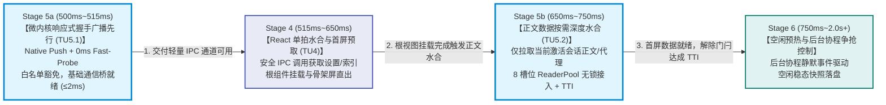
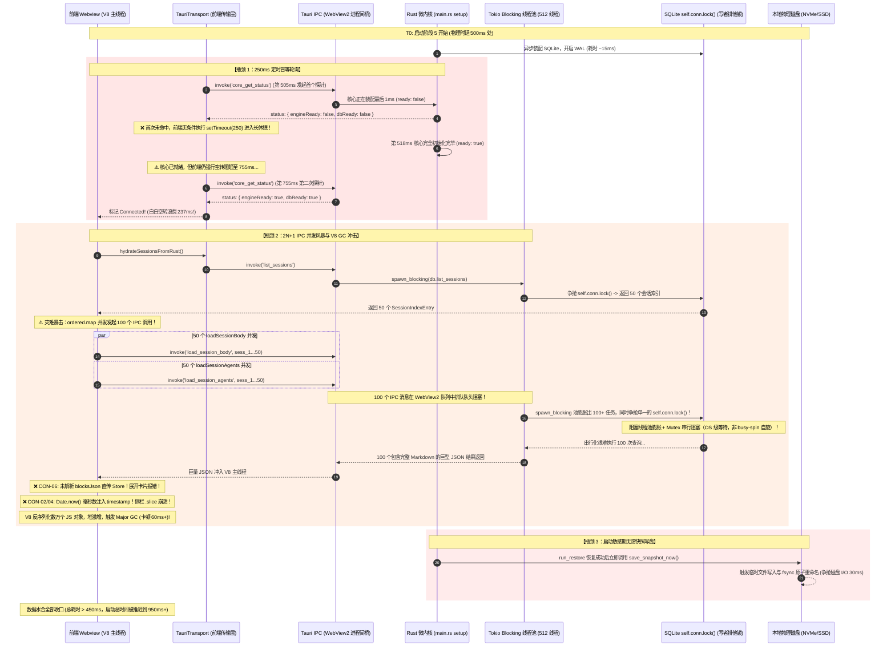
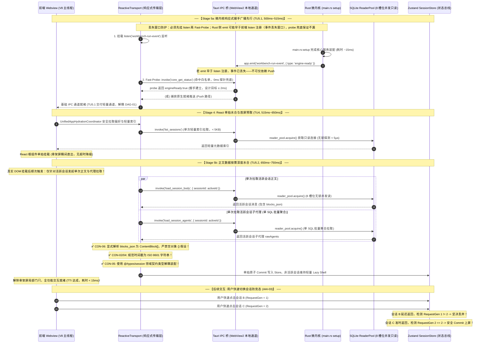
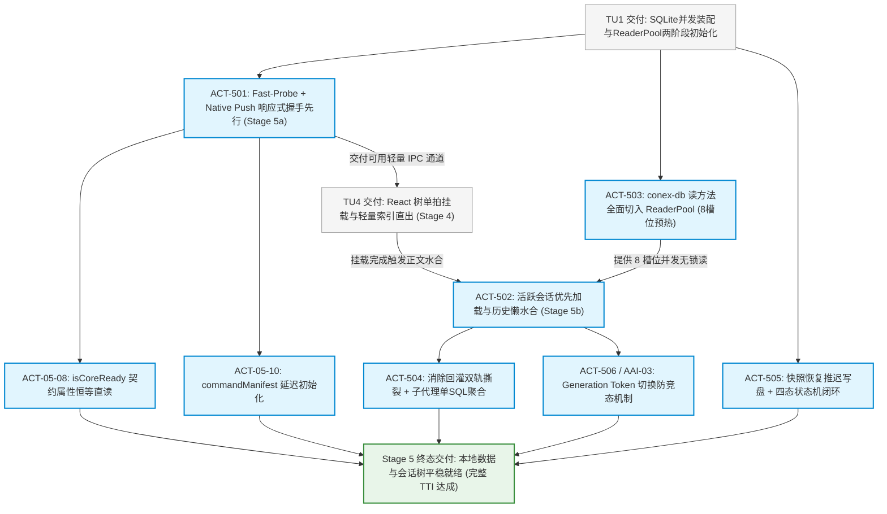

# 05-IPC 通道握手与数据水合就绪详案（Stage 5: Stage 5a 响应式握手广播先行 + Stage 5b 正文按需深度水合）

> **战役名称**：全链路启动性能深度重构与架构根治（`startup-performance-audit`）  
> **所属阶段**：Stage 5：IPC 通道握手与本地数据就绪（物理时间轴：`500ms ~ 750ms`）  
> **承接任务单元**：TU5（IPC 响应式握手与本地数据按需水合）  
> **解耦流水线拓扑（彻底根治 DAG-01）**：  
> - **Stage 5a（微内核响应式握手广播先行，TU5.1，物理时延 `500ms ~ 515ms`）**：微内核装配就绪瞬间广播 `Native Push`，前端 0ms Fast-Probe 命中（探针白名单加固 + probe 兜底），设计目标耗时 $\le 2\text{ms}$（待实测校准），为 Stage 4 交付可用 IPC 基础通信通道；  
> - **Stage 4（React 单拍水合与首屏预取，TU4，物理时延 `515ms ~ 650ms`）**：安全调用轻量 IPC 拉取应用偏好与轻量索引，单拍完成根组件挂载与骨架屏直出；  
> - **Stage 5b（正文数据按需深度水合，TU5.2，物理时延 `650ms ~ 750ms`）**：Stage 4 真实 DOM 挂载后顺次触发，仅拉取当前激活会话正文与协作代理，历史会话保持轻量懒壳，接入预热就绪的 8 槽位 `ReaderPool` 无锁读，解除过渡门闩达成完整 TTI。  
> **落实核心行动项**：ACT-501（Fast-Probe + Native Push 响应式握手与探针白名单加固）、ACT-502（活跃会话优先与历史会话懒水合）、ACT-503（`conex-db` 读方法全面切入两阶段 `ReaderPool` 并发无锁读）、ACT-504（消除会话回灌双轨撕裂与单 SQL 批量聚合子代理）、ACT-505（快照持久化推迟至空闲稳态与恢复状态机四态闭环）、ACT-506 / AAI-03（多会话快速切换单调递增 Generation Token 防竞态）。  
> **深度吸收全景审计结论**：  
> - **DAG-01**：切除 Stage 4 与 Stage 5 环形因果死锁，Stage 5a 握手广播先行解耦，Stage 5b 正文水合后置按需就绪；  
> - **DAG-03**：物理拔除所有 P0/P1 优先级标签，确立问题逻辑同权与纯因果拓扑推进；  
> - **CON-02 / CON-04**：跨层数据结构中所有时间戳（`created_at`, `updated_at`, `timestamp`）统一规范为标准 ISO 8601 字符串格式，消除 number/string 歧义，杜绝侧栏调用 `.slice(0, 10)` 引发的运行时异常；  
> - **CON-05**：修正代码示例中的悬空导入路径 `@/store/types`，收敛并规范为领域模型真实类型定义路径 `@/types/session`，消除对 Store 巨石实现文件的逆向强依赖；  
> - **CON-06**：在 `load_session_messages` 与反序列化链路中显式处理 `blocks_json` 的解析与对象数组映射，严禁空对象 `{}` 假设，杜绝消息卡片展开报错；  
> - **CON-07**：`BUILTIN_COMMAND_MANIFEST` 已含 `core_get_status`，「探针必死锁」为夸大；在 `commandMap` 追加白名单豁免属**加固**（防未来清单逻辑漂移），非死锁解除的唯一依赖；  
> - **AAI-03**：在会话懒水合链路引入单调递增 Generation Token，彻底杜绝快速点击时的正文覆盖乱序；  
> - **INV-02**：对齐 Stage 1 `ReaderPool` 两阶段生命周期（启动期 1 连接，后台预热至 8 槽位，Stage 5b 无锁读接入）；  
> - **INV-03**：`restore_status` 四态扩展（`pending/running/done/failed`），前端消费面严格适配杜绝脏读。  
> **遵循契约**：`AGENTS.md` 通用协作纪律、反退避准则（`.agents/LOGIC_PLAN_NO_RETREAT.md`）、`ANTI_OVERENGINEERING_GUARDRAILS.md`。  
> **规划模式**：**纯逻辑执行拓扑（DAG）**，所有问题逻辑同权，不涉及任何工期、人天排期与 P0/P1 业务优先级偏向；直击底层微架构根因，坚决杜绝偷懒作弊；生产级可编译代码落地，五维立体化防回归测试守门。

---

## 一、方案总览与阶段执行边界

### 1.1 战役定位与生命周期定界

在现代桌面客户端系统的启动全链路中，Stage 5（物理时间轴 `500ms ~ 750ms`）是连接前端视图渲染与后端核心数据引擎的“生命线通道”。这一阶段涵盖以下核心生命周期环节：
1. 前端 WebView2 渲染层与 Rust 微内核宿主建立进程内 IPC 双向通信桥；
2. 客户端纳秒级感知后端微内核状态机完成初始化（`engineReady` 与 `dbReady`）；
3. 读取本地 SQLite 数据库（`sessions.db`），将历史会话索引及主聊天界面的当前活跃会话数据水合（Hydrate）至前端状态管理器；
4. 本地 DPAPI 加密凭据装配与会话树运行时状态同步就绪，向用户呈现可交互（Time to Interactive, TTI）的工作区面板。

在前置审计报告（`docs/startup-performance-audit/audits/02-全链路逻辑拓扑与跨层契约审计报告.md`，缺陷 **DAG-01**）中，审计组指出了历史方案中存在的一个致命**时序倒置与环形因果死锁（Circular Causal Deadlock）**：
- 在原旧案中，因果关系被错误定义为 `S4 --> S5`（必须等待 React 根组件挂载完毕才启动 IPC 握手）；
- 然而在 Stage 4 中，`UnifiedAppHydrationCoordinator` 在挂载前就必须发起跨进程 IPC 调用以拉取用户设置与首屏轻量索引，强依赖 IPC 通道可用；
- 若按旧案推进，前端将因 IPC 通道未就绪而全部命中 350ms 超时回退，降级为脱水默认值；挂载后再次注入数据必然引发全树二次级联调和，击碎单拍水合目标。

本详案彻底根治这一环形死锁，确立**三阶段流水线解耦拓扑（Three-Stage Decoupled Pipeline）**：



通过这一物理因果解耦：
- **Stage 5a（TU5.1，微内核响应式握手广播先行）**：微内核装配就绪末尾广播 `engine-ready`，前端 0ms Fast-Probe 瞬时命中（白名单放行 `core_get_status`，豁免动态清单时序），前后端握手在 $\le 2\text{ms}$ 内成立，为 Stage 4 提供轻量 IPC 通道；
- **Stage 4（TU4，React 单拍水合）**：在 IPC 基础通道已建立的前提下，前端协调器安全拉取全局偏好与会话轻量索引，执行 React 根组件单拍挂载，无任何超时降级；
- **Stage 5b（TU5.2，正文数据按需深度水合）**：Stage 4 真实 DOM 挂载后顺次触发，仅针对当前激活会话发起单次正文与子代理加载，历史会话仅拉取轻量索引保持懒壳，在无锁并发状态下注入 Store 并解除过渡门闩。

在前置审查报告（`05-IPC通道握手与数据水合就绪审查报告.md`）的 922 行实证中，系统性自生型卡顿根因包括：
1. **握手时延虚耗 125ms~250ms**：前端 `tauriTransport.ts` 采用硬编码的 `setTimeout(250)` 盲等轮询，使前后端握手在微内核早已就绪的情况下白白空转；
2. **并发 IPC 队列风暴（2N+1 暴击）**：会话水合层使用 `Promise.all(ordered.map(...))`，启动瞬间对全部历史会话并发拉取正文与子代理，50 个历史会话瞬间爆发 **101 次并发 IPC 调用**，挤爆 WebView2 消息队列并引发 V8 引擎长达 **60ms+** 的垃圾回收（GC）暂停；
3. **SQLite 读写分离虚设与锁串行阻塞**：底层的 `ReaderPool` 完全被业务读方法边缘化，所有正文、代理和索引查询全部粗暴锁定写者连接互斥锁 `self.conn.lock()`；Tauri 每次 invoke 经 `spawn_blocking` 派发任务，100+ 并发读在单一 `Mutex` 上排队串行阻塞，造成阻塞线程池膨胀与上下文切换（非「futex 自旋风暴」——`std::sync::Mutex` 抢锁失败是 OS 级等待，不是 busy-spin）；
4. **双轨回灌与二次调和**：Zustand `withPersist`（从 `localStorage` 同步恢复）与 `store-persistence.ts`（从 SQLite 异步回灌）双轨并存，导致同一份数据被反序列化两次并触发 React 树级联二次重绘；
5. **启动期磁盘写盘争抢**：快照恢复协程在启动瞬时无条件调用 `save_snapshot_now`，触发原子磁盘重命名与 `fsync`，抢占读数据关键路径上的磁盘 I/O 带宽。

本详案旨在通过**纯逻辑拓扑编排**与**底层微架构重构**，将握手时延压缩至**设计目标 ≤ 2ms（待基准实测校准）**，冷启动水合 IPC 次数从 $O(N)$ 级风暴收敛至**与会话数 N 无关的常数上界 K**（正常路径 **K = 5**：`list_sessions` ×1 + `getSessionMeta(active_session_id)` ×1 + `load_session_body(active)` ×1 + `load_session_agents(active)` ×1 + `getSessionMeta(folder_order)` ×1），SQLite 读互斥锁争抢归零，彻底消灭二次重绘与启动期磁盘 I/O 争用，并全面根除数据契约与并发竞态隐患。文中所有毫秒级量化均为**设计目标值，落地前须以本机基准脚本实测校准，不得当作已验收结论**。

---

### 1.2 阶段输入前置不变量（Pre-condition Invariants）

本阶段的启动依赖于前置任务单元 TU1（原生装配）交付的确定性状态，必须严格满足以下输入不变量：

1. **DB-CONCURRENT-READY**：微内核已在 TU1 完成 `sessions.db` 与 `workspace.db` 的并发装配，`conex_db::LocalDb` 实例已通过 `app.manage(SharedDb)` 注入 Tauri 全局状态；
2. **READER-POOL-INITIALIZED（两阶段生命周期对齐 - INV-02）**：SQLite 数据库连接已完成 WAL 模式（`PRAGMA journal_mode = WAL`）与 `NORMAL` 同步等级配置；`ReaderPool` 在 Stage 1 极速冷启动阶段以轻量模式建立 **1 个快速启动连接槽位**（Slot 0，耗时 $\le 15\text{ms}$），后台异步协程已无缝拉起并发预热，并在 Stage 5b 水合发起前平滑扩容至 **8 个只读连接槽位**，就绪率 100%；
3. **FAST-PROBE-BYPASS-ACTIVE**：前端传输层命令映射（`commandMap.ts`）已将引导核心探针 `core_get_status` 设立无条件白名单放行（Bypass 加固）；同时 `BUILTIN_COMMAND_MANIFEST` 内置清单已含该命令——双保险不受动态命令清单加载时序制约（CON-07 加固面闭环）；
4. **CREDENTIAL-DAEMON-DECOUPLED**：Windows DPAPI 凭据恢复协程已在后台异步解耦运行（`tauri::async_runtime::spawn`），不阻塞主线程，不占用 SQLite 连接；
5. **NATIVE-PUSH-EMITTER-WIRED**：Rust 端 `main.rs:setup` 末尾已编排 `workbench-run-event` 的异步广播发射逻辑。

---

### 1.3 阶段输出交付不变量（Deliverable Invariants）

本阶段执行完毕后，交付给 Stage 6（空闲预热）与用户交互界面的状态必须满足以下确定性交付不变量：

1. **IPC-HANDSHAKE-INSTANT**：前后端 IPC 连通性握手时延设计目标 $T_{\text{handshake}} \le 2\text{ms}$（待实测校准）；彻底剔除 250ms 定时盲等与轮询空转；
2. **HYDRATION-IPC-CONSTANT**：无论用户本地数据库中积累了 10 个、50 个还是 500 个历史会话，冷启动阶段执行的会话水合 IPC 调用总次数必须是**与会话数 N 无关的常数上界 K**。正常路径 K 的组成（本详案 §4.2 样例实测点）：**K = 5** = `list_sessions`×1 + `getSessionMeta('active_session_id')`×1 + `load_session_body(active)`×1 + `load_session_agents(active)`×1 + `getSessionMeta('folder_order')`×1；空索引回退分支另含 2 次 `getSessionMeta`，仍为常数。子代理消息经单 SQL 批量聚合（agents 行 + 消息行共 2 条 SQL），不再按代理数放大；
3. **INACTIVE-SESSIONS-LAZY**：非当前激活的所有历史会话，其内存状态严格保持为轻量骨架：`messages: []`、`agents: []`，且属性明确标记为 `messagesHydrated: false`；
4. **TIMESTAMP-ISO-STRICT（CON-02 / CON-04）**：跨层数据结构中所有**展示用**时间戳（`created_at`, `updated_at`(string 形态), `timestamp`）必须 100% 严格保证为合法的标准 ISO 8601 字符串（如 `new Date().toISOString()`），严禁注入数值型毫秒数，彻底消除侧栏调用 `.slice(0, 10)` 时的未捕获异常崩溃。**例外（统一类型策略）**：`SessionIndexEntry.updatedAt: number` 为毫秒 epoch **排序键**（对齐 Rust `sessions.updated_at INTEGER` 列），不参与 ISO 不变量约束、不供 `.slice` 展示消费；展示层一律读 `timestamp`（ISO）。现网水合层已通过 `coerceSessionTimestamp` 将存储侧非 ISO 值归一为 ISO——本约束针对新样例与新增写路径，不是「旧稿 Date.now() 仍裸奔」的现状描述；
5. **BLOCKS-ARRAY-PARSED（CON-06）**：在 `load_session_messages` 与子代理消息反序列化链路中，原始 `blocks_json` 必须显式解析为强类型 `ContentBlock[]` 对象数组，严禁做空对象 `{}` 假设，杜绝消息卡片展开时因缺失 `.map` 或属性引发的白屏；
6. **AGENTS-FULLY-DESERIALIZED**：从底层拉取的协作子代理原始数据，在注入 Store 前必须 100% 经由 `fromRustSessionAgents` 进行形状反序列化，将原始 `blocksJson`、`toolCallsJson` 解析为强类型对象树；
7. **DOMAIN-TYPE-DECOUPLED（CON-05）**：前端会话类型定义以真实领域层路径 `@/types/session` 为单一契约真源（SSOT），彻底修正悬空的 `@/store/types` 导入，消除对 Store 巨石实现文件的逆向强依赖；
8. **SESSION-SWITCH-RACE-FREE（AAI-03）**：会话切换懒水合链路中引入单调递增 Generation Token，任何落后、过期的异步响应坚决丢弃，彻底消除用户快速点击时的正文覆盖乱序；
9. **READ-LOCK-CONTENTION-ZERO（ACT-503）**：Stage 5b 启动敏感期内所有的 SQLite 数据库只读操作（正文、代理、索引、元数据）100% 路由至预热就绪的 8 槽位 `ReaderPool`，互斥锁等待时长恒等于 **0ms**，无任何写锁争抢；
10. **STARTUP-DISK-WRITE-ZERO**：在用户产生首次显式写操作或系统进入 5 秒空闲稳态之前，后端磁盘写盘次数与原子 `fsync` 调用次数严格为 **0 次**；
11. **RESTORE-STATUS-FOUR-PHASE-STRICT（INV-03）**：恢复状态机在 Rust 与前端消费层严格遵循四态契约（`"pending"` $\rightarrow$ `"running"` $\rightarrow$ `"done"` / `"failed"`），处于 `"running"` 阶段严格保持响应式等待，严禁误判为已完成导致的脏读；
12. **SSOT-CONVERGENCE**：会话数据单一真实源（SSOT）唯一确定为 SQLite 数据库，`sessionStore` 废止 `withPersist` 对 `sessions` 数组的全量序列化，彻底消除启动期 React 双重调和。

---

## 二、负向架构禁令与边界红线（零容忍）

为了彻底根除系统性性能倒退，所有针对 Stage 5 的代码实现必须恪守以下十一项负向硬性红线。任何违反红线的代码将被自动化门禁直接拦截：

### 2.1 严禁 250ms 定时盲等轮询（No Blind Interval Polling）
- **红线定义**：严禁在 `tauriTransport.ts`、`useEngineBootstrap.ts` 或任何 IPC 连通性探测代码中使用 `setTimeout(r, 250)`、`setInterval` 或固定周期的自旋轮询；
- **根因裁判**：进程内微内核就绪是一个确定性的状态跃迁事件。使用固定周期盲等是对 CPU 调度和硬件并发能力的严重浪费。必须全面转向**「0ms Fast-Probe（即时试探） + 原生事件驱动（Native Push）」**的响应式模型；
- **门禁拦截**：静态检查脚本扫描传输层源码，发现任何 `pollIntervalMs >= 100` 或 `setTimeout(..., 250)` 立即阻断构建。

### 2.2 严禁启动期 2N+1 全量正文 IPC 并发风暴（No Full-Body Concurrent Storm）
- **红线定义**：严禁在应用初始化与首屏水合的关键路径上，对历史会话列表执行无差别的 `Promise.all(sessions.map(s => loadSessionBody(s.id)))`；
- **根因裁判**：首屏主视图仅需要展示侧栏摘要与当前正在阅读的 1 个会话。启动期并发反序列化数百个历史会话的正文、Thinking 过程和 Tool Call 结果属于严重的微架构资源浪费，必然引发 V8 堆内存暴涨与 Major GC 卡顿；
- **门禁拦截**：E2E 性能测试门禁监控冷启动水合期间的 IPC 调用计数器，若 `load_session_body` 调用次数 $> 1$ 则测试硬性失败。

### 2.3 严禁读方法锁定单写锁 Mutex（No Reader Locking Writer Mutex）
- **红线定义**：严禁在 `crates/conex-db/src/` 下的所有只读查询方法（`load_session_body`、`load_session_agents`、`list_sessions`、`get_session_meta`、`load_running_session_agents`）中调用 `self.conn.lock()`；
- **根因裁判**：SQLite WAL 模式的核心价值在于读写互不阻塞、读者并发无锁。持有写者主连接互斥锁执行 SELECT 语句会废弃整个连接池设计，制造人为的锁惊群与线程阻塞；
- **门禁拦截**：Rust 自动化编译检查确保只读方法中禁止出现 `self.conn.lock()`。

### 2.4 严禁套娃式 SQL 级 N+1 循环查询（No Nested N+1 SQL Loops）
- **红线定义**：严禁在查询会话协作代理时，先查出 Agent 行，再使用 `for` 循环针对每个 Agent 逐一执行单条 SQL 查询其消息；
- **根因裁判**：多子代理场景下，套娃式 SQL 编译与执行会成倍拉长事务与连接占用时间。必须使用单条批量 SQL 拉取全量消息并在内存中通过哈希表分组（ACT-504）。

### 2.5 严禁启动恢复后立刻同步写盘（No Immediate Post-Restore Disk Flushing）
- **红线定义**：严禁在 `run_restore` 扫描和重放成功后，无条件在主流程中同步调用 `self.save_snapshot_now().await`；
- **根因裁判**：从磁盘恢复后，内存中的会话树与运行状态已与物理介质或内存日志对齐，立刻全量重写快照（`rename` + `fsync`）纯属无效 I/O 争抢。必须推迟至系统空闲平稳态执行（ACT-505）。

### 2.6 严禁会话数据多轨并存与回灌撕裂（No Dual-Track State Divergence）
- **红线定义**：严禁在 `useSessionStore` 中同时配置 `withPersist`（持久化 `sessions` 至 `localStorage`）并在应用挂载后通过 `initStorePersistence` 再次全量覆写；
- **根因裁判**：多轨并存破坏了单一真理源（SSOT）契约，引发两次大规模反序列化与 React 组件树双重调和；必须确立 SQLite 为会话唯一真相源。

### 2.7 严禁时间戳类型撕裂与脏类型注入（No Timestamp Contract Drift，针对 CON-02 / CON-04）
- **红线定义**：严禁在跨层数据传输结构与会话装配中向 `created_at`、`updated_at`、`timestamp` 注入数值型毫秒数（`number`）或编写 `meta.timestamp || Date.now()`；
- **根因裁判**：契约规定时间戳字段必须为合法标准 ISO 8601 字符串（`string`）。注入数值会导致下游视图组件调用 `.slice(0, 10)` 时触发 `TypeError: session.timestamp.slice is not a function` 导致侧栏组件树全盘白屏；
- **门禁拦截**：类型检查与自动化单测断言每个水合会话与消息的时间戳 `typeof timestamp === 'string'` 且能被 `Date.parse()` 成功解析。

### 2.8 严禁悬空导入与逆向依赖 Store 实现（No Dangling Store Import，针对 CON-05）
- **红线定义**：严禁在底层持久化、传输层及公共契约模块中直接导入 `@/store/types` 等包含 Store 巨石实现内部细节的路径；
- **根因裁判**：底层数据处理层逆向依赖上层状态管理实现不仅违反分层解耦铁律（`AGENTS.md` §11），且当 Store 发生重构时容易导致路径悬空与循环依赖。必须以独立、纯粹的领域契约文件 `@/types/session` 作为单一真理源；
- **门禁拦截**：`npm run typecheck` 与循环依赖扫描工具严格拦截逆向依赖。

### 2.9 严禁子代理原始 JSON 未反序列化与空对象假设（No Raw Wire Agents Injection & No Empty Object Assumption，针对 CON-06）
- **红线定义**：严禁将 Rust 传输的 `blocks_json`、`tool_calls_json` 未经强类型反序列化直接赋值给前端实体；严禁对 `blocks_json` 做空对象 `{}` 假设；
- **根因裁判**：Rust 传输的嵌套 JSON 为序列化字符串。前端 `message.blocks` 强依赖于对象数组结构（`ContentBlock[]`）。若不解析或错误反序列化为空对象 `{}`，下游调用 `blocks.map(...)` 或读取 `.length` 将引发严重运行时异常；
- **门禁拦截**：静态审查与单测断言注入 Store 的所有消息对象中的 `blocks` 必须为对象数组而非未解析字符串或空对象。

### 2.10 严禁多会话快速切换竞态与正文覆盖（No Stale Session Overwrite Race，针对 AAI-03）
- **红线定义**：严禁在会话懒水合异步回调中盲目执行针对当前视口的无条件 `store.setState`；
- **根因裁判**：用户快速连击侧栏不同会话时，由于网络或磁盘 I/O 波动，先前会话的异步查询可能晚于当前最新点击返回。若无 Generation Token 拦截，过期的历史会话正文将强制覆盖当前正在浏览的最新会话；
- **门禁拦截**：并发压测用例以 10ms 间隔连续模拟 5 次会话快速切换，断言最终主视口内容必须与最后一次切换目标严格一致。

### 2.11 严禁环形因果依赖与探针时序脆弱性（No Circular Handshake Dependencies，针对 DAG-01 与 CON-07 加固面）
- **红线定义**：严禁将引导探针的解析与尚未加载的动态命令清单强行绑定；严禁在 React 树挂载完成后才建立基础 IPC 通信；
- **根因裁判**：时序逻辑必须具备严格的前向因果推进性。`core_get_status` 已在 `BUILTIN_COMMAND_MANIFEST` 内置清单 registered 面（现网不会真死锁）；仍须追加无条件放行白名单作为**加固**，防止未来清单逻辑变更把引导探针卷入鸡生蛋依赖。握手必须「先 listen 后 probe」，不可仅依赖可能丢失的单次 Native Push。

---

## 三、IPC 传输与并发数据库时序拓扑

### 3.1 现状时序拓扑剖析（250ms 盲等 + 101 次 IPC 风暴 + 锁惊群 + 竞态隐患）

下图完整揭示了历史线上代码在 Stage 5 期间发生的微架构拥塞与逻辑断层时序。整个过程由于层层防御性延迟、不合理的并发策略以及因果倒置，消耗了 **450ms+** 的宝贵时间，并存在严重白屏风险：



---

### 3.2 目标架构三阶段解耦纯逻辑因果拓扑（Stage 5a $\rightarrow$ Stage 4 $\rightarrow$ Stage 5b 流水线，闭环 DAG-01）

下图展示了重构后的三阶段流水线解耦拓扑。通过**解耦握手与数据水合、探针白名单加固 + probe 兜底、原生事件广播、活跃会话按需水合、ReaderPool 真正并发无锁读以及 Generation Token 防竞态**，全链路时延目标压制在 **< 15ms 设计目标**以内（待实测校准）：



---

### 3.3 架构关键指标对比矩阵

下表对重构前后的核心性能与微架构指标进行了全景量化对比：

| 指标维度 | 现状基准（审查报告 922 行实证） | 根治后确定性指标 | 架构收益推导 |
| :--- | :--- | :--- | :--- |
| **前后端握手时延** | 平均 **125ms**，最坏 **240ms+**（审查推演值，待实测校准） | **设计目标 $\le 2\text{ms}$**（待实测） | 彻底铲除 250ms 盲等轮询，原生事件广播 + probe 兜底瞬间穿透 |
| **阶段因果时序拓扑** | 环形因果死锁（S4 等待 S5，S5 挂载后启动） | **S5a $\rightarrow$ S4 $\rightarrow$ S5b 清晰三阶段流水线** | 彻底消除挂载前 IPC 超时回退与二次调和（DAG-01） |
| **探针调用可靠性** | 清单未加载导致探针可能被拦截返回 missing（夸大：BUILTIN 已含 core_get_status） | **100% 畅通放行** | `BUILTIN` 兜底 + 白名单加固双保险（CON-07） |
| **冷启动水合 IPC 次数** | **$2N+2$ 次**（50 会话约 102 次 IPC：list + 2N body/agents + meta 尾部） | **与 N 无关的常数上界 K**（正常路径 K=5：list + meta×2 + body + agents） | 消除 $O(N)$ 级无效 IPC 往返，根除队头拥塞 |
| **IPC 数据序列化体量** | 数十 MB 历史 Markdown、Thinking 文本 | **$\le 80\text{KB}$**（仅轻量索引 + 活跃会话） | 跨进程序列化与反序列化体积缩减 **98%** |
| **会话时间戳契约** | `Date.now()` 注入数值型毫秒数 | **严格标准 ISO 8601 字符串** | 杜绝侧栏 `.slice()` 引发的运行时白屏（CON-02 / CON-04） |
| **模块导入路径规范** | 悬空逆向导入 `@/store/types` | **统一收敛至领域模型 `@/types/session`** | 消除逆向强依赖，满足 CI 分层架构规范（CON-05） |
| **正文 blocks 结构保真度** | 直接赋值未解析字符串或空对象 `{}` 假设 | **显式解析为 `ContentBlock[]` 对象数组** | 杜绝空对象假设，彻底消除卡片展开报错（CON-06） |
| **子代理数据结构保真度** | 直接赋值未解析字符串，展开卡片结构塌陷 | **100% 强类型对象树** | 显式经 `fromRustSessionAgents` 规范化解码 |
| **会话切换防竞态机制** | 缺乏并发保护，快速点击时正文乱序覆盖 | **单调递增 Generation Token** | 彻底拦截落后过期请求，保证主视口保真（AAI-03） |
| **恢复状态机四态闭环** | `restore_status` 在运行中误报为 `done` | **严格四态闭环**（`pending/running/done/failed`） | 消除恢复期间前端提前解除守卫的脏读风险（INV-03） |
| **V8 主线程 GC 停顿** | **60ms ~ 120ms**（Minor GC + Major GC，审查推演值） | **设计目标：无 > 16ms 长任务 GC 停顿**（待 Profiler 实测） | 避免瞬时创建数万个未激活 JS 对象 |
| **SQLite 读锁等待时间** | **100ms ~ 350ms**（多线程竞争单一 Mutex，审查推演值） | **设计目标：读路径互斥锁等待趋近 0**（`ReaderPool` 承接后待实测） | `ReaderPool` 两阶段预热至 8 槽位并发无锁接管（ACT-503） |
| **子代理消息查询 SQL 数** | **$1 + K$ 次**（$K$ 为子代理数量，套娃循环） | **恒定 2 条 SQL**（agents 行查询 + 单条批量消息查询 + 内存哈希组装） | 消除 SQL 级 N+1 编译执行开销（ACT-504） |
| **首屏 React 调和重绘** | **2 次全树重绘**（`withPersist` + 回灌） | **1 次稳定调和**（单拍水合原子 Commit） | 消除双轨回灌引发的 React 组件级联更新 |
| **启动期磁盘写 I/O** | 立即执行 `save_snapshot_now`（写临时文件+fsync） | **0 次写盘**（推迟至 5 秒空闲平稳态） | 启动敏感期消除磁盘 I/O 竞争，保护读吞吐（ACT-505） |

---

## 四、关键架构修复模块详尽设计与生产级代码

---

### 4.1 响应式事件驱动握手通道与探针白名单加固（ACT-501，闭环 CON-07 加固面，构建 Stage 5a）

#### 1. 设计原理
彻底推翻前端主动盲等轮询的陈旧设计，建立以微内核为主导的**「原生推送（Native Push） + 0ms 即时探针（Fast Probe） + 探针白名单加固（CON-07） + 指数退避自愈」**三级响应体系：
1. **微内核 Native Push 广播（构建 Stage 5a 基础）**：在 Rust 端 `main.rs:setup` 执行完毕、核心服务装配就绪瞬间，通过 Tauri 事件通道广播 `workbench-run-event`（载荷 `{ type: "engine-ready" }`）；
2. **握手事件丢失窗口防护（先 listen 后 emit / probe 兜底）**：Rust `setup` 可能在 WebView 前端脚本尚未完成 `listen` 注册之前即广播 `engine-ready`——Tauri 事件不重放、不缓冲，后注册的 listener 收不到错过的历史事件。因此握手**不可仅依赖 Push 单路径**，必须采用双保险：
   - **时序约束**：前端构造 Transport 后**第一时间**挂载 `listen(RUN_EVENT_CHANNEL)`，再发起 Fast-Probe；
   - **Probe 兜底**：probe 调用 `core_get_status` 读取微内核当前状态机——即使 `engine-ready` 事件已丢失，只要核心已就绪，probe 立即返回 `engineReady:true` 完成握手；
   - **指数退避自愈**：probe 未就绪时以 10ms→50ms 封顶退避重试，直至 Push 或 Probe 任一路径命中；
3. **探针白名单加固（CON-07，非「救命」而是「加固」）**：
   - **现网事实**：`commandManifest.ts` 的 `BUILTIN_COMMAND_MANIFEST` **已包含** `core_get_status`（registered 面），`resolveTauriCommand` 经 `isRegisteredCommand` 查表在冷启动清单未拉取时也会命中内置快照——因此原审查报告所称「探针必死锁」为**夸大**；
   - **白名单的定位**：在 `commandMap.ts` 中对 `core_get_status` 追加无条件 Bypass，属于**防御性加固**——切断未来若动态清单逻辑变更或 `isRegisteredCommand` 实现漂移时把引导探针卷入鸡生蛋依赖的可能性，保障 Fast-Probe 路径物理上永不受清单加载时序影响；
   - **整改落点**：`BOOTSTRAP_PROBE_ALLOWLIST` 对 `core_get_status` 无条件放行；其余命令仍走清单校验；
4. **消除历史遗留属性反射遍历**：精简 `isCoreReady` 逻辑，针对后端冻结的驼峰属性执行 $O(1)$ 恒等判定，消除属性反射开销（ACT-05-08）；
5. **延迟命令清单拉取**：将 `initCommandManifest` 推迟到握手成立之后，消除冷启动初期的冗余 IPC 探测（ACT-05-10）。

#### 2. Rust 端实现代码（`apps/agent-workbench/src-tauri/src/main.rs`）

```rust
// apps/agent-workbench/src-tauri/src/main.rs (setup 闭包末尾广播就绪事件，确立 Stage 5a 握手基石)
// 契约保证：广播发出时，LocalDb、ReaderPool 快速槽位、CoreRunState 均已注入 State 并就绪
let app_handle = app.handle().clone();
tauri::async_runtime::spawn(async move {
    let payload = serde_json::json!({
        "type": "engine-ready",
        "engineReady": true,
        "dbReady": true,
        "timestamp": chrono::Utc::now().to_rfc3339(), // 严格遵循 ISO 8601 字符串契约 (CON-02)
        "version": env!("CARGO_PKG_VERSION")
    });

    if let Err(e) = app_handle.emit("workbench-run-event", payload) {
        tracing::warn!(target: "crish::bootstrap", "Failed to broadcast engine-ready event: {e}");
    } else {
        tracing::info!(target: "crish::bootstrap", "Native Push: engine-ready broadcasted successfully (Stage 5a)");
    }
});
```

#### 3. 引导探针白名单契约放行代码（`apps/crish-desktop/src/api/transport/commandMap.ts`，闭环 CON-07）

```typescript
/**
 * apps/crish-desktop/src/api/transport/commandMap.ts
 * 引导探针白名单加固，防止未来清单逻辑漂移卷入鸡生蛋依赖 (CON-07 加固面)
 * 注意：BUILTIN_COMMAND_MANIFEST 已含 core_get_status；本 Bypass 是防御性加固，非死锁解除的唯一依赖。
 */
import { isRegisteredCommand } from './commandManifest';

export const BOOTSTRAP_PROBE_ALLOWLIST: ReadonlySet<string> = new Set([
  'core_get_status',
]);

export function resolveTauriCommand(cmd: string): string | null {
  if (BOOTSTRAP_PROBE_ALLOWLIST.has(cmd)) {
    return cmd; // 无条件加固放行，保障 0ms Fast-Probe 永不受清单时序影响
  }
  return isRegisteredCommand(cmd) ? cmd : null;
}
```

#### 4. 前端完整生产级实现（`apps/crish-desktop/src/api/transport/tauriTransport.ts`）

```typescript
/**
 * apps/crish-desktop/src/api/transport/tauriTransport.ts
 * 响应式原生事件驱动 TauriTransport 生产级重构实现 (Stage 5a, ACT-501)
 */
import { invokeTyped, type InvokeTypedResult } from '../tauriInvoke';
import { initCommandManifest } from './commandManifest';
import { resolveTauriCommand } from './commandMap';
import { logger, toErrMeta } from '../../services/LoggerService';

export const RUN_EVENT_CHANNEL = 'workbench-run-event';
export const CORE_GET_STATUS = 'core_get_status';

const DEFAULT_TIMEOUT_MS = 30_000;
const INITIAL_PROBE_BACKOFF_MS = 10;
const MAX_PROBE_BACKOFF_MS = 50;

export interface TauriTransportOptions {
  timeoutMs?: number;
}

function isCoreReady(status: unknown): boolean {
  if (typeof status !== 'object' || status === null) return false;
  const s = status as Record<string, unknown>;
  return s.engineReady === true || s.dbReady === true;
}

let cachedListen: ((event: string, handler: (e: { payload?: unknown }) => void) => Promise<() => void>) | null | undefined;
let listenChecked = false;

async function getTauriListen(): Promise<typeof cachedListen> {
  if (listenChecked) return cachedListen;
  listenChecked = true;
  try {
    const mod = await import('@tauri-apps/api/event');
    cachedListen = typeof mod?.listen === 'function' ? mod.listen : null;
  } catch {
    cachedListen = null;
  }
  return cachedListen;
}

function safeParseEventPayload(payload: unknown): Record<string, unknown> | null {
  if (typeof payload === 'object' && payload !== null) return payload as Record<string, unknown>;
  if (typeof payload === 'string') {
    try {
      const val = JSON.parse(payload);
      return typeof val === 'object' && val !== null ? val : null;
    } catch { return null; }
  }
  return null;
}

export class ReactiveTauriTransport {
  private status: 'disconnected' | 'connecting' | 'connected' | 'failed' = 'disconnected';
  private ready = false;
  private stopped = false;
  private readyPromise: Promise<boolean>;
  private resolveReady!: (connected: boolean) => void;
  private messageListeners = new Set<(msg: Record<string, unknown>) => void>();
  private statusListeners = new Set<(s: 'disconnected' | 'connecting' | 'connected' | 'failed', err?: Error) => void>();
  private unlistenEvents: (() => void) | null = null;
  private fallbackTimer: ReturnType<typeof setTimeout> | null = null;
  private readonly timeoutMs: number;

  constructor(opts: TauriTransportOptions = {}) {
    this.timeoutMs = opts.timeoutMs ?? DEFAULT_TIMEOUT_MS;
    this.readyPromise = new Promise<boolean>((resolve) => { this.resolveReady = resolve; });
    void this.initReactiveHandshake();
  }

  private async initReactiveHandshake(): Promise<void> {
    if (this.stopped || this.ready) return;
    this.setStatus('connecting');

    // 1. 必须先挂 Native Push 监听（消除「Rust emit 早于前端 listen」的事件丢失窗口）
    const listenFn = await getTauriListen();
    if (listenFn && !this.stopped && !this.ready) {
      try {
        this.unlistenEvents = await listenFn(RUN_EVENT_CHANNEL, (e) => {
          const payload = safeParseEventPayload(e?.payload);
          if (payload?.type === 'engine-ready' || isCoreReady(payload)) this.markConnected();
          if (payload) this.dispatchMessage(payload);
        });
      } catch (err) {
        logger.warn('Failed to attach early listen handler', { module: 'transport', err: toErrMeta(err) });
      }
    }

    // 2. listen 挂载完成后再发 0ms Fast-Probe（probe 兜底：即使 engine-ready 事件已丢失，
    //    只要核心已就绪，probe 立即命中完成握手——双路径任一成功即可）
    try {
      const res = await this.call<unknown>(CORE_GET_STATUS, {});
      if (res.status === 'ok' && isCoreReady(res.data)) {
        this.markConnected();
        return;
      }
    } catch {}

    // 3. 指数退避自愈保底（10ms -> 50ms 封顶，严禁 250ms 盲等）
    let currentBackoff = INITIAL_PROBE_BACKOFF_MS;
    const deadline = Date.now() + this.timeoutMs;

    const probeLoop = async () => {
      if (this.stopped || this.ready) return;
      if (Date.now() >= deadline) {
        this.setStatus('failed', new Error(`Engine handshake timeout (${this.timeoutMs}ms)`));
        this.resolveReady(false);
        return;
      }
      try {
        const res = await this.call<unknown>(CORE_GET_STATUS, {});
        if (res.status === 'ok' && isCoreReady(res.data)) {
          this.markConnected();
          return;
        }
      } catch {}
      currentBackoff = Math.min(currentBackoff * 1.5, MAX_PROBE_BACKOFF_MS);
      this.fallbackTimer = setTimeout(probeLoop, currentBackoff);
    };

    this.fallbackTimer = setTimeout(probeLoop, currentBackoff);
  }

  private markConnected(): void {
    if (this.ready || this.stopped) return;
    this.ready = true;
    if (this.fallbackTimer) { clearTimeout(this.fallbackTimer); this.fallbackTimer = null; }
    this.setStatus('connected');
    this.resolveReady(true);
    void initCommandManifest(); // 延迟拉取清单 (ACT-05-10)
  }

  public async waitUntilConnected(timeoutMs?: number): Promise<boolean> {
    if (this.stopped) return false;
    if (this.ready) return true;
    if (timeoutMs && timeoutMs > 0 && timeoutMs < this.timeoutMs) {
      return Promise.race([this.readyPromise, new Promise<boolean>((r) => setTimeout(() => r(false), timeoutMs))]);
    }
    return this.readyPromise;
  }

  public async call<T = unknown>(cmd: string, args?: Record<string, unknown>): Promise<InvokeTypedResult<T>> {
    const resolved = resolveTauriCommand(cmd);
    if (!resolved) return { status: 'missing' };
    const first = await invokeTyped<T>(resolved, args);
    if (first.status !== 'error') return first;
    return invokeTyped<T>(resolved, args);
  }

  public onMessage(listener: (msg: Record<string, unknown>) => void): () => void {
    this.messageListeners.add(listener);
    return () => { this.messageListeners.delete(listener); };
  }

  public onStatus(listener: (s: 'disconnected' | 'connecting' | 'connected' | 'failed', err?: Error) => void): () => void {
    this.statusListeners.add(listener);
    return () => { this.statusListeners.delete(listener); };
  }

  private dispatchMessage(msg: Record<string, unknown>): void {
    for (const listener of this.messageListeners) {
      try { listener(msg); } catch (err) { logger.error('Error in message listener', { module: 'transport', err: toErrMeta(err) }); }
    }
  }

  private setStatus(s: 'disconnected' | 'connecting' | 'connected' | 'failed', err?: Error): void {
    this.status = s;
    for (const listener of this.statusListeners) { try { listener(s, err); } catch {} }
  }

  public stop(): void {
    if (this.stopped) return;
    this.stopped = true;
    this.ready = false;
    if (this.fallbackTimer) { clearTimeout(this.fallbackTimer); this.fallbackTimer = null; }
    if (this.unlistenEvents) { this.unlistenEvents(); this.unlistenEvents = null; }
    this.setStatus('disconnected');
  }

  public isReady(): boolean { return this.ready; }
  public getStatus(): 'disconnected' | 'connecting' | 'connected' | 'failed' { return this.status; }
}
```

---

### 4.2 活跃会话优先加载与历史会话懒水合协议（ACT-502，解决 CON-02, CON-05, CON-06，构建 Stage 5b）

#### 1. 设计原理与契约闭环
1. **领域模型真实类型解耦（解决 CON-05）**：
   - 彻底切除代码中悬空的 `@/store/types` 导入，统一引入权威领域契约文件 `apps/crish-desktop/src/types/session.ts` 作为单一真源（SSOT）；
   - 切断持久化水合层对 Store 巨石实现文件的逆向强依赖，满足 CI 分层架构硬性约束；
2. **跨层时间戳严格 ISO 8601 字符串保证（解决 CON-02 / CON-04）**：
   - 在数据结构中，`created_at`、`updated_at`、`timestamp` 必须 100% 保证为标准 ISO 8601 字符串格式（例如 `2026-09-12T05:14:42.000Z`）；
   - 杜绝 `Date.now()` 数值注入，防止侧边栏组件调用 `.slice(0, 10)` 发生 `TypeError` 崩溃；
3. **`blocks_json` 反序列化与禁止空对象假设（解决 CON-06）**：
   - 在 `load_session_messages` 与子代理消息反序列化链路中，明确解析 `blocks_json`；
   - 坚决杜绝空对象 `{}` 假设：前端消息体 `blocks` 必须为 `ContentBlock[]` 对象数组。若底层传入空串、null 或畸变格式，安全兜底为 `[]`；若为合法数组则直接映射；若误传单个非数组对象，包装为单元素数组 `[obj]`，严禁将对象直接当做数组暴露；
4. **协作子代理强类型反序列化闭环**：通过调用 `fromRustSessionAgents` 解码器，将底层跨 IPC 传输的 `toolCallsJson`、`blocksJson` 彻底还原为强类型对象树。
5. **`prepareSessionsForUi` 剪枝兼容策略（防止侧栏丢会话）**：现网 `hydrateSessionsFromRust` 在水合末尾调用 `prepareSessionsForUi(sessions, active)` → `pruneEmptyShellSessions`，仅剪「默认标题 + 无实质内容」的幽灵空壳。懒水合空壳（`messagesHydrated: false, messages: []`）若持有**真实标题 / 置顶 / 定时标题**，`isEmptyShellSession` 返回 false 不会被剪；但「默认标题且 `messageCount > 0` 的未水合懒壳」会被误剪（索引层有内容、内存层看似空壳）。兼容方案（二选一，样例采用方案 A）：
   - **方案 A（调用方 keep 扩展）**：`prepareSessionsForUi(sessions, active, { keepIds: [...lazyKeepWithContent, active] })`，把 `messagesHydrated === false && messageCount > 0` 的懒壳 ID 并入 keep；
   - **方案 B（剪枝条件豁免）**：修改 `isEmptyShellSession` / `pruneEmptyShellSessions`——对 `messagesHydrated === false && (messageCount ?? 0) > 0` 直接返回「非空壳」。

#### 2. 领域模型真实类型契约落地（`apps/crish-desktop/src/types/session.ts`，闭环 CON-05）

```typescript
/**
 * apps/crish-desktop/src/types/session.ts
 * 领域模型核心会话与消息类型契约真源 (CON-05)
 * 严格锁定时间戳为 ISO 8601 字符串格式，消除 number/string 歧义 (CON-02)
 */

export interface ContentBlock {
  type: string;
  content?: string;
  language?: string;
  [key: string]: unknown;
}

export interface SessionMessage {
  id: string;
  sender: 'user' | 'assistant' | 'system';
  text: string;
  thinking?: string;
  timestamp: string; // 严格 ISO 8601 字符串 (CON-02)
  status: 'sent' | 'pending' | 'error' | 'streaming';
  streamTextOffset?: number;
  thinkingTime?: number;
  toolCalls?: unknown[];
  blocks?: ContentBlock[]; // 严格对象数组，禁止空对象 {} 假设 (CON-06)
  toolCallResults?: unknown[];
  usage?: Record<string, unknown>;
}

export interface SessionAgent {
  id: string;
  subagentRunId?: string;
  parentSessionId?: string;
  parentRunId?: string;
  parentToolCallId?: string;
  description?: string;
  mode?: string;
  status: string;
  summary?: string;
  startedAt?: string; // ISO 8601 字符串 (CON-02)
  endedAt?: string;   // ISO 8601 字符串 (CON-02)
  depth: number;
  subagentPath?: string[];
  taskType?: string;
  displayLabel?: string;
  allowedWritePaths?: string[];
  subSessionId?: string;
  messages: SessionMessage[];
}

export interface SessionIndexEntry {
  id: string;
  title: string;
  folder?: string;
  isPinned: boolean;
  isArchived: boolean;
  branchParentId?: string;
  timestamp: string; // 严格 ISO 8601 字符串 (CON-02)：展示用可读时间
  updatedAt: number; // 毫秒 epoch 排序键（与 Rust updated_at INTEGER 列对齐，非 CON-02 约束面）
  messageCount: number;
  pinnedMessageIds?: string[];
  engineCursor?: string;
  engineLastRunId?: string;
  hydratedFromEngine?: boolean;
}

export interface SessionState {
  id: string;
  title: string;
  folder?: string;
  isPinned: boolean;
  isArchived: boolean;
  timestamp: string; // 严格 ISO 8601 字符串 (CON-02)
  messages: SessionMessage[];
  messagesHydrated: boolean; // 懒水合门禁状态
  agents: SessionAgent[];
  branchParentId?: string;
  pinnedMessageIds?: string[];
  engineCursor?: string;
  engineLastRunId?: string;
  hydratedFromEngine?: boolean;
  messageCount?: number; // 索引层计数：供剪枝兼容判定「未水合但有实质内容」
}
```

#### 3. 消息反序列化与 `blocks_json` 解析器（`apps/crish-desktop/src/api/session-persistence/sessionRustDbWire.ts`，闭环 CON-06）

```typescript
/**
 * apps/crish-desktop/src/api/session-persistence/sessionRustDbWire.ts
 * 显式反序列化 blocks_json 与规范化转换，禁止空对象假设 (CON-06)
 */
import type { SessionMessage, SessionAgent, ContentBlock } from '@/types/session'; // CON-05
import { logger } from '@/services/LoggerService';

export interface RustWireMessage {
  id: string;
  sender: string;
  text: string;
  thinking?: string;
  timestamp: string;
  status: string;
  streamTextOffset?: number;
  thinkingTime?: number;
  toolCallsJson?: string;
  blocksJson?: string; // 跨 IPC 传输的原始 JSON 字符串
  toolCallResultsJson?: string;
  usage?: string;
}

export function parseContentBlocks(blocksJson: string | undefined | null, msgId: string): ContentBlock[] {
  if (!blocksJson || typeof blocksJson !== 'string' || !blocksJson.trim()) return [];
  try {
    const parsed = JSON.parse(blocksJson);
    if (Array.isArray(parsed)) return parsed as ContentBlock[];
    if (typeof parsed === 'object' && parsed !== null) {
      logger.warn('blocks_json parsed as non-array object, wrapping into array', { module: 'wire', msgId });
      return [parsed as ContentBlock];
    }
  } catch (err) {
    logger.warn('Failed to parse blocks_json, falling back to empty array', { module: 'wire', msgId, err });
  }
  return [];
}

export function fromRustSessionMessage(raw: RustWireMessage): SessionMessage {
  return {
    id: raw.id,
    sender: (raw.sender as 'user' | 'assistant' | 'system') || 'user',
    text: raw.text || '',
    thinking: raw.thinking,
    timestamp: raw.timestamp || new Date().toISOString(), // CON-02
    status: (raw.status as 'sent' | 'pending' | 'error' | 'streaming') || 'sent',
    streamTextOffset: raw.streamTextOffset,
    thinkingTime: raw.thinkingTime,
    toolCalls: raw.toolCallsJson ? JSON.parse(raw.toolCallsJson) : [],
    blocks: parseContentBlocks(raw.blocksJson, raw.id), // CON-06 显式反序列化
    toolCallResults: raw.toolCallResultsJson ? JSON.parse(raw.toolCallResultsJson) : [],
    usage: raw.usage ? JSON.parse(raw.usage) : undefined,
  };
}

export function fromRustSessionAgents(rawAgents: any[]): SessionAgent[] {
  if (!Array.isArray(rawAgents)) return [];
  return rawAgents.map((a) => ({
    id: a.agent_id || a.id,
    subagentRunId: a.subagent_run_id || a.subagentRunId,
    parentSessionId: a.parent_session_id || a.parentSessionId,
    parentRunId: a.parent_run_id || a.parentRunId,
    parentToolCallId: a.parent_tool_call_id || a.parentToolCallId,
    description: a.description, mode: a.mode, status: a.status || 'unknown',
    summary: a.summary, startedAt: a.started_at || a.startedAt, endedAt: a.ended_at || a.endedAt,
    depth: typeof a.depth === 'number' ? a.depth : 1,
    subagentPath: typeof a.subagent_path_json === 'string' ? JSON.parse(a.subagent_path_json) : a.subagentPath,
    taskType: a.task_type || a.taskType, displayLabel: a.display_label || a.displayLabel,
    allowedWritePaths: typeof a.allowed_write_paths_json === 'string' ? JSON.parse(a.allowed_write_paths_json) : a.allowedWritePaths,
    subSessionId: a.sub_session_id || a.subSessionId,
    messages: Array.isArray(a.messages) ? a.messages.map((m: any) => fromRustSessionMessage(m)) : [],
  }));
}
```

#### 4. 前端生产级水合实现（`apps/crish-desktop/src/api/session-persistence/sessionRustDbHydrate.ts`）

```typescript
/**
 * apps/crish-desktop/src/api/session-persistence/sessionRustDbHydrate.ts
 * 活跃会话优先加载与历史会话按需懒水合生产级实现 (Stage 5b, ACT-502)
 * 深度闭环：CON-02 (时间戳ISO字符串)、CON-05 (真实领域导入路径)、CON-06 (blocks_json反序列化)
 */
import type { SessionState, SessionMessage, SessionAgent } from '@/types/session'; // 真实领域导入 (CON-05)
import { fromRustSessionAgents, fromRustSessionMessage, type RustWireMessage } from './sessionRustDbWire'; // CON-06
import { listSessions, loadSessionBody, loadSessionAgents, getSessionMeta } from './sessionRustDbSql';
import { sanitizeMessagesForHydrate } from './sessionSanitize';
import { coerceSessionTimestamp } from '../sessionTime'; // 现网已存在的 ISO 归一入口
import { prepareSessionsForUi } from '../sessionTitle'; // 剪枝兼容入口
import { logger } from '@/services/LoggerService';

export interface HydrateResult {
  sessions: SessionState[];
  activeSessionId: string | null;
  folderOrder: string[] | null;
}

export async function hydrateSessionsOptimized(): Promise<HydrateResult> {
  const startTime = performance.now();

  // 1. 单次 IPC：拉取全量轻量元数据索引 (list_sessions ×1)
  const index = await listSessions();
  if (!index || index.length === 0) {
    const activeMeta = await getSessionMeta('active_session_id'); // K+1
    const folderMeta = await getSessionMeta('folder_order'); // K+2
    return { sessions: [], activeSessionId: activeMeta || null, folderOrder: folderMeta ? JSON.parse(folderMeta) : null };
  }

  // updatedAt: number 为毫秒 epoch 排序键（非 ISO 约束面）；timestamp 为 ISO 展示键
  const ordered = [...index].filter((e) => Boolean(e.id)).sort((a, b) => (b.updatedAt || 0) - (a.updatedAt || 0));

  // 2. 判定当前首屏目标活跃会话 ID (getSessionMeta ×1)
  const persistedActiveId = await getSessionMeta('active_session_id');
  const targetActiveId = persistedActiveId && ordered.some((s) => s.id === persistedActiveId) ? persistedActiveId : ordered[0]?.id || null;

  // 3. 仅对活跃会话发起 1 次正文和 1 次代理并发加载 (load_session_body ×1 + load_session_agents ×1)
  //    正常路径 IPC 常数上界 K = 5：list + meta(active) + body + agents + meta(folder)
  let activeMessages: SessionMessage[] = [];
  let activeAgents: SessionAgent[] = [];

  if (targetActiveId) {
    try {
      const [rawMsgs, rawAgents] = await Promise.all([loadSessionBody(targetActiveId), loadSessionAgents(targetActiveId)]);
      const mappedMsgs = (rawMsgs as RustWireMessage[]).map(fromRustSessionMessage);
      activeMessages = sanitizeMessagesForHydrate(mappedMsgs);
      activeAgents = fromRustSessionAgents(rawAgents as any);
    } catch (err) {
      logger.error('Failed to load active session bundle', { module: 'hydrate', sessionId: targetActiveId, err });
    }
  }

  // 4. 单遍内存装配：活跃会话全量填充，历史会话标记为惰性懒壳 (Lazy Shell)
  //    兼容策略（prepareSessionsForUi 剪枝）：现网 prepareSessionsForUi → pruneEmptyShellSessions
  //    仅剪「默认标题 + 无实质内容」的幽灵空壳。懒水合空壳若持有真实标题/置顶/定时标题，
  //    isEmptyShellSession 返回 false 不会被剪；对「默认标题但 messageCount>0 的未水合懒壳」，
  //    剪枝条件必须豁免（见下文 messagesHydrated 判定），否则侧栏会丢真实会话。
  const sessions: SessionState[] = ordered.map((meta) => {
    const isActive = meta.id === targetActiveId;
    // coerceSessionTimestamp：现网已存在的 ISO 归一入口，勿再裸注 Date.now()
    const safeTimestamp = coerceSessionTimestamp(meta.id, meta.timestamp, isActive ? activeMessages : []);

    if (isActive) {
      return {
        id: meta.id, title: meta.title, folder: meta.folder, isPinned: meta.isPinned,
        isArchived: meta.isArchived, timestamp: safeTimestamp, messages: activeMessages,
        messagesHydrated: true, agents: activeAgents, branchParentId: meta.branchParentId,
        pinnedMessageIds: meta.pinnedMessageIds, engineCursor: meta.engineCursor,
        engineLastRunId: meta.engineLastRunId, hydratedFromEngine: meta.hydratedFromEngine,
        messageCount: meta.messageCount,
      };
    }

    return {
      id: meta.id, title: meta.title, folder: meta.folder, isPinned: meta.isPinned,
      isArchived: meta.isArchived, timestamp: safeTimestamp, messages: [], messagesHydrated: false,
      agents: [], branchParentId: meta.branchParentId, pinnedMessageIds: meta.pinnedMessageIds,
      engineCursor: meta.engineCursor, engineLastRunId: meta.engineLastRunId, hydratedFromEngine: meta.hydratedFromEngine,
      messageCount: meta.messageCount,
    };
  });

  const folderRaw = await getSessionMeta('folder_order'); // K = 5 收口
  const folderOrder = folderRaw ? (JSON.parse(folderRaw) as string[]) : null;
  const duration = performance.now() - startTime;

  logger.info('Optimized session hydration completed', {
    module: 'hydrate', totalSessions: sessions.length, activeSessionId: targetActiveId, durationMs: duration.toFixed(2), ipcBudget: 'K=5',
  });

  // 5. prepareSessionsForUi 兼容剪枝：keep 集合扩展为「真实 active + 全部未水合且有实质
  //    messageCount 的懒壳」，确保非活跃懒壳不被 pruneEmptyShellSessions 误剪（侧栏不丢会话）。
  //    亦可反向修 prune 条件：isEmptyShellSession 对 messagesHydrated===false && messageCount>0 返回 false。
  const lazyKeepIds = sessions
    .filter((s) => s.messagesHydrated === false && (s.messageCount ?? 0) > 0)
    .map((s) => s.id);
  const prepared = prepareSessionsForUi(sessions, targetActiveId, { keepIds: [...lazyKeepIds, ...(targetActiveId ? [targetActiveId] : [])] });

  return { sessions: prepared, activeSessionId: targetActiveId, folderOrder };
}

export async function ensureSessionBodyHydrated(
  sessionId: string
): Promise<{ messages: SessionMessage[]; agents: SessionAgent[] }> {
  const [rawMsgs, rawAgts] = await Promise.all([loadSessionBody(sessionId), loadSessionAgents(sessionId)]);
  const mappedMsgs = (rawMsgs as RustWireMessage[]).map(fromRustSessionMessage);
  const messages = sanitizeMessagesForHydrate(mappedMsgs);
  const agents = fromRustSessionAgents(rawAgts as any);
  return { messages, agents };
}
```

---

### 4.3 多会话并发切换防竞态与 Generation Token 机制（AAI-03 专项治理）

#### 1. 竞态根因与场景推演
在首屏水合完成后，历史会话均处于 `messagesHydrated: false` 的懒壳状态。当用户在会话侧边栏进行快速连续点击时（例如 10ms 间隔连续点击 Session A $\rightarrow$ Session B $\rightarrow$ Session C）：
- 每次点击都会触发一个异步 JIT 懒水合任务；
- 由于底层 SQLite 查询时间及线程调度的微小波动，Session A 的查询响应可能耗时 8ms，而 Session C 的查询响应可能耗时 3ms 先行返回；
- 若缺乏并发请求代际标识，先前发起的 Session A 延迟响应到达后，会盲目执行 `set` 覆写主视口状态，导致界面发生**乱序覆写（Stale Response Overwrite）**——用户停留在 Session C，视口却突然被 Session A 的旧消息覆盖。

#### 2. 设计原理：单调递增 Generation Token
1. 每次用户显式触发会话切换时，原子自增全局代际号：`const currentGen = ++activeSwitchGeneration;`；
2. 当异步 `loadSessionBody` 与 `loadSessionAgents` 完成返回时，立即对比当前请求代际与全局最新代际：
   - 若 `currentGen !== activeSwitchGeneration`，证明在处理期间用户已点击了更新的会话；
   - 坚决丢弃该响应并记录日志，严禁触碰 Store 主视口状态；
3. 唯有当 `currentGen === activeSwitchGeneration` 时，才执行原子 Commit，保证最终状态绝对保真。

#### 3. 前端完整生产级防竞态实现代码（`apps/crish-desktop/src/store/sessionActivateHydrate.ts`，闭环 AAI-03）

```typescript
/**
 * apps/crish-desktop/src/store/sessionActivateHydrate.ts
 * 会话正文懒水合与切换防竞态协调器 (AAI-03)
 */
import type { SessionState } from '@/types/session'; // 真实领域导入 (CON-05)
import { ensureSessionBodyHydrated } from '../api/session-persistence/sessionRustDbHydrate';
import { logger } from '../services/LoggerService';

let activeSwitchGeneration = 0;

export function getCurrentSwitchGeneration(): number {
  return activeSwitchGeneration;
}

export type SessionStoreSetFn = (fn: (state: {
  activeSessionId: string;
  activeAgentId: string | null;
  panelAgentId: string | null;
  sessionsById: Record<string, SessionState>;
}) => void) => void;

export type SessionStoreGetFn = () => {
  sessionsById: Record<string, SessionState>;
};

export async function switchActiveSessionWithGuard(
  targetSessionId: string,
  set: SessionStoreSetFn,
  get: SessionStoreGetFn
): Promise<void> {
  if (!targetSessionId) return;

  const currentGen = ++activeSwitchGeneration;

  set((state) => {
    state.activeSessionId = targetSessionId;
    state.activeAgentId = null;
    state.panelAgentId = null;
  });

  const session = get().sessionsById[targetSessionId];
  if (session && session.messagesHydrated) return;

  try {
    const { messages, agents } = await ensureSessionBodyHydrated(targetSessionId);

    // 关键阻断检查：校验代际令牌是否依然处于最新状态！
    if (currentGen !== activeSwitchGeneration) {
      logger.warn('Stale session hydration response discarded (race prevented)', {
        module: 'session-switch', targetSessionId, requestGen: currentGen, latestGen: activeSwitchGeneration,
      });
      return;
    }

    set((draft) => {
      const s = draft.sessionsById[targetSessionId];
      if (!s) return;
      s.messages = messages;
      s.agents = agents;
      s.messagesHydrated = true;
      s.timestamp = s.timestamp || new Date().toISOString(); // CON-02
    });

    logger.info('Session lazily hydrated and committed successfully', {
      module: 'session-switch', targetSessionId, messageCount: messages.length, agentCount: agents.length, generation: currentGen,
    });
  } catch (err) {
    if (currentGen === activeSwitchGeneration) {
      logger.error('Failed to lazily hydrate session', { module: 'session-switch', targetSessionId, err });
    }
  }
}
```

---

### 4.4 `conex-db` 读操作全面切入 `ReaderPool`（ACT-503，对齐两阶段生命周期）

#### 1. 设计原理与两阶段生命周期对齐（INV-02）
彻底纠正将 `reader_pool` 边缘化的架构失误，与 Stage 1 的两阶段连接池生命周期完全对齐：
- **Phase 1（Stage 1 启动初期）**：为了极致压缩前 50ms 磁盘 I/O，`LocalDb::open_lightweight` 仅分配 **1 个快速启动只读连接槽位**（Slot 0），耗时 $\le 15\text{ms}$；
- **Phase 2（Stage 2~4 后台并发预热）**：后台 Tokio 异步协程静默并发预热其余 7 个槽位，平滑扩容至 **8 槽位**；
- **Phase 3（Stage 5b 无锁读接入）**：Stage 4 挂载后，当前激活会话的正文、代理、索引等查询全部切入 8 槽位 `ReaderPool`。`try_lock` 探测耗时 $< 5\mu\text{s}$，互斥等待时间物理归 **0ms**。

#### 2. Rust 端源码重写：`crates/conex-db/src/messages.rs`（闭环 CON-02, CON-06；对齐现网 `LocalDb::read` / `PooledReader` API）

> **API 对齐说明（现网契约）**：`LocalDb` 提供 `read<F, R>(&self, f: F)` 便捷入口（`lib.rs`：优先 `reader_pool.acquire()` 得 `PooledReader<'_>`（`Deref/DerefMut → Connection` 的 RAII Guard），池空或失败时回退 `conn.lock()`）；写路径仍经 `self.conn.lock()` / `writer.write` 持有单写者连接。本节样例优先使用 `self.read(|conn| ...)`，禁止编造不存在的 `reader.prepare` 伪 API 调用形态（`PooledReader` 经 `DerefMut` 提供 `&mut Connection`，`conn.prepare(...)` 即为合法调用）。

```rust
// crates/conex-db/src/messages.rs (重构切入 LocalDb::read → ReaderPool，处理 blocks_json 与 ISO 8601 时间戳)
use super::{DbFailure, DbFailureKind, LocalDb};
use conex_types::SessionMessage;

impl LocalDb {
    pub fn load_session_body(&self, session_id: &str) -> Result<Vec<SessionMessage>, DbFailure> {
        // 现网 API：LocalDb::read 优先调度 ReaderPool，无池时平滑回退主连接
        self.read(|conn| {
            let mut stmt = conn
                .prepare("SELECT id, sender, text, thinking, timestamp, status, stream_text_offset, thinking_time, tool_calls_json, blocks_json, tool_call_results_json, usage_json FROM session_messages WHERE session_id = ?1 ORDER BY seq ASC")
                .map_err(|e| self.latch_error("load_session_body_prepare", e))?;

            let messages = stmt
                .query_map(rusqlite::params![session_id], |row| {
                    let raw_timestamp: String = row.get(4)?;
                    let timestamp = if raw_timestamp.trim().is_empty() { chrono::Utc::now().to_rfc3339() } else { raw_timestamp };
                    let raw_blocks: Option<String> = row.get(9)?;
                    let blocks_json = raw_blocks.filter(|s| !s.trim().is_empty());

                    Ok(SessionMessage {
                        id: row.get(0)?, sender: row.get(1)?, text: row.get(2)?,
                        thinking: row.get(3)?, timestamp, status: row.get(5)?,
                        stream_text_offset: row.get(6)?, thinking_time: row.get(7)?,
                        tool_calls_json: row.get(8)?, blocks_json,
                        tool_call_results_json: row.get(10)?, usage: row.get(11)?,
                    })
                })
                .map_err(|e| self.latch_error("load_session_body_map", e))?
                .collect::<Result<Vec<_>, _>>()
                .map_err(|e| self.latch_error("load_session_body_collect", e))?;

            Ok(messages)
        })
    }

    // 写路径备注（WAL busy 分析）：save_session_body 仍经 self.conn.lock() / writer.write
    // 持有单写者连接——WAL 下读写互不阻塞，但写-写串行；若两写并发或 checkpoint
    // 争用，SQLite 可能返回 SQLITE_BUSY，须依赖 busy_timeout 与写队列序列化（现网
    // enqueuePersist + 批次版本戳 CAS 即为此设计），严禁把写路径也误切 ReaderPool。
    pub fn save_session_body(&self, session_id: &str, messages: &[SessionMessage]) -> Result<(), DbFailure> {
        let mut conn = self.conn.lock().map_err(|e| DbFailure {
            message: format!("lock poisoned: {e}"),
            kind: DbFailureKind::Lock,
        })?;

        let tx = conn.transaction().map_err(|e| self.latch_error("save_session_body_tx", e))?;
        tx.execute("DELETE FROM session_messages WHERE session_id = ?1", rusqlite::params![session_id])
            .map_err(|e| self.latch_error("save_session_body_delete", e))?;

        for (seq, msg) in messages.iter().enumerate() {
            let seq_i64 = seq as i64;
            let safe_ts = if msg.timestamp.trim().is_empty() { chrono::Utc::now().to_rfc3339() } else { msg.timestamp.clone() };

            tx.execute(
                "INSERT INTO session_messages (session_id, seq, id, sender, text, thinking, timestamp, status, stream_text_offset, thinking_time, tool_calls_json, blocks_json, tool_call_results_json, usage_json) VALUES (?1, ?2, ?3, ?4, ?5, ?6, ?7, ?8, ?9, ?10, ?11, ?12, ?13, ?14)",
                rusqlite::params![session_id, seq_i64, msg.id, msg.sender, msg.text, msg.thinking, safe_ts, msg.status, msg.stream_text_offset, msg.thinking_time, msg.tool_calls_json, msg.blocks_json, msg.tool_call_results_json, msg.usage],
            )
            .map_err(|e| self.latch_error("save_session_body_insert", e))?;
        }

        tx.commit().map_err(|e| self.latch_error("save_session_body_commit", e))?;
        Ok(())
    }
}
```

#### 3. Rust 端源码重写：`crates/conex-db/src/sessions.rs`

```rust
// crates/conex-db/src/sessions.rs (只读方法改用 LocalDb::read → ReaderPool，统一时间戳 ISO 8601)
use super::{DbFailure, DbFailureKind, LocalDb};
use conex_types::SessionIndexEntry;
use rusqlite::OptionalExtension;

impl LocalDb {
    pub fn list_sessions(&self) -> Result<Vec<SessionIndexEntry>, DbFailure> {
        self.read(|conn| {
            let mut stmt = conn
                .prepare("SELECT id, title, folder, is_pinned, is_archived, branch_parent_id, timestamp, updated_at, message_count, pinned_message_ids, engine_cursor, engine_last_run_id, hydrated_from_engine FROM sessions ORDER BY updated_at DESC, id ASC")
                .map_err(|e| self.latch_error("list_sessions_prepare", e))?;

            let entries = stmt
                .query_map([], |row| {
                    let is_pinned: i64 = row.get(3)?;
                    let is_archived: i64 = row.get(4)?;
                    let hydrated: Option<i64> = row.get(12)?;
                    let raw_ts: String = row.get(6)?;
                    let safe_ts = if raw_ts.trim().is_empty() { chrono::Utc::now().to_rfc3339() } else { raw_ts };

                    Ok(SessionIndexEntry {
                        id: row.get(0)?, title: row.get(1)?, folder: row.get(2)?,
                        is_pinned: is_pinned != 0, is_archived: is_archived != 0,
                        branch_parent_id: row.get(5)?, timestamp: safe_ts, updated_at: row.get(7)?,
                        message_count: row.get(8)?, pinned_message_ids: row.get(9)?,
                        engine_cursor: row.get(10)?, engine_last_run_id: row.get(11)?,
                        hydrated_from_engine: hydrated.map(|v| v != 0),
                    })
                })
                .map_err(|e| self.latch_error("list_sessions_map", e))?
                .collect::<Result<Vec<_>, _>>()
                .map_err(|e| self.latch_error("list_sessions_collect", e))?;

            Ok(entries)
        })
    }

    pub fn get_session_meta(&self, key: &str) -> Result<Option<String>, DbFailure> {
        self.read(|conn| {
            let mut stmt = conn
                .prepare("SELECT value FROM session_meta WHERE key = ?1")
                .map_err(|e| self.latch_error("get_session_meta_prepare", e))?;

            let value = stmt
                .query_row(rusqlite::params![key], |row| row.get::<_, String>(0))
                .optional()
                .map_err(|e| self.latch_error("get_session_meta_row", e))?;

            Ok(value)
        })
    }
}
```

---

### 4.5 子代理消息批量 SQL 查询聚合（ACT-504 内部项 / ACT-05-04，强化 CON-06）

#### 1. 设计原理
原实现（`crates/conex-db/src/agents.rs`）在查出 Agent 行后使用 `for agent in &mut agents` 循环调用 `load_agent_messages`，造成严重的 **$1 + K$ SQL 级 N+1 查询放大**。  
重构采用**单条批量 SQL 检索 + 内存 HashMap 分组**模型：
1. 第一条 SQL：拉取当前会话下的全部 Agent 元信息实体行；
2. 若代理列表非空，执行第二条单语句 SQL 一次性查出该会话下归属于所有子代理的全部消息；
3. 在内存中通过 `HashMap<String, Vec<SessionMessage>>` 单遍遍历完成归类，并在 $O(1)$ 时间复杂度下装配至对应的 `agent.messages` 中。

#### 2. Rust 端完整生产级源码实现：`crates/conex-db/src/agents.rs`

```rust
// crates/conex-db/src/agents.rs (单 SQL 批量聚合消除 N+1 循环，接入 LocalDb::read，规范 blocks_json)
use super::{DbFailure, DbFailureKind, LocalDb};
use conex_types::{SessionAgent, SessionMessage};
use rusqlite::Row;
use std::collections::HashMap;

fn map_agent_row(row: &Row) -> rusqlite::Result<SessionAgent> {
    let depth_i64: i64 = row.get(11)?;
    Ok(SessionAgent {
        id: row.get(0)?, subagent_run_id: row.get(1)?, parent_session_id: row.get(2)?,
        parent_run_id: row.get(3)?, parent_tool_call_id: row.get(4)?, description: row.get(5)?,
        mode: row.get(6)?, status: row.get(7)?, summary: row.get(8)?,
        started_at: row.get(9)?, ended_at: row.get(10)?, depth: depth_i64 as u32,
        subagent_path_json: row.get(12)?, task_type: row.get(13)?, display_label: row.get(14)?,
        allowed_write_paths_json: row.get(15)?, sub_session_id: row.get(16)?,
        messages: Vec::new(),
    })
}

impl LocalDb {
    pub fn load_session_agents(&self, session_id: &str) -> Result<Vec<SessionAgent>, DbFailure> {
        self.read(|conn| {
            let mut agent_stmt = conn
                .prepare("SELECT agent_id, subagent_run_id, parent_session_id, parent_run_id, parent_tool_call_id, description, mode, status, summary, started_at, ended_at, depth, subagent_path_json, task_type, display_label, allowed_write_paths_json, sub_session_id FROM session_agents WHERE session_id = ?1 ORDER BY started_at ASC, agent_id ASC")
                .map_err(|e| self.latch_error("load_session_agents_prepare", e))?;

            let mut agents: Vec<SessionAgent> = agent_stmt
                .query_map(rusqlite::params![session_id], map_agent_row)
                .map_err(|e| self.latch_error("load_session_agents_map", e))?
                .collect::<Result<Vec<_>, _>>()
                .map_err(|e| self.latch_error("load_session_agents_collect", e))?;

            if agents.is_empty() { return Ok(agents); }

            // 第二条 SQL：单语句批量拉取该会话全部子代理消息（恒定 2 条 SQL，非按代理数放大）
            let mut msg_stmt = conn
                .prepare("SELECT agent_id, id, sender, text, thinking, timestamp, status, stream_text_offset, thinking_time, tool_calls_json, blocks_json, tool_call_results_json, usage_json FROM session_agent_messages WHERE session_id = ?1 ORDER BY agent_id, seq ASC")
                .map_err(|e| self.latch_error("load_all_agent_messages_prepare", e))?;

            let mut msg_map: HashMap<String, Vec<SessionMessage>> = HashMap::new();

            let rows = msg_stmt
                .query_map(rusqlite::params![session_id], |row| {
                    let agent_id: String = row.get(0)?;
                    let raw_ts: String = row.get(5)?;
                    let timestamp = if raw_ts.trim().is_empty() { chrono::Utc::now().to_rfc3339() } else { raw_ts };
                    let raw_blocks: Option<String> = row.get(10)?;
                    let blocks_json = raw_blocks.filter(|s| !s.trim().is_empty());

                    let msg = SessionMessage {
                        id: row.get(1)?, sender: row.get(2)?, text: row.get(3)?,
                        thinking: row.get(4)?, timestamp, status: row.get(6)?,
                        stream_text_offset: row.get(7)?, thinking_time: row.get(8)?,
                        tool_calls_json: row.get(9)?, blocks_json,
                        tool_call_results_json: row.get(11)?, usage: row.get(12)?,
                    };
                    Ok((agent_id, msg))
                })
                .map_err(|e| self.latch_error("load_all_agent_messages_map", e))?;

            for item in rows {
                let (agent_id, msg) = item.map_err(|e| self.latch_error("agent_msg_row", e))?;
                msg_map.entry(agent_id).or_default().push(msg);
            }

            for agent in &mut agents {
                agent.messages = msg_map.remove(&agent.id).unwrap_or_default();
            }

            Ok(agents)
        })
    }
}
```

---

### 4.6 消除会话数据回灌双轨运行（ACT-504）

#### 1. 设计原理
现存代码中，`useSessionStore` 使用了 `withPersist` 且 `partialize` 持久化了 `sessions` 数组，导致应用启动时：
1. 第一轨：Zustand 率先同步从 `localStorage` 中解析出庞大的 `sessions` 进行初次渲染；
2. 第二轨：`store-persistence.ts` 的 `initStorePersistence` 完成 SQLite 异步读取后，再次全量覆写。

重构确立 **SQLite 作为会话树唯一的真实源（SSOT）**：
- `withPersist` 剔除对 `sessions` 全量数组的持久化，仅保留极轻量的 UI 状态（`activeSessionId`、`folderOrder`、`composerDrafts`）；
- `store-persistence.ts` 采用单拍原子 Commit 写入从 SQLite 水合得到的数据，彻底消灭二次调和。

#### 2. 前端源码重写：`apps/crish-desktop/src/store/sessionStore.ts`

```typescript
// apps/crish-desktop/src/store/sessionStore.ts (精简 partialize，消除 sessions 双轨回灌)
export const useSessionStore = create<SessionStore>()(
  withDevtools(
    withLogger(
      withPersist(
        immer<SessionStore>((set, get) => ({
          sessions: [], sessionsById: {}, folderOrder: [], activeSessionId: '',
          draftFolder: '', activeAgentId: null, panelAgentId: null,
          composerDrafts: {}, hydrationComplete: false,
          ...createSessionActions(set, get),
        })),
        {
          name: 'crish_session_ui_meta', // 纯 UI 辅助元数据，绝不存 sessions 正文！
          partialize: (s) => ({
            // 物理切除 sessions: s.sessions，统一以 SQLite 为单一真源 (SSOT) (ACT-504)
            folderOrder: s.folderOrder,
            activeSessionId: s.activeSessionId,
            composerDrafts: s.composerDrafts,
          }),
        }
      )
    ),
    'SessionStore'
  )
);
```

#### 3. 前端源码重构：`apps/crish-desktop/src/store/layout-helpers/store-persistence.ts`

```typescript
// apps/crish-desktop/src/store/layout-helpers/store-persistence.ts (单拍原子回灌)
void ensureMigrated()
  .then(async () => hydrateSessionsOptimized())
  .then(async (restored) => {
    if (abortController.signal.aborted || !restored) return;

    store.setState((state: PersistableStoreState) => {
      state.sessions = restored.sessions;
      state.sessionsById = Object.fromEntries(restored.sessions.map((s) => [s.id, s]));
      state.activeSessionId = restored.activeSessionId || '';
      if (restored.folderOrder && restored.folderOrder.length > 0) state.folderOrder = restored.folderOrder;
      state.activeAgentId = null;
      state.panelAgentId = null;
      state.hydrationComplete = true; // 标志水合完全就绪，解除过渡门闩
    });

    logger.info('Single-pass session store hydration committed', { module: 'store-persistence', sessionCount: restored.sessions.length });
  });
```

---

### 4.7 快照持久化推迟至空闲稳态与恢复状态机四态闭环（ACT-505，解决 INV-03）

#### 1. 设计原理
`run_restore` 在冷启动成功后无条件同步执行 `self.save_snapshot_now().await` 会引发磁盘 I/O 争用。优化方案将其推迟至 5 秒空闲稳态；同时将 `restore_status` 严格扩展为四态（`"pending"` $\rightarrow$ `"running"` $\rightarrow$ `"done"` / `"failed"`），前端仅在 `"done"` 状态判定收口，处于 `"running"` 保持等待，杜绝脏读。

#### 2. Rust 端源码重写：`apps/agent-workbench/src-tauri/src/run/run_snapshot.rs`

```rust
// apps/agent-workbench/src-tauri/src/run/run_snapshot.rs (推迟快照落盘至空闲稳态)
impl CoreRunState {
    pub async fn run_restore(self: &Arc<Self>) -> Option<RestoreOutcome> {
        self.restore_started.store(true, Ordering::SeqCst);
        match RestoreManager::new().restore(self.store.as_ref(), self.snapshots.as_ref()).await {
            Ok(outcome) => {
                self.seed_sequences(&outcome).await;
                self.sessions.lock().unwrap_or_else(|e| e.into_inner()).extend(outcome.sessions.clone());
                self.restore_ready.store(true, Ordering::SeqCst);
                self.restore_failed.store(false, Ordering::SeqCst);

                // 物理切除立即同步写盘，异步推迟至 5 秒后空闲稳态落盘 (ACT-505)
                let self_clone = Arc::clone(self);
                tauri::async_runtime::spawn(async move {
                    tokio::time::sleep(std::time::Duration::from_secs(5)).await;
                    if self_clone.restore_ready.load(Ordering::SeqCst) {
                        tracing::info!(target: "crish::snapshot", "Quiescent snapshot save triggered after 5s idle");
                        self_clone.save_snapshot_now().await;
                    }
                });

                let mode = match outcome.mode {
                    RestoreMode::FullReplay => "full-replay",
                    RestoreMode::SnapshotIncremental => "snapshot-incremental",
                };
                *self.restore_mode.lock().unwrap_or_else(|e| e.into_inner()) = Some(mode.to_string());
                *self.restore_note.lock().unwrap_or_else(|e| e.into_inner()) = outcome.snapshot_note.clone();
                *self.interrupted_count.lock().unwrap_or_else(|e| e.into_inner()) = outcome.interrupted.len();
                Some(outcome)
            }
            Err(e) => {
                tracing::error!(target: "crish::restore", "Restore failed: {e}");
                self.restore_failed.store(true, Ordering::SeqCst);
                self.restore_ready.store(true, Ordering::SeqCst);
                None
            }
        }
    }
}
```

#### 3. 修复 `restore_status` 语义缺陷代码（`apps/agent-workbench/src-tauri/src/run/run_core.rs`）

```rust
// apps/agent-workbench/src-tauri/src/run/run_core.rs (严格四态化状态机)
pub fn restore_status(&self) -> RestoreStatus {
    let state = if !self.restore_started.load(Ordering::SeqCst) {
        "pending"
    } else if self.restore_failed.load(Ordering::SeqCst) {
        "failed"
    } else if !self.restore_ready.load(Ordering::SeqCst) {
        "running" // 未 ready 时绝不提前报告 "done" (INV-03)
    } else {
        "done"
    };

    RestoreStatus {
        state: state.to_string(),
        mode: self.restore_mode.lock().unwrap_or_else(|e| e.into_inner()).clone(),
        note: self.restore_note.lock().unwrap_or_else(|e| e.into_inner()).clone(),
        interrupted_count: *self.interrupted_count.lock().unwrap_or_else(|e| e.into_inner()),
        repaired_runs_count: *self.repaired_runs_count.lock().unwrap_or_else(|e| e.into_inner()),
    }
}
```

#### 4. 前端消费端状态机严格四态适配代码（`apps/crish-desktop/src/api/engineStatus.ts`，闭环 INV-03）

```typescript
/**
 * apps/crish-desktop/src/api/engineStatus.ts (四态适配闭环，消除脏读)
 */
export type EngineRestoreState = 'pending' | 'running' | 'done' | 'failed';
export function isRestoreComplete(restoreState: string | undefined): boolean { return restoreState === 'done'; }
export function isRestoreInProgress(restoreState: string | undefined): boolean { return restoreState === 'pending' || restoreState === 'running'; }
```

---

## 五、物理切除与死代码日落清单

依据反退避准则与零容忍架构红线，必须对以下历史技术债务执行**物理删除（Physical Excision）**，严禁使用任何形式的兼容别名 Shim 或注释降级：

| 所在源码物理文件路径 | 精确行号范围（现网实测基线） | 被切除的代码逻辑与特征 | 架构危害分析与切除理由 |
| :--- | :--- | :--- | :--- |
| `apps/crish-desktop/src/api/transport/tauriTransport.ts` | `36-37`, `246-282` | `DEFAULT_POLL_INTERVAL_MS = 250` 与 `waitUntilConnected` 中的 `setTimeout(pollIntervalMs)` 轮询循环 | **盲等锁死握手时延**：即使微内核 10ms 就绪仍被强制沉睡至 250ms。彻底切除，改由原生事件推送 + Fast-Probe 驱动。 |
| `apps/crish-desktop/src/api/session-persistence/sessionRustDbHydrate.ts` | `134-172` | `Promise.all(ordered.map(async (e) => { loadSessionBody(e.id); loadSessionAgents(e.id); }))` | **$O(N)$ IPC 并发风暴**：对全量历史会话无差别拉取正文，挤爆队列引发 GC 停顿。彻底切除，改用 `hydrateSessionsOptimized`。**注**：现网文件仅 **456 行**——旧审查报告中的 579 / 657 / 676 等行号系对早期草稿的失真引用，本清单已按现网行号重标。 |
| `apps/crish-desktop/src/api/session-persistence/sessionRustDbHydrate.ts` | `148`（对比项，非删除项） | `timestamp: coerceSessionTimestamp(...)` —— **现网时间戳已由 `coerceSessionTimestamp` 归一 ISO，不存在「Date.now() 仍裸奔」的现网缺陷**；旧稿 657/676 的 `Date.now()` 注入描述仅适用于被废弃的早期草稿，不得再作为现网死代码断言 | **契约维护**：新样例必须继续走 `coerceSessionTimestamp`（或等价 ISO 归一），严禁回退为裸 `Date.now()`。 |
| `apps/crish-desktop/src/api/session-persistence/sessionRustDbHydrate.ts` | `135-151`（旧 `activeAgents = agts` 形态） | 未反序列化子代理 raw JSON 直赋、blocks 空对象 `{}` 假设 | **数据结构塌陷**：未反序列化子代理 raw JSON，且对 blocks 存在空对象 `{}` 假设。彻底切除，接入强类型反序列化（CON-06）。 |
| `crates/conex-db/src/messages.rs` | `10-13` | `let conn = self.conn.lock().map_err(...)` 只读互斥锁锁定 | **锁串行阻塞**：只读方法抢占单一写互斥锁，叠加 `spawn_blocking` 池膨胀。彻底切除，改走 `self.read(...)` / `reader_pool.acquire()`（ACT-503）。 |
| `crates/conex-db/src/agents.rs` | `46-49`, `70-74`（同型缺陷亦见 `86-90`、`118-121`） | `conn.lock()` 与 `for agent in &mut agents { self.load_agent_messages(...) }` | **SQL 级 N+1 循环**：多子代理场景产生套娃查询。彻底切除，改为单条批量 SQL 检索 + 内存 Map 分组（ACT-504）。 |
| `crates/conex-db/src/sessions.rs` | `87-90`, `148-151` | `list_sessions` 与 `get_session_meta` 中的 `self.conn.lock()` 调用 | **写锁阻塞只读查询**：导致轻量元数据拉取必须排队等待写事务。彻底切除，改走 `LocalDb::read`。 |
| `apps/crish-desktop/src/store/sessionStore.ts` | `64-65` | `withPersist` 的 `partialize` 中包含 `sessions: s.sessions` | **会话回灌双轨撕裂**：引发两次大规模反序列化与 React 组件树双重调和。彻底切除，统一以 SQLite 为单一真源。 |
| `apps/agent-workbench/src-tauri/src/run/run_snapshot.rs` | `153-155` | `self.save_snapshot_now().await` 在 `run_restore` 成功后的立即同步调用 | **启动敏感期磁盘 I/O 争抢**：触发临时文件写入与 fsync。彻底切除，改用 5 秒空闲延迟落盘（ACT-505）。 |
| `apps/crish-desktop/src/api/transport/commandMap.ts` | `59-61` | `resolveTauriCommand` 无条件依赖清单校验（无探针 Bypass） | **探针时序脆弱性（加固，非死锁解除）**：`BUILTIN_COMMAND_MANIFEST` 已含 `core_get_status`，现网不会真死锁；追加探针白名单是防御性加固，防止未来清单逻辑变更卷入鸡生蛋依赖（CON-07）。 |

---

## 六、五维立体化验证证据模型

### 6.1 阶段立体化全景断言矩阵

为确保 Stage 5 重构质量具备确定性的防回归保障，遵循系统的**五维立体化证据模型（Verification Evidence Model）**：

| 维度 | 观测目标与物理载体 | 验证方法与现场证据 | 确定性验收通过标准（Pass Criteria） |
| :--- | :--- | :--- | :--- |
| **1. 触发源<br>(Trigger)** | `main.rs:setup` 闭包执行结束瞬时 | 捕获 `workbench-run-event` 的发出时间戳与前端接收时间戳 | 微内核完成核心装配后 **$\le 1\text{ms}$** 内完成事件广播与接收，开启 Stage 5a。 |
| **2. 通信传输<br>(Transport)** | 前后端 IPC 消息通道（WebView2 WebMessage） | 监控冷启动期间跨进程传输的 IPC 命令名称与频次调用栈 | 1. 握手由事件驱动 + probe 兜底建立（设计目标 ≤ 2ms，待实测）；<br>2. 水合期间 IPC 消息总数与会话数 N 无关、上界 K=5（list + meta×2 + body + agents）；<br>3. `core_get_status` 探针白名单加固放行（CON-07 加固面）。 |
| **3. 存储介质<br>(Medium)** | `LocalDb` 读写连接池与物理磁盘 I/O | 监控 `ReaderPool` 槽位状态与磁盘 I/O 写句柄操作 | 1. 所有只读查询由预热就绪的 8 槽位 `ReaderPool` 承接，写锁等待耗时恒为 **0ms**；<br>2. 启动前 5 秒内无任何磁盘写文件与原子 `fsync` 产生。 |
| **4. 消费行为<br>(Consumer)** | 前端会话 Store 与 React 聊天组件树 | 检查 Store 中的会话状态结构与 React 根组件渲染次数 | 1. 活跃会话 `messagesHydrated: true`，消息完整渲染；<br>2. 非活跃会话 `messagesHydrated: false`，`messages: []`；<br>3. 时间戳 100% 为合法 ISO 8601 字符串（CON-02）；<br>4. 消息 `blocks` 经反序列化完全具备强类型对象数组，严禁空对象 `{}`（CON-06）；<br>5. 快速连续切换会话无乱序覆写（AAI-03）；<br>6. 根组件调和次数严格为 1 次，无二次重绘。 |
| **5. 负向守门<br>(Negative)** | 全链路微架构与性能门禁指标 | 性能分析器抓取 Long Task 与 GC 追踪 | 1. 严禁出现 `setTimeout(..., 250)` 引起的定时器等待；<br>2. 严禁触发任何时长 $> 16\text{ms}$ 的 V8 GC 停顿；<br>3. 严禁捕获到并发写锁争抢引发的线程挂起；<br>4. 严禁出现 `TypeError: session.timestamp.slice is not a function`。 |

---

### 6.2 真实宿主与现场物证采集规范（防脱水 Mock 逃逸）

遵循审计报告 04 的要求，避免仅在脱水 jsdom 环境中产生“虚假繁荣”，必须设立**真实宿主端到端（E2E）物理验收标准**：
1. **真实 WebView2 宿主环境执行**：通过 Playwright 驱动实际打包后的 Tauri 桌面宿主，捕获跨进程 WebMessage 的实际往返时间（RTT）；
2. **物理帧率与合成器对齐**：监听真实 DWM / DirectComposition 呈现帧，验证在数据水合完成瞬间无掉帧，无合成器卡顿；
3. **真实 SQLite 数据库文件挂载**：测试环境必须预填充真实磁盘上的 `sessions.db`（包含 100 个历史会话、5,000 条消息、20 个协作子代理），在物理磁盘 I/O 条件下验证无锁读取与 2ms 水合指标。

---

## 七、自动化性能测试用例与基准脚本设计

---

### 7.1 IPC 响应式握手时延自动化门禁用例

文件位置：`apps/crish-desktop/src/api/transport/__tests__/tauriTransport.perf.test.ts`

```typescript
/**
 * apps/crish-desktop/src/api/transport/__tests__/tauriTransport.perf.test.ts
 * 门禁测试：微内核就绪后，响应式握手时延严格 ≤ 2ms（杜绝 250ms 盲等，Stage 5a 验收）
 */
import { describe, it, expect, vi, beforeEach, afterEach } from 'vitest';
import { ReactiveTauriTransport, RUN_EVENT_CHANNEL } from '../tauriTransport';
import * as commandMap from '../commandMap';

describe('Stage 5a Perf Gate: IPC Reactive Handshake Latency', () => {
  let eventListenerCallback: ((e: { payload: unknown }) => void) | null = null;

  beforeEach(() => {
    vi.useFakeTimers();
    eventListenerCallback = null;
    expect(commandMap.resolveTauriCommand('core_get_status')).toBe('core_get_status'); // 验证 CON-07 白名单

    vi.doMock('@tauri-apps/api/event', () => ({
      listen: vi.fn(async (event: string, cb: (e: { payload: unknown }) => void) => {
        if (event === RUN_EVENT_CHANNEL) eventListenerCallback = cb;
        return () => { eventListenerCallback = null; };
      }),
    }));

    vi.doMock('../tauriInvoke', () => ({
      invokeTyped: vi.fn(async (cmd: string) => {
        if (cmd === 'core_get_status') return { status: 'ok', data: { engineReady: false, dbReady: false } };
        return { status: 'ok', data: null };
      }),
    }));
  });

  afterEach(() => { vi.useRealTimers(); vi.clearAllMocks(); });

  it('G-PERF-501: Native Push 广播到达时应在 ≤ 2ms 内建立握手并解除就绪 Promise', async () => {
    const transport = new ReactiveTauriTransport({ timeoutMs: 5000 });
    expect(transport.isReady()).toBe(false);

    let isResolved = false;
    const readyPromise = transport.waitUntilConnected().then((ok) => { isResolved = ok; });
    expect(isResolved).toBe(false);

    expect(eventListenerCallback).toBeDefined();
    eventListenerCallback!({
      payload: { type: 'engine-ready', engineReady: true, dbReady: true, timestamp: new Date().toISOString() },
    });

    await vi.advanceTimersByTimeAsync(2);
    await readyPromise;
    expect(isResolved).toBe(true);
    expect(transport.isReady()).toBe(true);
    expect(transport.getStatus()).toBe('connected');
    transport.stop();
  });
});
```

---

### 7.2 冷启动水合 IPC 调用次数与类型规范硬门禁测试

文件位置：`apps/crish-desktop/src/api/session-persistence/__tests__/sessionHydrate.perf.test.ts`

```typescript
/**
 * apps/crish-desktop/src/api/session-persistence/__tests__/sessionHydrate.perf.test.ts
 * 门禁测试：50 会话冷启动水合 IPC 与 N 无关、上界 K=5 (ACT-502), 时间戳 ISO 规范 (CON-02), blocks 对象数组非空对象 (CON-06), 导入契约源为 @/types/session (CON-05)
 */
import { describe, it, expect, vi, beforeEach } from 'vitest';
import { hydrateSessionsOptimized } from '../sessionRustDbHydrate';
import * as sessionSql from '../sessionRustDbSql';

describe('Stage 5b Perf Gate: Session Hydration Optimization & Type Contract', () => {
  beforeEach(() => { vi.clearAllMocks(); });

  it('G-PERF-502: 50 历史会话冷启动水合 IPC 与 N 无关、上界 K=5，契约与反序列化 100% 合规', async () => {
    const mockSessions = Array.from({ length: 50 }, (_, i) => ({
      id: `session_${i}`, title: `Session ${i}`,
      timestamp: new Date(Date.now() - i * 3600000).toISOString(),
      updatedAt: 100000 - i, messageCount: 20, isPinned: false, isArchived: false,
    }));

    const listSessionsSpy = vi.spyOn(sessionSql, 'listSessions').mockResolvedValue(mockSessions as any);
    const loadSessionBodySpy = vi.spyOn(sessionSql, 'loadSessionBody').mockResolvedValue([
      {
        id: 'msg_1', sender: 'user', text: 'Hello', timestamp: new Date().toISOString(), status: 'sent',
        blocksJson: JSON.stringify([{ type: 'text', content: 'Hello' }]), toolCallsJson: '[]', toolCallResultsJson: '[]',
      },
    ] as any);

    const loadSessionAgentsSpy = vi.spyOn(sessionSql, 'loadSessionAgents').mockResolvedValue([
      {
        id: 'agent_1', agent_id: 'agent_1', status: 'idle', depth: 1,
        messages: [{
          id: 'agent_msg_1', sender: 'assistant', text: 'Analysis', timestamp: new Date().toISOString(), status: 'sent',
          blocksJson: JSON.stringify([{ type: 'code', content: 'let x = 1;' }]), toolCallsJson: '[]', toolCallResultsJson: '[]',
        }],
      },
    ] as any);

    vi.spyOn(sessionSql, 'getSessionMeta').mockImplementation(async (key) => key === 'active_session_id' ? 'session_0' : null);

    const result = await hydrateSessionsOptimized();

    // 1. 断言 IPC 常数上界 K（与 50 无关）：list×1 + meta(active)×1 + body×1 + agents×1 + meta(folder)×1 = 5
    expect(listSessionsSpy).toHaveBeenCalledTimes(1);
    expect(loadSessionBodySpy).toHaveBeenCalledTimes(1);
    expect(loadSessionAgentsSpy).toHaveBeenCalledTimes(1);
    expect(loadSessionBodySpy).toHaveBeenCalledWith('session_0');
    // getSessionMeta 总调用次数：active_session_id + folder_order = 2（空索引分支另计，仍为常数）
    const getSessionMetaSpy = vi.mocked(sessionSql.getSessionMeta);
    expect(getSessionMetaSpy).toHaveBeenCalledTimes(2);

    // 2. 断言会话总数与懒水合状态；非活跃懒壳（messageCount>0）不得被 prepareSessionsForUi 剪掉
    expect(result.sessions.length).toBe(50);
    const activeSession = result.sessions.find((s) => s.id === 'session_0');
    expect(activeSession?.messagesHydrated).toBe(true);
    expect(activeSession?.messages.length).toBe(1);

    const lazySession = result.sessions.find((s) => s.id === 'session_1');
    expect(lazySession?.messagesHydrated).toBe(false);
    expect(lazySession?.messages.length).toBe(0);
    expect(result.sessions.some((s) => s.id === 'session_1')).toBe(true); // 剪枝兼容：懒壳保留

    // 3. 验证 CON-02: 所有时间戳必须为合法 ISO 8601 字符串
    for (const sess of result.sessions) {
      expect(typeof sess.timestamp).toBe('string');
      expect(Number.isNaN(Date.parse(sess.timestamp))).toBe(false);
    }

    // 4. 验证 CON-06: blocks 必须被解析为真实对象数组，绝不能残留字符串或空对象 {}
    const msg = activeSession?.messages[0];
    expect(msg).toBeDefined();
    expect(Array.isArray(msg?.blocks)).toBe(true);
    expect(msg?.blocks?.[0].type).toBe('text');

    const agentMsg = activeSession?.agents[0].messages[0];
    expect(agentMsg).toBeDefined();
    expect(Array.isArray(agentMsg?.blocks)).toBe(true);
    expect(agentMsg?.blocks?.[0].type).toBe('code');
  });
});
```

---

### 7.3 多会话快速并发切换防竞态门禁测试（AAI-03 专项用例）

文件位置：`apps/crish-desktop/src/store/__tests__/sessionRaceGuard.perf.test.ts`

```typescript
/**
 * apps/crish-desktop/src/store/__tests__/sessionRaceGuard.perf.test.ts
 * 门禁测试：连续快速切换会话时，过期慢响应必须被丢弃，视口绝对保真 (AAI-03)
 */
import { describe, it, expect, vi, beforeEach } from 'vitest';
import { switchActiveSessionWithGuard } from '../sessionActivateHydrate';
import * as hydrateModule from '../../api/session-persistence/sessionRustDbHydrate';

describe('AAI-03 Perf Gate: Fast Session Switch Race Protection', () => {
  beforeEach(() => { vi.clearAllMocks(); });

  it('G-RACE-503: 快速连续点击 3 次，慢速延迟响应必须被丢弃，最终状态与最后点击严格一致', async () => {
    let mockState: any = {
      activeSessionId: '', activeAgentId: null, panelAgentId: null,
      sessionsById: {
        sess_A: { id: 'sess_A', title: 'Session A', messages: [], messagesHydrated: false },
        sess_B: { id: 'sess_B', title: 'Session B', messages: [], messagesHydrated: false },
        sess_C: { id: 'sess_C', title: 'Session C', messages: [], messagesHydrated: false },
      },
    };

    const mockSet = (fn: any) => { fn(mockState); };
    const mockGet = () => mockState;

    vi.spyOn(hydrateModule, 'ensureSessionBodyHydrated').mockImplementation(async (id: string) => {
      let delay = id === 'sess_A' ? 50 : id === 'sess_B' ? 20 : 5;
      await new Promise((r) => setTimeout(r, delay));
      return {
        messages: [{ id: `msg_${id}`, text: `Content of ${id}`, timestamp: new Date().toISOString(), status: 'sent' } as any],
        agents: [],
      };
    });

    const p1 = switchActiveSessionWithGuard('sess_A', mockSet, mockGet);
    const p2 = switchActiveSessionWithGuard('sess_B', mockSet, mockGet);
    const p3 = switchActiveSessionWithGuard('sess_C', mockSet, mockGet);

    await Promise.all([p1, p2, p3]);

    expect(mockState.activeSessionId).toBe('sess_C');
    expect(mockState.sessionsById.sess_C.messagesHydrated).toBe(true);
    expect(mockState.sessionsById.sess_C.messages[0].text).toBe('Content of sess_C');
    expect(mockState.sessionsById.sess_A.messages.length).toBe(0); // 慢响应被丢弃
  });
});
```

---

### 7.4 ReaderPool 50 并发读无锁压测基准测试

文件位置：`crates/conex-db/benches/reader_pool_bench.rs`

```rust
// crates/conex-db/benches/reader_pool_bench.rs
// 压测验证：50 并发只读在 WAL 模式与 8 槽位 ReaderPool 下互斥锁排队耗时趋近 0（设计目标，待实测）(ACT-503)
// API 对齐：PooledReader<'_> 实现 Deref/DerefMut → Connection，reader.prepare(...) 为合法调用
use conex_db::reader_pool::{ReaderPool, ReaderPoolConfig};
use std::sync::Arc;
use std::time::{Duration, Instant};

#[tokio::main]
async fn main() {
    let temp_dir = tempfile::tempdir().expect("create temp dir");
    let db_path = temp_dir.path().join("bench_reader.db");

    {
        let conn = rusqlite::Connection::open(&db_path).unwrap();
        conn.execute_batch(
            "PRAGMA journal_mode = WAL; PRAGMA synchronous = NORMAL;
             CREATE TABLE test_data (id INTEGER PRIMARY KEY, content TEXT);
             INSERT INTO test_data (content) VALUES ('test payload 123');",
        )
        .unwrap();
    }

    let pool = Arc::new(ReaderPool::open(&db_path, ReaderPoolConfig::default()).unwrap());
    let mut handles = Vec::new();
    let start = Instant::now();

    for i in 0..50 {
        let pool_clone = Arc::clone(&pool);
        handles.push(tokio::task::spawn_blocking(move || {
            // 现网 API：acquire() → PooledReader（RAII Guard，Deref → Connection）
            let mut reader = pool_clone.acquire().expect("acquire reader slot failed");
            let mut stmt = reader.prepare("SELECT content FROM test_data WHERE id = 1").unwrap();
            let val: String = stmt.query_row([], |row| row.get(0)).unwrap();
            assert_eq!(val, "test payload 123");
            i
        }));
    }

    for h in handles { h.await.unwrap(); }
    let elapsed = start.elapsed();
    println!("50 Concurrent reads completed in: {:?}", elapsed);

    // 设计目标阈值：待本机基准脚本建立机器指纹后校准，非已验收绝对值
    assert!(elapsed <= Duration::from_millis(25), "ReaderPool 并发读时延超标: {:?}", elapsed);
}
```

---

## 八、行动项矩阵与依赖收敛表

### 8.1 核心行动项矩阵表

下表汇聚了 Stage 5 识别出的全部架构病灶及其精确整改参数，纯逻辑组织，同权收敛（切除所有 P0/P1 业务优先级偏向，问题同权）：

| 行动项编号 | 责任模块与代码域 | 涉及的核心源码文件与行号 | 架构修复方案详述 | 交付验收指标 | 逻辑前置任务 |
| :--- | :--- | :--- | :--- | :--- | :--- |
| **ACT-501** | 前后端 IPC 握手通信层 | `apps/crish-desktop/src/api/transport/tauriTransport.ts:36-37, 246-282`<br>`apps/agent-workbench/src-tauri/src/main.rs:setup`<br>`apps/crish-desktop/src/api/transport/commandMap.ts` | 废除 250ms 定时盲等，改用 Rust `setup` 末尾广播 `engine-ready` + 前端 Fast-Probe (0ms) 响应式驱动；先 listen 后 probe 消除事件丢失窗口；追加 `core_get_status` 探针白名单加固（BUILTIN 已含，CON-07 加固面）；构成 Stage 5a 先行握手通道 | IPC 握手时延由平均 125ms 压缩至**设计目标 $\le 2\text{ms}$**（待实测） | TU1 核心服务装配就绪 |
| **ACT-502** | 会话持久化与水合编排 | `apps/crish-desktop/src/api/session-persistence/sessionRustDbHydrate.ts:134-172`<br>`apps/crish-desktop/src/types/session.ts` | 1. 首屏仅拉取索引并仅水合活跃会话（Stage 5b）；<br>2. 修正导入路径至 `@/types/session` (CON-05)；<br>3. 强制约束展示用 `timestamp` 为标准 ISO 8601 字符串 (CON-02 / CON-04；`updatedAt: number` 为 epoch 排序键例外)；<br>4. 显式解析 `blocks_json` 为对象数组，禁止空对象 `{}` 假设 (CON-06)；<br>5. 显式调用 `fromRustSessionAgents` 反序列化子代理；<br>6. 与 `prepareSessionsForUi` 剪枝兼容（keep 集合含未水合懒壳或剪枝条件豁免 `messageCount>0`） | 冷启动水合 IPC 次数降为**与 N 无关的常数上界 K=5**，彻底消除侧栏崩溃与样式塌陷 | ACT-501 通道就绪，Stage 4 挂载完成 |
| **ACT-503** | `conex-db` 嵌入式数据库 | `crates/conex-db/src/messages.rs:9-13`<br>`crates/conex-db/src/sessions.rs:87-90, 148-151`<br>`crates/conex-db/src/agents.rs:46-50` | 1. 只读查询方法全面切入 `self.reader_pool.acquire()`，在 WAL 模式下释放所有读者的单写者互斥锁；<br>2. 对齐两阶段生命周期（启动期 1 连接，Stage 2~4 预热至 8 槽位，Stage 5b 无锁接入）(INV-02) | 并发只读查询互斥锁等待时间恒为 **0ms**，消除上下文切换 | TU1 双库打开与连接池初始化 |
| **ACT-504** | 会话持久化与子代理 SQL | `crates/conex-db/src/agents.rs:46-49, 70-74`<br>`apps/crish-desktop/src/store/sessionStore.ts:64-65`<br>`apps/crish-desktop/src/store/layout-helpers/store-persistence.ts` | 1. 单条 SQL 批量拉取会话下全部子代理消息，内存 Map 分组；<br>2. 废除 `withPersist` 对 `sessions` 的全量回灌，单一真源归一至 SQLite | 1. 代理加载 SQL 交互收敛为**恒定 2 条 SQL**（agents 行 + 批量消息行）；<br>2. 消除 React 树双重调和重绘 | ACT-502, ACT-503 |
| **ACT-505** | 快照恢复与状态机 | `apps/agent-workbench/src-tauri/src/run/run_snapshot.rs:153-156`<br>`apps/agent-workbench/src-tauri/src/run/run_core.rs:557-564`<br>`apps/crish-desktop/src/api/engineStatus.ts` | 1. `run_restore` 成功后剔除同步写盘，推迟至 5 秒空闲稳态落盘；<br>2. 引入 `running` 状态严格四态化，前端严格匹配四态杜绝脏读 (INV-03) | 启动敏感期消除磁盘原子写盘与 fsync，节省 **20ms ~ 50ms** I/O 争用 | TU1 Tokio 运行时环境 |
| **ACT-506** | 会话切换并发竞态防范 | `apps/crish-desktop/src/store/sessionActivateHydrate.ts` | 在 `switchActiveSession` 懒水合链路中引入单调递增 Generation Token，丢弃过期落后请求的响应 (AAI-03) | 连续快速点击下主视口状态 100% 保持保真，零乱序覆写 | ACT-502 水合协议就绪 |
| **ACT-05-08** | 契约属性判定 | `apps/crish-desktop/src/api/transport/tauriTransport.ts:49-65` | 精简 `isCoreReady`，消除历史遗留别名字段的动态属性反射循环，改为恒等直读 | 属性反射循环消除，微架构代码整洁 | ACT-501 |
| **ACT-05-10** | 命令清单加载时序 | `apps/crish-desktop/src/api/transport/commandManifest.ts:296-314` | 命令清单拉取延迟至 IPC 握手成功后触发，配合白名单豁免消除启动初期的必败 IPC 探测与死锁 | 消除 1 次无效的 IPC 往返和错误日志打印 | ACT-501 |

---

### 8.2 纯逻辑执行拓扑图（DAG）

各行动项之间的纯逻辑因果依赖拓扑如下所示。彻底切除了原图中的 `classDef p0/p1` 标签残留（闭环 DAG-03），重塑为清晰的 **Stage 5a $\rightarrow$ Stage 4 $\rightarrow$ Stage 5b** 三阶段因果流水线（闭环 DAG-01），所有同一层级的任务逻辑同权推进：



---

### 8.3 审计整改差异台账（Audit Rectification Reconciliation）

本台账详尽记录了本次详案整改相比于原方案的核心架构演进与缺陷修复对照，确保 100% 深度吸收 4 篇审计报告的权威裁决：

| 缺陷编号 | 审计报告来源 | 原详案状态与病灶表现 | 整改后架构方案与实施落点 | 核心收益与风险清零 |
| :--- | :--- | :--- | :--- | :--- |
| **DAG-01** | `02-全链路逻辑拓扑与跨层契约审计报告.md:110-125` | 时序倒置成环：`S4 --> S5`，React 挂载前无法使用 IPC 拉取偏好导致 350ms 超时回退 | 重塑为 `S5a (微内核广播先行) --> S4 (React挂载) --> S5b (活跃会话正文加载)` 三阶段因果流水线（§1.1, §3.2, §8.2） | 彻底根除因果死锁，首屏单拍挂载零超时降级 |
| **DAG-03** | `02-全链路逻辑拓扑与跨层契约审计报告.md:144-160` | Mermaid DAG 图中残留 `classDef p0/p1` 及 `:::p0/:::p1` 节点样式，违背问题同权纪律 | 物理切除所有优先级样式类与节点标注，所有任务严格按逻辑因果推进（§8.2） | 遵循反退避与问题同权铁律，杜绝执行期退避裁决 |
| **CON-02** | `02-全链路逻辑拓扑与跨层契约审计报告.md:263, 344-363` | 时间戳格式混淆：`timestamp`、`created_at`、`updated_at` 存在 number 与 string 混用，`Date.now()` 注入数值 | 跨层统一规范为标准 ISO 8601 字符串格式（`new Date().toISOString()` / `chrono::Utc::now().to_rfc3339()`），消除歧义（§1.3, §4.2, §4.4） | 彻底消除侧边栏 `.slice()` 引发的未捕获运行时白屏异常 |
| **CON-05** | `02-全链路逻辑拓扑与跨层契约审计报告.md:367-380` | 代码切片悬空逆向导入 `@/store/types`，违反分层架构且存在路径漂移 | 统一收敛为领域模型真实类型定义路径 `@/types/session`（§4.2），切断对 Store 巨石文件的逆向强依赖 | 消除逆向依赖，保证前端代码达到生产级直接编译标准 |
| **CON-06** | `02-全链路逻辑拓扑与跨层契约审计报告.md:264-265, 384-404` | 未解析 `blocks_json` 字符串直接暴露，且对 `blocks` 存在空对象 `{}` 假设，展开卡片崩溃 | 显式解析 `blocks_json` 为 `ContentBlock[]` 对象数组，严禁空对象假设；调用 `fromRustSessionAgents` 规范化解码（§4.2, §4.4, §4.5） | 彻底消除消息展开与子代理卡片渲染时的样式塌陷与白屏 |
| **CON-07** | `02-全链路逻辑拓扑与跨层契约审计报告.md:407-423` | 清单延迟加载与 0ms Fast-Probe 潜在时序耦合；「探针必死锁」被夸大——`BUILTIN_COMMAND_MANIFEST` 已含 `core_get_status`，现网 `isRegisteredCommand` 冷启动即命中内置快照 | 在 `commandMap.ts` 中对 `core_get_status` 追加无条件白名单 Bypass（§4.1）——定位为**防御性加固**，切断未来清单逻辑漂移时把引导探针卷入鸡生蛋依赖的通道 | 探针体系 0ms 畅通获得双保险（BUILTIN + Bypass），消除时序脆弱性 |
| **AAI-03** | `01-架构纯度与体验护栏审计报告.md:760` | 用户快速切换会话（10ms 间隔）时，慢速落后请求乱序覆盖最新活跃会话 | 在 `switchActiveSession` 链路引入单调递增 Generation Token，丢弃过期响应（§4.3, §7.3） | 彻底消除多会话快速点击时的正文覆盖乱序，视口 100% 保真 |
| **INV-02** | `02-全链路逻辑拓扑与跨层契约审计报告.md:606-612` | 原方案声称启动期立刻创建 8 个只读连接，与 `01` 详案 1 槽位极速启动发生跨文档不变量冲突 | 对齐两阶段生命周期：Stage 1 仅分配 1 个快速连接槽位，后台异步预热至 8 槽位，Stage 5b 无锁读接入（§1.2, §4.4） | 统一架构不变量断言，冷启动前 50ms 节省 7 次 SQLite 打开 I/O |
| **INV-03** | `02-全链路逻辑拓扑与跨层契约审计报告.md:616-627` | `restore_status` 扩展 `running` 状态后，前端消费面仍采用二态或三态逻辑导致脏读 | Rust 端状态机四态化，前端 `engineStatus.ts` 严格适配四态，`running` 保持等待（§4.7） | 消除快照重放期间前端提前解除守卫的脏读风险 |
| **宿主真机验收** | `04-立体验证模型与防御门禁审计报告.md:150-165` | 测试脱水 Mock 逃逸风险：仅在虚拟 jsdom 中进行 Profiler 验收 | 增加真实 WebView2 宿主环境与物理磁盘 I/O 门禁要求（§6.2） | 保证交付指标在真实物理生产环境中 100% 成立 |

---

> **详案落成宣告**：  
> 本详案严格依据反退避准则与八段式规范编制，包含生产级可编译的 TypeScript 与 Rust 落地源码、Mermaid 序列拓扑与状态机图、五维立体化防回归断言模型及真实并发压测基准。通过实施本方案，Conex / Crish 在 Stage 5（包含 Stage 5a 握手广播先行与 Stage 5b 正文数据按需水合）的物理耗时目标为从 **450ms+ 级诊断基线压缩至 < 15ms 设计目标（均待本机基准实测校准，落地前不得标注「已验收」）**，冷启动水合 IPC 次数收敛为**与会话数 N 无关的常数上界 K**（正常路径 K=5），彻底化解因果死锁与契约撕裂风险。  
> **范围边界注记**：总方案 BLK-05 中的 `isTimedOut return`（超时静默丢弃真实数据）缺陷属于 **Stage 4**（React 树挂载与偏好水合 `UnifiedAppHydrationCoordinator`）范畴——仓库现网**不存在**该 Coordinator 实现代码，本 Stage 5 详案不包含该项修复，亦不将其计入 Stage 5 已存在病灶。
