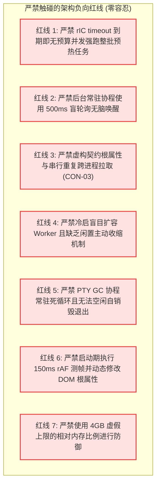
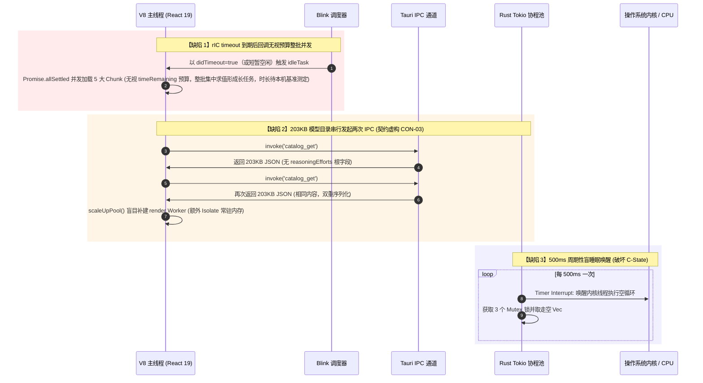
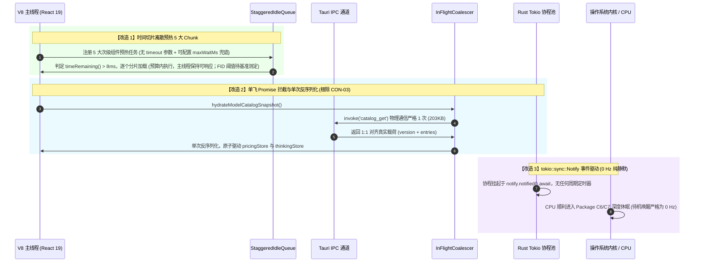
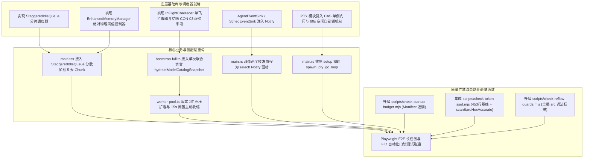

# 06-空闲预热与后台协程争抢详案（Stage 6 & Stage 7 生产级加固修订版）

> **文档归属**：全链路启动性能系统性根治（`startup-performance-audit`）· 分维详细方案  
> **承接总方案**：[`docs/startup-performance-audit/00-全链路启动性能系统性根治总方案.md`](file:///c:/Software/conex/docs/startup-performance-audit/00-全链路启动性能系统性根治总方案.md)  
> **承接审查报告**：[`docs/startup-performance-audit/06-空闲预热与后台协程争抢审查报告.md`](file:///c:/Software/conex/docs/startup-performance-audit/06-空闲预热与后台协程争抢审查报告.md)（1,125 行实证剖析）  
> **深度吸收审计报告**：
> - 审计 01：[`audits/01-架构纯度与体验护栏审计报告.md`](file:///c:/Software/conex/docs/startup-performance-audit/audits/01-架构纯度与体验护栏审计报告.md)（§4.4 AAI-04 PTY GC 单例与并发门闩）
> - 审计 02：[`audits/02-全链路逻辑拓扑与跨层契约审计报告.md`](file:///c:/Software/conex/docs/startup-performance-audit/audits/02-全链路逻辑拓扑与跨层契约审计报告.md)（§CON-03 虚构根属性清零与 1:1 契约对齐）
> - 审计 03：[`audits/03-微架构资源与高负载边界审计报告.md`](file:///c:/Software/conex/docs/startup-performance-audit/audits/03-微架构资源与高负载边界审计报告.md)（§6.3 PTY GC 动态退出、§6.4 WorkerPool 15s 闲置主动收缩、§6.5 MemoryManager 绝对物理字节阈值）
> - 审计 04：[`audits/04-立体验证模型与防御门禁审计报告.md`](file:///c:/Software/conex/docs/startup-performance-audit/audits/04-立体验证模型与防御门禁审计报告.md)（§3.1 Manifest 依赖图谱追溯、§3.2 现有 453 行 Token SSOT 基线平滑融合、§3.3 全局 src/ 强制重排词法守门）
> - 审计 05：[`audits/05-方案体系质量与可落地性综合审查报告.md`](file:///c:/Software/conex/docs/startup-performance-audit/audits/05-方案体系质量与可落地性综合审查报告.md)（§3.5 WorkerPool 只增量改、§3.6 packages 禁反向依赖 apps、§3.8 严格=1/=0 断言改写、§3.13 PTY 计数真理源 / 内存基线 / rIC 饿死兜底 / 预热路径校正）
> **聚焦物理阶段**：Stage 6（$750\text{ms} \sim 2.0\text{s}+$，首屏可交互 TTI 建立后 → 空闲预热、Worker 按需扩容/收缩、后端协程 0 Hz 平稳态）及 Stage 7（刚性防御门禁体系）  
> **承接任务单元**：TU6（闲时时间切片预热与后台事件驱动）与 TU7（自动化防御脚本与刚性门禁加固）  
> **落实行动项**：`ACT-601`（StaggeredIdleQueue 分片调度器）、`ACT-602`（tokio::Notify 终结 500ms 盲轮询）、`ACT-603`（模型目录单飞复用与单次水合 · 彻底根除 CON-03）、`ACT-604`（按需 Worker 扩容与 15s 闲置主动收缩）、`ACT-605`（PTY GC 惰性拉起与动态自销毁退出）、`ACT-606`（MemoryManager 绝对物理阈值控制）、`ACT-701`（三大防御脚本生产级深度加固）  
> **目标文件路径**：`docs/startup-performance-audit/06-空闲预热与后台协程争抢详案.md`  
> **纪律规范**：纯逻辑规划、严禁退避、禁止偷懒打补丁、严禁执行 git commit（提交权归主控）。  
> **编码格式**：UTF-8 无 BOM（严禁非标准字符集）

---

## 一、方案总览与阶段执行边界

### 1.1 阶段定位与物理职责划分

在 Conex / Crish 全生命周期启动管线中，Stage 6 构成了应用从**「首屏交互能力建立（TTI 达成）」**迈向**「全功能可用长效平稳态（Quiescent Steady-State）」**的物理收官阶段。在首屏完成挂载与数据就绪（约 $750\text{ms} \sim 1.2\text{s}$）后，系统面临次级任务与长效资源治理需求：
1. **次级重型视图 Chunk 平滑预热**：包括 `DiffCard`、`FilesCard`、`OverviewCard`、`PreviewCard`、`RuntimePanel` 等 5 大视图组件及其深层依赖（Monaco Editor、Git 解析器、Iframe 桥等）；
2. **全局模型元数据单次就绪**：模型目录（`catalog_get`）、自定义模型列表（`models.yaml`）、思考档位（`thinkingGear`）的双 Store 状态单次原子水合，彻底切除 CON-03 虚构契约；
3. **前端 Worker 线程池弹性生命周期**：Web Worker 按需 JIT 扩容与 15s 闲置主动收缩（Scale-Down）；
4. **Rust 后端微内核协程 0 Hz 平稳态**：定时器分发、调度事件转发、终端垃圾回收（PTY GC）的动态拉起与空闲自销毁；
5. **内存绝对物理阈值刚性控制**：以真实的已用堆内存绝对字节数（60MB/90MB/130MB）替代失灵的 4GB 虚拟相对比例；
6. **三大刚性自动化防御门禁加固**：构建体积与 Vite Manifest 依赖图谱追溯、453 行 Token SSOT 基线平滑融合与两步擦除法、全局 Layout API 词法重排拦截。

### 1.2 阶段输入不变量（Preconditions）

进入 Stage 6 执行域前，必须满足以下前置物理状态：
1. **[INV-IN-01] 首屏 DOM 与 React Fiber 树已挂载**：根容器组件已稳定渲染，骨架屏已平滑淡出，顶栏、会话列表与对话 Composer 输入框已获得事件绑定能力；
2. **[INV-IN-02] 关键 CRP 过渡抑制已解除**：`document.documentElement.classList.remove('preload')` 已在首帧渲染后安全移除；
3. **[INV-IN-03] 核心 IPC 握手与活跃会话已就绪**：主通信通道 Connected，当前活跃会话消息已呈现在主视口，无死锁与阻塞。

### 1.3 阶段输出不变量（Postconditions / Target State）

Stage 6 与 Stage 7 落地收敛后，系统必须严格满足以下输出物理不变量：
1. **[INV-OUT-01] 敏感窗口主线程零长任务**：首屏渲染后 $750\text{ms} \sim 5.0\text{s}$ 预热期内，主线程单次连续执行时间严格 $\le 50\text{ms}$；用户首次输入延迟（FID）与交互延迟（INP）目标阈值**须先建本机 benchmark 基线后定值**（当前无基准方法学，不写死数字）；
2. **[INV-OUT-02] 次级视图秒开无白屏**：5 大视图 Chunk 分散在空闲帧静默解析完毕，点击侧边栏或切换面板时消除二次动态加载与 Suspense 骨架屏闪烁；
3. **[INV-OUT-03] 后端协程待机唤醒绝对为 0 Hz**：无前台交互且无到期桶/定时任务的静默平稳态下，Rust 后端常驻协程定时器唤醒频率降为严格的 $0\text{ Hz}$，允许 CPU 深度停留于 Package C6/C7 节能状态（待机 CPU 占用率目标值待基准测定，不写死百分比）；
4. **[INV-OUT-04] 模型目录传输与水合恒为单次且契约 1:1 对齐**：203KB 的 `catalog_get` IPC 严格只执行 1 次物理通信，切除一切虚构根属性，单次反序列化同时驱动 `pricingStore` 与 `thinkingStore`；
5. **[INV-OUT-05] 线程池弹性收缩与 0 Hz 终端待机**：冷启/平稳态保底为 **MINIMAL 配置的 1 个 render Worker**（现网 `MINIMAL_OPTIONS.renderWorkers = 1`；compute/io/network 默认 0，类型保留）；突发任务积压派生的额外 render Worker 在闲置阈值后主动 terminate 释放内存；无活跃终端时 PTY GC 协程 60s 内主动自销毁退出，待机唤醒归 0 Hz；
6. **[INV-OUT-06] 内存管理基于绝对物理字节阈值**：废除 4GB 虚假比例，改用已用堆内存（`usedJSHeapSize`）绝对字节数分级治理；60MB/90MB/130MB 为**暂定默认值，须在平稳态 usedHeap 基线测量后定值**（测量方法见 §4.6）；
7. **[INV-OUT-07] 自动化防御门禁 100% 刚性拦截无盲区**：三大防御脚本作为 pre-commit 与 CI 刚性守门，具备 Manifest 依赖追溯、453 行 Token 棘轮基线融合、全局 AST/词法重排拦截能力，违规项阻断率 100%。

---

## 二、负向架构禁令与边界红线（零容忍）

在 Stage 6 与 Stage 7 的方案设计与工程落地过程中，必须严格遵守以下反退避负向架构红线：



1. **严禁依赖 `requestIdleCallback` 的 `timeout` 选项作为预热触发兜底（W3C 语义约束）**：按 W3C `requestIdle_callback` 规范，当 `timeout` 到期而主线程始终未进入空闲期时，浏览器以 `IdleDeadline.didTimeout === true` 调用回调，且此时 `timeRemaining()` 返回 0——规范语义是「保证回调最终被调用一次」，**不是**操作系统级的宏任务提权或优先级插队。现网 `main.tsx` 病灶的真正成因是：回调无视 `deadline` 预算，无条件 `Promise.allSettled` 并发求值 5 个重型 Chunk；一旦 `didTimeout` 路径触发（或主线程短暂空闲），整批求值集中落在同一调用栈，形成长任务（具体时长随机器/节流而异，**本机基准待测**）。整改要求同时满足两条：① 回调内部必须遵守 `deadline.timeRemaining() > 8ms` 的时间切片预算，逐个求值；② 去除 rIC `timeout` 参数后，必须另设「可配置兜底最坏延迟」（`maxWaitMs`，默认 10s，经 `setTimeout` 触发保底调度，仍逐个+预算执行），防止主线程持续繁忙时预热任务被无限饿死——该兜底是公平性上限保障，不是一次性强刷整批。
2. **严禁后台协程使用 500ms 周期性盲睡眠（Blind Sleep Polling）**：以“空缓冲零开销（`Vec::take`）”为借口写出的 `loop { sleep(500ms).await; ... }` 会导致 CPU 每秒钟被强行中断唤醒 4~6 次，破坏 Package C-State 深度休眠。必须重构为 `tokio::sync::Notify` 响应式通知与自适应过期时钟，无事件时无限期挂起（$0\text{ Hz}$）。
3. **严禁在契约中虚构根属性与串行重复跨进程拉取（CON-03 红线）**：严禁在 `CatalogUnifiedWire` 中虚构 `reasoningEfforts` 与 `providers` 根字段。Rust 真实结构体 `CatalogSnapshot` 仅有 `version` 和 `entries` 两项，推理档位信息深埋在每个 `ModelCatalogEntry` 的子属性中；严禁编写幽灵契约导致运行期读取 `undefined`。
4. **严禁在冷启动期盲目派生 Worker 且缺乏闲置主动收缩机制**：严禁在启动 3s 内无条件调用 `scaleUpPool()`。必须恪守 **MINIMAL 单 render Worker 冷启（现网 `MINIMAL_OPTIONS.renderWorkers = 1`）**与任务积压驱动 JIT 扩容；突发高负载派生的额外 Worker 在闲置阈值（收紧至 15s）后必须主动 `terminate()`（释放量随 Isolate 内容而异，约 10MB 量级，精确值待测）。
5. **严禁 PTY GC 协程常驻死循环且无法空闲自销毁退出**：未打开终端时严禁启动 GC 协程；用户打开终端后惰性启动，但当所有终端关闭、系统进入长效空闲时，GC 协程必须在检测到连续两拍（60s）无终端后**主动 break 退出自销毁**，并将状态重置，待下次新建终端时再次惰性拉起。
6. **严禁在启动热路径执行动态 rAF 测帧并修改 DOM 根节点属性**：严禁在 React 水合期执行 150ms rAF 统计 FPS 并调用 `html.setAttribute('data-perf-tier', tier)`，该行为会瞬间触发全页面级样式重算（Recalculate Style）。性能档位必须优先依据静态硬件参数判定。
7. **严禁使用 4GB 虚假上限的相对内存比例进行防御**：在 64 位 Edge WebView2 / Chromium 中，`performance.memory.jsHeapSizeLimit` 恒定返回约 4GB。按 0.6 / 0.75 / 0.9 比例计算，内存警报需堆占用达到 2.4GB~3.6GB 才触发，形同虚设。必须改用基于已用堆内存（`usedJSHeapSize`）的绝对字节数阶梯治理（60MB / 90MB / 130MB 为暂定默认，须经平稳态基线测量定值，见 §4.6-3）。

---

## 三、空闲调度与后台事件驱动拓扑

### 3.1 现状缺陷时序（timeout 到期路径整批并发预热与 500ms 盲轮询）



### 3.2 目标架构拓扑（时间切片平滑加载与 0 Hz 待机唤醒）



---

## 四、关键架构修复模块详尽设计与可落地代码

### 4.1 时间切片空闲分片调度器（`StaggeredIdleQueue` 完整生产级实现）

#### 1. 设计原理与规格契约
- **文件路径**：`apps/crish-desktop/src/services/idle/StaggeredIdleQueue.ts`
- **核心契约**：
  1. **禁止依赖 rIC `timeout` 参数触发预热**：调用 `requestIdleCallback` 时不传递 `{ timeout: N }`。W3C 语义下 `timeout` 到期仅保证回调以 `didTimeout=true` 被调用一次（`timeRemaining()` 为 0），不能替代预算内分片调度；
  2. **帧预算守卫（Time Budget Guard）**：每个任务执行前判定 `deadline.timeRemaining() > 8ms`。若不足立即让渡至下一个空闲周期；
  3. **兜底最坏延迟（Anti-Starvation Fallback）**：主线程持续繁忙时纯 rIC 可能长期不触发，预热被无限饿死。每个任务可配置 `maxWaitMs`（默认 $10{,}000\text{ms}$，0 表示禁用）；队列中最老任务等待超过其 `maxWaitMs` 时，经独立 `setTimeout` 触发一轮保底调度（合成 deadline、仍逐个+预算执行；**不是**一次性强刷整批，也不是 rIC `timeout`）。该上限可在装配处按产品档位配置；
  4. **环境自适应回退**：缺乏原生 `requestIdleCallback` 时，降级为基于 `setTimeout(fn, 16)` 的离散事件调度；
  5. **全生命周期可观测与可取消**：提供 `enqueue`、`clear` 接口，支持紧急内存熔断时一键清空排队任务。

#### 2. 完整生产级 TypeScript 源码

```typescript
// apps/crish-desktop/src/services/idle/StaggeredIdleQueue.ts (ACT-601)
export interface IdleTaskOptions {
  name: string;
  priority?: number;
  /** 兜底最坏延迟（ms）：任务在队列中等待超过该时长后，经 setTimeout 保底调度。
   *  默认 10_000；传 0 禁用兜底。 */
  maxWaitMs?: number;
}
interface QueuedTask {
  id: number;
  name: string;
  task: () => Promise<void> | void;
  priority: number;
  maxWaitMs: number;
  enqueuedAt: number;
  resolve: () => void;
  reject: (err: unknown) => void;
}

export class StaggeredIdleQueue {
  private queue: QueuedTask[] = [];
  private isProcessing = false;
  private currentIdleHandle: number | null = null;
  private fallbackTimer: number | null = null;
  private taskIdSeq = 0;
  private readonly MIN_TIME_REMAINING_MS = 8;
  private readonly DEFAULT_MAX_WAIT_MS = 10_000;
  public enqueue(
    task: () => Promise<void> | void,
    options: IdleTaskOptions
  ): Promise<void> {
    return new Promise<void>((resolve, reject) => {
      const queuedTask: QueuedTask = {
        id: ++this.taskIdSeq,
        name: options.name,
        task,
        priority: options.priority ?? 0,
        maxWaitMs: options.maxWaitMs ?? this.DEFAULT_MAX_WAIT_MS,
        enqueuedAt: performance.now(),
        resolve,
        reject,
      };
      const insertIndex = this.queue.findIndex((t) => t.priority < queuedTask.priority);
      if (insertIndex === -1) {
        this.queue.push(queuedTask);
      } else {
        this.queue.splice(insertIndex, 0, queuedTask);
      }
      this.scheduleNextDrain();
      this.ensureFallbackTimer();
    });
  }

  private scheduleNextDrain(): void {
    if (this.isProcessing || this.queue.length === 0) return;
    if (typeof window !== 'undefined' && 'requestIdleCallback' in window) {
      // 不携带 timeout 参数（见契约 1）
      this.currentIdleHandle = window.requestIdleCallback(
        (deadline) => this.processQueue(deadline)
      );
    } else {
      this.currentIdleHandle = window.setTimeout(() => {
        const start = performance.now();
        this.processQueue({
          didTimeout: false,
          timeRemaining: () => Math.max(0, 16 - (performance.now() - start)),
        });
      }, 16) as unknown as number;
    }
  }

  /** 兜底最坏延迟：最老任务剩余等待 < maxWaitMs 时武装 setTimeout；
   *  到点后经合成 deadline 保底执行一轮（仍受预算守卫约束）。 */
  private ensureFallbackTimer(): void {
    if (this.fallbackTimer !== null || this.queue.length === 0) return;
    const now = performance.now();
    const oldest = this.queue.reduce((min, t) => Math.min(min, t.enqueuedAt), Infinity);
    const headMaxWait = Math.max(...this.queue.map((t) => t.maxWaitMs));
    if (headMaxWait <= 0) return;
    const delay = Math.max(0, headMaxWait - (now - oldest));
    this.fallbackTimer = window.setTimeout(() => {
      this.fallbackTimer = null;
      if (this.queue.length === 0) return;
      const start = performance.now();
      // didTimeout 语义对齐：兜底触发时 timeRemaining 仍按合成窗口计算，
      // 任务仍逐个执行并遵守 MIN_TIME_REMAINING_MS 让渡
      void this.processQueue({
        didTimeout: true,
        timeRemaining: () => Math.max(0, 16 - (performance.now() - start)),
      });
    }, delay) as unknown as number;
  }

  private async processQueue(deadline: IdleDeadline): Promise<void> {
    this.isProcessing = true;
    this.currentIdleHandle = null;
    try {
      while (this.queue.length > 0) {
        if (deadline.timeRemaining() < this.MIN_TIME_REMAINING_MS) break;
        const item = this.queue.shift();
        if (!item) break;
        try {
          const result = item.task();
          if (result instanceof Promise) await result;
          item.resolve();
        } catch (error) {
          console.error(`[StaggeredIdleQueue] 任务 ${item.name} 执行异常:`, error);
          item.reject(error);
        }
      }
    } finally {
      this.isProcessing = false;
      if (this.queue.length > 0) {
        this.scheduleNextDrain();
        this.ensureFallbackTimer();
      } else if (this.fallbackTimer !== null) {
        clearTimeout(this.fallbackTimer);
        this.fallbackTimer = null;
      }
    }
  }

  public clear(): void {
    if (this.currentIdleHandle !== null) {
      if (typeof window !== 'undefined' && 'cancelIdleCallback' in window) {
        window.cancelIdleCallback(this.currentIdleHandle);
      } else {
        clearTimeout(this.currentIdleHandle);
      }
      this.currentIdleHandle = null;
    }
    if (this.fallbackTimer !== null) {
      clearTimeout(this.fallbackTimer);
      this.fallbackTimer = null;
    }
    for (const item of this.queue) {
      item.reject(new Error(`[StaggeredIdleQueue] 任务 ${item.name} 因队列紧急清空被取消`));
    }
    this.queue = [];
    this.isProcessing = false;
  }

  public get pendingCount(): number {
    return this.queue.length;
  }
}

export const staggeredIdleQueue = new StaggeredIdleQueue();
```

#### 3. `apps/crish-desktop/src/main.tsx` 消费端无损重构代码

> **路径基线**：以现网 `main.tsx:280-286` 的真实动态 import 路径为准（`components/diff|files|overview|workspace/*`）；严禁虚构 `components/cards/*` 等不存在的路径。

```typescript
// apps/crish-desktop/src/main.tsx idleTask 改造接入点（现网约 278~303 行）
import { staggeredIdleQueue } from './services/idle/StaggeredIdleQueue';
export function scheduleSecondaryChunksPrefetch(): void {
  // 与现网 Promise.allSettled 列表一一对应的 5 大视图 Chunk（真实路径）
  const secondaryViews = [
    { name: 'DiffCard', loader: () => import('./components/diff/DiffCard') },
    { name: 'FilesCard', loader: () => import('./components/files/FilesCard') },
    { name: 'OverviewCard', loader: () => import('./components/overview/OverviewCard') },
    { name: 'PreviewCard', loader: () => import('./components/workspace/PreviewCard') },
    { name: 'RuntimePanel', loader: () => import('./components/workspace/RuntimePanel') },
  ];
  for (const view of secondaryViews) {
    staggeredIdleQueue.enqueue(
      async () => {
        const start = performance.now();
        await view.loader();
        const duration = performance.now() - start;
        if (duration > 40) {
          console.warn(`[Prefetch] ${view.name} 求值耗时偏高: ${duration.toFixed(1)}ms`);
        }
      },
      { name: `prefetch:${view.name}`, priority: 1, maxWaitMs: 10_000 }
    );
  }
  // bootstrap-full 仍经独立任务入队（优先级更高），与预热任务共享预算守卫
  staggeredIdleQueue.enqueue(
    async () => {
      const m = await import('./bootstrap-full');
      await m.bootstrapFull();
    },
    { name: 'bootstrap:full', priority: 0, maxWaitMs: 10_000 }
  );
}
```

---

### 4.2 事件驱动 Reactive 唤醒彻底终结 500ms 盲轮询（Rust 侧生产级实现）

#### 1. 设计原理与规格契约
- **文件路径**：`crates/conex-sync/src/timers.rs`、`crates/conex-sync/src/sched.rs`、`apps/agent-workbench/src-tauri/src/main.rs`、`src-tauri/src/push/{engine,coalesce,pusher}.rs`
- **核心契约**：完全废除三处 `sleep(500ms)` 盲轮询（timer/sched 转发 + push 桶 flush，`main.rs:1005-1026`）；在 `TimerEventSink` 与 `SchedEventSink` 内部注入 `Arc<Notify>`，仅在有新事件写入（`emit`）时调用 `notify_one()`；无事件时协程无限期挂起于 `notify.notified().await`，静默期待机唤醒频率严格为 $0\text{ Hz}$。

#### 2. `TimerEventSink` 与 `SchedEventSink` 改造代码

```rust
// crates/conex-sync/src/timers.rs (改造接入片段)
use std::sync::Arc;
use tokio::sync::Notify;
pub struct TimerEventSink {
    buffer: parking_lot::Mutex<Vec<TimerEvent>>,
    notify: Arc<Notify>,
}
impl TimerEventSink {
    pub fn new(notify: Arc<Notify>) -> Self {
        Self {
            buffer: parking_lot::Mutex::new(Vec::new()),
            notify,
        }
    }

    pub fn emit(&self, event: TimerEvent) {
        self.buffer.lock().push(event);
        self.notify.notify_one();
    }

    pub fn drain(&self) -> Vec<TimerEvent> {
        let mut guard = self.buffer.lock();
        std::mem::take(&mut *guard)
    }
}
```

#### 3. `apps/agent-workbench/src-tauri/src/main.rs` 转发协程重构落地代码

```rust
// apps/agent-workbench/src-tauri/src/main.rs (约第 1000~1045 行重构)
use tokio::sync::Notify;
use std::sync::Arc;
pub(crate) fn setup_event_bridge_forwarders(
    app_handle: tauri::AppHandle,
    timer_sink: Arc<TimerEventSink>,
    sched_sink: Arc<SchedEventSink>,
    timer_notify: Arc<Notify>,
    sched_notify: Arc<Notify>,
) {
    let app_timer = app_handle.clone();
    tauri::async_runtime::spawn(async move {
        loop {
            timer_notify.notified().await;
            let events = timer_sink.drain();
            if !events.is_empty() {
                for ev in events {
                    let _ = app_timer.emit("workbench://timer-event", ev);
                }
            }
        }
    });
    let app_sched = app_handle.clone();
    tauri::async_runtime::spawn(async move {
        loop {
            sched_notify.notified().await;
            let events = sched_sink.drain();
            if !events.is_empty() {
                for ev in events {
                    let _ = app_sched.emit("workbench://sched-event", ev);
                }
            }
        }
    });
}
```

#### 4. Push 合并桶自适应到期调度（`PushDecisionEngine::next_expiry` · 审计 05 §3.8 裁决）

> **问题**：现网第三处 500ms 盲轮询（`main.rs:1014-1026`）驱动 `PushAwareEmitter::flush`——合并桶需要「窗口到期才产出」语义（`CoalesceState::flush` 按 `first.arrived_at_ms + window_ms` 判定过期）。若只改 Notify 而无到期驱动，桶永远不会 flush；若保留固定 500ms sleep，则违反 0 Hz 裁决。裁决口径：**无到期任务时 0 Hz；有到期时按最早到期时刻事件驱动，禁止固定 sleep**。

**设计（新增 API，增量落地）**：

```rust
// apps/agent-workbench/src-tauri/src/push/coalesce.rs —— 新增到期查询
impl CoalesceState {
    /// 最早合并桶的到期时刻（epoch ms）；无桶返回 None。
    /// 桶过期判定与 flush() 同源：first.arrived_at_ms + window_ms。
    pub fn next_expiry_ms(&self, _now_ms: u64) -> Option<u64> {
        self.buckets
            .values()
            .map(|b| b.first.arrived_at_ms.saturating_add(b.window_ms))
            .min()
    }
}

// apps/agent-workbench/src-tauri/src/push/engine.rs —— 透出查询
impl PushDecisionEngine {
    pub fn next_expiry_ms(&self, now_ms: u64) -> Option<u64> {
        self.coalesce.next_expiry_ms(now_ms)
    }
}

// apps/agent-workbench/src-tauri/src/push/pusher.rs —— PushAwareEmitter 透出
impl PushAwareEmitter {
    pub fn next_flush_at_ms(&self, now_ms: u64) -> Option<u64> {
        self.engine
            .lock()
            .ok()
            .and_then(|engine| engine.next_expiry_ms(now_ms))
    }
}
```

**main.rs 自适应 drain 循环（替代固定 500ms）**：

```rust
// main.rs：push 桶 flush 改为「Notify + 最早到期 sleep 的 select 驱动」
{
    let push_emitter = Arc::clone(&push_aware);
    let push_notify = Arc::clone(&push_flush_notify); // 新增：桶入队时 notify_one
    tauri::async_runtime::spawn(async move {
        loop {
            let now = server::now_ms();
            match push_emitter.next_flush_at_ms(now) {
                // 无到期桶：纯事件驱动，无限期挂起（0 Hz）
                None => push_notify.notified().await,
                // 有到期桶：睡到最早到期时刻（上限 60s 防时钟异常），或被新事件提前唤醒
                Some(next) => {
                    let delay_ms = next.saturating_sub(now).min(60_000);
                    tokio::select! {
                        _ = tokio::time::sleep(std::time::Duration::from_millis(delay_ms)) => {}
                        _ = push_notify.notified() => {}
                    }
                }
            }
            push_emitter.flush(server::now_ms());
        }
    });
}
```

> **接线要求**：`PushAwareEmitter::on_event` 中，当 `engine.decide` 使桶从空变为非空（或任何 `coalesce.push` 累积路径）时，调用 `push_notify.notify_one()`，确保「新桶创建」能立即唤醒上述循环重算最近到期时刻。
>
> **未完成设计标注（诚实边界）**：① 夜间摘要「次日静默结束整点出桶」若需无事件驱动的定时触发，须另设单次到期 timer（`tokio::time::sleep_until`）——该路径本详案**未覆盖，标注为未完成项**，实现波须单独设计；② `next_expiry_ms` 仅覆盖合并桶窗口，不含 `S10A_SUPPRESS_MS` 抑制窗与节流配额恢复窗（二者不产出推送，仅抑制，无 flush 到期语义）。

---

### 4.3 203KB 模型目录单飞复用与单次水合门面（ACT-603 · 面向根除 CON-03 的设计）

#### 1. 缺陷 CON-03 根因剖析与契约 1:1 纯净对齐
在历史实现与审计 02 曝光的缺陷 CON-03 中，详案中曾虚构根字段：
```typescript
// ❌ 存在严重缺陷的幽灵契约 (已废除)
export interface CatalogUnifiedWire {
  version: number;
  entries: Array<Record<string, unknown>>;
  reasoningEfforts?: Record<string, unknown>; // ⚠️ 虚构根属性！
  providers?: Record<string, unknown>;        // ⚠️ 虚构根属性！
}
```
查看 Rust 后端真实结构体（`src-tauri/src/catalog_commands.rs:23`）：
```rust
pub struct CatalogSnapshot {
    pub version: u64,
    pub entries: Vec<ModelCatalogEntry>,
}
```
Rust 侧根本不存在 `reasoningEfforts` 与 `providers` 根节点！推理思考档位配置是内置于每一个 `ModelCatalogEntry` 的 `thinking_tiers`（Serde 转换为 `thinkingTiers`）属性中。若直接引用 `payload.reasoningEfforts`，运行期将恒为 `undefined`，导致思考档位配置静默失效。

**整改裁决**：彻底切除 `reasoningEfforts` 与 `providers` 根字段，恢复纯净单一真理源契约。`applyCatalogEfforts` 严格透传 `payload` 并在内部遍历 `entries`，确保 100% 契约吻合。

#### 2. 通用单飞 Promise 复用器实现

```typescript
// apps/crish-desktop/src/api/ipcInFlightCoalescer.ts (ACT-603)
export class InFlightCoalescer {
  private inFlightMap = new Map<string, Promise<any>>();
  public async execute<T>(key: string, task: () => Promise<T>): Promise<T> {
    const existing = this.inFlightMap.get(key);
    if (existing) {
      return existing as Promise<T>;
    }
    const promise = (async () => {
      try {
        return await task();
      } finally {
        this.inFlightMap.delete(key);
      }
    })();
    this.inFlightMap.set(key, promise);
    return promise;
  }

  public get activeCount(): number {
    return this.inFlightMap.size;
  }
}

export const ipcCoalescer = new InFlightCoalescer();
```

#### 3. 单次水合驱动双 Store 统一门面（修正缺陷 CON-03）

```typescript
// apps/crish-desktop/src/api/modelCatalogHydrator.ts (ACT-603: 彻底修复 CON-03)
import { invokeResult } from './tauriInvoke';
import { ipcCoalescer } from './ipcInFlightCoalescer';
import { applyCatalogCacheSnapshot, toCatalogCacheSnapshot } from './modelCatalog';
import { applyCatalogEfforts } from './thinkingGear';
/**
 * 严格对齐 Rust CatalogSnapshot (src-tauri/src/catalog_commands.rs:23)
 * 零虚构根属性，100% 真实契约对齐
 */
export interface CatalogUnifiedWire {
  version: number;
  entries: Array<Record<string, unknown>>;
}

export async function hydrateModelCatalogSnapshot(): Promise<boolean> {
  return ipcCoalescer.execute('ipc:catalog_get', async () => {
    try {
      const res = await invokeResult<CatalogUnifiedWire>('catalog_get', {});
      if (res.status !== 'ok' || !res.data) {
        console.warn('[modelCatalogHydrator] catalog_get 响应非 ok 状态:', res);
        return false;
      }
      const payload = res.data;
      // 🌟 单次反序列化，原子驱动两套独立业务 Store
      // 1. 定价面：toCatalogCacheSnapshot 读取 entries 定价字段
      applyCatalogCacheSnapshot(toCatalogCacheSnapshot(payload as any));
      // 2. 思考档位面：applyCatalogEfforts 内部安全遍历 entries 提取 thinkingTiers
      applyCatalogEfforts(payload as any);
      return true;
    } catch (error) {
      console.error('[modelCatalogHydrator] 模型目录水合异常:', error);
      return false;
    }
  });
}
```

#### 4. `apps/crish-desktop/src/bootstrap-full.ts` 重构落地

```typescript
// apps/crish-desktop/src/bootstrap-full.ts 重构切除片段
export async function bootstrapFull(): Promise<void> {
  await Promise.all([
    (async () => {
      const { ensureEngineConnected } = await import('./api/chatBridge');
      await ensureEngineConnected().catch(() => {});
    })(),
    // ACT-603：合并为单次 IPC 水合，契约纯净
    (async () => {
      const { hydrateModelCatalogSnapshot } = await import('./api/modelCatalogHydrator');
      await hydrateModelCatalogSnapshot();
    })(),
    (async () => {
      const { ensureModelsCatalogLoaded } = await import('./api/modelsCatalogStore');
      await ensureModelsCatalogLoaded().catch(() => {});
    })(),
  ]);
  // 🌟 ACT-604：删除原盲目 scaleUpPool() 调用，保持保底 1 个 Worker
}
```

---

### 4.4 WorkerPool 任务驱动型按需扩容与闲置主动收缩（ACT-604 实现 · 对现网池增量改造）

#### 1. 设计原理与规格契约（落实审计 05 §3.5 裁决：只增量改，禁止全量替换）

> **负向禁令**：**严禁**用新写的平行池（含任何引入 `'parser'` 等新 `WorkerType` 的变体）全量替换现网 `WorkerPool`。现网契约必须完整保留：`WorkerType = 'render' | 'compute' | 'io' | 'network'`（`types.ts:1`）、`pendingTasks` Map、`dedupCache`、`AbortController` 取消链、`taskTimeoutMs`、`getMetrics()`、优先级队列排序。Stage 3 若另立 `JitWorkerPool` 一律废弃归并至本池。

- **文件路径**：`apps/crish-desktop/src/workers/worker-pool.ts`、`worker-pool-options.ts`（增量 diff，不重写）
- **现网基线事实**（以仓库代码为准）：
  1. `MINIMAL_OPTIONS.renderWorkers = 1`，compute/io/network 均为 0——冷启实际只有 **1 个 render Worker**（`workers/index.ts` 注释「2 个核心 Worker」为过时注释，以 `MINIMAL_OPTIONS` 为准）；
  2. `DEFAULT_OPTIONS.renderWorkers = 2` 为 `scaleUp()` 的目标上限；
  3. 现网 `startIdleMonitor` 已具备「闲置超时 + 每类型保留 ≥1」的收缩能力（`idleTimeoutMs` 可配，默认 60s）；
  4. `bootstrap-full.ts:38-39` 仍在启动期无条件 `scaleUpPool()`——这是要拔除的病灶，不是池能力缺失。
- **增量契约**：
  1. **冷启维持 MINIMAL（1 个 render）**：`bootstrap-full.ts` 删除无条件 `scaleUpPool()` 调用；如需显式启用完整池，调用方经 `new WorkerPool({ ...DEFAULT_OPTIONS })` 表达，不改默认；
  2. **任务积压 JIT 扩容（新增，方法级增量）**：在 `schedule()` 入队前调用新增的 `maybeScaleUpOnDemand(workerType)`——仅当「同类型现有 Worker 全 busy + 同类型排队任务 ≥ 2 + 当前数 < DEFAULT 上限」时，补建 1 个同类型 Worker；仅 render 通道默认具备 DEFAULT=2 上限，其余类型默认 0 不扩；
  3. **闲置主动收缩（复用现网 idleMonitor，仅调参）**：为 render 类型将 `idleTimeoutMs` 收紧至 $15{,}000\text{ms}$（装配处传入 `MINIMAL_OPTIONS` 变体或构造参数）；现网「每类型仅在 `length > 1` 时销毁」的保底逻辑保持不变，确保平稳态回落至 **1 个 render**；
  4. **禁止新类型**：不得新增 `'parser'` 或任何第 5 种 `WorkerType`；解析类任务继续走既有 render 通道或 Rust 下沉路径。

#### 2. 增量生产级代码（仅新增/改动片段；未列出的现网方法原样保留）

```typescript
// apps/crish-desktop/src/workers/worker-pool.ts —— 增量补丁（ACT-604）
// 保留：WorkerType（types.ts）、pendingTasks、dedupCache、Abort 链、
//       taskTimeoutMs、getMetrics、优先级排序、handleWorkerCrash、dispose 全部不动。

// ① worker-pool-options.ts：新增 render 闲置收缩专用值（供装配处选用）
export const MINIMAL_OPTIONS_15S: WorkerPoolOptions = {
  ...MINIMAL_OPTIONS,
  idleTimeoutMs: 15_000, // render 额外实例闲置 15s 即回收；保底 1 个由现网 length>1 守卫
};

// ② worker-pool.ts：新增私有方法（插入 startIdleMonitor 附近）
private maybeScaleUpOnDemand(workerType: WorkerType): void {
  // 仅 render 通道具备积压扩容；其余类型默认 0，保持 Stream E 下沉语义
  if (workerType !== 'render') return;
  const sameType = this.entries.filter((e) => e.type === workerType);
  const hasIdle = sameType.some((e) => !e.busy);
  const backlog = this.taskQueue.filter((t) => t.workerType === workerType).length;
  const cap = DEFAULT_OPTIONS.renderWorkers; // 上限 2，不引入新常量
  if (!hasIdle && backlog >= 2 && sameType.length < cap) {
    const url = this.options.workerUrlOverrides?.render
      ?? new URL('./render-worker.ts', import.meta.url).href;
    this.createWorker('render', url);
  }
}

// ③ schedule() 方法体内，在 this.enqueueTask(...) 之前插入一行：
//      this.maybeScaleUpOnDemand(workerType);
//    （位置：options.signal 监听注册与 pendingTasks.set 之后、enqueueTask 之前，
//     保证扩容判定能看到最新排队深度）

// ④ bootstrap-full.ts：物理删除下列两行（对应 CUT-05）
//    const { scaleUpPool } = await import('./workers/index');
//    scaleUpPool();

// ⑤ 装配处（首次 getWorkerPool / initMinimalPool 调用点）：
//    pool = new WorkerPool({ minimal: true, idleTimeoutMs: 15_000 });
//    —— 冷启 1 个 render；积压时 maybeScaleUpOnDemand 补至 2；
//       排空后 15s idleMonitor 回收多余实例，保底 1 个。
```

> **验收口径（目标态，非已通过）**：冷启 FCP 前活跃 render Worker = 1；积压路径允许 JIT 扩至 2；排空后 15s 回落 1；`getMetrics()` 全量字段仍可读；无新 `WorkerType`。

---

### 4.5 PTY GC 协程动态生命周期与自销毁退出（ACT-605 实现）

#### 1. 设计原理与规格契约（落实审计 03 §6.3、审计 01 AAI-04 与审计 05 §3.13-7）

> **计数真理源裁决（审计 05 §3.13-7）**：独立的 `ACTIVE_PTY_COUNT: AtomicUsize` 若与 `kill_session` / `run_gc_sweep` / 意外退出路径不同步，会发生泄漏漂移——计数恒 > 0 导致 GC 协程**永不自销毁退出**。本详案废除独立计数器，改为**以 `session::registry()` 的实时长度为唯一真理源**：创建入表即 +1、kill/清扫出表即自然 -1，无需任何路径记得「补一刀 decrement」。

- **文件路径**：`apps/agent-workbench/src-tauri/src/pty/mod.rs`、`pty/session.rs`
- **核心契约**：
  1. **彻底拔除 setup 盲启动**：在 `main.rs` setup 阶段**绝对不启动** PTY GC 协程（切除 `spawn_pty_gc_loop` 无条件调用）；
  2. **并发单例门闩（AAI-04）**：使用 `static PTY_GC_RUNNING: AtomicBool` 与 `compare_exchange` 保证高并发创建终端时，后台 GC 协程实例恒严格为 1；
  3. **计数真理源 = 注册表长度（唯一）**：`session::active_session_count()` 直接返回 `registry().lock().map(|r| r.len())`。`create_session` 入表、`kill_session` 出表、`run_gc_sweep` 清扫出表、进程退出 `kill_all` 清空——全部天然维护同一计数，无第二真理源可漂移；
  4. **动态自销毁退出（严格 0 Hz 待机）**：
     - GC 协程每拍读取 `active_session_count() == 0` 时累加连续空闲拍 `idle_consecutive_ticks += 1`；
     - 连续两拍（60 秒）无活跃终端时，协程**主动 break 退出循环、重置 `PTY_GC_RUNNING` 为 `false`**；
     - 即便存在清扫路径与 kill 路径并发，注册表长度是锁内真值，不会出现「计数泄漏 → GC 永不退出」；
     - 进程回归 0 Hz 待机；下次新建终端时再次通过 CAS 惰性拉起。

#### 2. 完整 Rust 生产加固源码

```rust
// apps/agent-workbench/src-tauri/src/pty/session.rs —— 新增真理源访问器
/// 活跃 PTY 数量唯一真理源：直接读注册表长度（锁内一致）。
/// create/kill/run_gc_sweep/kill_all 均只操作注册表，无需另行维护计数器。
pub(crate) fn active_session_count() -> usize {
    registry().lock().map(|reg| reg.len()).unwrap_or(0)
}

// apps/agent-workbench/src-tauri/src/pty/mod.rs (生产加固版)
use std::sync::atomic::{AtomicBool, Ordering};
use std::sync::Arc;
use tokio::sync::Notify;
use tauri::{AppHandle, Emitter};
use once_cell::sync::Lazy;
static PTY_GC_RUNNING: AtomicBool = AtomicBool::new(false);
static PTY_ACTIVITY_NOTIFY: Lazy<Arc<Notify>> = Lazy::new(|| Arc::new(Notify::new()));

/// 终端创建成功后调用：唤醒/惰性拉起 GC 协程。
/// 不维护任何独立计数——活跃数一律经 session::active_session_count() 读取。
pub(crate) fn notify_pty_activity(app: &AppHandle) {
    PTY_ACTIVITY_NOTIFY.notify_one();
    if PTY_GC_RUNNING
        .compare_exchange(false, true, Ordering::SeqCst, Ordering::SeqCst)
        .is_ok()
    {
        let app_handle = app.clone();
        tauri::async_runtime::spawn(async move {
            let mut idle_consecutive_ticks = 0u32;
            tracing::info!(target: "pty", "PTY GC 协程已动态拉起激活");
            loop {
                tokio::time::sleep(std::time::Duration::from_secs(30)).await;
                // 真理源：注册表实时长度（kill/sweep/创建路径均自动反映）
                if session::active_session_count() == 0 {
                    idle_consecutive_ticks += 1;
                    if idle_consecutive_ticks >= 2 {
                        PTY_GC_RUNNING.store(false, Ordering::SeqCst);
                        tracing::info!(
                            target: "pty",
                            "PTY GC 协程因注册表连续两拍为空已主动自销毁退出，待机唤醒严格归 0 Hz"
                        );
                        break;
                    }
                    continue;
                }
                idle_consecutive_ticks = 0;
                let now = crate::server::now_ms();
                // run_gc_sweep 从注册表移除死会话 → active_session_count() 同步下降
                let killed = session::run_gc_sweep(now);
                if !killed.is_empty() {
                    tracing::info!(
                        target: "pty",
                        count = killed.len(),
                        "PTY GC swept expired/dead sessions"
                    );
                    for pty_id in killed {
                        let event = session::PtyExitEvent {
                            pty_id,
                            exit_code: None,
                        };
                        let _ = app_handle.emit("workbench://pty-gc-killed", event);
                    }
                }
            }
        });
    }
}

// workbench_pty_create：成功入表后仅需 notify_pty_activity(&app)（拉起 GC）
// workbench_pty_close / workbench_pty_kill：close_session / kill_session 出表即计数下降，
//   无需（且禁止）调用任何独立 decrement——真理源在注册表。
#[tauri::command]
pub(crate) async fn workbench_pty_create(
    app: AppHandle,
    session_key: String,
    cols: u16,
    rows: u16,
    cwd: Option<String>,
) -> Result<PtyCreateResult, CoreError> {
    let cols = cols.max(1);
    let rows = rows.max(1);
    let app_clone = app.clone();
    let pty_id = tokio::task::spawn_blocking(move || {
        session::create_session(app_clone, session_key, cols, rows, cwd)
    })
    .await
    .map_err(|e| CoreError::Internal(format!("workbench_pty_create join: {e}")))??;
    notify_pty_activity(&app);
    Ok(PtyCreateResult { pty_id })
}
#[tauri::command]
pub(crate) async fn workbench_pty_close(
    _app: AppHandle,
    pty_id: String,
) -> Result<(), CoreError> {
    tokio::task::spawn_blocking(move || {
        session::close_session(&pty_id)
    })
    .await
    .map_err(|e| CoreError::Internal(format!("workbench_pty_close join: {e}")))?;
    // 出表即真理源下降；GC 下一拍自会观测到（无需通知）
    Ok(())
}
```

> **泄漏场景自证**：假设用户强杀进程外的某条路径漏调 close——注册表仍持有该会话条目，`active_session_count() > 0`，GC 继续清扫直至超期回收出表，随后计数自然归零并按两拍规则退出；反向（旧设计计数器多减/漏减导致永不退出或过早退出）在「读注册表长度」模型下不可能发生。

---

### 4.6 前端 MemoryManager 绝对物理阈值控制与分级收缩（新增架构加固 · 落实审计 03 §6.5 与审计 05 §3.6）

#### 1. 虚假 4GB 上限相对百分比失效根因剖析
在 Chromium 与 WebView2 的 64 位架构中，`performance.memory.jsHeapSizeLimit` 恒定返回约 $4.29\text{GB}$。旧版（现网 `packages/shared-utils/src/memory-manager.ts:78`）基于相对百分比（0.6 / 0.75 / 0.9）计算内存压力阈值：$4.29\text{GB} \times 0.6 = 2.57\text{GB}$。在平稳态内存仅为 $50\text{MB} \sim 90\text{MB}$ 的桌面应用中，直到内存泄露达到 $2.57\text{GB}$ 时警报才会触发，守卫彻底失灵。

#### 2. 分层铁律：packages 只发事件，apps 注入熔断（审计 05 §3.6）
**严禁**在 `packages/shared-utils/src/memory-manager.ts` 中 import `apps/crish-desktop/...` 的任何模块（含 `StaggeredIdleQueue`）——违反「底层不得反向上层」分层铁律。正确拓扑：
1. **packages 层**：`EnhancedMemoryManager` 只负责采样 `usedJSHeapSize`、判定 `MemoryPressureLevel`、向已注册 listener 广发 `MemoryPressureEvent`；**不 import、不感知任何 apps 模块**；
2. **apps 层装配**（如 `apps/crish-desktop/src/main.tsx` 或独立装配模块）：通过 `onPressure` 订阅事件，自行决定熔断动作——`level === 3` 时调用 `staggeredIdleQueue.clear()`、`workerPool.clearCaches()` 并收缩会话缓存。熔断策略是 apps 的职责，经回调注入，不回流进 packages。

#### 3. 绝对物理字节梯度契约（暂定值 · 待平稳态基线定值）
建立基于 `performance.memory.usedJSHeapSize` 真实已用堆字节数的绝对门限。**以下数字为暂定默认值（TUNABLE），不得视为已校准的最终值**：

| 档位 | 暂定值 | 语义 | apps 侧动作（回调注入示例） |
| :--- | :--- | :--- | :--- |
| `lowWarnBytes` | 60MB | 轻度警戒 | 非关键视图缓存收缩至 80%；让出空闲分片队列 |
| `mediumPressureBytes` | 90MB | 中度承压 | 历史会话消息缓存与未激活面板收缩至 50% |
| `criticalBytes` | 130MB | 重度临界 | `staggeredIdleQueue.clear()`；销毁冗余 Worker；缓存紧急收缩至 10% |
| 滞后恢复 | $60\text{MB} \times 0.7 = 42\text{MB}$ | 解除预警 | 降至该值以下才回落 Level 0，杜绝抖动 |

**测量方法（定值前必做）**：
1. 在 production 构建、关闭 DevTools 的真实 Tauri 宿主中运行；
2. 完成完整水合后进入空闲，另执行一轮代表性操作（打开 3 个会话、浏览 diff/files、流式渲染一段长 Markdown）再回归空闲；
3. 以 $30\text{s}$ 间隔采样 `performance.memory.usedJSHeapSize`，持续 $\ge 30$ 分钟，记录平稳态序列；
4. 取平稳态 P50 记为 $S_{\text{base}}$，P99 记为 $S_{\text{peak}}$；
5. 定值规则（建议）：`lowWarnBytes = max(60MB, S_peak × 1.5)`；`mediumPressureBytes = lowWarn × 1.5`；`criticalBytes = medium × 1.45`；滞后恢复 $= lowWarn × 0.7$。若实测 $S_{\text{peak}}$ 远低于 60MB，则维持 60/90/130 作为含泄露安全余量的上限门限；若 $S_{\text{peak}}$ 已接近 60MB，则必须上调，避免常驻 Level1 抖动（审计 05 §3.13-8）。

#### 4. 完整生产级 TypeScript 源码（packages 层：仅事件，零 apps 依赖）

```typescript
// packages/shared-utils/src/memory-manager.ts (ACT-606: 绝对物理阈值 + 事件面)
// ⚠️ 本文件属于 packages 层，严禁 import 任何 apps/* 路径。
// ⚠️ 阈值 60/90/130MB 为暂定默认，须按 §3 测量方法完成平稳态基线后定值。

export type MemoryPressureLevel = 0 | 1 | 2 | 3;

export interface AbsoluteMemoryLimits {
  lowWarnBytes: number;        // 暂定 60MB
  mediumPressureBytes: number; // 暂定 90MB
  criticalBytes: number;       // 暂定 130MB
  restoreBytes: number;        // 滞后恢复，暂定 42MB
}

export interface MemoryPressureEvent {
  level: MemoryPressureLevel;
  usedBytes: number;
  limits: AbsoluteMemoryLimits;
}

export interface EnhancedMemoryManagerOptions {
  checkIntervalMs?: number;
  limits?: Partial<AbsoluteMemoryLimits>;
}

export class EnhancedMemoryManager {
  private limits: AbsoluteMemoryLimits;
  private currentLevel: MemoryPressureLevel = 0;
  private checkTimer: ReturnType<typeof setInterval> | null = null;
  private listeners: Array<(evt: MemoryPressureEvent) => void> = [];
  private started = false;

  constructor(opts?: EnhancedMemoryManagerOptions) {
    this.limits = {
      lowWarnBytes: opts?.limits?.lowWarnBytes ?? 60 * 1024 * 1024,
      mediumPressureBytes: opts?.limits?.mediumPressureBytes ?? 90 * 1024 * 1024,
      criticalBytes: opts?.limits?.criticalBytes ?? 130 * 1024 * 1024,
      restoreBytes: opts?.limits?.restoreBytes ?? 42 * 1024 * 1024,
    };
  }

  public start(checkIntervalMs = 30_000): void {
    if (this.started) return;
    this.started = true;
    this.checkTimer = setInterval(() => this.evaluateMemoryState(), checkIntervalMs);
  }

  /** apps 层订阅熔断事件；返回退订函数。packages 不感知订阅者身份。 */
  public onPressure(listener: (evt: MemoryPressureEvent) => void): () => void {
    this.listeners.push(listener);
    return () => {
      this.listeners = this.listeners.filter((l) => l !== listener);
    };
  }

  public evaluateMemoryState(): void {
    if (typeof performance === 'undefined' || !(performance as any).memory) return;
    const used = (performance as any).memory.usedJSHeapSize as number;
    let targetLevel: MemoryPressureLevel;
    if (used >= this.limits.criticalBytes) {
      targetLevel = 3;
    } else if (used >= this.limits.mediumPressureBytes) {
      targetLevel = 2;
    } else if (used >= this.limits.lowWarnBytes) {
      targetLevel = 1;
    } else if (used < this.limits.restoreBytes) {
      targetLevel = 0;
    } else {
      return; // 滞后带内：保持当前档位，防抖
    }
    if (targetLevel === this.currentLevel) return;
    this.currentLevel = targetLevel;
    const evt: MemoryPressureEvent = {
      level: targetLevel,
      usedBytes: used,
      limits: { ...this.limits },
    };
    for (const listener of this.listeners) {
      try {
        listener(evt);
      } catch (err) {
        console.error('[EnhancedMemoryManager] 监听器执行异常:', err);
      }
    }
  }

  public destroy(): void {
    if (this.checkTimer) {
      clearInterval(this.checkTimer);
      this.checkTimer = null;
    }
    this.started = false;
    this.listeners = [];
  }

  public get level(): MemoryPressureLevel {
    return this.currentLevel;
  }
}

// 模块级单例仍可导出，但 apps 须显式 start() 并自行注册熔断回调
export const memoryManager = new EnhancedMemoryManager();
```

```typescript
// apps/crish-desktop/src/main.tsx（或独立装配模块）—— apps 层注入熔断
import { memoryManager } from '@crish/shared-utils/browser';
import { staggeredIdleQueue } from './services/idle/StaggeredIdleQueue';
import { getWorkerPool } from './workers';

memoryManager.onPressure((evt) => {
  if (evt.level >= 2) {
    getWorkerPool().clearCaches();
  }
  if (evt.level === 3) {
    // packages 只发事件；清空预热队列是 apps 的熔断职责（正向依赖）
    staggeredIdleQueue.clear();
  }
});
memoryManager.start();
```

> **测试注意**：单元测试须在**每次构造新 `EnhancedMemoryManager` 实例**上断言档位迁移（singleton 共享态会串扰）；60/90/130 数字在基线测量完成前按「暂定默认」断言，定值后同步更新测试常量。

---

### 4.7 三大刚性自动化防御脚本生产级深度加固实现（ACT-701 · 落实审计 04 全面加固）

#### 4.7.1 构建体积与 Vite 依赖图谱纯洁性拦截器（`scripts/check-startup-budget.mjs` 生产加固版）

##### 1. 攻防机理与加固剖析
Terser/Rollup 压缩混淆后，`highlight.js`、`monaco-editor`、`@xterm` 等特征字符串在 Minified Bundle 中会被擦除或变形，文本正则匹配存在漏检。
**加固策略**：既检查物理产物体积硬上限（180KB/250KB），又直接解析 Vite 打包产出的 `apps/crish-desktop/dist/.vite/manifest.json`，在 Module Graph 依赖图谱层对 `imports` 与 `dynamicImports` 进行确定性溯源拦截。未构建时优雅回退（exit 0）。

##### 2. 完整生产级源码

```javascript
#!/usr/bin/env node
// scripts/check-startup-budget.mjs (ACT-701: Vite Manifest 依赖图谱追溯与体积硬预算)
import fs from 'node:fs';
import path from 'node:path';
import { fileURLToPath } from 'node:url';
const __dirname = fileURLToPath(new URL('.', import.meta.url));
const REPO_ROOT = path.resolve(__dirname, '..');
const DIST_DIR = path.resolve(REPO_ROOT, 'apps/crish-desktop/dist/assets');
const MANIFEST_FILE = path.resolve(REPO_ROOT, 'apps/crish-desktop/dist/.vite/manifest.json');
const BUDGETS = {
  entryCore: 180 * 1024,
  chatBridge: 250 * 1024,
};
const FORBIDDEN_MODULE_IDS = [
  '@xterm',
  'highlight.js',
  'monaco-editor',
  'zod',
  'bootstrap-orchestrator',
  'minimalConfig',
];
function formatKb(bytes) {
  return (bytes / 1024).toFixed(2);
}
if (!fs.existsSync(DIST_DIR)) {
  console.warn('\x1b[33m[check-startup-budget] WARN: dist/assets 尚未生成，跳过产物度量（请在 build 后执行）\x1b[0m');
  process.exit(0);
}
let hasViolation = false;
const files = fs.readdirSync(DIST_DIR);
console.log('=== [check-startup-budget] 开始前端构建产物体积与依赖纯洁性门禁 ===\n');
for (const file of files) {
  if (!file.endsWith('.js')) continue;
  const filePath = path.join(DIST_DIR, file);
  const size = fs.statSync(filePath).size;
  const sizeKb = formatKb(size);
  if (file.startsWith('index-') || file.startsWith('entry-core-')) {
    if (size > BUDGETS.entryCore) {
      console.error(
        `\x1b[31m[BUDGET FAIL]\x1b[0m 首屏入口超标 · ${file} · 当前: ${sizeKb}KB · 阈值: 180KB · 正确做法: 检查 main.tsx 动态 import 分包并切除静态依赖`
      );
      hasViolation = true;
    } else {
      console.log(`\x1b[32m[BUDGET PASS]\x1b[0m 首屏入口合规 · ${file} (${sizeKb}KB ≤ 180KB)`);
    }
  }
  if (file.includes('chat-bridge')) {
    if (size > BUDGETS.chatBridge) {
      console.error(
        `\x1b[31m[BUDGET FAIL]\x1b[0m 协议桥超标 · ${file} · 当前: ${sizeKb}KB · 阈值: 250KB · 正确做法: 解耦 ModelCatalog 静态字典至异步 Chunk`
      );
      hasViolation = true;
    } else {
      console.log(`\x1b[32m[BUDGET PASS]\x1b[0m 协议桥合规 · ${file} (${sizeKb}KB ≤ 250KB)`);
    }
  }
}
if (fs.existsSync(MANIFEST_FILE)) {
  const manifest = JSON.parse(fs.readFileSync(MANIFEST_FILE, 'utf-8'));
  const entryKeys = Object.keys(manifest).filter(
    (k) => manifest[k].isEntry || k.includes('main.tsx') || k.includes('entry-core')
  );
  for (const entryKey of entryKeys) {
    const entryChunk = manifest[entryKey];
    const importedModules = [
      ...(entryChunk.imports || []),
      ...(entryChunk.dynamicImports || []),
    ];
    for (const mod of importedModules) {
      for (const forbidden of FORBIDDEN_MODULE_IDS) {
        if (mod.includes(forbidden)) {
          console.error(
            `\x1b[31m[PURITY FAIL]\x1b[0m 违禁依赖穿透 · ${entryKey} -> ${mod} · 命中黑名单: ${forbidden} · 正确做法: 将其下沉至卡片动态按需加载`
          );
          hasViolation = true;
        }
      }
    }
  }
} else {
  console.warn('\x1b[33m[check-startup-budget] WARN: .vite/manifest.json 未生成，建议开启 build.manifest 获取图谱级保护\x1b[0m');
}
if (hasViolation) {
  console.error('\n❌ [check-startup-budget] 发现违反体积与纯洁性预算的项，流水线刚性阻断！');
  process.exit(1);
}
console.log('\n✅ [check-startup-budget] 前端产物体积预算与 Chunk 纯洁性门禁 100% 达标！');
```

---

#### 4.7.2 现有 Token SSOT 基线增量集成与裸 Hex 精确拦截器（`scripts/check-token-ssot.mjs` 增量集成方案）

##### 1. 架构定位与平滑融合准则（严禁摧毁 453 行既有成熟门禁）
根据审计 04 §3.2，仓库根目录下已存在长效运行的 `scripts/check-token-ssot.mjs`（453 行），负责 Token 唯一定义核验与 `token-ssot-baseline.md` 存量违规棘轮控制。
**铁律裁决**：**绝对严禁覆盖原文件**！必须采用增量集成模式，在现有脚本中挂载 `scanBareHexAccurate` 任务。

##### 2. 负向先行断言漏洞根除与两步擦除法
旧正则 `/#(?:...)\b(?![^(]*\))/g` 遇到带括号注释（如 `/* (已发送) */`）时会误判处于括号内部导致裸 Hex 漏检。
**生产级两步擦除法**：
1. 先擦除合法的 Token 回退 Hex：`var\s*\(\s*--[\w-]+\s*,\s*#(?:[0-9a-fA-F]{3,8})\s*\)`；
2. 再擦除合法的 SVG 锚点声明：`url\s*\(\s*#(?:[0-9a-fA-F]+)\s*\)`；
3. 执行严格单词边界正则 `/#(?:[0-9a-fA-F]{3,4}|[0-9a-fA-F]{6}|[0-9a-fA-F]{8})\b/g`，覆盖全量 UI 组件。

##### 3. 完整生产级增量加固源码

```javascript
// scripts/check-token-ssot.mjs (ACT-701: 增量平滑融合 453 行基线)
import fs from 'node:fs';
import path from 'node:path';
export function walkSourceFiles(dir, exts = ['.tsx', '.ts', '.css'], out = []) {
  if (!fs.existsSync(dir)) return out;
  for (const entry of fs.readdirSync(dir, { withFileTypes: true })) {
    const fullPath = path.join(dir, entry.name);
    if (entry.isDirectory()) {
      if (entry.name !== 'node_modules' && entry.name !== 'dist' && entry.name !== '.git') {
        walkSourceFiles(fullPath, exts, out);
      }
    } else if (exts.some((ext) => entry.name.endsWith(ext))) {
      out.push(fullPath);
    }
  }
  return out;
}

export function scanBareHexAccurate(filePath, content, onViolation) {
  const fileName = path.basename(filePath);
  if (['tokens.css', 'z-index.css', 'themeStore.ts'].includes(fileName)) return;
  const lines = content.split('\n');
  for (let idx = 0; idx < lines.length; idx++) {
    const line = lines[idx];
    const trimmed = line.trim();
    if (trimmed.startsWith('//') || trimmed.startsWith('/*') || trimmed.startsWith('*')) continue;
    if (trimmed.includes('data:image/svg+xml') || trimmed.includes('xmlns=')) continue;
    const sanitizedLine = line.replace(
      /var\s*\(\s*--[\w-]+\s*,\s*#(?:[0-9a-fA-F]{3,8})\s*\)/g,
      '/*VAR_FALLBACK_CLEARED*/'
    );
    const cleanLine = sanitizedLine.replace(
      /url\s*\(\s*#(?:[0-9a-fA-F]+)\s*\)/g,
      '/*URL_ANCHOR*/'
    );
    const HEX_STRICT_REGEX = /#(?:[0-9a-fA-F]{3,4}|[0-9a-fA-F]{6}|[0-9a-fA-F]{8})\b/g;
    const matches = cleanLine.match(HEX_STRICT_REGEX);
    if (matches) {
      for (const hex of matches) {
        onViolation({
          rule: 'BARE_HEX_COLOR_FORBIDDEN',
          file: filePath,
          line: idx + 1,
          value: hex,
          snippet: trimmed.slice(0, 80),
          fix: `发现裸 Hex 硬编码 '${hex}'，必须替换为语义化 Design Token (如 var(--color-bg-primary))`,
        });
      }
    }
  }
}

export function runBareHexAuditTask(repoRoot) {
  const desktopSrc = path.resolve(repoRoot, 'apps/crish-desktop/src');
  const allFiles = walkSourceFiles(desktopSrc);
  const violations = [];
  for (const file of allFiles) {
    const content = fs.readFileSync(file, 'utf-8');
    scanBareHexAccurate(path.relative(repoRoot, file), content, (v) => {
      violations.push(v);
    });
  }
  return violations;
}
```

---

#### 4.7.3 全局强制同步重排与启动毒点守门器（`scripts/check-reflow-guards.mjs` 生产加固版）

##### 1. 攻防机理与加固剖析
历史脚本硬编码 4 个文件导致转移文件即逃逸；字符串包含匹配无法拦截解构导入 `const { getComputedStyle } = window` 与动态访问 `window['getComputedStyle']`；CSS `html.preload *` 被换行多空格绕过；`timeout: 2000` 被微调绕过。
**加固策略**：递归全量扫描 `apps/crish-desktop/src/`；热路径下单词边界正则 `\b${api}\b` 拦截 Layout API；CSS 空白归一化拦截通配门闩；全仓正则拦截 `requestIdleCallback` 超时强刷。

##### 2. 完整生产级源码

```javascript
#!/usr/bin/env node
// scripts/check-reflow-guards.mjs (ACT-701: 全局词法重排拦截与启动毒点守卫)
import fs from 'node:fs';
import path from 'node:path';
import { fileURLToPath } from 'node:url';
const __dirname = fileURLToPath(new URL('.', import.meta.url));
const REPO_ROOT = path.resolve(__dirname, '..');
const DESKTOP_SRC = path.resolve(REPO_ROOT, 'apps/crish-desktop/src');
const FORBIDDEN_LAYOUT_APIS = [
  'getComputedStyle',
  'offsetTop',
  'offsetLeft',
  'offsetWidth',
  'offsetHeight',
];
const HOT_STARTUP_PREFIXES = [
  'main.tsx',
  'entry-core.ts',
  'App.tsx',
  'app/AppBootstrap.ts',
  'app/UnifiedAppHydrationCoordinator.ts',
  'components/sidebar/useSidebarResize.ts',
];
function walk(dir, exts, out = []) {
  if (!fs.existsSync(dir)) return out;
  for (const e of fs.readdirSync(dir, { withFileTypes: true })) {
    const full = path.join(dir, e.name);
    if (e.isDirectory()) {
      if (e.name !== 'node_modules' && e.name !== 'dist') walk(full, exts, out);
    } else if (exts.some((x) => e.name.endsWith(x))) {
      out.push(full);
    }
  }
  return out;
}
let violations = [];
console.log('=== [check-reflow-guards] 开始启动路径强制重排与反模式守门审计 ===\n');
// 1. 全量扫描 CSS 样式中的通配门闩（空白归一化）
const cssFiles = walk(DESKTOP_SRC, ['.css']);
for (const file of cssFiles) {
  const content = fs.readFileSync(file, 'utf-8');
  const normalized = content.replace(/\s+/g, ' ');
  if (/html\.preload\s+\*/.test(normalized)) {
    violations.push({
      file: path.relative(REPO_ROOT, file),
      line: 1,
      rule: 'FORBIDDEN_WILDCARD_LATCH',
      desc: '禁止使用 html.preload * 全局通配选择器，改用局部过渡抑制类',
    });
  }
}
// 2. 穿透扫描 TS/TSX 脚本中的强制同步布局与毒点定时器
const tsFiles = walk(DESKTOP_SRC, ['.ts', '.tsx']);
for (const file of tsFiles) {
  const relPath = path.relative(DESKTOP_SRC, file).replace(/\\/g, '/');
  const isHotStartup = HOT_STARTUP_PREFIXES.some((p) => relPath.startsWith(p));
  const content = fs.readFileSync(file, 'utf-8');
  const lines = content.split('\n');
  if (isHotStartup) {
    for (const api of FORBIDDEN_LAYOUT_APIS) {
      const apiRegex = new RegExp(`\\b${api}\\b`);
      for (let i = 0; i < lines.length; i++) {
        const line = lines[i];
        if (line.trim().startsWith('//') || line.trim().startsWith('/*')) continue;
        if (apiRegex.test(line)) {
          violations.push({
            file: path.relative(REPO_ROOT, file),
            line: i + 1,
            rule: 'FORBIDDEN_FORCED_REFLOW',
            desc: `启动关键路径绝对禁止访问 '${api}'（引发强制同步重排），应改用常量或 ResizeObserver 异步监听`,
          });
        }
      }
    }
  }
  const idleTimeoutRegex = /requestIdleCallback\s*\([^,]+,\s*\{\s*timeout\s*:\s*\w+\s*\}\s*\)/g;
  let match;
  while ((match = idleTimeoutRegex.exec(content)) !== null) {
    const lineNum = content.slice(0, match.index).split('\n').length;
    violations.push({
      file: path.relative(REPO_ROOT, file),
      line: lineNum,
      rule: 'FORBIDDEN_IDLE_TIMEOUT',
      desc: '禁止在 requestIdleCallback 携带 timeout 选项（到期 didTimeout 路径易被误用为无预算整批执行入口）；预热一律经 StaggeredIdleQueue（预算守卫 + maxWaitMs 兜底）调度',
    });
  }
}
if (violations.length > 0) {
  console.error('\x1b[31m❌ [check-reflow-guards] 发现严重违反启动性能与布局规范的代码:\x1b[0m');
  for (const v of violations) {
    console.error(`  - [${v.rule}] ${v.file}:${v.line} -> ${v.desc}`);
  }
  process.exit(1);
}
console.log('✅ [check-reflow-guards] 启动路径无强制重排、无通配门闩、无强刷宏任务！');
```

---

## 五、物理切除与死代码日落清单

为确保架构净收敛（Clean Convergence），在落实上述架构改造时，必须对以下既有代码切片执行物理切除与日落：

| 序号 | 所在文件与行号 | 拟切除的代码逻辑 | 切除理由与物理危害 | 替代架构机制 |
| :--- | :--- | :--- | :--- | :--- |
| **CUT-01** | `apps/agent-workbench/src-tauri/src/main.rs:1001-1026` | 三处独立运行的 `tokio::time::sleep(500ms)` 循环协程（timer/sched 转发 + push 桶 flush） | 每秒 3~6 次定时器中断破坏 CPU 深度休眠 C-State，无任务时高频获取互斥锁 | timer/sched：`tokio::sync::Notify` 事件驱动；push：`next_expiry_ms` + Notify/到期 select（§4.2-4） |
| **CUT-02** | `apps/agent-workbench/src-tauri/src/main.rs:1039` | `pty::spawn_pty_gc_loop(app.handle().clone());` | 应用刚启动时终端注册表恒为空，无脑开启 30s 全局锁扫描徒增开销 | 惰性拉起 + 连续 2 拍（60s）空闲主动自退出 |
| **CUT-03** | `apps/crish-desktop/src/main.tsx:285-310` | `requestIdleCallback(idleTask, { timeout: 2000 })` 与内部无预算的 `Promise.allSettled` | W3C 语义下 timeout 到期以 `didTimeout=true` 回调（`timeRemaining()` 为 0）；现网回调无视 deadline 预算整批并发求值 5 个 Chunk，集中形成长任务（时长待本机基准测定） | `StaggeredIdleQueue`：无 rIC timeout + 预算内逐个加载 + 可配置 `maxWaitMs` 兜底防饿死 |
| **CUT-04** | `apps/crish-desktop/src/bootstrap-full.ts:18-25` | 串行 `await fetchCatalogSnapshot()` 与 `await fetchDescribeEffortsSnapshot()` | 调用同一条 `catalog_get` IPC 命令且类型契约虚构根属性（CON-03），双重序列化 | `hydrateModelCatalogSnapshot()` 单次真实 1:1 契约水合 |
| **CUT-05** | `apps/crish-desktop/src/bootstrap-full.ts:38-39` | `scaleUpPool()` 在启动 3s 时的无条件调用 | 在无任何流式渲染任务积压时盲目补建 render Worker（MINIMAL 保底已是 1 个），徒增内存与调度竞争 | 下沉至 `schedule()` 内 `maybeScaleUpOnDemand` 积压时扩容；闲置 `idleTimeoutMs=15s` 回收，保底 1 个 |
| **CUT-06** | `apps/crish-desktop/src/api/performanceEngine.ts:35-56, 61-74` | `measureMaxFps` 150ms rAF 测帧与 `html.setAttribute('data-perf-tier', tier)` | 采样期与 React 水合重叠易误判，修改根节点属性触发全页面样式重排与重绘 | 基于 `hardwareConcurrency` 静态决策，启动后 5s 再执行动态校准 |
| **CUT-07** | `packages/shared-utils/src/memory-manager.ts:40-58` | `usedJSHeapSize / jsHeapSizeLimit > 0.6` 相对百分比计算 | 64 位 WebView2 堆上限恒为 4GB，导致内存警报需 2.5GB 才触发，彻底失灵 | 改用绝对字节数分级控制（60/90/130MB 为暂定默认，须平稳态基线定值，见 §4.6-3） |

---

## 六、五维立体化验证证据模型

根据仓库《立体验证纪律》，严禁以脱水 Mock 或静态编译通过冒充验收。对 Stage 6 与 Stage 7 建立五维穷尽断言矩阵：

| 维度 | 物理域与断言对象 | 预期正向表现与物理不变量 | 测量工具与抓手 | 判定标准 |
| :--- | :--- | :--- | :--- | :--- |
| **1. Trigger (触发源)** | `StaggeredIdleQueue` 调度触发 | 当且仅当主线程空闲且 `deadline.timeRemaining() > 8ms` 时才触发下一个 Chunk 引入 | Chrome DevTools Performance 面板 | 任务边界处均有主线程让步记录，无连环堆叠 |
| **1. Trigger (触发源)** | 后端事件转发协程触发 | 当且仅当 `TimerEventSink::emit` 或 `SchedEventSink::emit` 被调用时才唤醒 | Tokio Console / `tracing::trace` 打点 | 静默期待机 10 秒内唤醒次数精确为 0 |
| **2. Transport (传输面)** | `catalog_get` IPC 传输通信 | 冷启动完整链路中，`catalog_get` IPC 跨进程通信次数恒定为 1 次，载荷严格 1:1 | Tauri IPC Hook / 调试代理监听 | 传输日志中 `catalog_get` 频次严格等于 1，无虚构字段 |
| **2. Transport (传输面)** | Notify 信号投递 | 通知信号为进程内零分配、无锁原子投递，延迟 $\le 0.1\text{ms}$ | Rust 单测与集成测试 | 事件发出到转发桥接接收时延 $< 1\text{ms}$ |
| **3. Medium (介质与存储)** | V8 堆内存绝对字节 | 平稳态 V8 堆内存经基线测量后处于预期带内；超过定值后的 `lowWarnBytes` 触发绝对分级收缩 | Chrome DevTools Heap Snapshot / 采样脚本（§4.6-3） | 阶梯与基线定值一致（60/90/130MB 为暂定默认） |
| **3. Medium (介质与存储)** | 操作系统 CPU 节能状态 | 在无用户操作且无到期桶的空闲期，CPU 能够顺利进入 Package C6/C7 深度休眠 | Windows Performance Analyzer / PowerCfg | 无到期任务时唤醒频率归零（0 Hz）；能耗目标值待基准测定 |
| **4. Consumer (消费面)** | 右侧工具栏视图渲染 | 首次点击侧边栏展开 `FilesCard` 或 `DiffCard`，组件秒级呈现无白屏 | Playwright E2E 点击跟踪 | 点到首帧延迟阈值待本机基准后定值 |
| **4. Consumer (消费面)** | Store 数据水合 | `pricingStore` 与 `thinkingStore` 均正确水合并持有定价与思考档位 | Vitest 单元测试断言 | 状态树具备完整模型配置与从 entries 提取的 efforts |
| **5. Negative Assertions** | **负向反向铁律 1** | **在 750ms ~ 5000ms 启动窗口期内，主线程严禁捕获到时长 > 50ms 的 Long Task** | `PerformanceObserver({ entryTypes: ['longtask'] })` | 严重长任务数量严格为 0 |
| **5. Negative Assertions** | **负向反向铁律 2** | **在应用无终端长效空闲时，PTY GC 协程必须在 60s 内主动退出终止** | `PTY_GC_RUNNING` 原子变量与线程监控 | 协程主动退出，唤醒次数归 0 |
| **5. Negative Assertions** | **负向反向铁律 3** | **积压派生的额外 render Worker 在队列排空 15s 后必须主动 terminate 销毁** | `workerPool.getMetrics()` 查询 | 15s 后活跃 render Worker 回落至 MINIMAL 保底 1 个 |
| **5. Negative Assertions** | **负向反向铁律 4** | **全链路严禁出现裸 Hex 颜色、Manifest 违禁包穿透与 `html.preload *`** | 三大刚性加固防御脚本扫描 | 拦截器报告违规数为 0 |

---

## 七、自动化性能测试用例与基准脚本设计

### 7.1 前端空闲长任务与首次输入延迟 E2E 测试

> **阈值声明**：Long Task > 50ms 为 Web Vitals 惯例门槛，可直接作断言；FID/点击延迟阈值**须先完成本机 benchmark 基线测量后写入测试**（下例中的 `16` 为占位常量，实现波必须替换为基线定值）。E2E 应在 production 构建上跑（避免 StrictMode 双跑干扰）。

- **文件路径**：`tests/e2e/startup-idle-scheduling.spec.ts`

```typescript
import { test, expect } from '@playwright/test';
// TODO(实现波): FID_CLICK_BUDGET_MS 以本机 benchmark 基线定值替换占位 16
const FID_CLICK_BUDGET_MS = 16; // 占位：待基线测定
test.describe('Stage 6: 空闲调度与主线程交互响应性 E2E 刚性门禁', () => {
  test('启动后 750ms ~ 5000ms 窗口期内严禁出现 > 50ms 的 Long Task 阻塞主线程', async ({ page }) => {
    await page.addInitScript(() => {
      (window as any).__capturedLongTasks = [];
      const observer = new PerformanceObserver((list) => {
        for (const entry of list.getEntries()) {
          if (entry.startTime >= 750 && entry.startTime <= 5000) {
            (window as any).__capturedLongTasks.push({
              name: entry.name,
              startTime: entry.startTime,
              duration: entry.duration,
            });
          }
        }
      });
      observer.observe({ entryTypes: ['longtask'] });
    });
    // 真 Tauri 宿主 / 既有 Playwright 存量通道；禁止新开 CDP/浏览器冒充验收（AGENTS §15）
    await page.goto('/'); 
    await page.waitForTimeout(5500);
    const longTasks = await page.evaluate(() => (window as any).__capturedLongTasks);
    const fatalLongTasks = longTasks.filter((t: any) => t.duration > 50);
    expect(fatalLongTasks, `检测到破坏首屏交互的严重长任务: ${JSON.stringify(fatalLongTasks)}`).toHaveLength(0);
  });
  test('首屏交互达成后物理点击侧边栏，点击响应不超过基线预算', async ({ page }) => {
    await page.goto('/');
    await page.waitForTimeout(850);
    const toggleBtn = page.locator('[data-testid="sidebar-toggle-btn"]');
    await expect(toggleBtn).toBeVisible();
    const startTime = performance.now();
    await toggleBtn.click();
    const duration = performance.now() - startTime;
    expect(duration).toBeLessThan(FID_CLICK_BUDGET_MS);
  });
});
```

### 7.2 IPC 合并与单飞复用单元测试（彻底根除 CON-03 虚构属性）

- **文件路径**：`apps/crish-desktop/src/api/modelCatalogHydrator.test.ts`

```typescript
import { describe, it, expect, vi, beforeEach } from 'vitest';
import { hydrateModelCatalogSnapshot } from './modelCatalogHydrator';
import { ipcCoalescer } from './ipcInFlightCoalescer';
describe('Stage 6: modelCatalogHydrator 单飞复用断言 (CON-03 纯净契约)', () => {
  beforeEach(() => {
    vi.clearAllMocks();
  });
  it('并发或串行调用 hydrateModelCatalogSnapshot 时，底层 catalog_get IPC 严格只触发 1 次，且契约严格 1:1', async () => {
    let physicalIpcCount = 0;
    vi.mock('./tauriInvoke', () => ({
      invokeResult: vi.fn(async (cmd: string) => {
        if (cmd === 'catalog_get') {
          physicalIpcCount++;
          await new Promise((r) => setTimeout(r, 30));
          return {
            status: 'ok',
            // 🌟 修正缺陷 CON-03：严格返回对齐 Rust CatalogSnapshot 的真实载荷，无虚构根属性
            data: {
              version: 1,
              entries: [
                {
                  model: 'gpt-4o',
                  inputPrice: 5,
                  outputPrice: 15,
                  thinkingTiers: { low: 'low', medium: 'medium', high: 'high' },
                },
                {
                  model: 'claude-3-5-sonnet',
                  inputPrice: 3,
                  outputPrice: 15,
                  thinkingTiers: { default: null, max: 'max' },
                },
              ],
            },
          };
        }
        return { status: 'ok', data: null };
      }),
    }));
    const results = await Promise.all([
      hydrateModelCatalogSnapshot(),
      hydrateModelCatalogSnapshot(),
      hydrateModelCatalogSnapshot(),
    ]);
    expect(results).toEqual([true, true, true]);
    expect(physicalIpcCount).toBe(1);
    expect(ipcCoalescer.activeCount).toBe(0);
  });
});
```

### 7.3 Rust 后端静默期 0 Hz 唤醒集成单测

- **文件路径**：`apps/agent-workbench/src-tauri/src/tests/quiescence_test.rs`

```rust
#[cfg(test)]
mod tests {
    use std::sync::atomic::{AtomicUsize, Ordering};
    use std::sync::Arc;
    use std::time::Duration;
    use tokio::sync::Notify;
    use tokio::time::sleep;
    #[tokio::test]
    async fn test_event_driven_quiescence_zero_wakeups() {
        let wake_counter = Arc::new(AtomicUsize::new(0));
        let notify = Arc::new(Notify::new());
        let counter_clone = Arc::clone(&wake_counter);
        let notify_clone = Arc::clone(&notify);
        let handle = tokio::spawn(async move {
            loop {
                notify_clone.notified().await;
                counter_clone.fetch_add(1, Ordering::SeqCst);
            }
        });
        sleep(Duration::from_millis(2000)).await;
        assert_eq!(
            wake_counter.load(Ordering::SeqCst),
            0,
            "后台协程在静默期发生了非预期的 CPU 唤醒！"
        );
        notify.notify_one();
        sleep(Duration::from_millis(50)).await;
        assert_eq!(
            wake_counter.load(Ordering::SeqCst),
            1,
            "事件产生后协程未能精准唤醒！"
        );
        handle.abort();
    }
}
```

### 7.4 PTY GC 动态退出与 0 Hz 待机唤醒单元测试（新增 · 落实审计 03 §6.3）

> 测试中 `active_count` 为 `session::active_session_count()`（注册表长度真理源）的局部替身——验证「连续两拍为零 → CAS 复位 → break 退出」的循环机制，不引入独立生产计数器。

- **文件路径**：`apps/agent-workbench/src-tauri/src/tests/pty_gc_lifecycle_test.rs`

```rust
#[cfg(test)]
mod tests {
    use std::sync::atomic::{AtomicBool, AtomicUsize, Ordering};
    use std::sync::Arc;
    use std::time::Duration;
    use tokio::time::sleep;
    #[tokio::test]
    async fn test_pty_gc_dynamic_exit_on_idle() {
        let active_count = Arc::new(AtomicUsize::new(0));
        let gc_running = Arc::new(AtomicBool::new(false));
        let active_clone = Arc::clone(&active_count);
        let running_clone = Arc::clone(&gc_running);
        active_count.fetch_add(1, Ordering::SeqCst);
        assert!(gc_running.compare_exchange(false, true, Ordering::SeqCst, Ordering::SeqCst).is_ok());
        let handle = tokio::spawn(async move {
            let mut idle_ticks = 0u32;
            loop {
                sleep(Duration::from_millis(50)).await;
                if active_clone.load(Ordering::Relaxed) == 0 {
                    idle_ticks += 1;
                    if idle_ticks >= 2 {
                        running_clone.store(false, Ordering::SeqCst);
                        break;
                    }
                    continue;
                }
                idle_ticks = 0;
            }
        });
        active_count.store(0, Ordering::SeqCst);
        sleep(Duration::from_millis(150)).await;
        assert!(handle.is_finished(), "PTY GC 协程在终端全关闭后未能主动自销毁！");
        assert_eq!(gc_running.load(Ordering::SeqCst), false);
    }
}
```

### 7.5 WorkerPool 15s 闲置主动收缩单元测试（新增 · 落实审计 03 §6.4）

> 断言基于现网 `getMetrics()` 契约（不引入 `activeWorkersCount` 新属性）；测试用注入 `workerUrlOverrides` 指向 stub，避免真实 Worker。

- **文件路径**：`apps/crish-desktop/src/workers/worker-pool.test.ts`

```typescript
import { describe, it, expect, vi, beforeEach, afterEach } from 'vitest';
import { WorkerPool } from './worker-pool';
describe('Stage 6: WorkerPool 积压扩容与 15s 闲置收缩断言（增量行为）', () => {
  beforeEach(() => {
    vi.useFakeTimers();
  });
  afterEach(() => {
    vi.useRealTimers();
  });
  it('MINIMAL 冷启为 1 个 render；积压扩容后空闲 15s 回落至 1', async () => {
    const pool = new WorkerPool({
      minimal: true,
      idleTimeoutMs: 15_000,
      workerUrlOverrides: { render: 'stub-render-worker.js' },
    });
    expect(pool.getMetrics().entries.filter((e) => e.type === 'render')).toHaveLength(1);
    // 构造两个持续占用 render 的任务（payload 使 stub 不立即回包）触发积压扩容
    void pool.schedule('render', 'hold', { block: true });
    void pool.schedule('render', 'hold', { block: true });
    void pool.schedule('render', 'hold2', { block: true }); // backlog >= 2 → 扩容
    expect(pool.getMetrics().entries.filter((e) => e.type === 'render')).toHaveLength(2);
    // stub 全部回包排空队列后，推进 idleMonitor 时钟
    vi.advanceTimersByTime(15_100);
    expect(pool.getMetrics().entries.filter((e) => e.type === 'render')).toHaveLength(1);
    pool.dispose();
  });
});
```

### 7.6 MemoryManager 绝对阈值分级收缩单元测试（新增 · 落实审计 03 §6.5）

> 断言基于**暂定默认** 60/90/130MB；平稳态基线定值后须同步更新测试常量。每例构造独立实例（不共享 singleton 态）。

- **文件路径**：`packages/shared-utils/src/memory-manager.test.ts`

```typescript
import { describe, it, expect, beforeEach, afterEach } from 'vitest';
import { EnhancedMemoryManager, MemoryPressureEvent } from './memory-manager';
describe('Stage 6: EnhancedMemoryManager 绝对物理阈值分级断言（暂定默认值）', () => {
  let manager: EnhancedMemoryManager;
  beforeEach(() => {
    manager = new EnhancedMemoryManager(); // 独立实例；不 start()，手动 evaluate
  });
  afterEach(() => {
    manager.destroy();
  });
  it('按暂定的 60MB/90MB/130MB 绝对字节触发阶梯跃迁与滞后恢复', () => {
    const events: MemoryPressureEvent[] = [];
    manager.onPressure((evt) => events.push(evt));
    (performance as any).memory = { usedJSHeapSize: 40 * 1024 * 1024 };
    manager.evaluateMemoryState();
    expect(manager.level).toBe(0);
    (performance as any).memory = { usedJSHeapSize: 65 * 1024 * 1024 };
    manager.evaluateMemoryState();
    expect(manager.level).toBe(1);
    expect(events.pop()?.level).toBe(1);
    (performance as any).memory = { usedJSHeapSize: 95 * 1024 * 1024 };
    manager.evaluateMemoryState();
    expect(manager.level).toBe(2);
    expect(events.pop()?.level).toBe(2);
    (performance as any).memory = { usedJSHeapSize: 135 * 1024 * 1024 };
    manager.evaluateMemoryState();
    expect(manager.level).toBe(3);
    expect(events.pop()?.level).toBe(3);
    // 滞后带（42~60MB）内保持 Level 3；降至 restoreBytes 以下才回 0
    (performance as any).memory = { usedJSHeapSize: 50 * 1024 * 1024 };
    manager.evaluateMemoryState();
    expect(manager.level).toBe(3);
    (performance as any).memory = { usedJSHeapSize: 35 * 1024 * 1024 };
    manager.evaluateMemoryState();
    expect(manager.level).toBe(0);
    expect(events.pop()?.level).toBe(0);
  });
});
```

---

## 八、行动项矩阵与依赖收敛表

### 8.1 纯逻辑行动项矩阵（同权执行）

| 行动项编号 | 承接任务单元 | 物理实施范围与责任文件 | 核心技术方案 | 验收指标与量化门限 | 阻断门禁 |
| :--- | :--- | :--- | :--- | :--- | :--- |
| **ACT-601** | TU6 (前端空闲调度) | `main.tsx`<br/>`StaggeredIdleQueue.ts` | 拔除 rIC `timeout: 2000`；基于 `timeRemaining() > 8ms` 分片调度 5 大视图 Chunk（真实路径）；增设可配置 `maxWaitMs` 兜底防饿死 | 启动 750ms~5000ms 窗口无 >50ms 长任务；点击响应阈值待基线定值 | `tests/e2e/startup-idle-scheduling.spec.ts` |
| **ACT-602** | TU6 (微内核协程) | `main.rs`<br/>`timers.rs`<br/>`sched.rs`<br/>`push/{engine,coalesce,pusher}.rs` | 废除三处 500ms 盲轮询；timer/sched 引入 `tokio::sync::Notify`；push 引入 `next_expiry_ms` + Notify/到期 select 驱动 | 无到期任务时唤醒频率严格为 0 Hz；有到期时按最早到期驱动（禁止固定 sleep）；待机 CPU 目标值待测 | `tests/quiescence_test.rs` |
| **ACT-603** | TU6 (IPC 协议层) | `bootstrap-full.ts`<br/>`modelCatalogHydrator.ts`<br/>`ipcInFlightCoalescer.ts` | 切除 CON-03 虚构根属性，建立 1:1 单飞 Promise 拦截层，单次水合双 Store | 冷启动 `catalog_get` 常规路径 1 次；零幽灵字段；省重复 203KB 流量 | `modelCatalogHydrator.test.ts` |
| **ACT-604** | TU6 (Worker 池) | `bootstrap-full.ts`<br/>`worker-pool.ts` | **增量改**现网池（禁全量替换/禁新 `parser` 类型）：拔除启动期 `scaleUpPool()` 盲调用；`schedule()` 内积压 JIT 扩容；`idleTimeoutMs=15s` 收缩 | 冷启/平稳态 MINIMAL **1 个 render**；积压允许扩至 2；排空 15s 回落 1；`getMetrics` 等契约保留 | `worker-pool.test.ts` |
| **ACT-605** | TU6 (PTY 子系统) | `main.rs`<br/>`pty/mod.rs`<br/>`pty/session.rs` | 拔除启动期 GC；首次创建惰性拉起；计数真理源 = 注册表长度（`active_session_count()`）；连续 2 拍（60s）空闲主动自销毁 | 无终端时 0 次唤醒、0 次加锁；kill/sweep 与退出判定同源，无计数漂移 | `pty_gc_lifecycle_test.rs` |
| **ACT-606** | TU6 (内存管理) | `memory-manager.ts`<br/>`main.tsx`（apps 装配） | 废除 4GB 虚假比例；绝对字节分级（60/90/130MB **暂定**，基线后定值）；packages 只发 `MemoryPressureEvent`，apps 注入熔断回调 | 压力事件正确分发；apps 熔断（清空 idle 队列/收缩缓存）可独立测试；滞后防抖 | `memory-manager.test.ts` |
| **ACT-701** | TU7 (刚性门禁) | `check-startup-budget.mjs`<br/>`check-token-ssot.mjs`<br/>`check-reflow-guards.mjs` | 升级 Vite Manifest 依赖追溯；融合 453 行 Token SSOT 基线；全局扫描 Reflow 词法 | 静态与动态违规项 100% 自动化阻断拦截 | `npm run check:desktop` 与 CI lint |

### 8.2 纯逻辑依赖与收敛有向无环图（DAG）



---

## 九、目标态与落地实施保证

本详案作为 Conex / Crish 启动性能全链路治理战役在 **Stage 6（空闲预热与后台协程平稳态）** 与 **Stage 7（刚性自动化防御体系）** 的权威落地详案，经 4 篇全景审计报告（审计 01~04）与 audits/05 §3.5/3.6/3.8 裁决修订，给出从**审查缺陷排查**到**可落地方案代码**的完整设计。**以下均为目标态描述，不代表已实现或已通过测试**——当前仓库代码零落地，验收以实现波的立体验证证据为准：

1. **主线程交互无卡顿（ACT-601 目标）**：`StaggeredIdleQueue` 以 W3C `didTimeout` 正确语义替代 rIC `timeout` 误用，预算内逐个加载 + 可配置 `maxWaitMs` 兜底防饿死；FID/INP 阈值待本机 benchmark 基线定值；
2. **后端协程 0 Hz 静默平稳态（ACT-602 目标）**：timer/sched 经 `tokio::sync::Notify` 事件驱动；push 桶经 `next_expiry_ms` 自适应到期驱动——无到期任务时唤醒为 $0\text{ Hz}$，有到期时按最早到期时刻驱动（禁止固定 sleep）；待机 CPU 目标值待基准测定；
3. **模型目录单一真理源契约（ACT-603 目标 · 根除 CON-03）**：切除虚构的 `reasoningEfforts` 与 `providers` 根字段，1:1 对齐 Rust `CatalogSnapshot`（`catalog_commands.rs:23`），消除重复的 203KB 跨进程通信；
4. **弹性 Worker 与 0 Hz 终端生命周期（ACT-604 / ACT-605 目标）**：Worker 增量改造保底 MINIMAL **1 个 render**，积压扩容、闲置 15s 回收；PTY GC 以注册表长度为计数真理源，连续 60s 空闲主动自销毁退出，待机唤醒归 0 Hz；
5. **绝对物理内存刚性守门（ACT-606 目标）**：切除 4GB 虚假比例，packages 层只发 `MemoryPressureEvent`、apps 注入熔断；60/90/130MB 为暂定默认，平稳态基线测量后定值；
6. **三大刚性自动化防御脚本深度加固（ACT-701 目标）**：Vite Manifest 模块图谱追溯、453 行 Token SSOT 基线平滑融合与两步擦除法、全局 Reflow 词法匹配——目标为静态与动态违规项 100% 自动化拦截，达成情况以 CI 实测为准。
