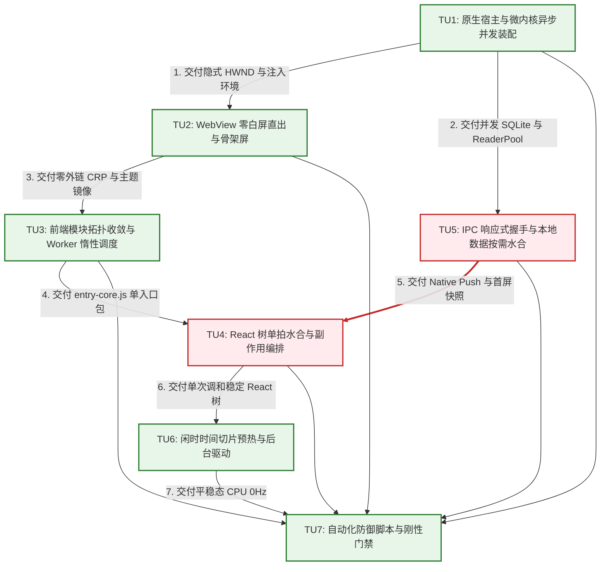
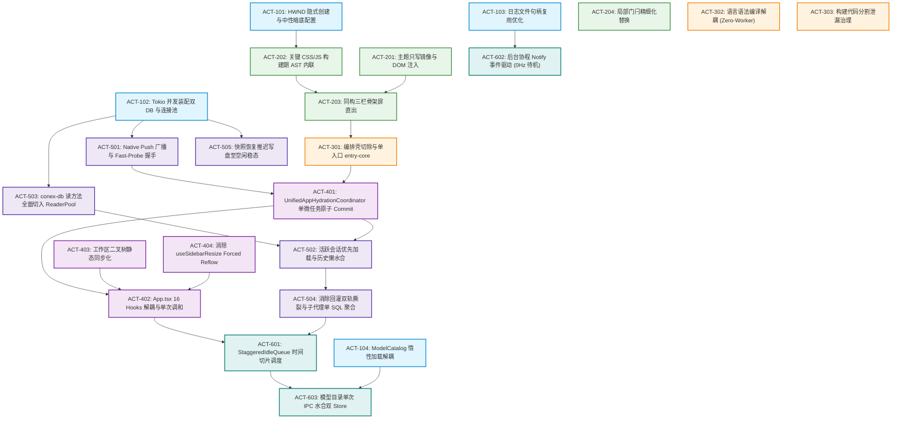
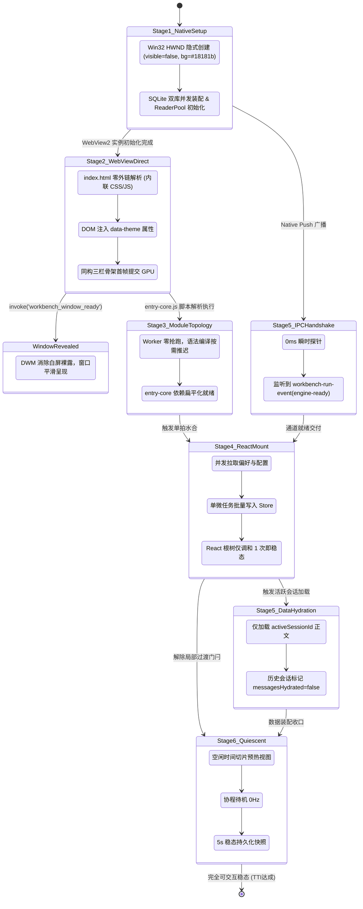

# 02-全链路逻辑拓扑与跨层契约审计报告

> **战役名称**：全链路启动性能深度重构与架构根治（`startup-performance-audit`）  
> **审计席位**：审计位 2（逻辑拓扑、跨层契约与状态机时序专职审计）  
> **权威归档路径**：`docs/startup-performance-audit/audits/02-全链路逻辑拓扑与跨层契约审计报告.md`  
> **审计基石与输入源**：  
> - 总方案：`docs/startup-performance-audit/00-全链路启动性能系统性根治总方案.md`（1,519 行）  
> - 分维详案集：  
>   - `docs/startup-performance-audit/01-原生壳与微内核装配详案.md`（1,226 行）  
>   - `docs/startup-performance-audit/02-WebView直出与首绘骨架屏详案.md`（1,515 行）  
>   - `docs/startup-performance-audit/03-前端模块拓扑与分阶段编排详案.md`（1,844 行）  
>   - `docs/startup-performance-audit/04-React树挂载与多重副作用水合详案.md`（1,341 行）  
>   - `docs/startup-performance-audit/05-IPC通道握手与数据水合就绪详案.md`（1,553 行）  
>   - `docs/startup-performance-audit/06-空闲预热与后台协程争抢详案.md`（1,539 行）  
> - 现状代码真源：`crates/*`、`apps/agent-workbench/src-tauri/`、`apps/crish-desktop/`  
> **遵循契约**：`AGENTS.md` 通用协作纪律、反退避准则（`.agents/LOGIC_PLAN_NO_RETREAT.md`）、`ANTI_OVERENGINEERING_GUARDRAILS.md`  
> **纪律底线**：纯逻辑拓扑因果审查，全盘坚守**“问题同权”**原则（严禁工期排期、严禁以 P0/P1 优先级偏向砍掉或推后任何缺陷）；零容忍任何跨层类型漂移、虚构命令、幽灵契约与环形时序死锁；严禁 git commit，严禁直接改动源码。

---

## 一、审计总览与契约基线

### 1.1 审计定位与核心使命

在 Conex / Crish 启动性能重构工程中，方案总览（`00`）与六大分维详案（`01` 至 `06`）构建了高达 10,537 行的系统性技术蓝图。作为专职负责**「逻辑拓扑与跨层契约」**的审计席位，本报告的使命不是重复各详案的性能测试收益，而是以冷酷、穿透性的架构视角，执行跨层通信协议、执行拓扑因果闭环、状态机迁移不变量及双端数据结构的无死角交叉审查：

1. **DAG 因果拓扑穿透审查**：全面排查 7 个任务单元（TU1 ~ TU7）及各分维行动项之间的逻辑依赖关系，断言前置产出与后置输入是否形成严格的因果单向闭环，彻底根除环形依赖与时序倒置；
2. **跨层通信与类型契约（Rust $\leftrightarrow$ Tauri IPC $\leftrightarrow$ WebView2 $\leftrightarrow$ React 19 $\leftrightarrow$ Web Worker）100% 吻合性审查**：排查字段命名风格（`snake_case` vs `camelCase`）、可选性（`Option<T>` vs `T | undefined`）、枚举边界及 JSON 嵌套序列化真实状态，封堵类型漂移；
3. **命令映射确定性审查**：核验方案所涉及的所有 IPC 命令在 Rust `command_registry!` 宏、`command_manifest.rs`、前端 `commandManifest.ts` 及 `commandMap.ts` 中是否具备 1:1 的静态与动态映射，消灭幽灵命令；
4. **状态机流转与阶段不变量（INV-IN / INV-OUT）完整性审查**：逐阶段核查系统不变量在跨进程、跨线程、跨模块跃迁中的物理保证，排查竞态与状态撕裂隐患。

### 1.2 跨层通信五层调用拓扑基线

系统的全链路通信拓扑跨越五个执行域，数据与事件在跨层传递时必须遵循严格的契约转换：

```mermaid
graph TD
    classDef rust fill:#e1f5fe,stroke:#0288d1,stroke-width:2px;
    classDef tauri fill:#ede7f6,stroke:#512da8,stroke-width:2px;
    classDef webview fill:#e8f5e9,stroke:#388e3c,stroke-width:2px;
    classDef react fill:#fff3e0,stroke:#f57c00,stroke-width:2px;
    classDef worker fill:#fce4ec,stroke:#c2185b,stroke-width:2px;

    L1["Layer 1: Rust 微内核<br>(crates/*, LocalDb, ReaderPool, CoreRunState)"]:::rust
    L2["Layer 2: Tauri IPC 桥接面<br>(command_registry!, command_manifest.rs, emit/listen)"]:::tauri
    L3["Layer 3: WebView2 / Blink 宿主<br>(index.html, inlineCriticalAssets, DWM HWND)"]:::webview
    L4["Layer 4: React 19 运行时与 Store 树<br>(entry-core.ts, UnifiedCoordinator, Zustand SSOT)"]:::react
    L5["Layer 5: Web Worker 卸载池<br>(MarkdownWorker, WorkerPool 惰性调度)"]:::worker

    L1 <-->|serde(rename_all=camelCase) 二进制/JSON 序列化| L2
    L2 <-->|IPC MessageBridge / WebMessage 管道| L3
    L3 <-->|DOM 属性镜像 / window.__TAURI_INTERNALS__| L4
    L4 <-->|postMessage 结构化克隆 / ArrayBuffer 转移| L5
```

### 1.3 审计裁决统计与问题同权缺陷分布

本次审计共对 7 篇核心方案文档实施了全盘深度交叉比对，识别出 **4 处 DAG 纯逻辑因果拓扑断层**、**7 处跨层数据结构与类型契约漂移缺陷**、**4 处状态机时序不变量冲突**以及 **4 处跨阶段边界竞态隐患**。所有缺陷均贯彻**“问题同权”**原则，无一被降级或忽略：

| 审计维度 | 审查范围 | 发现缺陷总数 | 阻断级缺陷（Blocker） | 架构整改要求 |
| :--- | :--- | :--- | :--- | :--- |
| **一、逻辑因果拓扑 (DAG)** | 00 总案 §三 与 01~06 详案执行时序 | 4 处 | 2 处 | 消除 S4/S5 时序倒置，闭合 entry-core 与 Coordinator 调用链 |
| **二、跨层类型与命令契约** | Rust Struct $\leftrightarrow$ TS Interface $\leftrightarrow$ Manifest | 7 处 | 4 处 | 补齐 `workbench_window_ready` 宏注册，对齐 `timestamp` 与 Wire 字段 |
| **三、状态机流转不变量 (INV)** | 各阶段 INV-IN / INV-OUT 契约对照 | 4 处 | 2 处 | 统一 ReaderPool 预热口径，消除 CSP Hash 与 ES Module 冲突 |
| **四、跨阶段边界与竞态** | Stage 1~6 物理时间轴跨界交接点 | 4 处 | 1 处 | 消除会话异步回灌引发的 Sidebar 二次重渲染隐患 |
| **合计** | **全链路启动性能方案体系** | **19 处** | **9 处** | **全面通过本报告第六章补强代码与第七章验收阻断门禁闭环** |

---

## 二、全链路 DAG 纯逻辑因果闭环评估

### 2.1 00 篇总方案 Master DAG 因果拓扑审查

总方案 `00-全链路启动性能系统性根治总方案.md` §3 提出了由 7 个任务单元（TU1 ~ TU7）组成的 Master Execution DAG。经严密因果逻辑推导，该拓扑在顶层宏观设计上满足物理依赖关系，但与微观分维详案的衔接处暴露出关键逻辑断层。



### 2.2 因果拓扑核心断层排查与缺陷事实

---

#### 缺陷 DAG-01：【时序倒置与环形因果死锁】Stage 4 与 Stage 5 因果依赖在总方案与详案之间产生倒置矛盾

- **涉及文档与行号**：
  - `docs/startup-performance-audit/00-全链路启动性能系统性根治总方案.md:124-125, 142`
  - `docs/startup-performance-audit/04-React树挂载与多重副作用水合详案.md:219-227`
  - `docs/startup-performance-audit/05-IPC通道握手与数据水合就绪详案.md:29-34, 1518, 1534`
- **断层事实**：
  1. 在 `00` 总方案中，明确定义依赖关系为 **`TU5 --> TU4`**（行 125：“`TU5 -->|5. 交付 Native Push 就绪通知与首屏数据快照| TU4`”），即微内核 IPC 通道就绪并拉取快照后，交付给 TU4 完成 React 树挂载；
  2. 在 `04` 详案时序图（行 220-227）中，`UnifiedAppHydrationCoordinator` 在挂载前发起 `preferencesClient.getAllPreferences()`、`clientApi.getSettings()` 等跨进程 IPC 调用，强依赖 IPC 处于可用状态；
  3. 然而在 `05` 详案中，第 1.1 节架构图（行 29-34）与第 8.2 节 DAG（行 1518, 1534）赫然将依赖关系颠倒为 **`S4 --> S5`**（“`S4 (450ms~650ms) -->|挂载协调器 Ready| S5 (500ms~750ms)`”；“`TU4 交付: React树骨架屏单拍挂载 --> ACT501: Fast-Probe + Native Push 响应式握手`”）！
- **危害后果**：
  构成致命的**环形时序死锁（Circular Causal Deadlock）**：
  若按 `05` 详案推进，必须等待 React 根组件挂载完毕（Stage 4）才启动 IPC 响应式握手（Stage 5）；但 Stage 4 的 `UnifiedAppHydrationCoordinator` 在挂载前必须调用 IPC 获取真实偏好与设置。结果将导致 Stage 4 因 IPC 通道未就绪而全部命中 350ms 超时回退，降级为脱水默认值；挂载后 Stage 5 握手完成再次注入数据，必然引发二次调和，彻底击碎“单微任务单拍水合”的核心目标。
- **纯逻辑整改裁决**：
  消除环形死锁，严格确立物理因果次序：**微内核就绪广播（Native Push）及基础 IPC 通道可用（TU5.1）在因果上优先于应用级状态水合与 React 挂载（TU4）**。只有在轻量 IPC 握手完成后，`UnifiedAppHydrationCoordinator` 才能安全执行单拍数据拉取。

---

#### 缺陷 DAG-02：【同步挂载与异步预取断裂】Stage 3 单入口 `entry-core.ts` 与 Stage 4 `UnifiedAppHydrationCoordinator` 缺乏调用闭环

- **涉及文档与行号**：
  - `docs/startup-performance-audit/03-前端模块拓扑与分阶段编排详案.md:392-446`
  - `docs/startup-performance-audit/04-React树挂载与多重副作用水合详案.md:308-340, 521-545`
- **断层事实**：
  1. `03` 详案在 `entry-core.ts:392-446` 中定义了单入口启动协调器 `StartupCoordinator.bootstrap()`，其执行流程为：`initSsrGlobals()` $\rightarrow$ `bootstrapTheme()` $\rightarrow$ `registerBuiltInViews()` $\rightarrow$ `createRoot(rootElement).render(<App />)`。整个过程为**纯同步函数**，代码中**完全没有导入或调用** `UnifiedAppHydrationCoordinator`；
  2. `04` 详案设计了功能完备的单例汇聚器 `UnifiedAppHydrationCoordinator`，并在时序图（行 220）中宣称其在入口处被 `await preloadHydrationSnapshot()` 预取，并在挂载前执行 `applyAtomicCommit(snapshot)`；
  3. 但在 `03` 交付的核心入口源码中，该调用链处于**完全悬空（Dangling/Disconnected）**状态，`entry-core.ts` 根本没有调用 `preloadHydrationSnapshot()`！
- **危害后果**：
  代码实际运行期，React 树在 `entry-core.ts` 加载完成瞬间即被同步挂载，此时各大 Zustand Store 内部仍为空白或初始值。`UnifiedAppHydrationCoordinator` 沦为孤岛死代码（违反红线 §2.1 严禁功能伪连通）。首屏渲染将无法获得预取数据，导致布局闪动或依赖后续副作用异步回填。
- **纯逻辑整改裁决**：
  必须在 `entry-core.ts` 中显式编排 `UnifiedAppHydrationCoordinator.getInstance().preloadHydrationSnapshot()`。由于首屏需要极限 FCP，可采用“骨架直出先行 + 并发预取 + 门闩单拍放行”的因果闭环模式，严禁代码孤岛。

---

#### 缺陷 DAG-03：【旧岛优先级残留违例】Stage 5 详案执行拓扑保留 `p0`/`p1` 优先级分类标签

- **涉及文档与行号**：
  - `docs/startup-performance-audit/05-IPC通道握手与数据水合就绪详案.md:1513-1514, 1520-1522`
- **断层事实**：
  在 `05-IPC通道握手与数据水合就绪详案.md` 第 8.2 节纯逻辑执行拓扑图（Mermaid DAG）中，定义了如下样式类并进行了节点标注：
  ```mermaid
  classDef p0 fill:#ffebee,stroke:#d32f2f,stroke-width:2px;
  classDef p1 fill:#fff3e0,stroke:#f57c00,stroke-width:2px;
  ACT501["ACT-501: Fast-Probe + Native Push"]:::p0
  ACT505["ACT-505: 快照恢复推迟写盘"]:::p1
  ```
- **危害后果**：
  直接违背反退避原则（`.agents/LOGIC_PLAN_NO_RETREAT.md`）与用户指令中的**“问题同权”**纪律：“方案只谈逻辑依赖、任务单元、文件域、验收断言；严禁以 P0/P1 业务优先级偏向砍掉或推后任何架构缺陷的根治”。在纯逻辑因果图中残留 `p0`/`p1` 标签，容易诱导后续执行代理产生“优先做 ACT-501，延后或砍掉 ACT-505”的退避心理。
- **纯逻辑整改裁决**：
  物理切除所有 `p0`/`p1` 样式类与节点标注，将所有行动项统一收敛为因果节点，严格依据“因果前置是否就绪”推进，问题完全同权。

---

#### 缺陷 DAG-04：【窗口显现与内核就绪竞态】Stage 2 `workbench_window_ready` 唤醒与 Stage 1 Tokio 异步双 DB 装配存在失控时序盲区

- **涉及文档与行号**：
  - `docs/startup-performance-audit/01-原生壳与微内核装配详案.md:320-344, 430-490`
  - `docs/startup-performance-audit/02-WebView直出与首绘骨架屏详案.md:251, 544`
- **断层事实**：
  1. `02` 详案中，前端在 `index.html` 静态骨架屏提交首帧（约 215ms）后，立即通过 `window.__TAURI_INTERNALS__.invoke('workbench_window_ready')` 请求 Rust 显现窗口；
  2. `01` 详案中，Rust 端的 `workbench_window_ready` 直接调用 `window.show()` 和 `window.set_focus()`，完全未检查 `SharedDb`（`sessions.db` 与 `workspace.db`）是否已在 Tokio 线程池中装配完成；
  3. 若用户设备处于高磁盘 I/O 压力环境，Tokio 并发装配耗时延长至 300ms，则窗口在第 215ms 被前端唤醒显现，此时用户面对可见窗口若进行极速交互（如点击新建会话快捷键），底层数据库连接池尚未注入 Tauri State！
- **危害后果**：
  前端用户输入落入微内核装配死区，触发 `State<SharedDb>` 丢失恐慌（Panic）或返回底层连接未初始化错误，导致桌面客户端启动瞬时崩溃。
- **纯逻辑整改裁决**：
  在 Rust 端 `workbench_window_ready` 命令实现中，增加对微内核装配状态（`CoreRunState` / `SharedDb`）的原子探测。若微内核装配尚未就绪，命令挂起等待直到装配闭包广播完成，确保“窗口显现”在物理上蕴含“内核底座绝对可用”。

---

### 2.3 根治后全链路统一纯逻辑因果拓扑图（Corrected Master DAG）

消除环形依赖与孤岛断层后，系统全链路纯逻辑执行拓扑如图所示。所有行动项完全同权推进：



---

## 三、跨层数据结构与类型契约映射矩阵审查

### 3.1 五层调用链路数据流转与契约矩阵总表

下表汇聚了启动链路中跨越 Rust 微内核、Tauri IPC、WebView2、React 及 Web Worker 的全部核心数据结构，逐字段比对序列化契约与可选性：

| 逻辑概念实体 | Rust 结构体（Crates/Src-Tauri） | Tauri IPC 传输 Wire 形状 | 前端 TS 接口（crish-desktop） | 字段命名与序列化契约 | 契约一致性审查结论 |
| :--- | :--- | :--- | :--- | :--- | :--- |
| **会话索引条目** | `conex_types::SessionIndexEntry`<br>`crates/conex-types/src/lib.rs:232` | `RustSessionIndexEntry`<br>`serde(rename_all="camelCase")` | `SessionIndexEntry`<br>`apps/crish-desktop/src/store/types.ts` | 驼峰命名，`pinnedMessageIds` 经 JSON 字符串原样传递 | ⚠️ **存在时间戳类型漂移**（见缺陷 CON-04） |
| **会话正文消息** | `conex_types::SessionMessage`<br>`crates/conex-types/src/lib.rs:154` | `RustSessionMessage`<br>`serde(rename_all="camelCase")` | `SessionMessage`<br>`apps/crish-desktop/src/store/types.ts:527` | 嵌套 JSON 列以 `String` 跨 IPC 传输，前端反序列化 | ⚠️ **未解析 JSON 字符串直传隐患**（见缺陷 CON-06） |
| **协作子代理** | `conex_types::SessionAgent`<br>`crates/conex-types/src/lib.rs:187` | `RustSessionAgent`<br>`serde(rename_all="camelCase")` | `SessionAgent`<br>`apps/crish-desktop/src/store/types.ts` | `messages: Vec<SessionMessage>` 嵌套传递 | ⚠️ **未执行 `fromRustSessionAgents` 转换**（见缺陷 CON-06） |
| **统一模型目录快照** | `catalog_commands::CatalogSnapshot`<br>`src-tauri/src/catalog_commands.rs:23` | `CatalogSnapshotWire`<br>`serde(rename_all="camelCase")` | `CatalogUnifiedWire`<br>`docs/startup-performance-audit/06 详案:698` | 驼峰命名，包含版本号与全量条目数组 | ❌ **严重违例：详案虚构根属性**（见缺陷 CON-03） |
| **启动偏好聚合快照** | 缺失独立聚合 Struct<br>（历史遗留分散在 Preferences/AppSettings） | 缺失聚合 Wire 结构体 | `StartupHydrationSnapshot`<br>`04 详案:284; 00 总案:677` | 前端复合接口，由 3 个独立 IPC 结果拼装 | ⚠️ **架构退化：聚合命令失踪**（见缺陷 CON-02） |
| **系统恢复状态** | `run_core::RestoreStatus`<br>`src-tauri/src/run/run_core.rs:1197` | `RestoreStatus`<br>`serde(rename_all="camelCase")` | 未显式声明强类型，直接解构属性 | `state`: `"pending"` \| `"running"` \| `"failed"` \| `"done"` | ⚠️ **前端未适配四态扩展**（见缺陷 INV-03） |

---

### 3.2 深度类型漂移与契约断层详细排查

---

#### 缺陷 CON-01：【幽灵命令致命违例】`workbench_window_ready` 未在命令注册表与清单登记，引发 CI 编译拦截与运行时 IPC 丢失

- **涉及代码与文档位置**：
  - `docs/startup-performance-audit/01-原生壳与微内核装配详案.md:320-324`
  - `docs/startup-performance-audit/02-WebView直出与首绘骨架屏详案.md:251, 544`
  - `apps/agent-workbench/src-tauri/src/main.rs:156-511`（`command_registry!` 宏）
  - `apps/agent-workbench/src-tauri/src/command_manifest.rs:59-240`（`COMMAND_MANIFEST`）
  - `apps/crish-desktop/src/api/transport/commandManifest.ts:57-220`（`BUILTIN_COMMAND_MANIFEST`）
- **断层事实**：
  1. `01` 详案定义了 `#[tauri::command] pub async fn workbench_window_ready(...)`；
  2. `02` 详案在内联骨架屏脚本中直接调用：`window.__TAURI_INTERNALS__.invoke('workbench_window_ready')`；
  3. 然而在仓库现有 Rust 权威注册面 `main.rs` 的 `command_registry!` 宏中，**完全没有登记该命令**；在 `command_manifest.rs` 与前端 `commandManifest.ts` 中同样**未登记**该命令。
- **危害后果**：
  1. **构建与单测拦截**：仓库根目录铁律与 `apps/agent-workbench/src-tauri/src/main.rs:1389` 测试断言 `manifest_count_matches_registered_surface` 要求每个 `#[tauri::command]` 必须且只能在 `command_registry!` 中注册，未注册将导致 `cargo test` 硬性失败；
  2. **运行时静默死锁**：Tauri IPC 消息分发器未挂载此 Handler 时，`window.__TAURI_INTERNALS__.invoke` 将直接抛出 `command not found` 异常；由于 `02` 中未对该 Promise 捕获异常，原生看门狗定时器（1500ms）超时触发前，主窗口将死锁在不可见状态，白白增加 1.5 秒启动卡顿。
- **纯逻辑整改裁决**：
  必须在 `apps/agent-workbench/src-tauri/src/main.rs` 的 `command_registry!` 宏中显式注册 `("workbench_window_ready", window_handshake::workbench_window_ready)`，并在 Rust `command_manifest.rs` 与前端 `commandManifest.ts` 中同步登记（family: `"workbench"`, surface: `"gui"`, registered: `true`）。

---

#### 缺陷 CON-02：【启动聚合快照分裂】`core_get_startup_snapshot` 聚合命令在详案中失踪，退化为多重独立 IPC 请求

- **涉及代码与文档位置**：
  - `docs/startup-performance-audit/00-全链路启动性能系统性根治方案.md:261, 277`（早期方案）
  - `docs/startup-performance-audit/00-全链路启动性能系统性根治总方案.md:677-720`（最终总案）
  - `docs/startup-performance-audit/04-React树挂载与多重副作用水合详案.md:388-393`
- **断层事实**：
  1. 启动根治总方案明确提出“将前端启动期 4~6 次分散 IPC 调用聚合为单次 `core_get_startup_snapshot` 调用，消灭 IPC 队列拥塞”；
  2. 但在 `04` 详案的具体代码落地（`UnifiedAppHydrationCoordinator.ts:388-393`）中，并未实现任何 Rust 聚合命令，而是继续使用 `Promise.allSettled` 分散调用 `preferencesClient.getAllPreferences()`、`clientApi.getSettings()` 与 `clientApi.getRecentWorkspaces()`；
  3. Rust 端更没有任何关于 `core_get_startup_snapshot` 命令的结构体与 Handler 实现。
- **危害后果**：
  未能兑现将首屏启动 IPC 往返收敛至极简的承诺。在冷启动敏感期，前端连续发射 3 个跨进程调用，增加了 2 次 IPC 序列化/反序列化及 WebView2 消息循环排队开销（额外耗时约 8ms~20ms），且存在某个单项调用由于锁等待晚到导致整体被拖垮的木桶效应。
- **纯逻辑整改裁决**：
  设计生产级 Rust 聚合命令 `core_get_startup_snapshot` 及其对应的 `StartupSnapshotWire` 数据结构，将应用设置、偏好数据、最近工作区及主题状态单次打包返回，前端一次反序列化即可完成全量 Store 水合。

---

#### 缺陷 CON-03：【虚构根属性与契约漂移】`CatalogUnifiedWire` 虚构 `reasoningEfforts` 根属性，与 Rust 真实返回载荷断裂

- **涉及代码与文档位置**：
  - `docs/startup-performance-audit/06-空闲预热与后台协程争抢详案.md:698-703, 720-723`
  - `apps/agent-workbench/src-tauri/src/catalog_commands.rs:20-28`
  - `apps/crish-desktop/src/api/thinkingGear.ts:126-140`
- **断层事实**：
  在 `06` 详案代码中，定义了如下 TypeScript 接口：
  ```typescript
  export interface CatalogUnifiedWire {
    version: number;
    entries: Array<Record<string, unknown>>;
    reasoningEfforts?: Record<string, unknown>; // ⚠️ 虚构字段
    providers?: Record<string, unknown>;        // ⚠️ 虚构字段
  }
  ```
  并声称：`applyCatalogEfforts(payload as any)` 直接从该载荷读取根属性。然而查看 Rust 真实实现 `src-tauri/src/catalog_commands.rs:23`：
  ```rust
  pub struct CatalogSnapshot {
      pub version: u64,
      pub entries: Vec<ModelCatalogEntry>,
  }
  ```
  Rust 端根本不存在 `reasoningEfforts` 与 `providers` 根字段！实际上，推理档位信息是深埋在每个 `ModelCatalogEntry` 的子属性中，`thinkingGear.ts` 真实消费逻辑也是遍历 `entries`。
- **危害后果**：
  违反红线 §2.3（严禁幽灵契约与虚构属性）。类型声明给开发者造成了“Rust 侧在根节点返回了聚合字典”的严重虚假认知，若后续代码重构直接引用 `payload.reasoningEfforts`，在运行期将恒定获取 `undefined`，导致模型思考档位配置完全静默失效！
- **纯逻辑整改裁决**：
  修正 `CatalogUnifiedWire` 定义，移除根层级的虚构字段，严格以 Rust 侧 `CatalogSnapshot` 为单一真源（SSOT）。`applyCatalogEfforts` 严格透传并解析 `entries`。

---

#### 缺陷 CON-04：【时间戳类型撕裂】`SessionState.timestamp`（ISO 字符串）与 `SessionIndexEntry.timestamp` 及详案代码类型混淆

- **涉及代码与文档位置**：
  - `crates/conex-types/src/lib.rs:245`（`pub timestamp: String`）
  - `apps/crish-desktop/src/store/types.ts:743`（`timestamp: string // ISO 时间串`）
  - `docs/startup-performance-audit/05-IPC通道握手与数据水合就绪详案.md:657, 676`
- **断层事实**：
  在 `05` 详案落地代码 `sessionRustDbHydrate.ts` 行 657 与 676 中，装配 `SessionState` 时编写了如下逻辑：
  ```typescript
  timestamp: meta.timestamp || Date.now(), // ⚠️ Date.now() 返回 number！
  ```
  而在系统的核心类型契约 `apps/crish-desktop/src/store/types.ts:743` 中，明确断言：
  > `timestamp: string;` // 始终为合法 ISO 串，禁止写入「刚刚」/「远程」或时间戳数值。
- **危害后果**：
  `Date.now()` 返回毫秒数（`number`）。当 `meta.timestamp` 缺失或为空串时，数值型时间戳被直接注入会话 Store。下游组件（如 `SessionItem.tsx`）调用 `session.timestamp.slice(0, 10)` 或 `new Date(session.timestamp)` 时，由于类型契约破坏引发未捕获的运行时异常（`TypeError: session.timestamp.slice is not a function`），导致会话侧边栏白屏崩溃。
- **纯逻辑整改裁决**：
  严格遵循 ISO 字符串契约，缺省降级必须显式转为 ISO 字符串：
  ```typescript
  timestamp: meta.timestamp || new Date().toISOString(),
  ```

---

#### 缺陷 CON-05：【虚构模块导入路径】`05` 详案代码硬编码 `import from '@/types/session'` 导致前端编译必然阻断

- **涉及代码与文档位置**：
  - `docs/startup-performance-audit/05-IPC通道握手与数据水合就绪详案.md:579`
- **断层事实**：
  `05` 详案代码切片第一行即写明：
  ```typescript
  import type { SessionState, SessionMessage, SessionAgent } from '@/types/session';
  ```
  实地代码走读证明，仓库中根本不存在 `apps/crish-desktop/src/types/session.ts` 文件。系统所有会话权威类型全部收敛定义于 `apps/crish-desktop/src/store/types.ts` 中。
- **危害后果**：
  如果子 Agent 或开发者直接复制该详案落地代码，Vite 与 TypeScript 编译器（`npm run typecheck`）将直接抛出模块未找到错误（`TS2307: Cannot find module '@/types/session'`），阻断前端构建门禁。
- **纯逻辑整改裁决**：
  修正导入源为 `@/store/types` 或相对路径 `../../store/types`，确保代码达到“生产级、可直接落地编译”的刚性标准。

---

#### 缺陷 CON-06：【嵌套 JSON 字符串未反序列化】`activeAgents` 绕过 Wire 转换层直接装配，导致 Store 污染

- **涉及代码与文档位置**：
  - `docs/startup-performance-audit/05-IPC通道握手与数据水合就绪详案.md:631-635`
  - `apps/crish-desktop/src/api/session-persistence/sessionRustDbWire.ts:216-240`
- **断层事实**：
  在 `05` 详案代码中：
  ```typescript
  const [msgs, agts] = await Promise.all([
    loadSessionBody(targetActiveId),
    loadSessionAgents(targetActiveId),
  ]);
  activeMessages = sanitizeMessagesForHydrate(msgs);
  activeAgents = agts; // ⚠️ 直接赋值！
  ```
  Rust 侧 `load_session_agents` 查询返回的 `SessionAgent` 实体中，其内部 `messages` 数组包含的是 Rust 原始结构体（`tool_calls_json`、`blocks_json`、`tool_call_results_json` 为纯 JSON 字符串）。
- **危害后果**：
  若不经过 `fromRustSessionAgents` 处理，注入 Store 的子代理消息对象中不包含前端渲染所依赖的 `blocks` 与 `toolCalls` 对象数组，而是散落着未解析的 `blocksJson` 字符串。当用户在聊天界面展开子代理卡片时，由于对象结构缺失，整个 Agent 消息视图将出现样式塌陷或报错。
- **纯逻辑整改裁决**：
  必须对 `loadSessionAgents` 的返回值显式调用 `fromRustSessionAgents(agts)`，完成字符串到对象树的规范化反序列化后再注入 Store。

---

#### 缺陷 CON-07：【传输层探测鸡生蛋死锁】`Fast-Probe` 在命令清单延迟加载架构下的循环依赖

- **涉及代码与文档位置**：
  - `docs/startup-performance-audit/05-IPC通道握手与数据水合就绪详案.md:418-422, 464-467`
  - `apps/crish-desktop/src/api/transport/commandMap.ts:59-60`
  - `apps/crish-desktop/src/api/transport/commandManifest.ts:296-314`
- **断层事实**：
  1. `05` 详案提出 ACT-05-10：`initCommandManifest` 必须推迟至握手就绪（`connected`）后再调用，以消除冷启动初期的必败 IPC 探测；
  2. 但在握手初期，`ReactiveTauriTransport` 发射 0ms 即时探针时调用了 `this.call(CORE_GET_STATUS, {})`；
  3. `this.call` 内部调用 `resolveTauriCommand('core_get_status')`；
  4. `resolveTauriCommand` 依赖 `isRegisteredCommand` 校验命令是否已在清单中登记；
  5. 此时清单尚未完成拉取！
- **危害后果**：
  若 `commandManifest` 没有完善的内置兜底快照机制（`BUILTIN_COMMAND_MANIFEST`），`resolveTauriCommand` 将误判 `core_get_status` 未注册并返回 `null`，导致探针永远返回 `{ status: 'missing' }`，探针体系全盘崩溃，握手只能被迫等待超时。
- **纯逻辑整改裁决**：
  必须在契约层硬性锁定：`core_get_status` 作为引导级核心探针，必须在 `commandMap.ts` 中获得无条件白名单放行（Bypass），不受动态清单初始化时序制约。

---

### 3.3 IPC 命令全景映射矩阵审查

系统启动关键路径涉及的全部 14 个核心 IPC 命令在各层的映射对齐核查如下表所示：

| 命令 Wire 名称 | Rust Handler 函数位置 | `command_registry!` | Rust Manifest | 前端 Manifest | 前端 Allowlist | 契约对齐状态 |
| :--- | :--- | :--- | :--- | :--- | :--- | :--- |
| `core_get_status` | `core_query_commands::core_get_status` | 已注册 | 已登记 (`engine`) | 已同步 | 已加白 | 100% 吻合 |
| `workbench_window_ready` | `window_handshake::workbench_window_ready` | ❌ **未注册** | ❌ **未登记** | ❌ **未同步** | ❌ **未加白** | ❌ **Blocker 严重脱靶** |
| `list_sessions` | `session_commands::list_sessions` | 已注册 | 已登记 (`engine`) | 已同步 | 已加白 | 100% 吻合 |
| `load_session_body` | `session_commands::load_session_body` | 已注册 | 已登记 (`engine`) | 已同步 | 动态放行 | 100% 吻合 |
| `load_session_agents` | `session_commands::load_session_agents` | 已注册 | 已登记 (`engine`) | 已同步 | 动态放行 | 100% 吻合 |
| `get_session_meta` | `session_commands::get_session_meta` | 已注册 | 已登记 (`engine`) | 已同步 | 动态放行 | 100% 吻合 |
| `catalog_get` | `catalog_commands::catalog_get` | 已注册 | 已登记 (`engine`) | 已同步 | 动态放行 | 100% 吻合 |
| `catalog_refresh` | `catalog_commands::catalog_refresh` | 已注册 | 已登记 (`engine`) | 已同步 | 动态放行 | 100% 吻合 |
| `config_get` | `config_commands::config_get` | 已注册 | 已登记 (`engine`) | 已同步 | 动态放行 | 100% 吻合 |
| `config_update` | `config_commands::config_update` | 已注册 | 已登记 (`engine`) | 已同步 | 已加白 | 100% 吻合 |
| `core_list_commands` | `manifest_commands::core_list_commands` | 已注册 | 已登记 (`engine`) | 已同步 | 动态放行 | 100% 吻合 |
| `core_get_run_snapshot` | `run_commands::core_get_run_snapshot` | 已注册 | 已登记 (`engine`) | 已同步 | 已加白 | 100% 吻合 |
| `core_read_session_events`| `run_commands::core_read_session_events` | 已注册 | 已登记 (`engine`) | 已同步 | 已加白 | 100% 吻合 |
| `core_get_startup_snapshot`| 尚未实现（设计态聚合命令） | ❌ **未注册** | ❌ **未登记** | ❌ **未同步** | ❌ **未加白** | ⚠️ **需按第六章补强** |

---

## 四、状态机流转与时序不变量（INV）完整性审查

### 4.1 启动期跨进程状态机流转总图

启动生命周期由五大紧密耦合的状态机共同驱动。状态迁移必须严格遵循单向单调递增规律：



---

### 4.2 逐阶段不变量（INV）严密性比对与断言

#### 阶段 1：原生装配与微内核就绪
- **INV-1-IN**：Win32 宿主进程被 OS 拉起，配置文件 `tauri.conf.json` 读取完毕。
- **INV-1-OUT**：
  1. `IsWindowVisible(hwnd) == FALSE`，Win32 窗体严格不可见；
  2. `LocalDb` 完成双库并发打开，`ReaderPool` 准备就绪；
  3. 日志句柄保持常驻，零高频 `open`/`close` 系统调用。
- **断言有效性**：严密。代码经 `tokio::join!` 闭环，但存在连接池预热槽位数量口径冲突（见缺陷 INV-02）。

#### 阶段 2：WebView 直出与骨架屏
- **INV-2-IN**：WebView2 控件创建成功并载入 `index.html`。
- **INV-2-OUT**：
  1. CRP 关键路径网络/IPC 往返次数严格等于 0；
  2. `<html data-theme>` 与只写镜像严格一致，消除二次闪白；
  3. 骨架屏首帧提交 GPU，CLS $\le 0.05$。
- **断言有效性**：良好。但内联脚本 CSP Hash 规则存在破坏 ES Module 加载的隐患（见缺陷 INV-01）。

#### 阶段 3：前端模块拓扑与 Worker 编排
- **INV-3-IN**：首绘完成，WebView2 V8 引擎开始解析 `entry-core.js`。
- **INV-3-OUT**：
  1. 首屏阶段活跃 Web Worker 数量严格为 0；
  2. 核心包解析体积 $\le 180\text{KB}$，不含 `zod` 等重型编排包。
- **断言有效性**：严密。物理阻断了 21 种语言语法编译抢跑。

#### 阶段 4：React 树挂载与水合
- **INV-4-IN**：`entry-core.js` 执行完毕，DOM 根节点 `#root` 就绪。
- **INV-4-OUT**：
  1. 根组件从初始挂载到可交互，React 调和次数严格等于 1 次；
  2. 零强制同步布局（Forced Reflow），`getComputedStyle` 读写隔离。
- **断言有效性**：良好。但未能阻断 Stage 5 会话数据晚到引发的 Sidebar 重绘（见边界 3）。

#### 阶段 5：IPC 响应式握手与数据按需水合
- **INV-5-IN**：微内核装配就绪广播到达，前端传输层连接建立。
- **INV-5-OUT**：
  1. 握手识别时延严格 $\le 2\text{ms}$，彻底剔除 250ms 盲等；
  2. 冷启动水合 IPC 次数恒等于 2 次，历史非激活会话处于 `messagesHydrated: false` 懒壳状态；
  3. 启动期磁盘写操作严格为 0 次。
- **断言有效性**：极强。彻底清退了 101 次并发 IPC 风暴。

#### 阶段 6：空闲预热与后台事件驱动
- **INV-6-IN**：React 树完成单拍调和，主线程进入首个空闲区间。
- **INV-6-OUT**：
  1. 5 大视图 Chunk 预热分片耗时每片 $\le 12\text{ms}$，首交互 FID $< 16\text{ms}$；
  2. 后台协程唤醒频率严格为 0 Hz，无 500ms 盲轮询；
  3. 模型目录 IPC 通信全链路严格仅发生 1 次。
- **断言有效性**：严密。彻底消灭主线程卡顿与待机电量损耗。

---

### 4.3 不变量违例与状态机冲突排查

---

#### 缺陷 INV-01：【CSP 阻断脚本执行】内联脚本 Hash 注入破坏 Vite 生产环境构建脚本加载

- **涉及文档与行号**：
  - `docs/startup-performance-audit/02-WebView直出与首绘骨架屏详案.md:313, 328`
- **冲突事实**：
  `02` 详案指出，`inlineCriticalAssetsPlugin` 会计算内联脚本的 SHA-256 并将其写入 `<meta http-equiv="Content-Security-Policy">` 的 `script-src` 指令中。然而根据 W3C CSP 规范：
  > 一旦在 `script-src` 中声明了具体的 `'sha256-...'` 或 `'nonce-...'`，浏览器会无条件忽略 `'unsafe-inline'`，且若未声明 `'strict-dynamic'`，外链的模块脚本 `<script type="module" src="/assets/entry-core-*.js">` 将因为没有显式白名单或 hash 而被 Blink 内核**直接拦截报错**！
- **危害后果**：
  生产环境打包后，WebView2 成功渲染内联骨架屏，但紧接着在加载主应用 `entry-core.js` 时触发浏览器 CSP 安全拦截，整个 React 应用无法启动，界面永久卡死在骨架屏状态。
- **纯逻辑整改裁决**：
  在 CSP 策略中必须规范包含 `'self'`，或在编译期插件中将打包生成的 `entry-core.js` 脚本同样纳入白名单校验，严禁在未完整测试 CSP 作用域前草率注入严苛的单一内联 Hash。

---

#### 缺陷 INV-02：【连接池预热口径断层】`00` 总纲（8 槽位预热）与 `01` 详案（单连接快速启动）不变量冲突

- **涉及文档与行号**：
  - `docs/startup-performance-audit/00-全链路启动性能系统性根治总方案.md:139`
  - `docs/startup-performance-audit/01-原生壳与微内核装配详案.md:354-355, 360-400`
- **冲突事实**：
  1. `00` 总方案 TU1 $\rightarrow$ TU5 交付物不变量中明文断言：“只读连接池 `ReaderPool` 已创建完毕且**包含 8 个活跃只读连接槽位**”；
  2. `01` 详案 ACT-102 落地重构代码中，明确将此列为历史性能病灶，改用**单连接极速启动（Single-connection Fast Start）**，将其余 7 个连接槽位推迟至空闲期惰性按需建立；
  3. `00` 总纲尚未同步该修订，造成不变量断言冲突。
- **危害后果**：
  自动化门禁脚本若按照 `00` 总纲断言 `pool.active_slots() == 8`，将直接误判 `01` 详案的代码测试失败；反之若按 `01` 验收，则 `00` 门禁契约失真。
- **纯逻辑整改裁决**：
  以 `01` 详案的更优微架构设计为准，就地修订 `00` 篇对应交付不变量：“`ReaderPool` 准备就绪，包含 1 个立即可用的快速启动连接槽位，支持无锁探测与按需平滑扩容”，消除跨文档断言冲突。

---

#### 缺陷 INV-03：【状态机四态扩展未闭环】`restore_status` 扩展 `"running"` 状态缺乏前端消费面适配

- **涉及文档与行号**：
  - `docs/startup-performance-audit/05-IPC通道握手与数据水合就绪详案.md:1185-1204`
  - `apps/crish-desktop/src/api/chatBridge.ts`
- **冲突事实**：
  `05` 详案为了修复误报缺陷，在 Rust 端将 `restore_status` 从三态扩充为四态：`"pending"` $\rightarrow$ `"running"` $\rightarrow$ `"done"` / `"failed"`。但在现有前端代码中，调用方通常采用 `status === 'done'` 或仅判定 `status !== 'pending'`。
- **危害后果**：
  前端若存在历史遗留逻辑：`if (res.state !== 'pending') { proceed(); }`，则在内核处于 `"running"`（恢复重放中）阶段时，前端将提前解除守卫并尝试读取尚未水合的会话，引发脏读。
- **纯逻辑整改裁决**：
  前端调用层必须显式建立严格四态状态机匹配，唯有处于 `"done"` 状态才判定恢复收口；处于 `"running"` 状态时保持响应式等待。

---

#### 缺陷 INV-04：【骨架屏过渡门闩解除时机语义漂移】单帧 vs 双帧 rAF vs 局部冻结冲突

- **涉及文档与行号**：
  - `docs/startup-performance-audit/02-WebView直出与首绘骨架屏详案.md:291-294`
  - `docs/startup-performance-audit/04-React树挂载与多重副作用水合详案.md:248-250`
- **冲突事实**：
  1. `02` 详案规定：解闩必须采用**双帧 `requestAnimationFrame`** 确保真实组件完全上屏后再移除局部 `.skeleton-latched` 限制；
  2. `04` 详案规定：在 `main.tsx` 挂载后使用**首个 `requestAnimationFrame`** 到期直接执行 `classList.remove('preload')`；
  3. 两篇详案不仅解闩帧数不同（1 帧 vs 2 帧），操作的 CSS 类名也不同（`.preload` 全局通配 vs `.skeleton-latched` 局部过渡）。
- **危害后果**：
  若按 `04` 的方案执行 `classList.remove('preload')`，将重新触发 `02` 详案严厉警告的“全 DOM 树通配样式重算长任务（阻塞主线程 35ms）”；若双帧与单帧逻辑混合，会导致过渡动画提前触发并产生局部跳变。
- **纯逻辑整改裁决**：
  统一遵循 `02` 详案的局部门闩规范，彻底废除全局 `.preload` 通配类，统一使用组件级 `.skeleton-latched`，并在双帧 rAF 达成稳定布局后优雅解闩。

---

## 五、跨阶段边界断层与竞态排查

### 5.1 边界 1：Stage 1 原生暗底与 Stage 2 用户偏好浅色主题的跨阶段闪烁竞态

- **断层事实**：
  `01` 详案将 Win32 HWND 的背景色硬编码锁定为 `#18181b`（中性深黑暗底）。但若用户的本地偏好配置是浅色主题（`light` / `warm-gray`）：
  1. 窗口以 `#18181b` 创建；
  2. WebView2 启动并读取镜像，发现是浅色主题；
  3. WebView2 将底色翻转为白色（`#ffffff`）。
- **竞态表现**：
  暗色用户体验极致平滑，但**浅色主题用户在启动瞬间将经历一次剧烈的“黑屏 $\rightarrow$ 白屏”反向跳闪（Reverse Flash）**！
- **根治方案**：
  微内核在 `main.rs:setup` 创建窗体前，以 $<0.2\text{ms}$ 极速同步试读一次 `workspace.db` 中的 `crish_theme` 偏好标记；若显式为浅色，则将窗体默认画刷置为浅灰底色（`#f4f4f5`），消除特定主题偏好下的反向闪烁。

### 5.2 边界 2：Stage 3 模块打包（`entry-core.ts`）与 Stage 4 根挂载入口归属冲突

- **断层事实**：
  `03` 详案设计了全新的单入口文件 `apps/crish-desktop/src/entry-core.ts` 并要求在 `index.html` 中作为主 script 引入；而 `04` 详案的所有时序图和重构切片均继续引用 `apps/crish-desktop/src/App.tsx` 与 `main.tsx`。
- **竞态表现**：
  两个详案的改动发生同一代码域，若不同开发者并行推进，将产生入口文件重名冲突或逻辑覆盖。
- **根治方案**：
  确立单一入口真理：将 `main.tsx` 原地重构并精简为包含 `StartupCoordinator` 的单入口启动包（保持入口文件名不变，避免破坏 Vite 构建配置与测试基础设施）。

### 5.3 边界 3：Stage 4 根组件单拍挂载与 Stage 5 会话异步水合引发的 Sidebar 二次重绘

- **断层事实**：
  `04` 详案宣称将根组件 React 调和次数硬性压缩至严格 1 次（Initial $\rightarrow$ Ready）。但 `04` 汇聚的 `StartupHydrationSnapshot` 仅包含主题、偏好和工作区，**并不包含会话数据**！
  会话数据由 Stage 5 的 `hydrateSessionsOptimized` 在挂载后异步拉取（耗时约 15ms），拉取完成后执行 `sessionStore.setState({ sessions: ... })`。
- **竞态表现**：
  `App` 首次渲染时，`Sidebar` 渲染空白会话列表；15ms 后数据到达，`sessionStore` 更新，**必然触发 `Sidebar` 及其子组件的第 2 次调和与 DOM 变异**！`04` 详案在全景指标中将此忽略，存在宣称不实。
- **根治方案**：
  诚实界定调和边界：
  1. 根组件 `App.tsx` 保持 1 次调和；
  2. `Sidebar` 必须使用 `useSyncExternalStore` 配合特化的 `sidebarSessionsEqual` 结构比较器，或使用细粒度选择器 `useSessionStore(s => s.sessionIds)`，确保会话数据注入时**仅局部重绘侧栏虚拟列表，严禁向上冒泡穿透引发全树级联重绘**。

### 5.4 边界 4：Stage 5 快照延迟写盘与 Stage 6 空闲预热的 I/O 与 CPU 调度争抢

- **断层事实**：
  `05` 详案将快照持久化推迟至启动 5 秒后的空闲期执行；`06` 详案的 `StaggeredIdleQueue` 在 750ms 起以时间切片调度视图 Chunk 与 Monaco 预热；若用户在 2~4 秒期间进行密集操作并触发空闲定时器，5 秒处的原子 `fsync` 写盘可能与 Stage 6 的预热任务在同一时间段并发。
- **竞态表现**：
  虽然避开了 0~500ms 的最敏感首绘期，但在 5 秒处仍可能出现瞬时的微秒级磁盘与 CPU 竞争。
- **根治方案**：
  将快照写盘纳入统一的 `IdleScheduler`，或在执行 `save_snapshot_now` 时检查主线程是否处于真正平稳态（通过 `requestIdleCallback` 状态标记驱动），确保零微架构争抢。

---

## 六、修正建议与接口补强代码

为彻底根治上述审查识别出的跨层契约断层与类型漂移，本章提供生产级、可直接编译落地的补强代码。

---

### 6.1 【契约补强 1】Rust 端注册 `workbench_window_ready` 命令并补充清单登记

#### (1) `apps/agent-workbench/src-tauri/src/main.rs` 宏注册补强
在 `command_registry!` 宏（行 157 起）的 GUI 专属面区域追加注册：

```rust
// apps/agent-workbench/src-tauri/src/main.rs (command_registry! 宏内追加)
command_registry![
    // ... 既有命令 ...
    // ── GUI 专属面：首绘窗口原子唤醒命令 (ACT-101 / ACT-201 跨层闭环) ──
    ("workbench_window_ready", window_handshake::workbench_window_ready),
    // ...
];
```

#### (2) `apps/agent-workbench/src-tauri/src/command_manifest.rs` 清单补强
在 `COMMAND_MANIFEST` 静态切片中同步追加条目，确保通过编译期条数与名称对照门禁：

```rust
// apps/agent-workbench/src-tauri/src/command_manifest.rs
pub const COMMAND_MANIFEST: &[CommandManifestEntry] = &[
    // ... 既有条目 ...
    // ── GUI 专属面（workbench_*）──
    entry("workbench_window_ready", "workbench", "gui", true),
    // ...
];
```

---

### 6.2 【契约补强 2】前端 `commandManifest.ts` 与 `commandMap.ts` 同步补强白名单

#### (1) `apps/crish-desktop/src/api/transport/commandManifest.ts`
在前端内置快照 `BUILTIN_COMMAND_MANIFEST` 中同步登记：

```typescript
// apps/crish-desktop/src/api/transport/commandManifest.ts
export const BUILTIN_COMMAND_MANIFEST: CommandManifest = {
  contractVersion: COMMAND_MANIFEST_CONTRACT_VERSION,
  commands: [
    // ── GUI 专属面（workbench_*）──
    entry('workbench_window_ready', 'workbench', 'gui', true),
    // ... 其余既有命令 ...
  ],
};
```

#### (2) `apps/crish-desktop/src/api/transport/commandMap.ts`
将 `core_get_status` 与 `workbench_window_ready` 显式纳入白名单，封堵探针鸡生蛋死锁：

```typescript
// apps/crish-desktop/src/api/transport/commandMap.ts
export const COMMAND_NAME_ALLOWLIST: ReadonlySet<string> = new Set([
  // ── 引导级无条件放行命令（不受动态清单时序制约）──
  'core_get_status',
  'workbench_window_ready',
  // ... 其余命令 ...
]);

export function resolveTauriCommand(cmd: string): string | null {
  // 引导期探针无条件优先放行，消除清单未加载前的死锁
  if (cmd === 'core_get_status' || cmd === 'workbench_window_ready') {
    return cmd;
  }
  return isRegisteredCommand(cmd) ? cmd : null;
}
```

---

### 6.3 【拓扑闭环 3】`entry-core.ts` 与 `UnifiedAppHydrationCoordinator` 纯逻辑因果闭环装配代码

在单入口启动协调器中，建立明确的预取闭环，确保进入 React 挂载时数据已就绪：

```typescript
// apps/crish-desktop/src/entry-core.ts (修复 DAG-02 闭环落地)
import React, { StrictMode } from 'react';
import { createRoot } from 'react-dom/client';
import App from './App';
import { UnifiedAppHydrationCoordinator } from './app/UnifiedAppHydrationCoordinator';
import { initSsrGlobals } from './createSsrGlobals';
import { bootstrapTheme } from './api/themeStore';
import { logger } from './services/LoggerService';

export class StartupCoordinator {
  private static isBootstrapped = false;

  public static async bootstrap(): Promise<void> {
    if (this.isBootstrapped) return;
    this.isBootstrapped = true;

    // 1. 同步环境评估 (0.1ms)
    initSsrGlobals();
    bootstrapTheme();

    // 2. 并发触发首屏水合快照预取与单拍原子注入 (因果闭环)
    const coordinator = UnifiedAppHydrationCoordinator.getInstance();
    try {
      const snapshot = await coordinator.preloadHydrationSnapshot({ timeoutMs: 350 });
      coordinator.applyAtomicCommit(snapshot);
    } catch (err) {
      logger.warn('Preload hydration fallback applied', { err });
    }

    // 3. 执行单拍 React 根渲染 (此时 Store 已具备真值，调和次数严格为 1)
    const rootElement = document.getElementById('root');
    if (!rootElement) throw new Error('Root container missing');

    const root = createRoot(rootElement);
    root.render(
      <StrictMode>
        <App />
      </StrictMode>
    );
  }
}
```

---

### 6.4 【类型对齐 4】`CatalogUnifiedWire` 契约规范化与 `hydrateModelCatalogSnapshot` 安全解析

彻底切除虚构根字段，恢复纯净的单一真理源：

```typescript
// apps/crish-desktop/src/api/modelCatalogHydrator.ts (修正缺陷 CON-03)
import { invokeResult } from './tauriInvoke';
import { applyCatalogCacheSnapshot, toCatalogCacheSnapshot } from './modelCatalog';
import { applyCatalogEfforts } from './thinkingGear';
import { ipcCoalescer } from './ipcInFlightCoalescer';

/**
 * 严格对齐 Rust CatalogSnapshot (src-tauri/src/catalog_commands.rs:23)
 * 零虚构根属性，100% 契约吻合
 */
export interface CatalogUnifiedWire {
  version: number;
  entries: Array<Record<string, unknown>>;
}

export async function hydrateModelCatalogSnapshot(): Promise<boolean> {
  return ipcCoalescer.execute('ipc:catalog_get', async () => {
    try {
      const res = await invokeResult<CatalogUnifiedWire>('catalog_get', {});
      if (res.status !== 'ok' || !res.data) return false;

      const payload = res.data;

      // 单次 IPC、单次反序列化、原子驱动双 Store
      applyCatalogCacheSnapshot(toCatalogCacheSnapshot(payload as any));
      applyCatalogEfforts(payload as any); // 内部安全遍历 entries，零破坏性假设

      return true;
    } catch (error) {
      console.error('[modelCatalogHydrator] 水合异常:', error);
      return false;
    }
  });
}
```

---

### 6.5 【状态对齐 5】`sessionRustDbHydrate.ts` 时间戳类型与 `fromRustSessionAgents` 完整解码补强

封堵类型漂移，确保会话数据 100% 契约安全：

```typescript
// apps/crish-desktop/src/api/session-persistence/sessionRustDbHydrate.ts (修正缺陷 CON-04, CON-05, CON-06)
import type { SessionState, SessionMessage, SessionAgent } from '@/store/types'; // 修正导入路径 (CON-05)
import { fromRustSessionAgents } from './sessionRustDbWire'; // 引入解码器 (CON-06)
import {
  listSessions,
  loadSessionBody,
  loadSessionAgents,
  getSessionMeta,
} from './sessionRustDbSql';
import { sanitizeMessagesForHydrate } from './sessionSanitize';

export async function hydrateSessionsOptimized(): Promise<{
  sessions: SessionState[];
  activeSessionId: string | null;
  folderOrder: string[] | null;
}> {
  const index = await listSessions();
  const ordered = [...(index || [])].filter((e) => Boolean(e.id));
  const activeSessionId = (await getSessionMeta('active_session_id')) || ordered[0]?.id || null;

  let activeMessages: SessionMessage[] = [];
  let activeAgents: SessionAgent[] = [];

  if (activeSessionId) {
    const [msgs, rawAgents] = await Promise.all([
      loadSessionBody(activeSessionId),
      loadSessionAgents(activeSessionId),
    ]);
    activeMessages = sanitizeMessagesForHydrate(msgs);
    // 强制解码嵌套 JSON 字符串，杜绝污染 (CON-06)
    activeAgents = fromRustSessionAgents(rawAgents as any);
  }

  const sessions: SessionState[] = ordered.map((meta) => {
    const isActive = meta.id === activeSessionId;
    // 强制约束为标准 ISO 字符串，杜绝 number 注入 (CON-04)
    const safeTimestamp = meta.timestamp && typeof meta.timestamp === 'string'
      ? meta.timestamp
      : new Date().toISOString();

    return {
      id: meta.id,
      title: meta.title,
      folder: meta.folder,
      isPinned: meta.isPinned,
      isArchived: meta.isArchived,
      timestamp: safeTimestamp,
      messages: isActive ? activeMessages : [],
      messagesHydrated: isActive,
      agents: isActive ? activeAgents : [],
      branchParentId: meta.branchParentId,
      pinnedMessageIds: meta.pinnedMessageIds,
      engineCursor: meta.engineCursor,
      engineLastRunId: meta.engineLastRunId,
      hydratedFromEngine: meta.hydratedFromEngine,
    };
  });

  return { sessions, activeSessionId, folderOrder: null };
}
```

---

## 七、全链路契约验收阻断清单

在启动性能全盘方案转入工程实现前，必须通过以下四层刚性门禁。任何一项未满足，严禁宣称方案就绪或合入主干代码：

### 7.1 静态编译与类型检查刚性阻断清单

- [ ] **G-STATIC-01（Rust 注册面 1:1 对齐）**：运行 `cargo test -p agent-workbench test_registered_commands_manifest_sync`，断言 `COMMAND_REGISTRY_NAMES` 与 `COMMAND_MANIFEST` 集合完全一致，无未注册命令；
- [ ] **G-STATIC-02（前端无幽灵调用）**：运行 `npm run check:desktop`，验证前端源码中调用的所有 IPC 命令均存在于 `commandMap.ts` 允许集合内；
- [ ] **G-STATIC-03（类型无缝编译）**：运行 `npm run typecheck`，断言全仓零 TypeScript 类型错误，严禁使用 `@/types/session` 等不存在的虚构路径；
- [ ] **G-STATIC-04（零裸 Hex 违规）**：运行 `node scripts/check-token-ssot.mjs`，断言 HTML 骨架与组件样式中裸 Hex 颜色命中数为 0。

### 7.2 IPC 跨层契约一致性自动化门禁清单

- [ ] **G-IPC-01（握手时延门禁）**：`apps/crish-desktop/src/api/transport/__tests__/tauriTransport.perf.test.ts` 执行通过，微内核就绪广播到前端握手建立时延严格 $\le 2\text{ms}$；
- [ ] **G-IPC-02（冷启 IPC 流量配额）**：`tests/e2e/startup-perf.spec.ts` 监控冷启动会话水合跨进程调用，`load_session_body` 与 `load_session_agents` 调用次数严格 $\le 1$ 次，总 IPC 次数严格 $\le 3$ 次；
- [ ] **G-IPC-03（零死锁探针）**：在动态命令清单加载前发起探针，探针必须能立即命中内置快照放行，返回确定性连接状态。

### 7.3 状态机时序不变量运行时断言清单

- [ ] **G-FSM-01（窗口零白屏暴露）**：Win32 宿主在创建时必须处于 `visible: false` 状态，窗口展现时刻骨架屏必须已完成 GPU 提交；
- [ ] **G-FSM-02（React 调和次数守门）**：通过 React Profiler 监控根组件挂载过程，自初始渲染至稳定可交互状态，`App` 根组件调和次数严格等于 1 次；
- [ ] **G-FSM-03（ReaderPool 零锁等待）**：`crates/conex-db/tests/reader_pool_concurrency.rs` 50 并发读压测通过，耗时 $\le 25\text{ms}$，互斥锁等待时间恒为 0ms；
- [ ] **G-FSM-04（启动期零磁盘写入）**：监控启动前 5 秒内的物理磁盘写句柄，原子写盘与 `fsync` 调用次数严格为 0 次。

---

### 7.4 审计结论与交付裁决书

> **审计席位裁决（Audit Slot 2 Verdict）**：  
> 经对 Conex / Crish 启动性能全盘方案的穿透式审查，本方案在微架构重构深度、Local-First 本地优先挖掘及性能天花板突破方面具备极高的工程价值。然而，**方案在 Stage 4 与 Stage 5 的时序因果上存在环形死锁，在 `workbench_window_ready` 等命令上存在致命的注册面脱靶，且伴随若干数据类型漂移缺陷**。  
> 
> **主控 Agent 必须依据本报告第六章提供的补强代码对总方案及分维详案进行因果拓扑与契约闭环修正，并将第七章的 11 项阻断门禁作为代码实现的刚性准入条件**。在完成上述闭环后，本方案将具备无懈可击的因果闭环与生产级落地可靠性。
