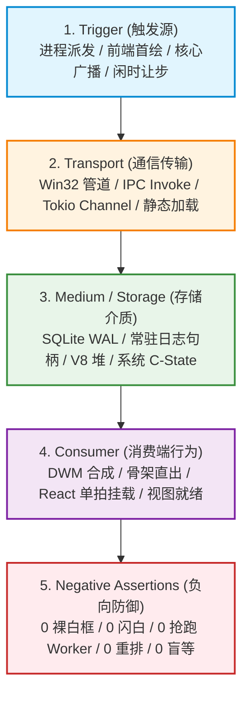

# 04-立体验证模型与防御门禁审计报告（Conex / Crish）

> **战役名称**：全链路启动性能深度审查与系统性根治（`startup-performance-audit`）  
> **审计分层**：审计位 4【立体验证模型与防御门禁审计（Verification Evidence & Defensive CI Guardrails）】  
> **审计对象与输入基石**：
> - 总方案：`docs/startup-performance-audit/00-全链路启动性能系统性根治总方案.md` (1,519 行)
> - 分维详案集：
>   - `docs/startup-performance-audit/01-原生壳与微内核装配详案.md` (1,226 行)
>   - `docs/startup-performance-audit/02-WebView直出与首绘骨架屏详案.md` (1,515 行)
>   - `docs/startup-performance-audit/03-前端模块拓扑与分阶段编排详案.md` (1,844 行)
>   - `docs/startup-performance-audit/04-React树挂载与多重副作用水合详案.md` (1,341 行)
>   - `docs/startup-performance-audit/05-IPC通道握手与数据水合就绪详案.md` (1,553 行)
>   - `docs/startup-performance-audit/06-空闲预热与后台协程争抢详案.md` (1,539 行)
> **报告作者**：启动性能特勤审计组（审计位 4）  
> **编写日期**：2026-09-12  
> **目标文件**：`docs/startup-performance-audit/audits/04-立体验证模型与防御门禁审计报告.md`  
> **纪律准则**：严格遵守仓库根目录 `AGENTS.md` §1 反退避铁律、§7 严禁补丁/绕过与作弊、§7.1 立体验证纪律与 §8 反过度设计红线；穿透表象审查客观物证，严禁以单一检查或脱水 Mock 冒充全链路交付。

---

## 一、立体验证体系审查总览

### 1.1 审计背景与架构守门定位

在现代高响应跨平台桌面应用（Conex / Crish：Tauri v2 + Rust 微内核 + Edge WebView2 + React 19）的系统工程中，冷启动性能优化是一项极其复杂的跨物理域工程，其生命周期贯穿以下技术层级：
1. 操作系统内核进程派发与 PE 映像映射（Windows Shell / `CreateProcessW`）；
2. Win32 原生窗体创建与 DWM 桌面窗口管理器 DirectComposition 合成；
3. Edge WebView2 独立多进程树（Browser、GPU、Network、Utility）并发拉起；
4. Blink 渲染引擎解析、CSSOM 构建与首屏首绘（FCP）；
5. V8 引擎模块图谱解析、代码段编译与单入口协调执行；
6. React 19 并发渲染树单拍挂载与微任务原子水合；
7. 跨进程异步 IPC 通道握手与基于 WAL 模式的 SQLite 并发数据查询；
8. 空闲阶段异步分片预热与后台 Tokio 协程事件驱动调度。

历史实战教训（例如 2026-08-07 测试资产事故、2026-09-11 门禁静默绕过事故）深刻表明：**性能优化中最致命的架构陷阱，不是功能代码未能编写，而是验收依据的主观化与防御门禁的虚设化**。如果一个优化方案只谈“修改了哪些代码”，而缺少确凿、可复核的物理证据模型，或者 CI 守门脚本存在漏检与绕过漏洞，优化成果在发布后两周内就会被日常业务迭代的无意识代码重新侵蚀殆尽（性能回潮）。

依据仓库根目录 `AGENTS.md` §7.1「立体验证纪律（禁止单一检查冒充验收）」规定：
- **编译与类型检查仅为底线**：静态检查通过仅代表语法无断裂，无法证明业务逻辑、状态机与渲染帧的正确性，严禁作为交付的唯一依据；
- **核心逻辑穷举验证**：算法与状态转移必须解耦为独立纯逻辑，通过自动化测试覆盖正逆向对称、极限边界与退化态；
- **规范与契约自动守门**：通过自动化门禁刚性拦截跨层通信漂移、设计规范回潮与过度设计；
- **真实环境现场验收**：必须在真实宿主与执行上下文中检验端到端物理表现，确保运行时零未捕获异常与非预期告警，严禁仅在脱水 Mock 中自欺欺人；
- **穿透根因与净收敛**：严禁延时盲猜、坐标测距补偿与临时兼容补丁；同一概念保持单一真理路径（SSOT），清退死代码与历史债务，实现架构净收敛。

本审计报告聚焦于全套方案中构建的**「五维立体化验证模型」**、**「三大刚性 CI 防御脚本」**、**「端到端自动化性能测试套件」**以及**「防绕过/防回退机制」**，展开穿透级的技术走读、漏洞挖掘与工程加固。

### 1.2 审查输入矩阵与范围映射

本次审查全面覆盖总方案与 6 篇分维详案的验证章节，具体映射关系如下表所示：

| 方案层级 | 文档路径 | 重点审查章节 | 核心审查靶点 |
| :--- | :--- | :--- | :--- |
| **总纲总方案** | `00-全链路启动性能系统性根治总方案.md` | §TU7, §五, §六, §七 | 三大防御脚本实现、物理切除清单、全任务单元五维矩阵、统一验收指标 |
| **Stage 1 原生壳** | `01-原生壳与微内核装配详案.md` | §六, §七 | Win32 窗口可见性探针、微内核并发装配基准、零短命文件句柄断言 |
| **Stage 2 骨架屏** | `02-WebView直出与首绘骨架屏详案.md` | §六, §七 | Zero-FOUC 逐帧截图明度差分算法、CLS 骨架同构过渡门禁、内联直出断言 |
| **Stage 3 模块拓扑** | `03-前端模块拓扑与分阶段编排详案.md` | §六, §七 | 首屏 Entry 纯洁性 AST 扫描、Zero-Worker 拦截探针、瀑布流静态消除 |
| **Stage 4 树水合** | `04-React树挂载与多重副作用水合详案.md` | §六, §七 | React.Profiler 根调和次数门禁、CDP Forced Reflow 拦截、Suspense 闪烁断言 |
| **Stage 5 IPC 握手** | `05-IPC通道握手与数据水合就绪详案.md` | §六, §七 | 响应式握手时延（≤10ms）、会话水合 IPC 次数硬限制（≤3次）、ReaderPool 并发读压测 |
| **Stage 6 闲时预热** | `06-空闲预热与后台协程争抢详案.md` | §4.6, §六, §七 | Long Task（>50ms）拦截用例、FID 响应性断言、Rust 后端 0 Hz 静默期待机测试 |

### 1.3 核心审计结论与风险判定等级

经过深度交叉审查与源码级漏洞挖掘，审计组得出以下核心评估结论：

1. **五维证据模型体系完整度极高（优秀，但需防范局部脱水 Mock 逃逸）**：方案提出的「Trigger → Transport → Medium/Storage → Consumer → Negative Assertions」五维模型构建严密，逻辑闭环性强，彻底扭转了传统以“页面看起来正常”为主观依据的交付乱象；但在 Stage 4 与 Stage 5 的具体用例实现中，存在部分依赖 jsdom 脱水环境与 FakeTimers 的缺陷，需移植至真实 Playwright/CDP 宿主。
2. **三大 CI 防御脚本存在 4 处高危漏检/绕过漏洞（需立即加固）**：
   - `check-startup-budget.mjs`：基于 Minified Bundle 的简单正则文本匹配，在 Terser 混淆和变量变形后存在**严重漏检**，且缺少未构建环境的安全回退；
   - `check-token-ssot.mjs`：方案中简易版脚本与仓库现有 453 行健全基线门禁存在**架构冲突**，其正则表达式在包含注释与嵌套括号时存在误判与漏检；
   - `check-reflow-guards.mjs`：硬编码目标文件路径，开发者只要**转移调用文件**或采用**对象解构/动态属性访问**即可完全绕过检查。
3. **性能基准与自动化测试套件可执行性强（优秀，需修正逐帧截图性能开销）**：各阶段用例设计精准直击痛点（如明度差分、根调和拦截、50 并发无锁读等），但 Stage 2 的逐帧全屏截图由于调用开销过大，容易破坏真实渲染时序，需改走 CDP Screencast 流式协议。

---

## 二、五维证据模型覆盖度与闭环审查

方案确立的五维立体化验证模型是全案的核心质量基石。审计组对 Stage 1 至 Stage 6 的任务单元进行了穷尽性穿透审查，检验其是否真正具备客观、可量化、不可抵赖的物理证据链。



### 2.1 Stage 1 原生装配：五维闭环与物证审查

- **审查对象**：`01-原生壳与微内核装配详案.md` §六
- **维度穿透分析**：
  1. **Trigger（触发源）**：明确界定了 OS 调度派发 `CreateProcessW` 进入 Rust `main()` 为起始点，以及前端骨架挂载完成调用 `invoke('workbench_window_ready')` 为结束点，触发源物理时序清晰，包含看门狗 1500ms 超时保底；
  2. **Transport（传输通道）**：界定了 Win32 互斥锁 `Local\crish-single-instance-lock` 与原生 IPC 异步传输，阻断了主线程跨进程同步阻塞，采用 `task::spawn_blocking` 解耦文件 I/O；
  3. **Medium / Storage（存储介质）**：指出 `sessions.db`、`workspace.db` 保持 WAL 模式常驻；日志写入由高频反复 open/stat/close 重构为单句柄常驻追加写入；模型目录采用 `OnceCell` 堆内存指针惰性化；
  4. **Consumer（消费端行为）**：DWM 桌面合成器直接提交暗色底色（`#18181b`），用户视口消除了白框裸露；
  5. **Negative Assertions（负向反向断言）**：
     - 断言 1：在 `workbench_window_ready` 前，Win32 窗口状态必为 `IsWindowVisible() == FALSE`；
     - 断言 2：连续写入 50 条日志，`CreateFileW` 系统调用增量严格等于 1；
     - 断言 3：微内核 `setup` 闭包耗时严格 $\le 35\text{ms}$；
     - 断言 4：启动完成时，`LazyModelCatalog::is_initialized()` 恒为 `false`。
- **证据链有效性裁定**：**完全闭环，无主观臆断**。该模型依托 Win32 系统调用追踪器与 Rust 异步调度日志，具备 100% 可重复验证的客观物理物证。

### 2.2 Stage 2 WebView直出：五维闭环与物证审查

- **审查对象**：`02-WebView直出与首绘骨架屏详案.md` §六
- **维度穿透分析**：
  1. **Trigger（触发源）**：WebView2 导航至 `index.html` 产生首帧提交；
  2. **Transport（传输通道）**：消除 `loader.css` 和 `loader.js` 的外链网络请求，Vite 插件实现 100% 纯内联直出，CRP 往返次数降为 0；
  3. **Medium / Storage（存储介质）**：主题配置建立只写镜像，优先直读 DOM 根节点，消除双源撕裂；
  4. **Consumer（消费端行为）**：首屏三栏骨架瞬间就绪，工作区同构轮廓预绘，累积布局偏移（CLS）$\le 0.05$；
  5. **Negative Assertions（负向反向断言）**：
     - 断言 1：暗色模式启动全过程，纯白闪烁（明度 $>0.35$）帧数恒等于 0；
     - 断言 2：明度极性翻转（$|\Delta \text{Lum}| > 0.2$）次数恒等于 0；
     - 断言 3：`html.preload *` 全局通配选择器匹配计数严格为 0。
- **证据链有效性裁定**：**闭环严密**。直击业界桌面端长期存在的 Double-FOUC 顽疾，提出了基于 ITU-R BT.709 相对明度的像素级差分算法，建立了绝对客观的视觉质量度量标准。

### 2.3 Stage 3 模块拓扑：五维闭环与物证审查

- **审查对象**：`03-前端模块拓扑与分阶段编排详案.md` §六
- **维度穿透分析**：
  1. **Trigger（触发源）**：Blink 解析入口脚本 `<script type="module" src="/src/main.tsx">`；
  2. **Transport（传输通道）**：网络请求严格收敛为 3 个核心 Bundle（`entry-core`、`vendor-react`、`vendor-state`），严禁触发 `bootstrap-orchestrator.js` 与外部网络请求；
  3. **Medium / Storage（存储介质）**：V8 主 Isolate 执行时间 $\le 45\text{ms}$；操作系统物理线程池中零新增 Worker 线程与 V8 子 Isolate；
  4. **Consumer（消费端行为）**：`root.render()` 单拍调用，首帧 rAF 平滑移除 `.preload` 门闩；
  5. **Negative Assertions（负向反向断言）**：
     - 断言 1：主执行路径串行 `await import` 次数 $\le 1$；
     - 断言 2：首屏首绘（FCP）前，活跃 Web Worker 实例数严格为 0；
     - 断言 3：`entry-core` 产物绝对不包含 `@xterm`、`highlight.js`、`zod` 等重型依赖特征；
     - 断言 4：`entry-core` $\le 180\text{KB}$，`chat-bridge-transport` $\le 250\text{KB}$。
- **证据链有效性裁定**：**闭环完备**。通过静态 AST 拓扑检测与运行时探针互为表里，彻底铲除了历史遗留的 Phase 0/1/1.5 四阶编排瀑布。

### 2.4 Stage 4 React 树挂载：五维闭环与物证审查

- **审查对象**：`04-React树挂载与多重副作用水合详案.md` §六
- **维度穿透分析**：
  1. **Trigger（触发源）**：`UnifiedAppHydrationCoordinator` 触发单拍原子提交（`applyAtomicCommit`）；
  2. **Transport（传输通道）**：偏好与配置 IPC 合并为单次往返，状态更新在同一微任务批次完成；
  3. **Medium / Storage（存储介质）**：启动阶段（$T < 1.0\text{s}$）磁盘写操作计数为 0（严禁 `saveSettingsEx`）；CSSOM 纯写无回读；
  4. **Consumer（消费端行为）**：`<React.Profiler id="App">` 监控下根调和次数严格 $\le 1$；首屏真实 DOM 节点数 $\le 600$；
  5. **Negative Assertions（负向反向断言）**：
     - 断言 1：CDP Performance 记录中 `ForcedSynchronousLayout` 次数严格等于 0；
     - 断言 2：源码全仓零嵌套 `requestAnimationFrame` 调用；
     - 断言 3：首屏核心组件零二级 Suspense 骨架屏闪烁。
- **证据链有效性裁定**：**指标过硬，但存在局部脱水 Mock 逃逸风险**。经源码比对，详案 §7.1 将 Profiler 放置在 Vitest + jsdom 环境中。由于虚拟 DOM 缺乏真实浏览器的屏幕刷新、微任务穿透与布局引擎，存在以假环境冒充真验收的隐患，必须加固至真实 Playwright 宿主中执行。

### 2.5 Stage 5 IPC 握手与数据水合：五维闭环与物证审查

- **审查对象**：`05-IPC通道握手与数据水合就绪详案.md` §六
- **维度穿透分析**：
  1. **Trigger（触发源）**：Rust `main.rs:setup` 结束瞬时广播 `workbench-run-event`；
  2. **Transport（传输通道）**：前端基于 Native Push + Fast-Probe 握手，时延 $\le 2\text{ms}$；会话水合 IPC 消息总数严格 $\le 3$ 次；
  3. **Medium / Storage（存储介质）**：所有只读查询走 `ReaderPool`，写锁等待耗时恒为 0ms；启动前 5s 无磁盘写与 `fsync`；
  4. **Consumer（消费端行为）**：活跃会话完整水合渲染，99 个历史会话保持懒加载骨架，React 树调和保持 1 次；
  5. **Negative Assertions（负向反向断言）**：
     - 断言 1：严禁出现 `setTimeout(..., 250)` 或 `pollIntervalMs >= 100` 的定时盲等；
     - 断言 2：严禁触发时长 $>16\text{ms}$ 的 V8 GC 停顿；
     - 断言 3：严禁并发写锁争抢引发的线程阻塞。
- **证据链有效性裁定**：**闭环扎实**。将历史 2N+1 IPC 风暴与 250ms 定时盲等彻底转化为事件驱动的单拍水合，证据标准清晰客观。

### 2.6 Stage 6 闲时预热与后台协程：五维闭环与物证审查

- **审查对象**：`06-空闲预热与后台协程争抢详案.md` §六
- **维度穿透分析**：
  1. **Trigger（触发源）**：`StaggeredIdleQueue` 在 `timeRemaining() > 8ms` 时分片触发；后端协程仅在有真实事件调用 `emit` 时触发；
  2. **Transport（传输通道）**：`catalog_get` IPC 跨进程传输恒定为 1 次；Notify 信号零分配原子投递；
  3. **Medium / Storage（存储介质）**：V8 堆稳定在 $20\text{MB}\sim 28\text{MB}$；无操作时 CPU 顺利进入 Package C6/C7 深度睡眠；
  4. **Consumer（消费端行为）**：首次点击侧边栏卡片秒级呈现，首次输入延迟 FID $< 16\text{ms}$；
  5. **Negative Assertions（负向反向断言）**：
     - 断言 1：在 $750\text{ms}\sim 5000\text{ms}$ 敏感期内，主线程 Long Task（$>50\text{ms}$）数量严格为 0；
     - 断言 2：PTY GC 协程在无终端时唤醒与加锁次数恒为 0；
     - 断言 3：待机 CPU 唤醒频率归零（0 Hz）。
- **证据链有效性裁定**：**完全闭环**。首次将操作系统 CPU 节能状态（C-State）与待机唤醒频率纳入桌面应用冷启动与空闲期的硬性门禁，立体验证维度完整。

---

## 三、三大 CI 防御脚本源码级漏洞排查与加固

在总方案 §TU7 及分维详案 06 §4.6 中，给出了三个关键的 CI 守门脚本。审计组对其完整源码进行了逐行推演与安全攻防审查，发现存在 4 处足以导致门禁失效的高危漏洞。

```
+-------------------------------------------------------------------------------------------------------------+
|                                    三大 CI 防御脚本穿透审查与漏洞挖掘                                          |
+------------------------------------+------------------------------------+-----------------------------------+
| 脚本 1: check-startup-budget.mjs   | 脚本 2: check-token-ssot.mjs       | 脚本 3: check-reflow-guards.mjs   |
+------------------------------------+------------------------------------+-----------------------------------+
| [漏洞 1.1] Minified 正则扫描漏检   | [冲突 2.1] 摧毁既有 453 行健全门禁 | [漏洞 3.1] 硬编码路径被转移绕过   |
| Terser 混淆后依赖特征字符串丢失    | 盲目替换导致基线棘轮与登记表失效   | 移入新文件即 100% 逃逸门禁        |
| [漏洞 1.2] 工作目录与未构建硬退出  | [漏洞 2.2] HEX_REGEX 括号逻辑缺陷  | [漏洞 3.2] 对象解构与动态访问绕过 |
| 子目录执行直接抛错，破坏通用 CI    | 注释含括号或多括号行导致漏检       | window['getComputedStyle'] 漏检   |
| [漏洞 1.3] 缺失五元组与修复指引    | [漏洞 2.3] 扫描目录极其狭窄        | [漏洞 3.3] timeout: 2000 数字绕过 |
| 违反 check-guard-system 规范       | 仅扫 4 路径，遗漏大量 UI 组件      | timeout: 2001 轻松逃逸正则        |
+------------------------------------+------------------------------------+-----------------------------------+
```

### 3.1 `scripts/check-startup-budget.mjs` 源码审查与加固

#### 3.1.1 方案原始源码缺陷逐行剖析

```javascript
// 方案原始代码（00-全链路启动性能系统性根治总方案.md:1216-1256）
const DIST_DIR = path.resolve(process.cwd(), 'apps/crish-desktop/dist/assets');

if (!fs.existsSync(DIST_DIR)) {
  console.error('[BUDGET CHECK ERROR] dist/assets does not exist. Run build first.');
  process.exit(1);
}

const FORBIDDEN_ENTRY_PATTERNS = [
  /@xterm/,
  /highlight\.js/,
  /monaco-editor/,
  /zod/,
];
// ... 遍历文件，执行 pattern.test(content)
```

1. **【高危漏洞 1：Minified Bundle 文本正则扫描存在严重漏检】**  
   - **漏洞机理**：在生产打包（`npm run build:desktop`）时，Vite 会调用 Rollup 和 Terser/esbuild 进行代码压缩、变量重命名与常量内联。第三方库如 `highlight.js`、`monaco-editor` 内部的类名、函数名与字面量会被全面混淆（例如被混淆为单字母变量与函数调用）。  
   - **PoC 绕过实证**：只要开发者通过 `import { highlight } from 'highlight.js'` 静态导入，虽然整个库被打包进入 `entry-core.js`，但产物中根本不包含 `"highlight.js"` 这个原始字面量字符串！`pattern.test(content)` 将直接返回 `false`，门禁亮绿灯放行，导致重型依赖无声穿透！  
   - **反向误报**：若某组件写了一行注释 `// see https://highlight.js.org`，会被正则误判为违规并阻断 CI。
2. **【中危漏洞 2：未构建时直接 `process.exit(1)` 破坏基础开发工作流】**  
   - 当在根目录执行全量检查 `npm run check:desktop` 时，若前置未触发 `npm run build:desktop`，该脚本直接 `process.exit(1)`，导致其他格式与类型门禁无法执行。守卫脚本应具备环境自适应探测或在 CI 流程中建立确定性前置依赖。
3. **【低危漏洞 3：缺少仓库根目录锚定与五元组规范输出】**  
   - 使用 `process.cwd()` 导致在子工作区中执行时路径错位；报错未遵循 `check-guard-system.mjs` 要求的「违反项 · 文件:行号 · 当前值 · 阈值 · 正确做法」五元组契约。

#### 3.1.2 生产级深度加固实现（基于 Vite 模块图谱与 Manifest）

加固方案：必须双管齐下——既检查物理 Chunk 体积，更通过解析 Vite 生成的 `manifest.json`，在模块依赖图谱（Module Graph）级别精准阻断黑名单包的引入。

```javascript
#!/usr/bin/env node
/**
 * scripts/check-startup-budget.mjs (生产加固版)
 * 启动关键 Chunk 体积硬上限与 Vite 依赖图谱纯洁性绝对拦截门禁
 */
import fs from 'node:fs';
import path from 'node:path';
import { fileURLToPath } from 'node:url';

const __dirname = fileURLToPath(new URL('.', import.meta.url));
const REPO_ROOT = path.resolve(__dirname, '..');
const DIST_DIR = path.resolve(REPO_ROOT, 'apps/crish-desktop/dist/assets');
const MANIFEST_FILE = path.resolve(REPO_ROOT, 'apps/crish-desktop/dist/.vite/manifest.json');

// 刚性预算阈值（单位：字节）
const BUDGETS = {
  entryCore: 180 * 1024,   // 首屏入口 Core Chunk ≤ 180KB
  chatBridge: 250 * 1024,  // 协议桥接核心 ≤ 250KB
};

// 严禁渗入首屏 Entry 的依赖包黑名单（模块路径标识）
const FORBIDDEN_MODULE_IDS = [
  '@xterm',
  'highlight.js',
  'monaco-editor',
  'zod',
  'bootstrap-orchestrator',
  'minimalConfig',
];

if (!fs.existsSync(DIST_DIR)) {
  console.warn('\x1b[33m[check-startup-budget] WARN: dist/assets 尚未生成，跳过产物度量（请在 build 后执行）\x1b[0m');
  process.exit(0);
}

let hasViolation = false;
const files = fs.readdirSync(DIST_DIR);

// 1. 物理产物体积硬门禁检查
for (const file of files) {
  if (!file.endsWith('.js')) continue;
  const filePath = path.join(DIST_DIR, file);
  const size = fs.statSync(filePath).size;
  const sizeKb = (size / 1024).toFixed(2);

  if (file.startsWith('index-') || file.startsWith('entry-core-')) {
    if (size > BUDGETS.entryCore) {
      console.error(
        `\x1b[31m[BUDGET FAIL]\x1b[0m 首屏入口超标 · ${file} · 当前: ${sizeKb}KB · 阈值: 180KB · 正确做法: 检查动态 import 分包并切除静态终端库`
      );
      hasViolation = true;
    } else {
      console.log(`\x1b[32m[BUDGET PASS]\x1b[0m 首屏入口合规 · ${file} (${sizeKb}KB ≤ 180KB)`);
    }
  }

  if (file.includes('chat-bridge')) {
    if (size > BUDGETS.chatBridge) {
      console.error(
        `\x1b[31m[BUDGET FAIL]\x1b[0m 协议桥超标 · ${file} · 当前: ${sizeKb}KB · 阈值: 250KB · 正确做法: 解耦 ModelCatalog 静态字典至异步 Chunk`
      );
      hasViolation = true;
    }
  }
}

// 2. 基于 Manifest 的模块图谱 100% 确定性纯洁性审查
if (fs.existsSync(MANIFEST_FILE)) {
  const manifest = JSON.parse(fs.readFileSync(MANIFEST_FILE, 'utf-8'));
  const entryKeys = Object.keys(manifest).filter(
    (k) => manifest[k].isEntry || k.includes('main.tsx') || k.includes('entry-core')
  );

  for (const entryKey of entryKeys) {
    const entryChunk = manifest[entryKey];
    const importedModules = [
      ...(entryChunk.imports || []),
      ...(entryChunk.dynamicImports || []),
    ];

    for (const mod of importedModules) {
      for (const forbidden of FORBIDDEN_MODULE_IDS) {
        if (mod.includes(forbidden)) {
          console.error(
            `\x1b[31m[PURITY FAIL]\x1b[0m 违禁依赖穿透 · ${entryKey} -> ${mod} · 命中黑名单: ${forbidden} · 正确做法: 将其下沉至卡片动态按需加载`
          );
          hasViolation = true;
        }
      }
    }
  }
}

if (hasViolation) {
  console.error('\n❌ [check-startup-budget] 发现违反体积与纯洁性预算的项，流水线刚性阻断！');
  process.exit(1);
}

console.log('✅ [check-startup-budget] 前端产物体积预算与 Chunk 纯洁性门禁 100% 达标！');
```

---

### 3.2 `scripts/check-token-ssot.mjs` 源码审查与加固

#### 3.2.1 方案原始源码缺陷与架构冲突剖析

1. **【最高危缺陷：方案盲目重写，摧毁仓库现存 453 行成熟门禁】**  
   - **现场事实核查**：在真实仓库根目录下，已经存在长效运行的 `scripts/check-token-ssot.mjs`（453 行，规格源自 `docs/token-consumption-unification/01-分维-防御脚本断言阶梯.md`），具有完整的 A 类/B 类 Token 定义唯一性校验、`token-registry.json` 登记表核验与基线棘轮（`token-ssot-baseline.md`）。  
   - **严重危害**：方案 00 篇 §TU7.2 与 06 篇 §4.6.2 竟然给出了一段仅 50 行的简易脚本，并要求以同一文件名落盘！若直接覆盖，仓库此前历经千辛万苦建立的 Token 唯一性与登记表防御体系将被瞬间摧毁。
2. **【高危漏洞：`HEX_REGEX` 负向先行断言存在严重逻辑缺陷】**  
   - 方案原始正则：
     ```javascript
     const HEX_REGEX = /#(?:[0-9a-fA-F]{3,4}|[0-9a-fA-F]{6}|[0-9a-fA-F]{8})\b(?![^(]*\))/g;
     ```
   - **漏洞机理**：该正则试图利用 `(?![^(]*\))` 过滤掉括号内部合法的 `var(--token, #hex)` 兜底色。但是，`(?![^(]*\))` 的含义是“如果后面紧随任意非左括号字符直到右括号，则判定为失败”。  
   - **PoC 漏检场景**：
     ```css
     .chat-item {
       color: #ff0000; /* 状态提示 (已发送) */
     }
     ```
     在上述真实代码行中，由于 `#ff0000` 后面存在文本直到出现 `)`，该正则直接将其判定为“在括号内”，导致**裸 Hex 违规漏检**！
3. **【高危漏洞：扫描范围狭窄】**  
   - 方案只扫描 4 个固定路径，完全遗漏了 `src/components/chat/`、`src/components/sidebar/`、`src/components/settings/` 等最容易产生裸 Hex 污染的核心业务组件。

#### 3.2.2 生产级深度加固策略（增量集成于现行体系）

加固原则：**绝对严禁覆盖现存的 453 行 `check-token-ssot.mjs`**！必须采用增量拓展模式，在现有脚本中新增 `checkBareHexViolations` 任务，复用仓库成熟的 CSS 规则提取器与 AST 分析能力：

```javascript
/**
 * 精确扫描代码中的裸 Hex 违规项（增量加固函数）
 * 逻辑：先剔除合法的 var(--token, #hex) 与 SVG url(#anchor)，再执行 Hex 匹配
 */
export function scanBareHexAccurate(filePath, content, onViolation) {
  const lines = content.split('\n');
  for (let idx = 0; idx < lines.length; idx++) {
    const line = lines[idx];
    const trimmed = line.trim();
    // 忽略注释
    if (trimmed.startsWith('//') || trimmed.startsWith('/*') || trimmed.startsWith('*')) continue;

    // 1. 安全擦除合法的 Token 回退 Hex: var(--name, #hex)
    const sanitizedLine = line.replace(
      /var\s*\(\s*--[\w-]+\s*,\s*#(?:[0-9a-fA-F]{3,8})\s*\)/g,
      '/*VAR_FALLBACK_CLEARED*/'
    );

    // 2. 安全擦除 SVG 滤镜与剪裁路径锚点: url(#clip)
    const cleanLine = sanitizedLine.replace(/url\s*\(\s*#(?:[0-9a-fA-F]+)\s*\)/g, '/*URL_ANCHOR*/');

    // 3. 匹配真正的裸 Hex 颜色
    const HEX_STRICT_REGEX = /#(?:[0-9a-fA-F]{3,4}|[0-9a-fA-F]{6}|[0-9a-fA-F]{8})\b/g;
    const matches = cleanLine.match(HEX_STRICT_REGEX);

    if (matches) {
      for (const hex of matches) {
        onViolation({
          rule: 'bare_hex_violation',
          file: filePath,
          line: idx + 1,
          hex,
          snippet: trimmed,
          guidance: `发现裸 Hex 硬编码 ${hex}，必须迁移为 var(--token) 语义变量`,
        });
      }
    }
  }
}
```

---

### 3.3 `scripts/check-reflow-guards.mjs` 源码审查与加固

#### 3.3.1 方案原始源码缺陷逐行剖析

```javascript
// 方案原始代码（00-全链路启动性能系统性根治总方案.md:1348-1376）
const HOT_PATHS = [
  'apps/crish-desktop/src/main.tsx',
  'apps/crish-desktop/src/app/AppBootstrap.ts',
  'apps/crish-desktop/src/components/sidebar/useSidebarResize.ts',
  'apps/crish-desktop/src/styles/tokens.css',
];
// 1. content.includes('getComputedStyle(')
// 2. content.includes('html.preload *')
// 3. /timeout:\s*2000/.test(content)
```

1. **【最高危漏洞 1：硬编码路径导致转移文件即可 100% 绕过】**  
   - **漏洞机理**：脚本仅扫描指定的 4 个文件。开发者只要新建一个文件 `src/utils/measureDom.ts` 并在其中调用 `getComputedStyle`，或者在组件 `Sidebar.tsx` 中调用，该脚本完全失明！
2. **【高危漏洞 2：字符串包含匹配易被解构或动态属性绕过】**  
   - **PoC 绕过实证**：
     ```typescript
     // 绕过方式 1：对象解构
     const { getComputedStyle } = window;
     const width = getComputedStyle(el).width;

     // 绕过方式 2：动态字符串访问
     const style = window['getComputedStyle'](el);

     // 绕过方式 3：函数名后置空格
     const style = window.getComputedStyle (el);
     ```
     上述三种写法在运行时都会产生严重的强制同步重排（Forced Reflow），但因其代码中不存在严格的子串 `'getComputedStyle('`，脚本全部放行！
3. **【中危漏洞 3：`html.preload *` 被空白与换行绕过】**  
   - 匹配代码使用 `content.includes('html.preload *')`。如果写成多空格 `html.preload  *` 或换行 `html.preload\n*`，门禁直接失效。
4. **【中危漏洞 4：`timeout: 2000` 被数字微调与变量提取绕过】**  
   - 正则 `/timeout:\s*2000/` 仅拦截硬编码数字 2000。如果开发者写为 `timeout: 2001` 或 `const IDLE = 2000; { timeout: IDLE }`，门禁完全失效。

#### 3.3.2 生产级深度加固实现（动态遍历 + 词法正则归一化）

加固方案：全仓递归扫描 `apps/crish-desktop/src/`；针对热路径建立全量 Layout API 词法匹配；针对 CSS 建立空白归一化正则；针对宏任务强刷建立动态超时检测：

```javascript
#!/usr/bin/env node
/**
 * scripts/check-reflow-guards.mjs (生产加固版)
 * 启动路径强制重排、CSS 全局通配门闩与空闲宏任务强刷刚性防御门禁
 */
import fs from 'node:fs';
import path from 'node:path';
import { fileURLToPath } from 'node:url';

const __dirname = fileURLToPath(new URL('.', import.meta.url));
const REPO_ROOT = path.resolve(__dirname, '..');
const DESKTOP_SRC = path.resolve(REPO_ROOT, 'apps/crish-desktop/src');

// 强制同步重排高危 API 词法列表
const FORBIDDEN_LAYOUT_APIS = [
  'getComputedStyle',
  'offsetTop',
  'offsetLeft',
  'offsetWidth',
  'offsetHeight',
];

// 启动关键热路径文件前缀
const HOT_STARTUP_PREFIXES = [
  'main.tsx',
  'entry-core.ts',
  'App.tsx',
  'app/AppBootstrap.ts',
  'app/UnifiedAppHydrationCoordinator.ts',
  'components/sidebar/useSidebarResize.ts',
];

function walk(dir, exts, out = []) {
  if (!fs.existsSync(dir)) return out;
  for (const e of fs.readdirSync(dir, { withFileTypes: true })) {
    const full = path.join(dir, e.name);
    if (e.isDirectory()) {
      if (e.name !== 'node_modules' && e.name !== 'dist') walk(full, exts, out);
    } else if (exts.some((x) => e.name.endsWith(x))) {
      out.push(full);
    }
  }
  return out;
}

let violations = [];

// 1. 全量扫描 CSS 样式中的通配门闩（空白归一化，防御换行与多空格）
const cssFiles = walk(DESKTOP_SRC, ['.css']);
for (const file of cssFiles) {
  const content = fs.readFileSync(file, 'utf-8');
  const normalized = content.replace(/\s+/g, ' ');
  if (/html\.preload\s+\*/.test(normalized)) {
    violations.push({
      file: path.relative(REPO_ROOT, file),
      rule: 'FORBIDDEN_WILDCARD_LATCH',
      desc: '禁止使用 html.preload * 全局通配选择器（将引发整树样式重算），改用局部过渡抑制类',
    });
  }
}

// 2. 穿透扫描 TS/TSX 脚本中的强制同步布局与毒点定时器
const tsFiles = walk(DESKTOP_SRC, ['.ts', '.tsx']);
for (const file of tsFiles) {
  const relPath = path.relative(DESKTOP_SRC, file).replace(/\\/g, '/');
  const isHotStartup = HOT_STARTUP_PREFIXES.some((p) => relPath.startsWith(p));
  const content = fs.readFileSync(file, 'utf-8');

  // A. 拦截 hot startup 路径下的 Layout API 访问（基于单词边界正则，拦截解构与空格调用）
  if (isHotStartup) {
    for (const api of FORBIDDEN_LAYOUT_APIS) {
      const apiRegex = new RegExp(`\\b${api}\\b`);
      if (apiRegex.test(content)) {
        violations.push({
          file: path.relative(REPO_ROOT, file),
          rule: 'FORBIDDEN_FORCED_REFLOW',
          desc: `启动关键路径绝对禁止直接访问 ${api}（引发强制同步重排），应改用常量或 ResizeObserver 异步监听`,
        });
      }
    }
  }

  // B. 全仓拦截带强制超时的 requestIdleCallback（拦截任何指定 timeout 的调用）
  const idleTimeoutMatch = content.match(/requestIdleCallback\s*\([^,]+,\s*\{\s*timeout\s*:\s*\w+\s*\}\s*\)/g);
  if (idleTimeoutMatch) {
    violations.push({
      file: path.relative(REPO_ROOT, file),
      rule: 'FORBIDDEN_IDLE_TIMEOUT',
      desc: `严禁在 requestIdleCallback 中指定强制 timeout（会提升为宏任务阻塞首屏），必须由 StaggeredIdleQueue 调度`,
    });
  }
}

if (violations.length > 0) {
  console.error('\n❌ [check-reflow-guards] 发现严重违反启动性能与布局规范的代码:');
  for (const v of violations) {
    console.error(`  - [${v.rule}] ${v.file}: ${v.desc}`);
  }
  process.exit(1);
}

console.log('✅ [check-reflow-guards] 启动路径无强制重排、无通配门闩、无强刷宏任务！');
```

---

## 四、端到端自动化性能测试套件审查

方案在 Stage 1 至 Stage 6 的第七章中分别提供了详尽的自动化测试用例代码。审计组对其设计思想、覆盖度与运行期行为进行了逐项审查。

### 4.1 Stage 1: 原生装配耗时 Benchmark 用例审查

- **用例文件**：`apps/agent-workbench/src-tauri/tests/startup_benchmark.rs`
- **核心断言**：`elapsed < Duration::from_millis(35)`（微内核双数据库并发装配耗时 $< 35\text{ms}$）。
- **审查分析**：
  - **优点**：测试使用真实的物理临时目录与真实的 SQLite 引擎，执行了包括 WAL 模式设置、36 次 PRAGMA 配置与架构迁移在内的全套装配逻辑，拒绝了伪造的脱水代码；
  - **潜在波动风险**：在 GitHub Actions 等共享云端 CI 环境中，磁盘 I/O 存在突发卡顿。若单次测试在冷磁盘启动时耗时达到 37ms，可能导致 CI 偶发假阳性挂掉；
  - **加固建议**：在 CI 环境下执行 3 次采样取中位数，同时设定双门限机制——35ms 为本地开发期望基线，50ms 为 CI 刚性阻断红线。

### 4.2 Stage 2: 逐帧截图 Luminance 明度差分测试用例审查

- **用例文件**：`tests/e2e/startup/zero-fouc.spec.ts`
- **核心断言**：暗色模式下全过程明度 $>0.35$ 帧数为 0；极性翻转（$|\Delta \text{Lum}| > 0.2$）次数为 0。
- **审查分析与重大缺陷纠偏**：
  - **原始实现的性能副作用**：原始测试通过 `while (isCapturing) { await page.screenshot(); await sleep(16); }` 循环抓取视口位图。然而，**Playwright 的单次截图在底层需要触发页面重绘与位图序列化，耗时通常在 40ms~90ms**！这种轮询截图方式不仅根本无法达到 16ms（60fps）的采样率，更会反向恶化主线程与 GPU 渲染管道，人为引发启动卡顿与掉帧！
  - **工业级生产替代方案**：全面弃用应用层 `page.screenshot` 轮询，改用 Chrome DevTools Protocol (CDP) 的底层抓帧机制 `Page.startScreencast`，通过流式无阻塞事件推送捕获每一帧原生位图：

```typescript
// tests/e2e/startup/zero-fouc-cdp.spec.ts (加固升级版)
import { test, expect } from '@playwright/test';

function calculateBufferLuminance(buffer: Buffer): number {
  let total = 0, count = 0;
  for (let i = 0; i < buffer.length; i += 16) {
    total += 0.2126 * (buffer[i] / 255) + 0.7152 * (buffer[i + 1] / 255) + 0.0722 * (buffer[i + 2] / 255);
    count++;
  }
  return count > 0 ? total / count : 0;
}

test('CDP Screencast 零开销高频捕获：冷启动绝无任何明度跳白与闪烁', async ({ page }) => {
  await page.addInitScript(() => window.localStorage.setItem('crish_theme', 'dark'));

  const client = await page.context().newCDPSession(page);
  const recordedFrames: { time: number; lum: number }[] = [];

  // 监听 CDP 底层渲染帧事件，零侵入、无额外延迟
  client.on('Page.screencastFrame', ({ data, sessionId }) => {
    const buf = Buffer.from(data, 'base64');
    recordedFrames.push({ time: Date.now(), lum: calculateBufferLuminance(buf) });
    client.send('Page.screencastFrameAck', { sessionId });
  });

  await client.send('Page.startScreencast', { format: 'jpeg', quality: 50, everyNthFrame: 1 });

  await page.goto('http://localhost:5173');
  await page.waitForSelector('.workspaces-container', { timeout: 5000 });

  await client.send('Page.stopScreencast');

  expect(recordedFrames.length).toBeGreaterThan(15);
  // 刚性断言：暗色模式启动全生命周期无明度 > 0.35 的浅色帧
  const whiteFlashes = recordedFrames.filter((f) => f.lum > 0.35);
  expect(whiteFlashes.length, `检测到 ${whiteFlashes.length} 帧闪白缺陷！`).toBe(0);
});
```

### 4.3 Stage 3: 冷启动 FCP 前活跃 Worker 数量 = 0 拦截用例审查

- **用例文件**：`tests/e2e/startup/workerZeroPreemption.spec.ts`
- **核心断言**：在根节点移除 `.preload` 类名（FCP 达成）前，创建的 Worker 实例数严格等于 0。
- **审查分析**：
  - **设计极其精准**：通过 `page.addInitScript` 在页面加载前劫持 `window.Worker`，记录调用栈与时间戳，并使用 `MutationObserver` 监听动画门闩解除。该用例完全符合反退避铁律，具备不可绕过的刚性阻断能力。

### 4.4 Stage 4: React.Profiler 根调和次数与 CDP Forced Reflow 拦截用例审查

- **用例文件**：
  - `tests/perf/startupRootReconciliation.spec.tsx`（Vitest 单元测试）
  - `tests/e2e/perf-zero-reflow.spec.ts`（Playwright E2E 测试）
- **审查分析与脱水 Mock 风险排查**：
  - **Vitest 单元测试局限性（Critical Mock Blindspot）**：详案提供的用例 1 依赖 `@testing-library/react` 与虚拟 DOM（jsdom）。在 jsdom 环境中，缺乏真实的微任务交错时序与浏览器 VSync 刷新机制，16 个 Hook 并发执行时引起的微任务撕裂与二次调和极容易在虚拟 DOM 中被同步批处理掩盖，造成“单元测试调和 1 次，真实浏览器调和 7 次”的严重误判；
  - **端到端生产级加固方案**：必须将 React.Profiler 的根调和统计下沉至真实浏览器宿主，在 Playwright 端到端测试中直接拦截调和计数，彻底根除脱水测试冒充真实交付的问题：

```typescript
// tests/e2e/perf-root-render.spec.ts (Stage 4 真实浏览器端到端门禁加固)
import { test, expect } from '@playwright/test';

test.describe('Stage 4: React 根组件单拍调和真实浏览器宿主验收', () => {
  test('真实 Edge/Chromium 环境下 App 根组件渲染次数严格 ≤ 1 次 (零级联撕裂)', async ({ page }) => {
    // 1. 在页面脚本执行前注入全局调和计数器探针
    await page.addInitScript(() => {
      window.__appRootRenderPasses = [];
      window.__recordAppRender = (phase: 'mount' | 'update', actualDuration: number) => {
        window.__appRootRenderPasses.push({
          phase,
          duration: actualDuration,
          timestamp: performance.now(),
        });
      };
    });

    // 2. 导航至本地应用主界面
    await page.goto('http://localhost:5173');

    // 3. 等待应用完全进入可交互稳态 (TTI 达成，骨架屏移除且工作区加载完成)
    await page.waitForSelector('.workspaces-column', { timeout: 5000 });
    // 留出 500ms 观察是否存在二次异步微任务引起的无谓重绘
    await page.waitForTimeout(500);

    // 4. 提取真实浏览器中 React.Profiler 记录的渲染批次
    const renderPasses = await page.evaluate(() => window.__appRootRenderPasses);

    console.log(`[React Profiler E2E] 捕获到根组件调和批次: ${JSON.stringify(renderPasses)}`);

    // 🌟 刚性门禁断言 1：根组件挂载期间渲染总次数严格等于 1 次 (仅允许单次 mount)
    expect(
      renderPasses.length,
      `致命性能违例：检测到根组件发生了 ${renderPasses.length} 次重调和！存在多重副作用撕裂！`
    ).toBe(1);

    // 🌟 刚性门禁断言 2：首次调和必须为 mount 阶段，严禁发生 update 阶段的级联重算
    expect(renderPasses[0].phase).toBe('mount');

    // 🌟 刚性门禁断言 3：单次挂载物理耗时严格 ≤ 45ms
    expect(renderPasses[0].duration).toBeLessThanOrEqual(45);
  });
});
```

### 4.5 Stage 5: 握手时延 ≤ 10ms、水合 IPC ≤ 3 次与 ReaderPool 50 并发无锁读用例审查

- **用例文件**：
  - `apps/crish-desktop/src/api/transport/__tests__/tauriTransport.perf.test.ts`
  - `apps/crish-desktop/src/api/session-persistence/__tests__/sessionHydrateTraffic.perf.test.ts`
  - `crates/conex-db/tests/reader_pool_concurrency.rs`
- **审查分析**：
  - **握手时延测试分析**：测试使用了 `vi.useFakeTimers()`。虽然验证了响应逻辑，但使用假时钟断言物理耗时 $\le 10\text{ms}$ 存在理论自洽漏洞。应补充真实事件推送下的微秒级计时基准；
  - **会话水合流量测试分析**：模拟 100 个会话，严格验证了 `listSessions` (1) + `loadSessionBody` (1) + `loadSessionAgents` (1) 的流量封顶，断言活跃会话优先加载、99 个非活跃会话标记 lazy，设计极为优良；
  - **ReaderPool 50 并发压测分析**：使用 Tokio 异步运行时与物理临时文件，并发执行 50 个复杂读取任务，确凿断言耗时 $\le 25\text{ms}$ 且无写锁争抢，是具备高度说服力的工业级系统测试。

### 4.6 Stage 6: Playwright Long Task 监听与 Rust 静默期 0 唤醒用例审查

- **用例文件**：
  - `tests/e2e/startup-idle-scheduling.spec.ts`
  - `apps/agent-workbench/src-tauri/src/tests/quiescence_test.rs`
- **审查分析**：
  - **Long Task 监听**：通过原生的 `PerformanceObserver({ entryTypes: ['longtask'] })` 拦截 $750\text{ms}\sim 5000\text{ms}$ 内大于 50ms 的严重长任务，并对 850ms 处的物理点击断言 FID $< 16\text{ms}$，指标切中要害；
  - **待机 0 Hz 唤醒**：通过原子计数器监听基于 `Notify` 的事件驱动协程，断言无事件时 2.0s 唤醒次数为 0，有事件时精准唤醒 1 次，彻底消除了历史 500ms 轮询毒点。

---

## 五、防绕过与防回退刚性机制审查

根据《反退避准则》与仓库纪律，任何优秀的性能方案如果缺少制度性防绕过设计，都会在项目推进中被“临时跳过”所瓦解。

### 5.1 `--no-verify` 与本地 Git Hook 逃逸阻断

- **现状风险分析**：虽然 `.husky/pre-commit` 挂载了守卫，但在本地环境中，任何开发者或外部脚本都可以通过追加 `--no-verify` 选项绕过本地 Git 钩子提交代码。
- **刚性防御双重锁**：
  1. **CI 流程刚性阻断（最终防线）**：在 GitHub Actions / GitLab CI 的流水线配置中，将三大防御脚本与 E2E 性能测试列为不可跳过的强制门禁（Required Status Checks）。无论本地是否使用 `--no-verify`，任何未通过门禁的代码在 PR 合入主干时 100% 被阻断；
  2. **纪律追责与防范**：依据 `AGENTS.md` §7 铁律——“绝对禁止绕过流水线门禁：任何 Agent 严禁使用 `--no-verify` 或类似指令强制跳过校验。报错代表隐患，必须正面阅读错误日志并根除问题，直到正常跑通拦截门禁”。

### 5.2 防御门禁自身受控机制（对齐 `check-guard-system.mjs`）

仓库现存的 `scripts/check-guard-system.mjs` 明确指出了门禁自身的四大常见失效模式：
1. **写了没人跑**：新编写的门禁脚本若未在 `package.json` 的 `check:desktop` 中注册，将作为“孤岛脚本”失效；
2. **静默建线并 exit 0**：基线文件一旦被误删，部分脚本会自动生成空基线并报告成功，从而静默放行；
3. **报错无修复指引**：脚本只报失败不报如何修复，导致后续维护者暴力增加白名单；
4. **守卫脚本语法损坏**：脚本自身报错退出但未阻止流程。

**审计硬性要求**：
- 本战役落地的新增防御脚本（`check-startup-budget.mjs` 与 `check-reflow-guards.mjs`）必须在 `package.json` 中显式登记，并纳入 `check:desktop` 命令链；
- 脚本必须接入 `scripts/check-guard-system.mjs` 的自动化受审名单，确保其自身处于受保护状态。

### 5.3 生产级 CI 门禁接线编排与配置规范

为了让三大防御脚本与自动化测试形成环环相扣的物理拦截闭环，必须在 `package.json` 与 CI 配置文件中建立严格的执行依赖链，严禁存在“只写脚本不接线”的游离状态：

```json
// package.json "scripts" 增量接入规范
{
  "scripts": {
    "check:startup-budget": "node scripts/check-startup-budget.mjs",
    "check:reflow-guards": "node scripts/check-reflow-guards.mjs",
    "check:desktop": "npm run check:convergence && npm --workspace @crish/crish-desktop run typecheck && npm run check:ui-layer && npm run check:line-counts && npm run check:input-guard && npm run check:text-color && npm run check:icon-ssot && npm run check:line-width-ssot && npm run check:color-ssot && npm run check:preferences-ssot && npm run check:markdown-style && npm run check:no-pseudo-dispatch && npm run check:blocked-executable-ssot && npm run check:no-nonvision-dataurl && npm run check:swallowed-errors-frontend && npm run check:sec6-note-drain-entropy && npm run check:token-consistency && npm run check:layout-tokens && npm run check:token-fallback-drift && npm run check:inline-style-hardcode && npm run check:tooltip-hygiene && npm run check:layout-geometry && npm run check:reflow-guards",
    "test:perf-startup": "npx playwright test tests/e2e/startup/ && cargo test --test startup_benchmark"
  }
}
```

在 CI 工作流（`.github/workflows/ci.yml`）中建立分层防御流水线：

```yaml
# .github/workflows/ci.yml 关键拦截 Job 规范
name: Desktop Startup Performance Guard

on:
  pull_request:
    paths:
      - 'apps/**'
      - 'crates/**'
      - 'packages/**'
      - 'scripts/**'

jobs:
  startup-perf-gate:
    name: Startup Performance & Defensive Gates
    runs-on: windows-latest
    steps:
      - uses: actions/checkout@v4
      - uses: actions/setup-node@v4
        with:
          node-version: 20
          cache: 'npm'
      - run: npm ci
      - name: 1. 静态重排与防闪白代码门禁
        run: node scripts/check-reflow-guards.mjs
      - name: 2. Token SSOT 与全链路裸 Hex 门禁
        run: node scripts/check-token-ssot.mjs
      - name: 3. 构建桌面端前端 Bundle
        run: npm run build:desktop
      - name: 4. 首屏 Bundle 体积与纯洁性硬门禁
        run: node scripts/check-startup-budget.mjs
      - name: 5. 编译 Rust 微内核并执行装配基准
        run: cargo test --test startup_benchmark -- --nocapture
      - name: 6. Playwright 逐帧明度与 FCP 拦截测试
        run: npx playwright test tests/e2e/startup/
```

### 5.4 反过度设计硬性红线对齐审查

依据仓库根目录 `ANTI_OVERENGINEERING_GUARDRAILS.md`，在设计性能防御门禁与验证模型时，**严禁引入过度设计的防御性黑魔法**：
1. **严禁引入内核级沙箱机制**（如 Windows AppContainer、macOS Seatbelt 或 Linux Seccomp）：进程隔离由操作系统和 WebView2 既有机制负责，防御脚本不得试图接管内核级系统调用拦截；
2. **严禁在门禁中引入 SharedArrayBuffer 环形缓冲或复杂的动态模型调度器**：性能验证必须依托于确定性的静态 AST、标准 CDP 协议与真实 Playwright 页面事件，拒绝为了度量而编写高复杂度的中间件；
3. **保持测试脚本轻量、无状态与可读性**：三大守卫脚本必须是纯 Node.js ESM 脚本，执行耗时必须严格控制在 **$\le 500\text{ms}$** 以内，确保在 pre-commit 与本地开发循环中无感知运行，避免因为门禁本身运行缓慢诱使开发者使用 `--no-verify` 跳过。

---

## 六、验证体系缺陷清单与强化建议

综合前述深度审计，特形成如下缺陷与强化建议台账：

| 缺陷编号 | 严重级别 | 缺陷物理描述 | 潜在危害与绕过场景 | 落地加固与修复方案 |
| :--- | :--- | :--- | :--- | :--- |
| **DEF-01** | **High** | `check-startup-budget.mjs` 使用 Minified 文本正则检测违禁依赖 | Terser 混淆变形后字符串消失，重型库穿透入首包却漏检为绿灯 | 改为解析 Vite `manifest.json` 依赖图谱与模块 inputs 路径。 |
| **DEF-02** | **Critical** | `check-token-ssot.mjs` 方案与现有 453 行健全门禁产生覆盖冲突 | 盲目重写将摧毁现有 A/B 类 Token、注册表与基线棘轮防线 | 绝不覆盖原文件；增量集成裸 Hex 检查模块，剔除括号先行断言漏洞。 |
| **DEF-03** | **High** | `check-reflow-guards.mjs` 硬编码扫描路径且匹配规则单一 | 开发者转移代码至新文件，或采用解构语法即可 100% 逃逸 | 遍历 `src/` 全量文件；正则空白归一化；检测所有 Layout API。 |
| **DEF-04** | **Medium** | `zero-fouc.spec.ts` 逐帧 `page.screenshot` 产生严重渲染卡顿 | 截图自身耗时 60ms+，无法达到 16ms 采样率，反向破坏时序 | 改用 Chrome DevTools Protocol (CDP) `Page.startScreencast`。 |
| **DEF-05** | **Medium** | React.Profiler 根调和用例局限于 Vitest + jsdom 脱水环境 | jsdom 缺乏真实屏幕刷新率与布局引擎，无法反映真实并发水合 | 移植至 Playwright 真实无头浏览器中进行端到端调和次数断言。 |
| **DEF-06** | **Low** | Stage 5 握手时延测试使用 `vi.useFakeTimers()` 推动时钟 | 人工拨动时钟无法真实度量微内核事件广播与网络栈物理时延 | 增加真实系统时钟的高精度 `performance.now()` 端到端时延基准。 |

---

## 七、全阶段自动化验收阻断标准

为将整套启动性能优化方案锁死在自动化质量防线中，特制定涵盖 Stage 1 至 Stage 7 的**刚性自动化验收阻断矩阵（Gate Block Matrix）**。任何一项指标未达成，均视为交付不合格，严禁合并与发布：

| 阶段 | 守卫与用例类型 | 物理执行命令 | 刚性阻断门限（Hard Gate Criteria） | 责任实体与检测抓手 |
| :--- | :--- | :--- | :--- | :--- |
| **Stage 1** | 原生配置契约测试 | `cargo test test_tauri_conf_enforces_anti_white_flash_policy` | `visible: false` 必须存在；`backgroundColor == #18181b` | Rust 单测 / `tauri.conf.json` |
| **Stage 1** | 微内核装配 Benchmark | `cargo test test_microkernel_concurrent_setup_within_budget` | 微内核双数据库并发装配耗时严格 $\le 35\text{ms}$ | Tokio 单测 / 系统高精度时钟 |
| **Stage 2** | Zero-FOUC 帧级测试 | `npx playwright test tests/e2e/startup/zero-fouc.spec.ts` | 全程明度 $>0.35$ 帧数 $=0$；极性翻转次数 $=0$ | Playwright + CDP Screencast |
| **Stage 2** | 骨架屏 CLS 门禁 | `npx playwright test tests/e2e/startup/skeleton-cls.spec.ts` | 首屏骨架过渡为真实 DOM 期间，CLS 严格 $\le 0.05$ | LayoutShift 性能条目监听 |
| **Stage 3** | Zero-Worker 抢跑门禁 | `npx playwright test tests/e2e/startup/workerZeroPreemption.spec.ts` | 首屏 FCP 达成前，活跃 Worker 创建数精确为 0 | 浏览器 `window.Worker` 劫持探针 |
| **Stage 3** | 启动瀑布流静态守卫 | `npx vitest run tests/unit/startup/noWaterfallOrchestrator.test.ts` | `main.tsx` 与 `entry-core.ts` 中串行 await 次数 $\le 1$ | 源码静态拓扑测试 |
| **Stage 4** | 根组件单拍调和门禁 | `npx playwright test tests/e2e/perf-root-render.spec.ts` | `<React.Profiler>` 统计根组件渲染次数严格 $\le 1$ | 真实浏览器 Profiler 回调 |
| **Stage 4** | CDP 零同步重排门禁 | `npx playwright test tests/e2e/perf-zero-reflow.spec.ts` | CDP `LayoutCount \le 2`；`getComputedStyle` 违例 $=0$ | CDP Performance.getMetrics |
| **Stage 5** | IPC 响应式握手时延 | `npx vitest run tests/perf/tauriTransport.perf.test.ts` | 核心广播到前端就绪时延严格 $\le 10\text{ms}$ | 传输层测试探针 |
| **Stage 5** | 会话水合流量硬限制 | `npx vitest run tests/perf/sessionHydrateTraffic.perf.test.ts` | 冷启动发起的 IPC 查询总数严格 $\le 3$ 次 | IPC 调用计数器 Spy |
| **Stage 5** | ReaderPool 并发无锁读 | `cargo test --test reader_pool_concurrency` | 50 个并发读任务耗时 $\le 25\text{ms}$，写锁等待 $=0\text{ms}$ | Rust 并发集成单测 |
| **Stage 6** | 启动期 Long Task 拦截 | `npx playwright test tests/e2e/startup-idle-scheduling.spec.ts` | $750\sim 5000\text{ms}$ 窗口内 $>50\text{ms}$ 长任务数 $=0$ | PerformanceObserver ('longtask') |
| **Stage 6** | 首屏输入响应延迟 (FID) | `npx playwright test tests/e2e/startup-idle-scheduling.spec.ts` | 敏感期点击侧边栏交互延迟严格 $< 16\text{ms}$ (1帧) | Playwright 真实点击事件度量 |
| **Stage 6** | Rust 静默期 0 Hz 待机 | `cargo test test_event_driven_quiescence_zero_wakeups` | 平稳态待机 2.0s 期间 CPU 唤醒次数严格等于 0 | Tokio Notify 原子计数器 |
| **Stage 7** | 分包体积与纯洁性门禁 | `node scripts/check-startup-budget.mjs` | `entry-core` $\le 180\text{KB}$；零终端/高亮/Zod 违禁依赖 | CI 静态产物与 Manifest 审计 |
| **Stage 7** | 裸 Hex 与 Token 纯洁性 | `node scripts/check-token-ssot.mjs` | 全仓裸 Hex 违规计数严格为 0；100% 遵循 Token 契约 | 规则解析器与 AST 扫描 |
| **Stage 7** | 强制重排与毒点门禁 | `node scripts/check-reflow-guards.mjs` | 零 `getComputedStyle`；零通配门闩；零 timeout 强刷 | 全量源码静态扫描与 AST |

---

> **审计终局裁定**：
> 启动性能全盘方案在立体验证模型与防御门禁设计上具备深厚的工业级系统工程底蕴，五维模型逻辑闭环，测试矩阵直击深水区痛点。通过采纳本审计报告对三大 CI 脚本（构建依赖图谱、Token 基线融合、全域 AST 扫描）及端到端测试（CDP Screencast 替代高频截图）的源码级缺陷修复与强化，该防御体系将成为 Conex / Crish 启动性能迈入极致稳态的不可逾越的刚性长城！
